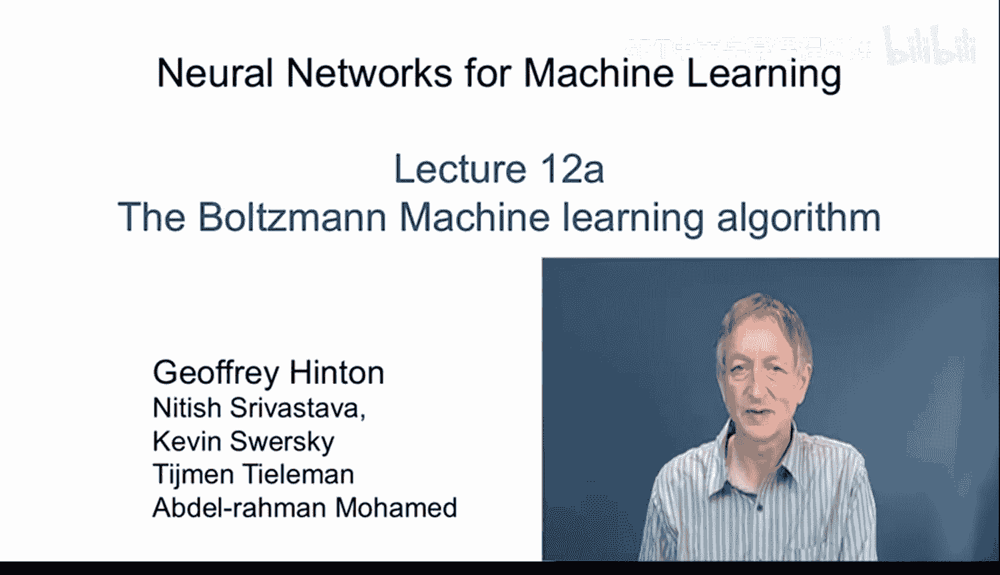
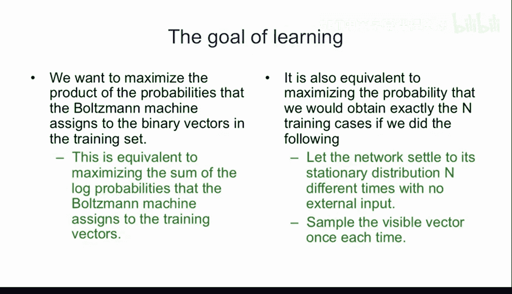
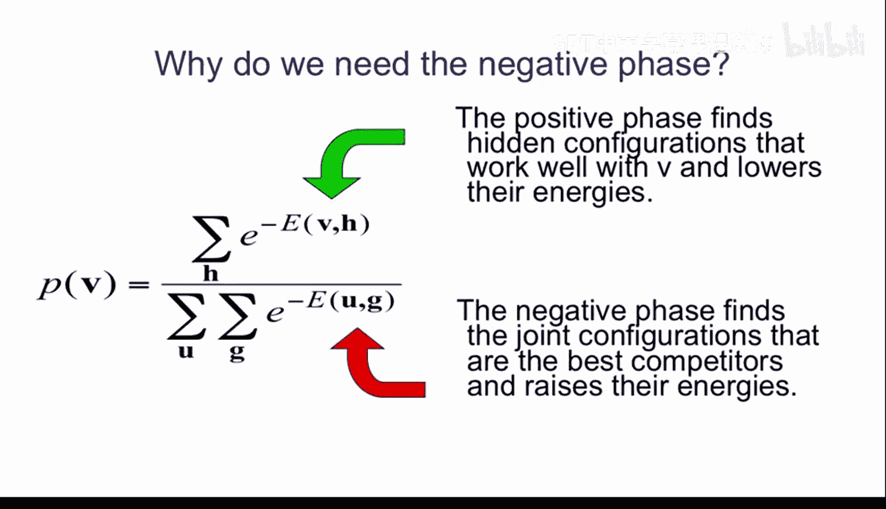
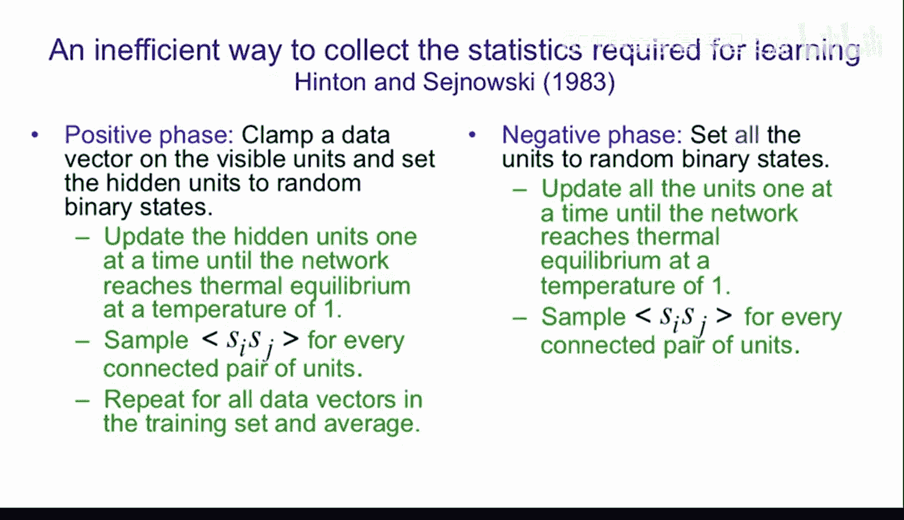

# 12.1：玻尔兹曼机学习算法 🔍

在本节课中，我们将学习玻尔兹曼机的学习算法。这是一个具有优雅理论基础的简单学习规则，但在实践中曾被认为效率低下。我们将探讨其工作原理、数学形式以及实际应用中的挑战。

## 概述

上一节我们介绍了玻尔兹曼机如何作为二进制数据向量的概率模型。本节中，我们来看看玻尔兹曼机的学习算法。

## 学习算法基础

玻尔兹曼机学习算法是一种无监督学习算法。与使用反向传播的典型场景不同（在反向传播中我们提供输入向量和期望输出），在玻尔兹曼机学习中，我们只提供输入向量，没有标签。

算法的目标是建立一组输入向量的模型（更准确地说，可以将其视为输出向量）。我们希望最大化玻尔兹曼机分配给训练集中二进制向量的概率乘积。这等价于最大化玻尔兹曼机分配给训练向量的对数概率之和。

## 学习困难与解决方案

学习过程可能面临许多困难，其中最重要的原因可以通过以下示例理解：

考虑一个隐藏单元链，两端连接着可见单元。如果训练集包含`[1,0]`和`[0,1]`（即我们希望两个可见单元处于相反状态），实现这一目标的方法是确保所有权重的乘积为负。

这意味着，在考虑学习权重`W1`时，我们需要知道其他权重（如`W3`）的信息。令人惊讶的是，存在一个非常简单的学习算法，且该算法只需要局部信息。

## 学习规则推导

实际上，每个权重需要了解的所有其他权重和数据信息，都包含在两个相关性的差异中。换句话说，如果我们取玻尔兹曼机分配给可见向量`V`的对数概率，并求其对权重`W_ij`的导数，结果是两个期望值的差：

**公式：** `∂logP(V)/∂W_ij = ⟨s_i s_j⟩_data - ⟨s_i s_j⟩_model`

其中：
- 第一项：当网络在可见单元上固定`V`并达到热平衡时，单元`i`和`j`状态乘积的期望值
- 第二项：当没有固定任何数据，网络在无外部干扰下达到热平衡时，相同两个单元状态乘积的期望值

因此，权重的变化可以设置为与这两个项的差成比例。

## 学习规则解释

这是一个非常有趣的学习规则。第一项表示：按呈现数据时单元活动的乘积比例增加权重。这是赫布学习规则的最简单形式。

但如果只使用这一规则，突触强度会不断增强，所有权重都会变得非常正，整个系统会失控。学习算法通过使用第二项来保持控制：按从模型分布中采样时这两个单元同时激活的频率比例减少权重。

## 理论依据

一个明显的问题是：为什么导数如此简单？原因在于，在热平衡时全局配置的概率是其能量的指数函数：`P ∝ e^(-E)`。

能量函数在权重上是线性的，因此权重和对数概率之间存在线性关系。具体来说，能量对特定权重`W_ij`的导数正好是该权重连接的两个活动的乘积。

## 正负相的作用

正相学习规则的第一项是减小求和式中已经较大的项的能源，它通过固定向量`V`达到热平衡来找到这些项。负相学习则对配分函数（归一化项）做同样的事情：找到给出低能量的全局配置，然后尝试提高它们的能量，使它们贡献更少。

因此，第一项使分子变大，第二项使分母变小。

## 统计收集方法

为了运行这个学习规则，需要收集两种统计量：正统计量（当数据固定在可见单元上时）和负统计量（当没有固定数据时，用于"反学习"）。

以下是收集这些统计量的低效方法：

**正相收集步骤：**
1. 将数据向量固定在可见单元上
2. 将隐藏单元设置为随机二进制状态
3. 一次更新一个隐藏单元，直到网络在温度为1时达到热平衡
4. 采样两个单元同时激活的频率
5. 对所有可见向量重复此过程

**负相收集步骤：**
1. 不固定任何数据，网络不受外部干扰
2. 将所有单元（可见和隐藏）设置为随机二进制状态
3. 一次更新一个单元，直到网络在温度为1时达到热平衡
4. 采样每对单元`i`和`j`的相关性
5. 多次重复此过程

## 实践挑战

在负相中，期望能量景观有许多不同但能量相近的最小值。这是因为我们使用玻尔兹曼机来建模像图像集合这样的数据，期望存在多个合理的图像（都具有相似的低能量）和许多不合理的高能量图像。

因此，只有一小部分空间是这些低能量状态，而大部分空间是糟糕的高能量状态。当存在多个模式时，不清楚需要重复这个过程多少次才能充分采样这些模式。

## 总结

本节课中我们一起学习了玻尔兹曼机学习算法的基本原理。我们了解到该算法通过正相（数据固定）和负相（自由运行）的统计差异来更新权重，从而学习数据的概率分布。虽然基础算法理论上优雅，但在实践中存在采样效率低下的问题，这为后续改进算法提供了方向。