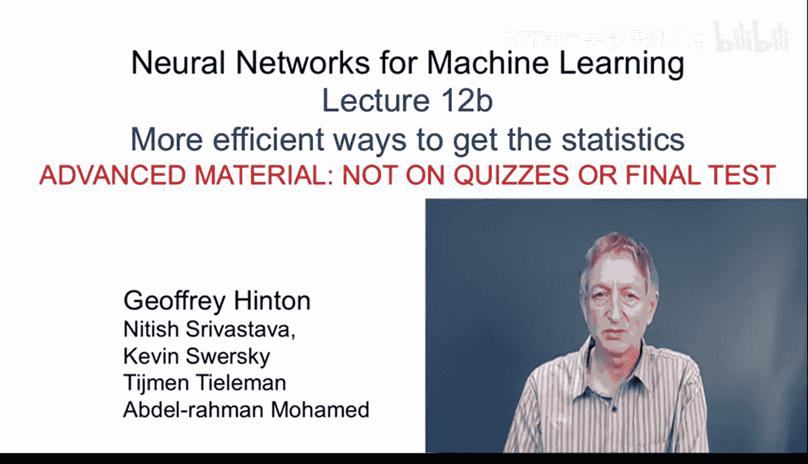
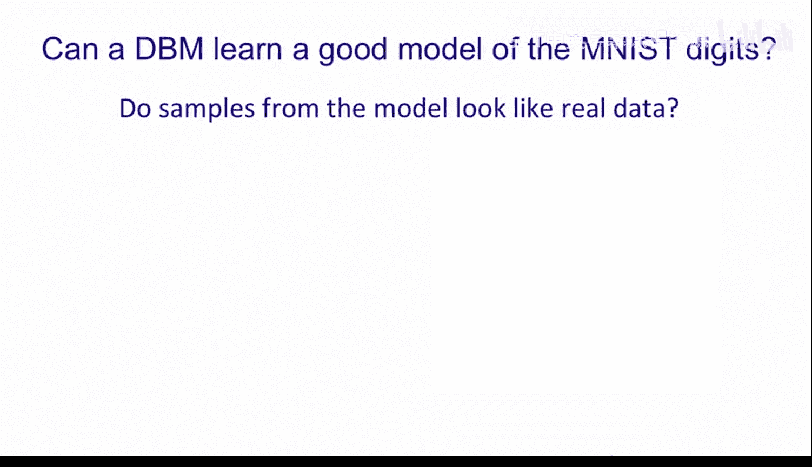
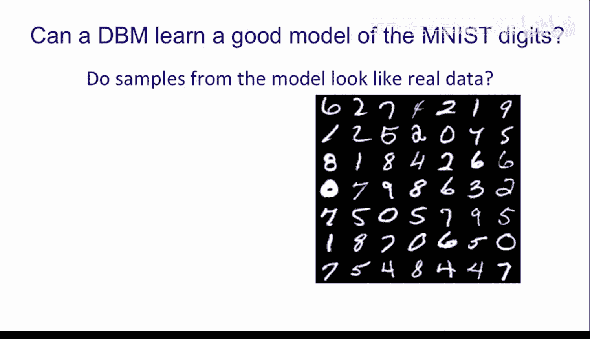
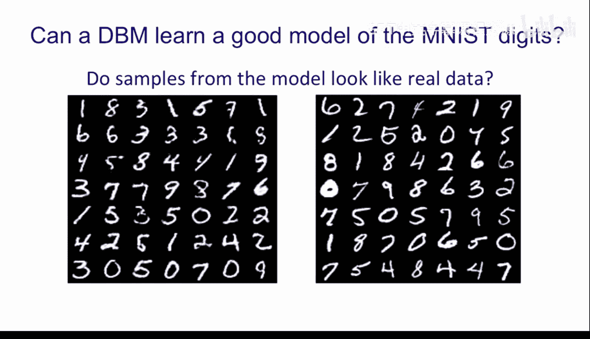
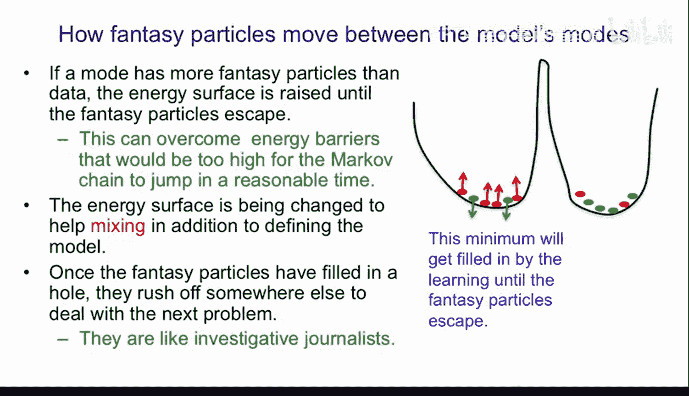

# 12.2：获取统计量的更高效方法 🔍

在本节课中，我们将深入探讨如何通过巧妙的方法，加速玻尔兹曼机的学习算法。具体来说，我们将学习如何让马尔可夫链保持在平衡分布附近，以及如何使用所谓的“平均场方法”。请注意，本节内容较为深入，不属于课程核心考核范围，初学者可以安全跳过。本教程专为那些对深度玻尔兹曼机高效工作原理感兴趣的学习者准备。

## 概述 📋

传统的玻尔兹曼机学习算法在收集统计量时效率较低。本节将介绍两种改进方法：使用持久化粒子进行“热启动”，以及基于“单模态”假设的平均场近似法。这些方法能显著提升学习速度，尤其是在处理深度架构时。

## 持久化粒子方法 🔄

上一节我们介绍了基础的学习算法，本节中我们来看看如何通过“持久化粒子”来更高效地收集统计量。

特瑞诺夫斯基和我最初提出的方法存在两个问题：从随机状态开始可能需要很长时间才能达到热平衡；并且无法轻易判断是否已达到平衡。因此，我们不知道需要运行链多久。

核心思想是：为什么不从上一次看到特定数据向量时结束的状态开始呢？我们记住数据向量在隐藏单元中的解释（即状态），并从此处开始。这个存储的状态被称为一个“粒子”。

使用持久化的粒子能提供一个“热启动”，并带来巨大优势：如果之前处于平衡状态，并且权重只更新了一点点，那么只需要对粒子中的单元进行几次更新，就能使其回到平衡状态。

我们可以为两个阶段都使用粒子：在正相阶段（当数据向量被钳制时）和在负相阶段（当没有钳制时）。

以下是拉福德·尼尔在1992年引入的收集统计量的方法：

在正相阶段，你有一组数据特定的粒子。每个训练案例对应一个或几个粒子。每个粒子都有一个当前值，即隐藏单元的配置以及与之关联的数据向量。你在每个粒子中，将相关数据向量钳制住，然后对所有隐藏单元进行几次顺序更新。接着，对于每一对相连的单元，你在所有这些粒子上平均两个单元同时开启的概率。

在负相阶段，你保留一组幻想粒子。这些是全局配置。同样，在每次权重更新后，你在每个幻想粒子中对所有单元进行几次顺序更新（此时也会更新可见单元）。然后，对于每一对相连的单元，你在所有幻想粒子上平均 `S_i * S_j` 的值。

学习规则是：权重的变化量与（在所有训练数据上平均得到的“数据平均”）和（在无钳制时幻想粒子得到的“幻想平均”）之差成正比。

这种方法比我和特瑞诺夫斯基引入的学习规则效果更好，至少对于全批次学习是如此。然而，这种方法难以应用于小批次学习。

原因是：如果我们使用小批次学习，等到再次看到同一个数据向量时，权重已经被更新了很多次。因此，为该数据向量存储的数据特定粒子，在新的权重下，将不再接近热平衡。我们也不知道需要再运行多久才能重新接近平衡。

## 平均场近似法 ⚖️

为了解决小批次学习的问题，我们可以对世界的理解做出一个强假设。这是一种认识论上的假设：我们假设当一个数据向量被钳制时，好的解释集合（即作为该数据向量解释的隐藏单元状态）是单模态的。

这意味着，对于一个给定的数据向量，不存在两种非常不同的解释。我们假设对于感官输入，存在一个正确的解释。如果我们有一个好的数据模型，我们的模型会为该数据点给出一个能量最小值。

这是对我们愿意学习模型种类的一种限制。我们将使用一种无法学习“一个数据向量具有多种非常不同解释”的模型的学习算法。

只要我们愿意做出这个假设，我们就可以使用一种非常高效的方法来接近热平衡（或热平衡的近似）。这被称为平均场近似。

为了获得正确的统计量，我们需要随机且顺序地更新单元。更新规则是：单元`i`开启的概率是它从其他单元接收的总输入及其偏置的逻辑斯蒂函数。这里，`S_j`（另一个单元的状态）是一个随机的二值量。

现在，我们不使用那个规则，而是说：我们不为单元`i`保留二值状态，而是保留一个0到1之间的实数值，我们称之为概率。这个概率在时间`T+1`将是逻辑斯蒂函数的输出，输入是偏置加上所有其他单元在时间`T`的概率乘以权重的总和。

因此，我们用实值概率替换了这个随机的二值量。这并不完全正确，因为这个随机的二值量位于一个非线性函数内部。如果它是线性函数，那就没问题。但由于逻辑斯蒂函数是非线性的，当我们在内部放入概率而不是波动的二值量时，我们得不到正确答案。

然而，它效果相当好。它可能会因为给我们双相振荡而出错，因为现在我们要并行更新所有东西。我们通常可以通过使用所谓的阻尼平均场来处理这些振荡。在阻尼平均场中，我们计算`P_i(T+1)`，但我们不会完全到达那里，而是前往当前位置和更新规则指示位置之间的一个点。具体来说，我们会前往 `λ * 当前位置 + (1 - λ) * 更新规则指示的位置`，这将消除振荡。

现在，我们可以为玻尔兹曼机获得一个高效的小批次学习过程。这是鲁斯·萨拉赫丁诺夫意识到的方法。

在正相阶段，我们可以将所有概率初始化为0.5。我们将数据向量钳制在可见单元上。然后，我们使用平均场并行更新所有隐藏单元，直到收敛。对于平均场，当概率停止变化时，你就可以识别出收敛。一旦收敛，我们为每一对相连的单元记录 `P_i * P_j`。

在负相阶段，我们做之前做的事情。我们保留一组幻想粒子，每个粒子都有一个作为全局配置的值。在每次权重更新后，我们在每个幻想粒子中顺序更新所有单元几次。然后，对于每一对相连的单元，我们在所有幻想粒子上平均这些随机的二值量 `S_i * S_j`。这些平均值之间的差异就是学习规则。也就是说，我们按与该差异成正比的量改变权重。

## 深度玻尔兹曼机架构 🏗️

如果我们想让幻想粒子的更新更加并行，我们可以改变玻尔兹曼机的架构。

我们将采用一种特殊的架构，允许对幻想粒子进行交替并行更新。我们在同一层内没有连接，也没有跨层跳跃连接，但我们允许自己有很多隐藏层。因此，架构看起来像这样。我们称之为深度玻尔兹曼机。它实际上是一个带有许多缺失连接（所有跳跃连接）的通用玻尔兹曼机。如果这些连接存在，我们就没有真正的层了，它将只是一个通用的玻尔兹曼机。

但在这种特殊架构中，我们可以做一些很好的事情。例如，给定可见单元和第二隐藏层的当前状态，我们可以更新第一隐藏层和第三隐藏层的状态。然后我们可以更新可见单元和第二隐藏层的状态。然后我们可以返回并更新其他状态，如此反复。因此，我们可以并行更新所有单元的一半状态，这将是一个正确的更新。

那么一个问题来了：如果我们有一个像那样的深度玻尔兹曼机，通过使用平均场进行正相，并通过在负相中交替更新偶数和奇数层来更新幻想粒子进行训练，我们能否学习到像MNIST数字甚至更复杂事物的良好模型？

判断是否学到了一个好模型的一种方法是：在学习之后，你移除所有输入，只从你的模型中生成样本。你运行马尔可夫链很长时间直到它“燃烧”完成，然后查看你得到的样本。鲁斯·萨拉赫丁诺夫使用深度玻尔兹曼机，通过平均场进行正相，以及通过交替更新粒子各层进行负相，来建模MNIST数字。

真实数据看起来是这样的。而他从模型中得到的数据看起来是这样的。你可以看到它们实际上相当相似。模型产生的东西非常像MNIST数字。所以它学到了一个相当好的模型。

## 一个有趣的谜题与洞察 🧩

这里有一个谜题：当他学习时，他使用的是包含100个数据示例的小批次，并且也使用了100个幻想粒子。同样的100个幻想粒子用于每一个小批次。

谜题是：我们如何仅用100个负样本来表征整个空间的负统计量？对于所有有趣的问题，全局配置空间将是高度多模态的。我们如何设法仅用100个粒子来找到并代表所有的模式？

对此有一个有趣的答案：学习过程与用于收集负统计量的马尔可夫链（即用于更新幻想粒子的链）相互作用。这种相互作用使其具有更高的有效混合率。

这意味着，我们不能通过认为存在一个更新权重的外循环和一个在固定权重下收集统计量的内循环来分析学习过程。学习正在影响那个内循环的有效性。

原因是：每当幻想粒子的数量超过正数据时，能量表面就会被抬高。这对马尔可夫链的混合率有影响。它使得幻想粒子过度活跃地四处奔走，它们移动的速度比由当前静态权重定义的马尔可夫链的混合率快得多。

下面这张图展示了正在发生的情况：如果能量表面中有一个模式拥有的幻想粒子比数据多，那么能量表面将被抬高，直到幻想粒子逃离那个模式。因此，左边的模式有四个幻想粒子和只有两个数据点。所以学习的效果将是抬高那里的能量。那个能量壁垒对于我们的马尔可夫链来说可能太高而无法跨越，因此混合率会非常慢。但学习实际上会通过抬高最小值，将这些红色粒子从那个能量最小值中“溅出”。它会被填满，幻想粒子会逃离并去往其他地方的其他深最小值。

因此，我们可以逃离马尔可夫链无法逃离的最小值（至少在合理时间内）。所以这里发生的是，能量表面实际上被用于两个不同的目的：能量表面代表我们的模型，但它也被学习算法操纵，以使马尔可夫链混合得更快，或者更准确地说，达到更快混合的马尔可夫链的效果。

一旦幻想粒子填满了一个“坑”，它们就会冲向下一个地方去处理下一个问题。一个类比是：它们就像调查记者，一旦某个糟糕问题因曝光而被解决，它们不会说“哦，现在一切都好了”，而是立即冲去寻找下一个糟糕问题。

## 总结 ✨

本节课中我们一起学习了提升玻尔兹曼机学习效率的两种高级策略。首先，**持久化粒子方法**通过“热启动”加速了马尔可夫链达到平衡的过程，尤其适用于全批次学习。其次，基于**单模态假设的平均场近似法**，通过用概率值代替二值状态并进行并行更新，为小批次学习提供了高效的解决方案。我们还探讨了**深度玻尔兹曼机**的特殊架构如何支持交替并行更新，并揭示了学习过程与幻想粒子马尔可夫链之间有趣的相互作用——学习本身能抬高能量面，帮助粒子逃离局部极小值，从而间接加速了混合过程。这些方法使得训练更深的模型并获取有意义的生成样本成为可能。