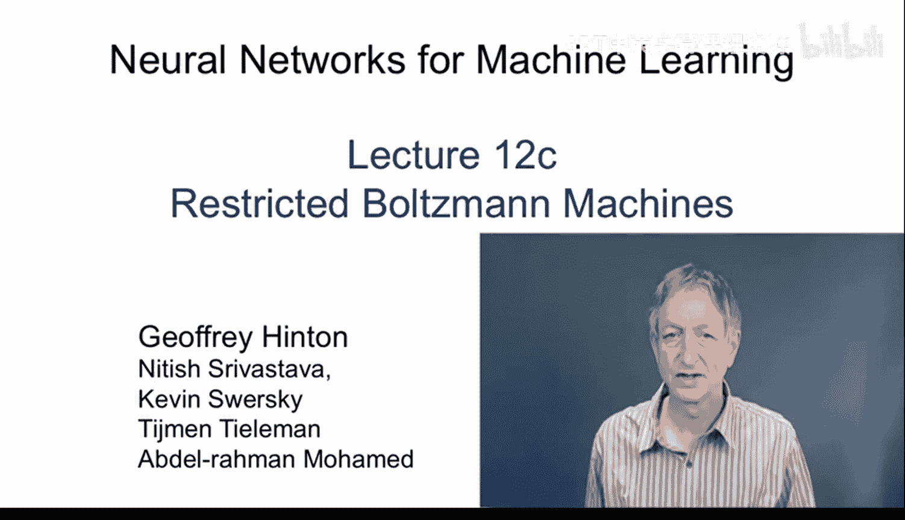
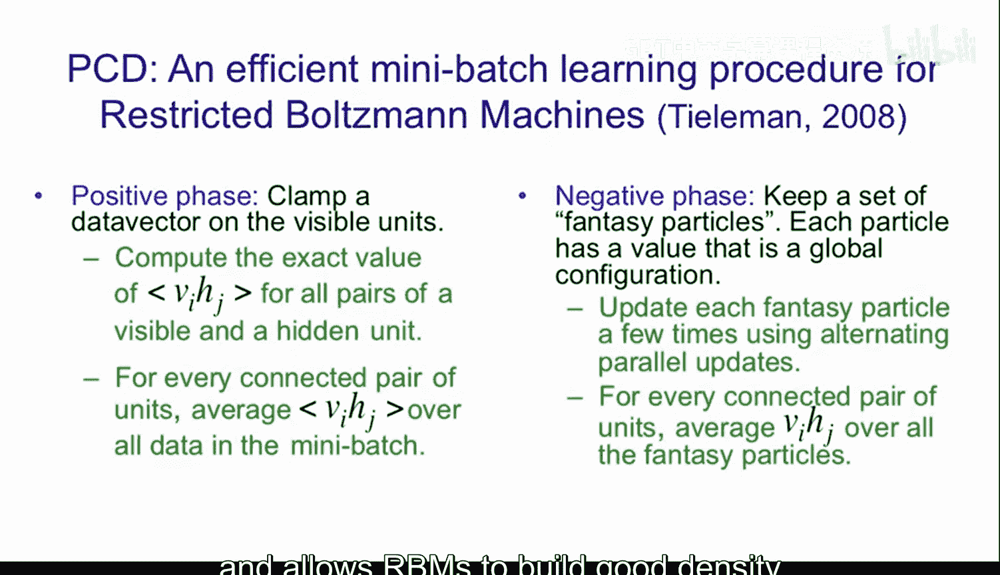
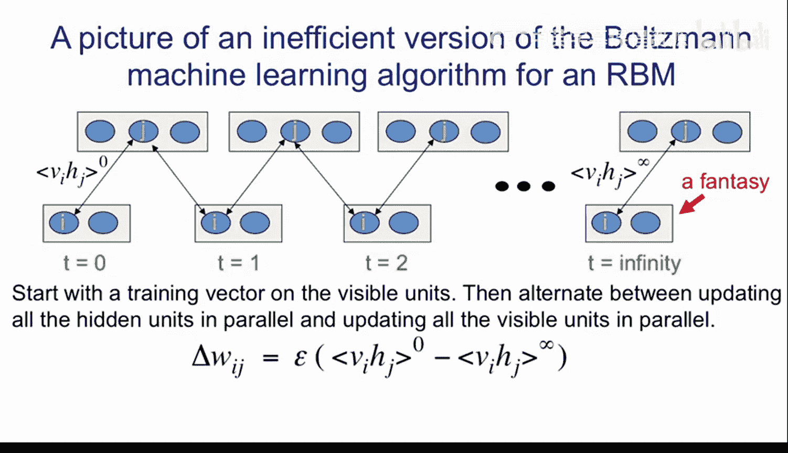
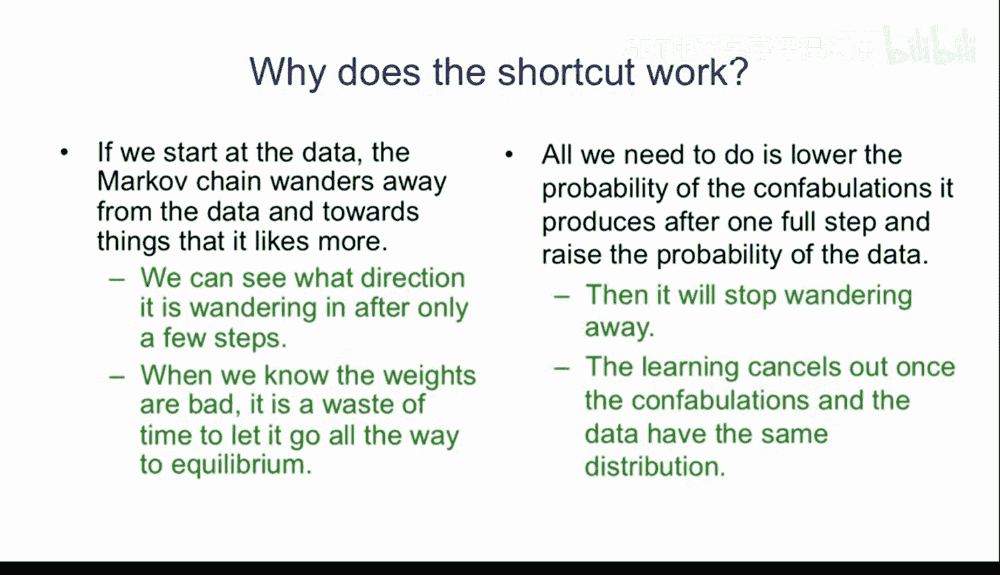
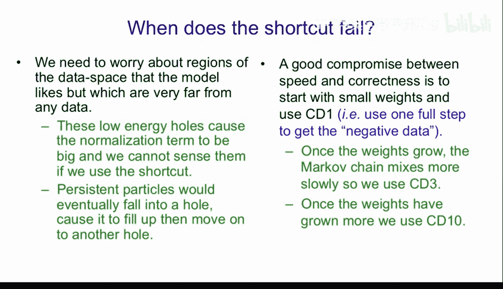

# 12.3：受限玻尔兹曼机 🧠

在本节课中，我们将要学习一种名为“受限玻尔兹曼机”的神经网络模型。这种模型具有简化的架构，使得学习和推断过程变得更加容易。我们将从它的基本结构开始，逐步深入到其高效的学习算法。

## 概述

受限玻尔兹曼机是一种简化的玻尔兹曼机。它的主要特点是隐藏单元之间没有连接。这种结构使得在给定可见单元状态时，能够非常容易地计算出隐藏单元的平衡分布。

## 架构与优势

上一节我们介绍了玻尔兹曼机的基本概念，本节中我们来看看受限玻尔兹曼机的具体结构。

在受限玻尔兹曼机中，我们通过限制网络的连接性来简化推断和学习过程。它只有一层隐藏单元，并且隐藏单元之间没有连接。可见单元之间也没有连接。因此，其架构看起来是一个二分图：包含两个部分，每个部分内部没有连接。

RBM的一个优点是，如果你将一个数据向量固定在可见单元上，你可以一步就达到热平衡。这意味着在数据向量固定的情况下，我们可以快速计算 `V_i H_j` 的期望值。因为我们可以精确计算第 `j` 个隐藏单元激活的概率，并且这个概率独立于隐藏层中的所有其他单元。

第 `j` 个隐藏单元激活的概率，仅仅是它从可见单元接收到的输入的逻辑函数，完全独立于其他隐藏单元在做什么。因此，我们可以并行计算所有隐藏单元的概率，这是一个巨大的优势。

## 构建密度模型的算法

如果你想为一组二进制向量建立一个好的模型，那么用于受限玻尔兹曼机的正确算法是由Tieleman在2008年提出的，它基于Neil的早期工作。

以下是该算法的两个阶段：

*   **正相**：将一个数据向量固定在可见单元上。然后为所有可见单元和隐藏单元对计算 `V_i H_j` 的期望值。因为 `V_i` 是固定的，并且你可以精确计算 `P_j`，所以可以做到这一点。接着，对于每一对连接的单元，你在小批次的所有数据向量上平均 `V_i H_j` 的期望值。
*   **负相**：保留一组“幻想粒子”，即全局配置。然后通过使用交替并行更新，对每个幻想粒子进行几次更新。在每次权重更新后，你对幻想粒子进行少量更新，这应该能使它们回到接近平衡的状态。然后，对于每一对连接的单元，你在所有幻想粒子上平均 `V_i H_j`，从而得到你的负统计量。

这个算法实际上效果很好，并且允许RBM为二进制向量集建立良好的密度模型。

## 对比散度：一种更快的算法

现在，我将介绍一种学习算法，它在构建密度模型方面不如上一个算法好，但速度要快得多。我将从一个低效的受限玻尔兹曼机学习算法的图示开始。

我们首先将一个数据向量固定在可见单元上，我们称这个时间为 `t0`。给定这个可见向量，我们更新隐藏单元。我们为隐藏单元选择二进制状态，并测量所有相连的可见单元和隐藏单元对的 `V_i H_j` 期望值。我称之为 `V_i H_j 0`，表示这是在时间0测量的。

然后，我们使用隐藏向量并行更新所有可见单元。接着，再次并行更新所有隐藏单元。因此，时间 `t=1` 的可见向量，我们称之为“重构”或“一步重构”。我们可以继续以这种方式进行交替链式更新，并行更新可见单元和隐藏单元。

经过长时间运行后，我们将到达可见单元的某个状态，我称之为 `T∞`，表示需要很长时间，此时系统将处于热平衡。现在，在链运行很长时间后，我们可以测量 `V_i` 和 `H_j` 的相关性，我称之为 `V_i H_j ∞`。长时间后得到的可见状态，我称之为“幻想”。

那么学习规则很简单：我们通过学习率乘以 `V_i H_j` 在时间0和 `V_i H_j` 在时间∞的差值来改变权重 `W_ij`。当然，这个算法的问题在于，我们必须运行这个链很长时间才能达到热平衡。如果我们运行时间不够长，学习可能会出错。

## 惊人的捷径：对比散度

实际上，最后那句话非常具有误导性。事实证明，即使我们只运行链很短的时间，学习仍然有效。

以下是这个非常惊人的捷径：你只需要运行链：上、下、再上一次。也就是说，从数据生成一个隐藏状态，从该状态生成一个重构，再从该重构生成另一个隐藏状态。完成这些后，你测量统计量。

因此，我们不是使用在平衡时测量的统计量，而是使用在执行马尔可夫链一次完整更新后测量的统计量。学习规则与之前相同，只是计算起来要快得多。这显然不是在执行最大似然学习，因为我们用于负统计量的项是错误的。但尽管如此，学习效果相当好。

一个明显的问题是：为什么这个捷径有效？推理如下：如果我们从数据开始链，马尔可夫链会从数据游走开，趋向其平衡分布，即趋向于其初始权重比数据更喜欢的东西。我们可以在仅仅几步之后就看到它游走的方向。如果我们知道初始权重不是很好，那么一直走到平衡是浪费时间。我们知道如何改变权重来阻止它从数据游走开，而不需要一直走到平衡。

我们需要做的就是降低它在一次完整步骤后产生的重构（或心理学家称之为“虚构”）的概率，然后提高数据的概率。这将阻止它从数据游走开。一旦数据和它在一次完整步骤后到达的地方具有相同的分布，学习就会停止。

## 算法原理与权衡

以下是正在发生的情况图示：这是全局配置空间中的能量曲面。这是能量曲面上的一个数据点。从该数据点开始，我们运行马尔可夫链一个完整步骤，得到一个新的可见向量以及与之对应的隐藏向量。然后我们改变权重，以降低数据点的能量，并提高重构的能量。这样做的效果将是使曲面看起来像这样。你会注意到我们开始在数据处构建一个能量最小值。你还会注意到，远离数据的地方，情况与之前基本保持不变。

因此，只做一个完整步骤来获得重构的这个捷径，对于远离数据的地方是无效的。我们需要担心模型喜欢但远离任何数据点的数据空间区域。这些低能量“空洞”会导致归一化项变大，如果我们使用捷径，就无法感知到它们。如果我们使用持久粒子，记住它们的状态，并在每次更新后对它们进行更多次更新，那么它们最终会找到这些空洞。它们会进入空洞，而学习会导致空洞被填满。

速度与正确性之间的一个良好折衷是：从小权重开始，并使用CD1（即对比散度，使用一个完整步骤来获得负数据）。一旦权重增长了一些，马尔可夫链混合得更慢，现在我们可以使用CD3。一旦权重增长得更多，我们可以使用CD5、9或10。因此，通过随着权重增长而增加步骤数，我们可以保持学习效果相当好，即使马尔可夫链的混合率在下降。

## 总结

本节课中我们一起学习了受限玻尔兹曼机。我们了解了其简化的二分图结构如何使得推断变得高效，并深入探讨了两种主要的学习算法：一种基于幻想粒子的密度建模算法，以及更快速实用的对比散度算法。我们明白了CD算法通过近似负相统计量来加速学习，虽然理论上不完美，但在实践中非常有效，并且理解了通过逐步增加马尔可夫链的步数可以在学习速度和模型质量之间取得平衡。