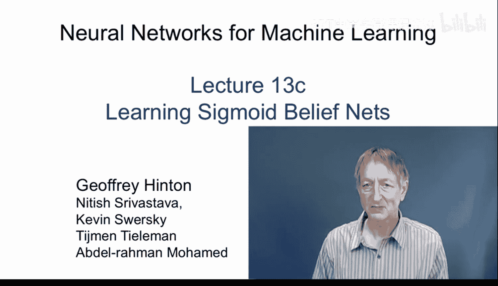
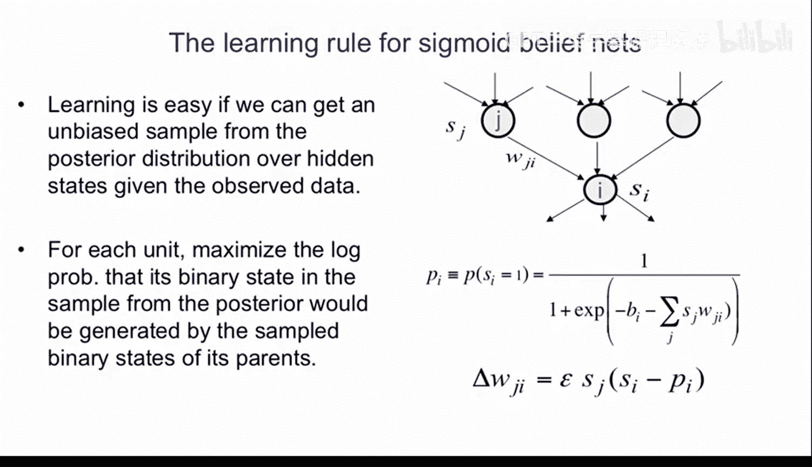
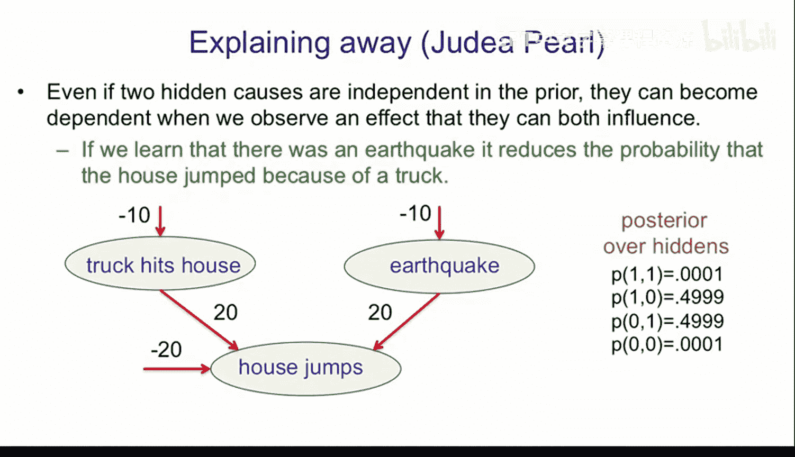
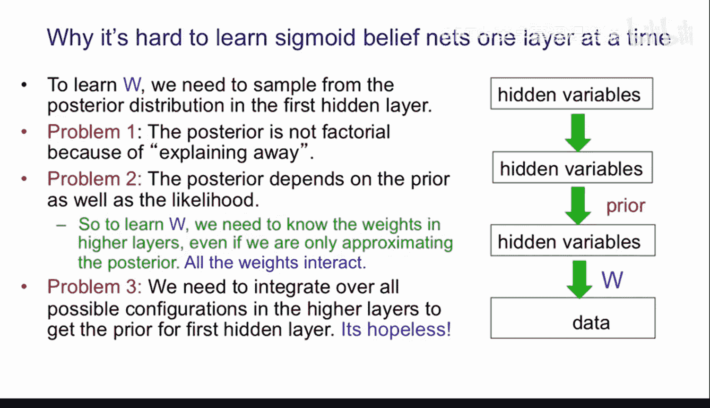
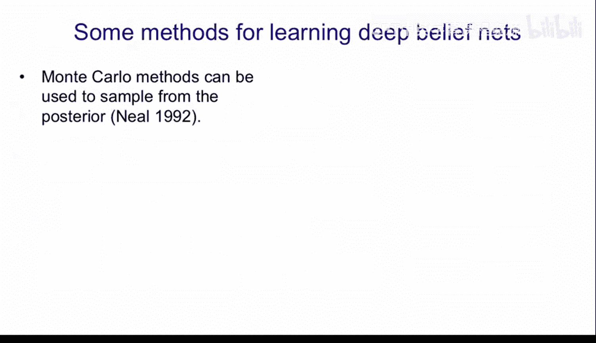
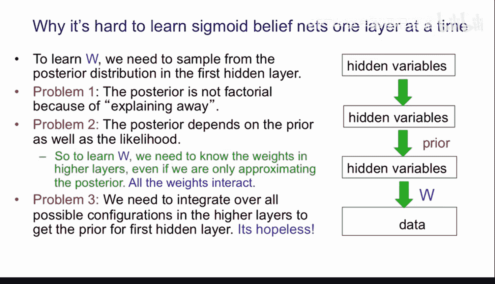
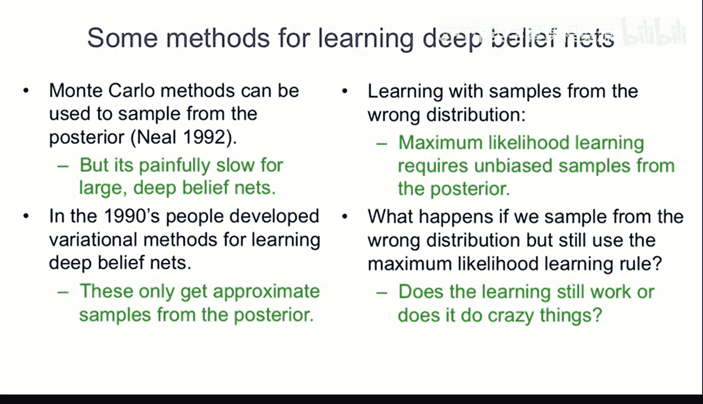

# 13.3：学习Sigmoid信念网络 🧠

在本节课中，我们将探讨学习Sigmoid信念网络为何困难。我们将首先理解其背后的核心挑战——“解释消除”现象，然后了解理想情况下的学习规则。最后，我们会简要介绍两种应对此挑战的学习方法。

## 学习Sigmoid信念网络的挑战

上一节我们介绍了Sigmoid信念网络的基本概念，本节中我们来看看学习这种网络时面临的主要困难。

学习Sigmoid信念网络的好消息是，与玻尔兹曼机不同，我们不需要两个不同的学习阶段，只需要玻尔兹曼机中的“正相”阶段。这是因为Sigmoid信念网络是所谓的**局部归一化模型**，因此我们无需处理配分函数或其导数。

另一个好消息是，如果我们能够从给定数据向量时隐藏单元的后验分布中获得无偏样本，那么学习将变得容易。也就是说，我们可以以一种小批量随机的方式，遵循最大似然学习指定的梯度进行学习。

问题在于，很难从隐藏单元的后验分布中获得无偏样本。这主要归因于朱迪亚·珀尔提出的“解释消除”现象。理解这一现象至关重要。

## 解释消除现象

现在，我们来深入探讨为什么学习Sigmoid信念网络很困难。我们已经看到，一旦完成学习（即确定了网络中的权重），生成无偏样本是容易的。我们可以通过从其模型中生成样本来轻松查看网络“相信”的事物类型。这是自上而下、逐层完成的，因为它是一个因果模型，所以很简单。

然而，即使我们知道权重，当我们观察到可见效应时，推断隐藏原因的后验分布也是困难的。原因在于，隐藏原因的可能模式数量随隐藏节点数量呈指数增长。甚至从后验中获取一个样本都很困难，而这正是我们进行随机梯度下降所需要的。

考虑到从后验中采样的这种困难，我们很难看出如何学习具有数百万参数的Sigmoid信念网络，而这正是我们希望做到的。请注意，这与通常用于图模型的范式非常不同。在图模型中，人们通常使用可解释的模型，并试图学习几十个或几百个参数，而不是数百万个。

## 理想情况下的学习规则

在探讨如何尝试从后验分布获取样本的方法之前，我们先了解一下如果我们能获得这些样本，学习规则是什么。

如果我们能从给定观测数据时隐藏状态的后验分布中获得一个无偏样本，那么学习就很容易。以下是Sigmoid信念网络的一部分。我们假设对于每个节点J，都有一个二进制值S_J。这个二进制值向量是网络的一个全局配置，它是来自后验分布的一个样本。

为了进行最大似然学习，我们需要做的就是最大化单元I的推断二进制状态由其父节点的推断二进制状态生成的对数概率。因此，学习规则是局部且简单的。

父节点将单元I激活的概率由一个逻辑函数给出，该函数涉及父节点的二进制状态。我们需要做的是使这个概率与I的实际观测二进制值相似。虽然这里不进行推导，但权重W_{JI}的最大似然学习规则很简单：按比例改变它，比例因子是J的状态乘以I的二进制状态与其父节点二进制状态将其激活的概率之差。

总结来说，如果我们有一个分配给所有隐藏节点的二进制状态，那么进行最大似然学习就很容易。我们可以采用典型的随机方式：从后验中采样，然后基于该样本更新权重，并在一个小批量样本上平均这个更新。

## 理解“解释消除”

让我们回到为什么难以从后验中采样的问题。其核心原因是一个称为“解释消除”的现象。

观察这个小型的Sigmoid信念网络，它有两个隐藏原因和一个观测效应。观察偏置项，你会发现除非其中一个原因为真，否则观测效应“房子跳跃”极不可能发生。但如果其中一个原因发生了，-20的偏置被抵消，房子跳跃的概率变为二分之一。

每个原因本身都相当不可能，但远不如房子自发跳跃那么不可能。因此，如果你看到房子跳跃，一个合理的解释是卡车撞了房子。另一个合理的解释是发生了地震。每个原因的概率约为e^{-10}，而房子自发跳跃的概率约为e^{-20}。然而，如果你假设两个隐藏原因同时发生，其概率为e^{-20}，即使房子确实跳跃了，这也极不可能。因此，假设发生了地震，会降低房子跳跃是因为卡车撞击的概率。当我们观察到房子跳跃时，两个隐藏原因之间就产生了反相关性。

在模型本身的先验中，这两个隐藏原因是相当独立的。所以如果房子跳跃了，基本上有均等的机会是因为卡车或是因为地震。后验实际上看起来是这样的：给定房子跳跃，隐藏原因有四种可能的模式。其中两种极不可能，即卡车撞房且发生地震，或者两者都没发生。另外两种组合的概率相等，你会注意到它们形成了一个“异或”关系。我们有两种可能的因果模式，它们彼此相反。这就是“解释消除”。

## 深度Sigmoid信念网络的学习难题

理解了“解释消除”后，让我们重新考虑学习深度Sigmoid信念网络的问题。

我们将有多层隐藏变量。在我们的因果模型中，它们会产生一些数据。我们想要学习数据与第一层隐藏变量之间的权重W。让我们看看学习W需要什么。

首先，第一层隐藏变量的后验分布不是因式分解的（即不是独立的）。这是因为“解释消除”。所以，即使我们只有那一层隐藏变量，一旦我们看到数据，它们也不会彼此独立。而且，因为我们有更高层的隐藏变量，它们甚至在先验中也不是独立的。那些更高层的隐藏变量创造了一个先验，这个先验本身会导致第一层隐藏变量之间的相关性。

为了学习W，我们需要知道第一隐藏层的后验，或者至少是它的一个近似。即使我们只是在近似它，为了计算那个先验项，我们也需要知道更高层的所有权重。实际上，情况甚至更糟，因为要计算那个先验项，我们需要**积分掉**更高层的所有隐藏变量。也就是说，我们需要考虑这些更高层中所有可能的活动模式，并将它们全部组合起来，以计算更高层为第一隐藏层创造的先验。计算这个先验是一件非常复杂的事情。

这三个问题表明，学习权重W将极其困难。特别是，如果不做大量高层工作来计算先验，我们将无法学习它们。

## 应对方法概述

现在，我们将考虑一些学习深度信念网络的方法。

第一种是拉福德·尼尔使用的蒙特卡洛方法。这种方法基本上完成了所有工作。也就是说，如果我们回到上一张幻灯片，它考虑了所有隐藏变量上的活动模式，并运行一个马尔可夫链。给定一个数据向量，这个链需要很长时间才能稳定下来。一旦它达到热平衡，你就可以从后验中获得一个样本，但这需要大量的计算工作。

在大型深度信念网络中，这种方法相当慢。在20世纪90年代，人们开发了更快的学习深度信念网络的方法，称为**变分方法**。实际上，这就是变分方法（至少对人工智能社区而言）的起源。

变分方法放弃了从后验获得无偏样本的目标，转而满足于仅获得近似样本，即来自某个近似后验的其他分布的样本。

正如我们之前所见，如果我们有来自后验的样本，最大似然学习是简单的。如果我们有来自其他分布的样本，我们仍然可以使用最大似然学习规则，但结果不确定。表面上，如果我们使用错误的分布来获取样本，可能会发生奇怪的事情。似乎没有任何保证情况会改善。

实际上，有一个保证：**某些东西会得到改善**。虽然不是模型生成数据的对数概率本身，但与之相关。事实上，它是该模型概率的一个**下界**。通过提升这个下界，我们通常也能提升对数概率。

---

本节课中我们一起学习了学习Sigmoid信念网络的核心挑战——“解释消除”现象，理解了理想情况下的最大似然学习规则，并初步认识了蒙特卡洛和变分这两种应对学习难题的主要方法框架。理解这些基础是掌握后续具体学习算法的关键。