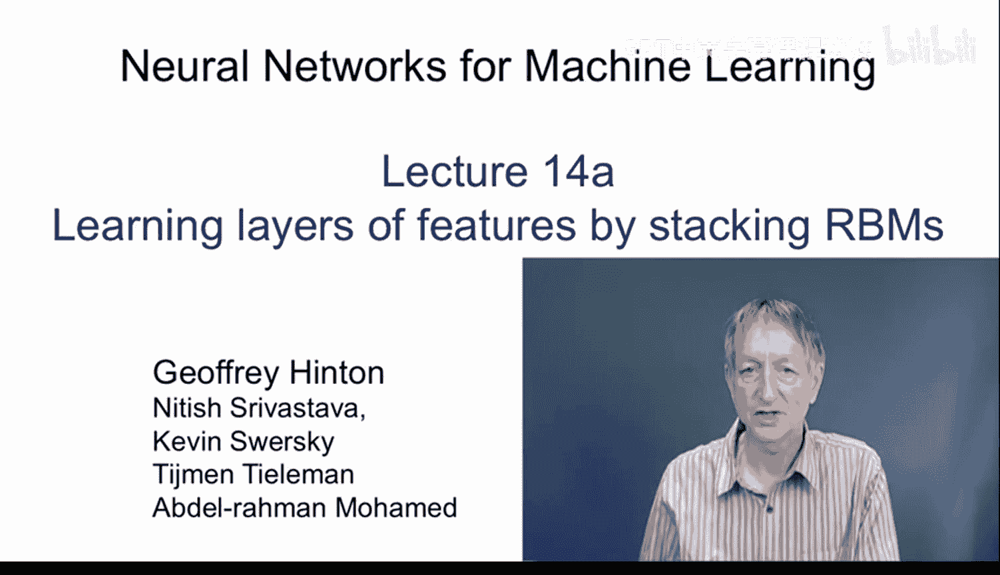
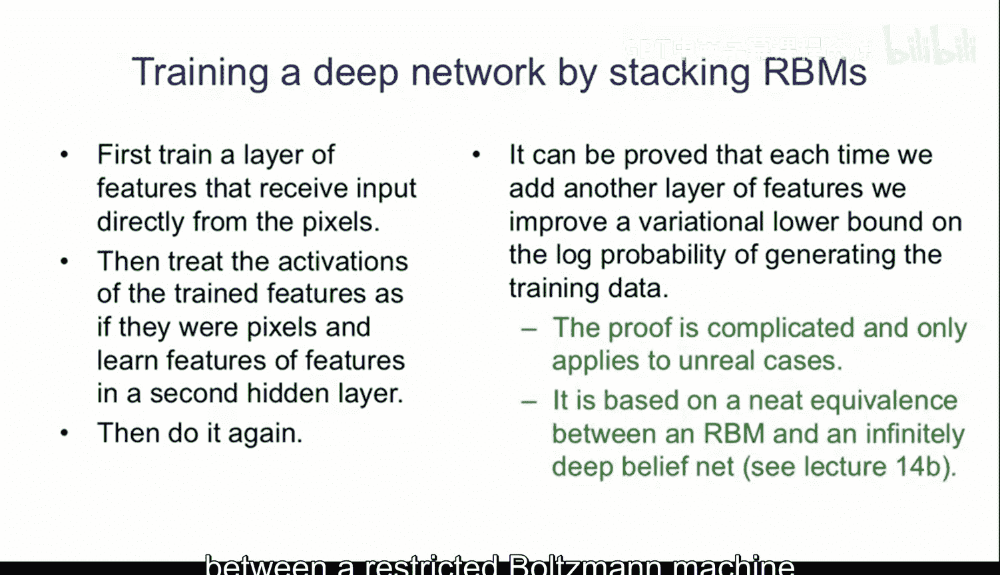
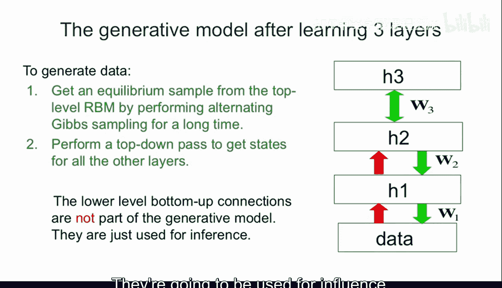
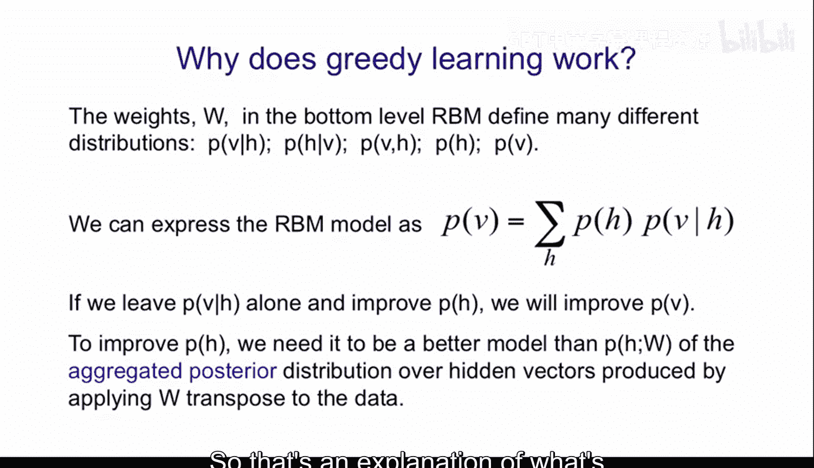
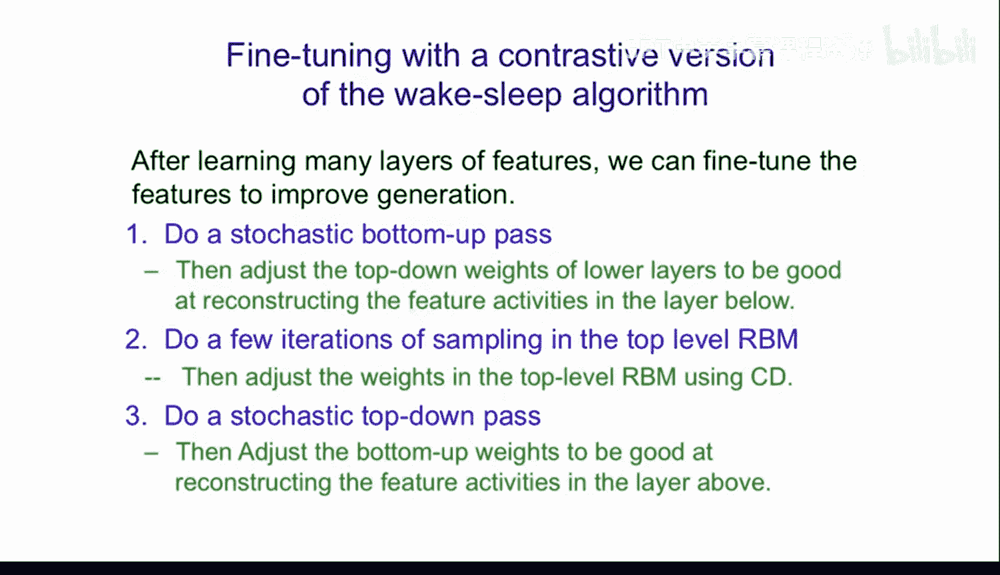
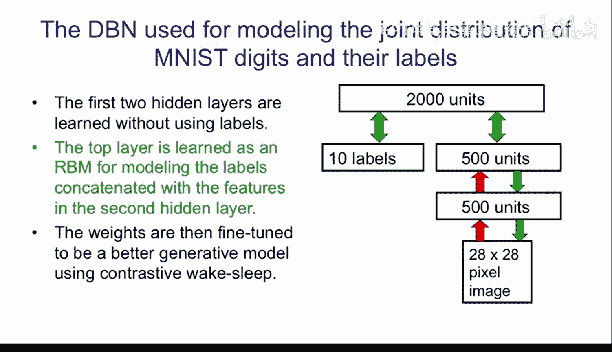

# 14.1：通过堆叠RBM学习特征层 🧠

在本节课中，我们将学习一种不同的方法来学习深度神经网络，即通过堆叠受限玻尔兹曼机来逐层学习非线性特征。这种方法意外地解决了深度Sigmoid信念网络的训练难题，并最终引发了深度神经网络研究的复兴。

## 从RBM到深度特征学习

上一节我们介绍了Sigmoid信念网络，本节中我们来看看一种不同的学习深度模型的方法。这个方法源于一个意外的发现：研究者放弃了直接学习有向的Sigmoid信念网络，转而研究无向的玻尔兹曼机，并发现受限玻尔兹曼机可以高效地学习。

受限玻尔兹曼机可以高效地学习一层非线性特征。一个很自然的想法是，将这些学习到的特征视为新的“数据”，然后应用另一个RBM来建模这些特征之间的相关性。我们可以继续这个过程，将一个RBM堆叠在另一个之上，从而学习多层非线性特征。

这种方法最终极大地推动了深度神经网络的研究兴趣。随之而来的问题是：一旦堆叠了多个RBM，每个RBM都学习前一层RBM产生的特征活动模式，那么我们是得到了一组独立的RBM，还是可以将它们组合成一个统一的模型？

一个合理的预期是，如果将一组RBM组合成一个模型，得到的结果应该是一个多层玻尔兹曼机。然而，一位名叫Geoffrey Hinton的研究生发现，结果并非如此。实际上，你得到的是一个看起来更像Sigmoid信念网络的东西。这是一个巨大的惊喜，因为我们通过放弃直接学习深度Sigmoid信念网络，转而专注于学习像玻尔兹曼机这样的无向模型，意外地解决了如何学习深度Sigmoid信念网络的问题。

## 堆叠RBM的过程 📚

以下是堆叠RBM学习多层特征的具体步骤：

1.  **训练第一层RBM**：使用高效的RBM学习算法，训练一层直接从像素接收输入的特征。
2.  **将特征激活视为数据**：将这些特征检测器的激活模式视为新的“像素”。
3.  **训练后续层**：在第二个隐藏层学习另一层特征，建模下层特征之间的相关活动。
4.  **重复堆叠**：可以按需重复此过程多次，每增加一层新特征，就建模其下一层特征的相关活动。

可以证明，每次添加新层时，都在改进某个组合模型生成数据的对数概率的变分下界。这个证明虽然复杂，并且只在理想条件下成立，但它表明这种堆叠RBM的做法是合理的。证明基于一个巧妙的等价关系：一个RBM等价于一个无限深的信念网络。

## 组合模型：深度信念网络

当我们学习两个堆叠的RBM，然后将它们组合成一个整体模型时，会发生什么？这个组合模型被称为**深度信念网络**。

首先，我们学习第一个RBM及其权重 `W1`。训练完成后，我们取该RBM在查看数据时的隐藏活动模式，并将每个隐藏活动模式视为训练第二个RBM的数据。我们只是将二进制状态复制到第二个RBM，然后学习第二个RBM的权重 `W2`。

一个有趣的现象是，如果我们初始化第二个RBM，使 `W2` 等于 `W1` 的转置，并且 `H2` 的隐藏单元数量与 `V` 相同，那么第二个RBM已经是一个相当好的 `H1` 模型，因为它只是第一个模型的倒置。对于一个RBM来说，哪边是可见层、哪边是隐藏层并不重要，它只是一个学习了模型的双向图。

学习完这两个RBM后，我们将它们组合成一个单一模型。这个单一模型看起来是这样的：它的**顶部两层**与顶部的RBM相同，是一个具有对称连接的无向模型。但它的**底部两层**是一个有向模型，就像一个Sigmoid信念网络。我们所做的是，取 `V` 和 `H1` 之间的对称连接，丢弃了向上的部分，只保留了向下的部分。这样做的原因相当复杂。

得到的组合模型显然不是玻尔兹曼机，因为它的底层连接不对称。它是一种我们称为深度信念网络的图模型，其中较低层就像Sigmoid信念网络，而顶部两层形成一个RBM。因此，它是一种混合模型。

如果我们堆叠三个RBM，会得到一个类似的混合模型：顶部两层仍然是RBM，下面的层则像Sigmoid信念网络一样是有向的。

## 从模型生成数据 🎲

从这个模型生成数据的正确流程如下：

1.  **顶层RBM采样**：首先，在 `H2` 和 `H3` 之间来回进行多次吉布斯采样，直到在顶层RBM中达到平衡。这涉及并行更新 `H3` 中的所有单元，然后并行更新 `H2` 中的所有单元，如此反复多次，直到从顶层RBM获得一个平衡样本。顶层RBM定义了 `H2` 的先验分布。
2.  **自上而下传递**：完成上述步骤后，只需使用生成连接 `W2` 从 `H2` 到 `H1` 进行一次传递。然后，无论你在 `H1` 中得到什么二进制模式，再使用权重 `W1` 进行一次传递以生成数据。

因此，我们执行一个从 `H2` 开始的自上而下的传递，以获取所有其他层的状态，就像在Sigmoid信念网络中一样。图中较低层显示的红色自下而上连接**不是生成模型的一部分**，它们实际上是对应权重的转置（即 `W1` 和 `W2` 的转置），将用于推断，但不属于模型本身。

## 贪婪学习为何有效？🔍

在解释为什么堆叠RBM是个好主意之前，需要理清“平均两个因式分解分布”意味着什么。你可能会惊讶地发现，如果我平均两个因式分解分布，我**不会**得到一个因式分解分布。这里的“平均”指的是取分布的**混合**：首先随机选择两个分布中的一个，然后从你选中的那个生成样本。

假设我们有一个包含四个隐藏单元的RBM。给定一个可见向量 `V1`，这四个隐藏单元的后验分布是因式分解的。假设分布是前两个单元开启的概率为0.9，后两个为0.1。因式分解意味着，例如，从这个分布中采样时，前两个单元同时开启的概率正好是 `0.9 * 0.9 = 0.81`。

现在假设有另一个输入向量 `V2`，相同四个隐藏单元的后验分布变为 `[0.1, 0.1, 0.9, 0.9]`。如果我们平均这两个分布，每个隐藏单元开启的平均概率确实是每个分布均值的平均，即 `[0.5, 0.5, 0.5, 0.5]`。但你得到的并不是由这四个概率定义的因式分解分布。以隐藏单元向量 `[1, 1, 0, 0]` 为例，在 `V1` 的后验中，其概率为 `0.9*0.9*0.1*0.1 = 0.0081`；在 `V2` 的后验中，这个向量极不可能，概率为 `0.1*0.1*0.9*0.9 = 0.0081`。平均这两个概率得到约 `0.0081`。这比一个均值为0.5的因式分解分布分配给该向体的概率 `0.5^4 = 0.0625` **要小得多**（注：此处原文计算和比较有误，根据上下文逻辑，意在说明混合分布非因式分解）。关键在于，当你平均两个因式分解的后验时，你得到的是一个**非因式分解的混合分布**。

现在，让我们看看为什么贪婪学习（先学一个RBM，再学第二个RBM来建模第一个RBM隐藏单元的活动模式）是有效的。

底层RBM的权重实际上以一致的方式定义了四种分布：
*   `P(v|h)`：给定隐藏单元时可见单元的概率。
*   `P(h|v)`：给定可见单元时隐藏单元的概率。
*   `P(v, h)`：联合分布。
*   `P(h)`：忽略 `v` 时，由该RBM定义的 `h` 的先验分布。
*   `P(v)`：忽略 `h` 时，由该RBM定义的 `v` 的先验分布。

我们将从这四种分布中选取一对令人惊讶的分布来定义模型。我们将RBM分配给可见向量 `v` 的概率定义为：
`P(v) = Σ_h P(h) * P(v|h)`
这看起来有点奇怪，因为定义 `P(h)` 和定义 `P(v)` 一样困难。尽管如此，我们就这样定义 `P(v)`。

现在，如果我们保持 `P(v|h)` 不变，但学习一个更好的 `P(h)` 模型（即学习一些新参数，给我们一个更好的 `P(h)` 模型），并用它代替我们原有的 `P(h)` 模型，那么我们实际上会改进我们对 `v` 的建模。这里“更好的 `P(h)` 模型”指的是一个能更好拟合**聚合后验**的先验。聚合后验是整个训练集中所有数据向量对应的隐藏层后验分布的平均。

我们要做的就是：使用我们的第一个RBM来获得这个聚合后验，然后使用我们的第二个RBM来构建一个比第一个RBM更好的聚合后验模型。如果我们把第二个RBM初始化为第一个RBM的倒置，那么它开始时对聚合后验的模型将与第一个RBM的相同，然后如果我们改变权重，只能使模型变得更好。这就是贪婪学习有效性的解释。

## 微调：对比唤醒-睡眠算法 ⚙️

堆叠RBM之后，一旦我们学习了一堆RBM并将它们组合成一个深度信念网络，我们就可以使用**对比唤醒-睡眠算法**的变体来微调整个复合模型。

首先，我们通过堆叠RBM来学习多层特征。然后，我们希望微调自下而上的识别权重和自上而下的生成权重，以获得更好的生成模型。我们可以通过使用三种不同的学习规则来实现：

1.  **自下而上传递与生成权重更新**：首先进行随机的自下而上传递。然后调整较低层的自上而下生成权重，使其擅长重建下一层的特征活动。这与标准的唤醒-睡眠算法中的“唤醒”阶段类似。
2.  **顶层RBM的对比散度学习**：在顶层RBM中，进行几次前向后向的吉布斯采样，采样该RBM的隐藏层和“可见”层（即下一层的激活）。然后使用对比散度学习更新该RBM的权重：利用数据首次到达该RBM时的相关性，与在该RBM内进行几次迭代后的相关性之间的差异来更新权重。
3.  **自上而下传递与识别权重更新**：然后，取该顶层RBM的“可见”单元（即其下一层的单元），从那里开始，使用有向的下层连接（即一个Sigmoid信念网络）进行一次随机的自上而下传递，生成一些数据。接着，调整自下而上的权重，使其擅长重建上一层的特征活动。这就是唤醒-睡眠算法中的“睡眠”阶段。

与标准唤醒-睡眠算法的不同之处在于：
*   顶层RBM作为对顶层活动的**更好的先验**，而不仅仅是Sigmoid信念网络中假设的独立单元层。
*   我们不是通过从先验采样来生成数据，而是观察一个训练案例，向上传播到顶层RBM，然后在生成数据之前只运行几次吉布斯采样迭代。

## 实例：手写数字识别 🔢

现在我们将看一个例子：首先学习一些堆叠的RBM，然后使用对比唤醒-睡眠算法进行微调，最后观察它作为生成模型和识别模型的效果。

首先，我们将使用500个二进制隐藏单元来学习建模28x28像素图像中的所有10个数字类别。我们**在没有标签的情况下**学习这个RBM（无监督学习）。然后，我们取这500个隐藏单元在查看数据时的活动模式，将这些活动模式视为数据，并学习另一个也有500个单元的RBM。前两个隐藏层都是在没有标签的情况下学习的。

之后，我们才告诉它标签。我们添加一个大的顶层，并给它10个标签。你可以认为我们将这10个标签与代表特征的500个单元连接起来，只不过这10个标签实际上是一个10维的softmax单元。然后，我们训练这个顶层RBM来建模这10个标签的softmax单元与由下面两层产生的500个特征活动的联合分布。

训练完顶层RBM后，我们可以使用对比唤醒-睡眠算法微调整个系统。这样我们就得到了一个非常好的生成模型，也就是在本课程介绍视频中展示的那个模型。在那个介绍视频中，你可以看到这个模型在运行时有多好，无论是识别还是生成。现在，你已经了解了这个模型是如何被学习出来的。

---

本节课中我们一起学习了如何通过堆叠受限玻尔兹曼机来逐层学习深度特征，从而构建深度信念网络。我们探讨了堆叠的过程、组合模型的原理、生成数据的方法、贪婪学习有效的理论解释，以及如何使用对比唤醒-睡眠算法进行微调。最后，通过一个手写数字识别的实例，我们看到了这种方法的实际应用和强大能力。