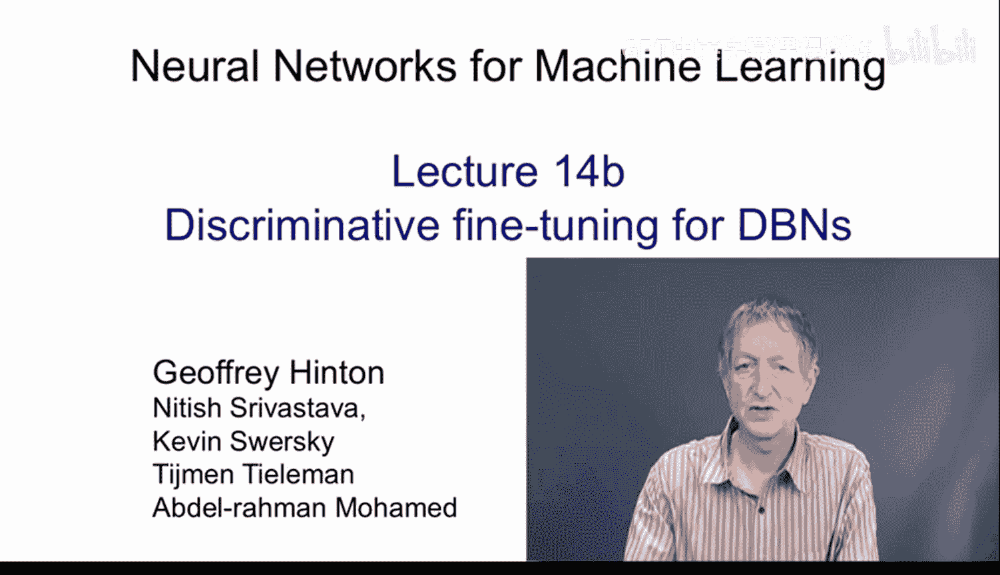
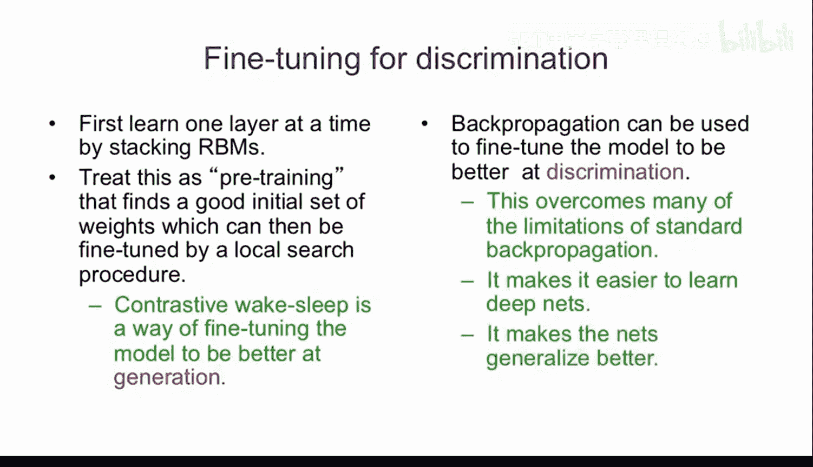
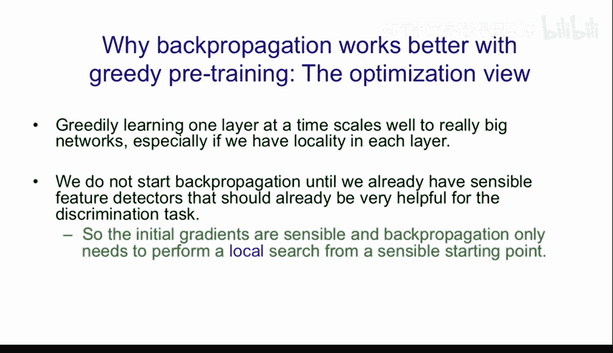
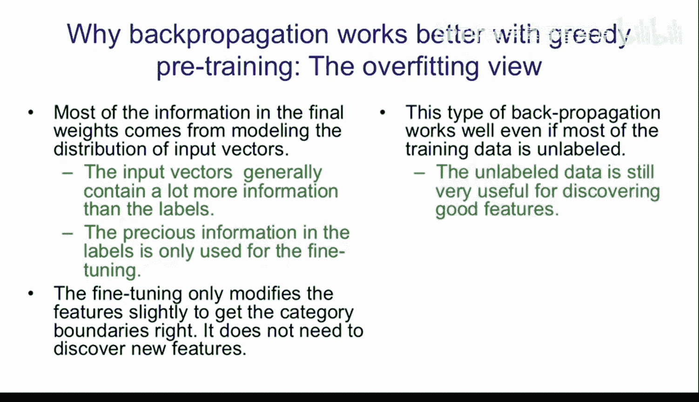
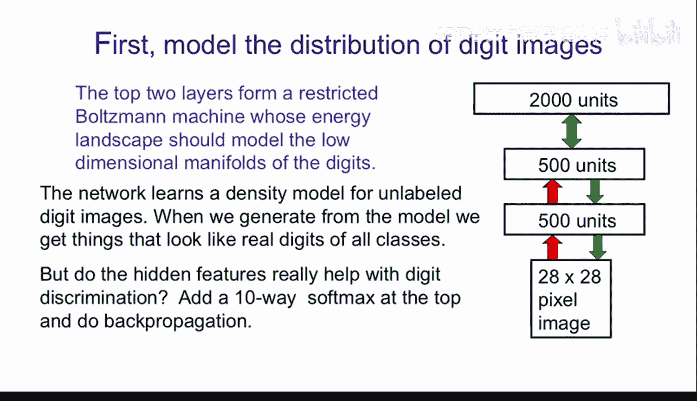
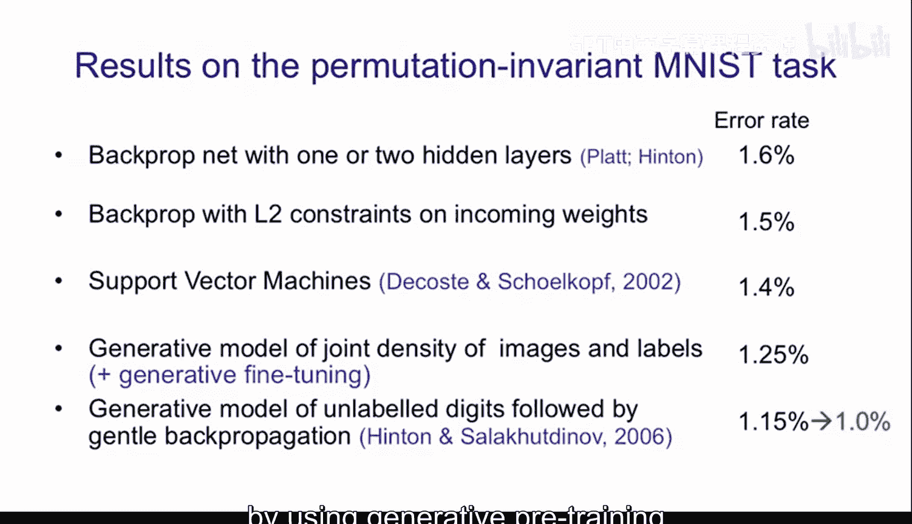
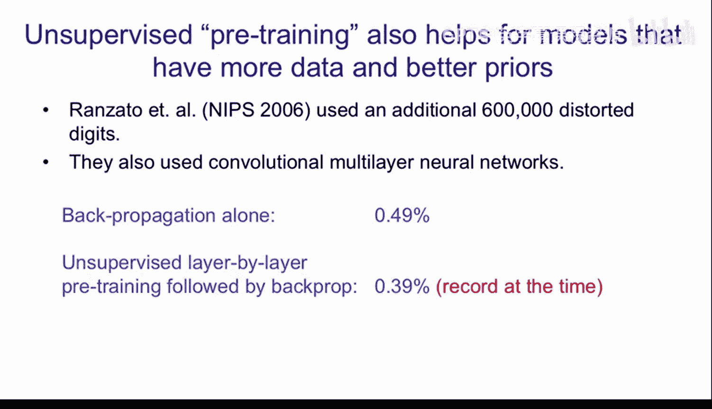
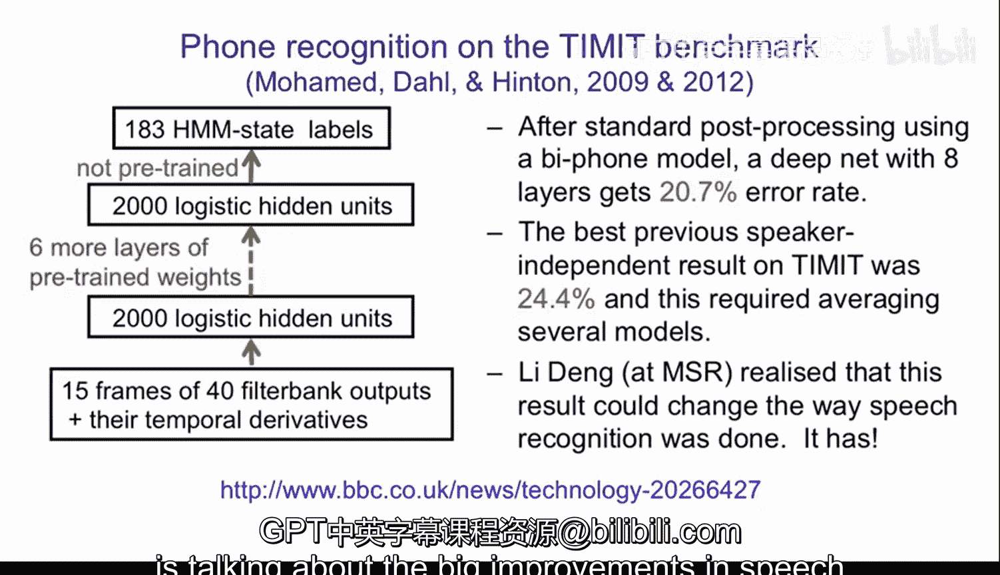

# 14.2：深度信念网络的判别式学习 🧠

在本节课中，我们将学习如何通过堆叠受限玻尔兹曼机来构建一个深度信念网络，然后将其视为一个深度神经网络，并进行判别式微调。我们将探讨这种方法为何有效，以及它如何克服传统反向传播的局限性，最终在图像识别和语音识别等任务上取得突破性成果。

上一节我们介绍了如何使用对比醒眠算法对深度网络进行生成式微调。本节中，我们来看看如何使用反向传播对模型进行判别式微调。

## 判别式微调的原理

首先，我们通过逐层堆叠受限玻尔兹曼机来学习特征。这被视为一种预训练，为深度神经网络找到一组良好的初始权重。随后，我们使用局部搜索程序（如反向传播）对这些权重进行微调，使其在分类任务上表现更好。

这种方法克服了反向传播的许多标准限制，使得学习深度网络变得更容易，并且这些网络的泛化能力也更强。

## 预训练为何有效：优化与泛化

我们需要理解为何在预训练权重后，反向传播的效果会更好。这主要归因于两个效应：**优化效应**和**泛化效应**。

**优化效应**：预训练具有良好的可扩展性，尤其是在每层具有局部连接性的大型网络中。例如，在处理视觉任务时，每层的局部感受野使得不同区域之间的交互很少，因此可以近乎并行地学习大型层。在开始反向传播之前，我们已经通过预训练学到了合理的特征检测器。这些特征检测器对判别任务非常有帮助，因此初始梯度比使用随机权重时更加合理。反向传播无需进行全局搜索，只需从一个合理的起点进行局部搜索。

**泛化效应**：除了易于优化，预训练的网络表现出更少的过拟合。这是因为最终权重中的大部分信息来自于对输入向量分布的建模。以图像为例，输入向量通常包含比标签多得多的信息。标签通常只包含少量信息来约束从输入到输出的映射，而图像则包含大量信息，这些信息会约束任何图像集合的生成模型。标签信息仅用于最终的微调阶段。由于到那时我们已经确定了特征检测器，因此不会浪费这些宝贵的信息从头开始设计特征检测器。微调只对我们生成式预训练阶段学到的特征检测器进行微小的调整，这些调整是为了将决策边界放置在正确的位置。关键在于，反向传播不需要去发现新的特征，因此它不需要那么多的标记数据。

事实上，这种学习方法在大多数数据未标记的情况下效果很好，因为生成式预训练可以利用所有这些数据，未标记的数据对于发现好的特征仍然非常有用。

## 对预训练的质疑与回应

对于这种学习方式，存在一个明显的质疑：当我们进行生成式预训练时，可能会学到许多对特定判别任务无用的特征。

例如，你可能希望网络区分不同的形状，或者区分同一形状的不同姿态，这需要非常不同的特征。如果你事先不知道任务是什么，你不可避免地会学到一些永远不会用到的特征。

在计算机规模较小的时代，这是一个严重的缺点。但现在计算机已经足够强大，我们可以负担得起学习一些永远不会用到的特征。这是因为在我们学到的所有特征中，总会有一些比原始输入更有用的特征，这足以弥补我们学到了一些对特定任务无用的特征这一事实。

## 应用于MNIST数字建模

现在，我们将这种方法应用于MNIST数字建模。我们将完全无监督地学习三层隐藏特征。完成学习后，当我们从模型中生成样本时，它会生成看起来像真实数字的图像，并且会生成来自所有不同类别的数字。它通常会在从一个类别切换到另一个类别之前停留一段时间，因为它倾向于在同一个“山谷”中停留一段时间，然后才跳转到另一个“山谷”。

但问题是，我们以这种方式学到的特征对执行判别任务有用吗？我们只需要在顶部添加一个最终的10路softmax层，并使用反向传播进行微调，然后看看是否比纯粹的判别式训练效果更好。

以下是关于MNIST数字建模的结果。

以下是关于MNIST数字建模的结果。

以下是关于MNIST数字建模的结果。

以下是关于MNIST数字建模的结果。

以下是关于MNIST数字建模的结果。

以下是关于MNIST数字建模的结果。

以下是关于MNIST数字建模的结果。

以下是关于MNIST数字建模的结果。

以下是关于MNIST数字建模的结果。

以下是关于MNIST数字建模的结果。

以下是关于MNIST数字建模的结果。

以下是关于MNIST数字建模的结果。

以下是关于MNIST数字建模的结果。

以下是关于MNIST数字建模的结果。

以下是关于MNIST数字建模的结果。

以下是关于MNIST数字建模的结果。

以下是关于MNIST数字建模的结果。

以下是关于MNIST数字建模的结果。

以下是关于MNIST数字建模的结果。

以下是关于MNIST数字建模的结果。

以下是关于MNIST数字建模的结果。

以下是关于MNIST数字建模的结果。

以下是关于MNIST数字建模的结果。

以下是关于MNIST数字建模的结果。

以下是关于MNIST数字建模的结果。

以下是关于MNIST数字建模的结果。

以下是关于MNIST数字建模的结果。

以下是关于MNIST数字建模的结果。

以下是关于MNIST数字建模的结果。

以下是关于MNIST数字建模的结果。

以下是关于MNIST数字建模的结果。

以下是关于MNIST数字建模的结果。

以下是关于MNIST数字建模的结果。

以下是关于MNIST数字建模的结果。

以下是关于MNIST数字建模的结果。

以下是关于MNIST数字建模的结果。

以下是关于MNIST数字建模的结果。

以下是关于MNIST数字建模的结果。

以下是关于MNIST数字建模的结果。

以下是关于MNIST数字建模的结果。

以下是关于MNIST数字建模的结果。

以下是关于MNIST数字建模的结果。

以下是关于MNIST数字建模的结果。

以下是关于MNIST数字建模的结果。

以下是关于MNIST数字建模的结果。

以下是关于MNIST数字建模的结果。

以下是关于MNIST数字建模的结果。

以下是关于MNIST数字建模的结果。

以下是关于MNIST数字建模的结果。

以下是关于MNIST数字建模的结果。

以下是关于MNIST数字建模的结果。

以下是关于MNIST数字建模的结果。

以下是关于MNIST数字建模的结果。

以下是关于MNIST数字建模的结果。

以下是关于MNIST数字建模的结果。

以下是关于MNIST数字建模的结果。

以下是关于MNIST数字建模的结果。

以下是关于MNIST数字建模的结果。

以下是关于MNIST数字建模的结果。

以下是关于MNIST数字建模的结果。

以下是关于MNIST数字建模的结果。

以下是关于MNIST数字建模的结果。

以下是关于MNIST数字建模的结果。

以下是关于MNIST数字建模的结果。

以下是关于MNIST数字建模的结果。

以下是关于MNIST数字建模的结果。

以下是关于MNIST数字建模的结果。

以下是关于MNIST数字建模的结果。

以下是关于MNIST数字建模的结果。

以下是关于MNIST数字建模的结果。

以下是关于MNIST数字建模的结果。

以下是关于MNIST数字建模的结果。

以下是关于MNIST数字建模的结果。

以下是关于MNIST数字建模的结果。

以下是关于MNIST数字建模的结果。

以下是关于MNIST数字建模的结果。

以下是关于MNIST数字建模的结果。

以下是关于MNIST数字建模的结果。

以下是关于MNIST数字建模的结果。

以下是关于MNIST数字建模的结果。

以下是关于MNIST数字建模的结果。

以下是关于MNIST数字建模的结果。

以下是关于MNIST数字建模的结果。

以下是关于MNIST数字建模的结果。

以下是关于MNIST数字建模的结果。

以下是关于MNIST数字建模的结果。

以下是关于MNIST数字建模的结果。

以下是关于MNIST数字建模的结果。

以下是关于MNIST数字建模的结果。

以下是关于MNIST数字建模的结果。

以下是关于MNIST数字建模的结果。

以下是关于MNIST数字建模的结果。

以下是关于MNIST数字建模的结果。

以下是关于MNIST数字建模的结果。

以下是关于MNIST数字建模的结果。

以下是关于MNIST数字建模的结果。

以下是关于MNIST数字建模的结果。

以下是关于MNIST数字建模的结果。

以下是关于MNIST数字建模的结果。

以下是关于MNIST数字建模的结果。

以下是关于MNIST数字建模的结果。

以下是关于MNIST数字建模的结果。

以下是关于MNIST数字建模的结果。

以下是关于MNIST数字建模的结果。

以下是关于MNIST数字建模的结果。

以下是关于MNIST数字建模的结果。

以下是关于MNIST数字建模的结果。

以下是关于MNIST数字建模的结果。

以下是关于MNIST数字建模的结果。

以下是关于MNIST数字建模的结果。

以下是关于MNIST数字建模的结果。

以下是关于MNIST数字建模的结果。

以下是关于MNIST数字建模的结果。

以下是关于MNIST数字建模的结果。

以下是关于MNIST数字建模的结果。

以下是关于MNIST数字建模的结果。

以下是关于MNIST数字建模的结果。

以下是关于MNIST数字建模的结果。

以下是关于MNIST数字建模的结果。

以下是关于MNIST数字建模的结果。

以下是关于MNIST数字建模的结果。

以下是关于MNIST数字建模的结果。

以下是关于MNIST数字建模的结果。

以下是关于MNIST数字建模的结果。

以下是关于MNIST数字建模的结果。

以下是关于MNIST数字建模的结果。

以下是关于MNIST数字建模的结果。

以下是关于MNIST数字建模的结果。

以下是关于MNIST数字建模的结果。

以下是关于MNIST数字建模的结果。

以下是关于MNIST数字建模的结果。

以下是关于MNIST数字建模的结果。

以下是关于MNIST数字建模的结果。

以下是关于MNIST数字建模的结果。

以下是关于MNIST数字建模的结果。

以下是关于MNIST数字建模的结果。

以下是关于MNIST数字建模的结果。

以下是关于MNIST数字建模的结果。

以下是关于MNIST数字建模的结果。

以下是关于MNIST数字建模的结果。

以下是关于MNIST数字建模的结果。

以下是关于MNIST数字建模的结果。

以下是关于MNIST数字建模的结果。

以下是关于MNIST数字建模的结果。

以下是关于MNIST数字建模的结果。

以下是关于MNIST数字建模的结果。

以下是关于MNIST数字建模的结果。

以下是关于MNIST数字建模的结果。

以下是关于MNIST数字建模的结果。

以下是关于MNIST数字建模的结果。

以下是关于MNIST数字建模的结果。

以下是关于MNIST数字建模的结果。

以下是关于MNIST数字建模的结果。

以下是关于MNIST数字建模的结果。

以下是关于MNIST数字建模的结果。

以下是关于MNIST数字建模的结果。

以下是关于MNIST数字建模的结果。

以下是关于MNIST数字建模的结果。

以下是关于MNIST数字建模的结果。

以下是关于MNIST数字建模的结果。

以下是关于MNIST数字建模的结果。

以下是关于MNIST数字建模的结果。

以下是关于MNIST数字建模的结果。

以下是关于MNIST数字建模的结果。

以下是关于MNIST数字建模的结果。

以下是关于MNIST数字建模的结果。

以下是关于MNIST数字建模的结果。

以下是关于MNIST数字建模的结果。

以下是关于MNIST数字建模的结果。

以下是关于MNIST数字建模的结果。

以下是关于MNIST数字建模的结果。

以下是关于MNIST数字建模的结果。

以下是关于MNIST数字建模的结果。

以下是关于MNIST数字建模的结果。

以下是关于MNIST数字建模的结果。

以下是关于MNIST数字建模的结果。

以下是关于MNIST数字建模的结果。

以下是关于MNIST数字建模的结果。

以下是关于MNIST数字建模的结果。

以下是关于MNIST数字建模的结果。

以下是关于MNIST数字建模的结果。

以下是关于MNIST数字建模的结果。

以下是关于MNIST数字建模的结果。

以下是关于MNIST数字建模的结果。

以下是关于MNIST数字建模的结果。

以下是关于MNIST数字建模的结果。

以下是关于MNIST数字建模的结果。

以下是关于MNIST数字建模的结果。

以下是关于MNIST数字建模的结果。

以下是关于MNIST数字建模的结果。

以下是关于MNIST数字建模的结果。

以下是关于MNIST数字建模的结果。

以下是关于MNIST数字建模的结果。

以下是关于MNIST数字建模的结果。

以下是关于MNIST数字建模的结果。

以下是关于MNIST数字建模的结果。

以下是关于MNIST数字建模的结果。

以下是关于MNIST数字建模的结果。

以下是关于MNIST数字建模的结果。

以下是关于MNIST数字建模的结果。

以下是关于MNIST数字建模的结果。

以下是关于MNIST数字建模的结果。

以下是关于MNIST数字建模的结果。

以下是关于MNIST数字建模的结果。

以下是关于MNIST数字建模的结果。

以下是关于MNIST数字建模的结果。

以下是关于MNIST数字建模的结果。

以下是关于MNIST数字建模的结果。

以下是关于MNIST数字建模的结果。

以下是关于MNIST数字建模的结果。

以下是关于MNIST数字建模的结果。

以下是关于MNIST数字建模的结果。

以下是关于MNIST数字建模的结果。

以下是关于MNIST数字建模的结果。

以下是关于MNIST数字建模的结果。

以下是关于MNIST数字建模的结果。

以下是关于MNIST数字建模的结果。

以下是关于MNIST数字建模的结果。

以下是关于MNIST数字建模的结果。

以下是关于MNIST数字建模的结果。

以下是关于MNIST数字建模的结果。

以下是关于MNIST数字建模的结果。

以下是关于MNIST数字建模的结果。

以下是关于MNIST数字建模的结果。

以下是关于MNIST数字建模的结果。

以下是关于MNIST数字建模的结果。

以下是关于MNIST数字建模的结果。

以下是关于MNIST数字建模的结果。

以下是关于MNIST数字建模的结果。

以下是关于MNIST数字建模的结果。

以下是关于MNIST数字建模的结果。

以下是关于MNIST数字建模的结果。

以下是关于MNIST数字建模的结果。

以下是关于MNIST数字建模的结果。

以下是关于MNIST数字建模的结果。

以下是关于MNIST数字建模的结果。

以下是关于MNIST数字建模的结果。

以下是关于MNIST数字建模的结果。

以下是关于MNIST数字建模的结果。

以下是关于MNIST数字建模的结果。

以下是关于MNIST数字建模的结果。

以下是关于MNIST数字建模的结果。

以下是关于MNIST数字建模的结果。

以下是关于MNIST数字建模的结果。

以下是关于MNIST数字建模的结果。

以下是关于MNIST数字建模的结果。

以下是关于MNIST数字建模的结果。

以下是关于MNIST数字建模的结果。

以下是关于MNIST数字建模的结果。

以下是关于MNIST数字建模的结果。

以下是关于MNIST数字建模的结果。

以下是关于MNIST数字建模的结果。

以下是关于MNIST数字建模的结果。

以下是关于MNIST数字建模的结果。

以下是关于MNIST数字建模的结果。

以下是关于MNIST数字建模的结果。

以下是关于MNIST数字建模的结果。

以下是关于MNIST数字建模的结果。

以下是关于MNIST数字建模的结果。

以下是关于MNIST数字建模的结果。

以下是关于MNIST数字建模的结果。

以下是关于MNIST数字建模的结果。

以下是关于MNIST数字建模的结果。

以下是关于MNIST数字建模的结果。

以下是关于MNIST数字建模的结果。

以下是关于MNIST数字建模的结果。

以下是关于MNIST数字建模的结果。

以下是关于MNIST数字建模的结果。

以下是关于MNIST数字建模的结果。

以下是关于MNIST数字建模的结果。

以下是关于MNIST数字建模的结果。

以下是关于MNIST数字建模的结果。

以下是关于MNIST数字建模的结果。

以下是关于MNIST数字建模的结果。

以下是关于MNIST数字建模的结果。

以下是关于MNIST数字建模的结果。

以下是关于MNIST数字建模的结果。

以下是关于MNIST数字建模的结果。

以下是关于MNIST数字建模的结果。

以下是关于MNIST数字建模的结果。

以下是关于MNIST数字建模的结果。

以下是关于MNIST数字建模的结果。

以下是关于MNIST数字建模的结果。

以下是关于MNIST数字建模的结果。

以下是关于MNIST数字建模的结果。

以下是关于MNIST数字建模的结果。

以下是关于MNIST数字建模的结果。

以下是关于MNIST数字建模的结果。

以下是关于MNIST数字建模的结果。

以下是关于MNIST数字建模的结果。

以下是关于MNIST数字建模的结果。

以下是关于MNIST数字建模的结果。

以下是关于MNIST数字建模的结果。

以下是关于MNIST数字建模的结果。

以下是关于MNIST数字建模的结果。

以下是关于MNIST数字建模的结果。

以下是关于MNIST数字建模的结果。

以下是关于MNIST数字建模的结果。

以下是关于MNIST数字建模的结果。

以下是关于MNIST数字建模的结果。

以下是关于MNIST数字建模的结果。

以下是关于MNIST数字建模的结果。

以下是关于MNIST数字建模的结果。

以下是关于MNIST数字建模的结果。

以下是关于MNIST数字建模的结果。

以下是关于MNIST数字建模的结果。

以下是关于MNIST数字建模的结果。

以下是关于MNIST数字建模的结果。

以下是关于MNIST数字建模的结果。

以下是关于MNIST数字建模的结果。

以下是关于MNIST数字建模的结果。

以下是关于MNIST数字建模的结果。

以下是关于MNIST数字建模的结果。

以下是关于MNIST数字建模的结果。

以下是关于MNIST数字建模的结果。

以下是关于MNIST数字建模的结果。

以下是关于MNIST数字建模的结果。

以下是关于MNIST数字建模的结果。

以下是关于MNIST数字建模的结果。

以下是关于MNIST数字建模的结果。

以下是关于MNIST数字建模的结果。

以下是关于MNIST数字建模的结果。

以下是关于MNIST数字建模的结果。

以下是关于MNIST数字建模的结果。

以下是关于MNIST数字建模的结果。

以下是关于MNIST数字建模的结果。

以下是关于MNIST数字建模的结果。

以下是关于MNIST数字建模的结果。

以下是关于MNIST数字建模的结果。

以下是关于MNIST数字建模的结果。

以下是关于MNIST数字建模的结果。

以下是关于MNIST数字建模的结果。

以下是关于MNIST数字建模的结果。

以下是关于MNIST数字建模的结果。

以下是关于MNIST数字建模的结果。

以下是关于MNIST数字建模的结果。

以下是关于MNIST数字建模的结果。

以下是关于MNIST数字建模的结果。

以下是关于MNIST数字建模的结果。

以下是关于MNIST数字建模的结果。

以下是关于MNIST数字建模的结果。

以下是关于MNIST数字建模的结果。

以下是关于MNIST数字建模的结果。

以下是关于MNIST数字建模的结果。

以下是关于MNIST数字建模的结果。

以下是关于MNIST数字建模的结果。

以下是关于MNIST数字建模的结果。

以下是关于MNIST数字建模的结果。

以下是关于MNIST数字建模的结果。

以下是关于MNIST数字建模的结果。

以下是关于MNIST数字建模的结果。

以下是关于MNIST数字建模的结果。

以下是关于MNIST数字建模的结果。

以下是关于MNIST数字建模的结果。

以下是关于MNIST数字建模的结果。

以下是关于MNIST数字建模的结果。

以下是关于MNIST数字建模的结果。

以下是关于MNIST数字建模的结果。

以下是关于MNIST数字建模的结果。

以下是关于MNIST数字建模的结果。

以下是关于MNIST数字建模的结果。

以下是关于MNIST数字建模的结果。

以下是关于MNIST数字建模的结果。

以下是关于MNIST数字建模的结果。

以下是关于MNIST数字建模的结果。

以下是关于MNIST数字建模的结果。

以下是关于MNIST数字建模的结果。

以下是关于MNIST数字建模的结果。

以下是关于MNIST数字建模的结果。

以下是关于MNIST数字建模的结果。

以下是关于MNIST数字建模的结果。

以下是关于MNIST数字建模的结果。

以下是关于MNIST数字建模的结果。

以下是关于MNIST数字建模的结果。

以下是关于MNIST数字建模的结果。

以下是关于MNIST数字建模的结果。

以下是关于MNIST数字建模的结果。

以下是关于MNIST数字建模的结果。

以下是关于MNIST数字建模的结果。

以下是关于MNIST数字建模的结果。

以下是关于MNIST数字建模的结果。

以下是关于MNIST数字建模的结果。

以下是关于MNIST数字建模的结果。

以下是关于MNIST数字建模的结果。

以下是关于MNIST数字建模的结果。

以下是关于MNIST数字建模的结果。

以下是关于MNIST数字建模的结果。

以下是关于MNIST数字建模的结果。

以下是关于MNIST数字建模的结果。

以下是关于MNIST数字建模的结果。

以下是关于MNIST数字建模的结果。

以下是关于MNIST数字建模的结果。

以下是关于MNIST数字建模的结果。

以下是关于MNIST数字建模的结果。

以下是关于MNIST数字建模的结果。

以下是关于MNIST数字建模的结果。

以下是关于MNIST数字建模的结果。

以下是关于MNIST数字建模的结果。

以下是关于MNIST数字建模的结果。

以下是关于MNIST数字建模的结果。

以下是关于MNIST数字建模的结果。

以下是关于MNIST数字建模的结果。

以下是关于MNIST数字建模的结果。

以下是关于MNIST数字建模的结果。

以下是关于MNIST数字建模的结果。

以下是关于MNIST数字建模的结果。

以下是关于MNIST数字建模的结果。

以下是关于MNIST数字建模的结果。

以下是关于MNIST数字建模的结果。

以下是关于MNIST数字