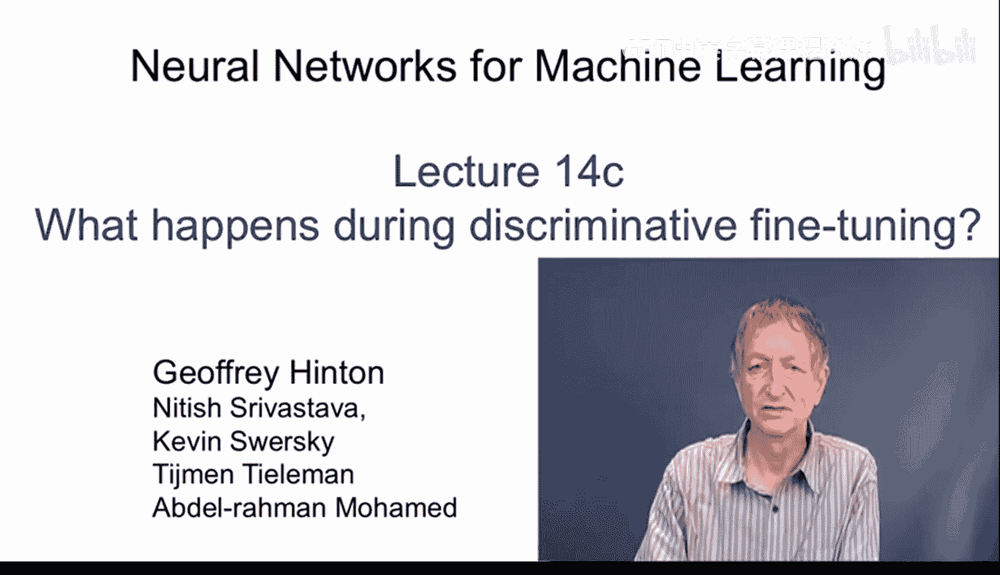
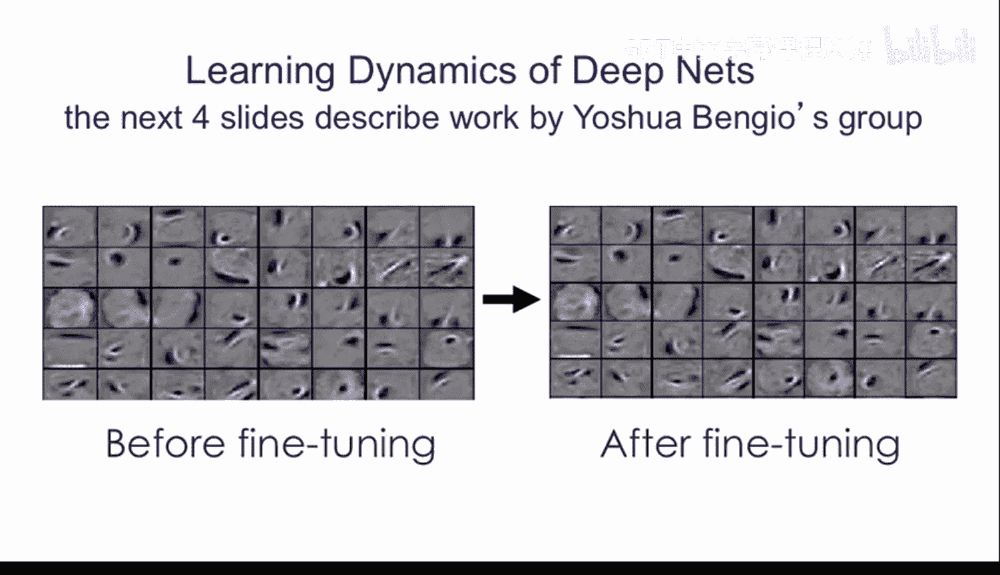
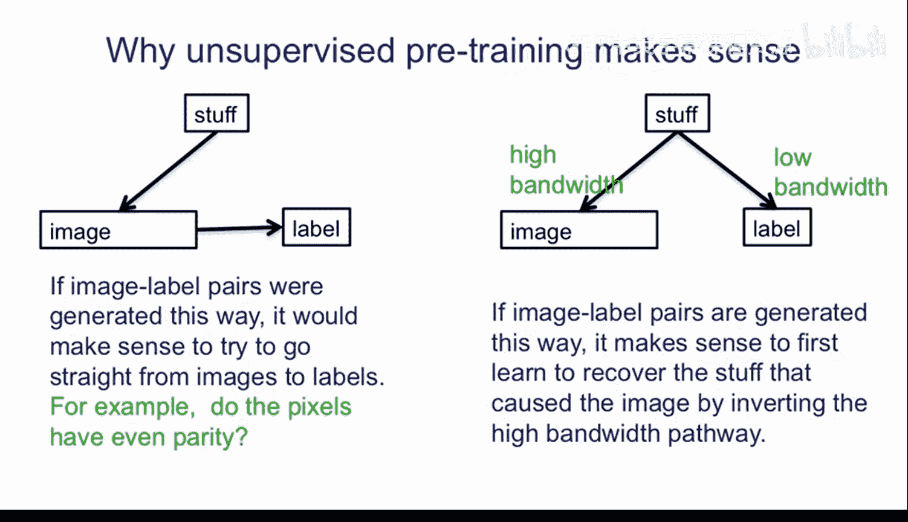

# 14.3：判别式微调详解 🔍

在本节课中，我们将详细探讨神经网络在经过玻尔兹曼机堆叠预训练后，进行判别式微调时会发生什么。我们将看到，尽管底层权重变化微小，但这些变化对网络的分类性能有显著影响。此外，我们还将分析预训练如何使深层网络比浅层网络更有效，并解释为何先进行生成式训练再进行判别式训练是合理的做法。

## 微调过程中的权重变化

上一节我们介绍了判别式微调的基本概念，本节中我们来看看微调过程中权重的具体变化。在 Yoshua Bengio 实验室的研究中，研究人员观察了神经网络在经过生成式预训练后进行微调时的权重变化。

在左侧，我们可以看到经过生成式预训练但尚未进行微调时，第一层隐藏层特征检测器的感受野。右侧则是经过微调后的同一层感受野。几乎看不到任何明显变化。然而，这些微小的变化却显著提升了网络的判别能力。

## 预训练对网络性能的影响

了解了权重变化的特性后，我们进一步探讨预训练对网络整体性能，特别是对不同深度网络的影响。

以下是预训练如何减少具有一个隐藏层的网络的测试误差示例。该任务是在一个包含大量扭曲数字的数据集中区分数字。

*   经过反向传播微调后，经过预训练的网络几乎总是比未经预训练的网络表现更好。
*   如果使用更深的网络，这种效果会更加明显。图中显示，两个分布几乎没有重叠。
*   经过预训练的深层网络比浅层网络表现更好，而未经预训练的深层网络则比浅层网络表现更差。

此图展示了分类误差及其变化情况，随网络层数的改变而变化。

*   当不进行预训练时，两层网络似乎是最佳选择。当网络达到四层时，性能会显著下降。
*   相比之下，如果使用预训练，四层网络优于两层网络，误差变化更小，且整体误差更低。

## 预训练与未预训练网络的函数空间对比

为了更深入地理解预训练的效果，我们需要比较网络在函数空间中的行为，而不仅仅是权重向量。

以下是使用 t-SNE 技术对预训练和未预训练网络在训练过程中权重变化进行的可视化。所有网络都被绘制在同一空间中，但形成了两个明显不同的类别。

*   顶部的点是未经预训练的网络。
*   底部的点是经过预训练的网络。

每个点代表函数空间中的一个模型。颜色表示训练的不同阶段。

*   观察顶部的网络（未预训练），初始阶段有一个深蓝色的点群。可以看到，经过一个训练周期后，这些点大致朝同一方向移动。换句话说，经过一个周期学习后的网络彼此之间比初始网络更为相似。
*   底部的预训练网络，这种趋势更为明显。

顶部的训练轨迹（未预训练）显示，不同的网络最终会到达函数空间的不同位置，且分布相当分散。底部的训练轨迹（预训练）显示，经过预训练后，网络会到达函数空间中一个完全不同的区域，并且网络之间往往更加相似。

关键点在于，这两种解决方案没有重叠。通过生成式预训练网络所找到的解决方案类型，与从小型随机权重开始训练所找到的解决方案类型，在性质上是完全不同的。

## 为何预训练是合理的

在本视频的最后，我想解释为什么预训练是合理的。让我们想象一下生成图像-标签对的方式。

一种方式是，我们利用现实世界中的事物生成图像（例如拍照），然后为图像附加一个标签，而这个标签**不依赖于**现实世界中的事物。也就是说，在给定图像本身的前提下，现实世界中的事物是无关的，标签仅取决于图像中的像素。例如，标签告诉我们左上角像素是否与右下角像素相似。

如果以这种方式生成图像，那么尝试学习从图像到标签的映射是有意义的，因为标签直接依赖于图像。

但实际上，更合理的图像-标签对生成方式是：现实世界中存在某些事物，这些事物产生了图像，而图像之所以有某个名称，正是**因为**现实世界中的这些事物，而不是因为图像中的像素。例如，你看到一头牛，拍了一张照片，你称这张照片为“牛的照片”，是因为你在拍照时正在看一头牛。

这里的关键在于，从现实世界到图像存在一条**高带宽**的路径，而从现实世界到标签则存在一条**低带宽**的路径。例如，如果我只说“牛”，你并不知道这头牛是倒立的还是正立的，是棕色的还是黑白的，是活的还是死的，有多大，图像中还有什么其他东西，它是面向你还是背对你。所有这些信息都没有通过标签传达。

如果你看到一张包含成千上万个像素的图像，你通常能知道所有这些信息。通过观察图像，你获得的关于图像成因的信息量，远比通过观察图像标签获得的信息量要多得多。

因此，在这种情况下，更合理的做法是：首先尝试**反转高带宽路径**，以回溯到导致图像的**现实世界中的事物**；然后，在恢复了导致图像的这些现实世界事物之后，再决定应该给它赋予什么标签。

这是一个更合理的、我们为图像中事物命名的模型。这也证明了先进行一个**预训练阶段**（尝试从图像到其潜在成因）是合理的，随后再进行一个**判别式阶段**（尝试从这些潜在成因到标签），并且可能对从图像到潜在成因的映射进行轻微的微调。

## 总结

本节课中，我们一起学习了判别式微调的详细过程。我们看到，微调主要引起底层权重的微小变化，但这些变化能显著优化决策边界，从而提升分类性能。预训练不仅普遍提升了网络性能，更重要的是，它改变了深度网络与浅层网络的效能对比，使得深层网络能够超越浅层网络，并收敛到函数空间中更优、更一致的解区域。最后，我们从信息论的角度理解了预训练的合理性：它模拟了从高带宽的感官数据（图像）中推断潜在成因，再根据这些成因进行低带宽的判别（分类）这一更符合现实世界认知过程的路径。