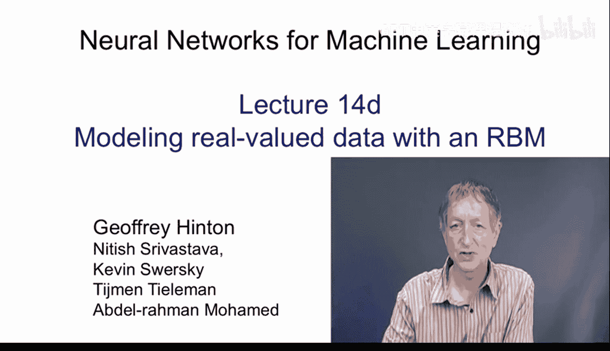
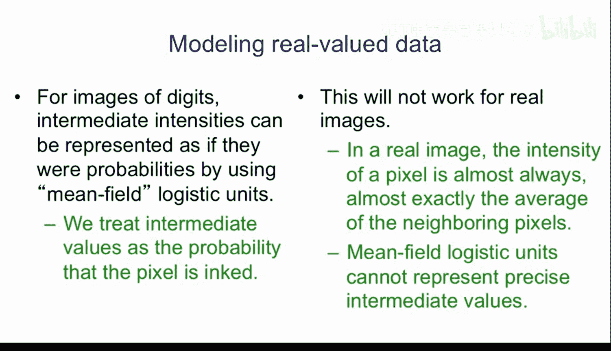
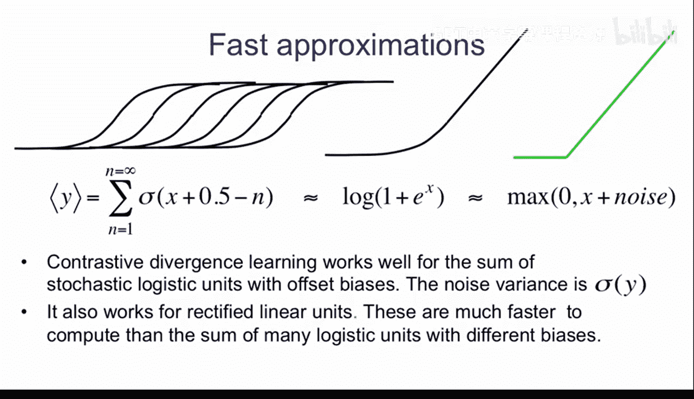
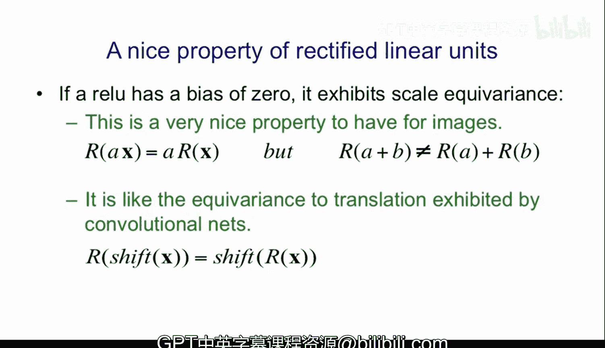

# 14.4：使用RBM建模实值数据 📊

在本节课中，我们将学习如何使用受限玻尔兹曼机来建模实值数据，例如图像像素的连续强度值。我们将看到，将可见单元从二值随机单元改为带有高斯噪声的线性单元，并配合使用修正线性单元作为隐藏单元，可以有效地解决建模过程中的学习难题。

## 从二值到实值：为何需要改变？ 🔄

上一节我们介绍了用于二值数据的RBM。然而，对于像真实图像这样的实值数据，简单的二值单元（如逻辑单元）无法很好地建模。

在真实图像中，一个像素的强度值通常非常接近其邻居的平均值。这意味着该值有很高的概率出现在平均值附近，而偏离该值的概率则迅速减小。逻辑单元无法精确表示这种“强度值为0.69，但几乎不可能是0.71或0.67”的概率分布。

因此，我们需要一种新的单元类型。

## 高斯线性单元：建模实值数据 📈

一个显而易见的解决方案是使用带有高斯噪声的线性单元。这样，我们可以将像素建模为高斯变量。

我们仍然可以使用交替吉布斯采样来运行对比散度学习所需的马尔可夫链。但此时需要使用更小的学习率，否则模型容易发散。

其能量方程如下：

`E(v, h) = Σ_i (v_i - b_i)^2 / (2 * σ_i^2) - Σ_j b_j h_j - Σ_{i,j} (v_i / σ_i) * w_{ij} * h_j`

以下是该方程各部分的解释：

*   **第一项**：这是一个抛物线形的约束函数，防止数值爆炸。对于第 `i` 个可见单元，该项是一个以偏置 `b_i` 为最小值的抛物线，旨在将可见单元的值保持在 `b_i` 附近。
*   **交互项**：描述可见单元与隐藏单元之间的相互作用。该项对 `v_i` 的导数是常数 `Σ_j h_j * w_{ij} / σ_i`，其效果是线性地推动可见单元均值的偏移。

隐藏单元的总效果就是线性地推动可见单元均值的偏移。虽然写出这样的能量函数并求导很容易，但在实际学习时，我们常常会遇到问题。

## 学习难题：方差与权重的冲突 ⚖️

文献中有很多报告指出，高斯-二值RBM难以训练。其中一个核心难题是学习可见单元的方差（`σ_i`）非常困难。

下图有助于理解原因。考虑可见单元 `i` 对隐藏单元 `j` 的影响：
*   当可见单元 `i` 的标准差 `σ_i` 很小时，自底向上的权重效应会被放大（因为需要以标准差为单位衡量活动）。
*   同时，自顶向下的权重效应会被衰减（因为乘以了小的 `σ_i`）。

这导致了一个冲突：要么自底向上的效应过大，要么自顶向下的效应过小。结果是隐藏单元容易饱和（始终开启或关闭），从而破坏学习过程。

解决方案是使用比可见单元数量多得多的隐藏单元。这样，即使可见单元和隐藏单元之间的权重很小，由于隐藏单元数量众多，其自顶向下的总效应仍然可以很强。当然，理想情况下，隐藏单元的数量应能随着标准差 `σ_i` 的减小而动态增加。

## 解决方案：修正线性单元 🛠️

为了实现隐藏单元数量随需要动态增加的效果，我们可以引入“阶梯式Sigmoid单元”的概念。

其思想是为每个随机二值隐藏单元创建多个副本。所有副本共享相同的权重和学习到的偏置 `b`，但每个副本有一个固定的偏置偏移量（例如-0.5, -1.5, -2.5...）。这样，随着总输入 `x` 的增加，被激活的副本数量会线性增加。当可见单元的标准差变小时，被激活的隐藏单元副本数量就会增加，从而提供更强的自顶向下效应。

然而，使用大量带偏移偏置的二值随机单元计算成本很高。我们可以采用更快的近似方法，效果同样好。

以下是关键的近似公式：

`Σ_k sigmoid(x - k + 0.5) ≈ log(1 + exp(x)) ≈ max(0, x)`

这个 `max(0, x)` 函数定义的单元，就是**修正线性单元**。它计算速度快得多，并且对比散度学习在这种单元上同样运行良好。

## 修正线性单元的优良特性：尺度等变性 🌟

修正线性单元有一个很好的特性：如果其偏置为0，则具有**尺度等变性**。这对于图像处理非常有用。

尺度等变性意味着，如果你将图像 `X` 的所有像素强度乘以一个标量 `a`，那么图像 `aX` 在修正线性单元中的表示，就是 `a` 乘以图像 `X` 的表示。换句话说，当我们缩放图像强度时，所有单元的活性按相同比例缩放，但比例关系保持不变。

这种特性与卷积网络（忽略池化层时）的**平移等变性**非常相似。在卷积网络中，输入图像的平移只会导致网络各层表示的相应平移，而不会改变其内容。

## 总结 📝

本节课中，我们一起学习了如何使用RBM建模实值数据。核心要点是：
1.  对于实值数据（如图像像素），需要使用**高斯线性单元**作为可见单元。
2.  直接使用高斯-二值RBM学习会遇到方差与权重冲突的难题，导致隐藏单元饱和。
3.  解决方案是使用**修正线性单元**作为隐藏单元。它本质上是“阶梯式Sigmoid单元”的高效近似，能动态提供所需的建模能力，并且计算速度快。
4.  修正线性单元具有**尺度等变性**，这是一个对图像建模非常有益的属性。

通过结合高斯线性可见单元和修正线性隐藏单元，我们可以有效地学习一个能很好建模实值数据的受限玻尔兹曼机。