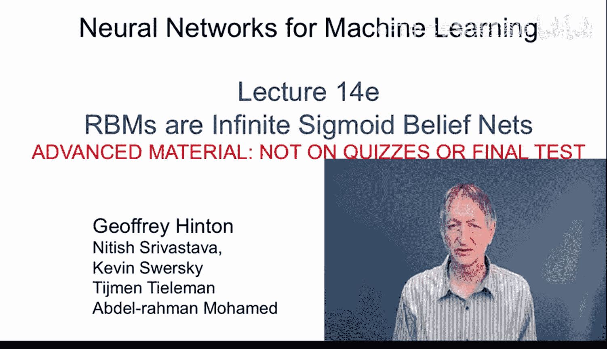
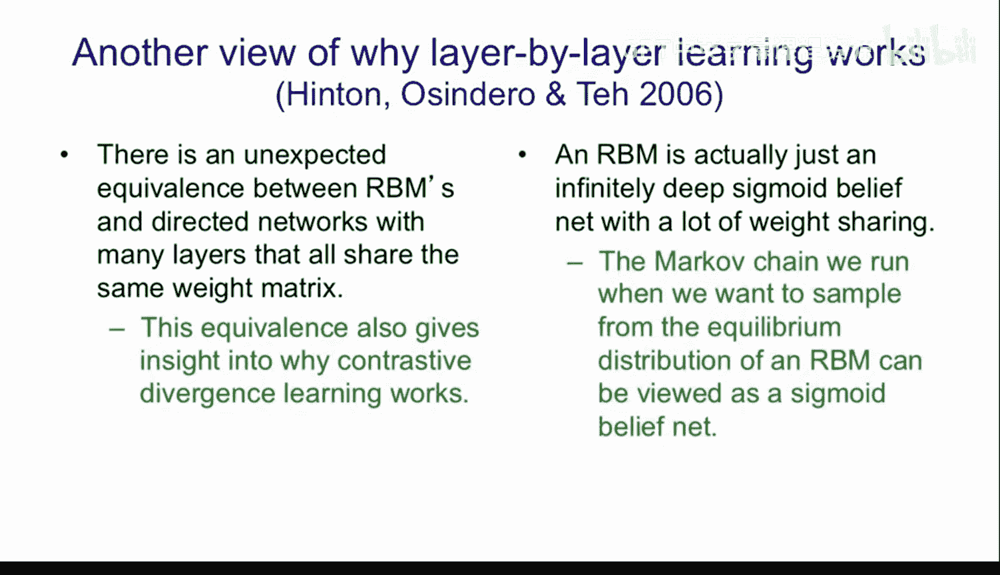
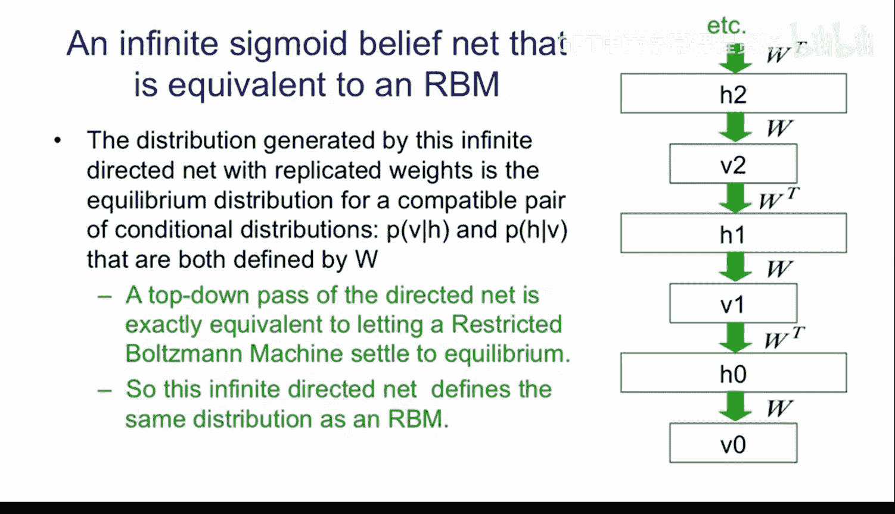
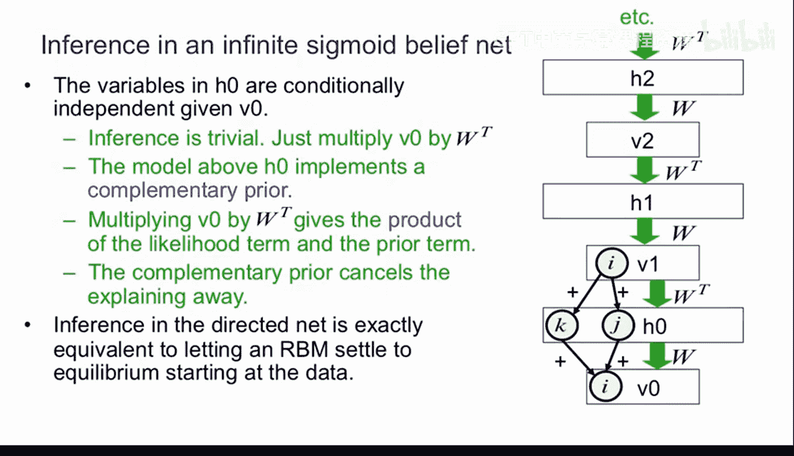
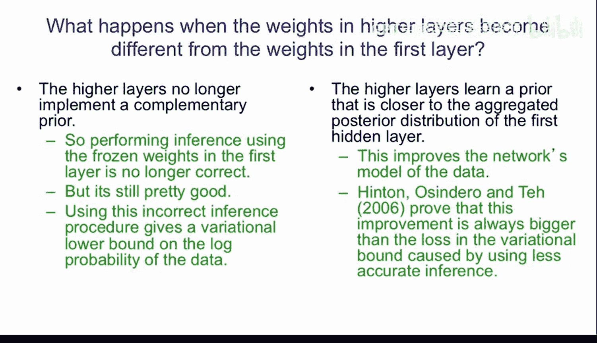
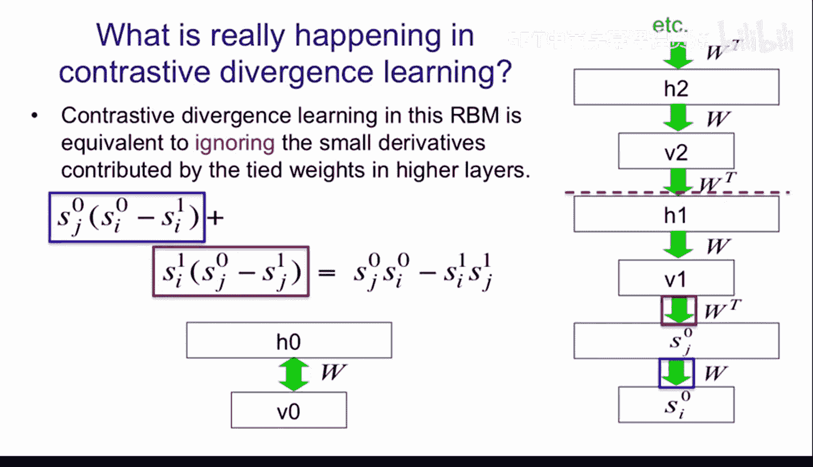
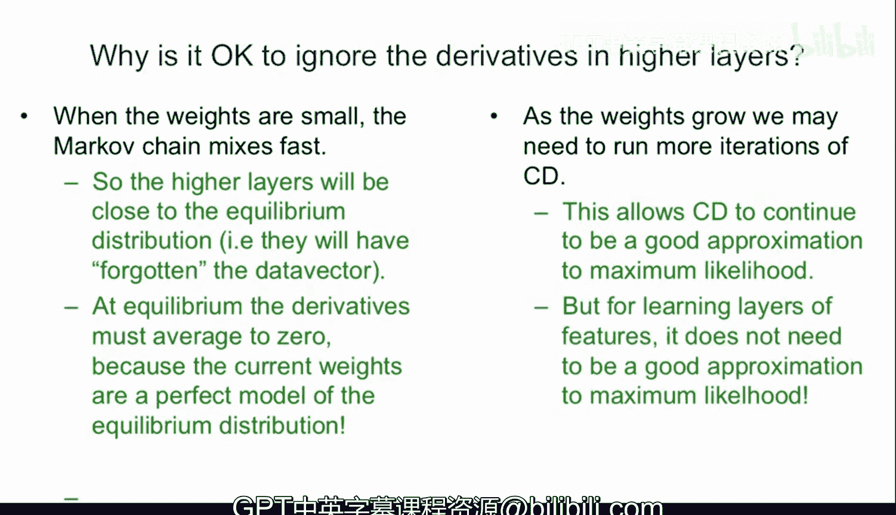

# 14.5：RBM是无限深的Sigmoid信念网络 🧠

在本节课中，我们将探讨一个高级主题：受限玻尔兹曼机与无限深的Sigmoid信念网络之间的深刻等价关系。这个数学上非常优美的见解，揭示了逐层预训练和对比散度学习算法有效性的根源。

上一节我们介绍了深度学习的起源，本节中我们来看看一个核心的数学洞察：堆叠受限玻尔兹曼机本质上等同于构建一个具有共享权重的无限深Sigmoid信念网络。这种等价性无需复杂数学，仅通过观察结构即可理解。

## RBM与无限深信念网络的等价性 🔄

一个受限玻尔兹曼机，实际上就是一个具有共享权重的无限深Sigmoid信念网络。这种权重共享的特性带来了非常有趣的结果。

以下是该等价关系的图示。我们有一个非常深（实际上是无限深）的Sigmoid信念网络。**每一层都使用相同的权重矩阵**。所有V层的大小必须相同，所有H层的大小也必须相同，但V和H的大小可以不同。

这个具有复制权重的深度网络所生成的分布，**完全等同于**通过交替执行 `P(V|H)` 和 `P(H|V)` 所达到的平衡分布。这里的条件概率都由同一个权重矩阵 **W** 定义。而这正是我们从RBM运行马尔可夫链以获取平衡分布样本时所做的事情。

因此，从这个无限深的有向网络顶部开始进行的**自上而下传播**，完全等同于让一个RBM**达到平衡状态**。它们定义了相同的分布。如果你运行这个无限深网络，在 `v0` 处得到的样本，就是等价RBM的一个平衡样本。

## 无限深信念网络中的推理 🔍

现在，让我们看看在无限深Sigmoid信念网络中如何进行推理。在推理时，我们从 `v0` 开始，然后需要推断 `H0` 的状态。

通常情况下，由于“解释消除”效应，这会很困难。例如，如果隐藏单元K和J都对可见单元I有大的正权重，那么当我们观察到I激活时，K和J在后验分布中会变得**负相关**。这就是解释消除。

然而，在这个网络中，给定 `V0` 进行推理时，K和J是**完全独立**的。推理变得非常简单：我们只需将 `v0` 乘以权重转置 **W^T**，将结果通过逻辑Sigmoid函数，然后采样，就得到了 `H0` 中单元的二进制状态。

问题是，考虑到解释消除，它们怎么可能独立？答案是，`H0` 之上的模型实现了我称之为**互补先验**的东西。它实现的 `H0` 先验分布，恰好抵消了解释消除带来的相关性。

对于上面展示的例子，先验会在K和J之间实现**正相关**，而解释消除会导致**负相关**，两者恰好抵消。

实际上发生的是，当我们乘以权重转置时，我们不仅仅是在计算似然项，而是在计算**似然项和先验项的乘积**。这正是得到后验分布所需做的。

在这个网络中，由 `H0` 之上所有层实现的互补先验，精确地抵消了解释消除，使得推理变得非常简单。**这在网络的每一层都成立**。

因此，我们可以对每一层进行推理，只需将 `v0` 乘以 **W^T**，就能得到每一层的无偏样本。一旦计算出 `H0` 的二进制状态，我们将其乘以 **W**，通过逻辑Sigmoid函数并采样，就得到了 `V1` 的二进制状态，依此类推，一直向上。

所以，正如从这个模型生成样本等同于运行RBM的交替马尔可夫链以达到平衡，**在这个模型中执行推理，正是相反方向的同一过程**。这是一种非常特殊的Sigmoid信念网络，其中推理和生成一样简单。

## 从有向网络学习规则到玻尔兹曼机学习规则 📈

上图展示了定义模型的生成权重（绿色），以及我们用于推理的它们的转置（红色）。现在我想展示的是，我们如何从有向Sigmoid信念网络的学习算法，得到玻尔兹曼机的学习算法。

Sigmoid信念网络的学习规则是：首先从后验分布中获取一个样本（即 `SJ` 和 `SI`），然后按比例改变一个生成权重，比例是**突触前活动 `SJ`** 与 **突触后活动 `SI`** 和 **给定父层所有二进制状态时单元I激活的概率 `P`** 之差 的乘积。

如果我们问如何计算 `P`，会发生一些非常有趣的事情。观察右边网络的推理过程：我们首先推断出 `H0` 的二进制状态。一旦选择了这个状态，我们通过将 `H0` 乘以 **W**，将结果输入逻辑函数并采样，来推断 `V1` 的二进制状态。

因此，`SI1` 的生成方式，正是我们将 `H0` 通过权重矩阵 **W** 再通过逻辑函数后得到的样本。而这正是我们计算 `P` 所需要做的：我们需要获取 `H0` 中的二进制活动，然后通过绿色的权重 **W** 向下传播，计算给定其父节点二进制状态时单元I激活的概率。

关键在于，从 `H0` 到 `V1` 的过程，与从 `H0` 到 `V0` 的过程是**完全相同**的。因此，`SI1` 是 `P` 的一个**无偏样本**。这意味着我们可以在学习规则中用它来替换 `P`。

我们最终得到一个如下所示的学习规则。由于我们有复制的权重，每一行都对应一个绿色权重矩阵的学习规则项。

对于第一个绿色权重矩阵，学习规则是：突触前状态 `SJ0` 乘以突触后状态 `SI0` 与概率 `PI0` 之差。而具有该概率的样本正是 `SI1`。因此，通过代入 `SI1`，可以得到导数的一个无偏估计。

类似地，对于第二个权重矩阵，学习规则是 `SI1` 乘以 `SJ0` 与 `PJ0` 之差。而 `PJ0` 的一个无偏估计是 `SJ1`。这就是第二个权重矩阵学习规则的无偏估计。

如果对所有权重矩阵持续这个过程，你会得到一个无限级数，除了第一项和最后一项，**所有中间项都相互抵消**。最终你得到的就是玻尔兹曼机学习规则：`SJ0 * SI0 - SJ∞ * SI∞`。

## 逐层学习与变分边界 📚

让我们回到如何学习一个无限深Sigmoid信念网络。我们首先将所有权重矩阵设为相同，即**绑定所有权重**，然后使用这些绑定的权重进行学习。这**完全等价于**学习一个受限玻尔兹曼机。左右两图是**完全相同**的。我们可以将左图中的对称箭头，视为具有绑定权重的无限深有向网络的一种简便表示。

我们首先学习那个RBM。虽然我们应该使用最大似然学习，但实际上我们将使用对比散度学习作为一种捷径。

一旦学习了第一个RBM，我们可以**冻结底层权重**（即定义模型的生成权重），同时冻结我们将用于推理的权重（即那些生成权重的转置）。我们保持所有其他权重绑定在一起，但现在允许它们与底层权重不同（但它们彼此之间仍然绑定）。

学习这些剩余的绑定权重，**完全等价于**学习另一个RBM。这个RBM以 `H0` 作为其可见单元，`V1` 作为其隐藏单元。而训练这个网络的数据，是跨 `H0` 的**聚合后验分布**。

也就是说，要采样一个数据向量来训练这个网络，我们做的是：在 `V0` 输入一个真实数据向量，通过那些冻结的权重进行推理，得到一个二进制向量 `H0`，并将其视为训练下一个RBM的数据。我们可以根据需要向上堆叠任意多层。当我们堆叠足够多层后，最顶层就是一个RBM，这等价于说，在那之上的无限深有向网络中的所有权重仍然是绑定的，但其下的权重现在变得不同了。

我们对推理过程正确性的解释，依赖于由上层权重创建的互补先验这一概念。当然，当我们改变上层的权重而保持底层权重固定时，由这些已改变的权重创建的先验就不再是精确互补的了。因此，现在使用底层冻结权重的推理过程不再完全正确。

好消息是，它几乎总是非常接近正确。并且，即使使用不正确的推理过程，我们仍然能得到数据对数概率的一个**变分下界**。高层权重之所以改变，是因为它们学习到了一个更接近聚合后验分布的、针对底层隐藏层的先验分布，这使得模型变得更好。

所以，改变高层权重使得我们在底层隐藏层所做的推理变得不正确，但给了我们一个更好的模型。如果考察这两种效应，我们可以证明：**从一个更好模型中获得的变分下界的提升，总是大于因推理略微不正确而造成的损失**。因此，在这个变分边界框架下，学习高层权重时，只要你用正确的最大似然方法去做，你总是赢的。

## 对比散度学习的原理 🎯

现在让我们回到对比散度学习中发生了什么。右边是无限深网络，左边是RBM，两者等价。如果我们对RBM进行最大似然学习，那也就是对无限深Sigmoid信念网络进行最大似然学习。

但我们要做的是**截断处理**。我们将忽略在无限深Sigmoid信念网络更高层中得到的那些微小权重导数。我们在图中红色虚线处将其截断。

现在，如果我们观察导数，它们有两项。第一项来自底层权重，我们之前见过，底层权重的导数就是这里的第一行。第二项来自下一层权重，对应这里的第二行。我们需要计算 `H1` 中的活动来计算第二行中的 `SJ1`。但我们实际上并不计算第三层权重的导数。

当我们取前两项并将它们组合时，我们得到的正是**一步对比散度的学习规则**。因此，对比散度中发生的是：我们**组合了较低层的权重导数，而忽略了更高层的权重导数**。

## 为何可以忽略高层导数？ 🤔

问题是，为什么我们可以忽略那些更高的导数？当权重很小时，马尔可夫链混合得非常快。如果权重为0，它一步就能混合。如果马尔可夫链混合得快，更高层将接近平衡分布，即它们将“忘记”底层输入是什么。

现在我们有一个很好的性质：如果更高层是从平衡分布中采样的，那么我们知道，**数据对数概率相对于这些权重的导数，其平均值必须为0**。这是因为模型中的当前权重是平衡分布的完美模型——平衡分布正是使用这些权重生成的。如果你想从平衡分布生成样本，这些就是你能拥有的最佳权重。所以我们知道梯度在那里是0。

随着权重变大，我们可能需要运行更多步的对比散度，这对应于考虑更多层无限深Sigmoid信念网络。这将使对比散度继续成为最大似然的一个良好近似。因此，如果我们试图学习一个密度模型，这是很有意义的：随着权重增长，你运行CD的步数也越来越多。如果有统计学家在场，你可以给他一个保证：在无限极限下，你将运行无限多步CD，然后你就有了一个渐近收敛的结果——这能让统计学家满意。当然，这完全无关紧要，因为你永远达不到那个点。

然而，这里有一个有趣的点：如果我们使用CD的目的是构建一个学习多层特征的RBM堆栈，那么事实证明，我们**不需要**一个对最大似然的良好近似。对于学习多层特征，**CD1就足够了**。事实上，它可能比做最大似然更好。

## 总结 📝

本节课中我们一起学习了受限玻尔兹曼机与无限深Sigmoid信念网络之间的深刻等价关系。我们了解到：

1.  **结构等价**：一个RBM等价于一个具有共享权重的无限深有向信念网络。
2.  **互补先验**：这种网络结构中的权重共享，在上层创建了一个“互补先验”，精确抵消了底层推理时的“解释消除”效应，使得推理变得和生成一样简单。
3.  **学习规则衍生**：从有向信念网络的最大似然学习规则出发，通过用高层状态的样本近似期望值，并利用权重共享导致中间项抵消的性质，可以推导出RBM的对比散度学习规则。
4.  **逐层学习原理**：堆叠RBM进行逐层预训练，对应于先冻结底层权重学习一个RBM，然后将其隐藏层的聚合后验作为数据，训练更高层的RBM。这虽然使底层的推理变得不精确，但通过优化一个变分下界，整体上仍然能得到更好的模型。
5.  **对比散度的有效性**：CD学习通过截断无限深网络的高层导数来近似最大似然学习。当权重较小时，高层状态接近平衡分布，其导数的期望为零，因此忽略它们是合理的。CD1对于学习好的特征表示已经足够有效。

这个优雅的数学框架不仅解释了为什么深度信念网络和对比散度学习有效，也揭示了深度学习早期思想中权重共享和层次化表示的核心魅力。