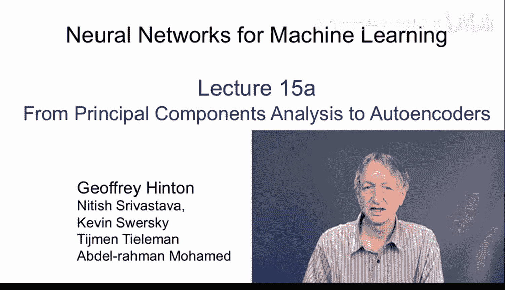
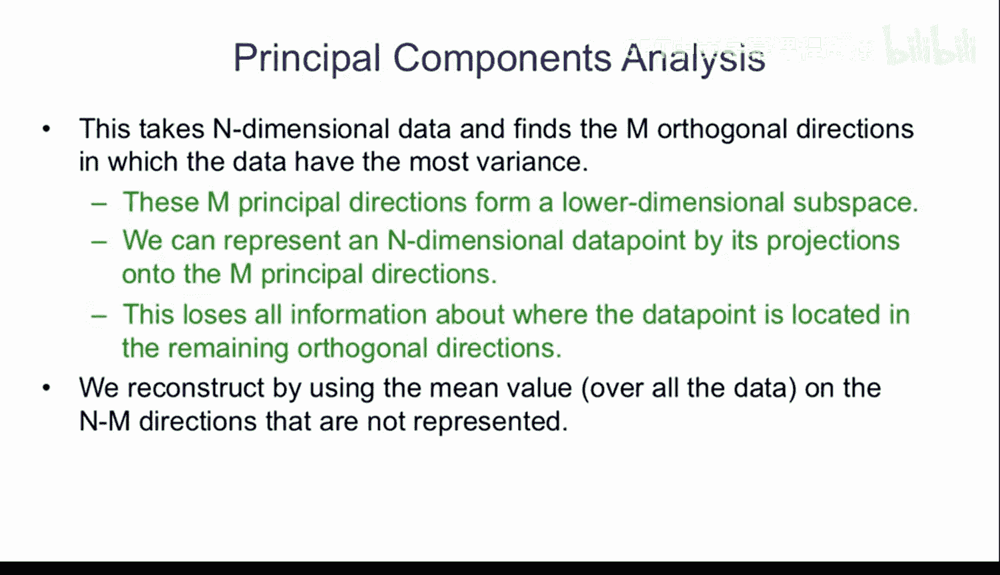
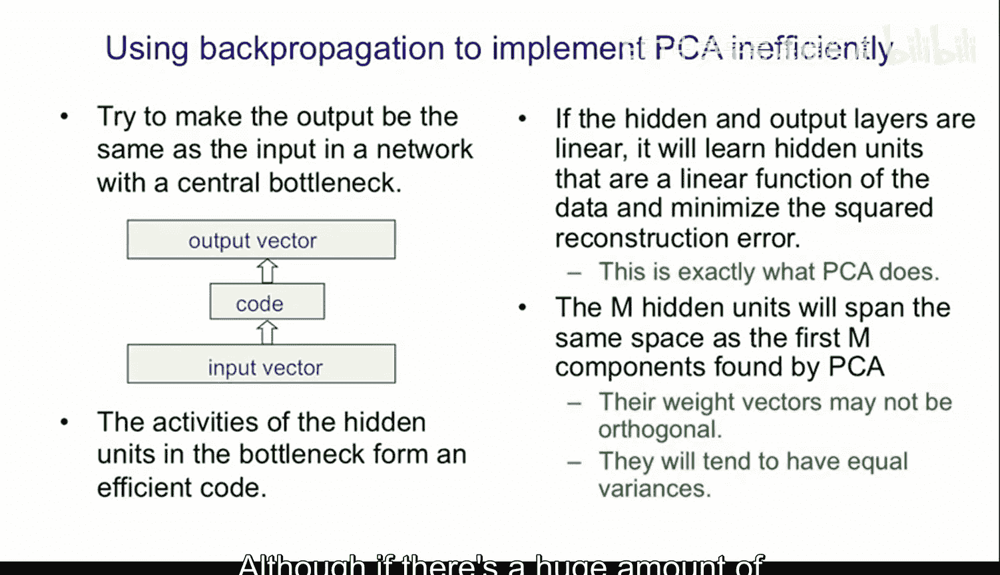
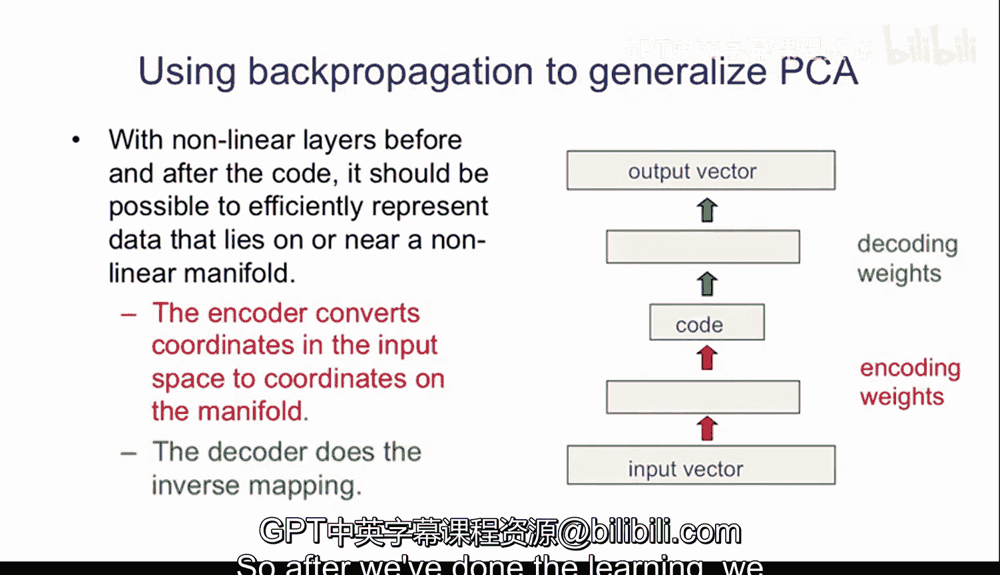

# 15.1：从主成分分析到自编码器 🧠

在本节课中，我们将要学习主成分分析这一在信号处理中广泛使用的技术，并探讨如何将其思想扩展到使用神经网络，特别是自编码器，以实现更强大的数据降维与表示。

## 概述 📋

主成分分析的核心思想是，高维数据通常可以用一个维度低得多的编码来表示。这种情况发生在数据位于高维空间中的一个线性流形附近时。如果我们能找到这个线性流形，就可以将数据投影到该流形上，并仅用其在流形上的位置来表示它。这样做的损失很小，因为在垂直于流形的方向上，数据的变化不大。

## 主成分分析原理 🔍

主成分分析处理的是n维数据，目标是使用少于n个数字来表示它。为此，我们寻找数据方差最大的M个正交方向，并忽略数据变化很小的方向。这M个主方向构成了一个低维子空间。我们通过一个n维数据点在该低维空间中这M个方向上的投影来表示它。

我们丢失了数据点在其余正交方向上的所有位置信息。但由于这些方向本身方差很小，我们并未损失太多信息。

### 重建与误差

如果我们想根据这M个数字的表示来重建数据点，对于所有未被表示的 `n - M` 个方向，我们将使用其均值。

重建误差将是所有未被表示的方向上，数据点在该方向上的值与方向均值之差的平方和。这可以通过一个二维数据的例子直观理解。

考虑一个呈细长高斯分布的数据集。椭圆表示高斯分布的一个标准差轮廓。如果我们使用单一成分进行主成分分析，该成分将是数据中方差最大的方向。为了表示一个红色数据点，我们表示它沿该方向的距离，即该红点在线上的投影（绿点）。

当需要重建红点时，我们只需使用所有数据点在被忽略方向上的均值。也就是说，我们表示的是黑线上的一个点。因此，重建损失将是红点与绿点之间的平方差。我们丢失的正是数据点在我们未表示的方向（即方差最小的方向）上与所有数据均值的差异。显然，选择忽略方差最小的方向能最小化我们的损失。

## 用神经网络实现PCA 🧮

实际上，我们可以使用反向传播来实现PCA或其变体，尽管效率不高。具体做法是构建一个网络，其输出是数据的重建，并尝试最小化重建的平方误差。

该网络有一个中心瓶颈层，只包含M个隐藏单元，这些单元将对应于主成分或类似的东西。

以下是网络结构：
*   我们有一个输入向量。
*   将其投影到一个编码向量。
*   从编码向量中，我们构建一个输出向量。
*   目标是使输出向量尽可能接近输入向量。

编码向量中隐藏单元的活动形成了一个瓶颈。因此，编码向量是输入向量的一种压缩表示。

### 线性自编码器

如果隐藏单元和输出单元都是线性的，那么这样的自编码器将学习到能最小化平方重建误差的编码。这正是主成分分析所做的。

它将获得与主成分分析完全相同的重建误差。但其隐藏单元不一定精确对应于主成分。它们将张成与前M个主成分相同的空间，但这些轴可能存在旋转和倾斜。因此，编码单元的输入权重向量（代表成分的方向）可能不正交，并且与主成分分析不同，它们通常具有相等的方差。

然而，这些编码单元的输入权重向量所张成的空间，将与M个主成分所张成的空间完全相同。从这个意义上说，这个网络将执行与主成分分析等价的操作。

只是，如果我们对这个网络使用随机梯度下降学习，其效率通常远低于主成分分析所使用的算法。不过，如果数据量极大，它实际上可能更高效。

## 从PCA到非线性自编码器 🚀

使用神经网络中的反向传播来实现主成分分析的主要意义在于，它允许我们推广主成分分析。

### 网络结构

如果我们使用一个在编码层前后都有线性或非线性层的神经网络，就有可能表示位于高维空间中**弯曲流形**上的数据，而不仅仅是线性流形。这更具普适性。

我们的网络结构如下：
*   输入向量。
*   一层或多层非线性隐藏单元（通常使用逻辑单元）。
*   一个编码层（可能是线性单元）。
*   编码层之后，是一层或多层非线性隐藏单元。
*   最后是一个输出向量，我们训练它使其尽可能接近输入向量。

这是一个有趣的网络，我们使用监督学习算法来进行无监督学习。

*   **编码器**：网络的下半部分。它接收输入向量，并通过非线性映射将其转换为编码。
*   **解码器**：网络的上半部分。它接收非线性编码，并将其映射回输入向量的重建。

学习完成后，我们就得到了双向的映射。

## 总结 ✨

本节课中我们一起学习了主成分分析的基本原理，它是一种通过寻找数据最大方差方向来实现降维的技术。我们探讨了其重建过程与误差计算。更重要的是，我们了解了如何用带有瓶颈层的线性神经网络（自编码器）来实现等效功能，并认识到这种方法的真正价值在于其可扩展性：通过引入非线性层，我们可以构建深度自编码器，从而学习数据在**非线性弯曲流形**上的低维表示，这比传统的线性PCA更加强大和通用。这种使用监督学习目标（最小化重建误差）进行无监督特征学习的思想，是深度学习中的一个重要概念。