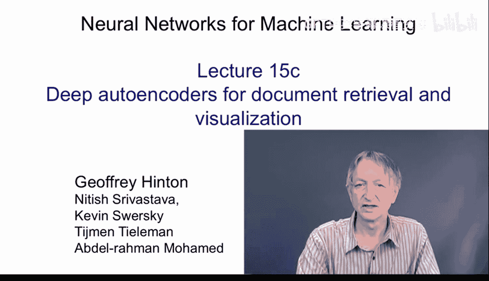
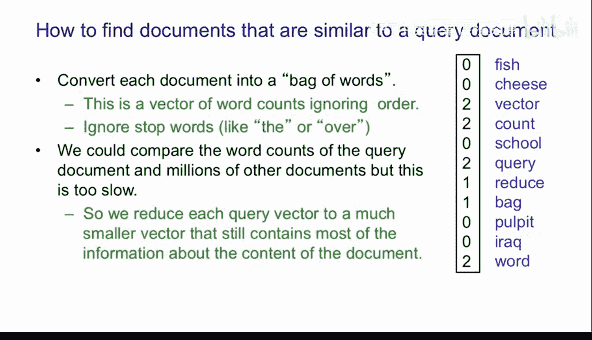
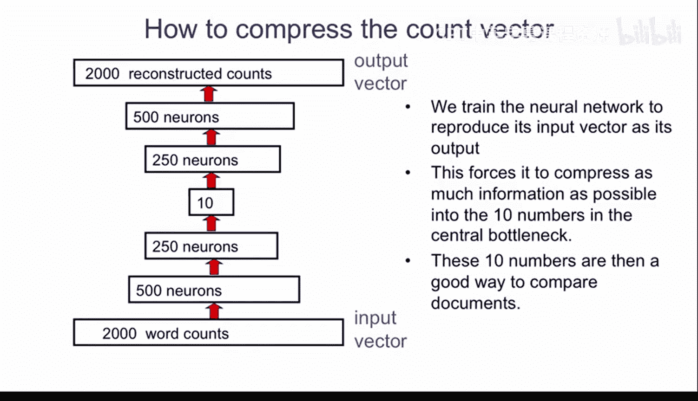
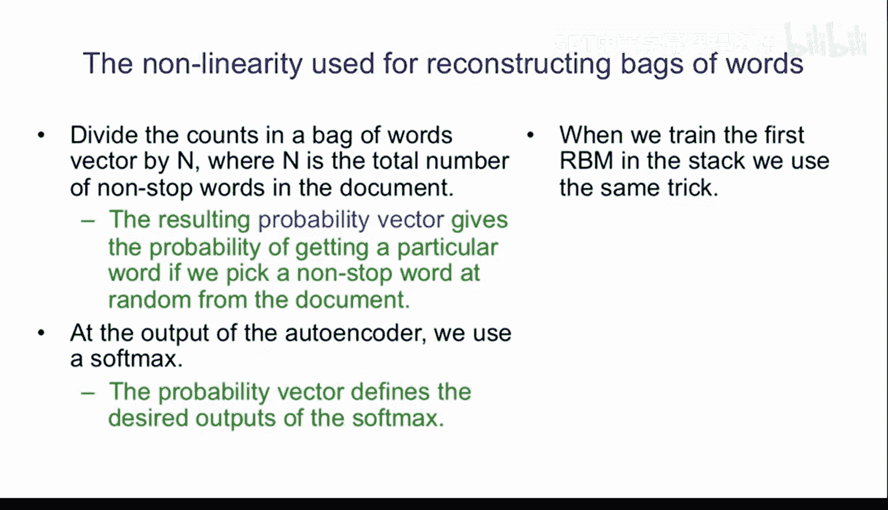
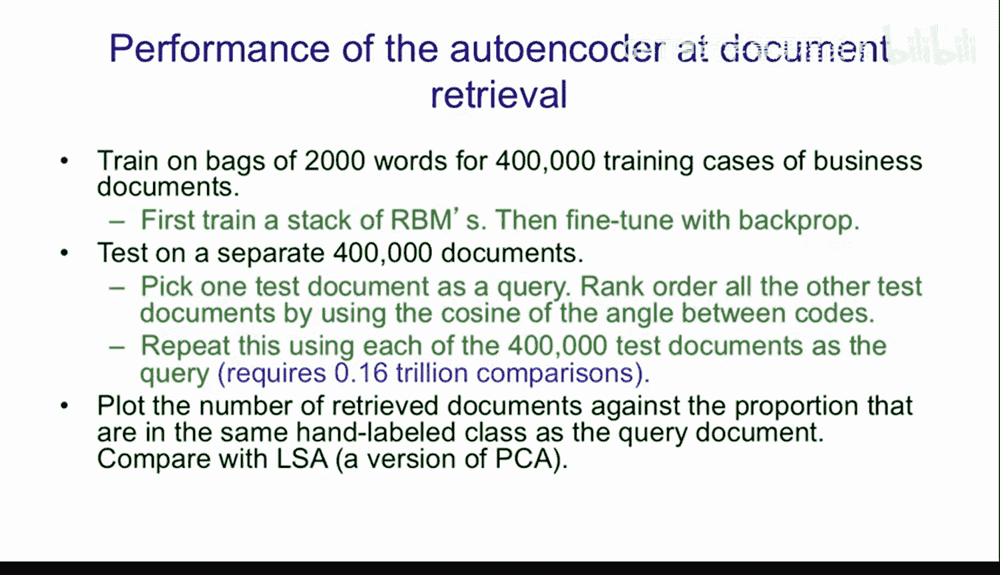
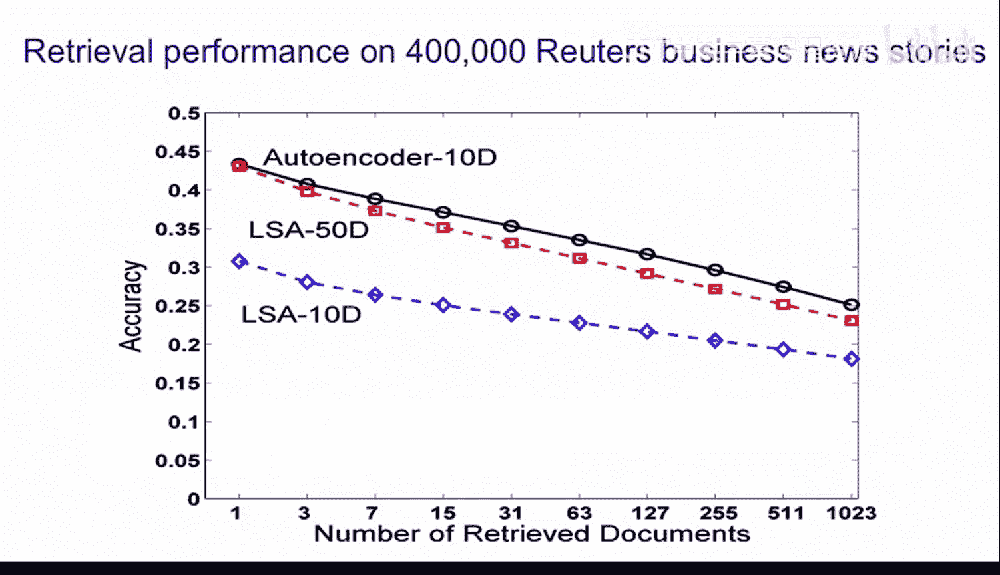
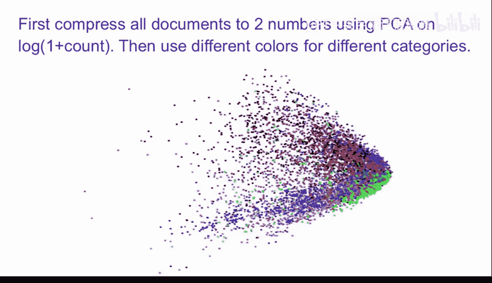

# 15.3：用于文档检索的深度自编码器 🗂️🔍

在本节课中，我们将学习如何应用深度自编码器进行文档检索。我们将了解如何将文档转换为向量，通过神经网络压缩这些向量以提取关键信息，并利用压缩后的编码高效地查找相似文档或可视化文档集合。

## 概述

文档检索的目标是找到与查询文档内容相似的其他文档。传统方法如潜在语义分析（LSA）使用主成分分析（PCA）处理词频向量。然而，深度自编码器作为一种非线性方法，能够更有效地从文档中提取信息，从而获得性能更优的文档编码。

## 从文档到词袋向量

为了比较文档，我们首先需要一种数值化的表示方法。以下是处理步骤：

我们首先将每个文档转换为一个“词袋”向量。这意味着我们统计文档中每个特定词汇的出现次数，形成一个计数向量，同时忽略词汇的顺序。

这种方法虽然丢弃了词序信息，但保留了关于文档主题的大量信息。我们通常会忽略“the”、“over”这类被称为“停用词”的词汇，因为它们对主题信息的贡献很小。

例如，对于一个文档，我们可能得到类似 `{"vector": 5, "count": 3, "query": 2, ...}` 的计数向量，这能有效反映文档的核心内容。

直接比较查询文档与数百万其他文档的长向量（例如2000维）会非常缓慢。因此，我们需要一种方法将这些高维向量压缩为更小、但仍包含核心信息的低维向量。

## 使用深度自编码器进行压缩

上一节我们介绍了文档的向量表示，本节中我们来看看如何对其进行压缩。我们使用深度自编码器来完成这个任务。

自编码器是一种神经网络，其目标是尽可能好地重建其输入。通过将2000维的词频向量压缩到仅10个实数组成的编码，再从这个编码重建原始向量，网络被迫将尽可能多的输入信息塞进这10个数字中。

训练完成后，我们只需比较文档对应的10维编码向量，这比直接比较2000维的原始向量要快得多。

## 处理词频数据的技巧

然而，词频计数与图像像素等实数值有所不同，需要特殊处理。以下是具体的预处理和网络设计步骤：

1.  **概率化**：我们将词袋中的每个计数除以文档中非停用词的总数，从而将计数向量转换为一个概率向量。可以将其理解为从文档中随机抽取一个非停用词时，抽到某个特定词的概率。
2.  **输出层**：在自编码器的输出层，我们使用一个巨大的2000路Softmax层。我们的目标值就是上述概率化后的词概率向量。
3.  **输入加权**：还有一个技巧。当我们将概率向量作为第一隐藏层的输入时，我们会将所有权重乘以文档中的非停用词总数 `n`。这是因为我们有 `n` 次独立观测来自该概率分布。如果直接使用概率值，输入单元的激活值会非常小，无法为第一隐藏层提供足够的输入信号。因此，对于第一个受限玻尔兹曼机（RBM），其自下而上的权重是自上而下权重的 `n` 倍。

## 性能评估：与LSA的对比

那么，这种方法效果如何呢？我们在路透社数据集的4000篇商业文档上进行了训练，这些文档被人工标注了大约100个不同的类别。

我们首先训练了一堆受限玻尔兹曼机（RBM）进行预训练，然后使用反向传播进行微调，输出层是2000路的Softmax。接着，我们在另外4000篇文档上进行了测试。

测试时，我们选取一篇测试文档作为查询，然后根据自编码器生成的10维编码向量之间的余弦相似度，对所有其他测试文档进行排序。对每个可能的查询文档重复此过程后，我们绘制图表：横轴是计划检索的文档数量（即在排序列表中向下查看多远），纵轴是检索到的文档中与查询文档属于同一人工标注类别的比例。

虽然这不是衡量检索质量的完美指标，但我们用同样的指标与潜在语义分析（LSA）进行比较，因此至少是公平的。

以下是检索准确率随检索文档数量变化的曲线图。可以看到，仅使用10维实数编码的自编码器，其性能优于使用50维实数编码的潜在语义分析。当然，在获得编码后，处理每个文档的工作量也减少了五倍。而使用10维编码的LSA效果则要差得多。

## 二维可视化应用

我们也可以将文档压缩到仅两个实数。这样，我们就不再用于检索，而是可以将所有文档绘制在一张地图上进行可视化。

我们采用文档的主要类别，并为不同类别赋予不同颜色。首先，我们对词频计数取 `log(1+count)` 后进行PCA降维到2维并绘图（取对数可以抑制大数值，通常使PCA效果更好）。得到的分布图显示类别间有一些分离，但混合程度很高。

然后，我们使用深度自编码器将文档压缩到两个数字，同样以这两个数字作为坐标，将文档绘制在二维空间中。

我们得到了好得多的布局，它能更好地揭示数据集的结构。可以看到不同的类别，并且它们分离得相当好。我们推测位于中间区域的文档可能包含的词汇量较少，因此难以区分其类别。

这样的可视化展示可能非常有用。例如，如果你看到其中一个绿点代表安然公司的财报，你可能不会想购买其附近有绿点的公司的股票。

## 总结

本节课中我们一起学习了深度自编码器在文档检索中的应用。我们了解了如何将文档表示为词袋向量，如何利用深度自编码器将其压缩为低维编码，以及这种编码在高效检索和直观可视化方面的优势。实验表明，深度自编码器在压缩效率和提取的编码质量上均显著优于传统的线性方法（如潜在语义分析）。