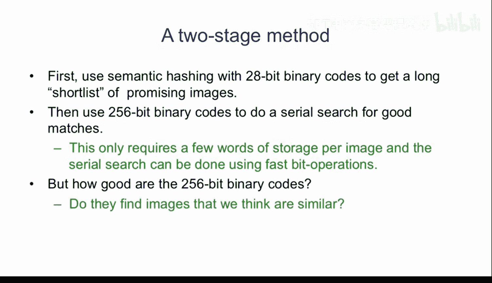
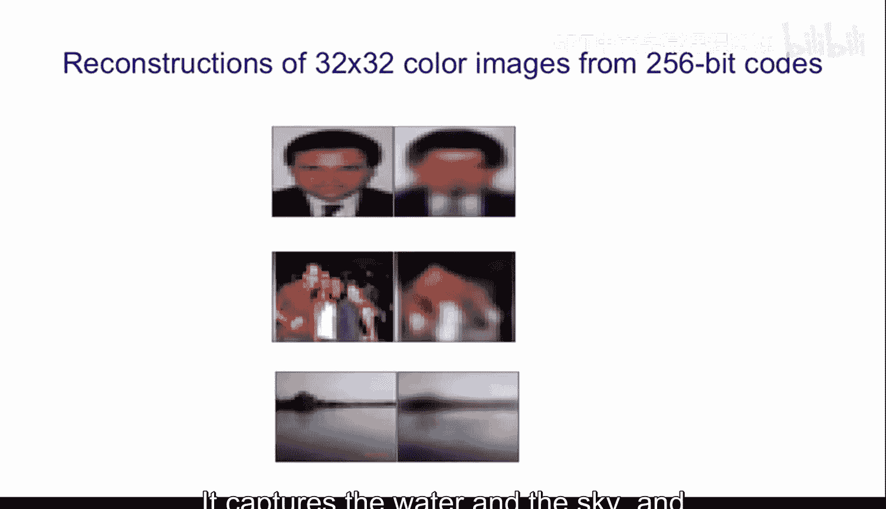
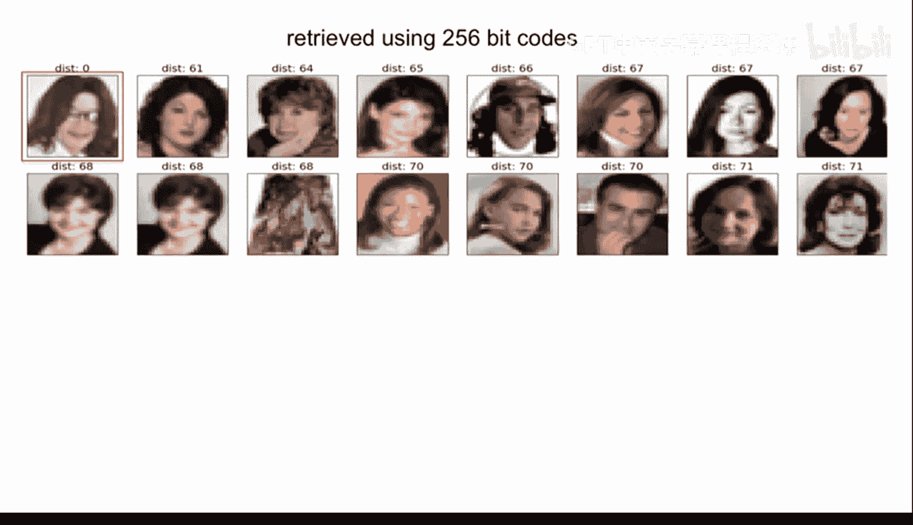
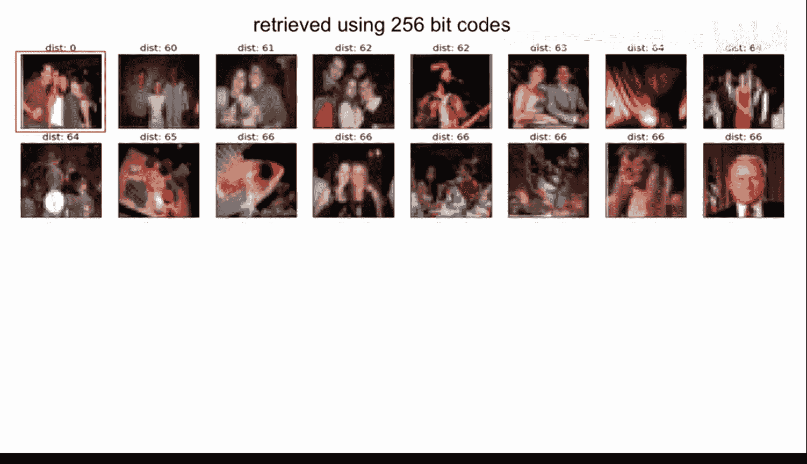
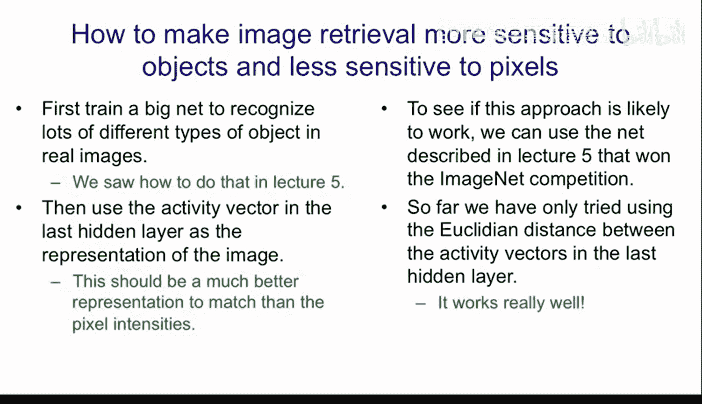

# 15.5：图像检索的二进制编码学习 🖼️

在本节课中，我们将学习如何使用二进制编码进行图像检索。我们将探讨为何直接使用像素进行检索效果不佳，以及如何通过深度自编码器或预训练网络的隐藏层表示来生成包含丰富语义信息的短二进制码，从而实现快速、高效的图像相似性搜索。

## 概述

目前，图像检索通常依赖于图像的标题或标签。然而，图像本身包含的信息远多于标题。直接使用像素进行检索的主要问题是，单个像素无法有效传达图像内容。如果我们能识别图像中的物体，问题会简单得多，但物体识别本身是一项困难的任务。因此，一种替代方案是提取一个能概括图像内容的向量。虽然实值向量是一种选择，但在大型数据库中进行匹配和存储的成本很高。相比之下，提取一个较短的二进制向量则更易于存储和快速匹配。

## 从像素到二进制码

上一节我们提到了使用内容向量的想法，本节中我们来看看如何具体实现二进制编码。

基本思路是，我们不直接识别物体，而是提取一个包含图像内容信息的向量。最直接的方法是提取一个实值向量。但问题在于，在大数据库中匹配实值向量速度慢，且存储这些向量需要大量空间。

如果我们能提取一个相当短的、包含大量图像信息的二进制向量，那么存储和匹配都会容易得多。更快的是一种两阶段方法：
1.  首先，提取一个约30位的短二进制码。
2.  这个短码通过语义哈希技术，能非常快速地为我们提供一个有希望的图像候选短列表。
3.  然后，候选图像可以使用与每个已知图像一起存储的256位二进制码进行匹配，以搜索比28位二进制码所能找到的更好的匹配。

即使是256位的二进制码，每张图像也只需要4个字的内存。尽管我们需要对这些二进制码进行串行搜索，但由于只需几次操作即可比较两个256位二进制码以找出它们有多少位相同，因此搜索速度可以非常快。

## 自编码器架构

那么，如何生成这样的二进制码呢？以下是一个由Alex Krushevsky训练的网络，它处理小型彩色图像（32x32像素）。

以下是该自编码器的架构描述：
*   **输入层**：红色、绿色和蓝色通道，共 3 * 32 * 32 = 3072 个输入。
*   **中间层**：网络首先将输入扩展到更多隐藏单元（因为要从实值输入转换到可能容量较小的逻辑隐藏单元），然后逐层减少单元数量。
*   **输出层**：最终降至256个二进制单元。

这个编码器拥有约6700万个参数，规模相当大。在NVIDIA GPU上训练需要数天时间。Alex使用了200万张图像进行训练。

目前没有理论证明他所使用的架构是最优的。我们知道需要一个相当深的网络，并且随着层数增加而变窄是合理的。但这种每层单元数减半的具体架构只是一种猜测。有趣的是，即使是这样的猜测也能工作得相当好。很可能存在其他效果更好的架构。

## 重建与检索效果

首先需要问的是，这样的自编码器在重建图像方面表现如何。

以下是重建示例：
*   **人脸图像**：从重建图像中可以分辨出图像的类型。
*   **派对场景**：虽然无法确切分辨场景类型，但可能猜测涉及多人。
*   **户外场景**：重建图像捕捉了大量关于户外场景的信息，如水面、天空以及有一条狭长陆地的事实。

接下来，让我们看看使用能产生此类重建的自编码器进行检索的质量。

我们以红色方框中的迈克尔·杰克逊图片开始。Alex检索了最相似的图像。在每个图像上方，可以看到它与迈克尔·杰克逊图像相差的比特数。值得注意的是，这些差值都在一个相当相似的范围内。在256位中，仅相差61位如果是随机图像则极不可能发生，这必须是相当相似的图像。

检索结果的一个优点是，除一个例外，其他都是人脸。如果我们查看使用原始像素的欧几里得距离进行检索的结果，那么其中一些是人脸，但大多数不是。显然，自编码器理解了关于人脸的某些信息，这些信息并未包含在欧几里得距离的信息中。它显然提供了更好的检索效果。

再看另一个例子。我们取派对场景的图像并检索其他图像。可以看到，大约一半的图像是你认为相当相似的，即其他派对场景。它们通常是中间有明亮物体的其他派对场景，就像原始派对场景一样。你会注意到，大多数不匹配的图像中间也有明亮物体。因此，即使我们通过许多隐藏层将信息压缩到256位二进制码，网络仍然对图像结构和较亮斑块的位置相当敏感。

如果你观察欧几里得距离的效果，它会差得多。欧几里得距离只找到另一个有一群人的场景，然后其他所有图像都相当不相似。你会注意到，使用欧几里得距离时，它经常得到非常平滑的图像。这是因为如果你无法匹配图像中的高频变化，匹配其平均值比匹配其他相位不同的高频变化内容更好。所以，当你有一个复杂的图像时，欧几里得距离通常会找到平滑的图像来匹配它。这是因为它最小化了像素空间中的平方误差。

## 基于语义的改进方法

显然，我们希望图像检索能对图像内容（即图像中物体的种类及其关系）更敏感，而对像素强度不那么敏感。

我们可以通过首先训练一个大型网络来识别真实图像中的许多不同种类的物体来实现这一点。我们在第5讲中已经看到了如何做到这一点。然后，我们取这个大网络最后一个隐藏层的激活向量，并将其用作图像的表示。在捕捉图像中物体种类信息方面，这应该比像素强度好得多。

为了验证这种方法是否可行，我们使用了第5讲中描述的、赢得ImageNet比赛的网络。到目前为止，我们只尝试了在最后一个隐藏层的激活向量之间使用欧几里得距离。但显然，如果这对欧几里得距离有效，我们就可以获取这些激活向量，并在此基础上构建一个自编码器，将其压缩为二进制码。

首先看看它使用欧几里得距离是否有效。事实证明效果非常好。
*   在左侧列中，您可以看到查询图像。
*   在它们的右侧，您可以看到所有检索到的内容。
*   观察大象查询图像，你会发现检索到的是其他大象，但是姿态非常不同的大象。这些图像在像素空间的重叠度不会很好。
*   观察万圣节南瓜，你会发现所有检索到的都是其他万圣节南瓜。其中一些在像素空间的重叠度会很差。
*   同样，对于航空母舰，我们检索到的其他航空母舰图像也非常不同。

因此，我们预期，如果能够将这些激活向量压缩为短二进制码，我们将拥有一种快速有效的方法，仅通过图像内容来检索相似图像。

我们将在第16讲中看到，实际上可以将图像内容与图像标题结合起来，以获得更好的表示。

## 总结

本节课中，我们一起学习了用于图像检索的二进制编码技术。我们了解到，直接匹配像素效果不佳，而通过深度自编码器或利用预训练分类网络的深层特征，可以生成包含高级语义信息的紧凑二进制码。这种两阶段检索方法（先用短码哈希快速筛选，再用长码精细匹配）能显著提升大规模图像库的检索速度和精度。未来，结合图像内容与文本信息将是进一步提升检索性能的重要方向。