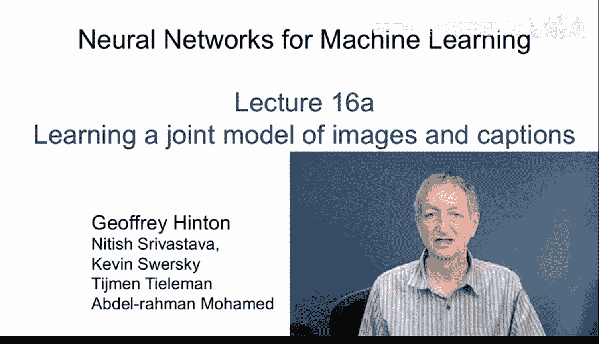
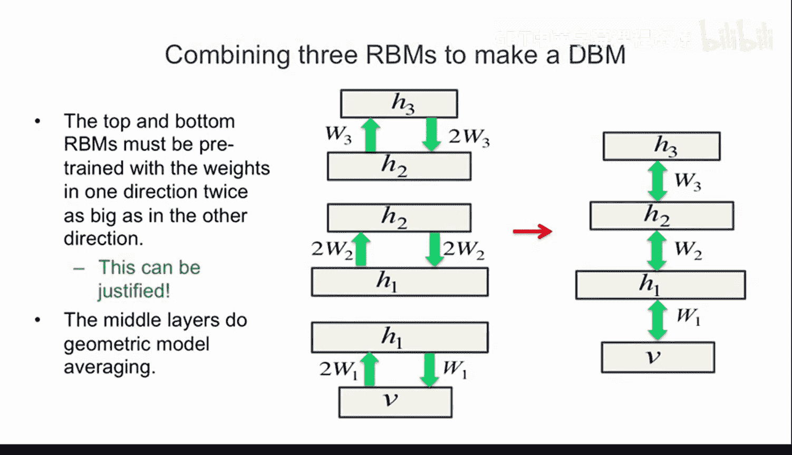
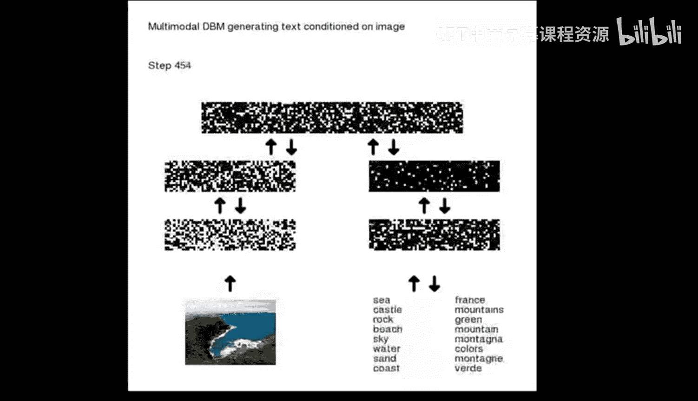
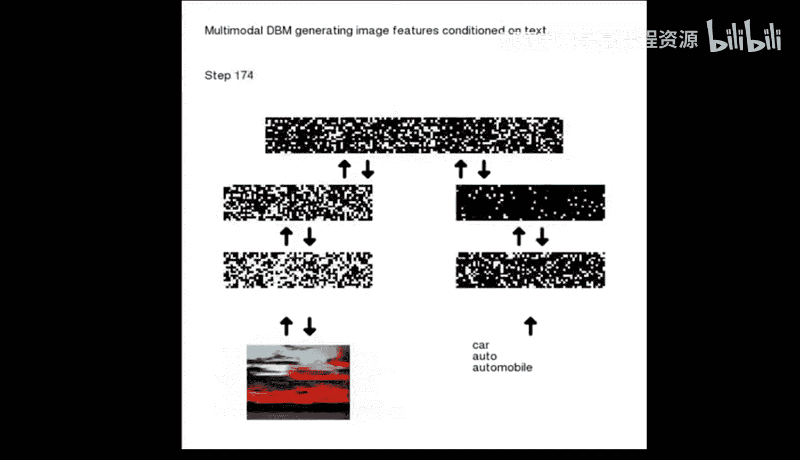

# 16.1：学习图像与描述文本的联合模型 🖼️📝

在本节课中，我们将学习如何构建一个联合模型，该模型能够同时理解图像及其对应的文字描述。我们将看到，通过结合图像特征和文本信息，模型可以更有效地学习两者的语义关系。

在上一讲中，我们讨论了如何从图像中提取有意义的语义特征，但当时并未利用描述文本的信息。显然，描述中的词语应当有助于从图像中提取合适的语义类别。同样，图像也应当有助于消除描述中词语的歧义。

因此，我们的核心思想是训练一个大型网络。该网络的输入是两部分：
*   从图像中提取的标准计算机视觉特征向量。
*   描述文本的词袋表示。

网络将学习这两种输入表示是如何相互关联的。在本讲末尾，我将展示一段视频，演示最终的网络如何使用词语来为图像创建特征向量，并在其数据库中找出最相似的图像；以及如何使用图像来生成词袋。

## 模型构建方法

以下是Niti Srivastava、Ruslan Salakhutdinov等人的研究工作。目标是构建一个描述文本和图像的联合密度模型，但图像由计算机视觉中标准使用的特征表示，而非原始像素。这比我们之前在课程中看到的构建标签和数字图像的联合密度模型需要更多的计算。

他们的具体做法如下：

1.  **分别预训练单模态模型**：
    *   首先，他们单独训练了一个**图像的多层模型**。实际上，这是一个基于标准计算机视觉特征提取的图像特征的多层模型。
    *   然后，他们单独训练了一个**描述文本词袋向量的多层模型**。

2.  **构建联合模型**：
    *   在分别训练好这两个模型后，他们添加了一个新的顶层，该层连接到两个独立模型的顶层。

3.  **联合微调**：
    *   之后，他们对整个系统进行进一步的联合训练。这样，每种模态（图像或文本）都能改进另一种模态的早期层。

## 模型架构选择：深度玻尔兹曼机

你可能会期望他们使用深度信念网络，但他们使用了**深度玻尔兹曼机**，其中对称连接存在于所有层对之间。

对整个深度玻尔兹曼机进行进一步的联合训练，正是允许每种模态改变另一种模态早期层中特征检测器的原因。这也是他们选择使用深度玻尔兹曼机的原因。

他们本可以使用深度信念网络并通过对比唤醒-睡眠算法进行生成式微调，但深度玻尔兹曼机的微调算法可能效果更好。

## 深度玻尔兹曼机的预训练技巧

这引出了一个问题：他们如何预训练深度玻尔兹曼机的隐藏层？因为我们在课程中目前看到的是，如果你训练一堆受限玻尔兹曼机并将它们组合成一个复合模型，你得到的是一个深度信念网络，而不是深度玻尔兹曼机。

现在我将解释，尽管我在课程早期那样说过，但实际上你可以以一种特殊方式预训练一堆受限玻尔兹曼机，然后将它们组合成深度玻尔兹曼机。

**关键在于**：堆栈中顶部和底部的受限玻尔兹曼机，其权重需要在一个方向上是另一个方向的两倍。

*   观察可见单元的**底部玻尔兹曼机**，其训练时**自底向上的权重是自上而下权重的两倍**。除此之外，权重是对称的。我称之为**尺度对称**。
*   堆栈中的**下一个受限玻尔兹曼机**，使用**真正的对称权重**进行训练。我在这里称它们为 `2W` 而不是 `W`，原因稍后解释。
*   我们可以继续用这种方式训练受限玻尔兹曼机，使用真正的对称权重。
*   但**堆栈顶部的那个**，其训练时**自底向上的权重是自上而下权重的一半**。所以，这又是尺度对称权重，但现在是**自上而下的权重是自底向上权重的两倍**，这与我们训练堆栈中第一个受限玻尔兹曼机时的情况相反。

在训练了这三个受限玻尔兹曼机之后，我们可以将它们组合起来形成一个复合模型。复合模型如下图所示。

*   对于**中间的**受限玻尔兹曼机，我们简单地将它的权重减半（这就是为什么它们一开始是 `2W2`）。
*   对于**底部的**那个，我们将其**向上权重减半**，但保持向下权重不变。
*   对于**顶部的**那个，我们将其**向下权重减半**，但保持向上权重不变。

## 为什么需要权重减半？

解释相当复杂，但我会给你一个大致的思路。如果你看层 `H1`，在左侧的受限玻尔兹曼机堆栈中，我们有两种不同的方式来推断 `H1` 中单元的状态：
1.  我们可以自底向上从 `V` 推断 `H1` 的状态。
2.  我们也可以自上而下从 `H2` 推断 `H1` 的状态。

当我们将这些玻尔兹曼机组合在一起时，我们要做的是对推断每一层的这两种方式取一个**平均**。为了取一个**几何平均**，我们需要做的是将权重减半。

因此，我们将使用自底向上模型所说的一半（即 `1/2 * 2W1`），并使用自上而下模型所说的一半（即 `1/2 * 2W2`）。如果你看右侧的深度玻尔兹曼机，这正是用来推断 `H1` 状态所使用的权重。

**我们需要减半权重的原因是为了避免双重计数**。在右侧的玻尔兹曼机中，`H2` 的状态已经依赖于 `V`（至少在我们对玻尔兹曼机进行一些稳定迭代之后）。因此，如果我们使用来自堆栈中第一个受限玻尔兹曼机的自底向上输入，**并且**使用来自堆栈中第二个玻尔兹曼机的自上而下输入，我们将会把证据计算两次，因为我们既从 `V` 推断 `H1`，又从 `H2`（其本身依赖于 `V`）推断 `H1`。为了避免双重计算证据，我们必须将权重减半。

这是一个非常高层次、或许不完全清晰的描述，解释了为什么我们必须减半权重。如果你想了解数学细节，可以去阅读相关论文。但核心思想是：我们需要减半权重，以便中间层可以对原始堆栈中两个不同受限玻尔兹曼机对该层的两种不同模型进行几何平均。

## 总结

本节课中，我们一起学习了如何构建一个联合模型来关联图像和其文字描述。我们了解到，通过分别预训练图像和文本的单模态模型，然后将它们连接并进行联合微调，可以有效地让两种信息相互增强。特别地，我们探讨了使用深度玻尔兹曼机作为架构，并详细解释了通过特殊设计的权重减半策略来预训练其各层的方法，以避免在组合模型时对证据进行双重计数。这种方法使得模型能够更准确地理解图像内容与描述语言之间的复杂关系。