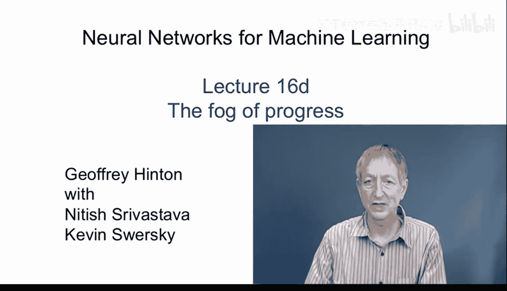
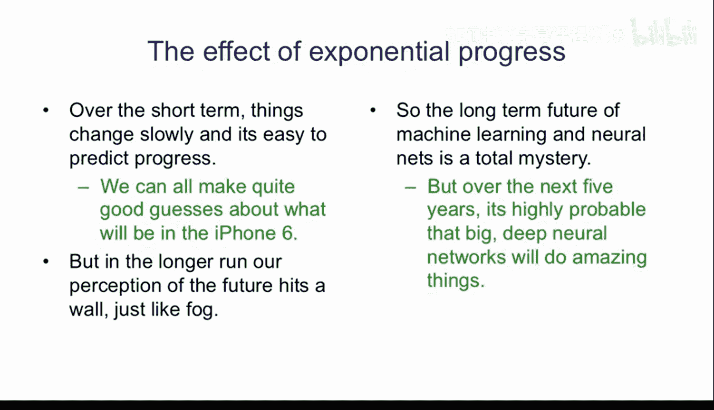

# 16.4：进展的迷雾 🌫️

在本节课中，我们将探讨为何难以对神经网络研究的长期未来做出预测。我们将通过一个生动的类比来理解技术进步的本质，并明确短期预测与长期预测之间的根本区别。

## 课程概述

在上一节中，我们讨论了神经网络研究的现状。本节作为课程的结尾，我们将不进行具体的未来预测，而是深入分析为何做出长期预测是极其不明智的。我们将通过一个“迷雾中行车”的类比来阐明这一观点。

## 迷雾的类比：短期清晰与长期模糊

想象一下，你在夜晚驾车，正看着前方车辆的尾灯。

在空气清澈的情况下，你接收到的尾灯光子数量与距离的平方成反比下降。这可以用公式表示为：
**光子数量 ∝ 1 / D²**
其中，**D** 代表到前车的距离。

现在，假设起了雾。在短距离范围内，雾对光的吸收微乎其微，因此光子数量仍然大致遵循 **1 / D²** 的规律衰减。然而，对于长距离，情况发生了根本变化。雾会按单位距离吸收固定比例的光子，这使得衰减变为指数形式：
**光子数量 ∝ e⁻ᴰ**
（其中 e 是自然常数）。

这意味着，在短距离内，雾看起来是透明的；但在长距离下，它变得完全不透明。因此，前方车辆会在一个根据短期模型（**1 / D²**）预测其仍应清晰可见的距离上，突然变得完全不可见。这正是雾天导致追尾事故的原因。

## 技术发展的指数本质

技术的发展通常也遵循指数规律。

*   **短期可预测**：在短期内，变化看起来相对缓慢，进展也容易预测。例如，我们大多数人都能对“iPhone 6会包含什么功能”做出相当准确的猜测。
*   **长期不可知**：但从长期来看，我们对未来的认知会撞上一堵“墙”，就像迷雾的效果一样。因此，**机器学习和神经网络的长期未来完全是一个谜**。我们根本无法根据当前的知识预测30年后会发生什么，因为我们将经历指数级的进步。

## 短期展望与课程结束

然而，在短期范围内，例如未来的 **3到10年**，我们可以进行相当不错的预测。在我看来，在接下来的五年左右，**大型深度神经网络必将取得惊人的成就**。

以下是本讲的核心要点总结：
1.  技术发展具有指数特性，类似迷雾中的指数衰减效应。
2.  短期（数年）进展相对可预测。
3.  长期（数十年）未来因其指数增长的本质而无法准确预知。
4.  神经网络在可预见的短期内前景广阔。

---

我要祝贺所有坚持学习到这里的同学们。😊

希望你们喜欢这门课程。祝大家在期末考试中好运！