# 001：课程概述 🎯

在本节课中，我们将要学习多伦多大学2025年秋季强化学习课程的整体安排、学习路径、评估方式以及所需背景知识。课程将从基础框架开始，逐步深入到表格型方法和深度强化学习。

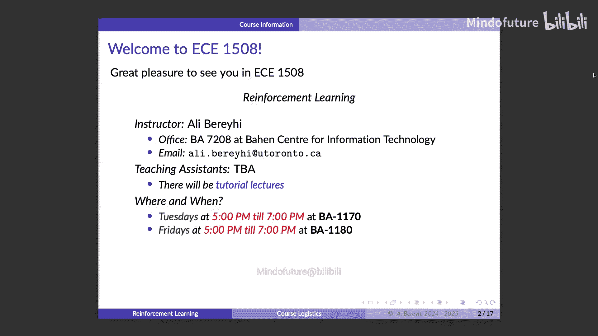

---

## 课程讲师与后勤

我的名字是Ali Berehi，你们可以叫我Ali。我的办公室在7楼。

如果有任何问题，可以通过电子邮件联系我，或者在课程专用的Piazza平台上提问。助教团队共有四人，将会安排辅导课。

课程将在周二和周五进行，请注意周五的教室在1180。

一旦完成课程注册，你将能够访问课程页面（通过Quercus系统）。所有课程材料、公告和文档都将通过这个页面分享。Piazza是提问的最佳平台。

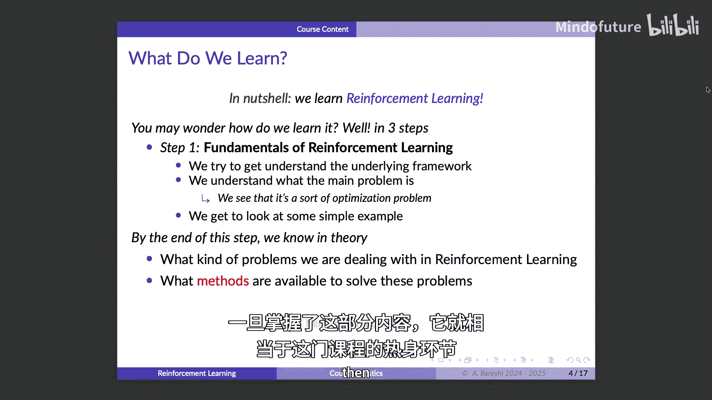

---

## 课程内容与结构 📚

本课程关于强化学习。如果你对此尚无概念，这完全没问题，我们将在本学期内逐步学习。

课程将分为三个主要步骤进行。

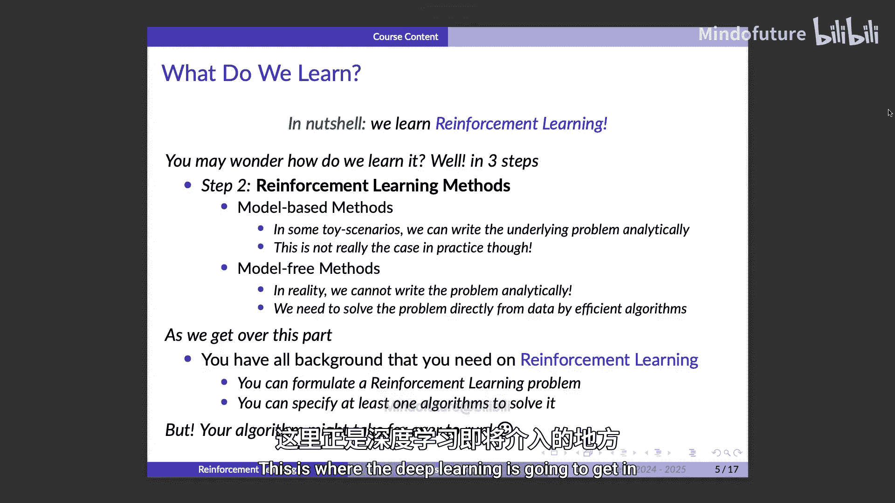

### 第一步：理解强化学习框架

首先，我们将学习强化学习的基本框架。这是一个在线优化框架。我们将理解一系列核心定义，例如：
*   **智能体** 与 **环境**
*   两者之间的 **交互**
*   在此过程中可获取的 **信息** 与 **数据**
*   **策略** 与 **最优策略** 的含义

目标是能够使用该框架来描述在线优化和控制问题。这部分内容偏重概念，是进入强化学习领域的“热身”。

### 第二步：表格型强化学习

在理解了框架之后，我们将进入**表格型强化学习**部分。

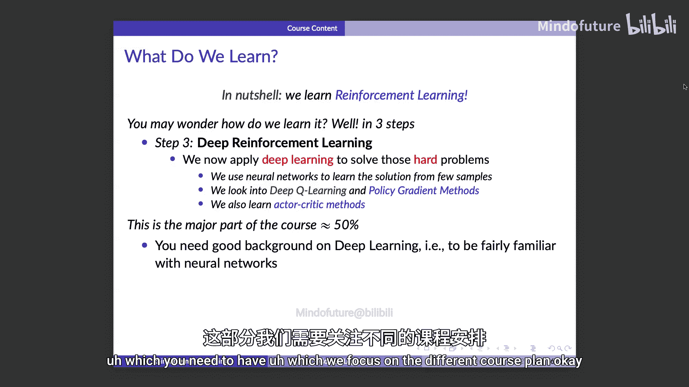

表格型方法意味着你查看数据并尝试解决那个在线优化问题，但**不使用任何神经网络**。你通过构建和计算表格（如Q表）来获得应采取正确行动的思路。

这部分是强化学习中**最重要的理论部分**，有坚实的数学基础。即使现在大家都在谈论深度强化学习，但如果不理解表格型方法，就无法真正理解深度强化学习，因为后者本质上是用神经网络替代了前者的表格。

### 第三步：深度强化学习

表格型方法在解决实际问题（如国际象棋）时，可能会因为状态空间巨大而导致计算上不可行。这时就需要**深度强化学习**。

在第三步中，我们将**重新审视**第二步中的所有方法，但这次我们将使用神经网络进行**函数近似**来替代表格。这将引领我们学习不同的深度强化学习方法，例如：
*   **深度Q网络**
*   **策略梯度方法**（如REINFORCE算法、PPO）
*   **演员-评论家方法**（结合了价值函数和策略学习）

---

## 先修知识与课程比重

要学习本课程，特别是第三部分，你**必须**具备良好的深度学习背景，清楚理解神经网络的工作原理并能实现它们。

如果你正在同时学习机器学习的入门课程，需要注意时间安排，确保在需要完成本课程作业时，你已具备足够的神经网络知识。

课程的理论部分（前两部分）相对容易掌握，而深度强化学习部分约占课程的50%，因为其中涉及大量解决实际挑战的算法和技巧。

---

## 技术路线图概览 🗺️

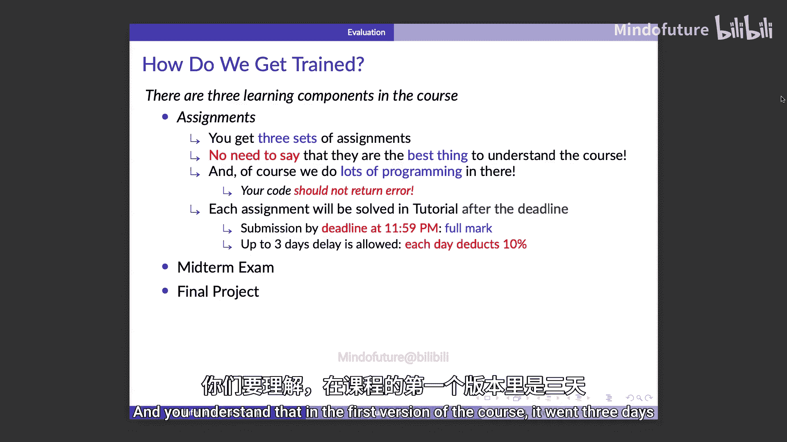

整个课程的技术路线可以概括为下图，它展示了强化学习的两种主要范式及其与深度学习的结合：

我们将首先学习**基于模型**和**免模型**的表格型强化学习。
*   **基于模型**：你知道描述智能体与环境交互的模型。相关算法包括**价值迭代**和**策略迭代**。
*   **免模型**：你不知道环境的具体模型，只能通过交互获取数据。相关方法包括**蒙特卡洛**和**时序差分**学习，并由此衍生出如**Q学习**、**Sarsa**等算法。

在掌握了表格型方法后，我们会将其扩展到深度强化学习领域，主要聚焦于更实用、更常见的**免模型深度强化学习**方法。

这张图我们会在课程中反复看到，每次完成一个部分，理解就会加深一层。

---

## 课程评估方式 ⚖️

课程评估包含三个主要部分：作业、期中考试和期末项目。

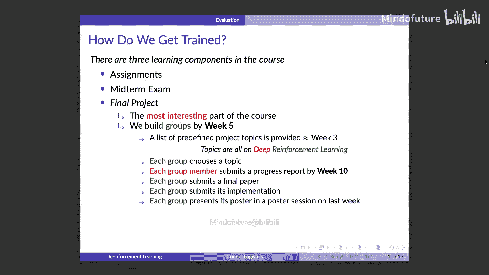

### 作业
共有三次作业，每次覆盖一个主要部分（基础、表格型、深度强化学习）。第一次作业侧重于应用定义和理解基础概念。

作业通常有两周的完成时间。在截止日期后两天内提交，会有10%的扣分。

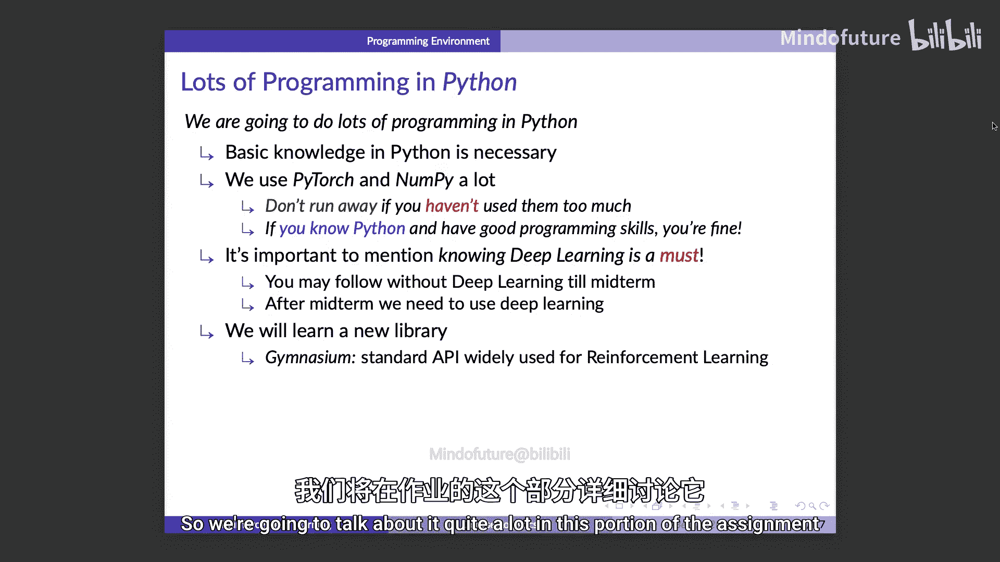

### 期中考试
期中考试将在第8周（阅读周前一周）的周二进行。考试内容涵盖前两部分（基础和表格型强化学习），不涉及编程，均为可以手算的理论题。期中考试占总成绩的25%。

### 期末项目
期末项目将替代期末考试，占总成绩的很大一部分。项目将以小组形式进行（预计4人一组）。

项目流程如下：
1.  **选题**：在第5周左右，我会提供一些预定义的项目建议，你们也可以提出自己的创意项目（需与建议项目的难度和工作量相当）。
2.  **进度简报**：在第10周，需要提交一份简短的进度报告。
3.  **最终提交**：在学期最后一周，需要提交最终论文、5分钟演示幻灯片以及**GitHub代码仓库**。我们鼓励使用GitHub来管理代码，便于跟踪开发过程。

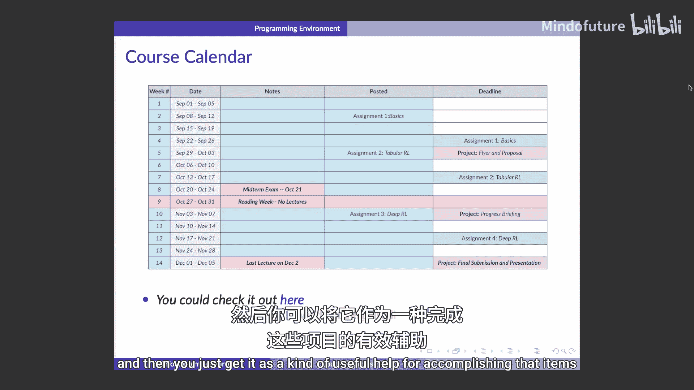

---

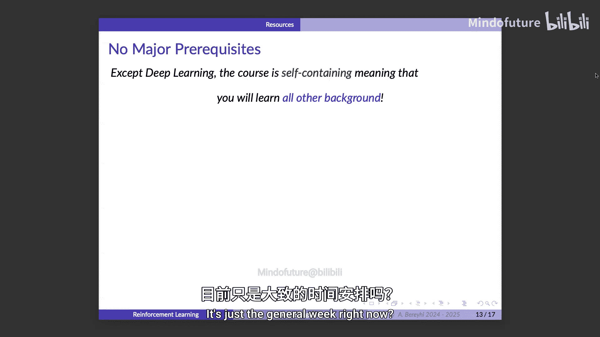

## 实践工具与学术诚信 🔧

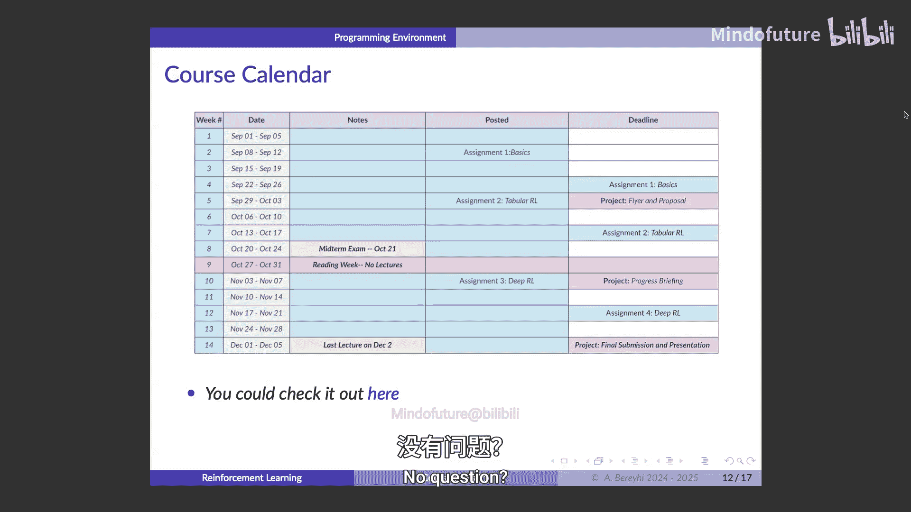

*   **编程语言**：主要使用 **Python**。
*   **环境库**：使用 **Gymnasium** 来模拟强化学习环境。助教和课程材料会提供相关示例。
*   **深度学习库**：你可以选择自己熟悉的库（如PyTorch, TensorFlow）。
*   **关于ChatGPT等工具的使用**：你可以将其作为调试代码、理解概念的辅助工具。但**禁止**直接让其完成作业并抄袭。作业的目的是帮助你巩固知识。虽然我无法完全追踪，但这关乎你的学习效果。

---

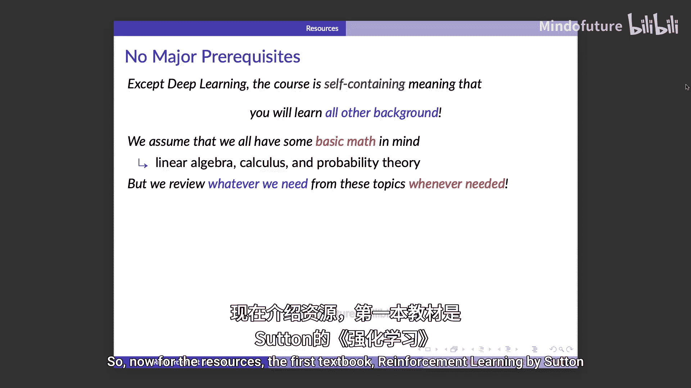

## 课程资源与承诺 📖

*   **主要教材**：《Reinforcement Learning: An Introduction》（Sutton & Barto著）。这本书是强化学习领域的经典，前两部分与本书内容高度一致。该书可免费在线获取。
*   **其他资源**：还有《Algorithms for Reinforcement Learning》和《Deep Reinforcement Learning Hands-On》等书籍可供参考。
*   **课程契约**：我保留在课前甚至课后修改讲义的权利。建议在每次课前下载最新的讲义。

---

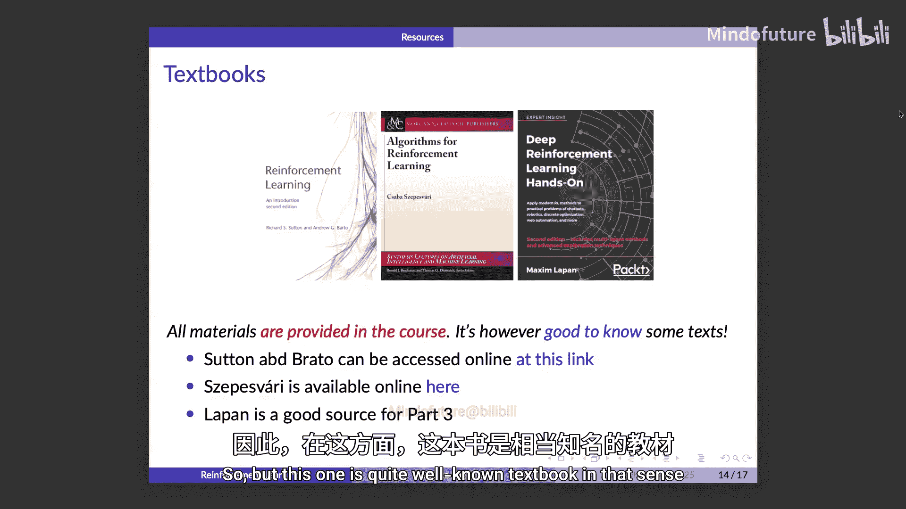

## 课堂文化：像Bloom一样思考 🤔

我将以动画角色 **Bloom**（一个总是持怀疑态度、爱问问题的小人）作为教学参考。这意味着我会站在零基础、学习速度中等的学生的角度来讲解。

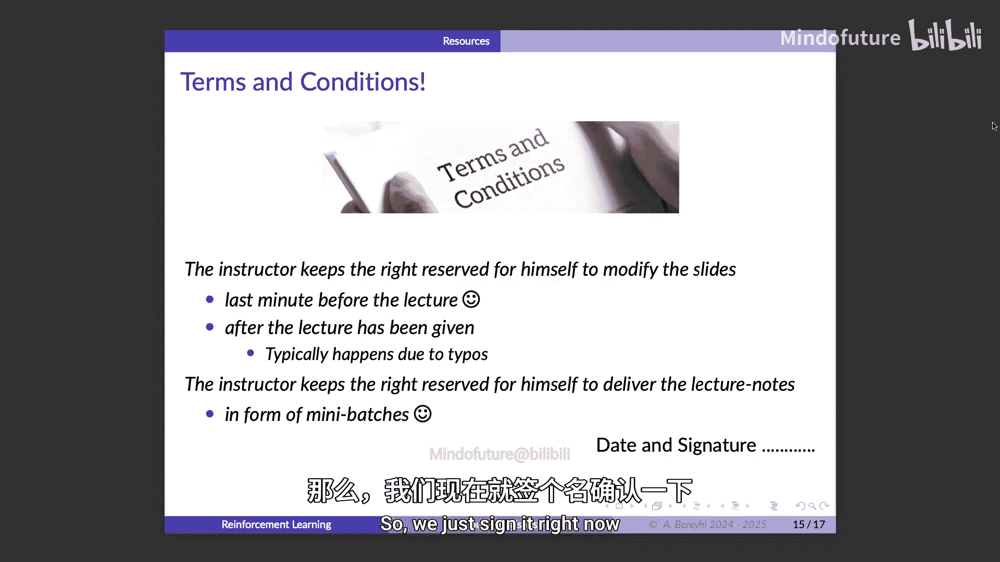

因此，有些已有背景的同学可能会觉得部分讲解较慢，请保持耐心，这有助于确保所有同学都能跟上进度。我们的目标是共同完成学习。

**最后，请记住：没有愚蠢的问题。** 如果你不理解，请随时提问。这对于你的学习和课堂互动都至关重要。

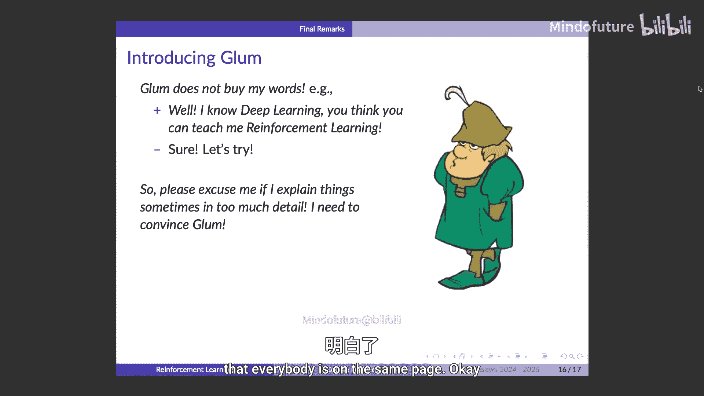

---

## 总结

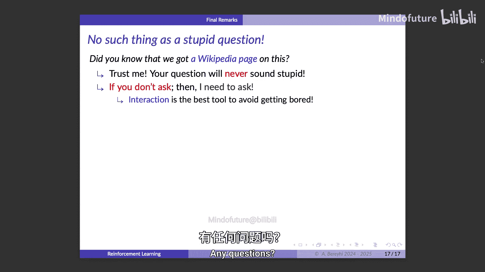

本节课我们一起学习了强化学习课程的全貌。我们了解了课程将由基础框架、表格型方法和深度强化学习三部分组成；明确了作业、期中考试和期末项目三种评估方式；认识到掌握深度学习基础的重要性；并熟悉了课堂将使用的工具和资源。准备好开始这段学习旅程吧！