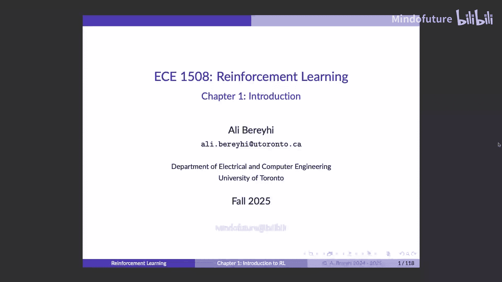
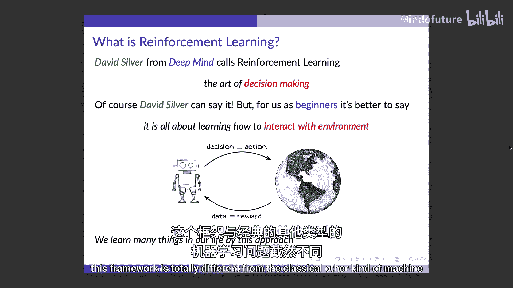
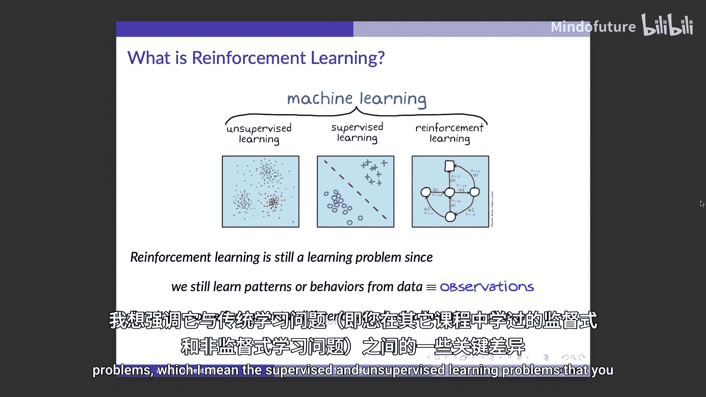
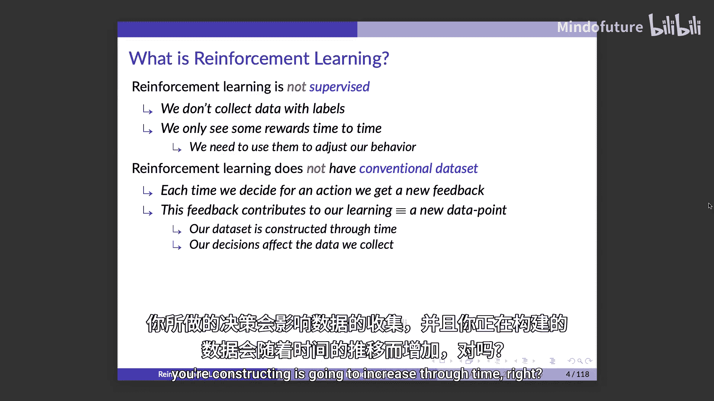
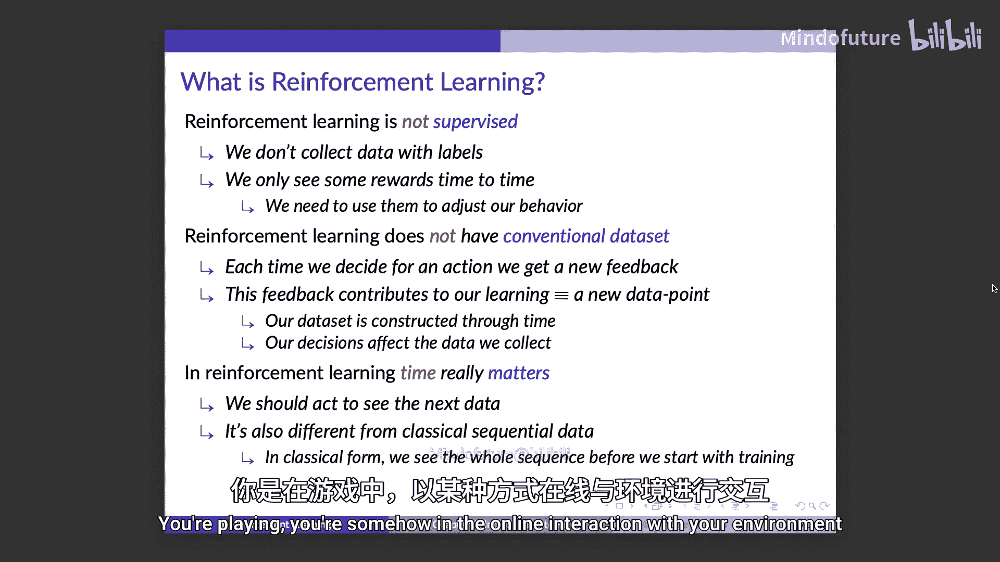
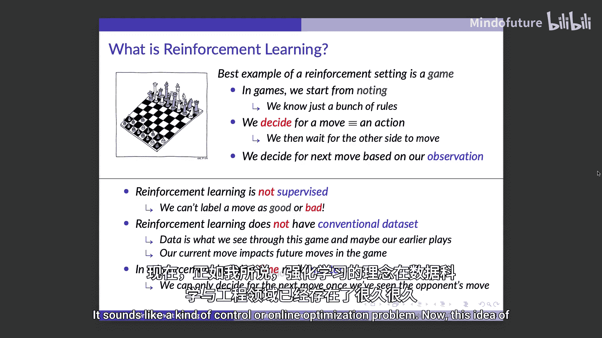
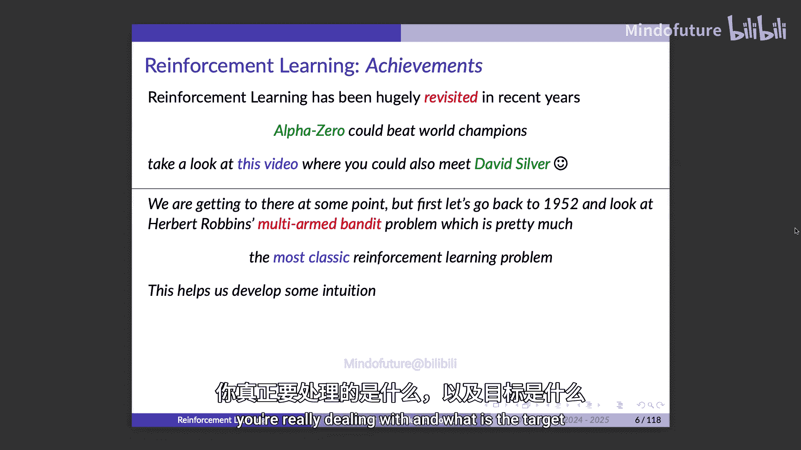

# 002：强化学习作为学习问题 🎯

在本节课中，我们将学习强化学习的基本框架，并通过一个经典的多臂老虎机例子来理解其核心概念。我们将探讨强化学习与其他机器学习范式的关键区别。

## 概述

强化学习被定义为“决策的艺术”。其核心框架涉及一个**智能体**与一个**环境**进行交互。智能体执行**动作**，环境对此做出反应并返回一个**奖励**。智能体的目标是学习一种策略，以最大化其长期获得的累积奖励。

上一节我们介绍了课程的基本信息，本节中我们来看看强化学习作为一个学习问题的具体框架。

## 强化学习框架

强化学习框架的核心交互循环如下图所示：

在这个框架中：
*   **智能体**：做出决策的实体（如机器人、玩家）。
*   **环境**：智能体之外的一切，有其自身的规则和状态。
*   **动作**：智能体对环境施加的影响。
*   **奖励**：环境对智能体动作的反馈信号。

智能体的目标是通过与环境的持续交互，学习如何选择动作以最大化其获得的总奖励。

## 与其他机器学习范式的区别

许多机器学习领域的概述将问题分为监督学习、无监督学习和强化学习。生成式AI等任务通常被归类在监督或无监督学习之下。强化学习则自成一类，因为它与传统的机器学习问题有本质区别。

以下是强化学习与经典机器学习（监督/无监督学习）的几个关键区别：

1.  **无显式监督**：在监督学习中，每个数据点都有明确的标签（如“猫”或“狗”）。而在强化学习中，并没有这样的“正确动作”标签。智能体只能获得一个稀疏的、通常是延迟的奖励信号（如赢棋或输棋），这个信号并不能直接定义某个具体动作的好坏。
2.  **数据集的动态性**：在经典机器学习中，我们通常有一个静态的、预先收集好的数据集用于训练。在强化学习中，数据是在智能体与环境交互的过程中**在线生成**的。智能体当前采取的动作会影响它接下来能观察到什么样的状态和奖励，从而影响后续数据的收集。数据随着时间不断积累和变化。
3.  **时间顺序至关重要**：强化学习是一个**顺序决策**过程。动作的顺序和时机极其重要。例如在下棋时，你必须根据对手的上一步来决定下一步，无法在游戏开始前就决定所有步骤。智能体需要根据当前时刻的观察来实时做出决策。

## 以棋盘游戏为例

理解强化学习最好的例子之一是玩棋盘游戏（如国际象棋）。

在这个例子中：
*   **环境**：包括棋盘、游戏规则以及对手。
*   **智能体**：玩家本人。
*   **状态/观察**：当前棋盘的局面（虽然无法得知对手的想法）。
*   **动作**：玩家决定走的每一步棋。
*   **奖励**：通常是稀疏的，在游戏结束时获得（赢、输或平局）。

当你第一次玩时，你从零经验开始。你走一步，观察对手的反应，再走下一步。通过多次对局，你逐渐积累经验，了解哪些走法在特定局面下更可能导向胜利，从而改进你的策略。这个过程完美体现了上述三个区别：
1.  没有老师告诉你某一步是“好棋”或“臭棋”，你只能从最终的胜负结果中学习。
2.  你的经验（数据）随着每一盘棋的进行而增长。
3.  走棋的顺序至关重要，你必须根据不断变化的局面实时做出决策。

## 历史背景与经典问题

强化学习的思想在数据科学和工程社区中存在已久。近年来一个重大的突破是DeepMind的AlphaZero，它能够高效地学习并掌握围棋、国际象棋等游戏。

不过，本节课我们将从一个更简单、更经典的问题入手——**多臂老虎机问题**。这个问题是理解强化学习核心挑战的绝佳起点。

## 总结

本节课我们一起学习了强化学习的基本框架。我们了解到强化学习是智能体通过与环境的交互来学习最优决策策略的过程。它与监督/无监督学习的主要区别在于：**无显式监督信号**、**数据在线生成且具有动态性**以及**时间顺序在决策中至关重要**。我们通过棋盘游戏的例子加深了这些概念的理解，并引出了下节课将深入探讨的经典问题——多臂老虎机。