# 003：多臂老虎机-最优策略与随机策略 🎰

在本节课中，我们将通过一个简单的例子来理解强化学习中的核心问题：如何在未知环境中做出最优决策。我们将介绍多臂老虎机问题的基本概念，并比较最优策略与随机策略的表现。

## 问题背景

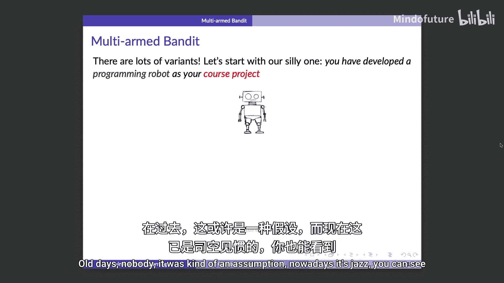

正如你的朋友所说，这个问题有成千上万的版本。我将从一个非常简单的版本开始，这个版本足以让我们进入强化学习的环境。

假设你在第一个项目中开发了一个编程机器人。例如，有些同学在夏天接触过生成式AI，目标是编写代码。你可以让机器人用Python或Java等语言为你编写代码，它会给你一份干净的代码。

如今，没有人会免费提供服务，它会向你收费。

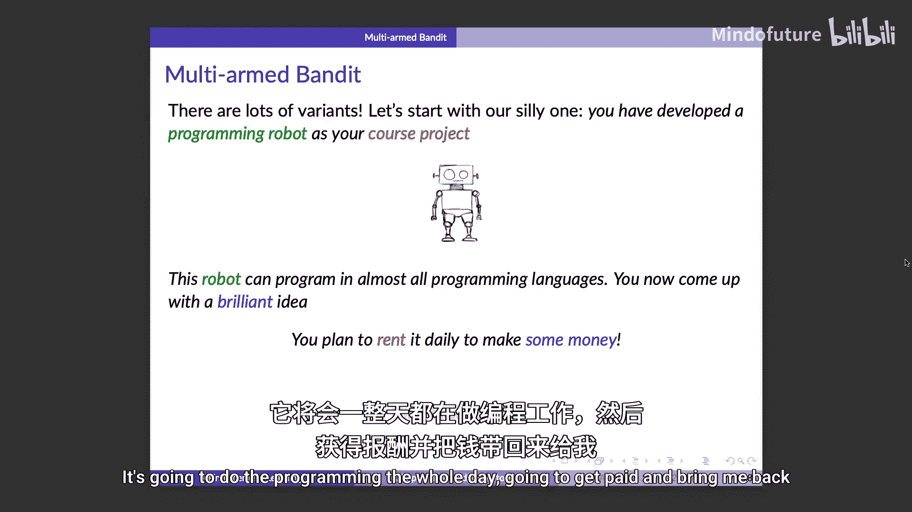

假设我拥有这个机器人。在构建它之后，你想出了一个非常棒的主意：你想从这个项目中赚钱。接下来要做的是出租它。有许多公司正在寻找程序员，每天早晨，我会查看一家公司，然后把我的机器人派过去。它会工作一整天，获得报酬，然后把钱带回来。

这就是基本想法。很好。

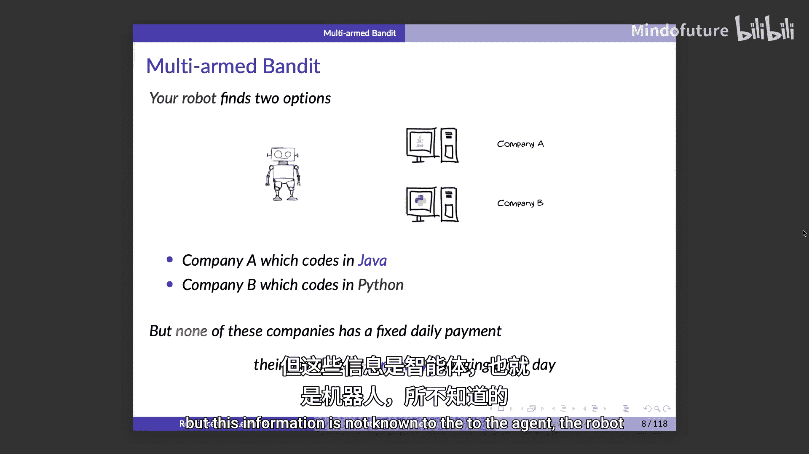

由于就业市场状况不佳，现在只剩下两家公司：公司A和公司B。一家使用Java，另一家使用Python。你想出租你的机器人，对吧？所以，你每天都有一个选择：决定将机器人派往其中一家公司。

现在，所有这些公司的关键点是，这两家公司都没有固定的日薪。这意味着它们不会在一天开始时告诉你今天会支付多少钱。这完全取决于市场需求，也许在一天结束时，它们会支付你一些报酬。

我将给你一些背景信息，但这些信息对智能体（即机器人）是未知的。信息如下：公司A的报酬服从高斯分布。

这意味着它有一个钟形密度函数。钟形的中心在均值600附近，标准差为100。

这就是该公司的支付方式。这意味着有人观察了该公司很长一段时间的支付记录，发现平均每天支付大约600美元。但有些日子支付很多，有些日子支付很少。通常你可以取一个区间，比如均值加减3倍标准差。所以有些日子可能支付900美元，另一些日子可能支付300美元。所有这些都有可能，但纵观整个时间段的支付，平均值大约在600美元。

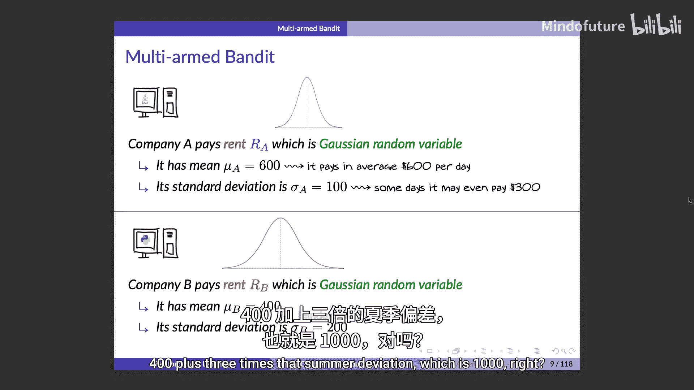

关于公司A就是这些。公司B的情况则不同。公司B的支付也服从高斯分布，但参数不同。其均值是400，比600小，但标准差更高。

这意味着，如果你在那里工作，平均会得到400美元。但甚至有可能在某一天得到400加上三倍标准差，也就是1000美元。所以在某些情况下，你会在这里得到1000美元，而在另一些情况下，你会得到大约-200美元（或更低）。但平均而言，公司A的支付优于公司B。

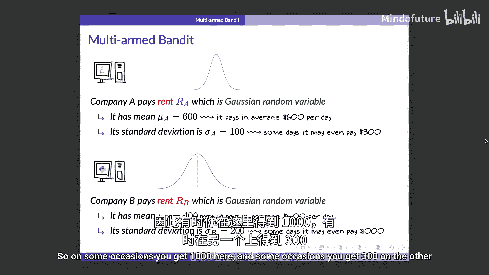

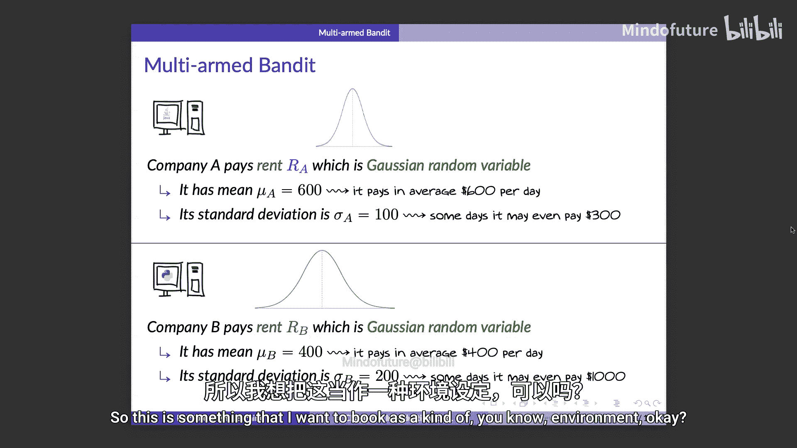

然而，这些信息对你都是未知的。我想把这作为环境的一部分。

现在，你想做的是出租那个机器人，那个机器人就是你的智能体。它每天都会外出工作，在每天结束时获得奖励，也就是报酬。你希望把它租出去一个月，并在这个月内收集尽可能多的报酬。

为了做到这一点，你需要设计一个策略。别担心，这不是我定义智能体、环境和策略的方式（我们将在周五的课上定义），但只是给你一个例子。你有一个特定的策略，什么是你的策略？这就是你出租这个机器人的策略。所以，每一天你决定是把它派往公司A还是公司B。在时间t，你的决策I(t)实际上是A或B。所以当你决定在时间t派往公司A时，策略就是A；当你决定派往公司B时，策略就是B。这就是这里的策略。

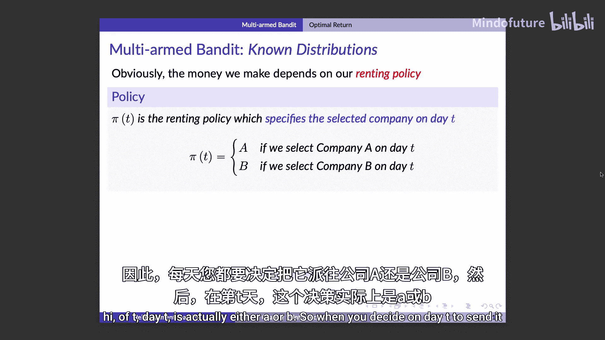

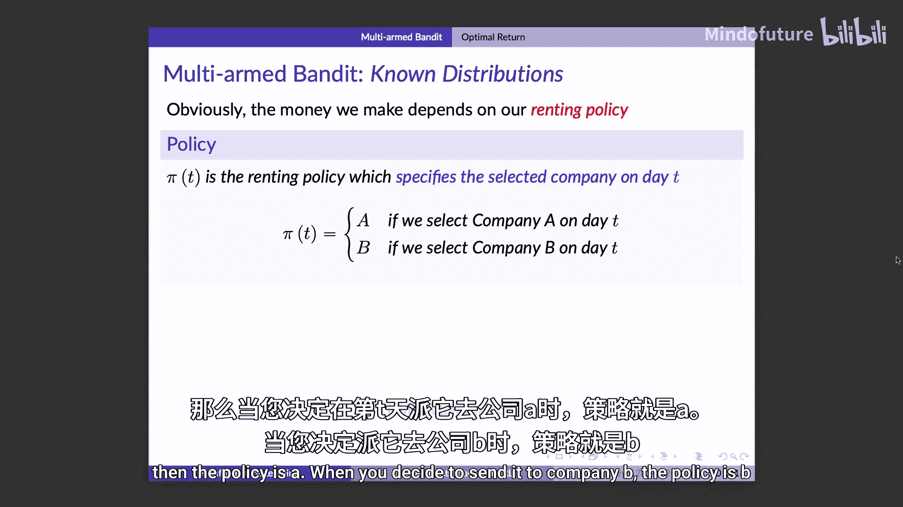

这里的问题是：出租你的机器人的最优方法是什么？你如何找到最优策略？显然，我们希望获得最大的奖励，即收集最多的钱。但整个问题在于，这个奖励系统是随机的。公司会等到一天结束时，根据就业市场情况支付报酬。所以，在你派机器人去之前，你无法知道一天结束时能收到多少钱。

这就是定义最优策略的挑战所在。整个过程是随机的。我们所说的“最优”是什么意思？这是许多统计问题中出现的经典问题。最好的解决方案是什么？如果你想定义最优方法，如何定义它？

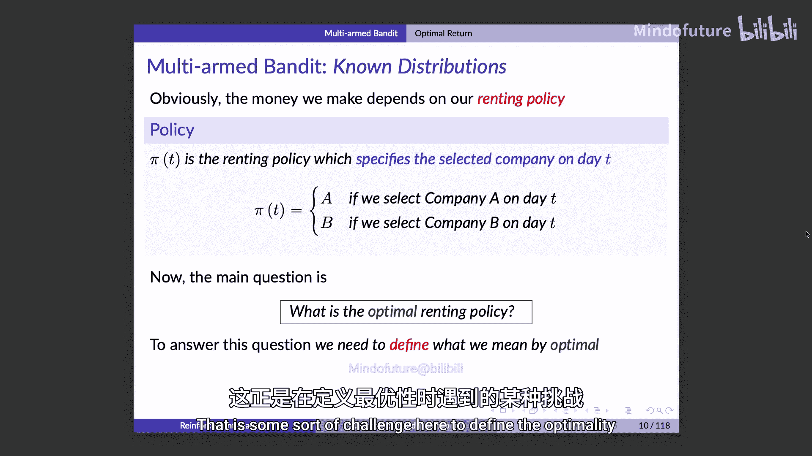

## 最优期望回报

最优指的是期望回报。在期望意义上。你会说，好吧，我不关心发生的某个特定样本。所以，也许某一天我希望它工作得很好，但随着时间的推移，你会期望它平均表现良好。

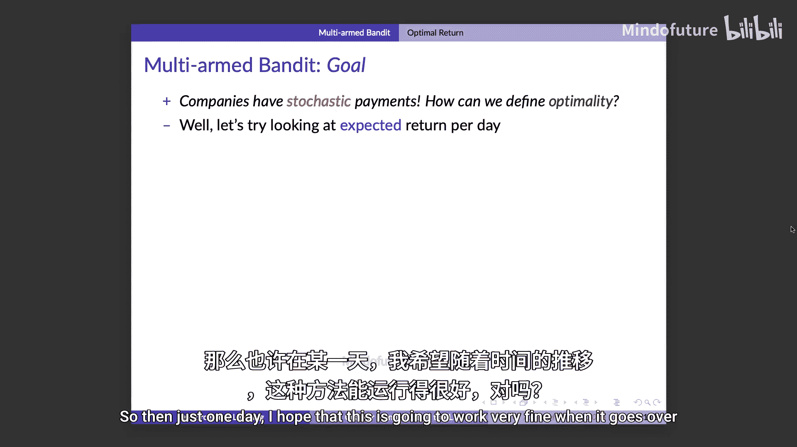

这是你收集金钱的直观方式。你会说，好吧，今天我可能会损失一点，但只要明天我能得到更多，我就能弥补。这就是你通常的做法。你希望你的平均回报最大。平均回报在数学上可以定义为期望值。这是特定回报的数学期望。这个R是什么？R是你在一天结束时获得的报酬。

显然，它取决于你的策略，取决于你是将智能体派往公司A还是B。但根据你选择的公司，你会得到一个奖励，而这个奖励本质上是随机的。假设我做了两天，定义它的最佳方式是平均你这两天的所有报酬，但它仍然是随机的。所以你需要取它的期望。如果你不取期望，你处理的就是一个随机量，你无法优化它。

所以目标是：我想在T天的时间内，使这个平均回报最大化。是的，这个期望是针对回报R_t取的，它既取决于策略，也取决于公司的支付随机性，因为公司的支付也是随机的。当然，策略也会产生影响。

我的最终目标是：如果我出租机器人T天，那么这个平均回报将是最大的。我希望获得我能得到的最大平均报酬。

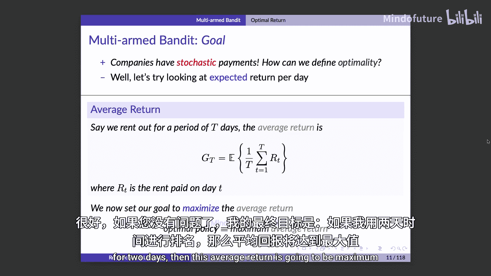

现在。

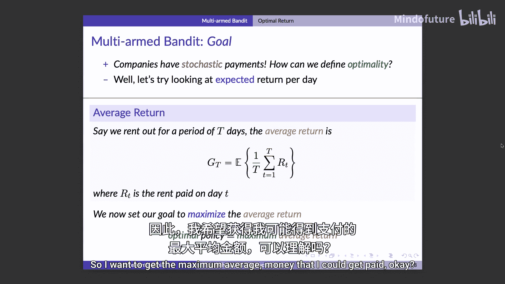

## 期望值概念回顾

这里有一个问题：边际期望和条件期望，你们清楚它们是什么吗？如果不清楚，我可以在黑板上写下来。

首先，让我定义随机变量的期望。如果我有一个随机变量X（用大写字母表示），它服从某个密度函数P(x)，你如何定义期望？X的期望是什么？

如果它是离散的，你会写求和；但既然我们处理的是连续随机变量，那就是积分。期望内的任何东西，对于X本身，就是 ∫ x P(x) dx。这就是你的期望。

现在，如果我把x换成其他东西，比如我有f(x)，这里会发生什么？

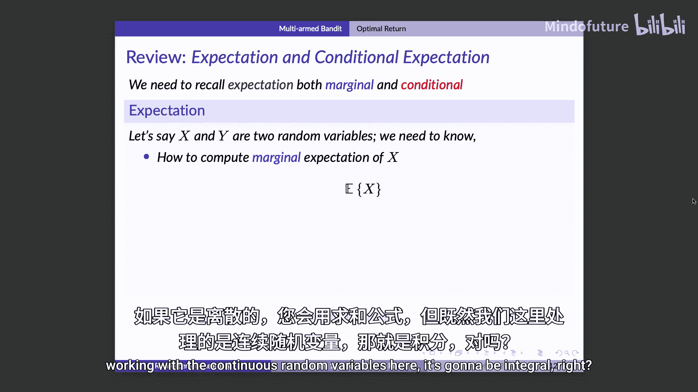

这个x将变成f(x)，所以你会写成 ∫ f(x) P(x) dx。这就是关于X的边际期望，不涉及其他变量。

但你也可以有条件分布。我可以把它写成P(x|y)。当y对你来说是某个固定值时，这个P(x|y)就是给定y时x的分布。一旦你知道y，你就可以写出x的分布。对于给定的y，你有一个分布。现在，你如何定义在y等于某个特定值y的条件下，x的期望？当y固定为特定值y时，你的分布将是x给定y。然后你想在该分布上对x求平均。你应该怎么做？你积分x乘以条件密度，即 ∫ x P(x|y) dx。

现在，我也可以继续对y求平均吗？是的。我该怎么做？这个量是y的函数。所以乘以P(y)，然后对y积分。所以这个y是这里的变量，乘以它，然后对y积分。这个量首先是关于x（在给定y下）的期望，然后我将其对y求平均。所以我可以把它写成X本身的期望。

大家都清楚了吗？好的。

现在，如果大家都清楚了，那我们继续看例子。

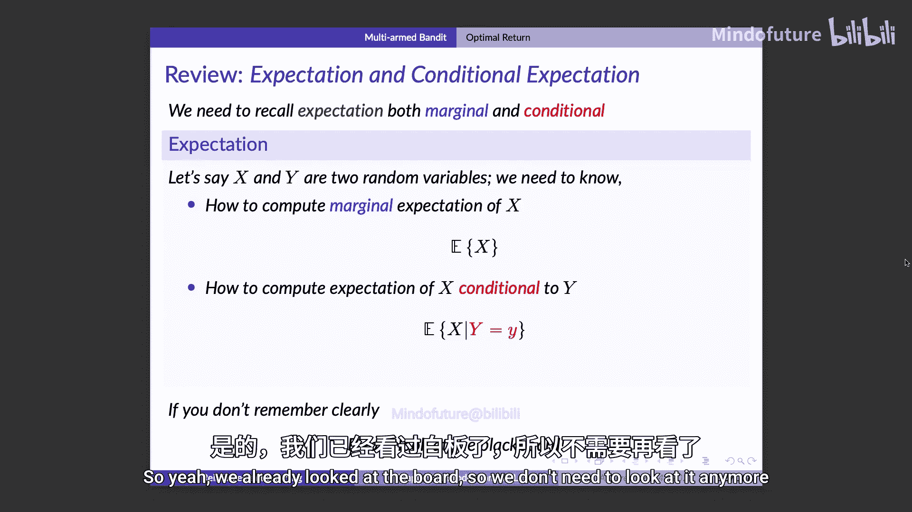

## 已知分布时的最优策略

首先，如果我确实知道公司A和B的支付分布，我知道它们服从那些均值和标准差的高斯分布。最优策略是什么？你当然不知道，但如果你知道，最优策略是什么？

你想最大化你的平均回报。是的，你会一直选择去平均报酬更高的公司。如果我知道，我会一直把它派往公司A，因为它的平均支付更高。这在数学上也很明显。我想最大化这个平均值的期望。

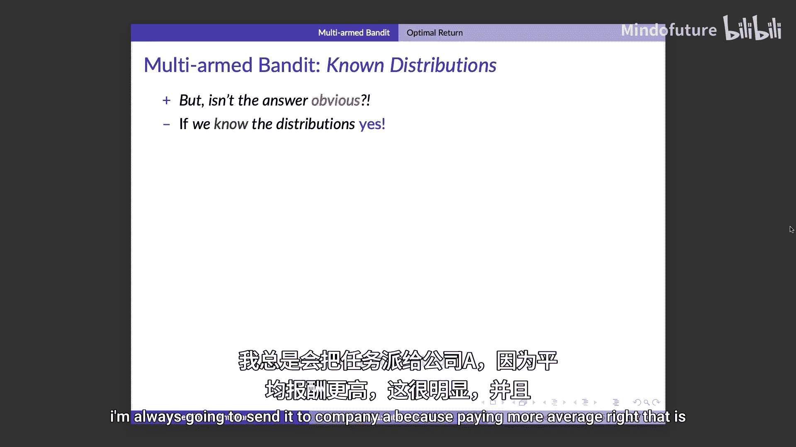

这个期望可以简单地移到求和内部。这很容易。我将把它移到里面。

现在，假设我不知道具体该怎么做。我决定将机器人派往公司A工作T_A天，派往公司B工作T_B天。会发生什么？我将有T天。在所有这些T_A天里，奖励的期望是公司A的平均值，即μ_A。所以这里会出现T_A * μ_A。对于公司B，我派了T_B天，每一天我平均得到μ_B，即T_B * μ_B。

这是我在这T天内收集的总报酬，除以T，就是平均回报。

现在，首先，如果我把T_A和T_B加起来，结果是什么？是T。如果我有100天，也许我派20天去A，剩下的80天派去B。所以T_A加T_B等于T。我可以把T_A写成T减去T_B。

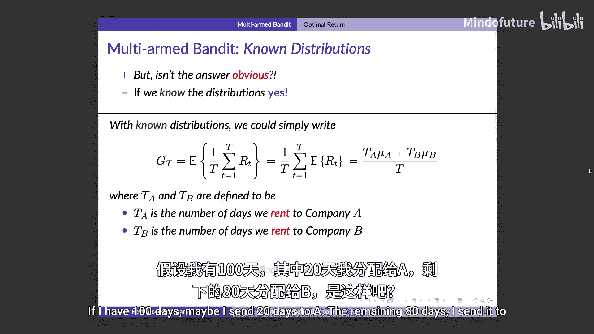

T_A和T_B都小于等于T，即工作天数小于等于总天数。

如果我在这里做简单的符号替换，我会说我的平均回报是这个项。现在，我不写T_A，而是用T - T_B替换它。

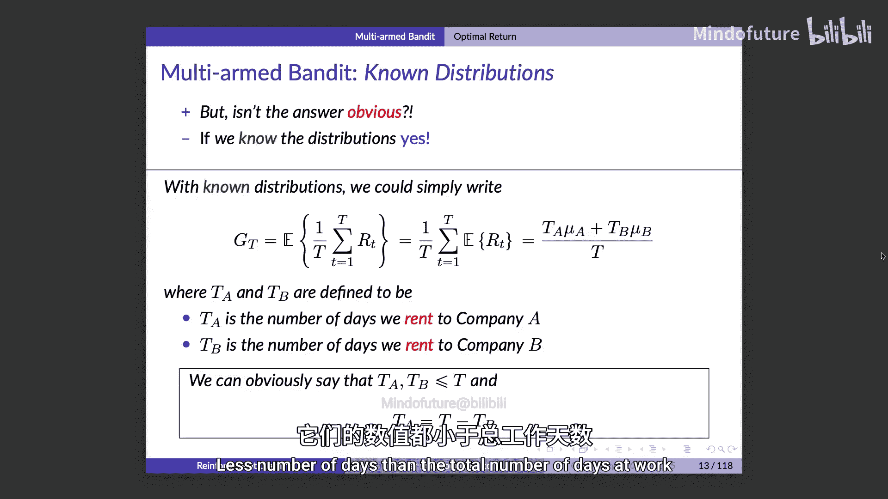

第一项T除以T等于1。我把那一项单独提出来。然后我有μ_A乘以T_B/T，以及μ_B乘以T_B/T。我可以提出因子T_B/T。

我可以先这样写。所以这一项将是1减去T_B/T。另一项μ_B乘以T_B/T保留。现在我可以提出T_B/T。提出后，剩下的是μ_A，加上T_B/T乘以（μ_B - μ_A）。

大家都看到这个基本推导了吗？没问题。

现在，T_B/T这个比值，当我把智能体从未派往公司B时，它可以为0；当我总是派往公司B时，它可以为1。所以这个值总是在0和1之间。如果我把μ_A和μ_B的值（600和400）代入，情况就是这样。所以我平均收集的回报将是600（这是公司A较高的平均支付）减去两者之差（200）乘以T_B/T。这个值能超过600吗？永远不会。如果你选择做任何事，这个分数将是0到1之间的某个正数，这意味着我得到的报酬将少于600。

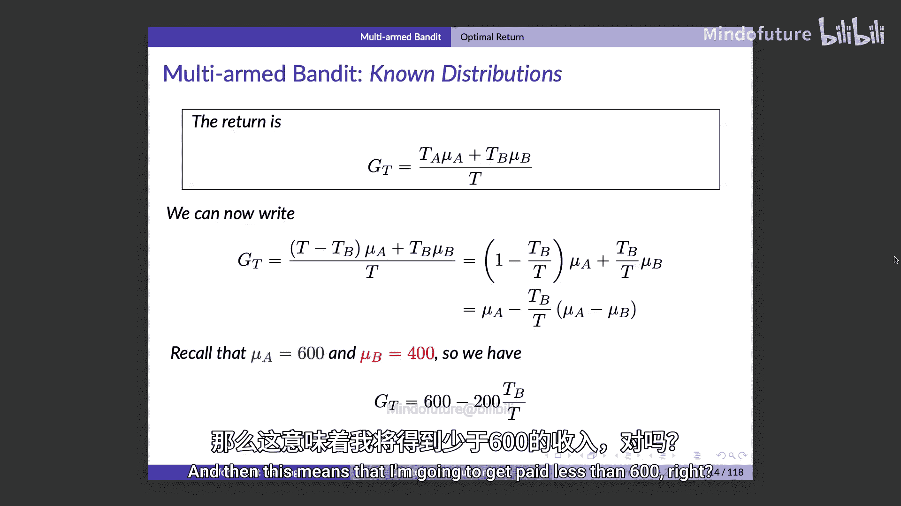

所以，更直白地说，T_B/T为0意味着你总是在A工作，为1意味着你总是在B工作。最好的主意是让这个值为0，那么你将得到最好的报酬，即平均600美元。这意味着，即使公司B可能在某天支付1000美元，但正确的策略（即使你每天都不知道确切的支付额）是始终选择平均支付更高的那个。

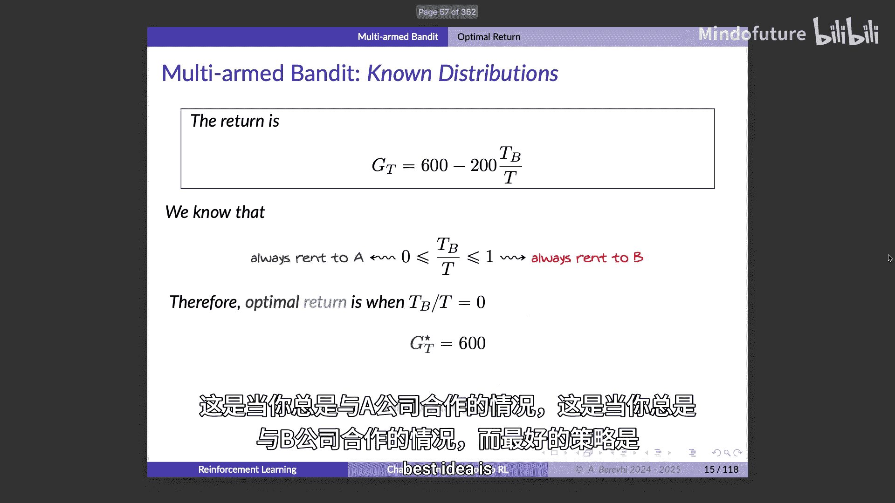

这说得通，对吧？很好。

所以这是最佳的平均回报。你可以想象，如果你为T天工作，你永远无法超过这个值。但这里的关键点是，当我计算这个时，我假设我知道分布，我知道每家公司的支付行为，而这在实践中并非如此。在现实情况下，我们并不真正了解那个分布。如果我们知道那个分布，那么我们总是会把智能体派往公司A。这意味着我们可以使用的最佳策略是：每一天都选择公司A。但我们不能这样做，因为我们不知道分布。这就是实践中发生的情况。在实践中，你不知道报酬的分布是什么。

我给你的这些是作为环境内部的某种附加信息，但在现实中，你只是派你的智能体出去，那是你的工作，你看到一些样本报酬。今天你得到600，明天得到300，等等。可能第一天你去公司A，那天是公司A的坏日子，只付你300美元；然后第二天你说，好吧，我去公司B，结果那天是公司B的好日子，付你1000美元；然后你继续选择公司B。但平均而言，你得到的报酬更少。这是一个非常明显的事情，但这会在实践中发生。

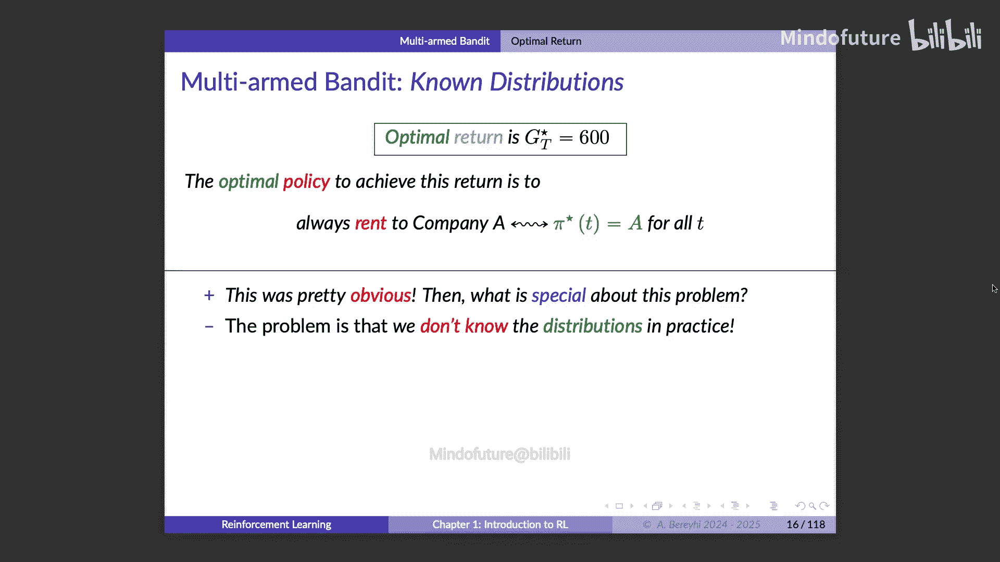

## 实践中的策略：探索与利用

在实践中，我们能做的是最终进行一些观察。我们可以通过去那些公司工作一段时间，从它们那里获得一些样本支付，从而得出简单的观察。我们开始推断哪家公司是更好的选择。

这就是实践中将要发生的事情。所以，在实践中，你将会有一种租赁策略，你根据从环境中获得的观察来构建该策略。你可以看到，这种观察完全是随机的，这是从你的环境中出来的一个样本。如果你一直工作下去，你可能会得出一个不同的策略。

现在，让我们看一个简单的案例，我们采用一种折中的方法来设计策略。看看我们能离这个最优策略有多远。

所以，最优工作的最佳回报是600。这是当有人告诉你公司A平均更好时，我们会一直选择在那里工作。

如果在实践中我们采用贪婪的方法，会发生什么？我所说的贪婪方法是什么意思？让我们考虑这个策略。首先，让我们讨论随机策略，然后我们再讨论我的贪婪策略。

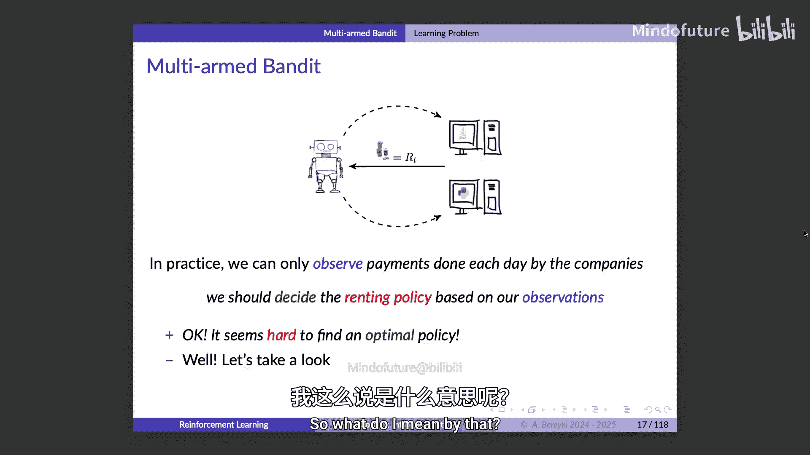

## 随机策略

让我们考虑这个简单的随机策略。在这个策略中，我每天抛一枚硬币。如果是正面，我去公司A；如果是反面，我去公司B。硬币是公平的，所以我有50%的机会去A，50%的机会去B。现在我想看看，从这个随机策略中，我能得到多少平均回报。你认为平均回报大概是多少？500。公司B是400，公司A是600，一半时间在这里，一半时间在那里，平均你会得到500。

你可以简单地计算，或者再用方程推导一下。我想通过计算给你一个实现的概念。我想取这个期望。我的奖励R_t取决于策略，而策略完全是随机的（我抛硬币）。

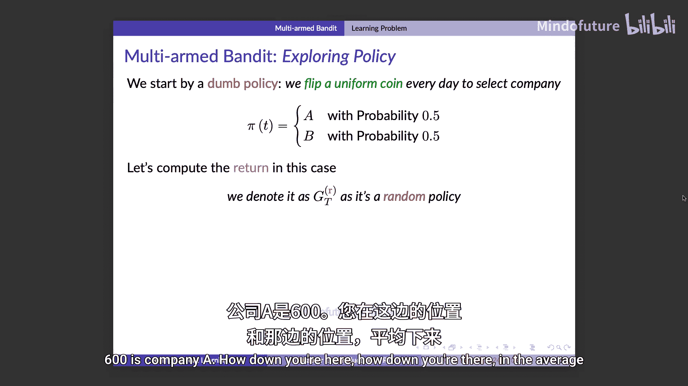

假设我抛了硬币，硬币显示A，那么R_t将是我从公司A得到的奖励；如果硬币告诉我B，那么R_t将是我从公司B得到的奖励。

我可以先固定策略，然后对奖励求平均；一旦我对策略求了奖励的平均，然后我再对所有可能的策略求这个平均奖励。在我们这种情况下会是什么？

对于策略π_t，可能的结果是什么？你的策略π_t可能是什么？它只能是A或B，这是你唯一能做的。所以你可以说，好吧，假设我的策略在第t天是去公司A。这意味着现在这个R_t最终取决于公司A。然后你取它的期望。同样，如果你的策略是选择B，那么这意味着我们的R将是从公司B获得的报酬。

你分别计算它们的平均值。这是你策略的两种可能结果。现在，每种情况发生的概率各为一半。你乘以各自的概率，然后把它们加起来。这就是关于策略的平均。

这正好是你说的500。如果我把第一项放在这里，第一个期望是600，这是公司A的平均报酬。第二项是400。然后一半600加一半400，得到500。

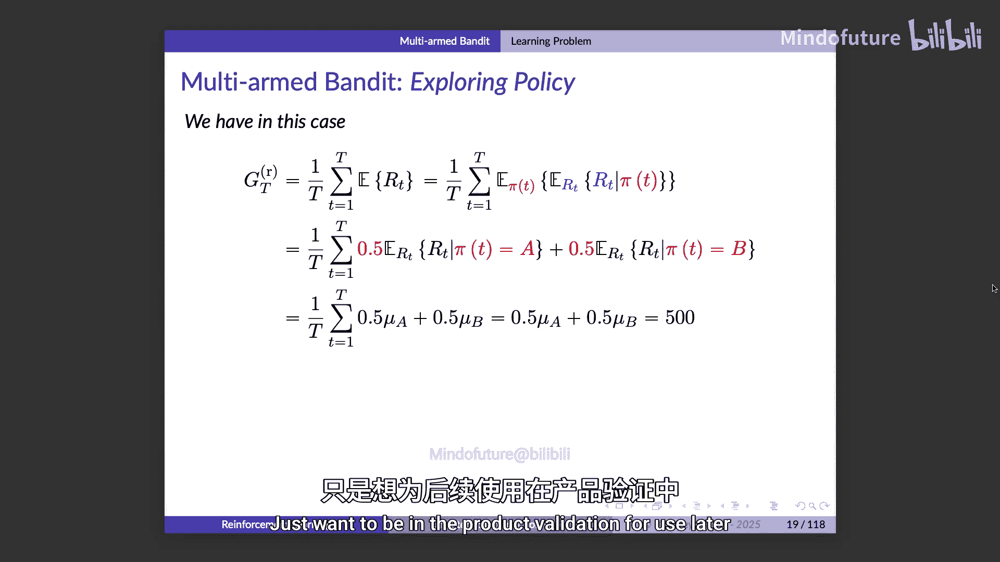

这正是你已经说过的，我只是想通过这个额外的符号来澄清一下。

所以，现在，如果你采用这个随机策略，将会发生的是，你将获得平均500的报酬，你将损失100，这个损失是相对于你可能获得的最佳报酬而言的。有时人们称之为“遗憾”。你可能会说，好吧，没有办法摆脱这一点，因为我最终对分布一无所知，所以我随机选择这家或那家。

但实际上情况并非如此，我的意思是，你实际上可以做得比那更好。你可以以一种方式操作，使得你获得的平均回报不正好是600，但你可以让它尽可能接近600。你可以做到这一点，让我们从这个想法开始。

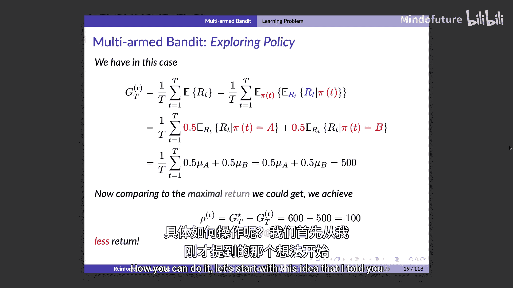

## 贪婪策略（带初步探索）

我告诉你的这个想法是，一旦你已经做了一些探索，你就已经去公司A工作了一段时间，也去公司B工作了一段时间。从这些数据中，你可以对它们有所了解。

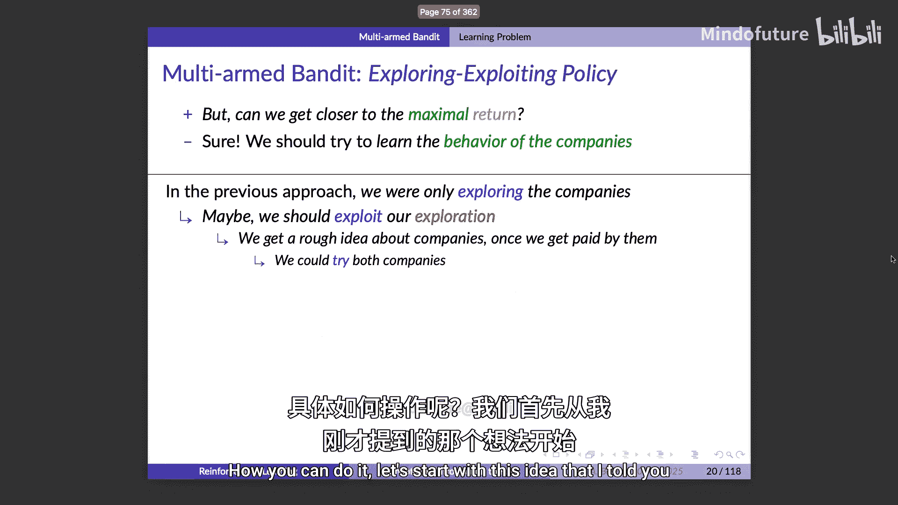
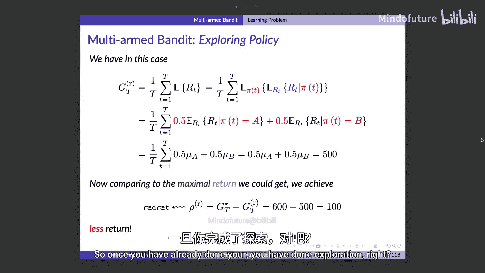

如果你作为一个人想这样做，你会在两家公司各工作几天，然后说，好吧，这家公司似乎平均支付更好。当然，第一天他们付得少，但我工作了10天，似乎比另一家更好。所以你会在剩下的日子里坚持选择那一家。你最终所做的是，首先进行了一些探索。你去过这些公司，收集了一些样本。尽管那些样本在你脑海中，你开始勾勒出那个钟形曲线，并且公司A的那个曲线的中心更好一些。然后，在那个时候，你开始利用你从探索中已经得出的结论。你开始得出结论，去公司A工作更好。

这是玩这个特定游戏的正确方式。

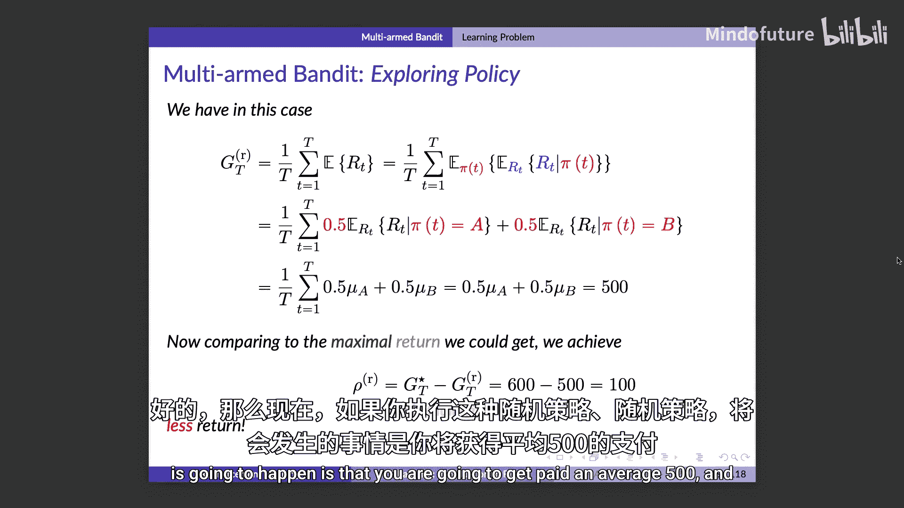

所以，当我们这样做时，这最终就是我们所说的学习过程，因为你开始收集一些数据，然后开始估计公司的行为，并据此尝试构建你自己的行为。所以这是一种学习过程。但让我们尝试这个特定的策略，看看它如何工作。

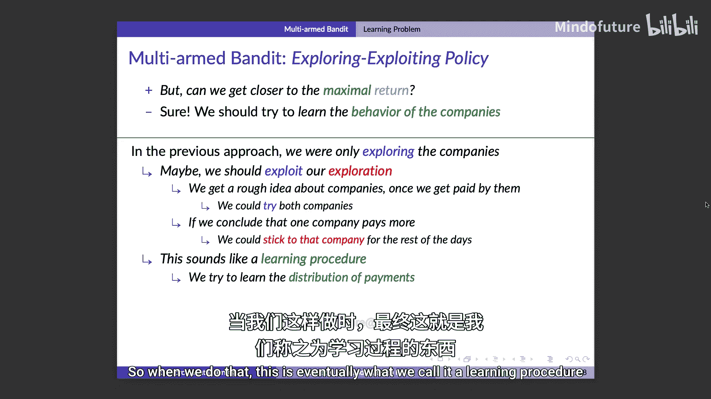
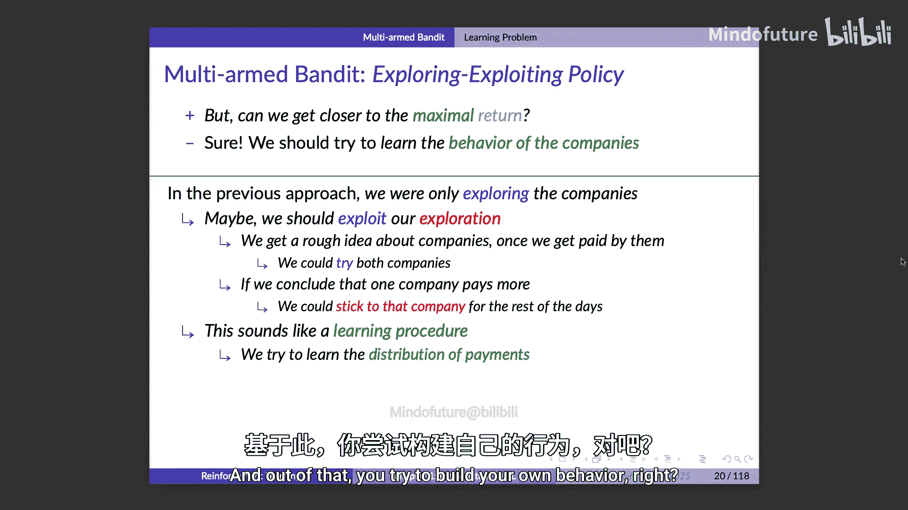

## 简单贪婪策略示例

我还有一些时间，所以看看这个策略与其他策略相比如何工作。我要做最简单的一种：我不会耐心地在每家公司工作几天，我只为每家公司工作一天。

我将在公司A工作一天，在公司B工作一天，然后比较报酬。如果我在A（第一天）得到的报酬比在B（第二天）得到的多，那么我将继续在A工作。

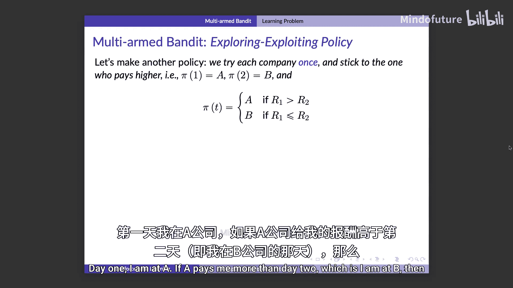

如果第二天我在B工作得到更多，那么我将继续在B工作。这是最贪婪的玩法，但事实证明，这个策略的表现优于纯随机策略。

现在，让我展示一下你从这个贪婪策略中获得的回报。它之所以更好，仅仅是因为我每家公司都尝试了一天。

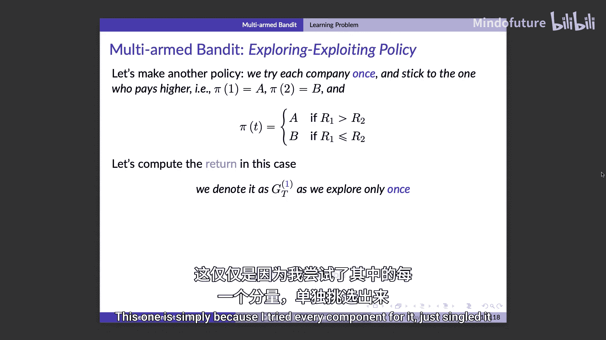

大家都清楚高斯分布及其性质，以及多个随机变量的性质了吗？

或者你想让我解释一下？

## 总结

在本节课中，我们一起学习了多臂老虎机问题的基本框架。我们通过一个出租编程机器人的例子，引出了在随机回报环境下寻找最优策略的问题。

我们首先定义了**最优期望回报**作为衡量策略好坏的标准，即在已知支付分布时，始终选择平均回报最高的选项（公司A）。其数学表示为：
**最优平均回报 = μ_A = 600**

接着，我们分析了**纯随机策略**（如抛硬币），其平均回报是两家公司均值的简单平均：
**随机策略平均回报 = (μ_A + μ_B) / 2 = 500**
这产生了100的“遗憾”或损失。

最后，我们介绍了一种简单的**贪婪策略**，它包含初步探索：先尝试每个选项一次，然后一直选择初始尝试中回报更高的选项。虽然简单，但这种策略通过极少的探索获得了比纯随机策略更好的性能，因为它有更高的机会锁定更好的选项。

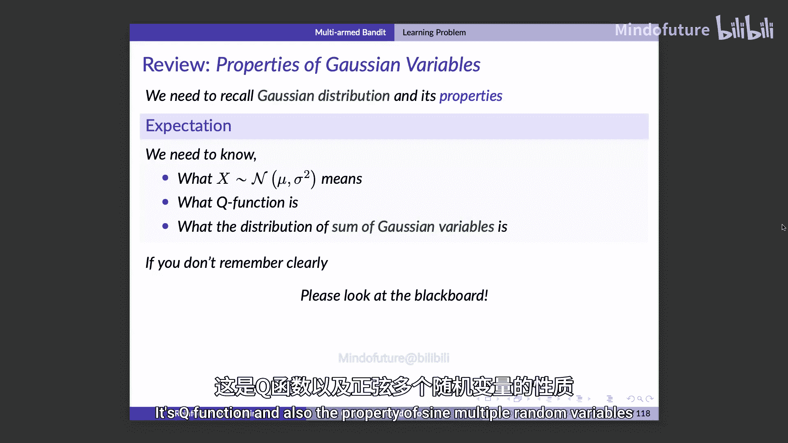

本节课的核心在于理解**探索**（尝试未知选项以获取信息）与**利用**（利用当前已知的最佳选项）之间的权衡。在完全未知的环境中，我们需要通过探索来估计各选项的价值，然后利用这些信息做出更优的决策，从而使长期平均回报接近理论最优值。