# 004：多臂老虎机的混合方法

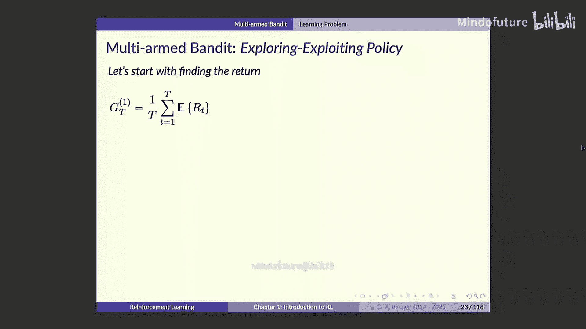

在本节课中，我们将学习如何为多臂老虎机问题设计一种混合策略。我们将通过一个机器人选择公司的具体例子，分析如何平衡探索（尝试不同选项）和利用（选择当前已知的最佳选项），以最大化长期收益。

---

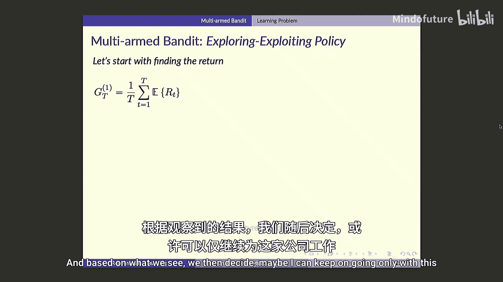

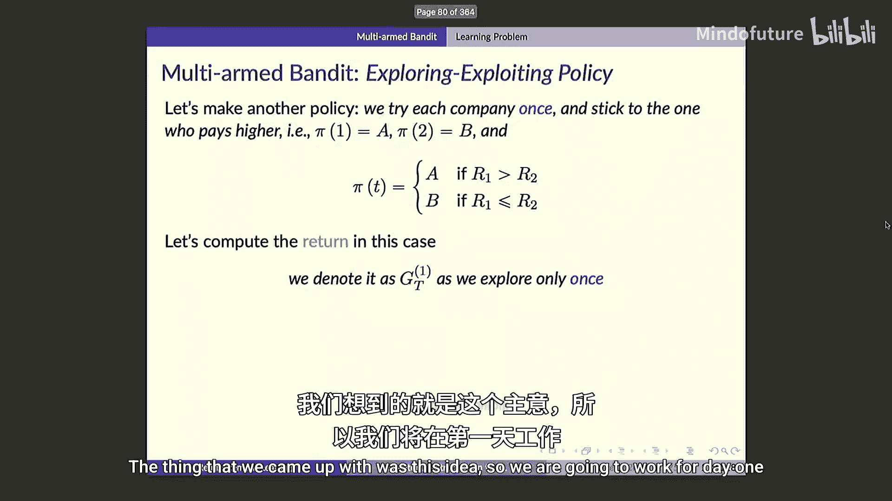

## 问题设定

假设有一个机器人需要选择为哪家公司工作。有两家公司：公司A和公司B。公司A的平均日薪为600元，方差为100。公司B的平均日薪为400元，方差为200。我们的目标是设计一个策略，让机器人在T天内获得尽可能高的总报酬。

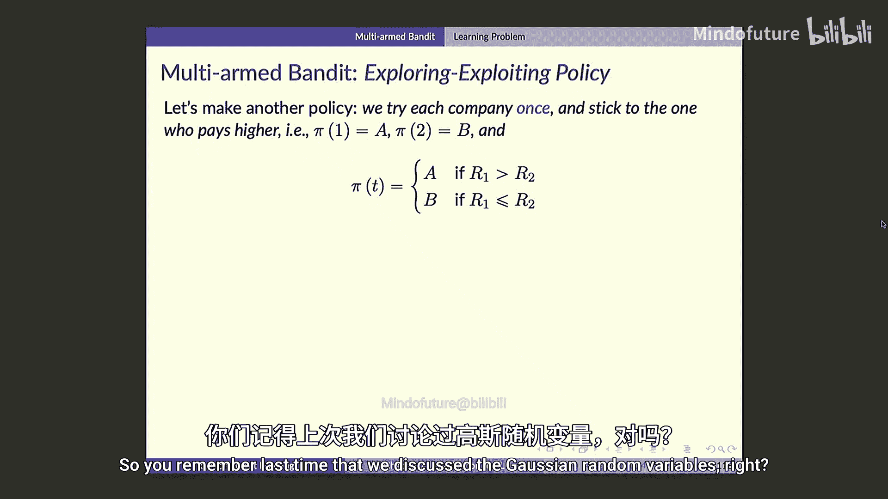

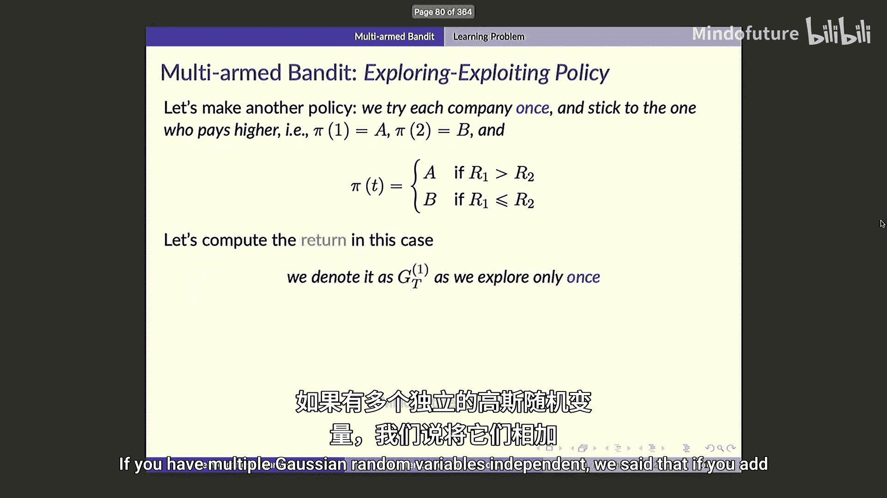

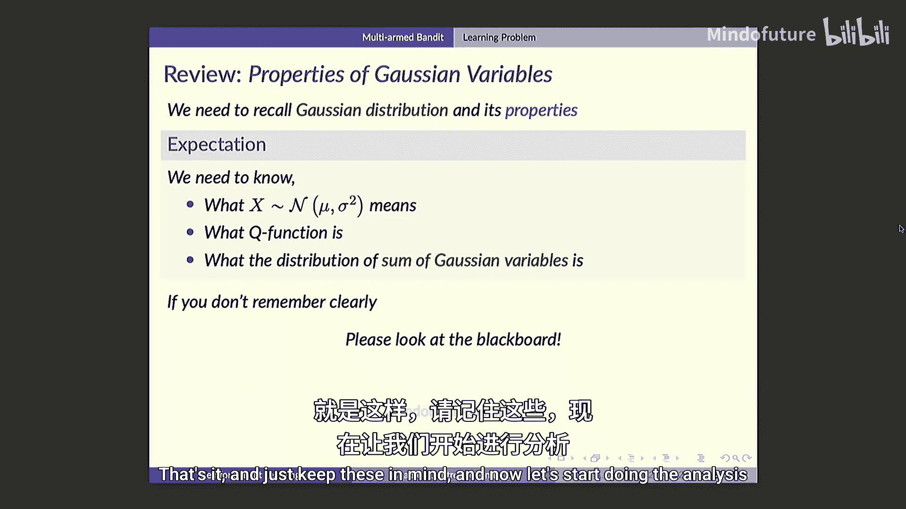

我们已知的最优策略（若拥有完全信息）是**始终选择公司A**，因为其平均报酬更高。然而，在现实中，我们最初并不知道哪家公司更好。

---

## 策略分析

上一节我们介绍了问题背景，本节中我们来看看几种不同的策略及其效果。

### 策略一：纯随机策略

一种简单的方法是让机器人每天随机选择公司，例如各以50%的概率选择A或B。

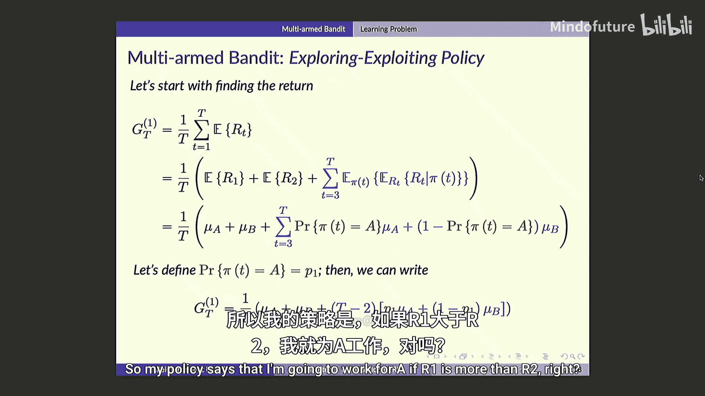

以下是该策略的预期收益计算：
*   预期日收益 = 0.5 * 600 + 0.5 * 400 = 500
*   总预期收益 = 500 * T

与始终选择公司A的最优策略相比，该策略每天损失100元，**遗憾值**（Regret）较高。

### 策略二：简单探索后利用策略

为了做出更明智的决定，我们可以先进行少量探索，再根据结果进行利用。具体策略如下：
1.  **第1天**：为公司A工作，获得报酬 R1。
2.  **第2天**：为公司B工作，获得报酬 R2。
3.  **从第3天到第T天**：比较 R1 和 R2。如果 R1 > R2，则剩余所有天都为A工作；否则，为B工作。

我们用数学公式来描述这个策略。定义策略函数 π_t 表示第t天选择的公司。那么：
*   π_1 = A
*   π_2 = B
*   对于 t >= 3: π_t = A 如果 R1 > R2，否则 π_t = B

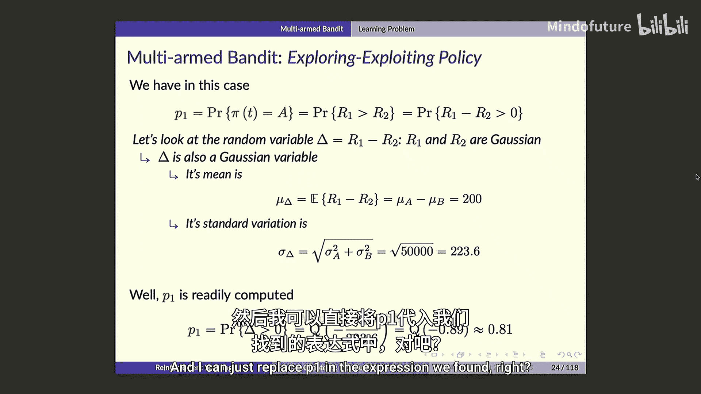

我们的目标是计算该策略的**平均总收益** G_T(1)，其中“1”表示每家公司只探索一天。

---

## 收益计算

上一节我们定义了策略，本节我们来具体计算其预期收益。

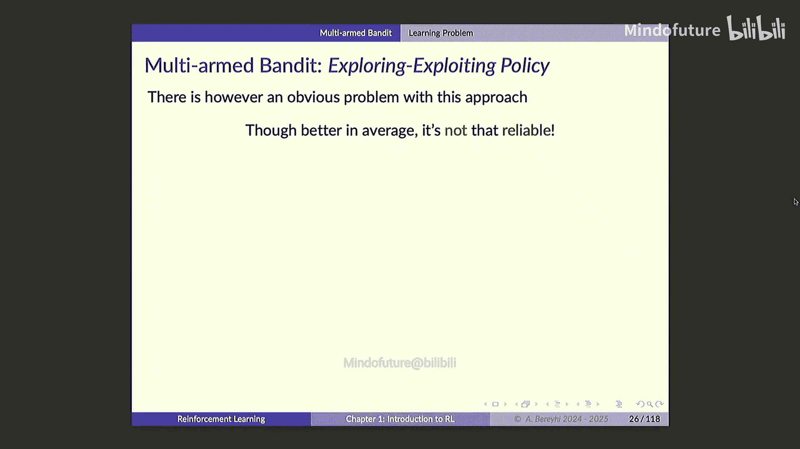

总收益是各天报酬之和：G_T(1) = (R1 + R2 + ... + R_T) / T。我们计算其期望值 E[G_T(1)]。

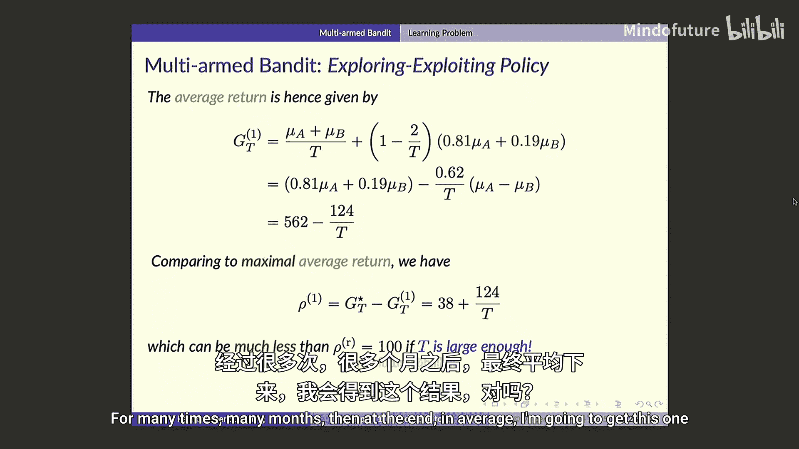


前两天的期望收益是固定的：
*   E[R1] = μ_A = 600
*   E[R2] = μ_B = 400

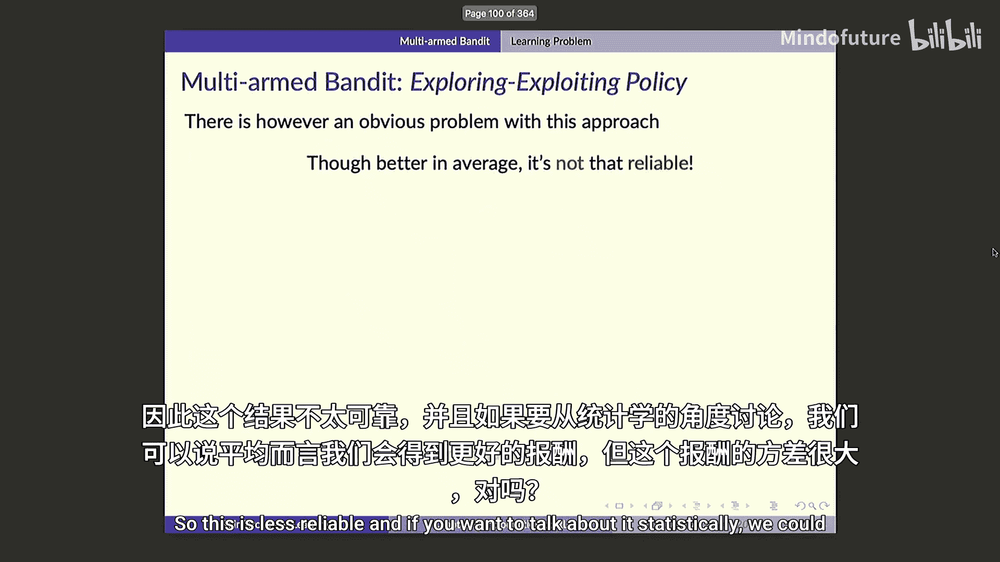

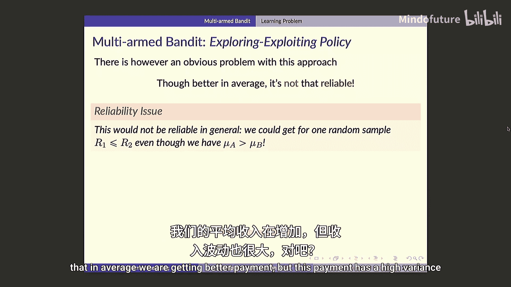

从第3天起，选择的公司取决于策略。我们需要计算从第3天起选择公司A的概率，记为 P1。
*   P1 = P(策略从第3天起选择A) = P(R1 > R2)

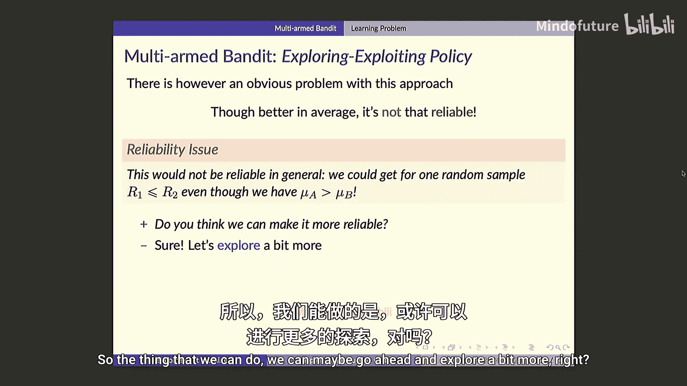

定义 Δ = R1 - R2。由于R1和R2是独立的高斯随机变量，Δ也服从高斯分布：
*   均值 μ_Δ = μ_A - μ_B = 200
*   方差 σ_Δ² = σ_A² + σ_B² = 100² + 200² = 50000
*   标准差 σ_Δ = √50000 ≈ 223.6

因此，P1 = P(Δ > 0)。我们可以使用Q函数（标准高斯分布的右尾概率）来计算：
```
P1 = Q( (0 - μ_Δ) / σ_Δ ) = Q(-200 / 223.6) ≈ Q(-0.894)
```
查表或计算可得 Q(-0.894) ≈ 0.81。这意味着有81%的概率策略会（正确地）锁定公司A。

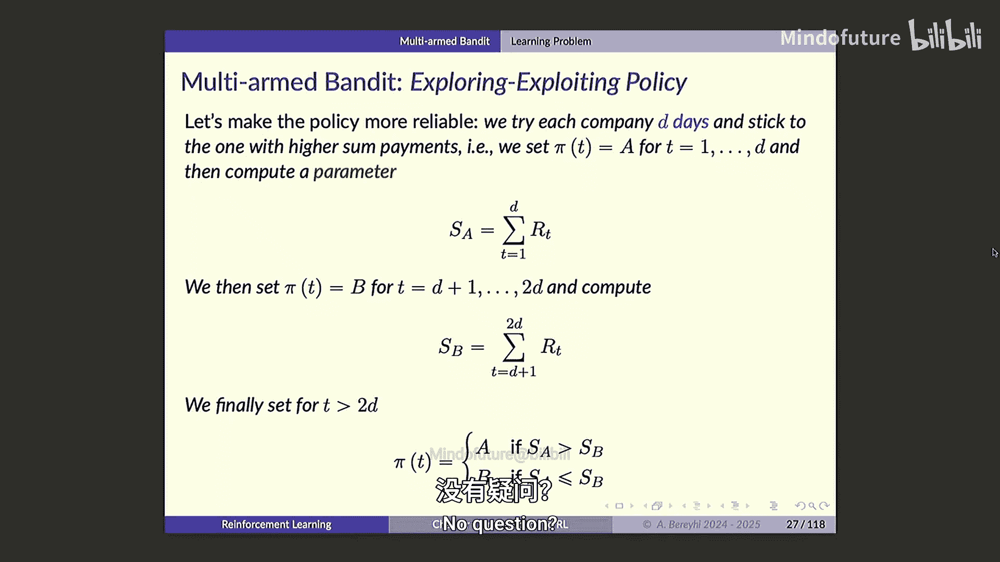

现在，我们可以写出从第3天起的期望日收益：
*   以概率 P1 选择A，收益为 μ_A。
*   以概率 (1-P1) 选择B，收益为 μ_B。
*   因此，期望日收益 = P1 * μ_A + (1-P1) * μ_B。

综合所有天，平均总收益的期望为：
```
E[G_T(1)] = (1/T) * [ μ_A + μ_B + (T-2) * (P1 * μ_A + (1-P1) * μ_B) ]
```
代入数值 μ_A=600， μ_B=400， P1=0.81， 可得：
```
E[G_T(1)] ≈ 562 - 124/T
```
当T很大时，平均日收益趋近于562元。与最优策略的600元相比，**遗憾值**约为 38 + 124/T 元。这比纯随机策略（遗憾值100元）要好。

---

## 增加探索以降低方差

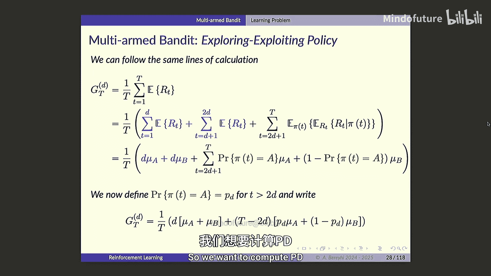

上一节我们计算了简单探索策略的**平均**表现，但该策略存在**方差高**的问题。因为决策仅基于两天的数据，有可能B公司在那两天偶然支付更高，导致机器人整个剩余时间都为较差的B公司工作。

为了增加决策的可靠性，我们可以延长探索期。新策略如下：
1.  **前D天**：为公司A工作，记录总报酬 S_A = R_A1 + ... + R_AD。
2.  **接下来D天**：为公司B工作，记录总报酬 S_B = R_B1 + ... + R_BD。
3.  **从第(2D+1)天到第T天**：比较 S_A 和 S_B。如果 S_A > S_B，则剩余所有天都为A工作；否则，为B工作。

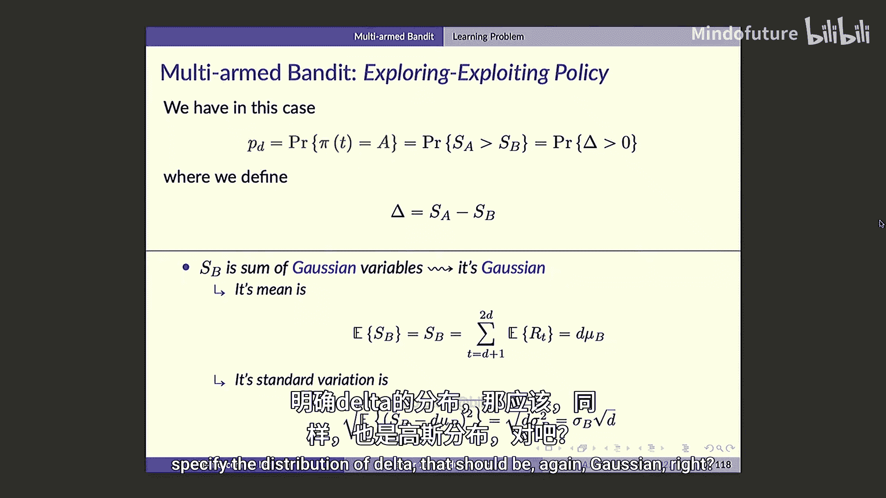

我们用 G_T(D) 表示此策略的平均收益。类似之前的推导，定义 P_D 为策略在探索后选择公司A的概率：
```
P_D = P(S_A > S_B)
```
S_A 和 S_B 分别是D个独立高斯报酬的和，因此它们自身也服从高斯分布：
*   S_A ~ N(D * μ_A, D * σ_A²)
*   S_B ~ N(D * μ_B, D * σ_B²)

定义新的差值 Δ_D = S_A - S_B，它同样服从高斯分布：
*   均值 μ_{ΔD} = D * (μ_A - μ_B) = 200D
*   方差 σ_{ΔD}² = D * (σ_A² + σ_B²) = 50000D
*   标准差 σ_{ΔD} = √(50000D) ≈ 223.6√D

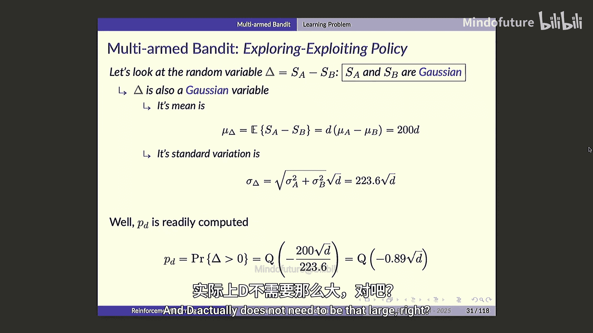

因此，
```
P_D = P(Δ_D > 0) = Q( (0 - μ_{ΔD}) / σ_{ΔD} ) = Q( -200D / (223.6√D) ) = Q( -0.894√D )
```
随着探索天数D增加，Q函数的参数负值越来越大，导致 P_D 趋近于1。这意味着探索越充分，做出正确选择（锁定公司A）的概率越高。

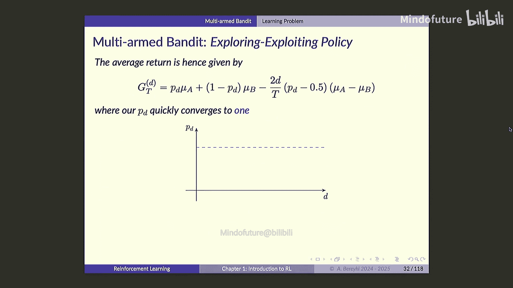

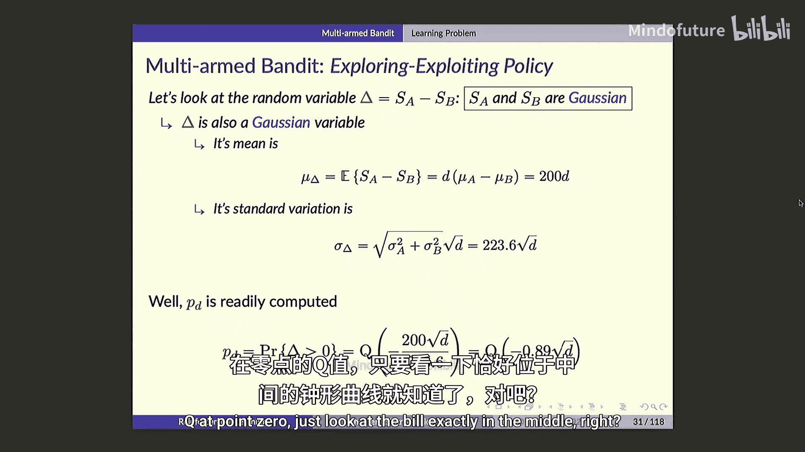

---

## 优化探索天数D

上一节我们引入了探索天数D，本节我们分析D如何影响最终收益。

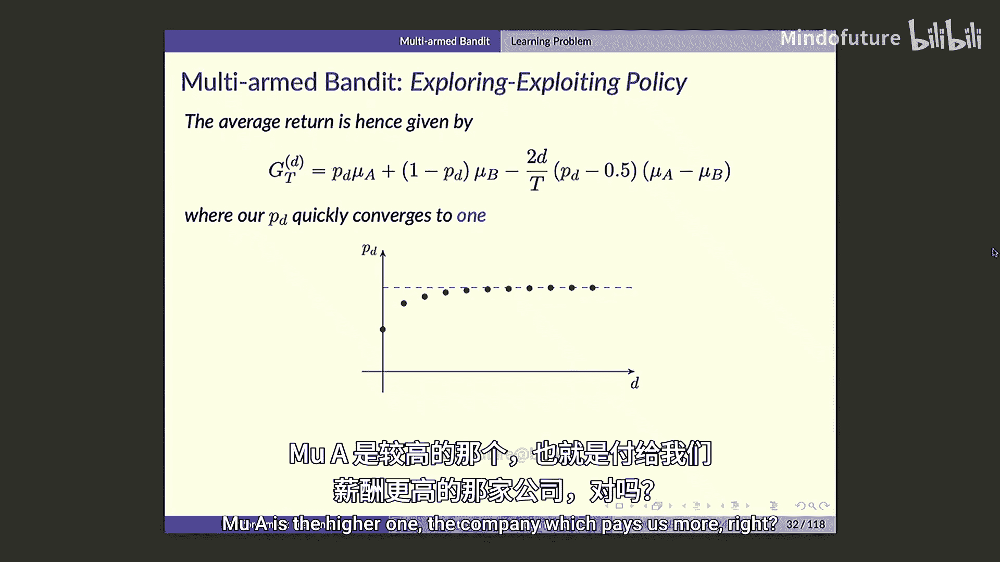

经过推导（过程略），平均总收益 E[G_T(D)] 可近似表示为：
```
E[G_T(D)] ≈ μ_A - (D / T) * (μ_A - μ_B) / 2
```
其中 μ_A=600， μ_B=400。

这个公式非常直观：
*   **第一项 μ_A**：如果我们探索得足够充分（D适中，使P_D≈1），那么大部分时间我们都在利用最优选项A，因此平均收益接近最优值 μ_A。
*   **第二项**：代表因探索而产生的损失。我们在前2D天没有全力利用最优选项，而是花费时间探索，这造成了 (D/T) 比例的机会成本。

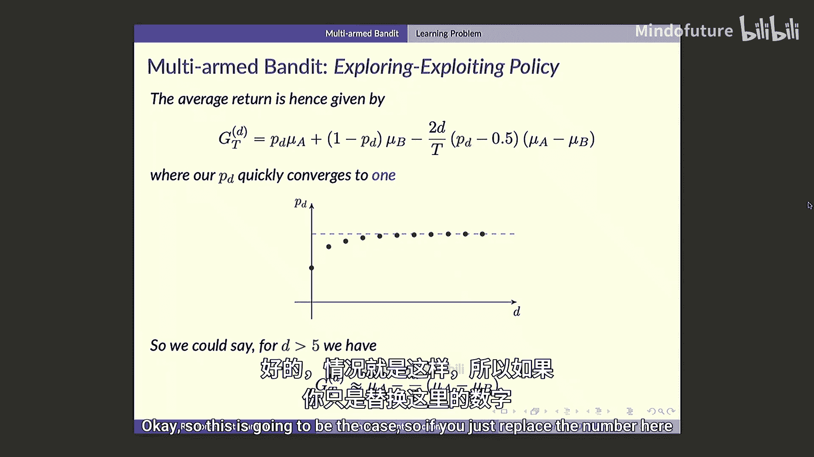

对应的**遗憾值**（与始终选A相比的损失）约为：
```
Regret ≈ (D / T) * (μ_A - μ_B) / 2 = 100 * (D / T)
```

**关键结论**：
1.  **探索是必要的**：没有探索（D=0，即随机策略），遗憾值很高。
2.  **探索有成本**：探索天数D直接增加了短期遗憾。
3.  **长期视角**：总工作天数T很大时，比例 D/T 可以非常小。这意味着只要D是固定的（例如探索10天），那么当T趋于无穷大时，遗憾值趋于0。我们可以用短暂的探索成本，换取长期接近最优的收益。

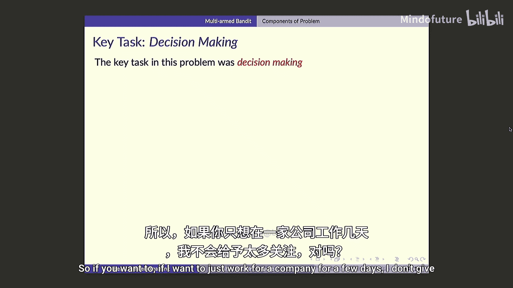

这体现了强化学习中的一个核心权衡：**短期探索成本**与**长期利用收益**之间的平衡。对于长期任务，进行充分的初始探索是值得的。

---

## 与经典机器学习的区别

本节课中我们一起学习了多臂老虎机的基本混合策略。最后需要强调，强化学习与经典监督学习有本质区别：

*   **数据获取方式**：在经典机器学习中，我们通常假设拥有一个固定的、包含所有可能选项信息的数据集。而在强化学习中，**智能体必须通过与环境互动（探索）来生成数据**，并且互动策略会影响收集到的数据分布。
*   **决策的影响**：在老虎机问题中，你选择拉哪个臂，决定了你观察到哪个臂的奖励。你无法同时观察到所有臂的奖励。这种**决策影响数据收集**的特性，是强化学习挑战性的核心，也使其更贴近现实世界的序贯决策问题。

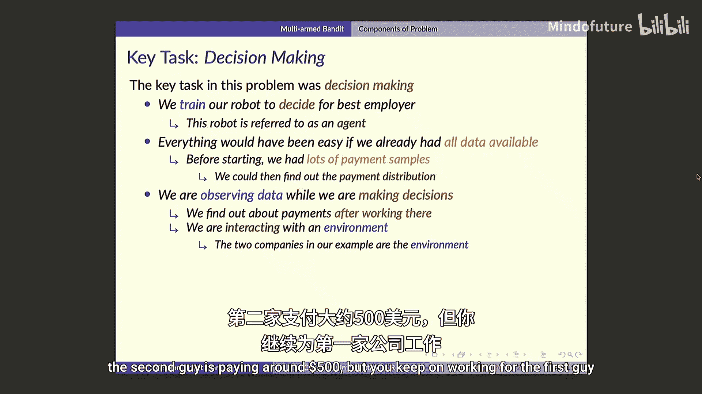

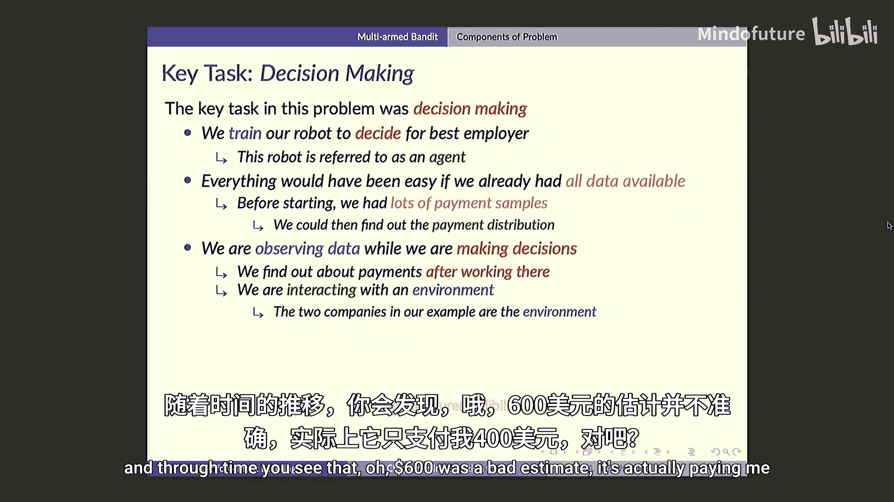

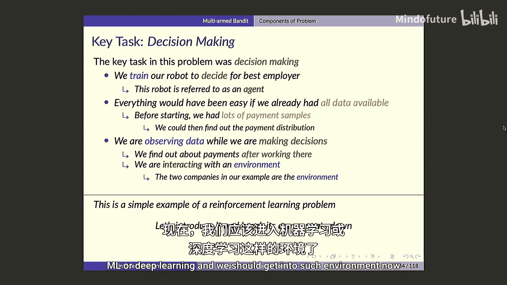

因此，我们需要告别经典机器学习中“数据给定”的假设，进入这个需要主动探索、决策与学习交织的新环境。