# 006：环境作为状态依赖系统 🎮

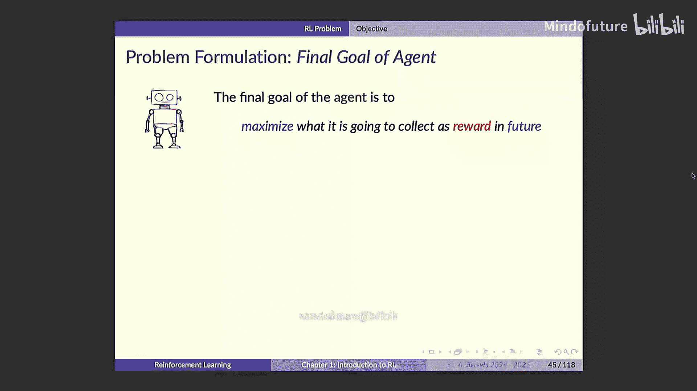

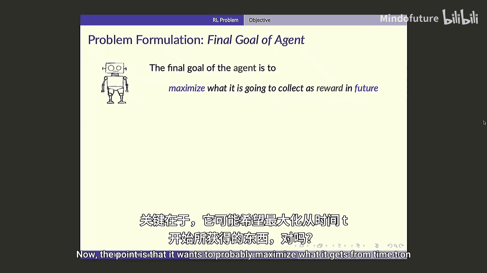

在本节课中，我们将学习强化学习中的一个核心概念：如何将环境建模为一个状态依赖系统。我们将探讨智能体的最终目标、未来回报的定义，以及为什么需要引入“状态”这一概念来简化对环境的描述。

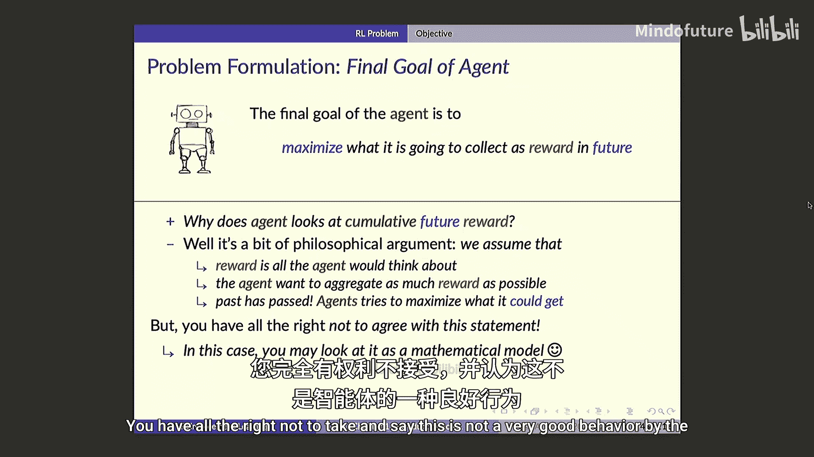

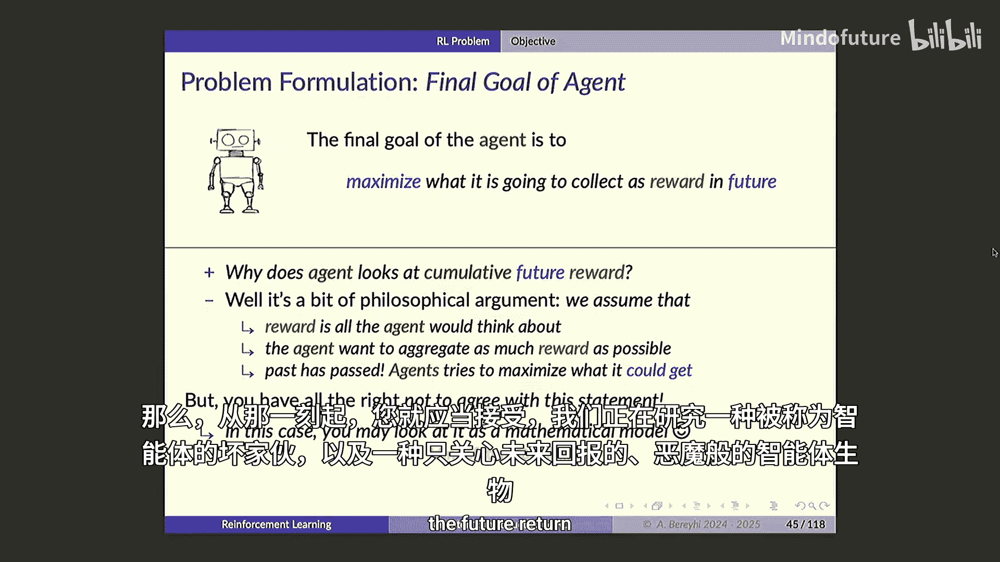

## 智能体的最终目标 🎯

智能体开始与环境交互。它会执行一个动作，获得奖励，并基于此获得一些观察结果，然后决定下一个动作。这个过程会持续进行。

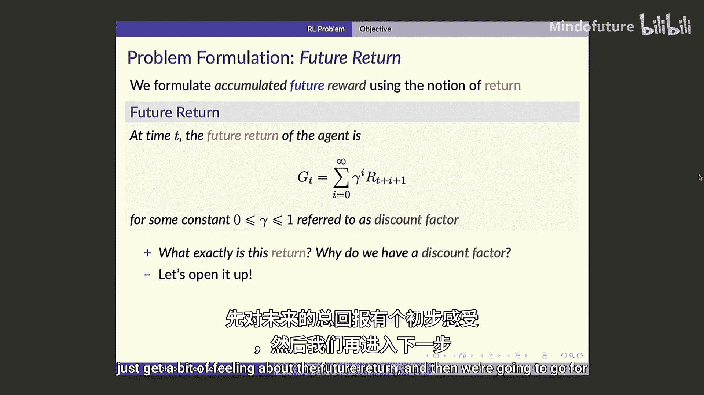

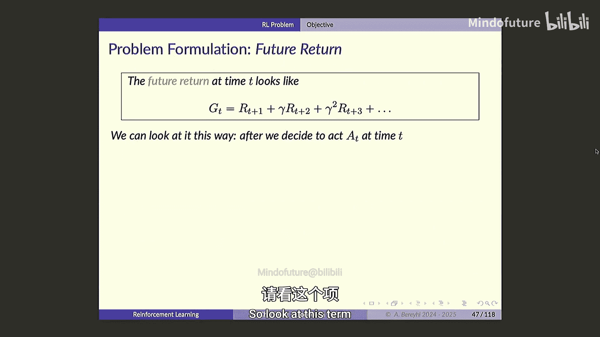

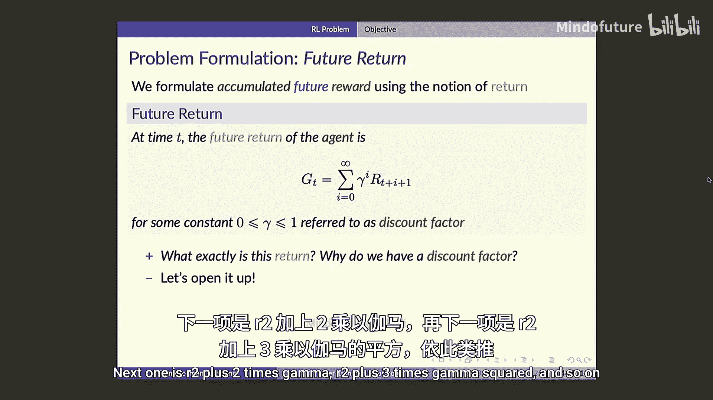

智能体的目标通常是最大化从时间 `t` 开始所获得的**未来回报**。这意味着，智能体在每一步行动时，都关心如何使后续的回报最大化。

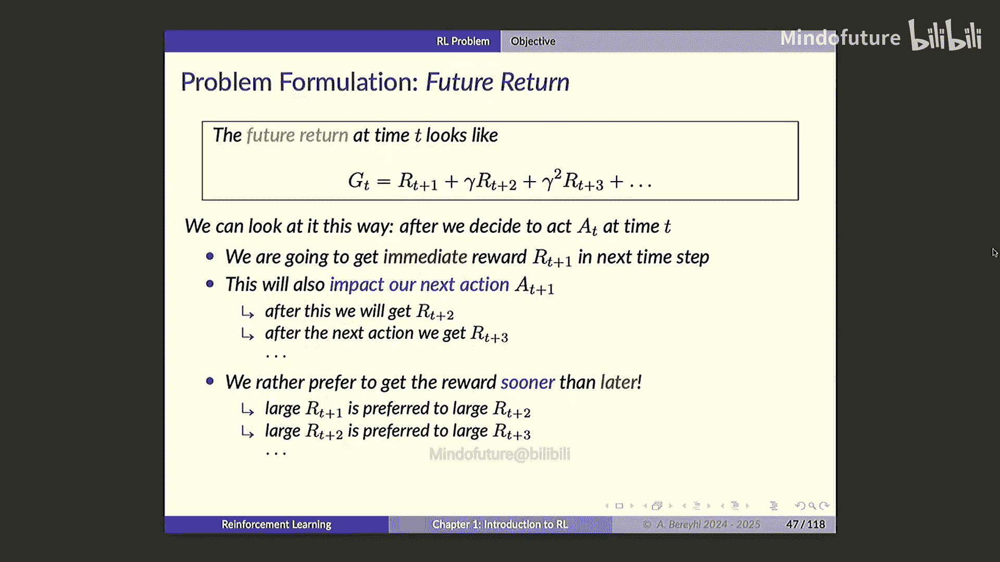

## 未来回报的定义 📈

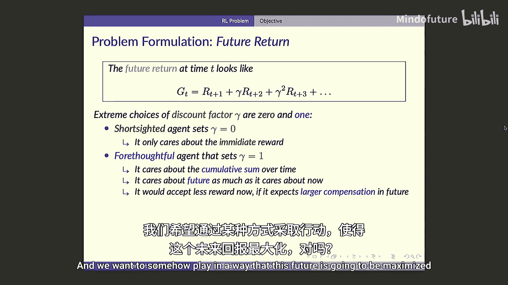

未来回报 `G_t` 是智能体从时间 `t` 开始所关心的总和。其数学公式如下：

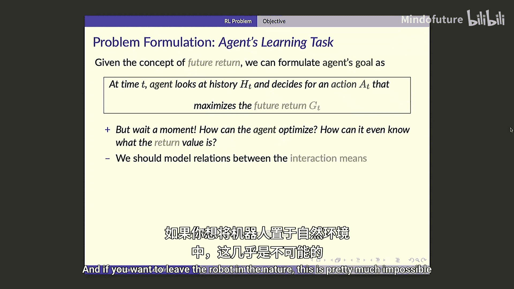

```
G_t = R_{t+1} + γ * R_{t+2} + γ^2 * R_{t+3} + ... = Σ_{i=0}^{∞} γ^i * R_{t+i+1}
```

其中：
*   `R_{t+1}` 是执行动作 `A_t` 后获得的**即时奖励**。
*   `γ` 是**折扣因子**，其值介于 0 和 1 之间。

### 折扣因子的作用

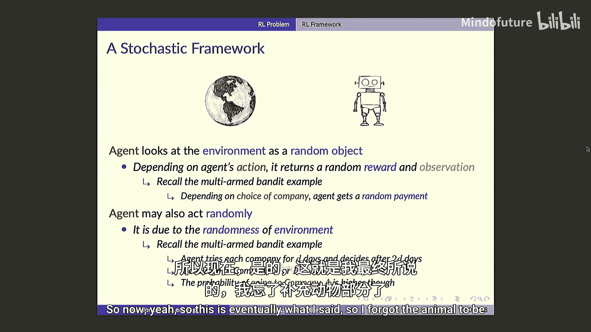

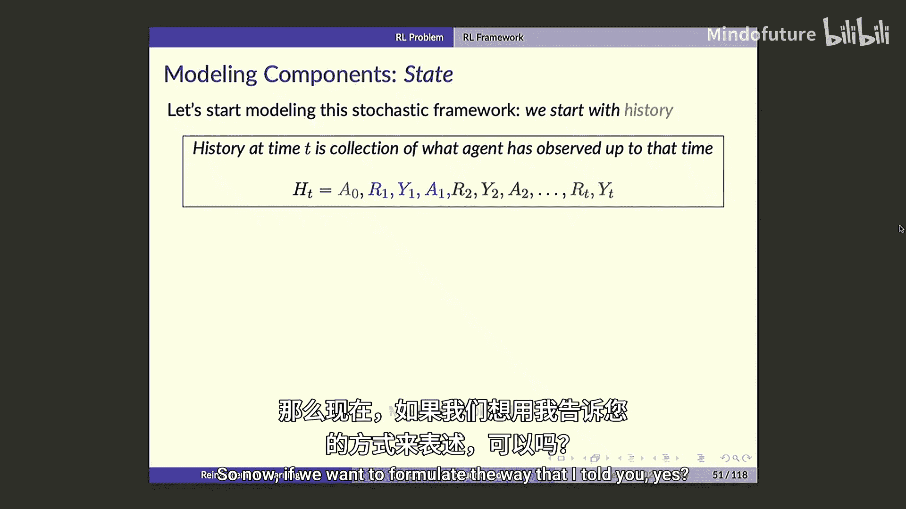

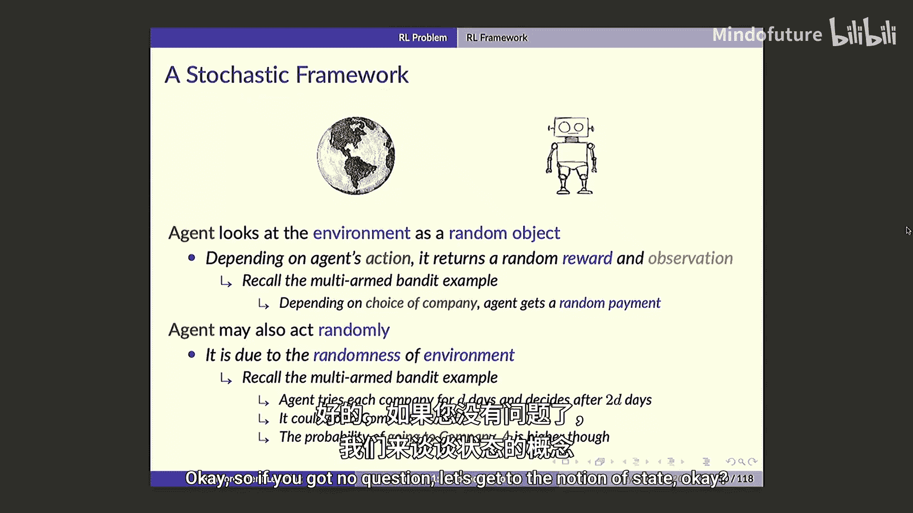

折扣因子 `γ` 有两个主要作用：
1.  **数学收敛性**：在奖励密集的环境中，如果 `γ=1`，无限序列的奖励之和可能不收敛。`γ<1` 确保了级数的收敛。
2.  **实际意义**：它体现了“当前奖励比未来奖励更有价值”的理念，类似于经济学中的现值概念。

以下是关于折扣因子两种极端选择的说明：
*   **`γ = 0`**：智能体变为**短视的**，只关心下一步的即时奖励。
*   **`γ = 1`**：智能体变得**极度保守**，赋予未来奖励与即时奖励同等的权重。

智能体的目标就是：在每一步，基于已有的历史信息，选择一个能最大化预期未来回报的动作。

## 引入状态的必要性 🔄

上一节我们定义了未来回报，但要实际计算它，智能体理论上需要记住从开始到当前时刻的**全部历史信息**。这在实践中是不可能的，因为：
1.  存储无限历史需要无限内存。
2.  即使计算能力允许，基于完整历史的分析也极其复杂。

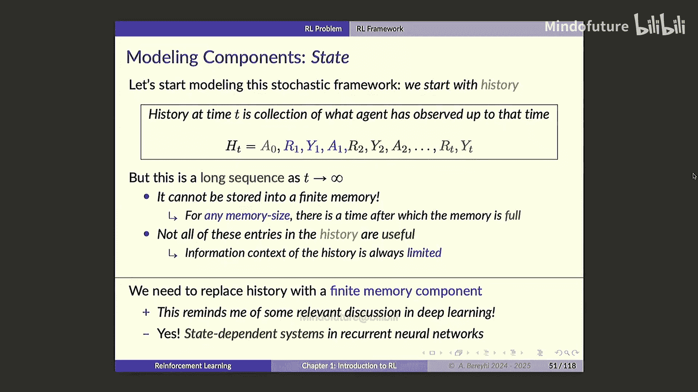

自然界中的系统（如天气）通常具有**有限记忆**。明天的天气主要受最近几天的影响，而不会显著依赖于一年前的某一天。这意味着，我们不需要完整的无限历史，只需要一个能概括相关历史信息的、**有限的**摘要。

这个有限的摘要就是**状态**。状态是一个可以随时间无限传递的、有限的信息载体。它包含了预测未来所需的所有相关信息。

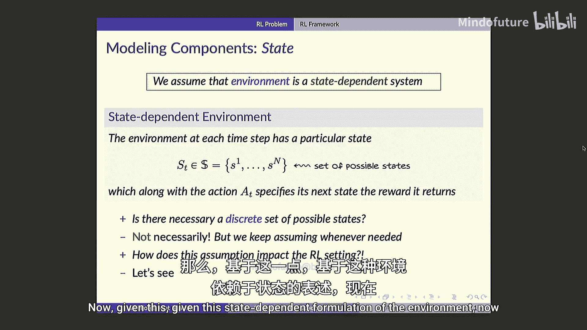

## 马尔可夫性与状态依赖环境 🧩

基于上述讨论，我们可以假设环境具有**马尔可夫性**。这意味着：**下一时刻的奖励 `R_{t+1}` 和状态 `S_{t+1}` 的概率分布仅取决于当前状态 `S_t` 和当前动作 `A_t`**，而与更早的历史无关。

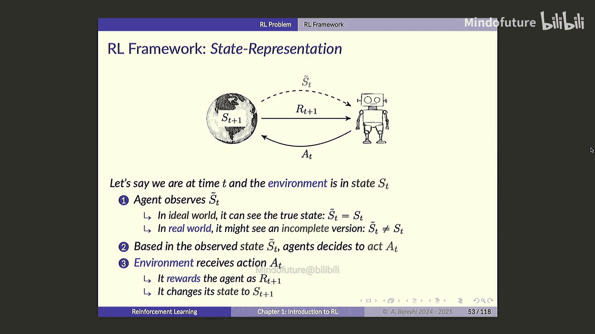

因此，我们可以将环境建模为一个**状态依赖的随机系统**。环境在任何时刻都处于某个状态 `s`（属于一个可能的状态集合 `S`）。当智能体执行一个动作 `a` 后，环境会根据当前状态 `s` 和动作 `a`，随机地转移到下一个状态 `s'`，并产生一个奖励 `r`。

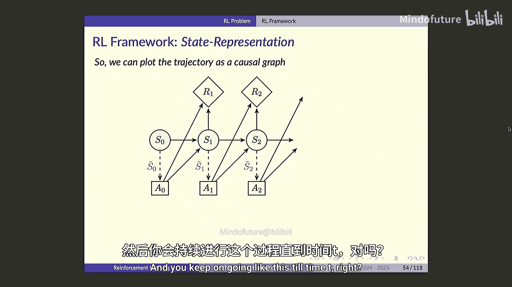

### 状态依赖环境的交互流程

以下是智能体与状态依赖环境交互的典型流程：
1.  在时刻 `t`，环境处于状态 `S_t`。
2.  智能体观察状态 `S_t`（可能是完整或部分观察），并选择动作 `A_t`。
3.  环境接收动作 `A_t`，根据某种规则（可能包含随机性）：
    *   转移到新状态 `S_{t+1}`。
    *   产生奖励 `R_{t+1}`。
4.  智能体接收到奖励 `R_{t+1}` 和新的观察（即状态 `S_{t+1}`）。
5.  流程在 `t+1` 时刻重复。

### 环境的数学描述

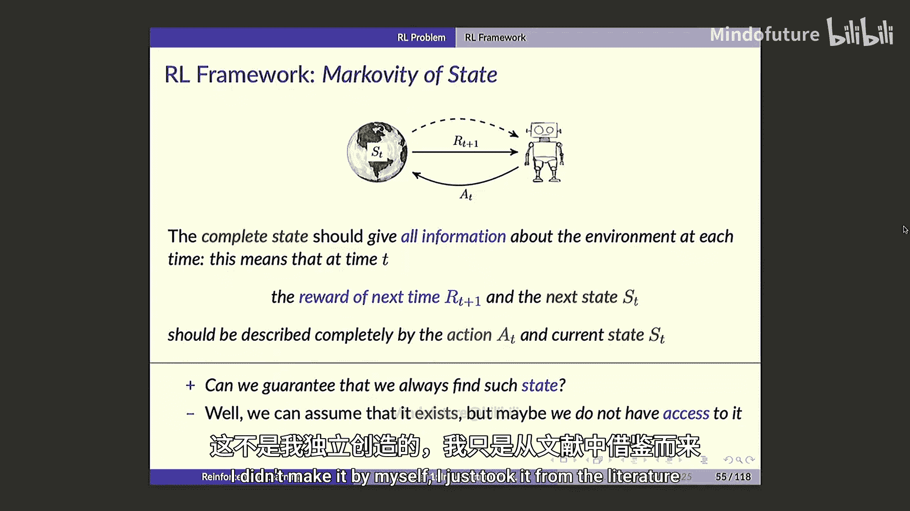

我们可以用两个（通常是随机的）函数来形式化描述这样的环境：
*   **奖励函数**：`R(s, a)`。给定当前状态 `s` 和动作 `a`，输出奖励值。
*   **状态转移函数**：`P(s' | s, a)`。给定当前状态 `s` 和动作 `a`，指定转移到下一个状态 `s'` 的概率。

在诸如国际象棋等游戏中，转移函数包含了对手随机走棋的不确定性。在机器人控制中，它可能由复杂的物理动力学决定。

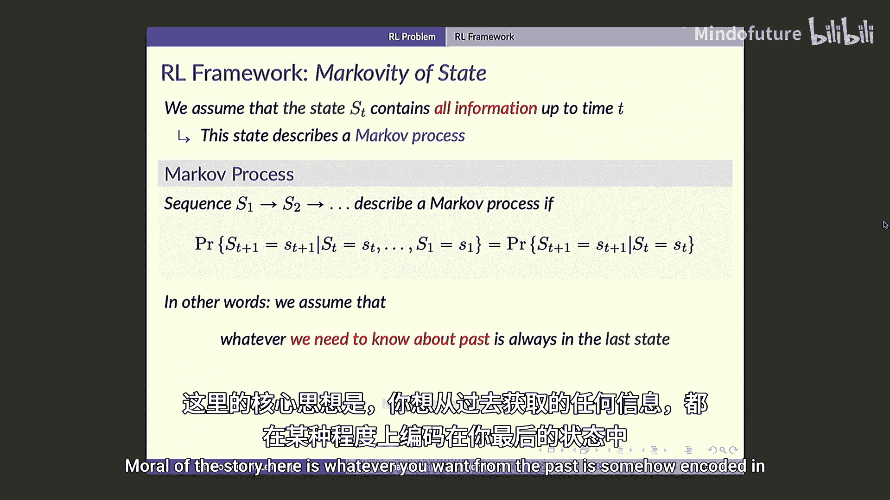

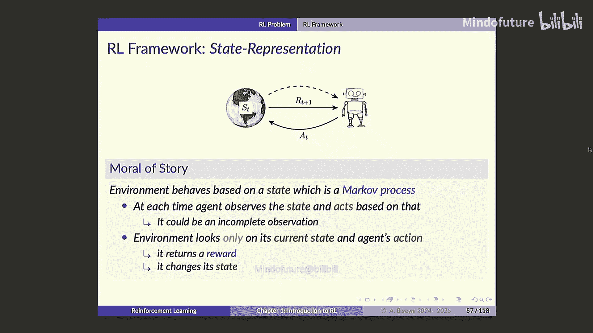

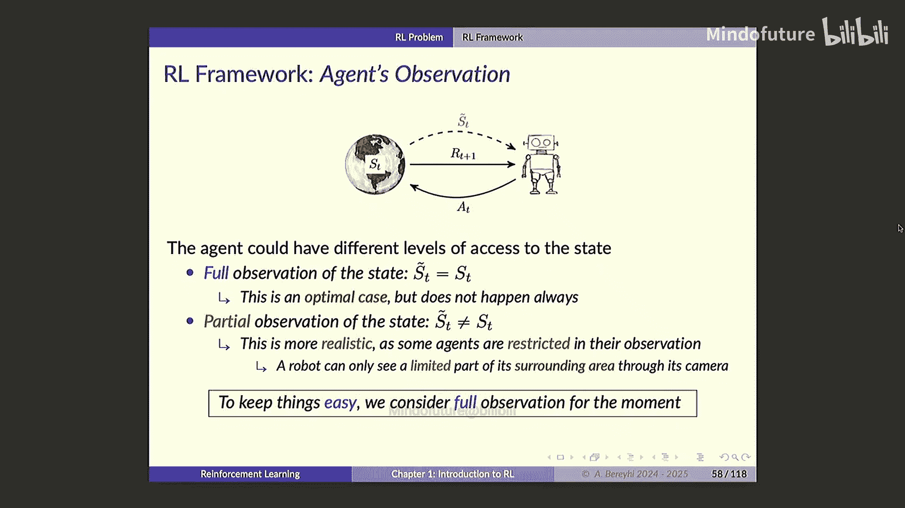

## 模型已知与模型未知 🤔

对于上述的奖励函数和转移函数，我们有两种处理方式：
*   **基于模型的方法**：我们尝试直接学习或已知环境的模型（即 `R` 和 `P`）。
*   **无模型方法**：我们承认不知道环境的精确模型，仅通过智能体与环境交互产生的数据（状态、动作、奖励序列）来学习最优策略。这是本课程后续将重点探讨的主流方法。

## 总结 📝

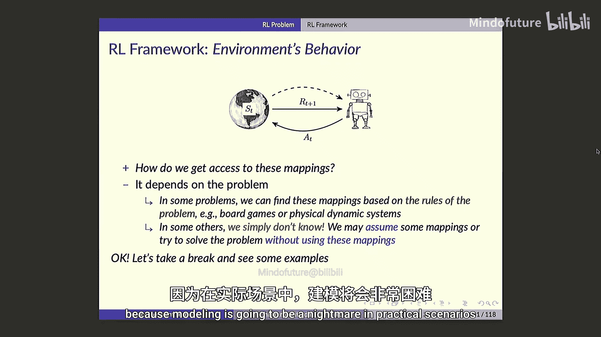

本节课我们一起学习了强化学习中环境建模的核心思想：
1.  智能体的核心目标是最大化折扣化的**未来回报**。
2.  直接使用无限历史进行决策不可行，因此引入了**状态**的概念作为历史的有限摘要。
3.  我们假设环境具有**马尔可夫性**，从而可以将其建模为**状态依赖的随机系统**，由奖励函数和状态转移函数描述。
4.  根据是否已知环境的精确模型，强化学习算法可分为**基于模型**和**无模型**两大类。理解状态依赖的环境模型是学习后续所有强化学习算法的基础。