# 007：强化学习场景示例 🎮

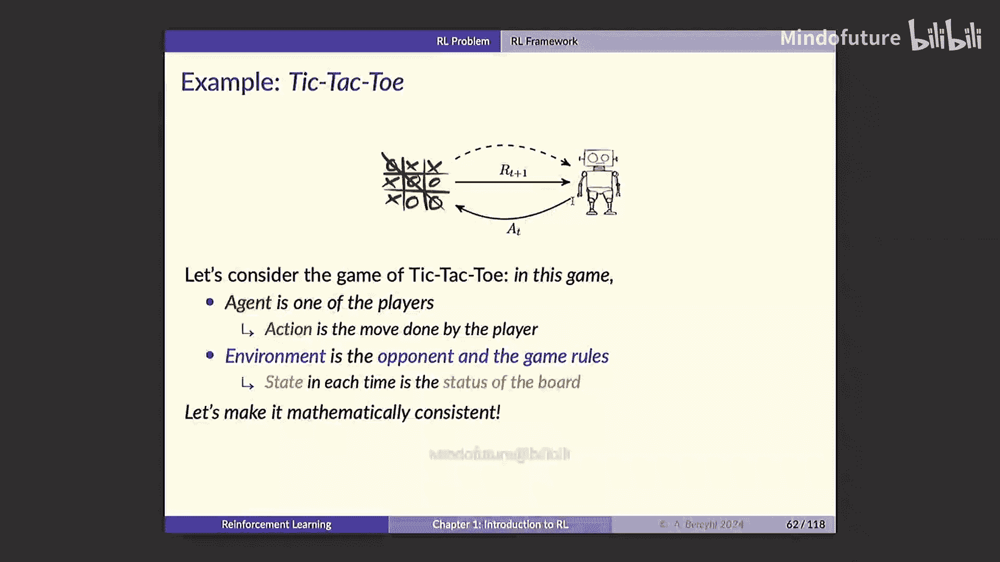

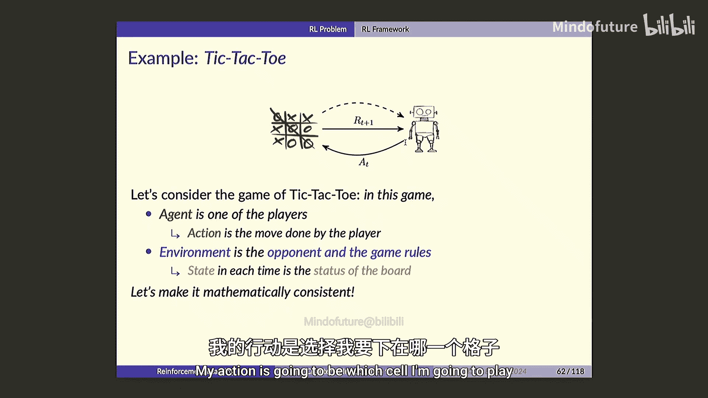

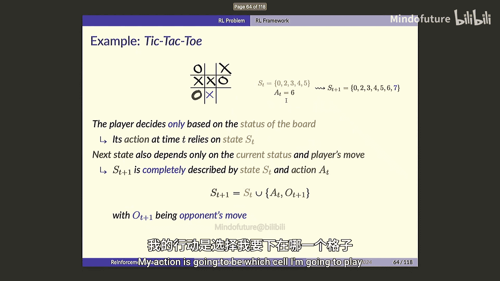

在本节课中，我们将通过几个具体的例子，深入理解强化学习框架中的核心概念：智能体、环境、状态、动作、转移函数和奖励函数。我们将从简单的井字棋游戏开始，逐步过渡到更复杂的倒立摆和股票市场问题，以展示强化学习框架的普适性。

## 智能体与环境框架回顾

上一节我们介绍了强化学习的基本框架。本节中，我们来看看这个框架如何应用于具体场景。

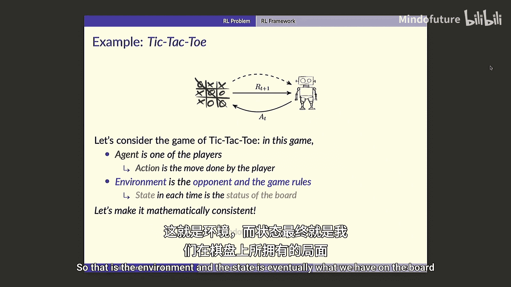

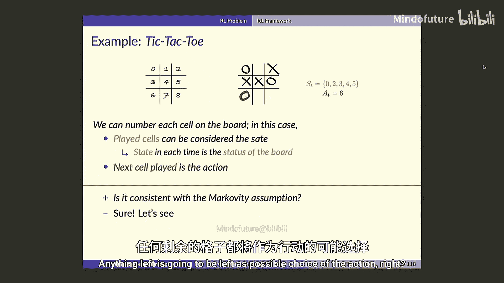

首先，我们回顾一下基本框架。我们拥有**智能体**和**环境**。智能体负责执行动作，环境则包含游戏规则、对手或其他动态系统。在井字棋的例子中，**我**就是智能体。

## 井字棋示例 🎯

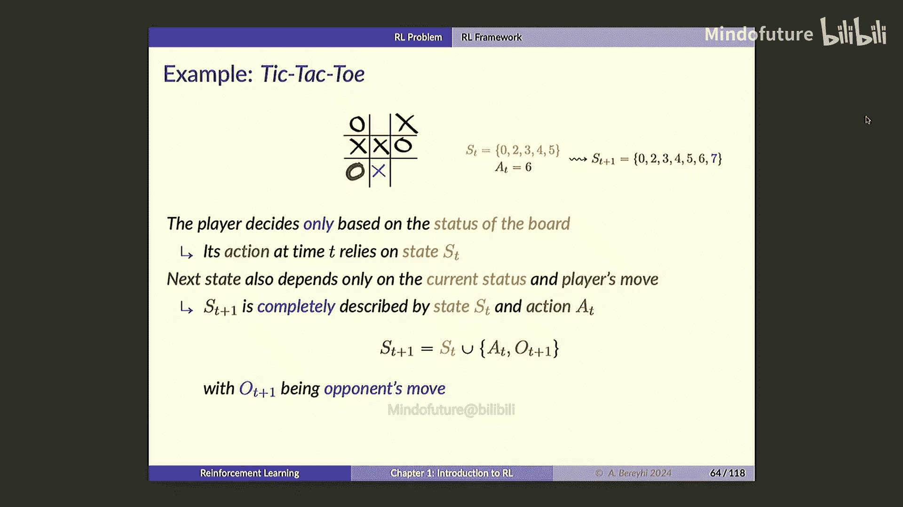

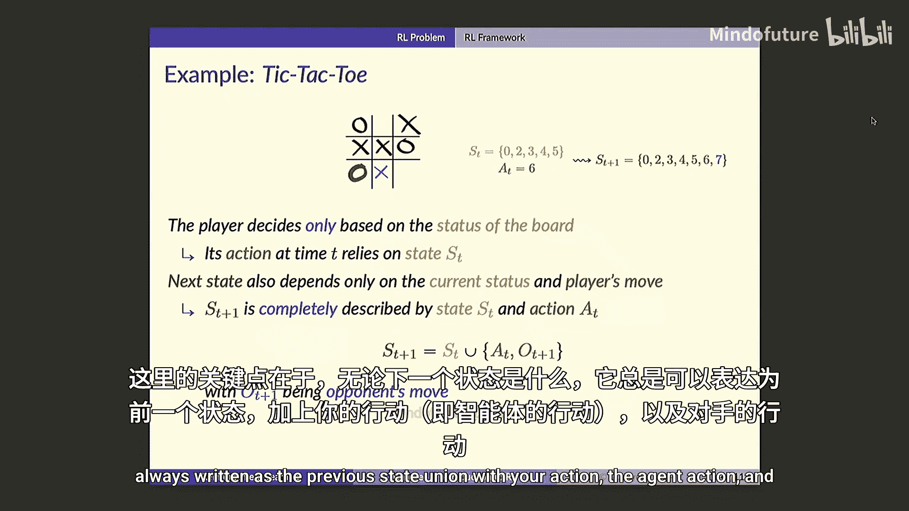

以下是井字棋游戏中的关键要素分析。

*   **智能体**：玩家本人。
*   **动作**：选择在哪个格子落子。我们可以将棋盘上的格子编号为0到8。每次行动就是选择一个可用的格子。
*   **环境**：游戏规则以及与我博弈的对手。
*   **状态**：棋盘上当前的局势，即所有已落子的位置。状态决定了当前可选择的动作。

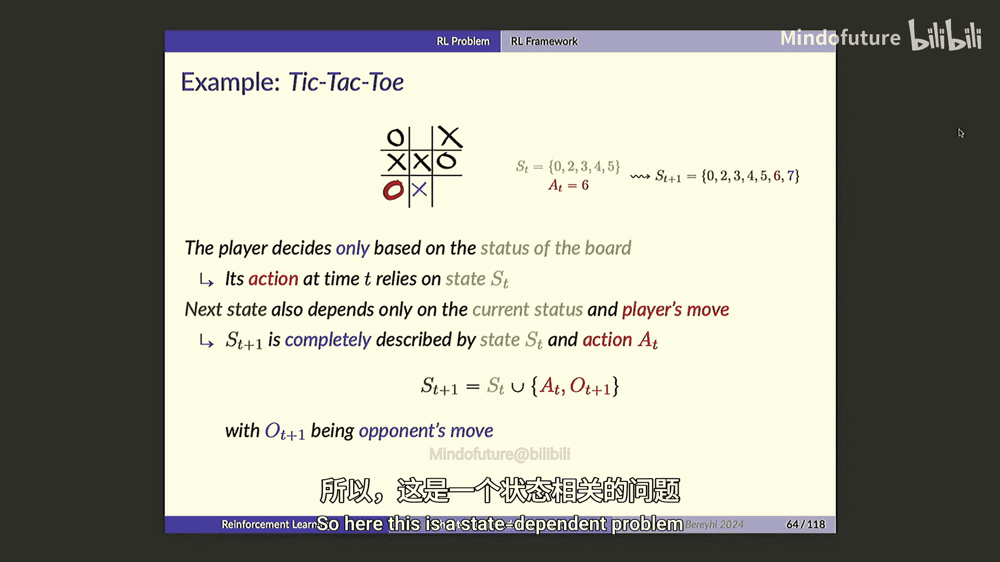

让我们分析一个具体局面。假设之前已落子的位置是0、2、3、4、5。此时，智能体决定采取动作6，即在6号格落子。

那么，下一个状态 `S_{t+1}` 会是什么？它将是当前状态 `S_t`（0,2,3,4,5）与智能体动作（6）以及对手随后动作（例如在7号格落子）的并集。

关键点在于：**下一个状态仅取决于前一个状态和后续动作**，你无需知道最初的状态。这符合马尔可夫性质。

### 转移函数与奖励函数

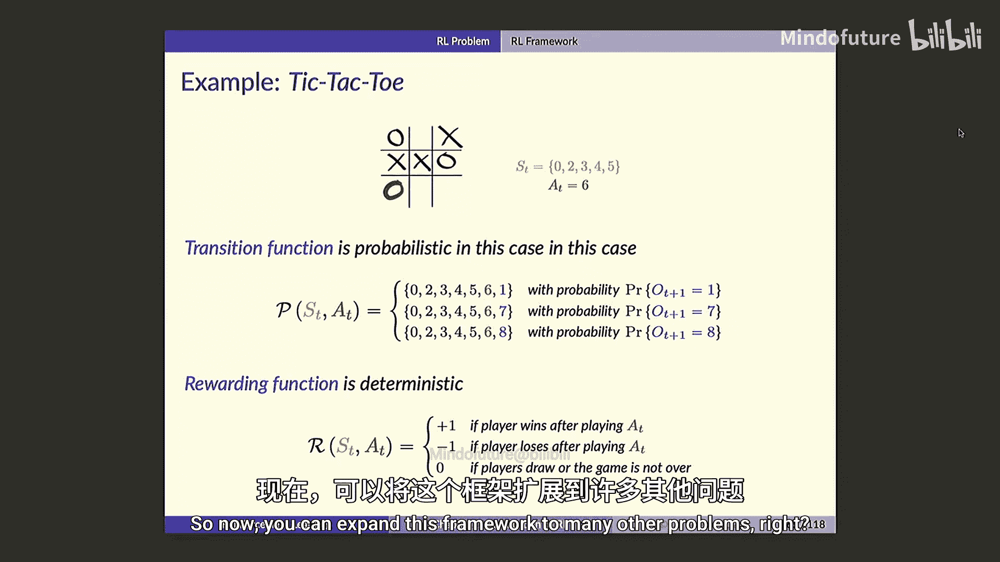

接下来，我们定义井字棋中的转移函数和奖励函数。

*   **转移函数 `P`**：这是一个可能具有随机性的函数。它描述了在状态 `S_t` 下执行动作 `A_t` 后，环境转移到下一个状态 `S_{t+1}` 的概率。在井字棋中，这完全取决于对手的策略。例如，从当前状态出发，对手可能以某种概率在1、7或8号格落子，从而导向不同的下一个状态。转移函数可以表示为概率形式：`P(S_{t+1} | S_t, A_t)`。
*   **奖励函数 `R`**：这同样可能是一个随机函数，取决于当前状态和动作，并给出奖励值。在井字棋中，奖励可以定义为：获胜得+1，落败得-1，未分胜负则得0。奖励函数也依赖于游戏规则和对手的行动，可以表示为 `R(S_t, A_t)`。

## 倒立摆问题 🤖

理解了井字棋的例子后，现在我们可以将这个框架应用到许多其他问题上。一个著名的例子是**倒立摆**问题。

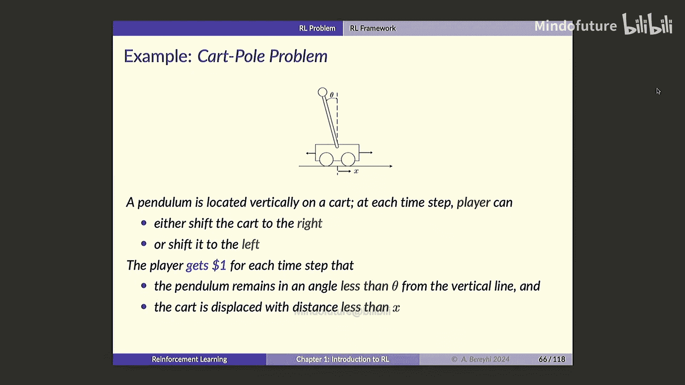

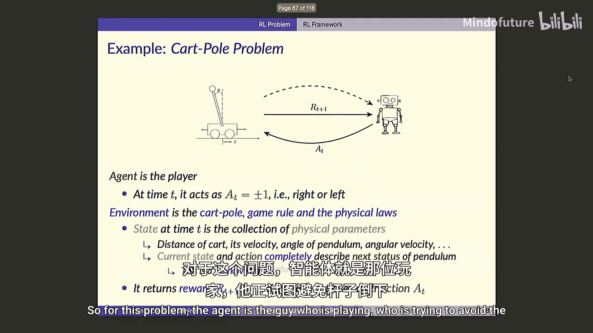

问题是这样的：一个小车顶部通过铰链连接着一根杆子。你的动作是向左或向右推小车。目标是获得持续奖励：只要杆子与垂直线的夹角不超过 `θ`，且小车与中心点的距离不超过 `x`，你就能持续得分。一旦杆子倒下或小车偏离太远，游戏结束。

### 问题建模

以下是倒立摆问题的强化学习建模。

*   **智能体**：控制小车移动的控制器。
*   **动作**：`+1`（向右推）或 `-1`（向左推）。
*   **环境**：小车、杆子以及它们所遵循的物理定律。
*   **状态**：描述系统所需的所有物理参数。例如：杆子的角度 `θ`、角速度 `\dot{\theta}`、小车的位置 `x`、速度 `\dot{x}`，以及地面的摩擦系数等。知道当前时刻的这些参数，就足以预测下一时刻的系统动态。
*   **奖励**：只要系统未超出限制（`|θ| < θ_{max}` 且 `|x| < x_{max}`），每一步获得奖励 `+1`；一旦违反，奖励为 `0`。目标是最大化累积奖励，即尽可能长时间保持平衡。

### 转移与奖励函数

对于倒立摆，其函数定义如下。

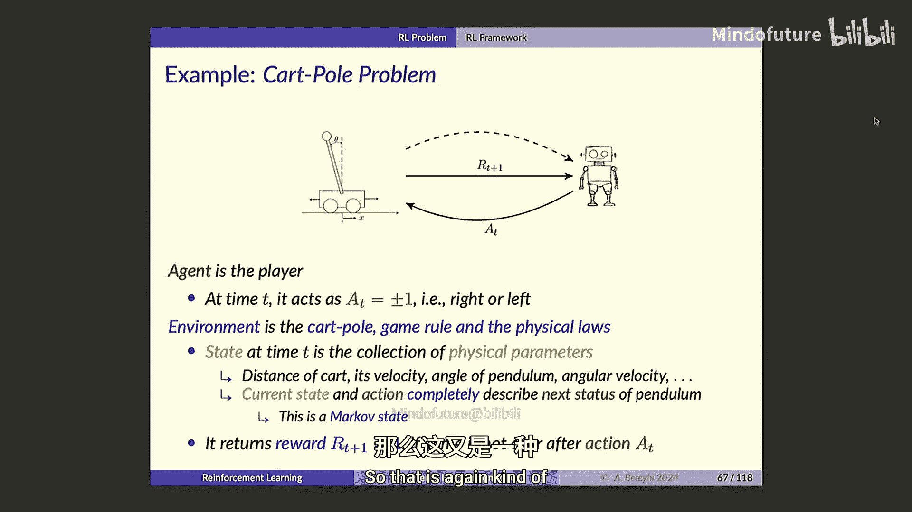

*   **转移函数**：本质上是物理动力学的解。给定当前状态（所有物理参数）和动作（推力方向），通过求解牛顿运动定律，可以确定下一个状态（新的角度、位置、速度等）。这可以写为 `S_{t+1} = physics\_solver(S_t, A_t)`。
*   **奖励函数**：根据转移函数计算出的下一个状态来判断。如果下一个状态仍在限制范围内，奖励为 `R = +1`；否则 `R = 0`。即 `R = 1 if (|θ_{t+1}| < θ_{max} and |x_{t+1}| < x_{max}) else 0`。

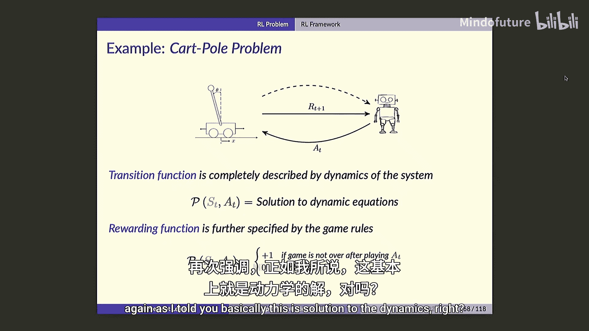

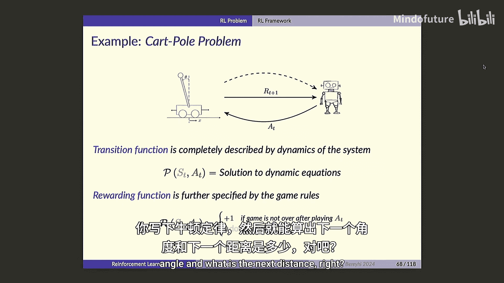

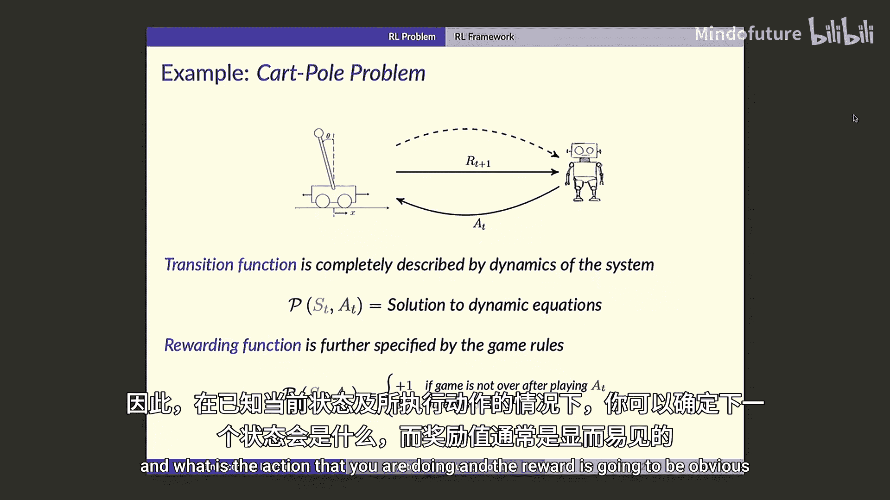

需要注意的是，精确写出这个转移函数（物理方程）非常复杂，但理论上它是确定存在的。

## 股票市场示例 📈

我们甚至可以处理更复杂的问题，例如**股票市场**。与市场的交互同样可以套用这个框架。

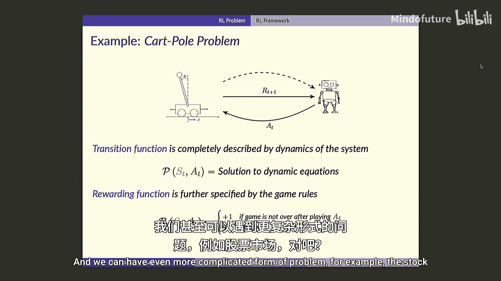

以下是其抽象建模。

*   **智能体**：交易者。
*   **动作**：买入或卖出。
*   **环境**：整个股票市场，以及所有可能影响价格的信息（新闻、公司财报、宏观经济数据等）。
*   **状态**：所有能用于评估股价的信息总和。这非常抽象，在实践中我们无法完全获知真实状态，但可以假设它存在。
*   **奖励**：执行动作后获得的利润或亏损。

在这个问题中，转移函数（市场状态如何变化）和奖励函数（盈亏计算）都极难准确描述，它涉及无数未知和随机因素。但这并不妨碍我们在抽象层面用强化学习的框架来思考它。与倒立摆（物理规则复杂但明确）和井字棋（规则简单）相比，股票市场体现了强化学习在处理高度复杂、不完全可知环境时的挑战与潜力。

## 总结

本节课中，我们一起学习了如何将强化学习框架应用于不同复杂度的场景：
1.  **井字棋**：一个规则简单、状态离散的确定性游戏，便于理解状态、动作、转移和奖励的基本概念。
2.  **倒立摆**：一个连续状态空间的物理控制问题，其转移函数由明确的物理定律决定，但形式复杂。
3.  **股票市场**：一个高度复杂、随机且状态难以完全观测的现实世界问题，展示了框架的抽象能力和应用边界。

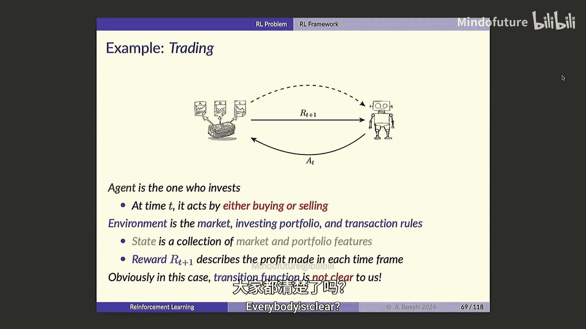

通过这些示例，我们看到，尽管问题的具体细节千差万别，但它们都可以被统一到**智能体-环境交互**、**状态-动作-奖励**的强化学习范式中进行分析和求解。