# 009：井字棋游戏中的策略与价值函数

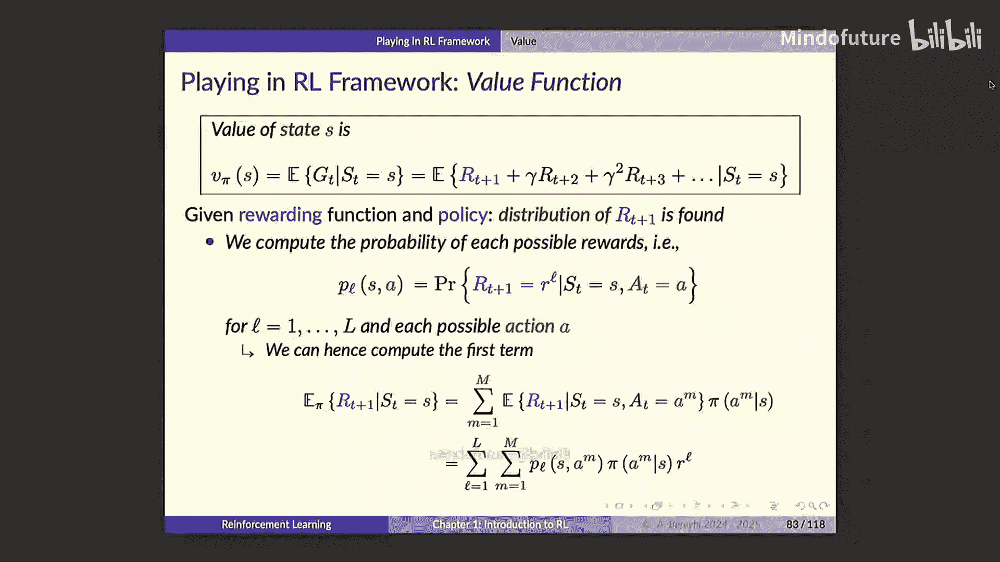

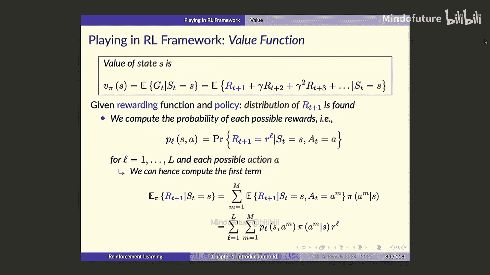

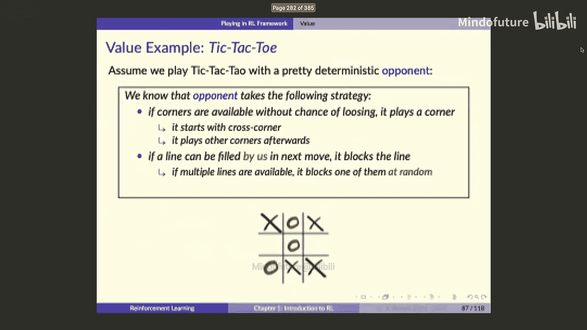

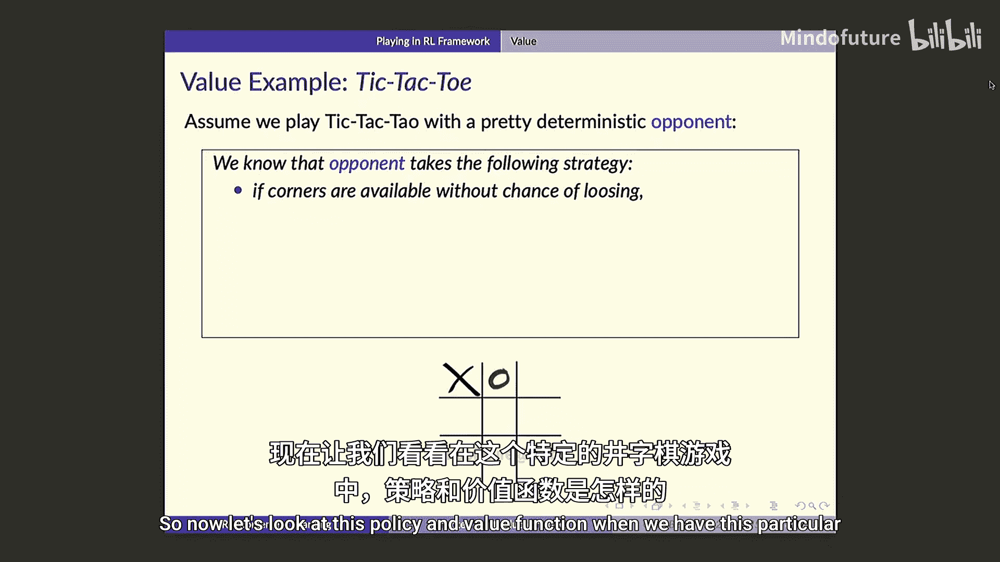

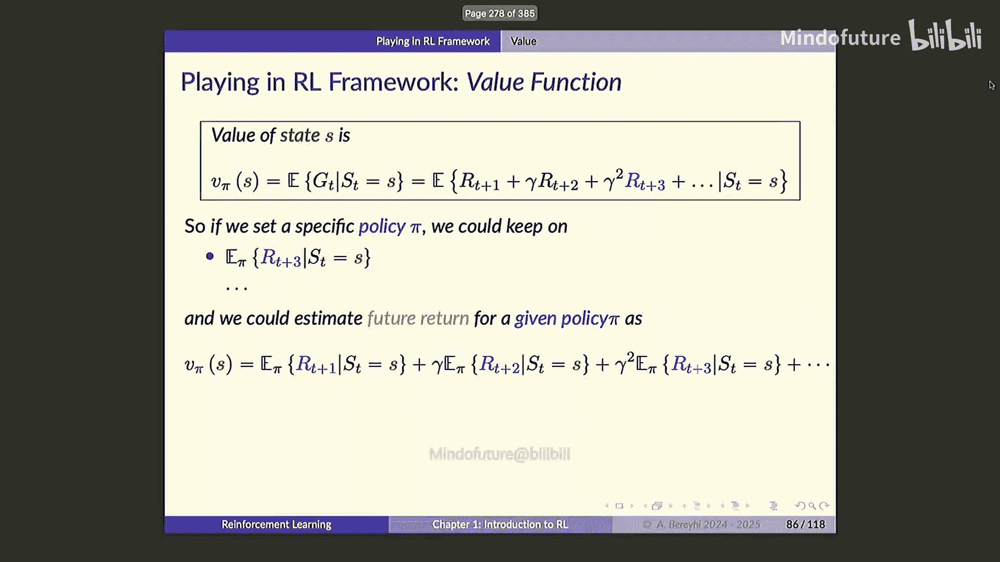

在本节课中，我们将通过一个具体的井字棋游戏例子，学习如何定义和计算策略的价值函数。我们将看到，不同的策略会导致不同的游戏结果，而价值函数是衡量和比较这些策略优劣的关键工具。

## 游戏设定与对手策略

首先，我们定义一个具体的井字棋游戏环境。在这个环境中，我们作为玩家是后手方。我们的对手遵循一个明确的策略。

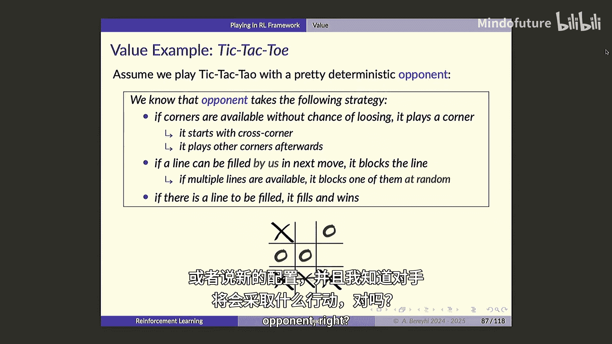

以下是该对手的策略描述：
*   **优先占角**：如果棋盘上有空角落，对手会优先占据。其选择顺序是：先占主对角线的角落，如果被占满，则选择其他角落。
*   **封锁连线**：如果对手发现存在一条我方（玩家）即将连成三子的线，它会立即落子进行封锁。如果存在多条可封锁的线，它会随机选择一条进行封锁。
*   **尝试获胜**：如果对手发现自己有可以立即获胜的落子点，它会选择该点并获胜。

这个对手策略定义了环境的状态转移概率。虽然在实际游戏中，对手的行为可能带有随机性（例如，有一定概率犯错），但为了简化说明，我们目前假设这个策略是确定性的。这意味着，给定当前棋盘状态和我方的行动，我们可以完全预测出下一个状态。

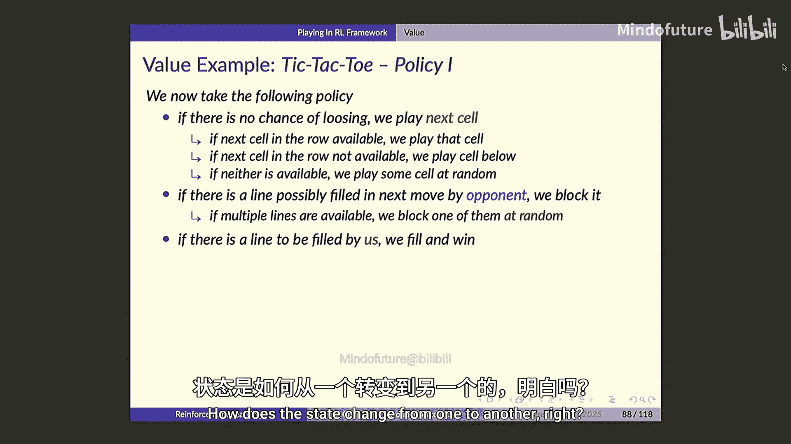

## 策略一及其价值分析

现在，我们定义我方的第一个策略，称之为 **策略π1**。

策略π1的规则如下：
*   **常规落子**：如果对手没有即将获胜的威胁，我方将落子在对手上一手棋的相邻位置（同行右侧或同列下方）。如果该位置不可用，则随机选择一个空位落子。
*   **封锁与获胜**：与对手策略类似，如果我方发现对手有即将连成三子的线，则进行封锁（多条线时随机封锁一条）。如果我方有立即获胜的机会，则落子获胜。

假设游戏从空棋盘开始，对手先手。根据其策略，对手会占据一个角落（例如位置0）。现在，我们处于状态S0（对手已落子于0）。我们想知道，在策略π1下，这个状态S0的价值 `V^π1(S0)` 是多少。

由于我们完全了解自己的策略π1和对手的确定性策略，我们可以推演出从S0开始的所有后续步骤，而无需实际进行游戏。

上一节我们介绍了游戏的基本设定，本节中我们来看看在策略π1下，游戏会如何发展。

以下是推演过程：
1.  在S0状态，根据π1，我方应落子在对手棋子（位置0）的相邻位置。假设我们选择位置1。
2.  对手根据其策略，会选择另一个空角落，例如位置2。
3.  此时，对手在位置0和2，构成了一个潜在的胜利线（对角线）。根据π1的封锁规则，我方必须落子位置4以阻止对手获胜。
4.  对手接着会落子位置6，以阻止我方在第一条边获胜。
5.  我方落子位置3，以阻止对手在第一条边获胜。
6.  最后，对手落子位置5。
7.  棋盘填满，游戏以平局结束。

在整个推演过程中，除了终局，每一步的即时奖励都是0。平局的最终奖励也是0。因此，从S0开始，在策略π1下获得的总回报期望值为0。所以，**`V^π1(S0) = 0`**。

这个价值0并不意味着只有一条轨迹，而是所有可能轨迹（例如，对手选择不同角落开局，我方在有多条封锁线时随机选择）的回报期望值。在这个确定性例子中，所有轨迹都导向平局。

## 策略二及其价值分析

接下来，我们修改策略，看看价值函数如何变化。我们定义 **策略π2**。

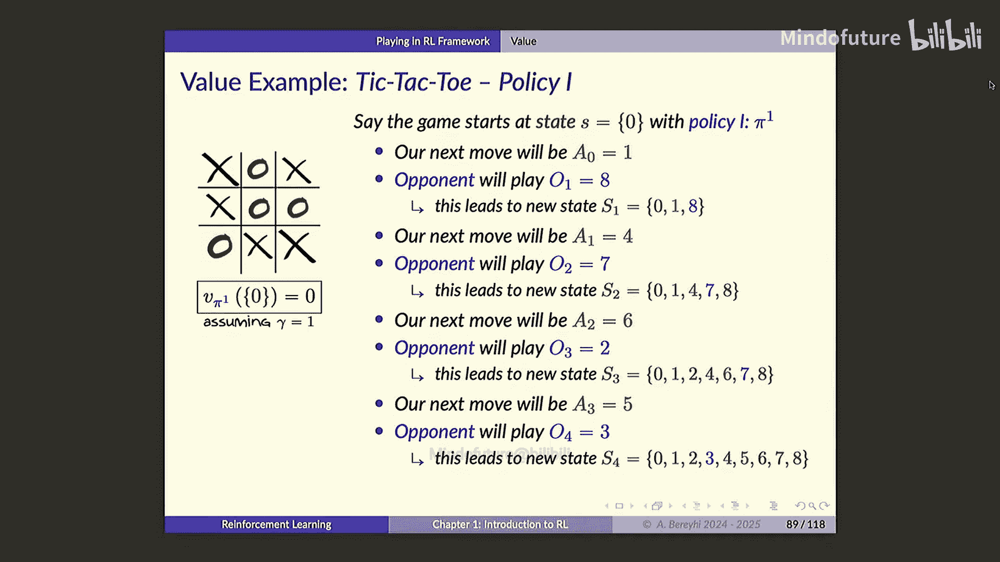

策略π2与π1大部分相同，只有一处关键区别：
*   当没有立即输棋的风险时，如果我方发现有空角落可用，将优先占据角落，而不是落子在对手棋子的相邻位置。其他关于封锁和获胜的规则保持不变。

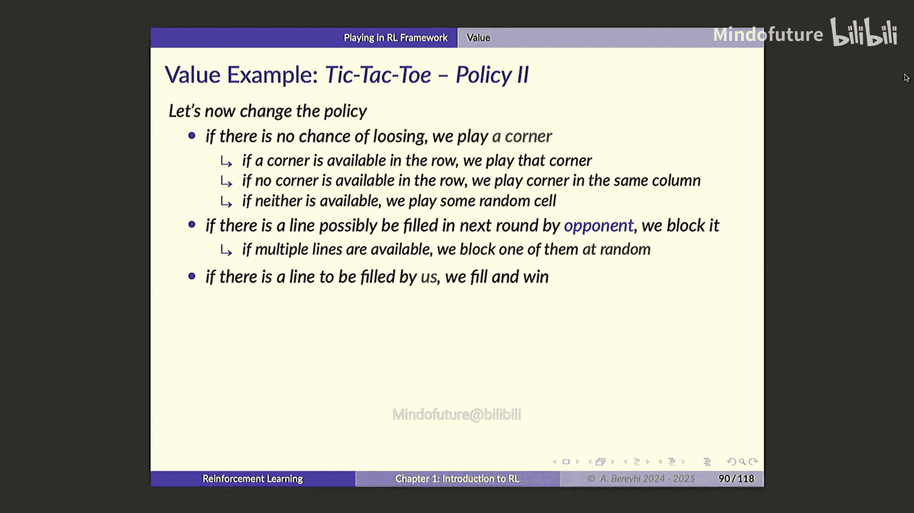

现在，我们计算在策略π2下，初始状态S0的价值 `V^π2(S0)`。

我们再次进行推演：
1.  在S0状态，根据π2，我方应占据一个空角落。假设我们选择位置2。
2.  对手根据其策略，会选择另一个空角落，例如位置6。
3.  此时，对手在位置0和6，构成了一个潜在的胜利线（左边列）。根据π2的封锁规则，我方必须落子位置3以阻止对手获胜。
4.  现在，棋盘上我方棋子位于2和3，对手位于0和6。我方有两条可以形成三连的线：`[1, 2, 3]` 或 `[2, 4, 6]`。根据策略，我方会随机选择一条线去完成它。
    *   如果我方选择落子1，对手会落子4获胜（形成 `[0, 4, 8]` 对角线）。
    *   如果我方选择落子4，对手会落子1获胜（形成 `[0, 1, 2]` 顶行）。
5.  无论哪种选择，我方都会输掉比赛，获得最终奖励-1。

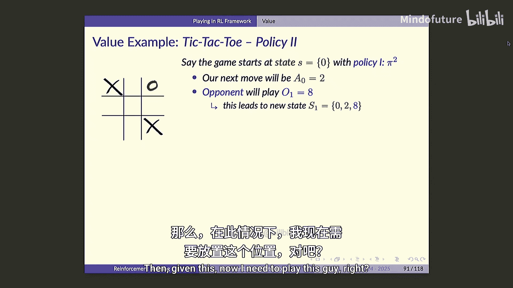

因此，从S0开始，在策略π2下，游戏总是以我方失败告终。所以，**`V^π2(S0) = -1`**。

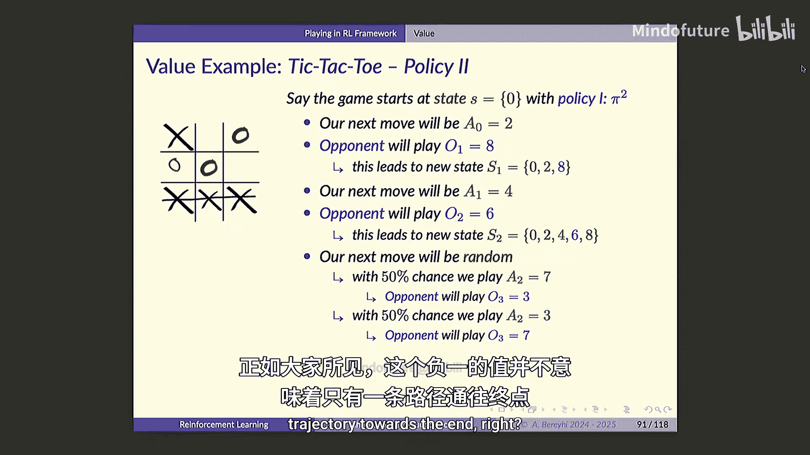

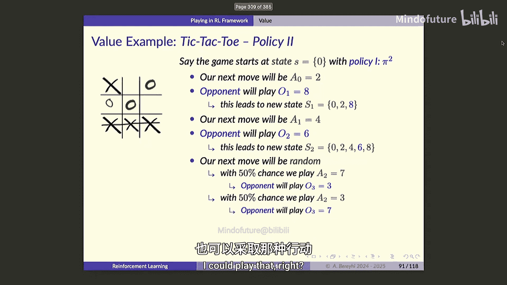

通过对比，我们发现 `V^π1(S0) = 0` 而 `V^π2(S0) = -1`。**价值函数清晰地表明策略π1优于策略π2**，因为它能带来更高的期望回报（平局优于失败）。这就是价值函数的核心作用：为不同策略提供一个可比较的量化指标。

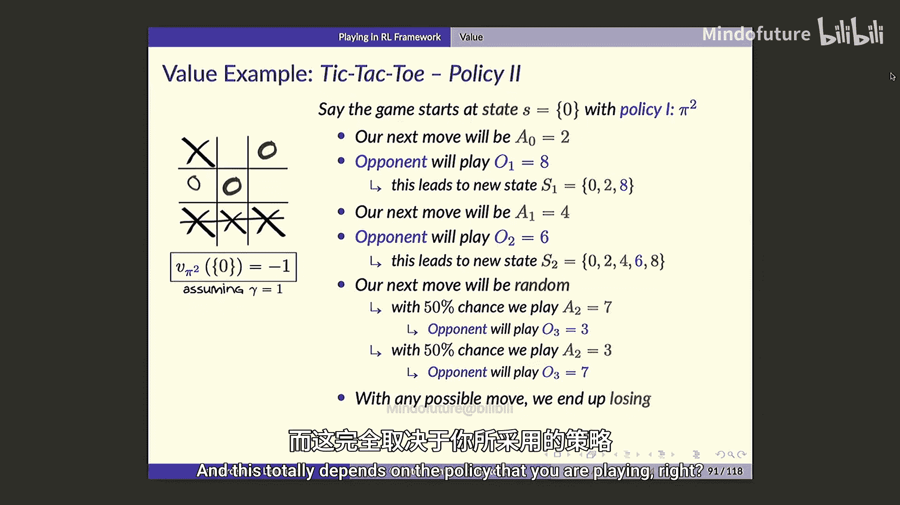

## 动作价值函数

除了衡量某个状态的价值，我们有时还需要衡量在某个状态下执行某个特定动作的价值。这就引出了 **动作价值函数 Q^π(s, a)**。

动作价值函数 `Q^π(s, a)` 的定义是：在状态 `s` 下，执行动作 `a`，然后**之后一直遵循策略π**，所能获得的期望回报。

它与状态价值函数 `V^π(s)` 的关系非常密切。实际上，状态价值函数就是动作价值函数关于策略π的期望值。用公式表示如下：

**`V^π(s) = Σ_a π(a|s) * Q^π(s, a)`**

其中，`π(a|s)` 表示在状态 `s` 下，策略π选择动作 `a` 的概率。这个公式意味着，一个状态的价值，等于在该状态下所有可能动作的价值，按照策略给出的概率分布进行加权平均。

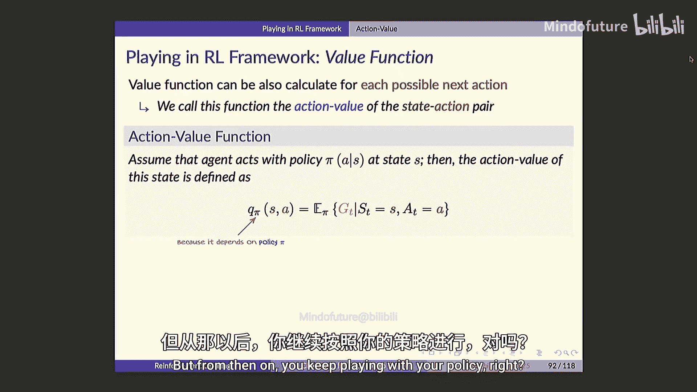

## 混合策略的价值

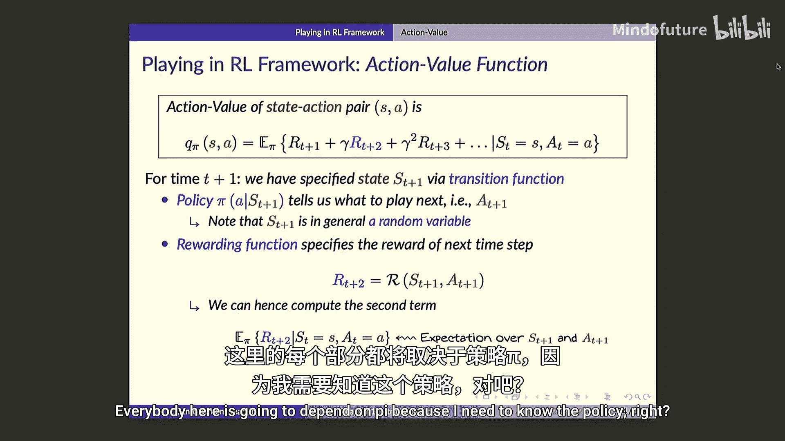

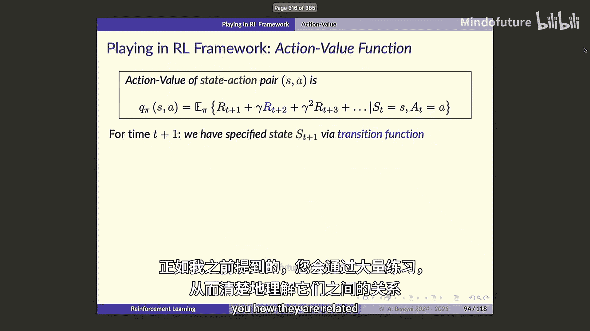

最后，我们来看一个混合策略的例子，它结合了π1和π2。定义新策略 **π-混合** 如下：在初始状态S0，有50%的概率采用策略π1的初始行动（落子相邻位），50%的概率采用策略π2的初始行动（落子角落），之后的步骤分别遵循π1或π2的后续规则。

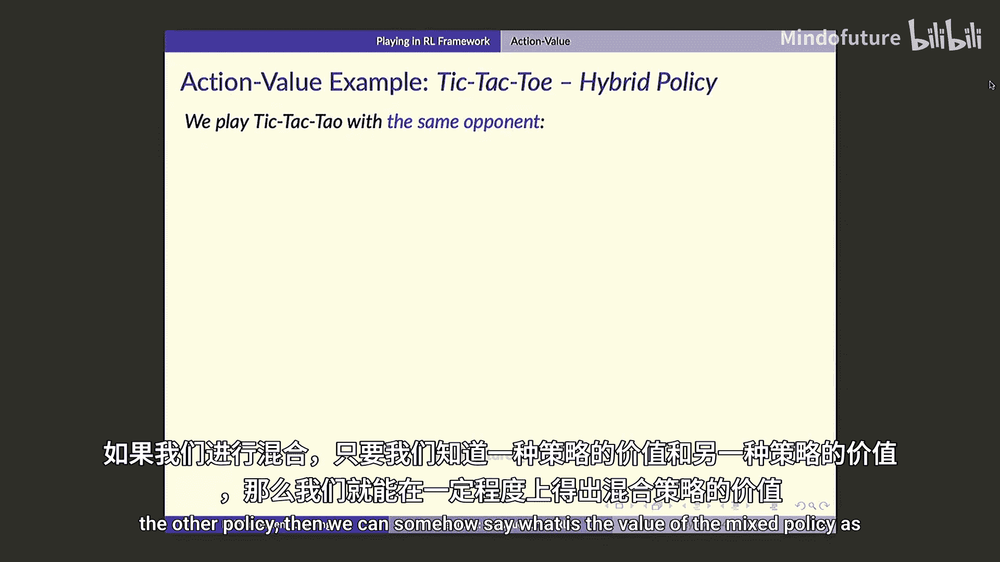

那么，这个混合策略在S0的价值 `V^π-混合(S0)` 是多少？

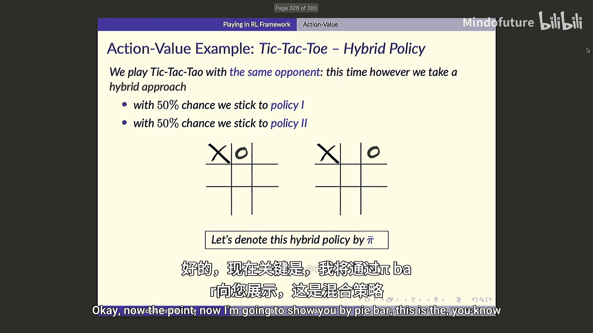

我们可以利用动作价值函数和上述公式来计算：
*   当选择π1的初始行动（动作a1）时，其动作价值 `Q^π-混合(S0, a1)` 等于完全遵循π1所能获得的价值，即 `V^π1(S0) = 0`。
*   当选择π2的初始行动（动作a2）时，其动作价值 `Q^π-混合(S0, a2)` 等于完全遵循π2所能获得的价值，即 `V^π2(S0) = -1`。

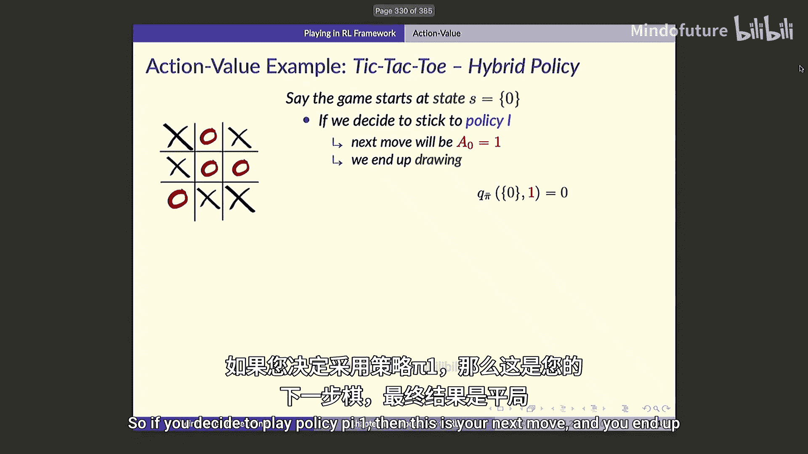

根据混合策略，选择a1和a2的概率各为50%。因此，状态价值为：
**`V^π-混合(S0) = 0.5 * 0 + 0.5 * (-1) = -0.5`**

这个结果直观地展示了如何通过组合简单策略及其价值，来计算更复杂策略的价值。

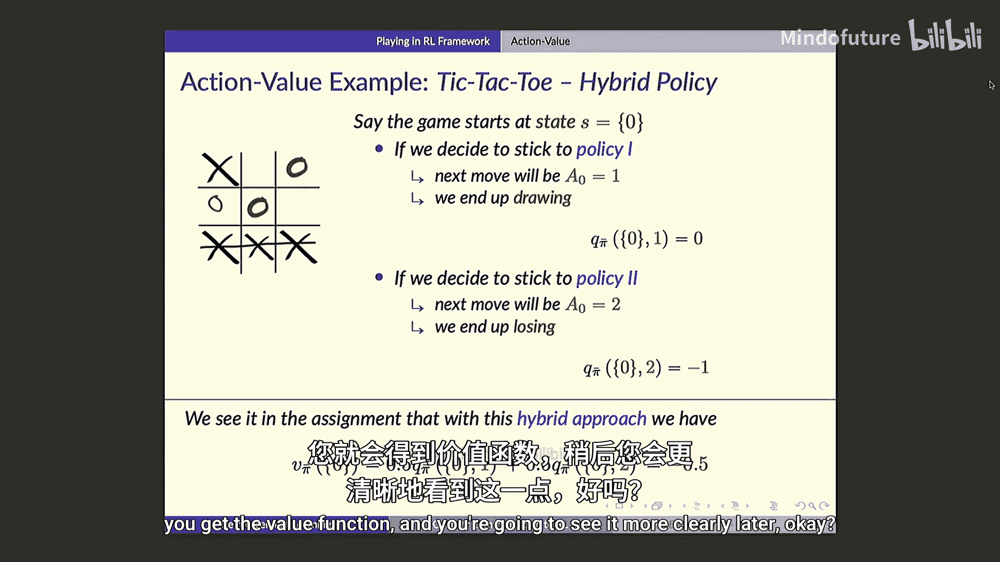

本节课中我们一起学习了强化学习中的核心概念：策略、状态价值函数和动作价值函数。我们通过井字棋的实例看到：
1.  策略决定了智能体在环境中的行为方式。
2.  状态价值函数 `V^π(s)` 量化了在特定策略π下，从状态`s`出发能获得的长期期望回报。
3.  动作价值函数 `Q^π(s, a)` 则量化了在状态`s`下执行特定动作`a`，然后遵循策略π的长期期望回报。
4.  价值函数是评估和比较不同策略优劣的根本依据，`V^π(s)` 值越高的策略越好。
5.  状态价值与动作价值通过策略概率紧密相连：`V^π(s)` 是 `Q^π(s, a)` 关于策略π的期望。理解这些概念是后续学习如何寻找最优策略的基础。