# 010：最优策略与强化学习方法综述 🎯

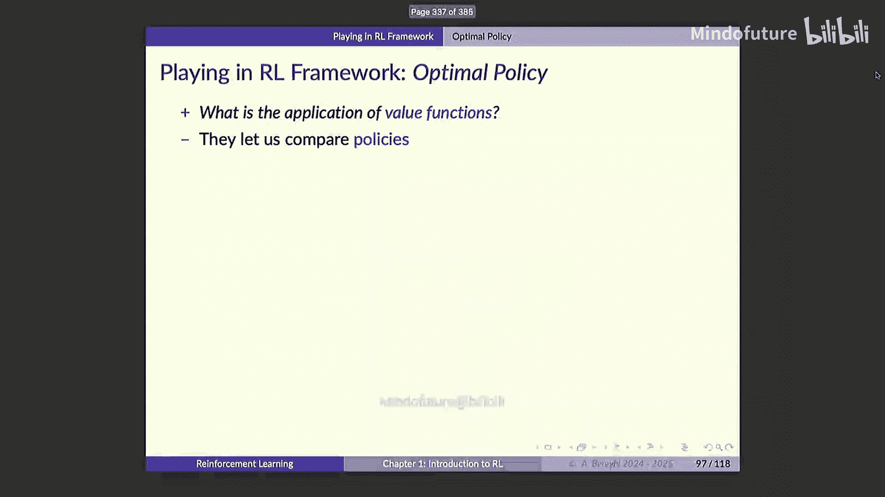

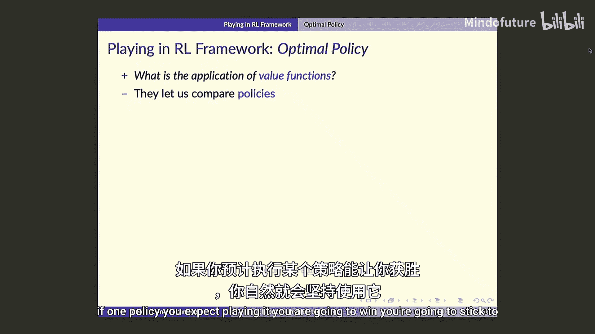

在本节课中，我们将学习强化学习的核心目标——寻找最优策略，并概述实现这一目标的两大类方法：基于模型的方法和无模型方法。我们还将探讨当状态空间巨大时，如何利用深度学习技术来近似求解。

## 最优策略的定义

上一节我们介绍了价值函数，本节中我们来看看如何利用价值函数来比较和定义最优策略。

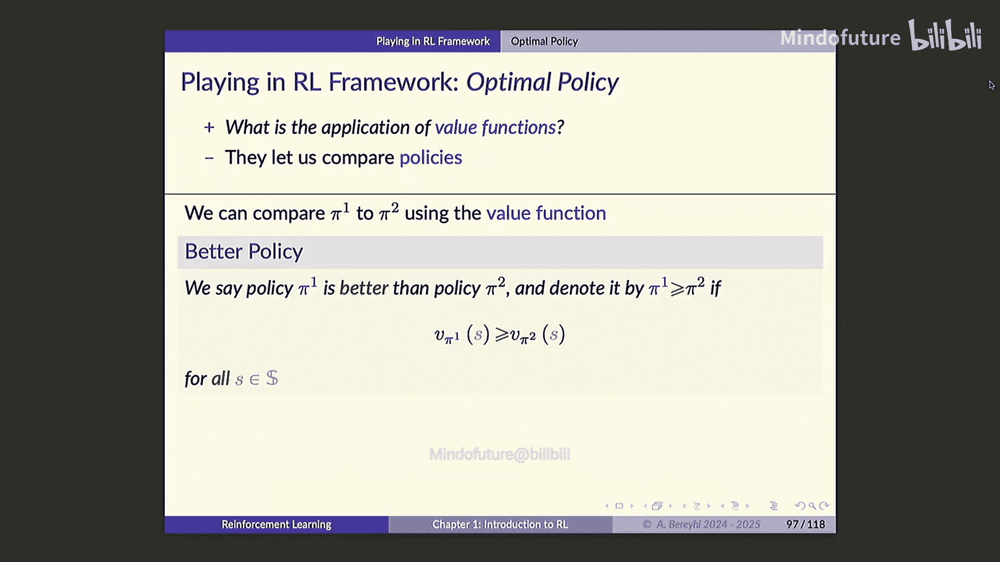

一旦你有了价值函数，这个函数就能让你比较两个不同的策略。你总是会选择能给你带来更高价值的策略，因为如果一个策略预期表现良好，你就会坚持使用它。

我们可以这样定义“更好”的策略。假设策略 **π₁** 被认为优于或等于策略 **π₂**，可以表示为：

**π₁ ≥ π₂**

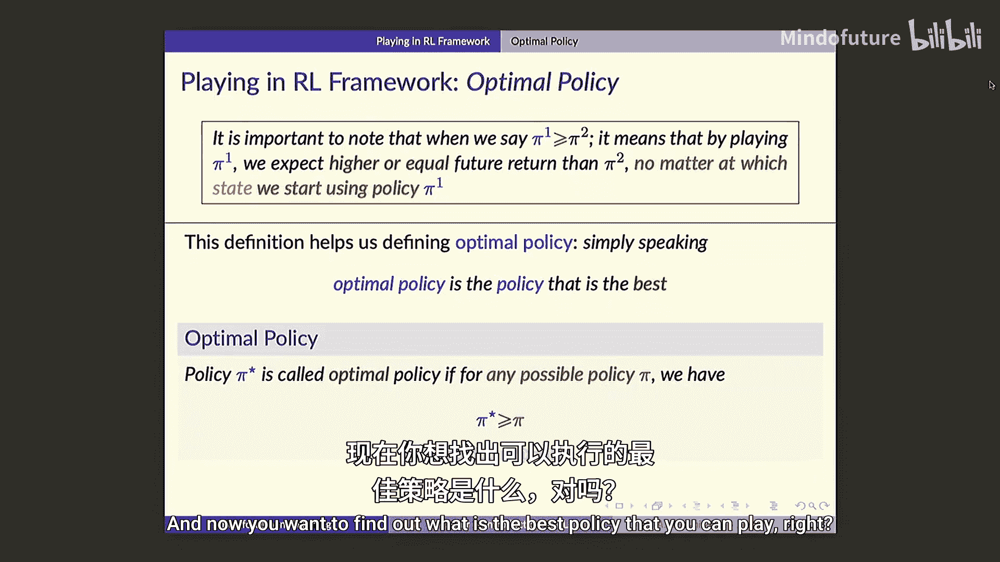

这意味着，如果你计算策略 **π₁** 的价值函数，它在**每一个**状态下的值都将大于或等于策略 **π₂** 的价值函数。这一点非常重要。价值函数是状态的函数，所以一个策略要被称为更好，必须在所有可能的状态下都提供更好或相等的价值。如果一个策略在某个状态下让你获胜，但在另一个状态下让你失败，那么它就不能被称为总体上更好的策略。

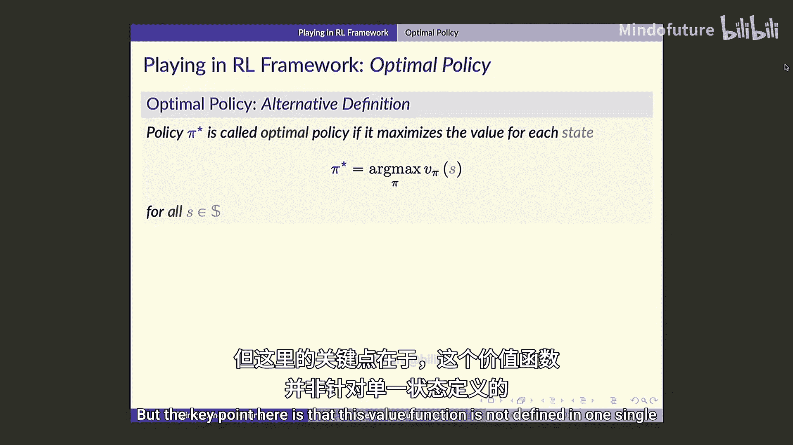

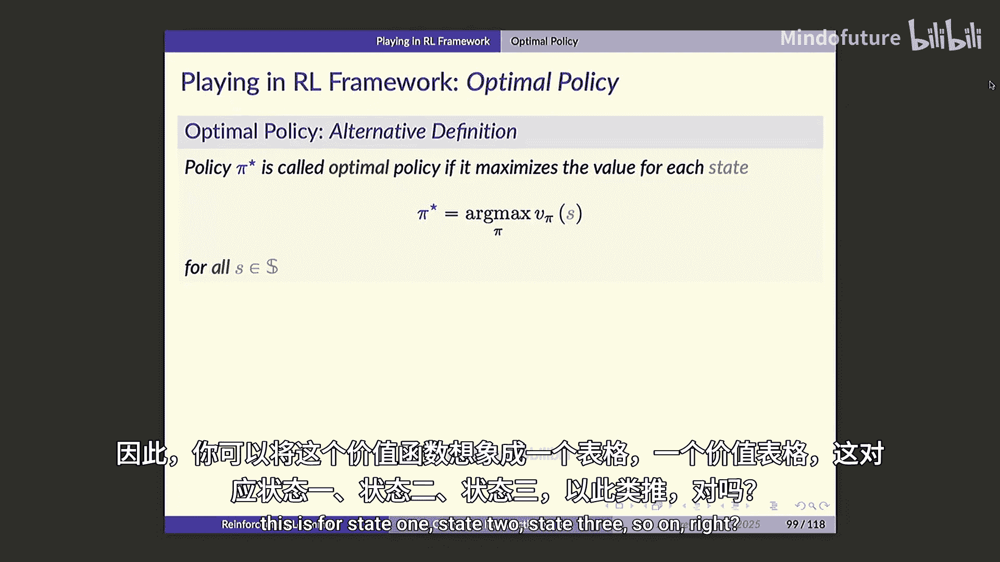

以下是判断策略优劣的核心条件：
*   策略 **π₁** 优于或等于 **π₂**，当且仅当对于所有状态 **s**，都有 **V^π₁(s) ≥ V^π₂(s)**。

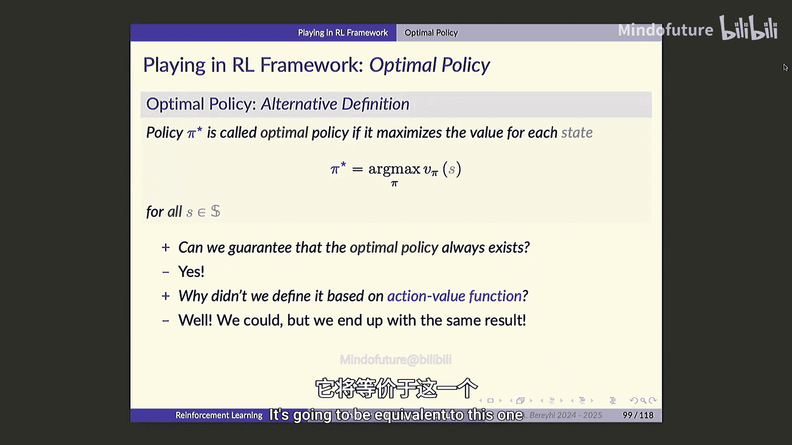

那么，什么是最优策略呢？最优策略就是比任何其他策略都更好的策略。如果存在一个策略 **π***，对于任何其他策略 **π** 和所有状态 **s**，都满足：

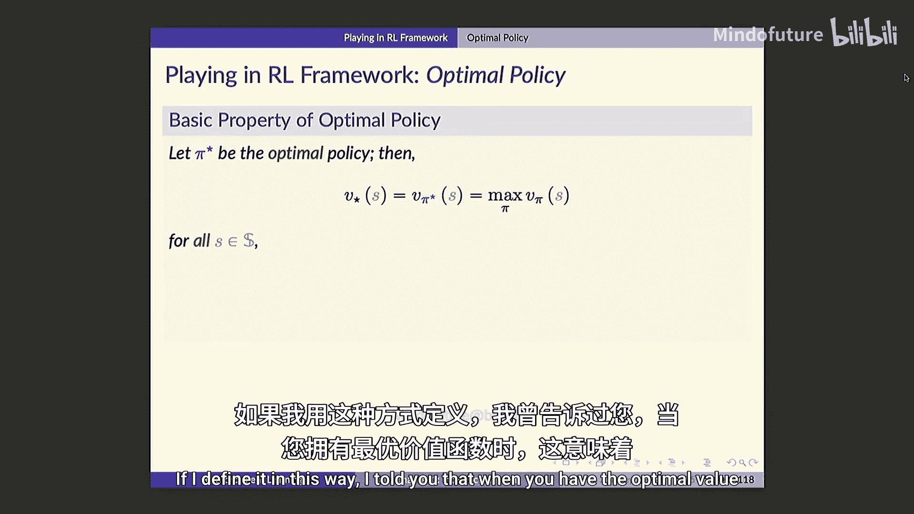

**V^π*(s) ≥ V^π(s)**

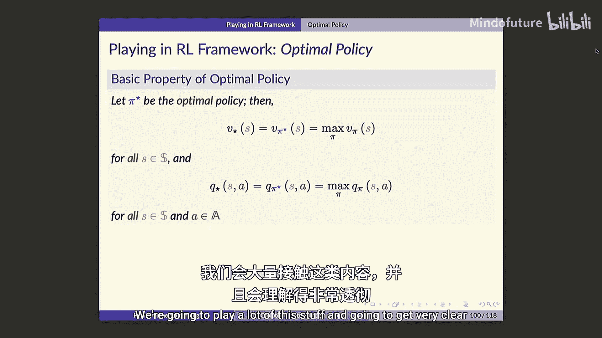

那么 **π*** 就是最优策略。强化学习的根本目的就是为给定的环境找到这个最优策略 **π***，因为它能带来在整个游戏过程中可收集的最佳期望奖励。

人们也可以用另一种等价形式来定义最优策略，即最优策略是最大化价值函数的策略。但关键点在于，这里最大化的不是单个状态的价值，而是所有状态构成的价值表。

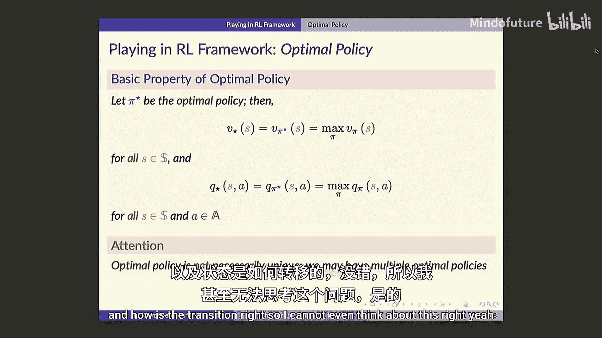

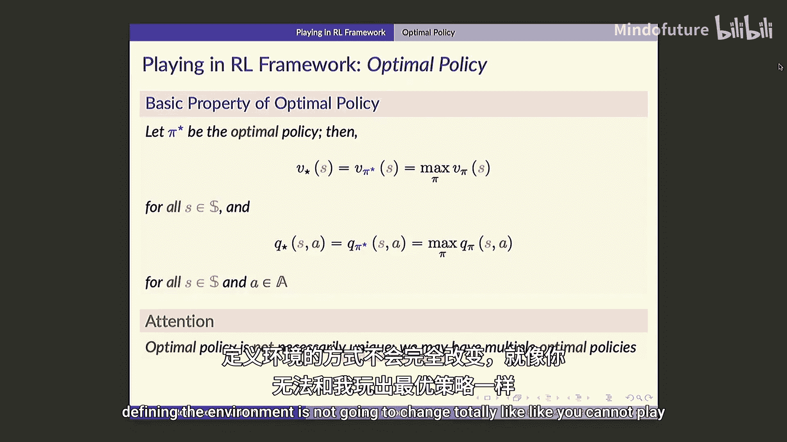

## 关于最优策略的深入探讨

一个自然的问题是：对于任何环境，最优策略都存在吗？如果我们认为环境具有明确定义（即使我们不知道具体细节）且一致的转移函数和奖励系统，那么最优策略就是存在的。但能否找到它则是另一个问题。

为什么我们只用状态价值函数来定义呢？我们不是也定义了动作价值函数 **Q** 吗？实际上，用 **Q** 函数来定义是等价的。当你遵循最优策略时，得到的 **Q** 函数也将是所有可能策略中能产生的最大 **Q** 函数。

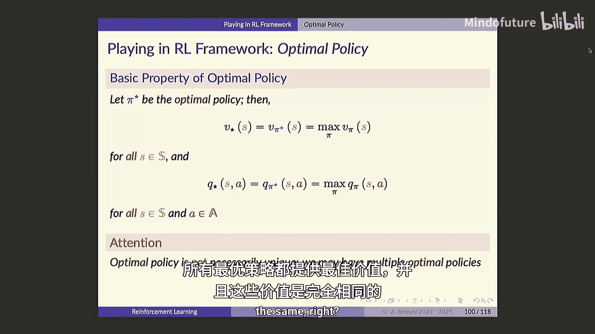

需要指出的是，最优策略可能不是唯一的。可能存在多个不同的策略，但它们都能产生相同的、最优的价值函数。所有这些策略都被视为最优策略。

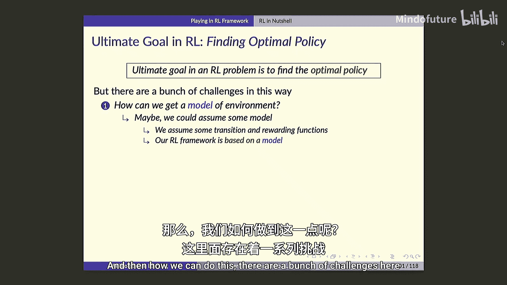

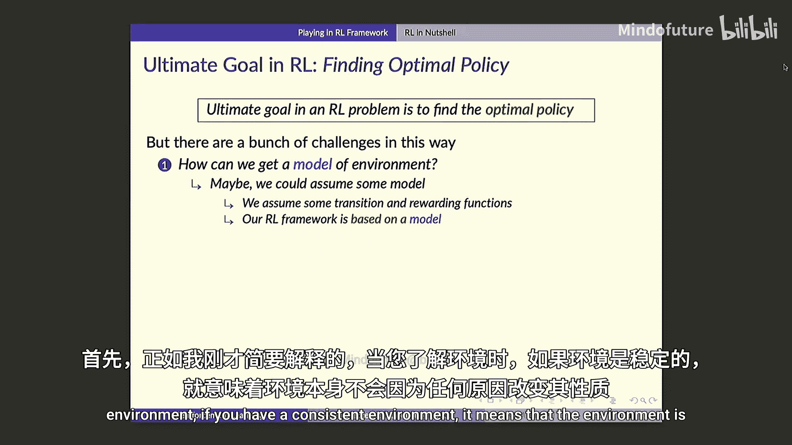

## 寻找最优策略的方法分类

强化学习的终极目标是找到最优策略。如何实现这一目标面临几个挑战，主要分为两大类方法。

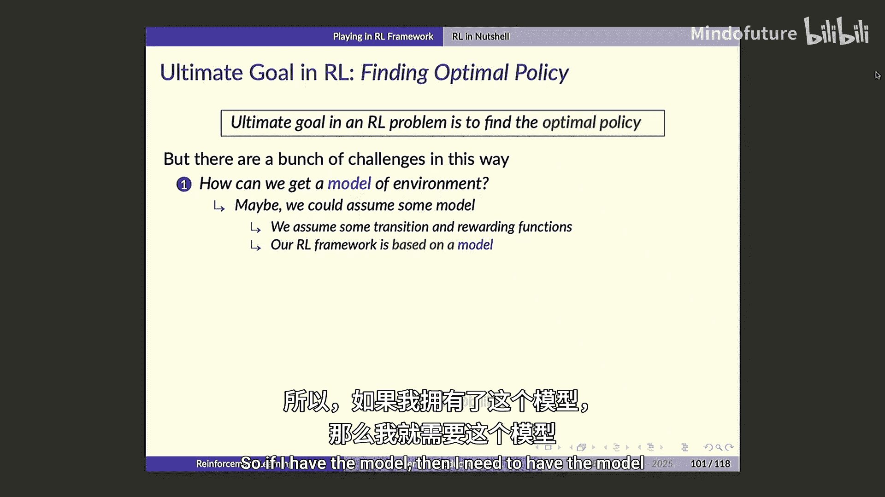

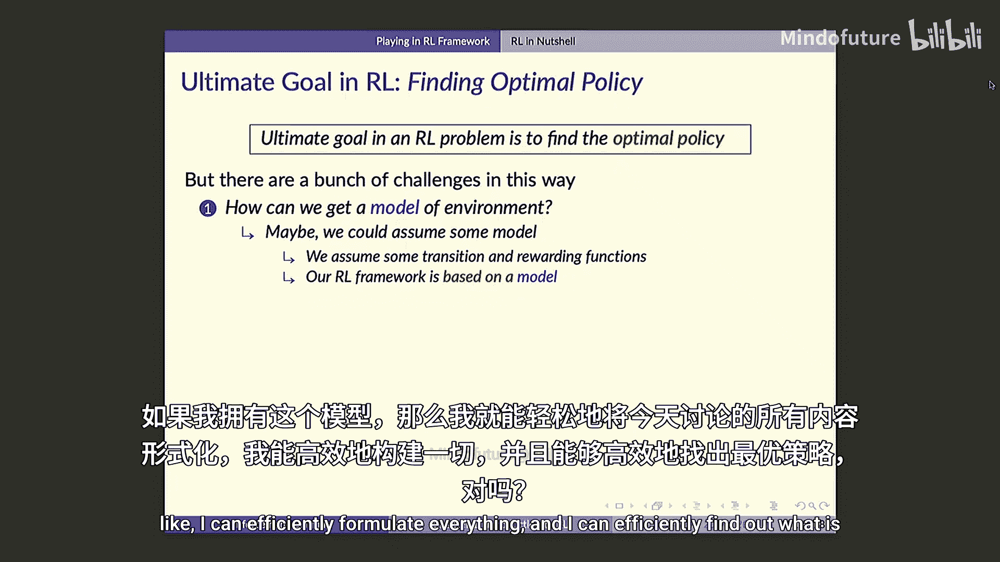

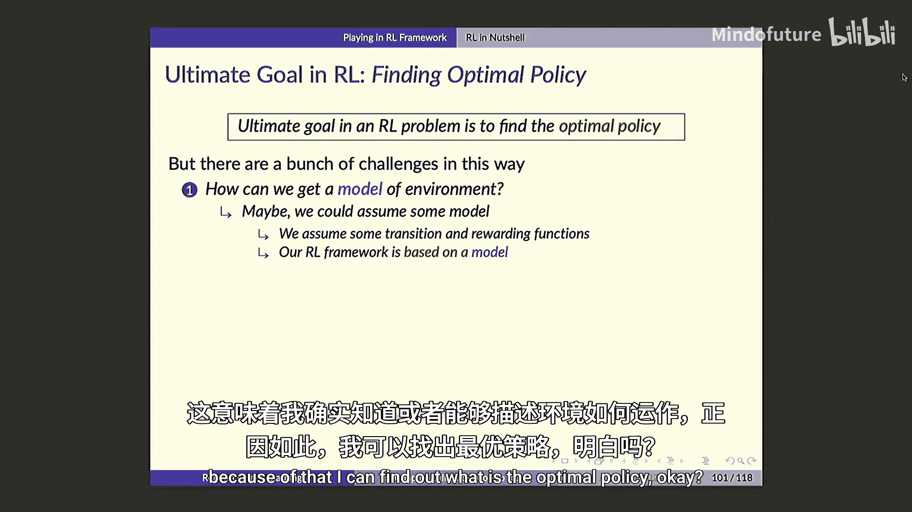

首先，如果你**知道或可以建模**环境的动态（即状态转移概率和奖励函数），那么你就能精确地形式化所有计算，并有效地找出最优策略。这种方法称为**基于模型的强化学习**。例如，在经典控制问题中，人们通常使用随机模型来描述环境。

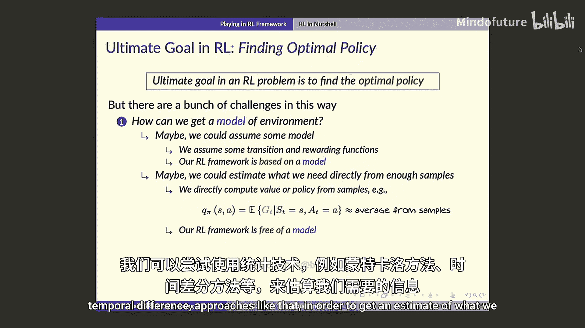

然而，更常见的情况是，我们**不知道**环境的精确模型。我们无法描述从一个状态转移到另一个状态的分布。这时，我们就需要使用统计技术来估计所需的期望值（如价值函数）。这种方法称为**无模型强化学习**。例如，要估计在特定状态 **s** 下执行动作 **a** 的动作价值 **Q(s, a)**，我们可以多次在现实中执行该动作，观察得到的回报，然后对这些回报取平均值（蒙特卡洛方法）。

这种分类与使用的计算工具无关。无论是经典的表格型方法还是深度强化学习，你总是在采用这两种思路之一。

在无模型强化学习中，又可以分为两种主要技术路径：
*   **同策略方法**：评估或改进的策略与用于与环境交互、收集数据的策略是同一个。
*   **异策略方法**：用于评估或改进的策略与用于交互收集数据的策略不同。这通常借助重要性采样等技术来实现。

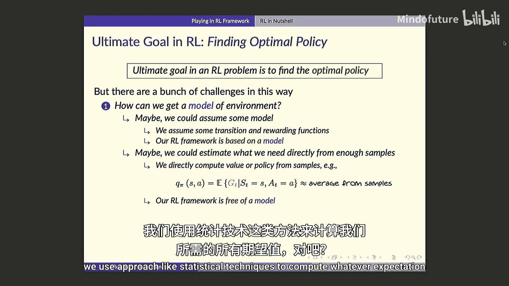

以下是强化学习方法的简要分类流程：
1.  **目标**：寻找最优策略 **π***。
2.  **方法选择**：
    *   如果已知环境模型 -> 采用**基于模型**的方法（如策略迭代、价值迭代）。
    *   如果未知环境模型 -> 采用**无模型**的方法。
        *   **同策略**方法（如 Sarsa）。
        *   **异策略**方法（如 Q-learning）。

## 大规模问题与深度强化学习

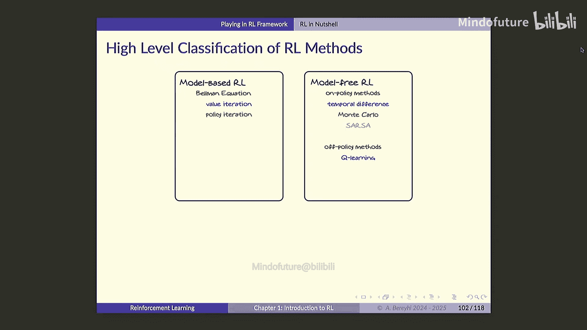

现在，假设我们采用基于模型或无模型的方法，最终都需要处理价值函数。价值函数依赖于状态。如果状态数量很少（例如10个、1000个），我们可以用一个表格来存储每个状态的价值。

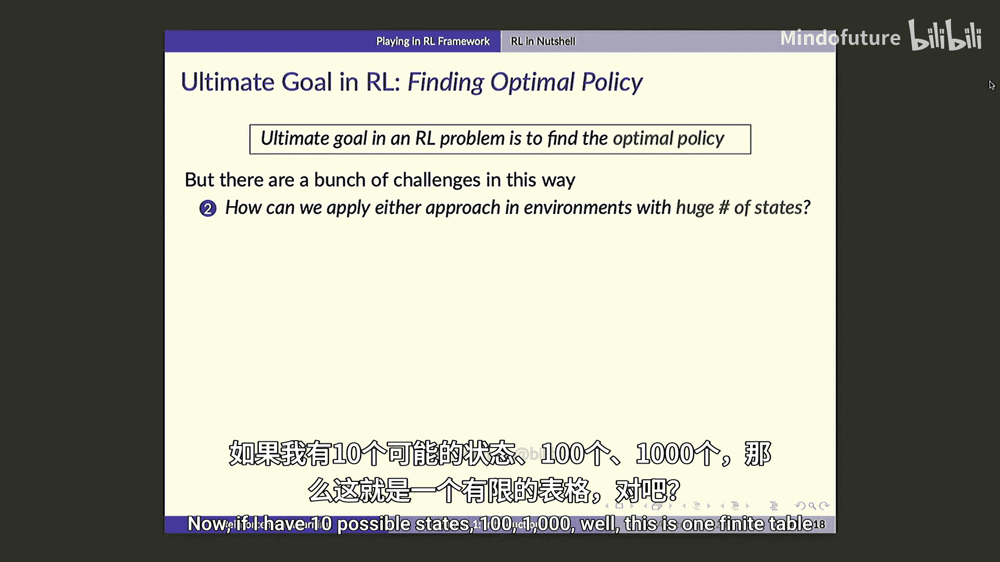

但是，如果状态空间巨大无比呢？例如国际象棋，可能的状态数量超过 10^40，这是一个天文数字，无法用表格逐一存储和计算。那么，如何解决这个问题呢？

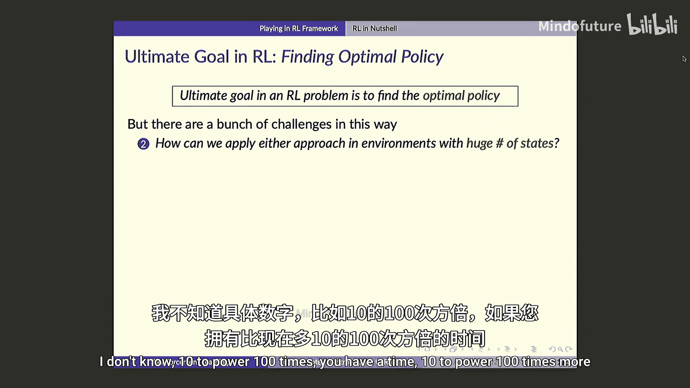

这就是深度学习介入的地方。在机器学习中，当我们有一个未知函数但拥有其一些样本点（数据）时，我们可以用一个模型（如神经网络）去拟合这些数据。训练完成后，这个模型就可以用来预测新输入的函数值。

我们将其应用到强化学习中：我们无法计算每个状态的价值，但我们需要一个函数，在给定任何状态时能输出其（近似）价值。我们可以这样做：采样一批状态，用强化学习算法（可能是无模型的蒙特卡洛或时间差分法）估算出这些状态的价值，然后将这些（状态，价值）对作为训练数据，来训练一个神经网络（称为价值网络）。训练完成后，这个网络就可以作为价值函数的近似器，用于新的状态。

这构成了深度强化学习的基础。当然，实际中如何构建和训练这个网络（以及策略网络）要复杂得多，由此衍生出深度 Q 网络、策略梯度、演员-评论家等一系列高级方法。核心思想在于，当状态空间连续或极其庞大时，我们利用函数近似器（如神经网络）来泛化我们对价值或策略的估计。

## 总结

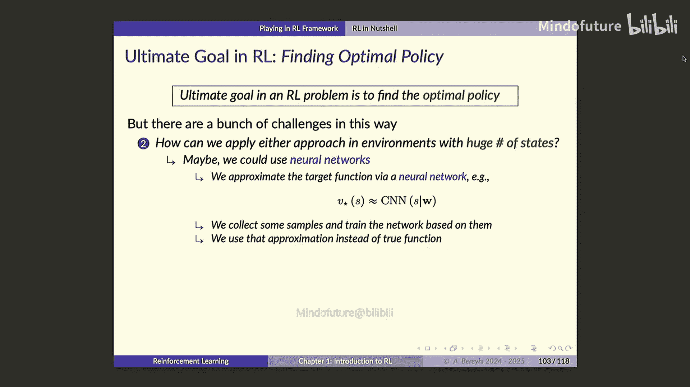

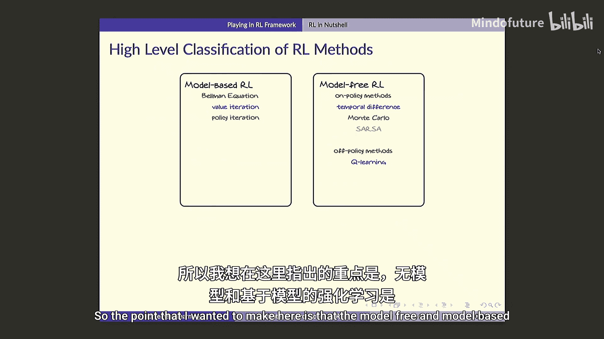

本节课中我们一起学习了强化学习的核心目标与主要方法。我们首先明确了最优策略的定义，即能够在所有状态下取得不劣于任何其他策略的期望回报的策略。接着，我们探讨了寻找最优策略的两条主要路径：在已知环境模型时使用的**基于模型**的方法，以及在未知模型时依赖经验估计的**无模型**方法。最后，我们指出了当状态空间巨大时，需要借助**深度强化学习**，利用神经网络作为函数近似器来有效地表示和寻找最优策略。这为我们后续深入学习具体的强化学习算法奠定了框架基础。