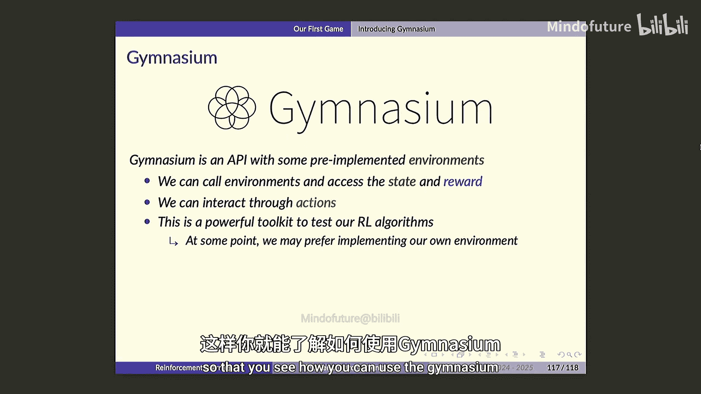
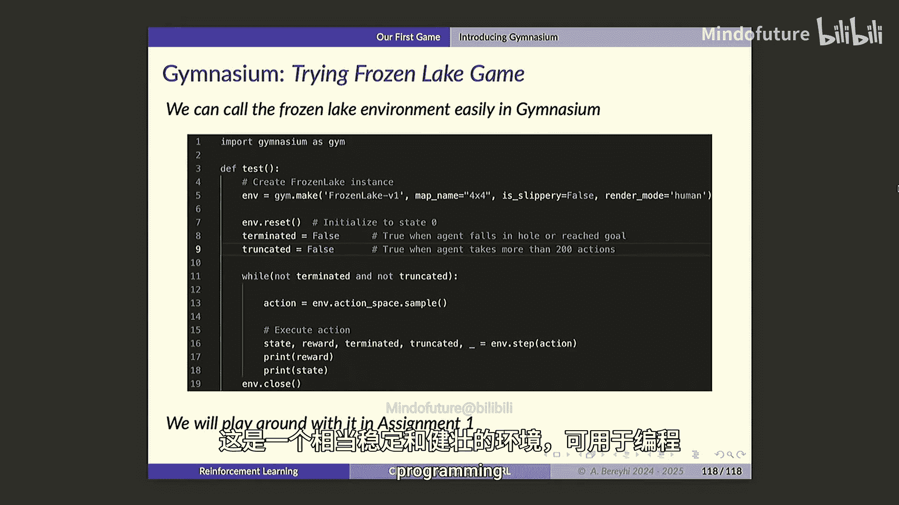

# 011：冰湖示例——终止状态与回合 🧊❄️

在本节课中，我们将通过一个名为“冰湖”的经典游戏示例，来学习如何将实际问题建模为强化学习问题。我们将重点理解状态、动作、奖励的定义，并引入“终止状态”和“回合”这两个核心概念。

## 回顾冰湖游戏

上一节我们介绍了强化学习的基本框架。本节中，我们来看看一个具体的例子：冰湖游戏。

这是一个著名的网格游戏，在作业中你们会多次用到它。我们通过分析这个游戏，来学习如何定义强化学习中的各个组件。

在冰湖游戏中，有一个智能体。环境是一个4x4的网格。智能体的目标是到达终点并获得奖励。游戏规则很简单：每次智能体决定移动时，例如选择向右移动，它有很高的概率（1-P）成功向右移动，但也有一个很小的概率P会滑向其他方向。

例如，当智能体在某个单元格时，如果它选择向右移动，那么有90%的概率到达右边的单元格，有10%的概率可能停留在原地或滑向下方。如果上方没有单元格，选择向上移动就会停留在原地。这种随机性使得游戏结果不确定。当滑移概率P很小时，智能体通过简单地向终点移动，在大多数情况下都能获胜。

如果智能体到达终点，它会获得正奖励。如果智能体掉入冰面上的洞（网格中的浅色单元格），它会获得负奖励并输掉游戏。我们的目标是将这个问题形式化为一个强化学习问题。

## 定义状态、动作与奖励

要将游戏建模为强化学习问题，首先需要明确状态、动作和奖励。

**状态**是智能体所在的单元格。总共有16个不同的单元格，因此有16个不同的状态，可以标记为状态0到状态15。

**动作**是智能体可以移动的方向。通常，在任何位置都有四个可能的动作：上、右、下、左。我们可以用数字0、1、2、3来表示这些动作。虽然在某些边界单元格，某些动作（如向墙移动）不会改变状态，但将所有动作都定义为可用可以简化模型。

**奖励**根据结果定义。如果掉入洞中，奖励为-1。如果到达终点，奖励为+1。如果游戏仍在进行中（即停留在安全的冰面上），奖励为0。因此，奖励函数可以看作是从一个离散集合{-1， 0， +1}中取值。

给定当前状态和采取的动作，我们就可以描述接下来会获得的奖励。

## 转移与奖励系统

现在我们来描述状态转移和奖励系统。这两个系统都因为环境的随机性而具有随机性。

当智能体在状态`s`执行动作`a`时，例如选择向右移动，它以概率`1-P`成功移动到目标单元格，并以概率`P`滑向其他相邻方向。

奖励系统也类似。以概率`1-P`，智能体获得目标单元格的奖励（可能是0、-1或+1）。以概率`P`，它可能滑向其他方向并获得相应的奖励。

例如，假设我们在状态4（即第2行第1列的单元格）。如果我们执行动作“右”（用数字2表示），那么：
*   以概率 `1-P`，我们转移到状态5，并获得该单元格的奖励（可能是-1，因为旁边是洞）。
*   以概率 `P`，我们可能滑向状态0或状态8，并获得相应的奖励（可能是0）。

## 终止状态的概念

在最初的建模中，我们假设游戏永远进行下去。但在冰湖游戏中，当智能体到达终点或掉入洞中时，游戏实际上就结束了。如何将这种“结束”的概念融入我们的无限时间框架中呢？

解决方案是引入**终止状态**。

终止状态是指，一旦进入这个状态，无论后续采取什么动作，智能体都将永远停留在这个状态，并且获得的奖励始终为0。例如，我们可以将掉入的洞（如状态5）或终点本身定义为终止状态。

这样处理的好处是，我们无需再关心游戏的具体结束时间。时间仍然可以无限延伸，但一旦进入终止状态，后续的奖励流就固定为0，不影响总回报的计算。这解决了游戏回合长度不一致的问题。

## 回合与价值函数

从初始状态开始，到进入某个终止状态结束，这样一条完整的状态-动作-奖励序列，我们称之为一个**回合**。

通过多次运行游戏，我们可以收集到多个回合的数据。这些数据后续将用于学习价值函数和优化策略。

现在，考虑终止状态的价值。根据定义，在终止状态，无论采取什么策略，后续获得的奖励始终为0。因此，终止状态的价值函数 `V(terminal)` 为0。

我们可以通过公式来验证这一点。状态`s`在策略`π`下的价值 `V^π(s)` 是预期回报：
`V^π(s) = E[ R_t + γR_{t+1} + γ²R_{t+2} + ... | S_t = s ]`
如果`s`是终止状态，则立即奖励`R_t`、下一个奖励`R_{t+1}`以及所有未来奖励都是0。因此，其期望值，即价值函数，也为0。这是一个与策略无关的自然属性。

## 策略与示例分析

在冰湖游戏中，一个策略 `π(a|s)` 定义了在每个单元格（状态`s`）下选择各个移动方向（动作`a`）的概率分布。

策略可以是确定性的。例如，在状态0，最优策略可能总是选择向右移动（动作1），即 `π(右|状态0) = 1`， 其他动作概率为0。

策略也可以是随机性的。例如，在某个十字路口单元格，策略可能设定向右和向下移动的概率各为50%，而向左和向上的概率为0。

让我们分析一个具体案例。假设滑移概率 `P = 0`，即没有随机滑动。那么，一个始终向终点移动的确定性策略就是最优策略。遵循这个策略，从任何非终止状态出发，智能体最终都能获得+1的奖励。因此，这些状态的价值（在折扣因子γ接近1时）都接近于1，而终止状态的价值为0。

如果我们采用另一个策略，比如在某个关键点总是错误地向右移动掉入洞中，那么从某些状态出发的价值就会是-1。**最优策略**就是那个能使每个状态的价值函数最大化的策略。

## 关于时间与策略的讨论

有同学可能会问，策略是否可以随时间变化？在目前我们讨论的框架中，环境动态是固定的，不随时间改变。所有的变化和不确定性都已包含在环境的随机转移概率中。因此，一个不随时间变化的静态策略足以应对。如果环境本身会随时间发生阶段性变化（例如从稳态到瞬态），那么就需要更复杂的、随时间变化的策略，但这超出了当前课程的范畴。

## 奖励设计的影响

奖励函数的设计会影响智能体的行为。在冰湖中，我们将掉入洞的奖励设为-1，这给了智能体强烈的避免掉入洞的动机。如果将其设为0，智能体避免掉洞的动机就 solely（主要）来自于对最终+1奖励的追求，这在学习初期可能效率较低。但从理论上讲，只要算法收敛，最终仍能找到最优策略（即到达终点）。奖励设计是强化学习应用中的一个重要课题。

## 实战工具：Gymnasium简介

在实际编程中，我们不会从头开始编写所有环境代码。`Gymnasium`（前身是OpenAI Gym）是一个广泛使用的Python库，它提供了大量预定义的环境和统一的接口，方便我们实现和测试强化学习算法。

它包含许多经典环境，如冰湖、悬崖漫步、山地车等。在接下来的教程中，助教将带领大家学习如何使用Gymnasium。基本步骤通常包括：
1.  导入库：`import gymnasium as gym`
2.  创建环境：`env = gym.make(‘FrozenLake-v1‘， is_slippery=True)`
3.  重置环境到初始状态：`state = env.reset()`
4.  在主循环中：
    *   从动作空间中采样一个动作（例如，随机选择或根据策略选择）。
    *   执行该动作：`next_state， reward， terminated， truncated， info = env.step(action)`
    *   根据返回的`reward`、`next_state`以及是否结束（`terminated`）来更新智能体。
    *   如果回合结束，则重置环境。

使用Gymnasium可以让我们专注于算法本身，而无需重复实现环境逻辑。

## 总结

本节课中，我们一起学习了如何通过冰湖示例来构建强化学习模型。我们明确了状态、动作和奖励的定义，并深入理解了**终止状态**和**回合**这两个关键概念，它们帮助我们在无限时间框架中处理有限长度的任务。我们还分析了策略如何影响状态价值，并简要介绍了用于实际开发的Gymnasium工具。在接下来的课程中，我们将利用这些基础概念来推导和实现核心的强化学习算法。