# 012：马尔可夫决策过程 🧠

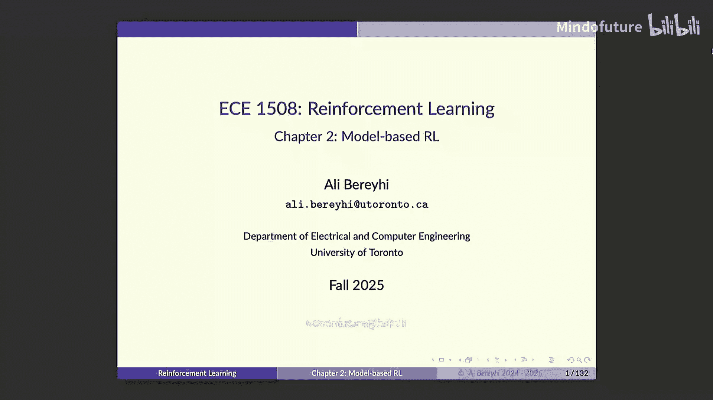

在本节课中，我们将学习模型基础的强化学习方法。我们将探讨如何在一个已知或可建模的环境中，寻找最优策略。核心在于理解马尔可夫决策过程，并利用贝尔曼最优性方程来求解最优策略。

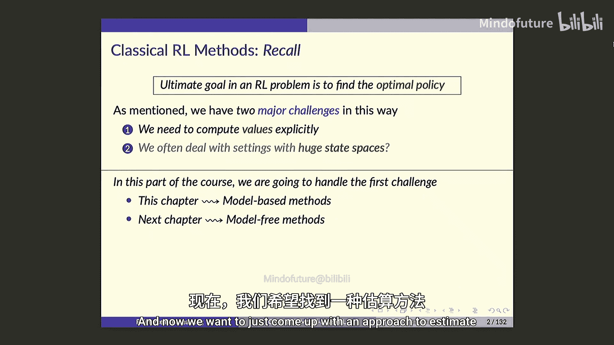

上一节我们介绍了强化学习的整体框架和目标。本节中，我们来看看当环境模型已知时，我们如何形式化地描述问题并寻找解决方案。

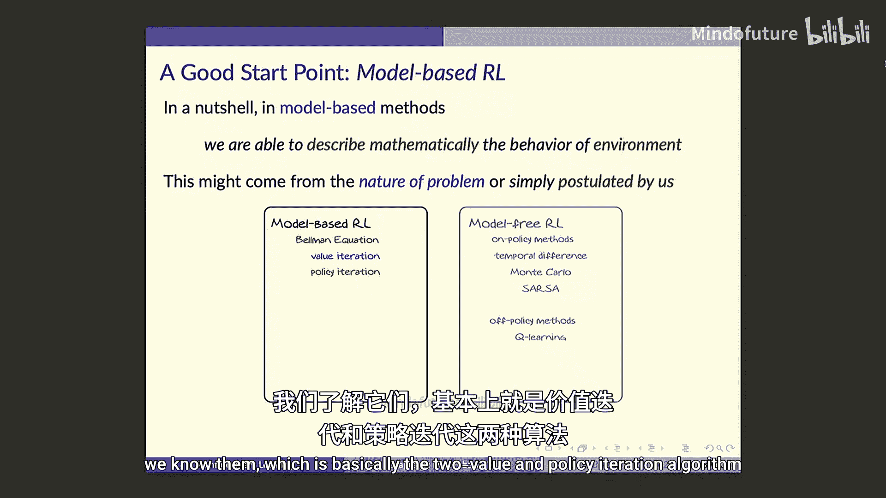

## 模型基础方法概述

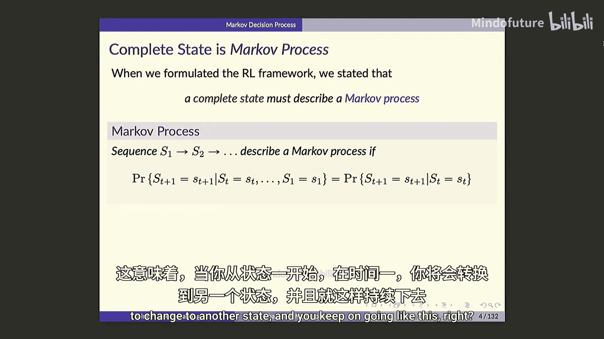

模型基础方法的核心假设是，我们能够描述环境的动态。这意味着我们知道或可以假设一个统计模型，用于表示从当前状态和动作转移到下一个状态并获得奖励的概率。

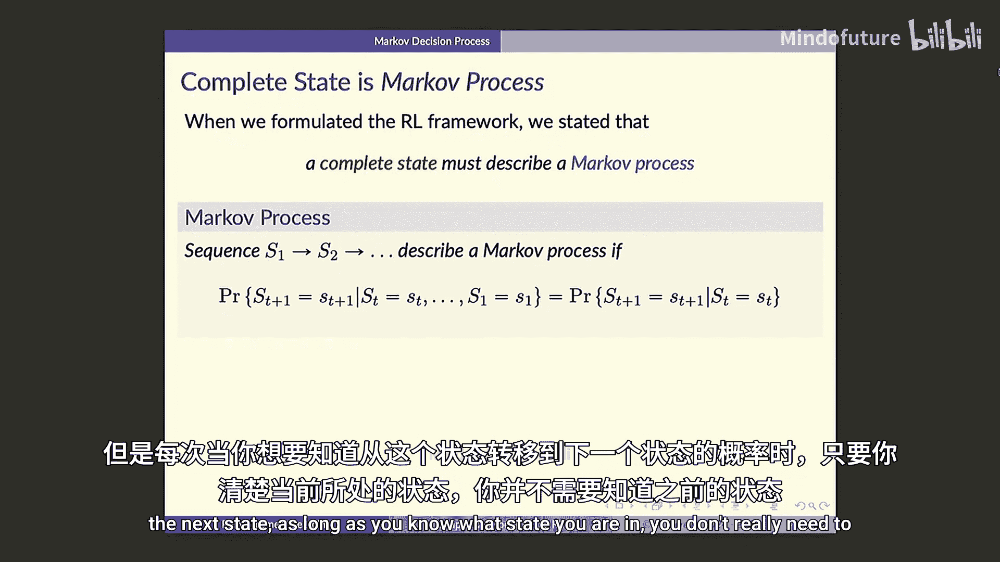

具体而言，我们假设可以访问或定义马尔可夫决策过程的转移概率。这使我们能够精确计算价值函数，并最终找到最大化累积奖励的策略。

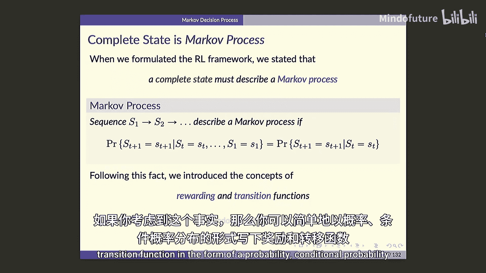

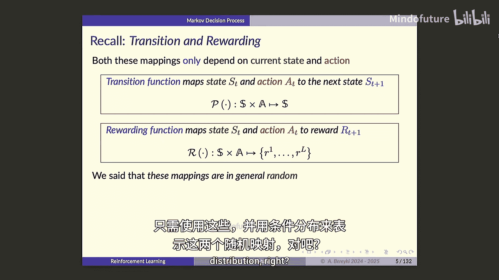

## 马尔可夫决策过程的形式化

马尔可夫过程的关键特性是“无记忆性”。给定当前状态，未来的状态演变与过去的历史无关。所有必要的信息都包含在当前状态中。

在强化学习中，我们将其扩展为马尔可夫决策过程。MDP由以下要素定义：
*   **状态集合 S**
*   **动作集合 A**
*   **转移模型 P**：定义了在状态 `s` 执行动作 `a` 后，转移到状态 `s'` 并获得奖励 `r` 的联合概率。

我们可以用一个条件概率分布来紧凑地表示这个模型：

**P(s', r | s, a)**

这个公式描述了在给定当前状态 `s` 和动作 `a` 的情况下，下一时刻进入状态 `s'` 并获得即时奖励 `r` 的概率。

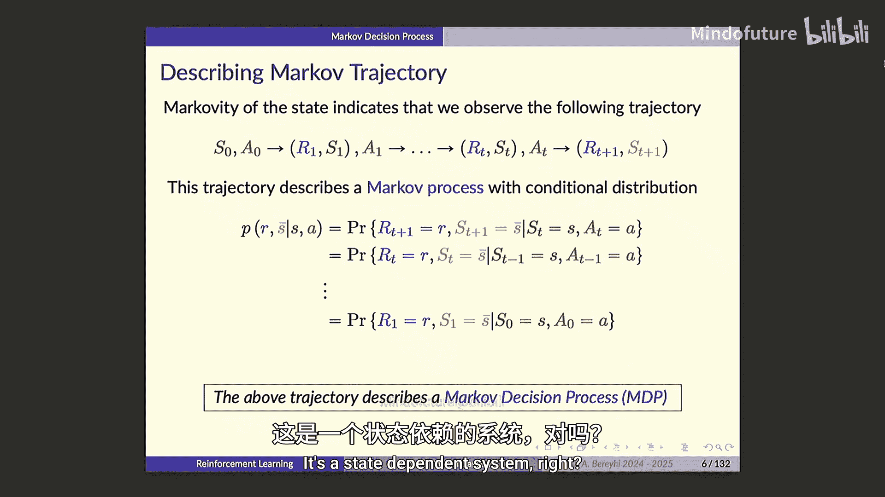

### 从联合分布到奖励与转移函数

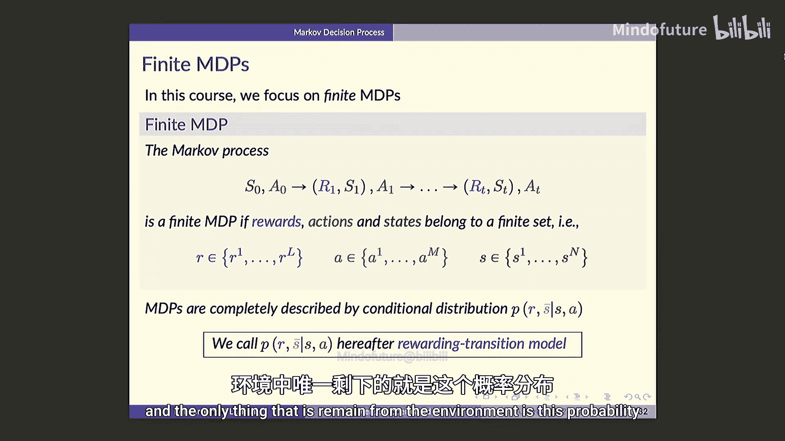

原始的强化学习框架分别定义了奖励函数和转移函数。它们可以从上述联合分布中推导出来。

以下是具体方法：

*   **奖励函数 R(s, a)**：如果我们只关心奖励的分布，而不关心下一个状态是什么，我们可以对下一个状态 `s'` 进行边际化。
    **R(s, a) 的分布由 Σ_{s'} P(s', r | s, a) 给出**
*   **状态转移函数 T(s, a, s')**：如果我们只关心下一个状态的分布，而不关心获得的即时奖励，我们可以对奖励 `r` 进行边际化。
    **T(s, a, s') = Σ_{r} P(s', r | s, a)**

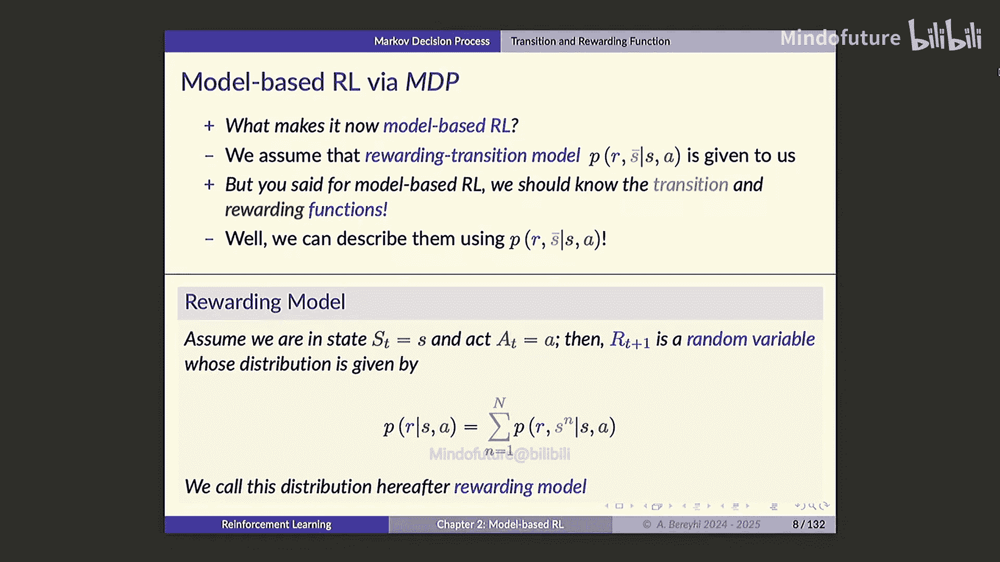

因此，联合概率分布 `P(s', r | s, a)` 提供了对环境最完整的描述，奖励和转移函数都是它的特例。

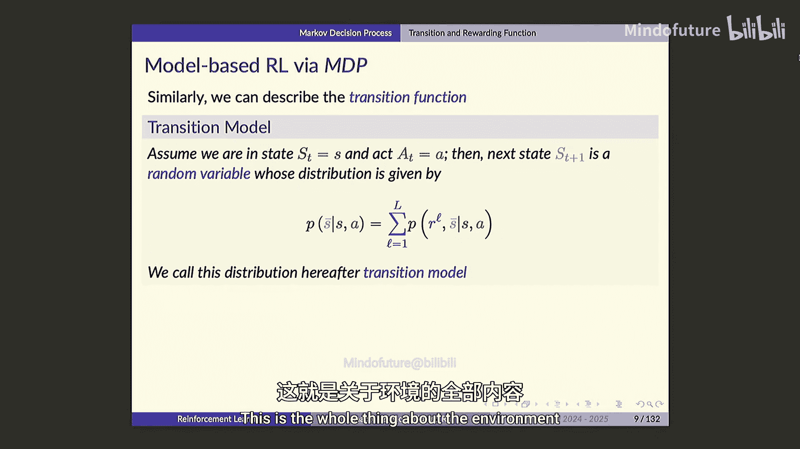

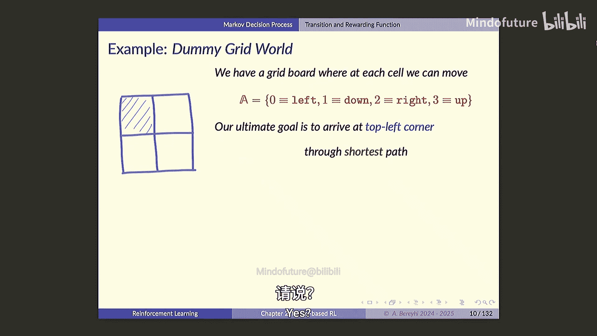

## 一个简单示例：网格世界 🌍

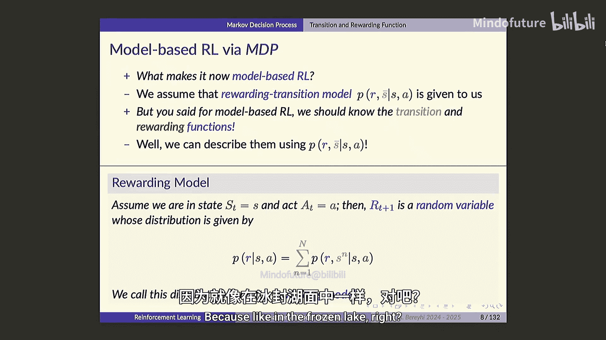

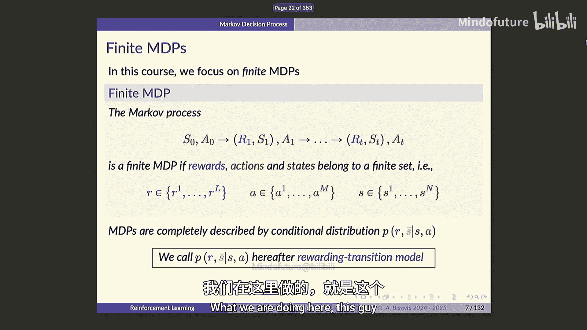

为了更具体地理解，我们来看一个简单的“网格世界”例子。这是一个2x2的网格：
*   状态：四个单元格，编号为 0（左上，目标），1（右上），2（左下），3（右下）。
*   动作：四个方向：左(0)、下(1)、右(2)、上(3)。
*   奖励设定：
    *   移动到另一个非目标单元格：奖励 -1（鼓励最短路径）。
    *   试图移出网格（撞墙）：奖励 -0.5，并停留在原状态（防止智能体因撞墙无惩罚而永远撞墙）。
    *   到达或停留在目标状态（状态0）：奖励 0，并且游戏终止（或保持在该状态）。

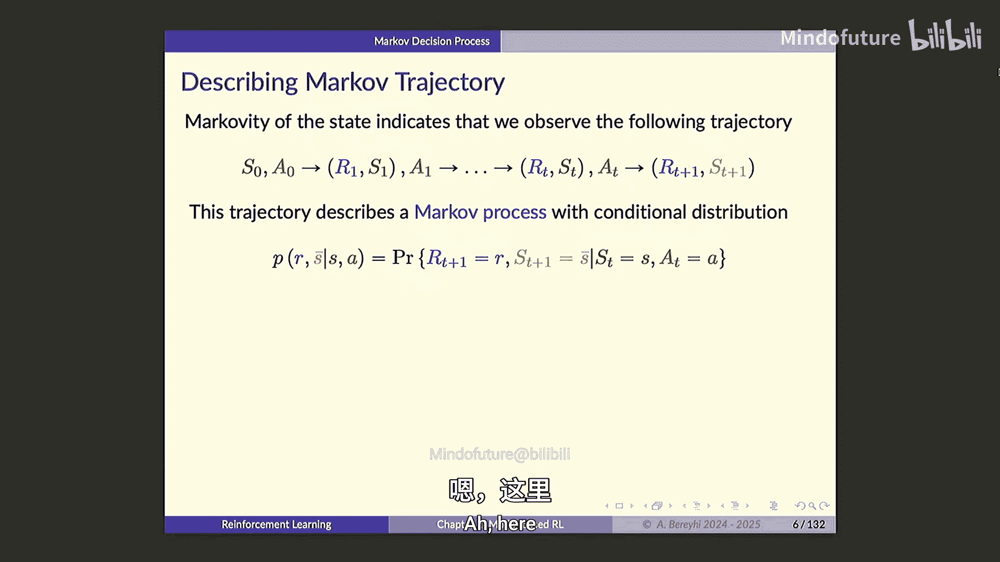

### 定义MDP转移概率

根据上述规则，我们可以为每个 `(s, a)` 对定义 `P(s', r | s, a)`。

例如：
*   在状态1（右上角），执行动作0（向左）：
    *   以概率1转移到状态0（左上角），并获得奖励-1。
    *   公式表示为：**P(s'=0, r=-1 | s=1, a=0) = 1**
*   在状态1，执行动作2（向右）：
    *   这是撞墙。以概率1保持在状态1，并获得奖励-0.5。
    *   公式表示为：**P(s'=1, r=-0.5 | s=1, a=2) = 1**
*   在状态0（目标状态），执行任何动作：
    *   以概率1保持在状态0，并获得奖励0。
    *   公式表示为：**P(s'=0, r=0 | s=0, a) = 1**，对于所有动作 `a`。

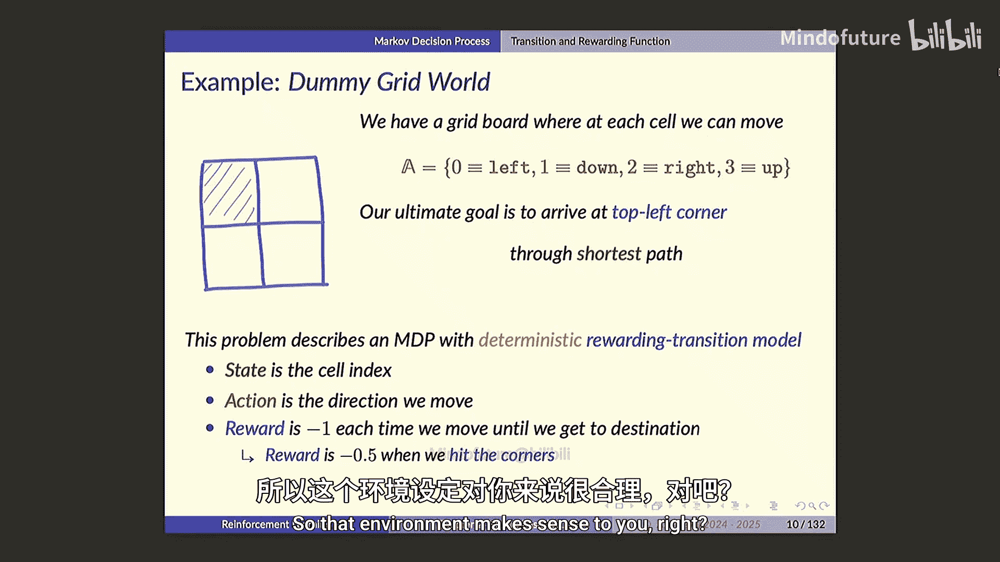

### 状态转移图表示

对于这种有限状态的问题，用状态转移图来表示非常直观。每个圆圈代表一个状态，箭头代表在特定动作下可能发生的转移，箭头上标注了获得的奖励。

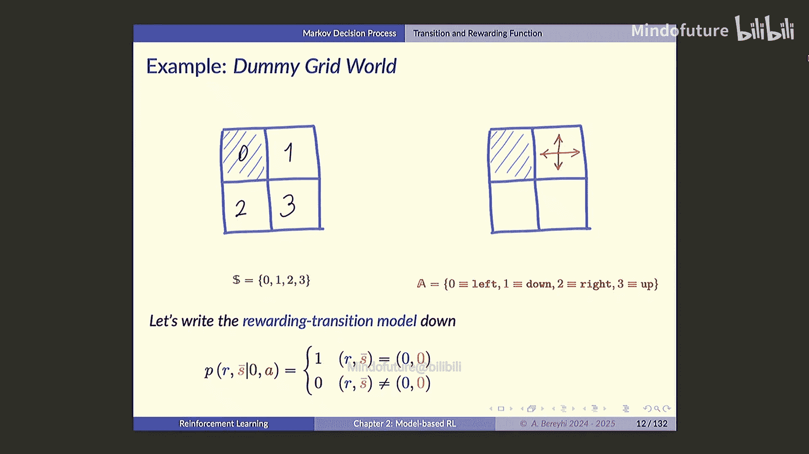

例如，状态1的转移图部分如下：
*   一个箭头指向状态0，标注 `a=0, r=-1`。
*   一个自循环箭头（指向自己），标注 `a=2, r=-0.5`（代表撞墙）。
*   类似地，可以画出其他动作（上、下）导致的转移，可能是移动到状态3或撞墙。

整个MDP就是所有这些状态、动作以及对应的转移概率和奖励的集合。有了这个完整的模型描述，我们就可以进入下一步：如何评估策略并找到最优策略。

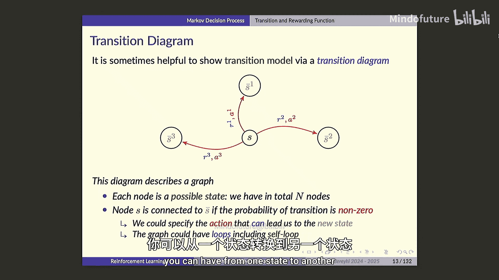

---

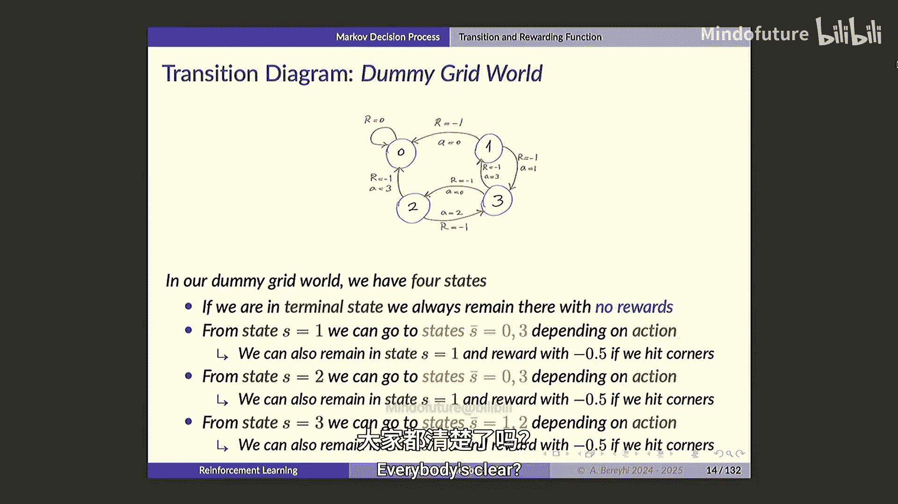

本节课中我们一起学习了模型基础强化学习的核心——马尔可夫决策过程。我们了解了如何用条件概率 **P(s', r | s, a)** 形式化地描述环境动态，并通过一个简单的网格世界示例演示了如何具体定义MDP。我们还看到，奖励函数和状态转移函数都可以从这个联合分布中推导出来。在接下来的课程中，我们将基于这个已知的模型，探讨如何计算价值函数和寻找最优策略。