# 017：回溯最优策略 🧠

在本节课中，我们将学习如何利用贝尔曼最优方程来求解一个简单网格世界示例中的最优价值函数，并从中推导出最优策略。我们将通过一步步的数学推导和具体计算，展示从方程到策略的完整过程。

## 概述

我们将分析一个确定的网格世界环境。已知该环境的最优价值函数为：状态0的价值为0，状态1的价值为-1，状态2的价值为-1，状态3的价值为-2。本节的目标是验证，通过建立并求解贝尔曼最优方程，我们能否得到相同的结果，并进一步找出最优策略。

## 建立贝尔曼最优方程

上一节我们介绍了贝尔曼最优方程的概念。本节中，我们来看看如何为一个具体的环境建立这些方程。

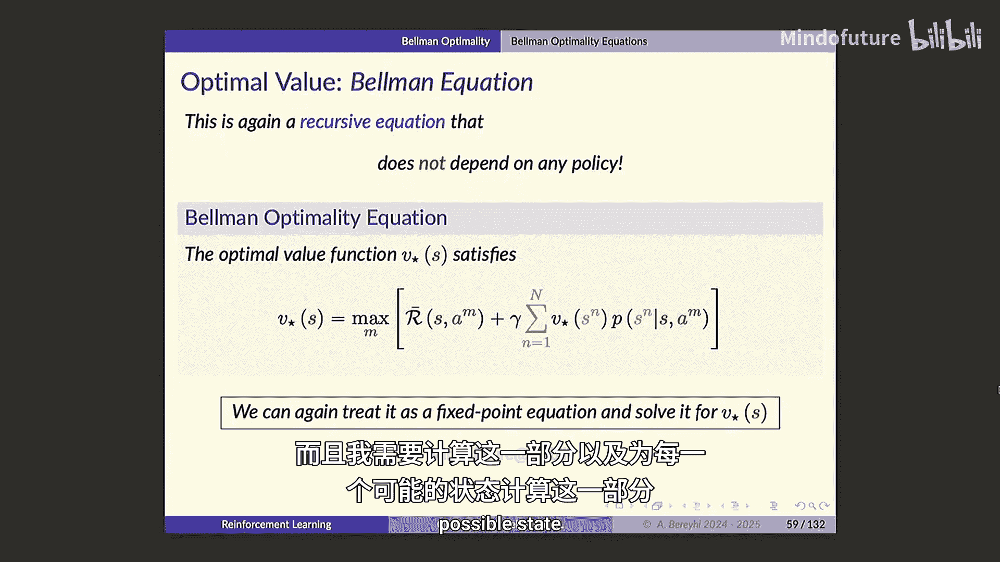

首先，我们需要为每个状态和每个动作计算期望即时奖励。在这个确定性的环境中，没有随机性，因此期望即时奖励就等于执行该动作后实际获得的奖励。

以下是每个状态-动作对的即时奖励：

*   **状态0（终止状态）**：执行任何动作的即时奖励均为0。
*   **状态1**：
    *   动作0（左）：-1
    *   动作1（下）：-1
    *   动作2（右）：0
    *   动作3（上）：0
*   **状态2**：
    *   动作0（左）：-1
    *   动作1（下）：-0.5
    *   动作2（右）：-1
    *   动作3（上）：-1
*   **状态3**：
    *   动作0（左）：-1
    *   动作1（下）：0.5
    *   动作2（右）：0.5
    *   动作3（上）：-1

我们用一个矩阵 **R̄** 来表示这些值，其维度为（状态数 × 动作数）。

## 应用贝尔曼最优方程

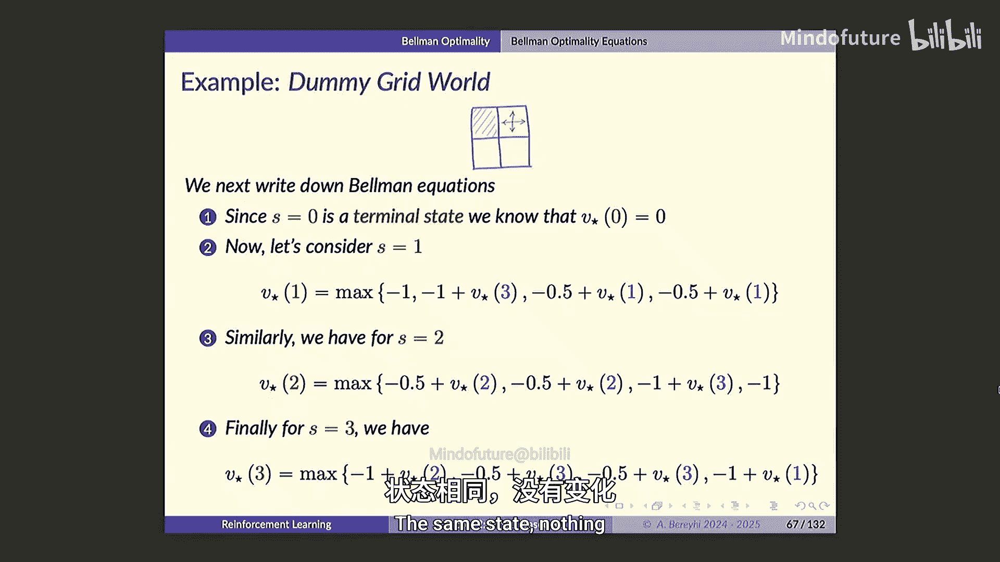

现在，我们为每个非终止状态（状态1, 2, 3）写出贝尔曼最优方程。方程的核心是，一个状态的最优价值等于所有可能动作中，能带来最大“即时奖励+折扣后的下一状态期望价值”的那个值。

对于状态1，我们需要计算每个动作对应的未来价值项。在确定性环境中，给定当前状态和动作，下一状态是确定的，因此期望就是下一状态的价值本身。

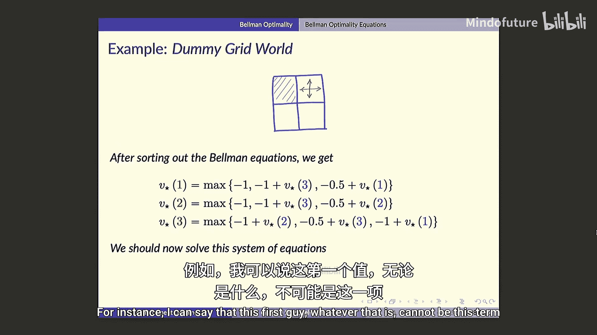

以下是状态1的详细计算：

*   **动作0（左）**：下一状态为0。该项为：`-1 + γ * V*(0) = -1 + 0 = -1`
*   **动作1（下）**：下一状态为3。该项为：`-1 + γ * V*(3)`
*   **动作2（右）**：撞墙，下一状态仍为1。该项为：`0 + γ * V*(1)`
*   **动作3（上）**：撞墙，下一状态仍为1。该项为：`0 + γ * V*(1)`

因此，状态1的贝尔曼最优方程为：
`V*(1) = max( -1, -1 + γ*V*(3), γ*V*(1), γ*V*(1) )`

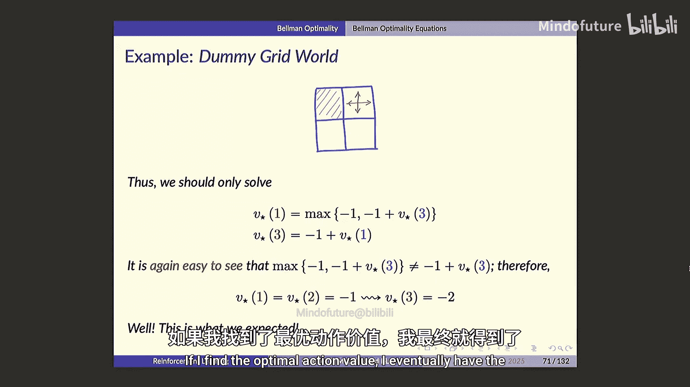

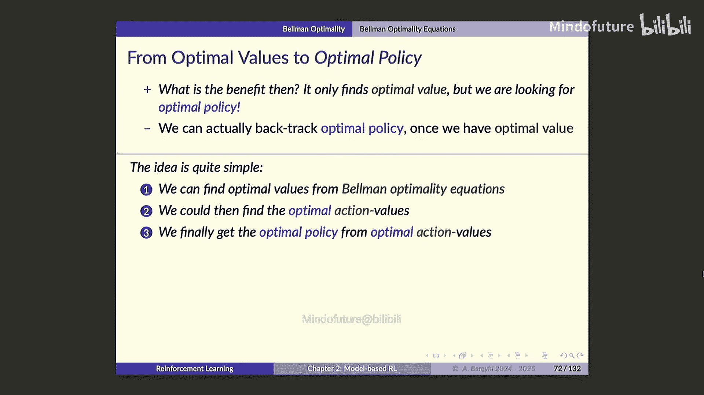

由于撞墙的动作（2和3）产生了相同的项，我们可以合并。假设折扣因子γ=1，方程简化为：
`V*(1) = max( -1, -1 + V*(3), V*(1) )`

类似地，我们可以为状态2和状态3建立方程。经过简化，我们得到以下方程组：
`V*(1) = max( -1, -1 + V*(3), V*(1) )`
`V*(2) = max( -1, -0.5 + V*(3), V*(2) )`
`V*(3) = max( -1 + V*(1), 0.5 + V*(2), 0.5 + V*(3), -1 + V*(3) )`

## 求解最优价值函数

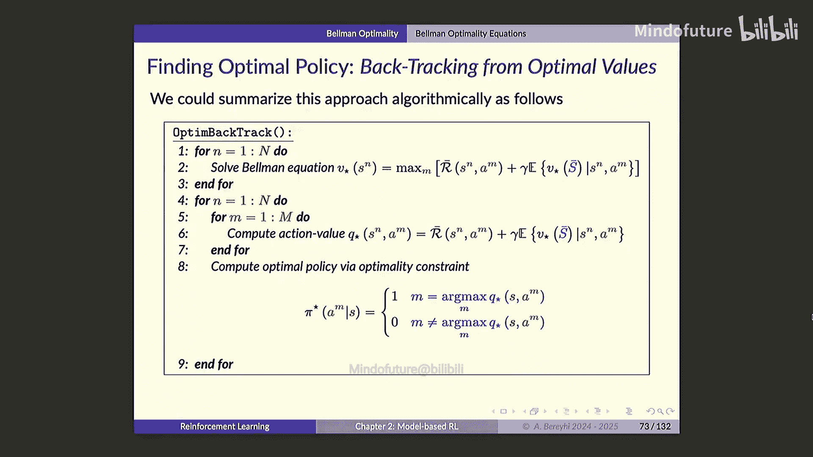

我们有一个包含最大化操作的方程组，求解需要一些推理。

首先，观察状态1的方程：`V*(1) = max( -1, -1 + V*(3), V*(1) )`。如果最大值是 `V*(1)` 本身，则意味着 `V*(1) > -1` 且 `V*(1) > -1 + V*(3)`。但这会导致 `V*(1) = V*(1)`，是一个恒等式，无法给出信息。更合理的假设是最大值是前两项之一。

假设 `V*(1) = -1`。代入状态3的方程进行验证。状态3方程中，`-1 + V*(1) = -2`，`0.5 + V*(2)` 待定，`0.5 + V*(3)` 和 `-1 + V*(3)` 都包含 `V*(3)`。为了使 `V*(3)` 最大，它很可能等于 `0.5 + V*(2)` 或 `-1 + V*(1) = -2`。显然 `0.5 + V*(2)` 可能更大。

通过类似的分析和代入（例如，从状态2方程中可推断 `V*(2)` 很可能等于 `-1` 或 `-0.5 + V*(3)`），我们可以推导出满足所有方程的一组解：
`V*(1) = -1`
`V*(2) = -1`
`V*(3) = -2`

这正好验证了我们最初已知的最优价值。

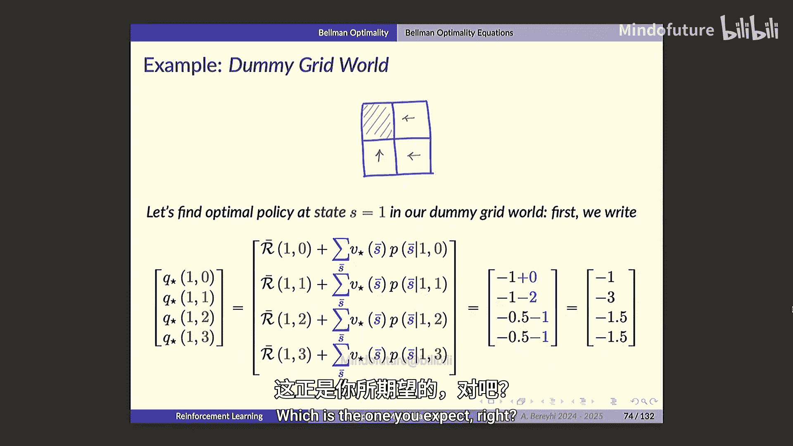

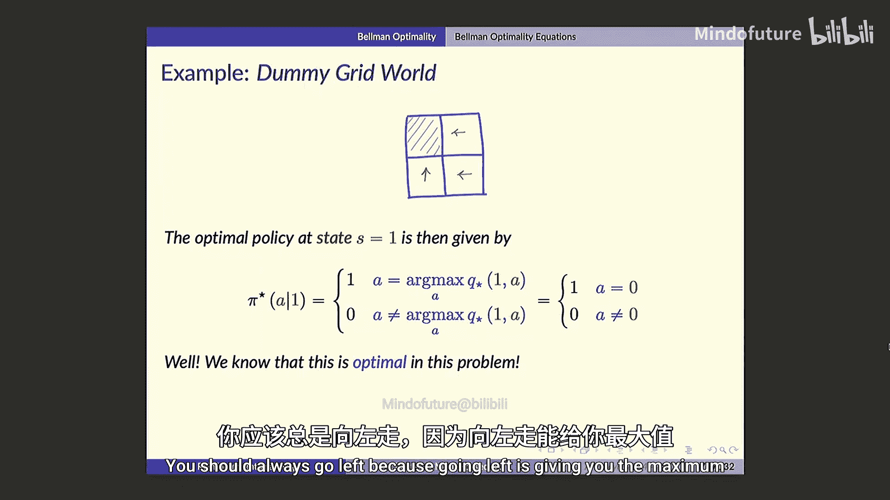

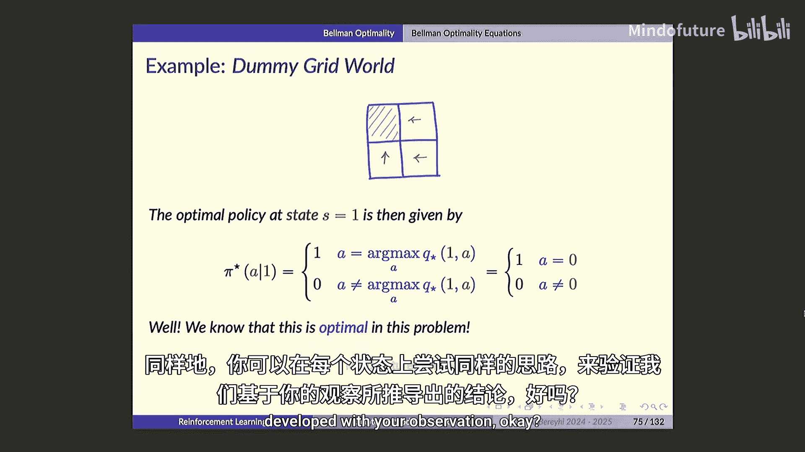

## 从最优价值到最优策略

一旦我们获得了最优状态价值函数 **V***，我们就可以计算最优动作价值函数 **Q***。

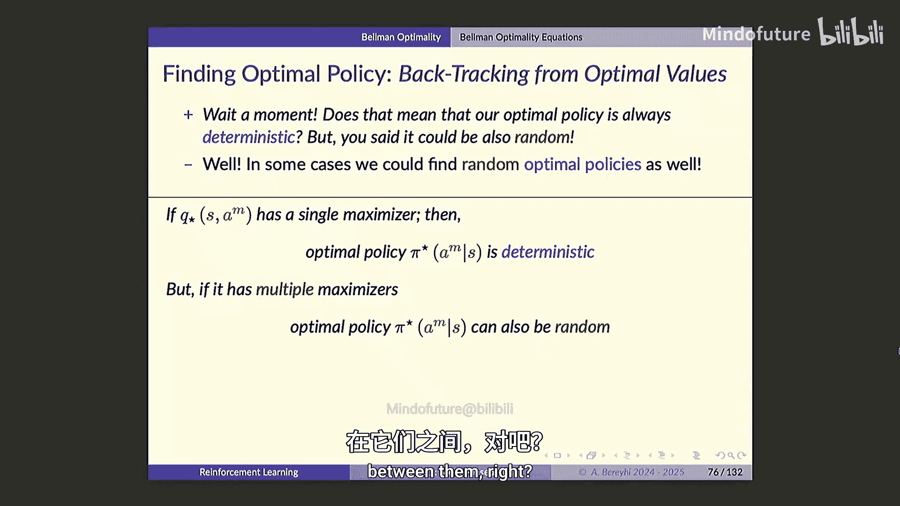

**Q\*(s, a)** 的公式由贝尔曼方程给出：`Q*(s, a) = R̄(s, a) + γ * Σ_s‘ P(s'|s,a) * V*(s')`

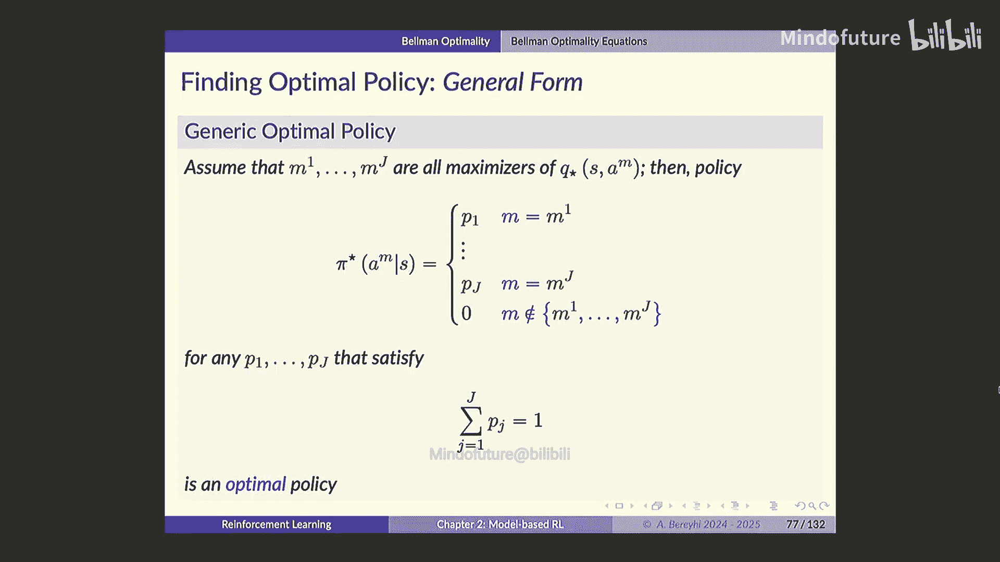

对于我们的确定性环境，这简化为：`Q*(s, a) = R̄(s, a) + V*(s')`，其中 `s'` 是执行动作 `a` 后到达的状态。

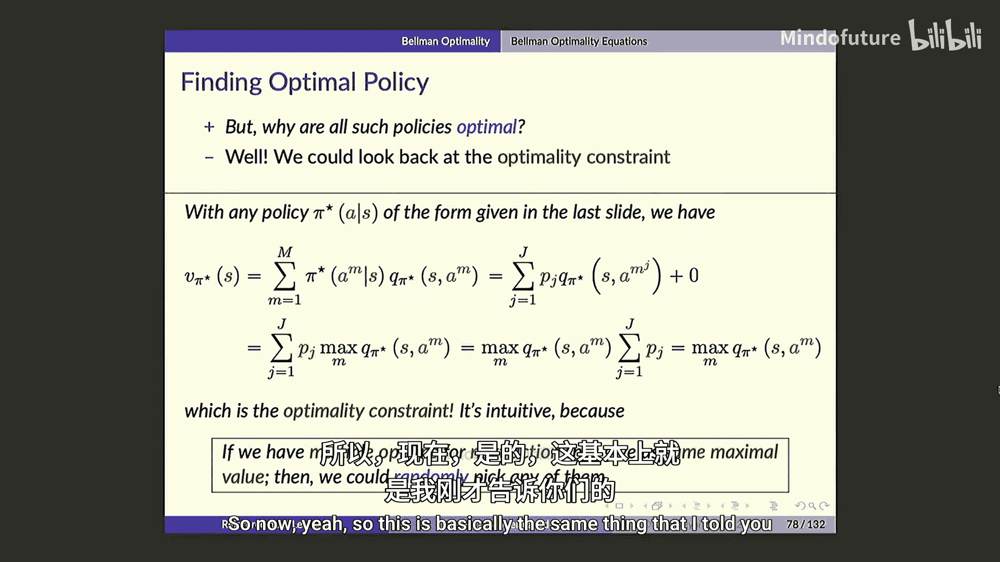

以状态1为例：
*   `Q*(1, 左) = -1 + V*(0) = -1`
*   `Q*(1, 下) = -1 + V*(3) = -3`
*   `Q*(1, 右) = 0 + V*(1) = -1` (撞墙，留在状态1)
*   `Q*(1, 上) = 0 + V*(1) = -1` (撞墙，留在状态1)

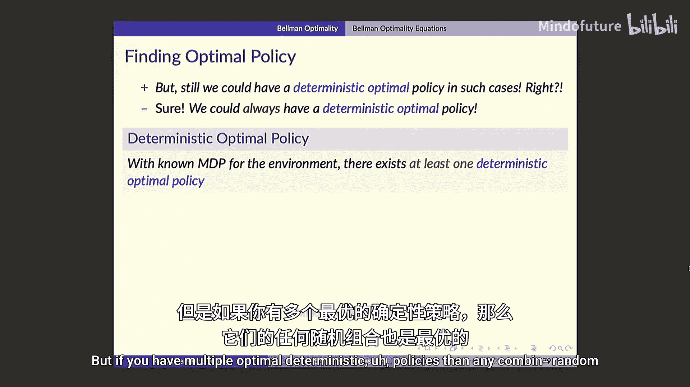

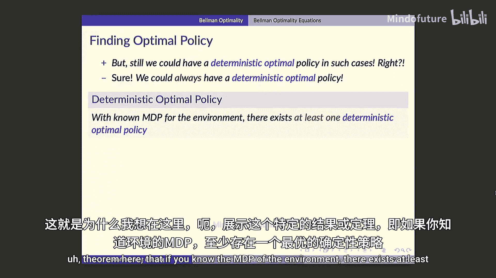

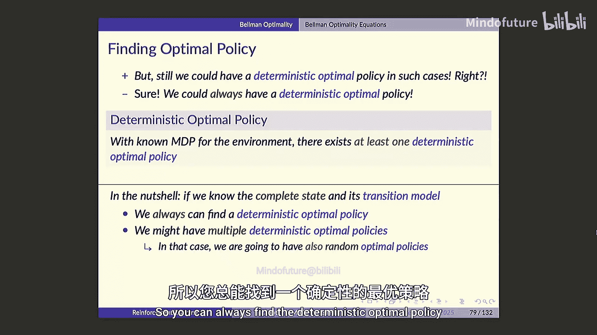

最优策略 **π*** 就是在每个状态 `s` 下，选择使 **Q\*(s, a)** 最大的动作 `a`。
在状态1，`Q*` 的最大值是-1，对应动作“左”、“右”、“上”。因此，最优策略可以是选择“左”（这显然是明智的），或者由于“右”和“上”因撞墙导致的价值相同，随机选择它们也是最优的。

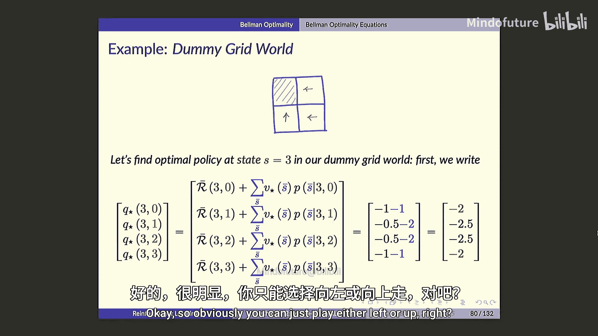

**这意味着最优策略不一定唯一。** 如果在一个状态下有多个动作都能达到最大的 **Q*** 值，那么任意选择其中一个的确定性策略，或者以任意概率在这些动作间随机选择的策略，都是最优策略。但总是存在至少一个确定性的最优策略。

## 总结

本节课中我们一起学习了如何利用贝尔曼最优方程来求解一个马尔可夫决策过程的最优价值函数。我们通过一个网格世界的例子，具体演示了：
1.  建立每个状态的贝尔曼最优方程。
2.  通过逻辑推理求解方程，得到最优状态价值 **V***。
3.  利用 **V*** 计算最优动作价值 **Q***。
4.  最后，通过选取每个状态下 **Q*** 值最大的动作来得到最优策略 **π***。

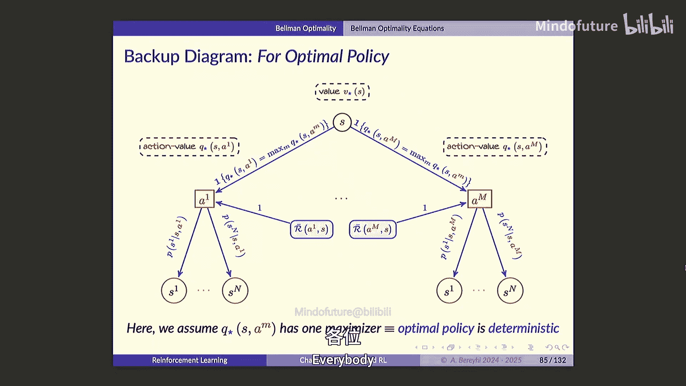

关键结论是：对于任何已知的有限MDP，总存在至少一个最优策略，并且我们可以通过求解贝尔曼最优方程来找到它。当某个状态有多个最优动作时，最优策略可以具有随机性。