# 019：策略改进与策略迭代 🚀

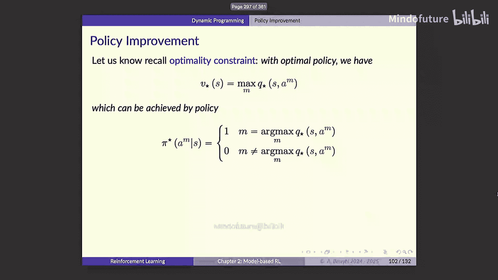

在本节课中，我们将学习如何评估一个给定的策略，并在此基础上对其进行改进。我们将介绍**策略评估**和**策略改进**这两个核心概念，并最终将它们结合成**策略迭代**算法，这是一种寻找最优策略的有效方法。

## 策略评估回顾 📊

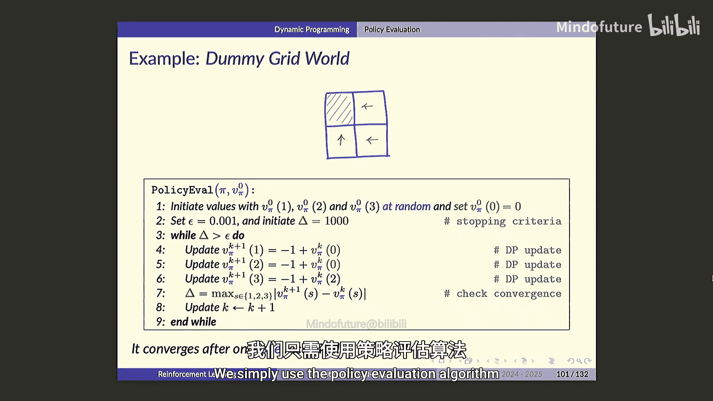

上一节我们介绍了策略评估。策略评估本身是一个迭代算法。

它使用贝尔曼方程。你可以从一个随机的价值函数开始。

进行迭代。最终你会知道该策略的价值。所以，如果给你一个策略，你可以简单地使用策略评估算法来计算其价值函数。现在你得到了这个价值函数。

## 从评估到改进 🛠️

但你现在想做的事情是改进策略，因为你可能从一个不好的策略开始。

也许我一开始用的是随机策略，而不是最优策略。

如果我以随机策略开始。那么你最终会评估这个随机策略，得到它的价值。但这并不是你想要的策略。

你想要最好的策略。那么你如何改进策略呢？

你会说，如果我有最优价值函数，那么在每一个状态下，最优价值都将是该状态下所有可能动作中能获得的最大价值。

这是一个简单的约束，最优性约束。

现在，如果你总是遵循某个策略，在某些状态下，该策略采取的动作可能不会给你带来最大价值。这是合理的，因为你没有遵循最优策略。

如果你遵循的是最优策略，你就会看到每个状态的价值都达到了最大。所以，如果你没有看到这一点，说明你的策略不是最优的。

## 策略改进的核心思想 💡

策略改进的形式如下。假设你有一个特定的策略，通过策略评估，你可以了解在每个状态下的动作价值。

你发现当前策略给出的价值并非最大值。那么，为了改变这种情况，在每个状态下，你查看在当前策略下，采取哪个动作能获得最大价值。然后你就选择执行那个动作。

这就是一个新策略。所以，核心思想是：我将定义一个新策略 π'，其形式如下。

例如，假设你有一个随机策略，它告诉你随机地向各个方向移动。你评估了所有情况，发现随机移动的价值。

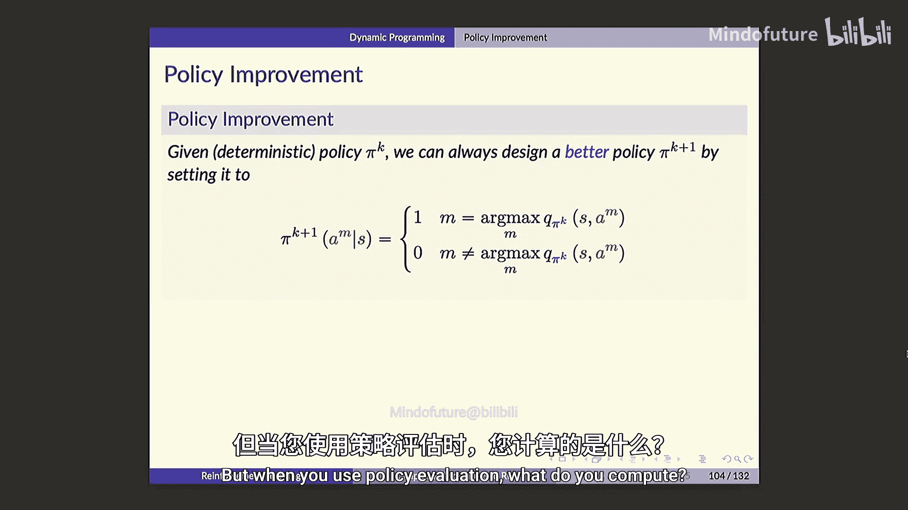

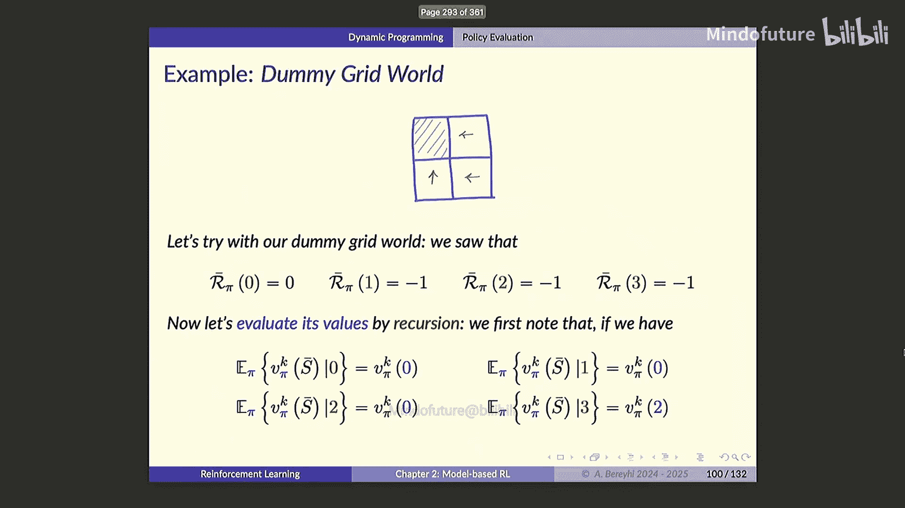

但当你有了这个策略的价值后，你会发现，即使在随机策略下，能获得最大价值的情况是“总是向上走”。那么你会想，为什么我还要继续随机移动呢？我将一直向上走。

这可能不是最终的最优策略，但这个新策略（一直向上）肯定比随机到处走要好。

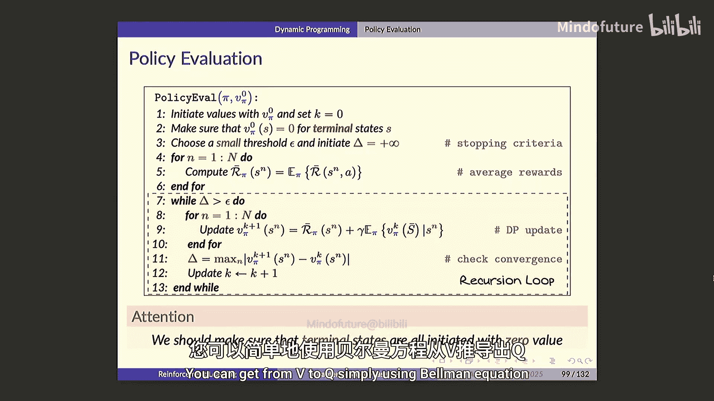

现在你决定执行新策略“一直向上”，然后你再次评估这个新策略。你发现，如果“向左走”，可能会得到更高的价值。于是，基于这个新评估的价值，你再次改进你的策略，改为“向左走”。

你不断重复这个过程，直到你的策略不再改变。这构成了一个更高层次的迭代循环，在策略和其价值之间进行。

## 策略改进的数学描述 📝

具体来说，你只需查看每一个状态，并说：在当前状态下，对于所有可能的动作，我想执行能给我带来最大价值的那个动作。

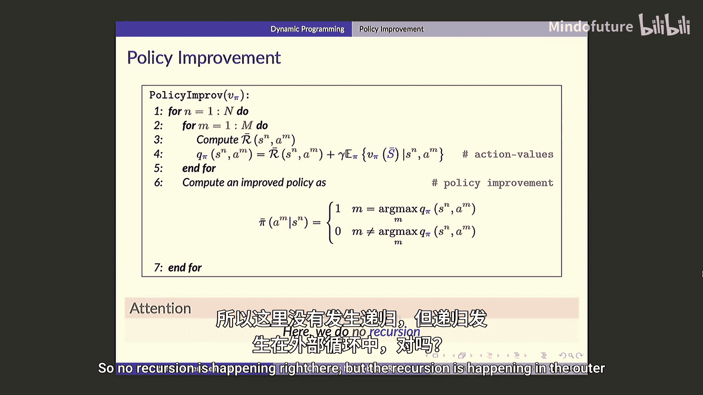

你可以简单地证明，如果按照这种方式构造新策略 π'，那么 π' 至少和原策略 π 一样好，甚至更好。这个证明可以在标准教材中找到。

所以，如果你这样做，你就在改进你的策略。你从一个随机策略开始，使用策略评估来计算其价值。然后你得到一系列价值，你根据这些价值选择能带来最大价值的动作，这就得到了一个新策略。你执行这个新策略，计算其价值，然后重复这个过程。你不断进行，直到策略不再改变，因为每次你都在改进策略。

## 策略改进算法 🔄

这就是策略改进。策略改进很简单：你只需查看动作价值函数 Q，然后选择能给你带来最大价值的动作。这将成为你的下一个策略。

你从策略 π_k 开始。你通过评估得到了它的价值函数 V(π_k)。现在你可以构建改进后的策略 π_{k+1}。然后，你将 π_{k+1} 再次输入到评估算法中，计算这个新策略的价值。

如果 π_{k+1} 与 π_k 完全相同，说明策略已经收敛。

以下是改进策略的伪代码思路。

## 从价值函数到动作价值函数 🔗

有一个需要注意的地方。为了计算 Q(π_k)，我应该使用策略评估算法。但当你使用策略评估时，你计算出来的是状态价值函数 V。

价值函数 V 是输出。我如何从 V 得到 Q 呢？在马尔可夫决策过程中，你可以通过贝尔曼方程从 V 得到 Q。

具体公式如下：`Q(s, a) = R(s, a) + γ * Σ_{s'} P(s'|s, a) * V(s')`

如果我给你策略 π 的价值函数 V^π，你可以使用贝尔曼方程将这个价值函数转换为动作价值函数 Q^π。

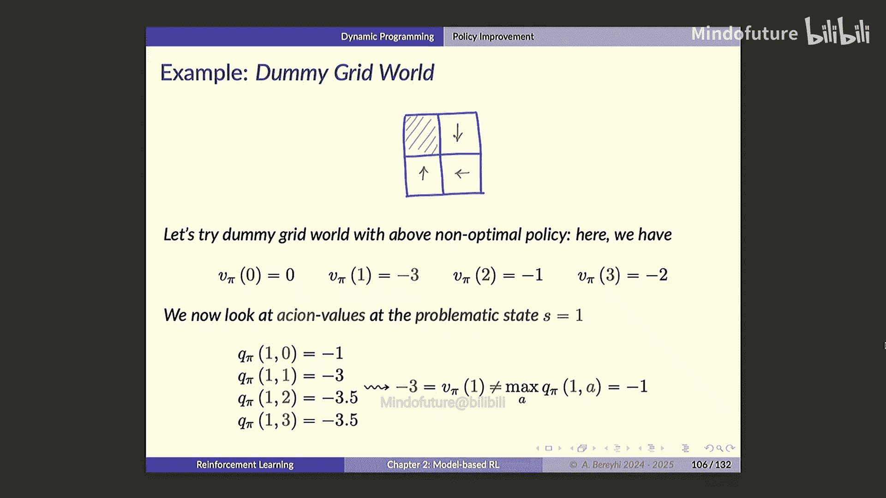

然后，在每一个状态 s，你选择能最大化 Q^π(s, a) 的动作 a。这将成为你的新策略 π'。

你不断重复这个过程，直到收敛。所以这是策略改进的一个步骤。如果我给你 V^π，你就能给出策略的改进版本。

这里本身没有递归，因为递归发生在更大的循环中：你计算 V^π，用它改进得到 π'，然后计算 V^{π'}，再改进，如此循环。

## 一个具体例子 🎯

让我们看一个具体的例子。假设我们有一个策略，它显然不是最优的。

我们不需要在这里进行完整的策略评估，因为我们可以直接为这个特定策略写出 Q 函数。

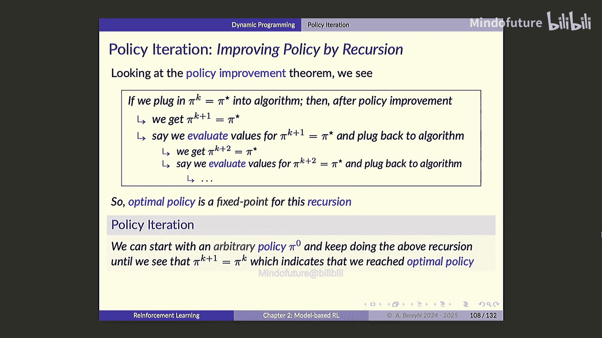

假设我们从状态 1（右上角）开始。查看所有可能的动作。
*   执行动作 0（假设是“左”）：你会到达终止状态，之后遵循策略会一直留在终止状态，获得奖励 0。所以总价值是 -1。
*   执行动作 1（“下”）：获得 -1，然后策略告诉你“左”，再“上”，总价值可能是 -3。
*   执行动作 2（“右”）：撞墙，获得 -0.5，然后继续遵循策略，总价值可能是 -2.5。
*   执行动作 3（“上”）：撞墙，获得 -0.5，然后继续遵循策略，总价值可能是 -1.5。

现在，看这个策略在当前状态 1 下执行什么动作？假设它执行动作 1（“下”），其价值是 -3。但所有动作中的最大价值是 -1（对应动作 0，“左”）。所以，当前策略执行的动作（“下”）并没有给出最大价值。

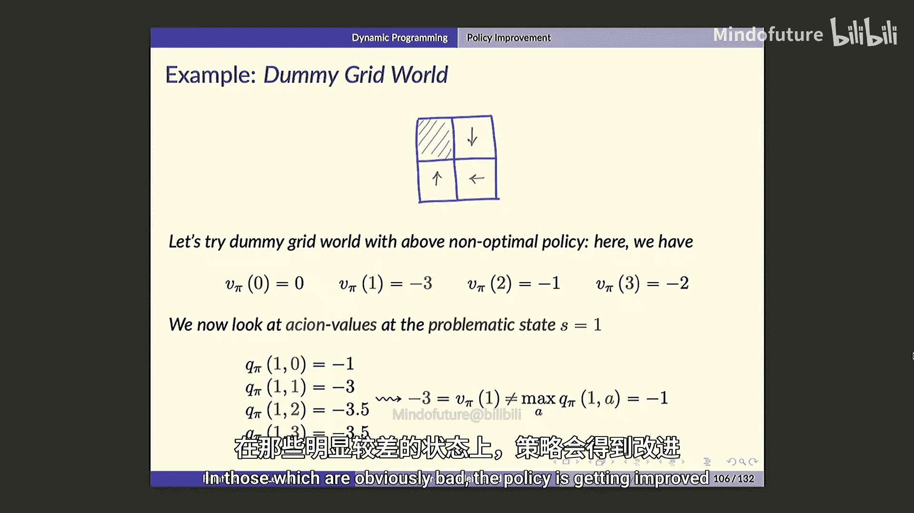

因此，这个策略不是最优的。我们要做的就是改变它。我们说，在状态 1，新策略将执行动作 0（“左”）。我不改变其他状态的动作。这个新策略最终可能就是最优策略。我们不需要再迭代了，但理论上可以继续迭代。你会一直保持这个策略。

通过计算动作价值，你就有机会基于所见来改进策略。因为在这里，仅仅通过查看所有可能的动作，你就发现即使遵循当前策略，也有更好的选择（“左”而不是“下”）。

## 策略迭代：评估与改进的结合 🔁

如果没有问题，让我总结一下策略迭代的整体思想。这是一种创造性地使用这两个算法的方式。

你从一个策略开始，评估那个策略，然后可以改进它。一旦你改进了它，你会说，这个改进后的策略 π_1，我不知道它的价值是多少。我再次把它放入策略评估算法中，得到新的价值函数。基于这个新的价值函数，我再次改进我的策略，得到 π_2。我不断进行，直到看到策略不再改变。

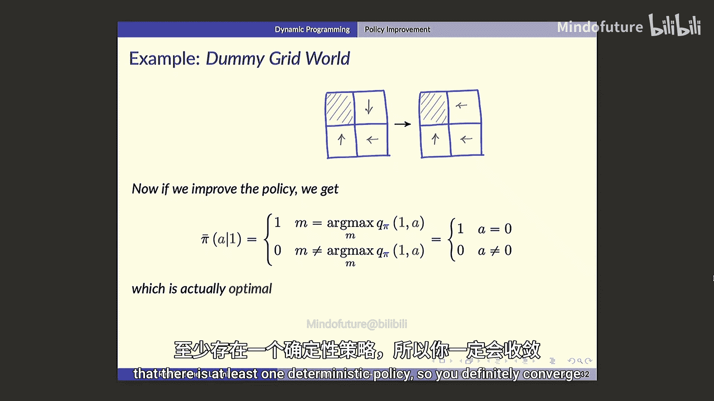

可以证明，一旦你达到最优策略，你就会永远保持那个最优策略。因为当你执行最优策略时，通过策略评估，你最终会得到最优价值函数。然后你得到最优动作价值函数，接着策略改进会将你带回到最优策略。你将永远保持那个最优策略。

这意味着这个算法将会收敛。最优策略本质上是这个特定迭代的不动点。这就是我们所说的**策略迭代**。

你从一个初始策略开始，评估它。然后通过策略改进进行更新，并持续进行。直到策略收敛。

## 算法细节与讨论 💬

是的，你需要对所有状态进行这个操作。在这个例子中，关键点在于，在那些已经最优的状态上，最大化 Q 值的动作恰好就是你正在做的动作，所以这些状态上的策略不会改变。但在那些明显不好的状态上，策略会得到改进。

完全正确。在策略迭代中，你从某个策略（例如完全随机策略）的随机价值函数开始。然后你进入一个循环：每次你评估你的策略，通过评估，你会得到一个新的价值函数。一旦有了这个价值函数，你就可以计算出动作价值函数，并改进策略。你不断递归，直到 π' 与 π 相比不再改变。

## 注意事项与优化 ⚡

有几点需要注意：
1.  这是一个递归迭代算法，因为第4到第7行是一个迭代循环，而第5行的策略评估本身又是另一个迭代循环。这是一种嵌套循环。
2.  在实践中，我们通常不会每次都用随机的初始值开始策略评估。第一次，我用随机初始值来评估策略 π，最终得到 V^π。当我改进策略后，下一次进入第5行的循环时，我不会从一个随机初始点开始。我会使用前一个策略的价值函数作为初始值。这会收敛得更快。逐渐地，对于一个好的策略，它可能只需几次迭代就能收敛。
3.  这个算法适用于完全可观测的、已知动态特性的MDP。只要你能够计算（状态转移和奖励），理论上就可以进行。但如果状态空间非常大，计算上可能无法实现。

## 总结 📚

本节课中，我们一起学习了：
1.  **策略评估**：计算给定策略的价值函数。
2.  **策略改进**：基于当前策略的价值函数，通过选择每个状态下能最大化动作价值的动作，来得到一个更好的新策略。
3.  **策略迭代**：将策略评估和策略改进循环结合，从一个初始策略出发，不断评估和改进，直至策略收敛到最优策略。

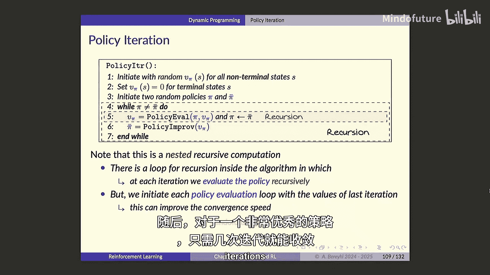

策略迭代是强化学习中寻找最优策略的一种基础且重要的方法。