# 020：价值迭代 🧠

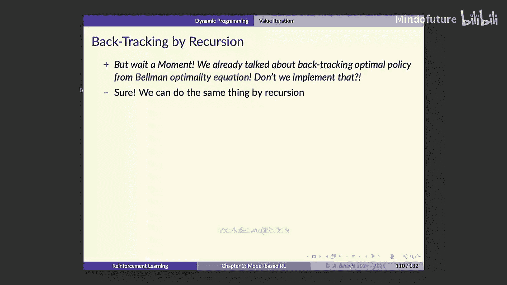

在本节课中，我们将学习价值迭代算法。这是一种通过动态规划直接求解贝尔曼最优方程，从而找到最优价值函数和最优策略的方法。

---

上一节我们介绍了策略迭代，它包含策略评估和策略改进两个交替进行的步骤。本节中我们来看看一种更直接的方法——价值迭代。

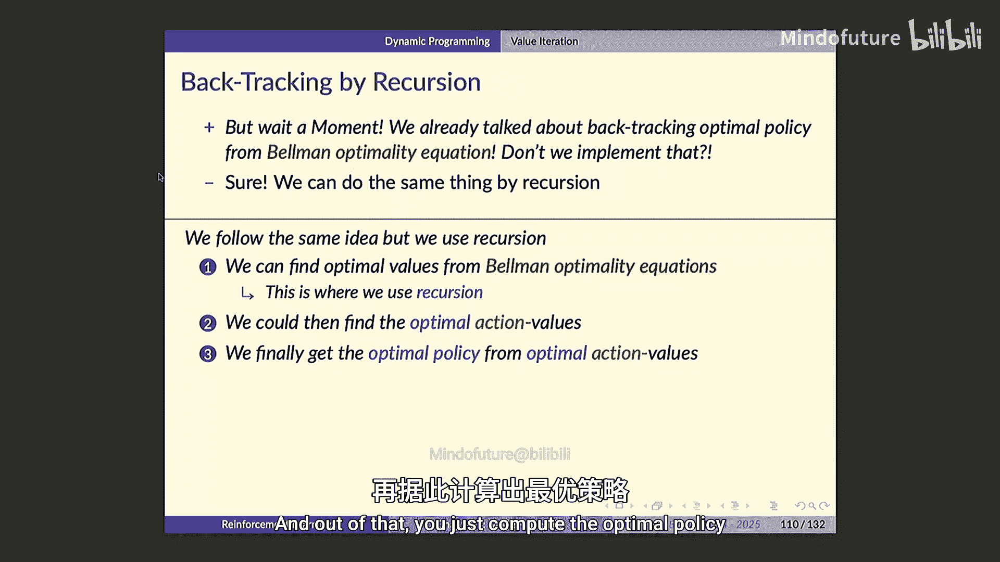

价值迭代的核心思想非常简单：如果我们能直接解出贝尔曼最优方程，那么问题就解决了。因为一旦我们有了最优价值函数，就可以通过回溯轻松地找到最优策略。这个想法在我们深入动态规划之前就已经提出过。

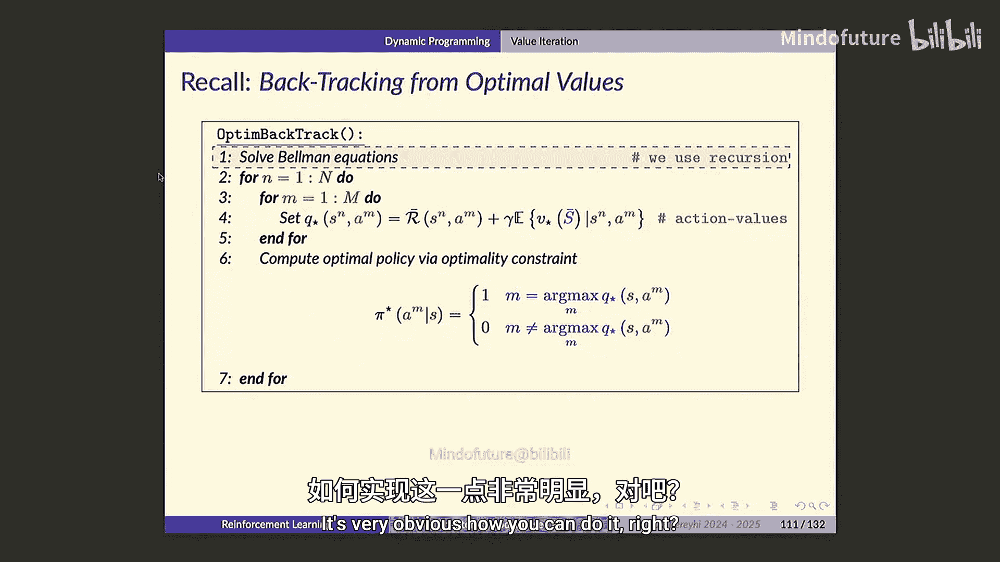

因此，价值迭代本质上就是使用动态规划来迭代求解贝尔曼最优方程。

## 算法思路 💡

以下是价值迭代的基本思路：
1.  从对最优价值函数的一个随机估计开始。
2.  将这个估计值代入贝尔曼最优方程，计算出一个新的、改进的估计值。
3.  重复步骤2，直到估计值不再变化（即收敛）。
4.  收敛后得到的价值函数就是最优价值函数。
5.  根据最优价值函数，通过选择具有最大动作价值的动作来推导出最优策略。

## 动态规划更新 🔄

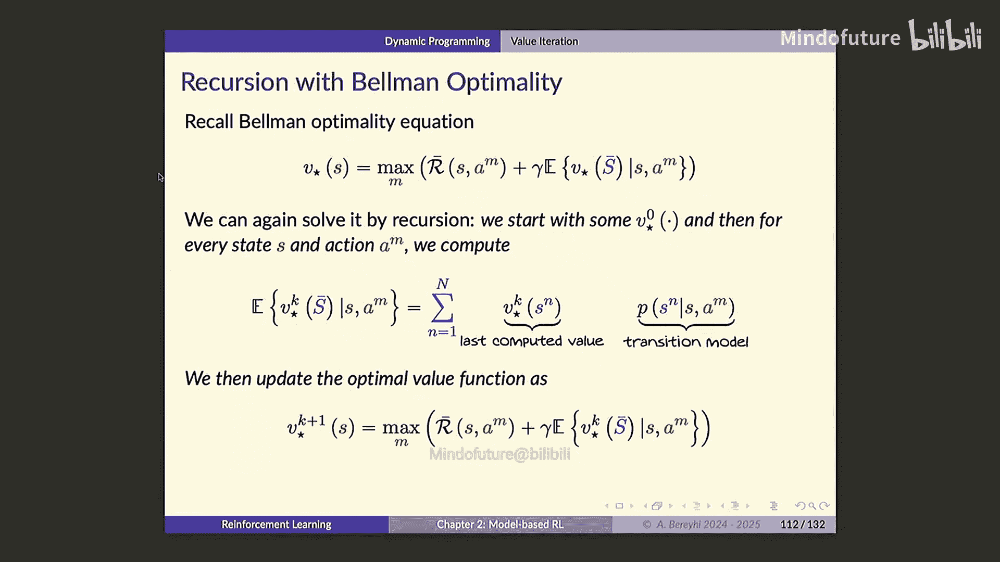

贝尔曼最优方程定义了最优价值函数 `V*(s)` 如何依赖于其他状态的最优价值。其公式如下：

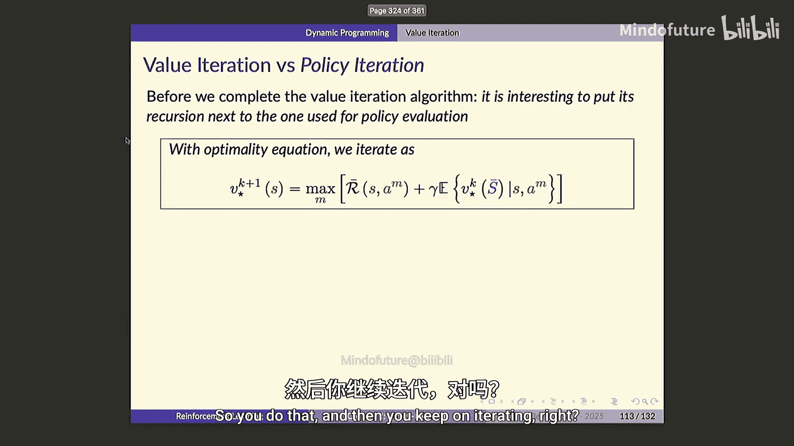

**V\*(s) = max<sub>a</sub> [ R(s, a) + γ * Σ<sub>s'</sub> P(s' | s, a) * V\*(s') ]**

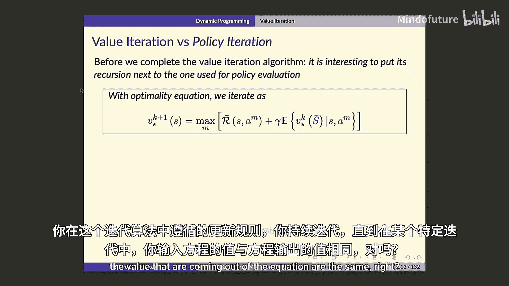

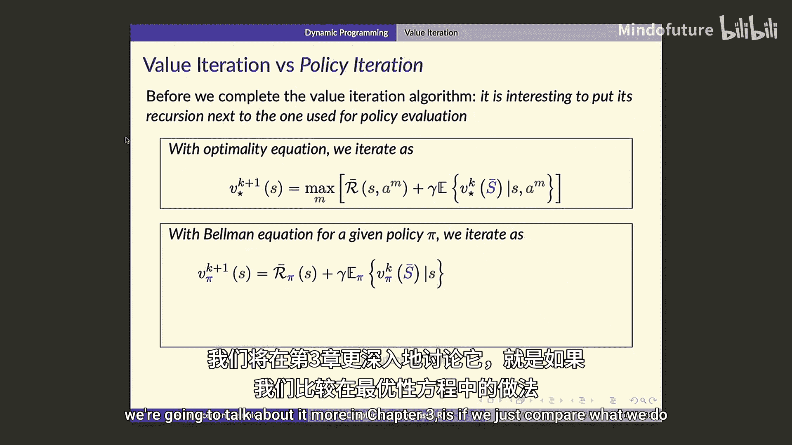

其中：
*   `V*(s)` 是状态 `s` 的最优价值。
*   `max_a` 表示对所有可能动作 `a` 取最大值。
*   `R(s, a)` 是执行动作 `a` 后获得的即时奖励。
*   `γ` 是折扣因子。
*   `Σ_s' P(s' | s, a) * V*(s')` 是下一状态 `s'` 的最优价值的期望。

我们无法直接解这个方程，但可以通过迭代来逼近它。我们从对 `V*(s)` 的随机猜测开始（通常将终止状态的价值设为0），然后反复应用以下更新规则，直到收敛：

**V<sub>k+1</sub>(s) = max<sub>a</sub> [ R(s, a) + γ * Σ<sub>s'</sub> P(s' | s, a) * V<sub>k</sub>(s') ]**

这个更新规则正是价值迭代算法的核心。

## 与策略评估的对比 ⚖️

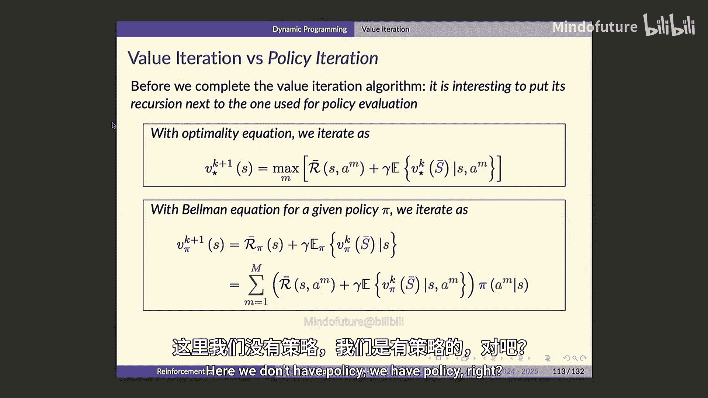

为了更好地理解价值迭代，我们可以将其与策略评估步骤进行对比。

在策略评估中，我们对于一个给定的固定策略 `π`，通过以下方程迭代计算其状态价值函数 `V_π(s)`：

**V<sub>π, k+1</sub>(s) = Σ<sub>a</sub> π(a|s) * [ R(s, a) + γ * Σ<sub>s'</sub> P(s' | s, a) * V<sub>π, k</sub>(s') ]**

请注意两个方程的关键区别：
*   **策略评估（上式）**：对**所有动作的价值按策略 `π` 的概率进行加权平均**。
*   **价值迭代（贝尔曼最优方程）**：对**所有动作的价值取最大值**。

这种区别引出了“在策略”和“离策略”的重要概念。在模型已知的背景下，这种区别意义不大，因为我们不需要采样。但在后续无模型学习中，基于平均值（如SARSA）的方法通常被称为“在策略”学习，而基于最大值（如Q-learning）的方法被称为“离策略”学习。

从计算角度看，两者在每个状态都需要计算所有可能动作的 `Q(s, a)` 值。区别仅在于最后一步是取平均值还是最大值。

## 价值迭代算法 📝

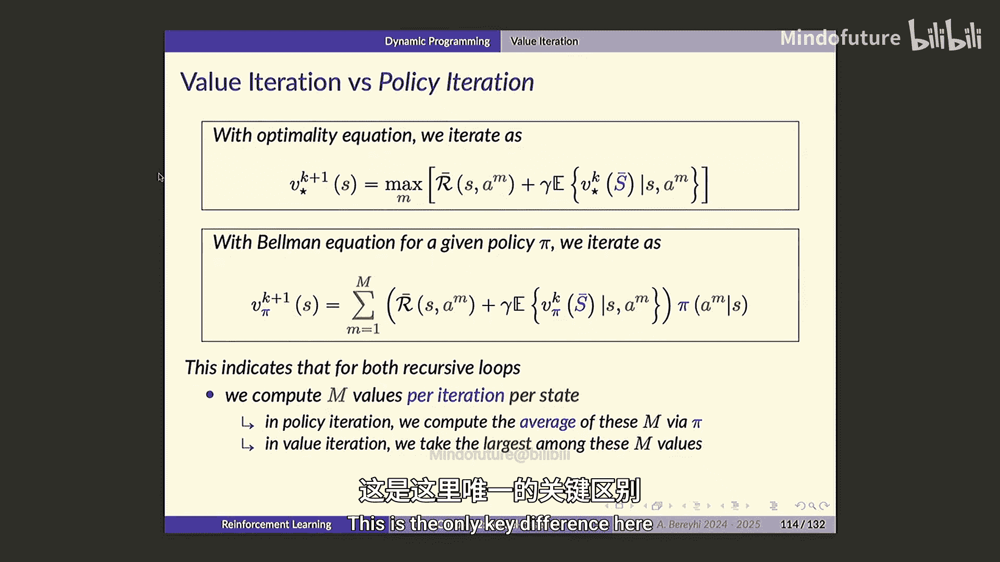

以下是价值迭代算法的伪代码描述。算法会持续迭代，直到最优价值函数的变化小于一个预设的阈值 `ε`。

```
1.  初始化：对于所有状态 s，设置 V*(s) 为一个任意值（通常终止状态设为0）。
2.  设置一个小的阈值 ε > 0，用于判断收敛。
3.  循环：
4.      Δ ← 0
5.      对于每个状态 s：
6.          v ← V*(s) # 保存旧值
7.          # 计算所有可能动作的 Q 值，并取最大作为新状态价值
8.          V*(s) ← max_a [ R(s, a) + γ * Σ_s‘ P(s' | s, a) * V*(s') ]
9.          Δ ← max(Δ, |v - V*(s)|) # 记录本轮最大变化
10.     如果 Δ < ε：
11.         跳出循环 # 已收敛
12.  # 根据收敛的最优价值函数推导最优策略
13.  对于每个状态 s：
14.      π*(s) ← argmax_a [ R(s, a) + γ * Σ_s‘ P(s' | s, a) * V*(s') ]
```

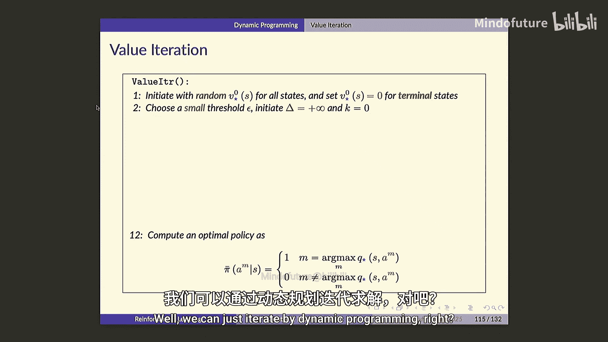

算法结束后，我们便得到了最优价值函数 `V*` 和最优确定性策略 `π*`。

## 实践与总结 🎯

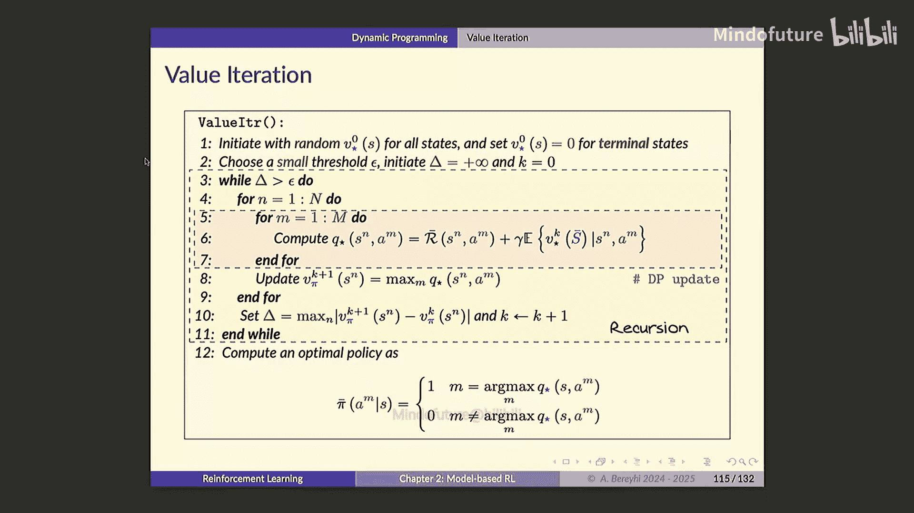

你可以尝试将这个算法应用于之前课程中提到的网格世界示例。从随机初始化价值函数开始（记住将目标/终止状态的价值设为0），然后进行几次迭代。你会发现，价值迭代通常能非常高效地收敛到最优解。

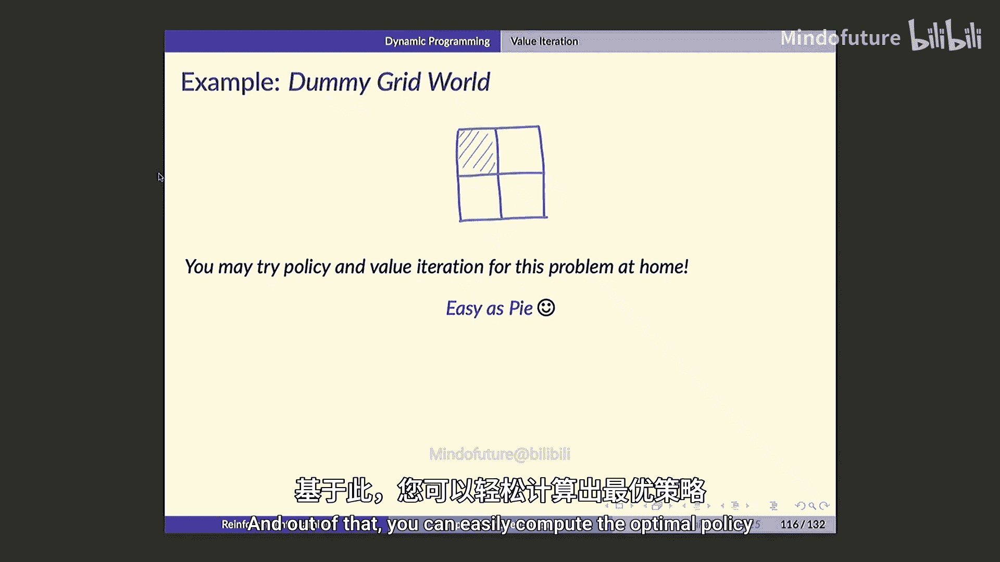

本节课中我们一起学习了价值迭代算法。我们了解到，价值迭代通过动态规划直接迭代求解贝尔曼最优方程，从而绕过显式的策略评估-改进循环。其核心是在每个状态对所有可能动作的价值取最大值进行更新，这与策略评估中的取平均值操作形成对比。掌握价值迭代是理解后续无模型强化学习算法（如Q-learning）的重要基础。