# 021：广义策略迭代 🧠

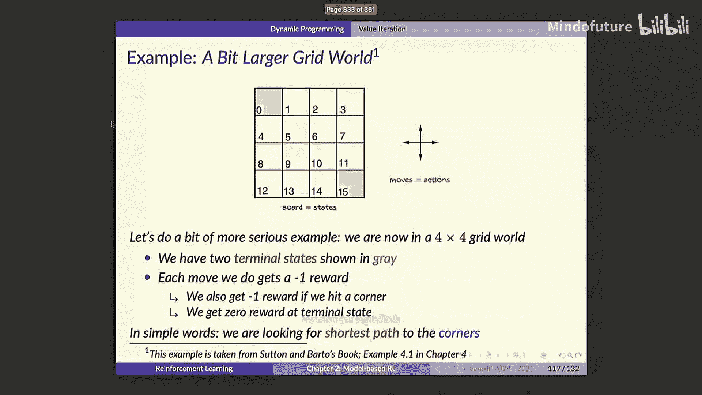

在本节课中，我们将通过一个具体的网格世界例子，深入探讨策略迭代和价值迭代算法的工作原理，并理解它们之间的区别与联系。我们还将介绍一个更实用的概念——广义策略迭代。

## 概述

我们将分析一个4x4的网格世界环境，其中包含两个终止状态。目标是学习如何从任意起始单元格出发，找到到达最近角落（终止状态）的最短路径。我们将通过对比策略迭代和价值迭代两种经典算法，来理解动态规划在强化学习中的应用。

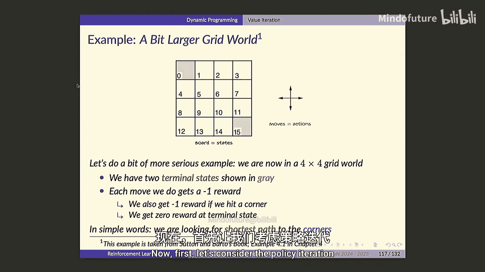

## 环境设定

我们有一个4x4的网格世界，共有16个不同的单元格。其中，状态0和状态15是两个终止状态。一旦进入终止状态，智能体将永远停留在那里并获得0奖励，整个回合结束。

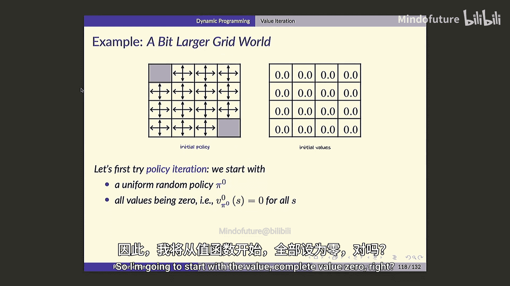

智能体从网格中的某个单元格开始，可以执行上、下、左、右四个动作。**每次移动，无论是否撞墙，都会获得-1的奖励**，除非动作导致进入终止状态。

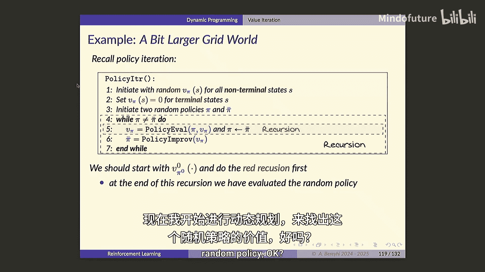

智能体的目标是找到一条路径，以最小的累积惩罚（即最短路径）到达最近的角落（状态0或15）。例如，从状态11出发，最优动作是向下移动；从状态1出发，最优动作是向左移动。

## 策略迭代详解

上一节我们介绍了环境，本节中我们来看看如何使用策略迭代算法来求解最优策略。

策略迭代算法包含两个核心步骤：**策略评估**和**策略改进**。我们将从一个完全随机的策略开始。

### 初始化

我们从一个完全随机的策略 `π0` 开始。该策略规定在每个单元格，以均等的概率（各1/4）选择上、下、左、右四个动作。同时，我们将所有状态的价值函数 `V(s)` 初始化为0。

### 策略评估

以下是策略评估的步骤，我们通过动态规划迭代计算随机策略 `π0` 下的状态价值函数。

1.  我们使用贝尔曼期望方程进行迭代更新。
2.  在第一次迭代中，对于任何非终止状态，执行动作的即时奖励是-1，而下一状态的期望价值初始为0。因此，所有非终止状态的价值更新为 `-1 + 0 = -1`。终止状态价值保持为0。
3.  我们持续迭代，直到价值函数收敛（即两次迭代间的变化可以忽略）。最终，我们得到了随机策略 `π0` 下各状态的价值表。

### 策略改进

得到策略 `π0` 的价值函数后，我们进入策略改进阶段。其核心思想是：在每个状态，选择能带来最大动作价值的动作，从而生成一个新策略 `π1`。

让我们以状态1为例，演示如何计算动作价值函数 `Q(s, a)` 并选择最优动作。

*   **动作：上**
    *   公式：`Q(1, 上) = R(1, 上) + V(下一状态)`
    *   即时奖励 `R(1, 上) = -1`。
    *   执行“上”会撞墙，下一状态仍是状态1，其价值 `V(1) = -14`。
    *   因此，`Q(1, 上) = -1 + (-14) = -15`。

*   **动作：左**
    *   公式：`Q(1, 左) = R(1, 左) + V(下一状态)`
    *   即时奖励 `R(1, 左) = -1`。
    *   执行“左”会进入终止状态0，其价值 `V(0) = 0`。
    *   因此，`Q(1, 左) = -1 + 0 = -1`。

*   **动作：右**
    *   进入状态2，`V(2) = -20`，所以 `Q(1, 右) = -1 + (-20) = -21`。

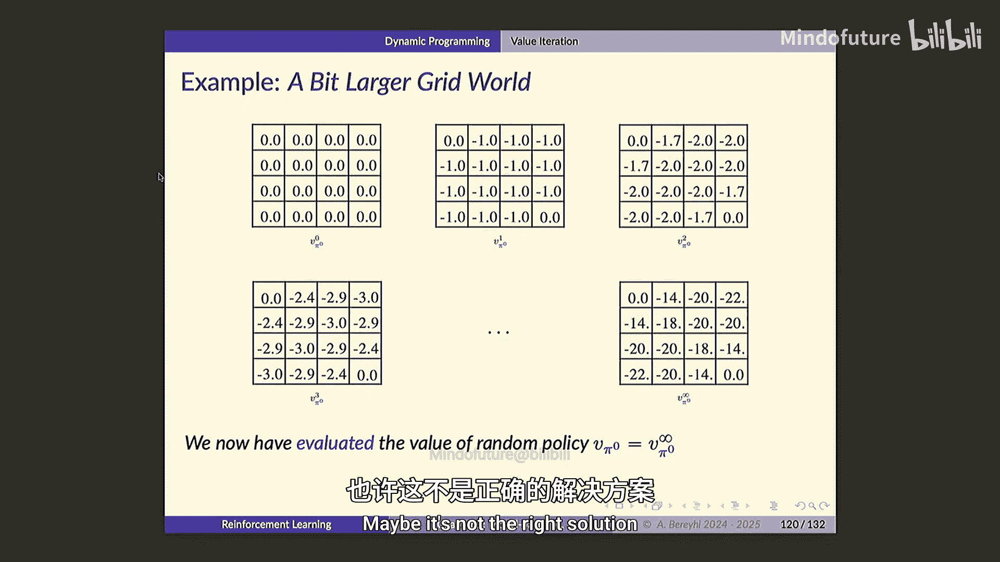

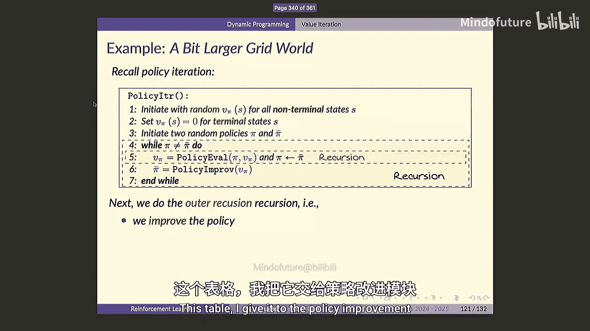

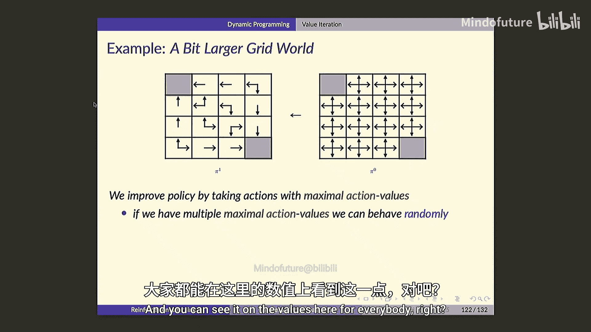

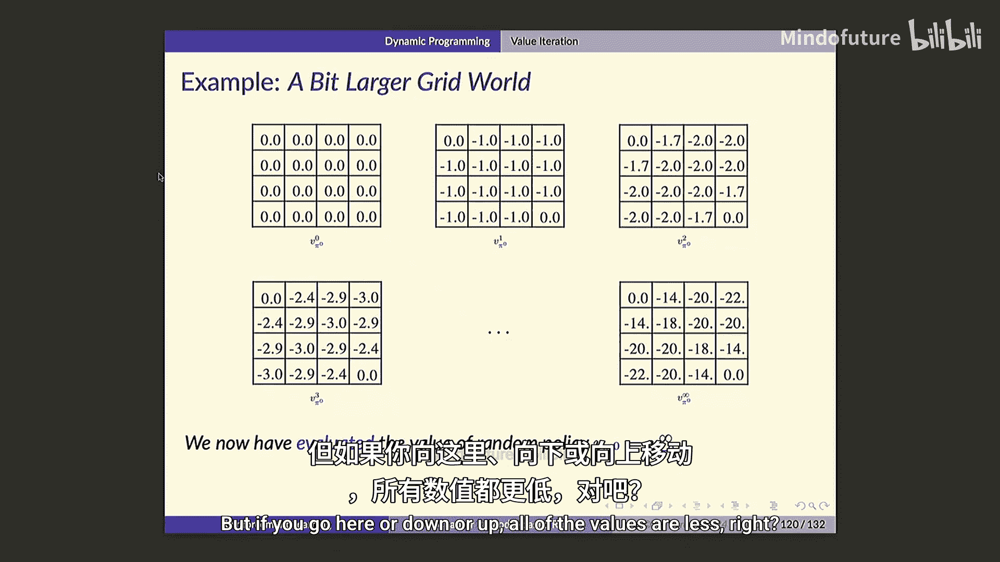

*   **动作：下**
    *   进入状态5，`V(5) = -18`，所以 `Q(1, 下) = -1 + (-18) = -19`。

比较所有动作价值，`Q(1, 左) = -1` 是最大值。因此，在状态1，改进后的策略 `π1` 将确定性地选择动作“左”。

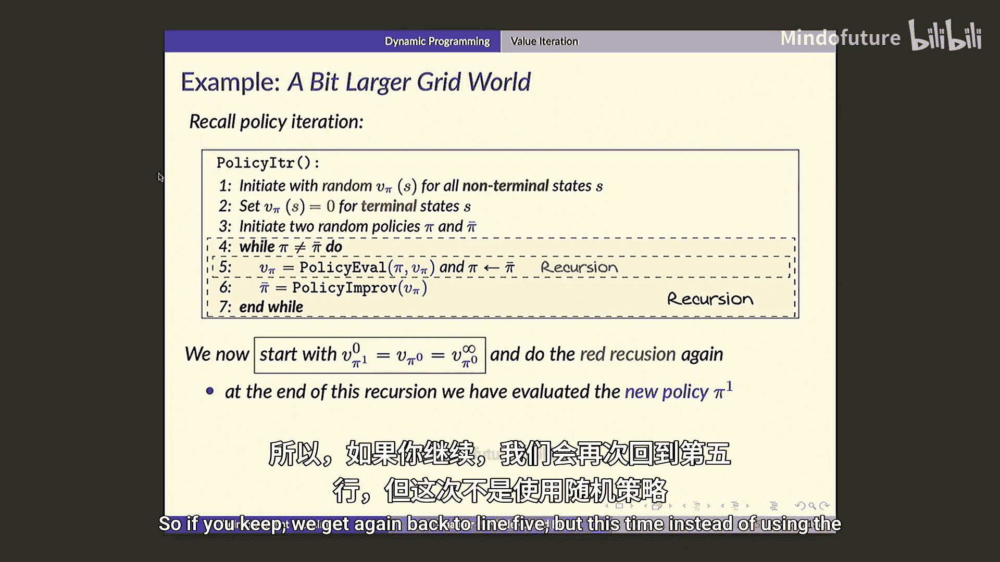

我们对所有状态执行此操作，即可得到完整的新策略 `π1`。

### 迭代直至收敛

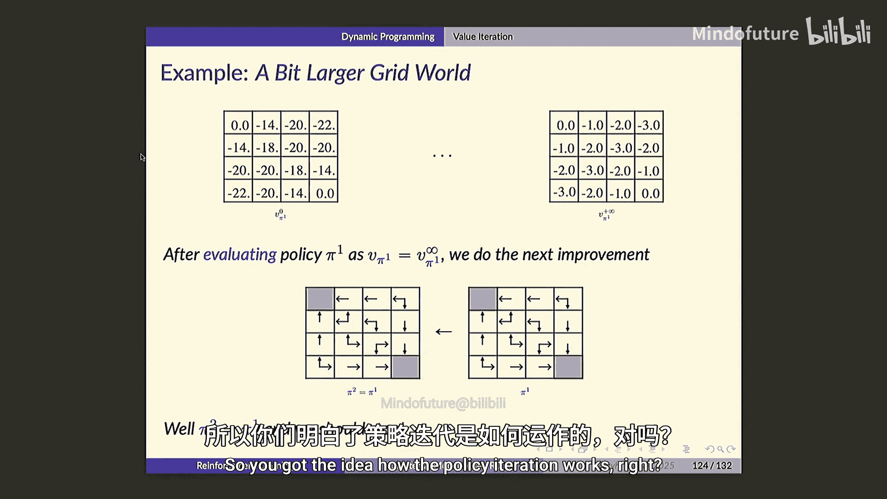

得到新策略 `π1` 后，我们重复上述过程：
1.  **再次评估**：以 `π1` 为输入，进行策略评估，计算其价值函数 `V^π1`。通常，我们可以用上一轮的价值函数作为初始值，以加速收敛。
2.  **再次改进**：基于 `V^π1` 进行策略改进，得到 `π2`。

在这个简单的网格世界例子中，我们会发现 `π2` 与 `π1` 完全相同，这意味着算法已经收敛，`π1` 就是最优策略。

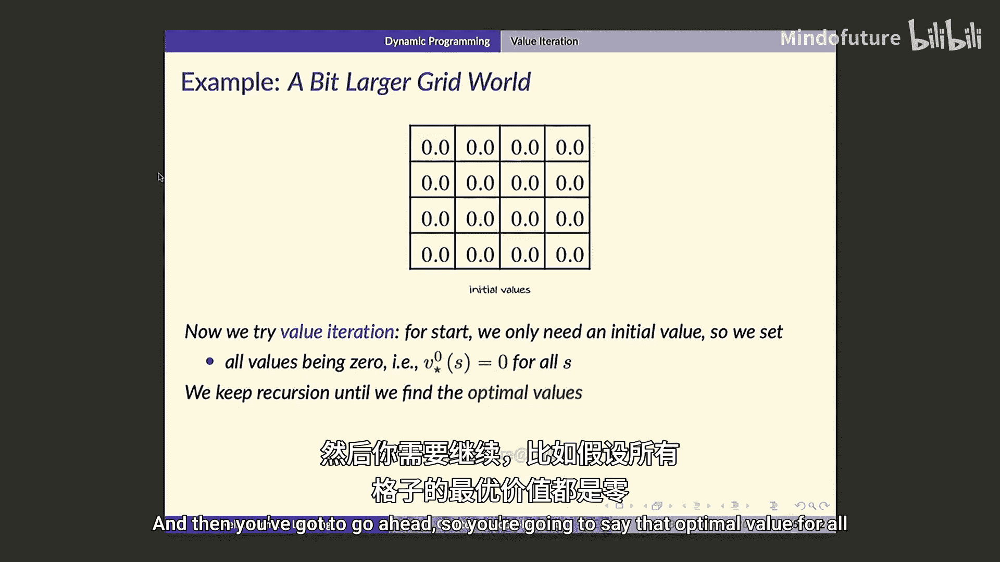

## 价值迭代详解

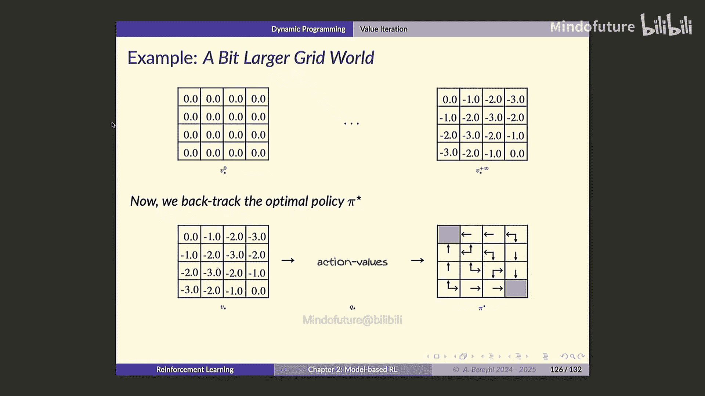

上一节我们详细走通了策略迭代，本节中我们来看看另一种方法——价值迭代。价值迭代直接寻找最优价值函数，而无需显式地维护和评估中间策略。

### 算法过程

1.  初始化所有状态的最优价值函数 `V*(s)`，例如全部设为0。
2.  进行迭代更新。在每次迭代中，对所有状态 `s`，使用贝尔曼最优方程进行更新：
    `V_{k+1}(s) = max_a [ R(s, a) + Σ_s‘ P(s'|s,a) * V_k(s') ]`
    在我们的确定性网格世界中，转移是确定的，因此公式简化为：
    `V_{k+1}(s) = max_a [ R(s, a) + V_k(下一状态) ]`
3.  持续迭代，直到 `V*(s)` 收敛。
4.  一旦得到最优价值函数 `V*`，即可通过一步前瞻推导出最优策略 `π*`：
    `π*(s) = argmax_a [ R(s, a) + V*(下一状态) ]`

对于我们的网格世界，价值迭代最终会收敛到与策略迭代相同的最优价值函数和最优策略。

## 策略迭代 vs. 价值迭代

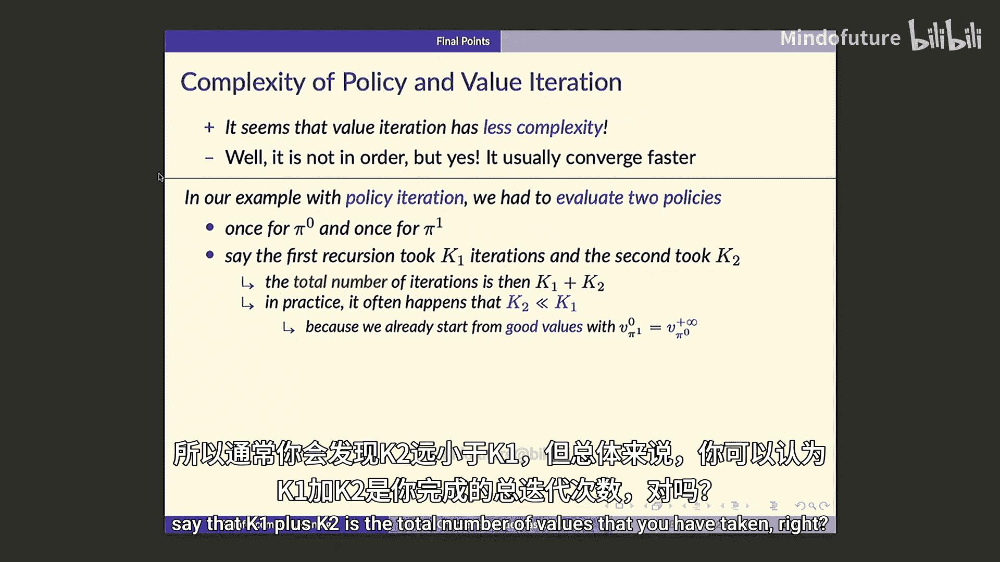

一个自然的疑问是：价值迭代似乎更简单，只需要一个循环，我们为什么还需要策略迭代？

### 计算复杂度分析

让我们从迭代次数的角度考虑：
*   在策略迭代中，假设评估第一个策略 `π0` 用了 `K1` 次迭代，评估第二个策略 `π1` 用了 `K2` 次迭代。由于评估 `π1` 时可以用 `V^π0` 作为良好的初始值，因此 `K2` 通常远小于 `K1`。总迭代次数为 `K1 + K2`。
*   在价值迭代中，假设从零收敛到最优价值函数需要 `K*` 次迭代。

**并没有理论保证 `K*` 一定小于 `(K1 + K2)`**。对于某些问题，最优价值函数可能很复杂，导致 `K*` 很大。虽然在实际中，`K*` 有时会小一些，但从算法复杂度的阶（即随状态数、动作数增长的规模）来看，两种方法是相同的。

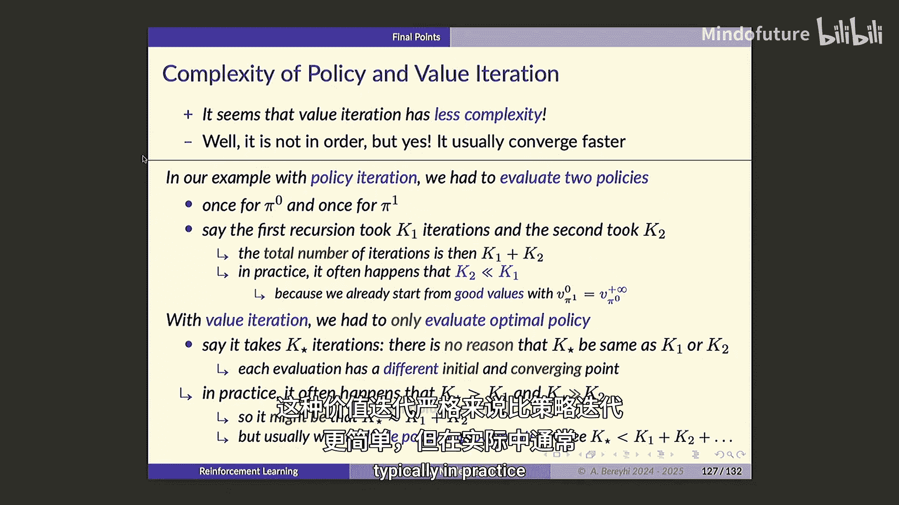

### 数值稳定性的关键区别

两者的关键区别在于**数值稳定性**，尤其是在实际应用中。

在实际的复杂环境中，无论是策略评估还是价值迭代，内部的动态规划循环都很难达到数学上的精确收敛。我们通常会在达到最大迭代次数或变化小于某个阈值时提前终止循环。

*   **价值迭代的风险**：如果提前终止，我们得到的是**对最优价值函数 `V*` 的一个近似估计**。这个估计可能不准确，从而导致基于它推导出的策略也不是最优的。
*   **策略迭代的优势**：在广义策略迭代框架下，我们每次只对一个确定的策略进行**近似评估**。即使评估不精确，我们也能基于这个近似价值函数进行策略改进，得到一个更好的策略。然后，对这个更好的策略进行评估时，由于策略更优，其价值函数往往更容易、更快地得到更准确的估计。这种“评估-改进”的循环在数值上通常更稳定，更容易收敛到一个良好的策略。

因此，**策略迭代（尤其是其广义形式）通常被认为在实践中更稳健、更可靠**，尽管它可能需要在“评估”和“改进”之间进行多次切换。而价值迭代可能收敛得更快（在迭代次数上），但其最终输出的策略质量对价值函数近似的精度更敏感。

## 广义策略迭代 🌀

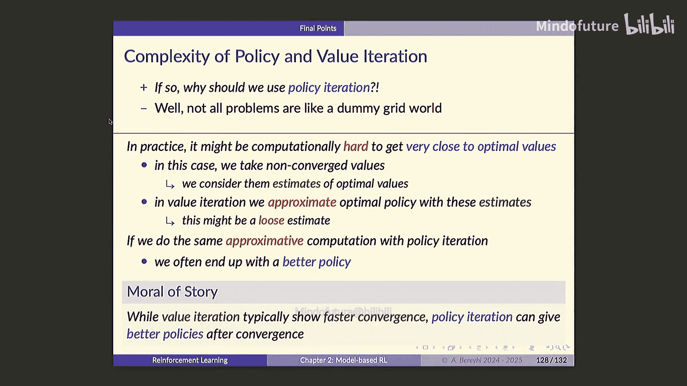

上一节我们讨论了两者的优劣，本节中我们正式介绍结合两者优点的实用框架——广义策略迭代。

广义策略迭代是策略迭代思想的一种灵活实现，它不再要求内部的策略评估必须完全收敛。

### 核心思想

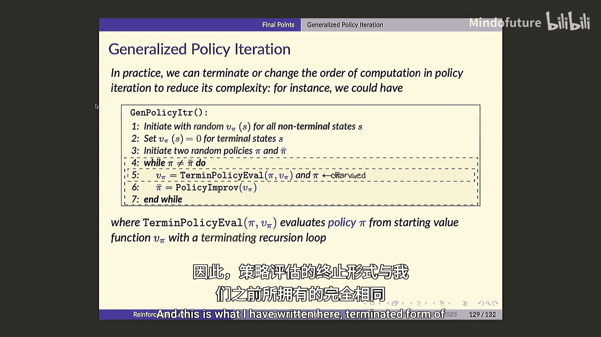

GPI的核心是**在策略评估和策略改进两个过程之间交替进行，但允许策略评估是近似的、未完全收敛的**。

其算法流程如下：
1.  初始化策略 `π` 和价值函数 `V`。
2.  **策略评估（近似）**：运行 `k` 步策略评估迭代（`k` 可以很小，甚至为1），更新价值函数 `V`，使其更接近当前策略 `π` 的真实价值，但不要求完全收敛。
3.  **策略改进**：基于当前近似的价值函数 `V`，对每个状态进行贪婪改进，得到一个新策略 `π‘`。
4.  令 `π = π‘`，重复步骤2和3。

### 为何有效

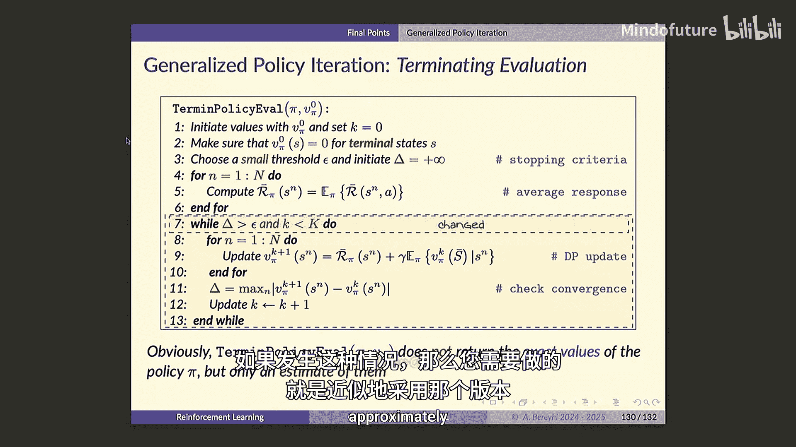

即使策略评估是近似的，只要策略改进步骤能基于当前价值函数产生一个更好的策略，这个过程就能持续向最优解前进。**评估和改进过程相互促进、相互约束**：
*   评估过程驱使价值函数趋近当前策略的真实价值。
*   改进过程驱使策略变得相对于当前价值函数更贪婪。
*   最终，当策略相对于其自身价值函数不再改变时，便达到了最优。

### 收敛性说明

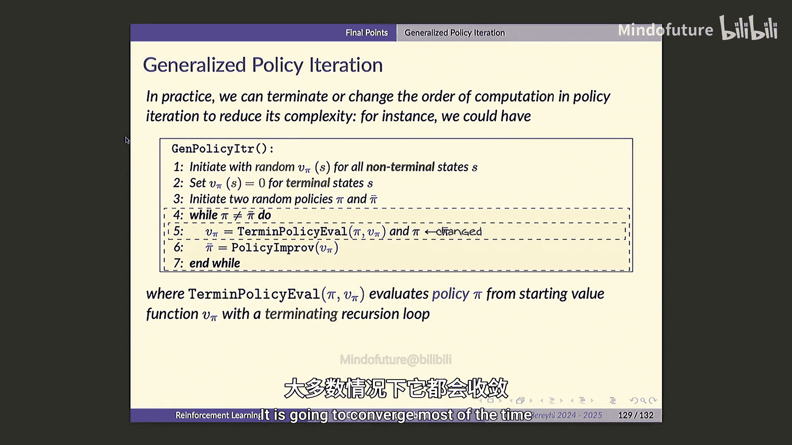

广义策略迭代在大多数情况下都能收敛。有理论研究表明，只要策略评估达到一定的精度（即使不完美），并且策略改进是贪婪的，整个算法就能收敛到最优策略。然而，这并不保证收敛速度，有时可能需要很多轮迭代。在实际应用中，GPI 提供了一个在计算时间和策略质量之间取得平衡的实用框架。

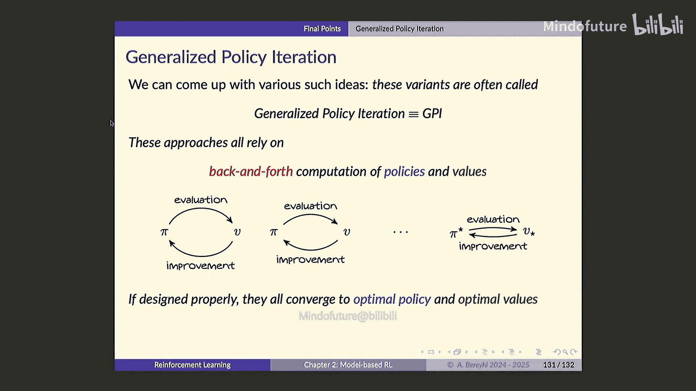

## 总结

本节课中我们一起学习了强化学习中求解马尔可夫决策过程的两个核心动态规划算法：策略迭代和价值迭代。

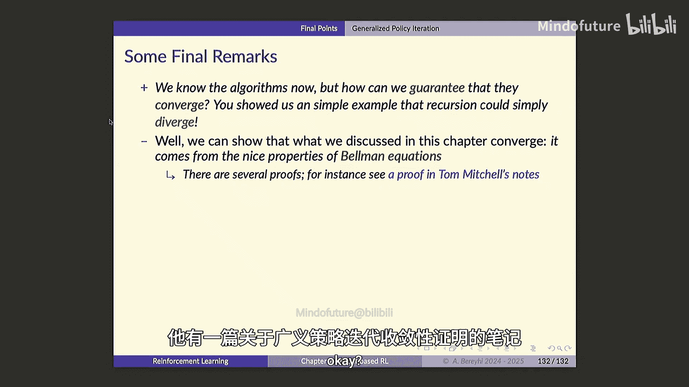

1.  **策略迭代** 通过交替进行“策略评估”和“策略改进”来逐步优化策略，直到收敛到最优策略。
2.  **价值迭代** 直接迭代更新最优价值函数，最后一步从中提取出最优策略。
3.  两者在理论复杂度上同阶，但**策略迭代通常具有更好的数值稳定性**，因为它对中间价值函数的近似误差不那么敏感。
4.  **广义策略迭代** 是策略迭代的实用化扩展，它允许使用不完整的、近似的策略评估，在实际应用中更灵活、更常用，是许多高级强化学习算法的基础思想。

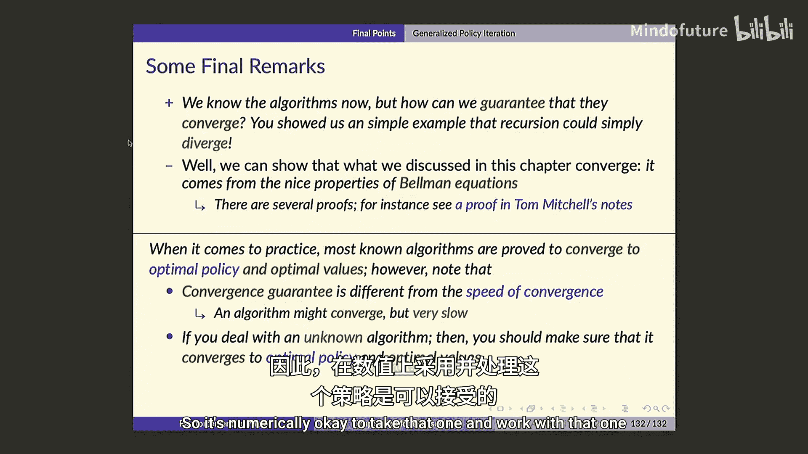

理解这些基本算法的区别、联系及其背后的权衡，是掌握更复杂强化学习技术的重要基石。