# 023：通过蒙特卡洛实现广义策略迭代 🎲

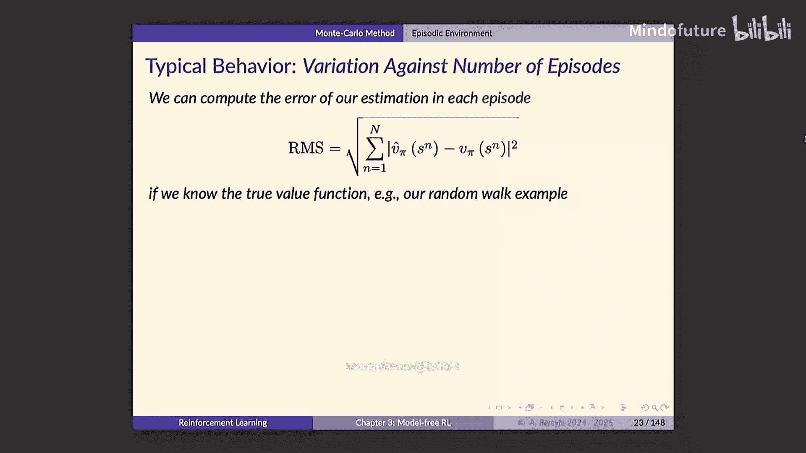

在本节课中，我们将学习如何在没有环境模型（即不知道状态转移概率和奖励函数）的情况下，使用蒙特卡洛方法进行策略评估，并以此为基础实现广义策略迭代。我们将重点理解蒙特卡洛估计的行为特点、如何估计动作价值函数，以及如何将其整合到策略迭代的框架中。

## 蒙特卡洛估计的行为特点 📈

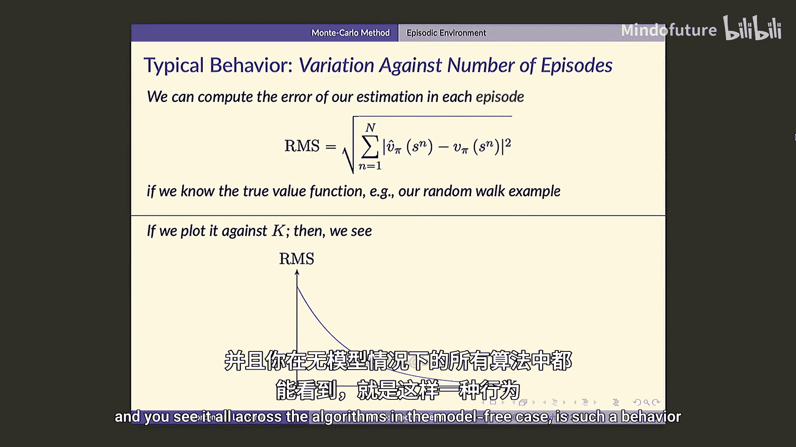

上一节我们介绍了蒙特卡洛估计的基本思想。本节中我们来看看在实际应用蒙特卡洛估计时，我们可能会观察到的一种典型行为。

当你进行蒙特卡洛估计时，你只是采样一个回合，然后基于这个回合的回报来估计价值函数。假设你知道真实的价值函数 `V(π)`，而我们通过采样得到的是估计值 `V_hat(π)`。显然，我们并不拥有真实的价值函数，否则就不需要使用蒙特卡洛方法了。但在一些简单的示例中，我们可以计算出真实值，从而观察估计误差。

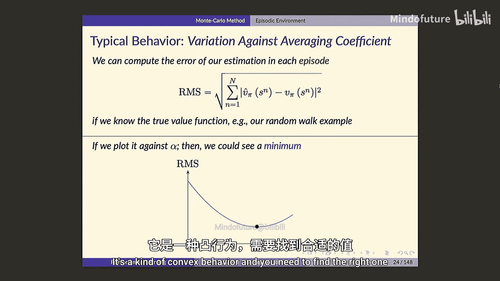

如果你从环境中采样无限数量的样本，估计误差最终会趋向于0。随着采样数量的增加，误差会逐渐减小。你总是会看到这样的行为：开始时误差很大，估计完全不准确；但渐渐地，估计会变得越来越好。

以下是蒙特卡洛估计中一个关键参数的行为：

在在线更新中使用的学习率 `α` 存在一个最优值。这意味着，如果你在每次更新时使用的步长太大，你的估计会变得很差；如果步长太小，估计同样会不佳。`α` 的最佳选择是一个数值问题，它取决于你的具体环境。通常你需要尝试不同的 `α` 值，观察每个值对应的方差，然后选择最合适的一个。关键在于，`α` 值的变化并不会导致误差单调地改善或恶化，你需要找到一个合适的“甜点”。

## 在策略迭代中应用蒙特卡洛 🔄

现在，我们想将蒙特卡洛的思想应用到策略迭代中。策略迭代包含两个部分：策略评估和策略改进。我们应该在哪一步使用蒙特卡洛方法呢？答案是在策略评估步骤。因为一旦你完成了评估，策略改进就相对直接了。关键在于如何进行准确的评估。

在模型未知的情况下，我们需要估计的是动作价值函数 `Q`，而不是状态价值函数 `V`。因为 `Q` 函数包含了动作信息，我们可以直接基于它来进行策略改进（例如，选择具有最高 `Q` 值的动作）。

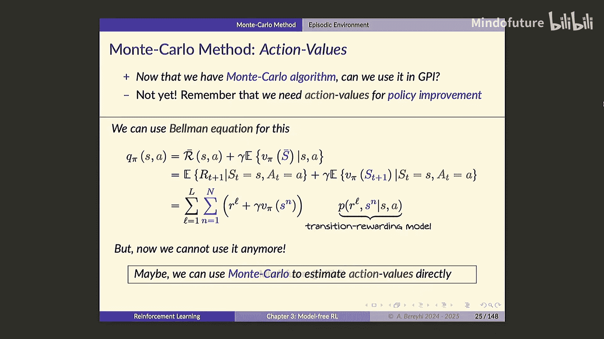

在之前的章节中，我们并不关心是使用 `V` 函数还是 `Q` 函数，因为我们知道如何通过贝尔曼方程从 `V` 函数推导出 `Q` 函数。公式如下：

`Q(s, a) = R(s, a) + γ * Σ_{s'} P(s'|s, a) * V(s')`

然而，要计算这个期望值，我们需要知道状态转移函数 `P(s'|s, a)`。在模型未知的情况下，我们无法使用这个公式。

那么，如何解决这个问题呢？我们可以直接使用蒙特卡洛方法来估计动作价值函数 `Q`。我们不再估计 `V` 函数，而是直接估计 `Q` 函数。动作价值 `Q(s, a)` 的定义是：从状态 `s` 执行动作 `a` 开始，之后所获得的累积回报的期望。因此，我们可以通过采样来估计它。

## 蒙特卡洛动作价值估计 🎯

让我们通过一个轨迹样本来理解如何估计动作价值。

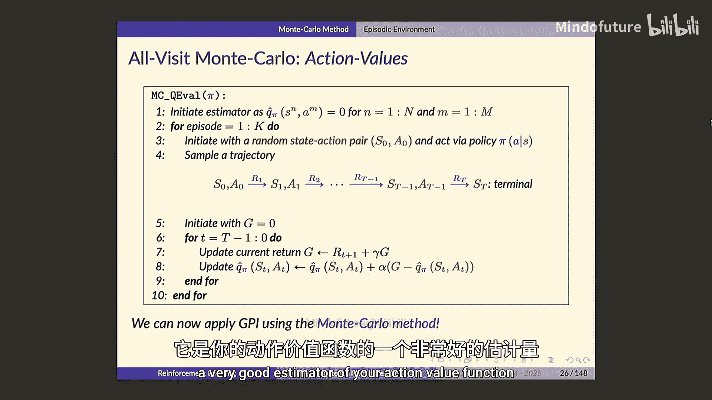

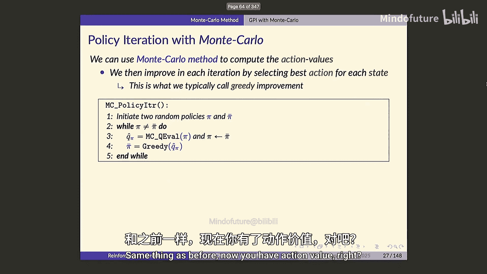

假设我们采样到一条轨迹：从状态 `S0` 开始，执行动作 `a0`，环境转移到状态 `S1`，获得奖励 `R1`，然后根据策略 `π` 继续执行动作，直到到达终止状态，并获得后续奖励 `R2, R3, ...`。

对于状态-动作对 `(S0, a0)`，我们收集到的回报是 `G = R1 + R2 + ...`（直到回合结束）。这就是一个样本回报。如果我们有数百个这样的样本（都从 `(S0, a0)` 开始），然后将所有这些样本回报平均起来，就得到了 `Q(S0, a0)` 的估计值。

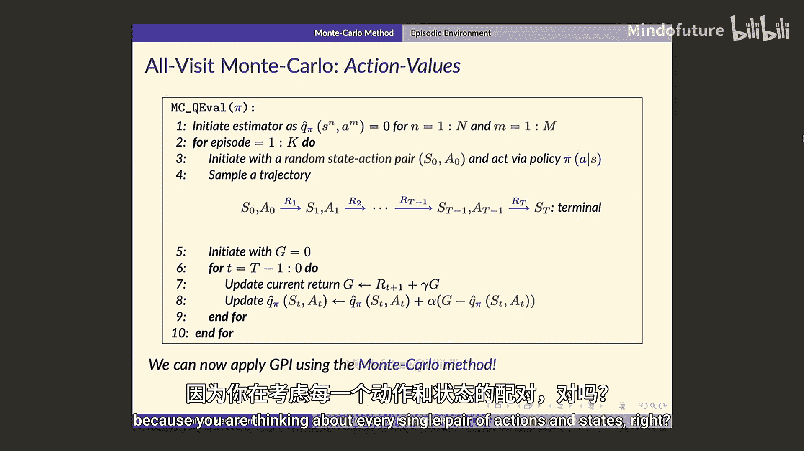

同样的思想可以应用于轨迹中的每一个状态-动作对。因此，一条轨迹可以提供多个状态-动作对的样本回报。

以下是蒙特卡洛动作价值估计的流程：

1.  初始化所有状态-动作对的 `Q` 值为0。
2.  采样一条轨迹（一个回合）。
3.  从轨迹的末尾开始向前遍历：
    *   对于最后一个非终止状态-动作对 `(S_{T-1}, a_{T-1})`，其样本回报就是最后获得的奖励 `R_T`。用这个样本来更新 `Q(S_{T-1}, a_{T-1})` 的估计。
    *   向前一步，对于 `(S_{T-2}, a_{T-2})`，其样本回报是 `R_{T-1} + γ * R_T`（假设无折扣或已考虑折扣）。用这个样本来更新 `Q(S_{T-2}, a_{T-2})`。
    *   以此类推，更新轨迹中出现的每一个状态-动作对。
4.  重复步骤2和3，采样新的轨迹并更新，直到 `Q` 函数收敛。

在满足一定条件下，经过足够多的回合后，这个估计值会收敛到一个很好的动作价值函数近似。

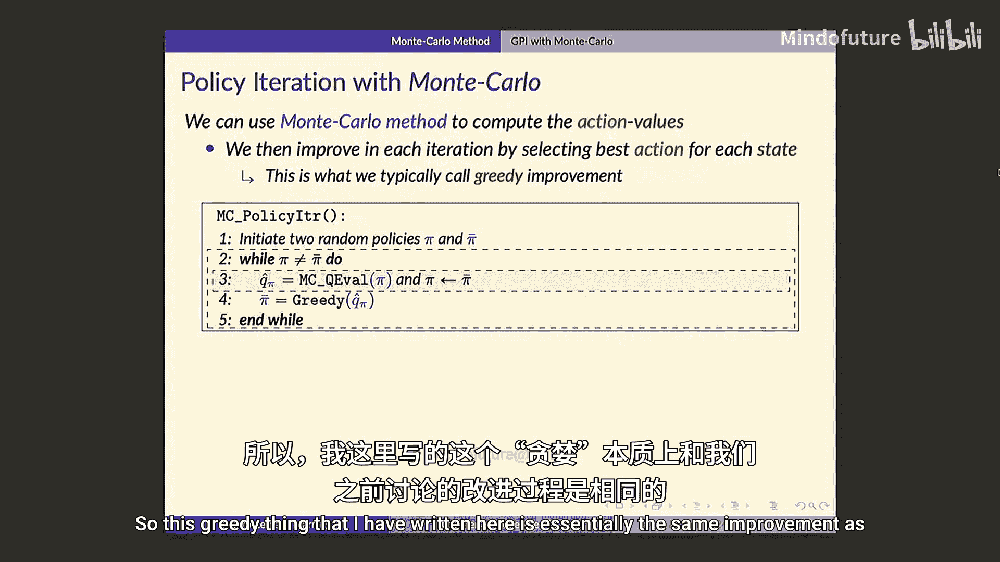

## 价值估计与动作价值估计的比较 ⚖️

现在有一个问题：如果分别用蒙特卡洛方法估计状态价值 `V` 和动作价值 `Q`，哪一个收敛得更快？

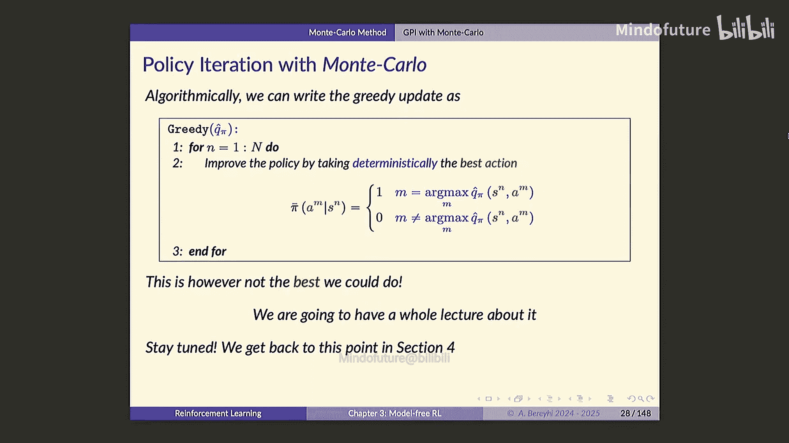

答案是估计 `V` 通常收敛得更快。原因在于参数数量。假设有 `S` 个状态和 `A` 个动作。估计 `V` 函数需要估计 `S` 个值（每个状态一个）。而估计 `Q` 函数需要估计 `S * A` 个值（每个状态-动作对一个）。显然，需要估计的参数越多，就需要更多的样本来达到相同的精度，因此收敛得更慢。

## 蒙特卡洛策略迭代 🚀

理解了如何用蒙特卡洛评估动作价值后，我们就可以实现广义的策略迭代了，我们称之为蒙特卡洛策略迭代。

其工作原理与经典的策略迭代完全相同，唯一的区别在于策略评估步骤：

1.  **初始化**：从一个随机策略 `π` 开始。
2.  **策略评估**：使用上述的蒙特卡洛方法，通过采样来估计当前策略 `π` 下的动作价值函数 `Q_hat(π)`。我们无法进行精确的动态规划计算。
3.  **策略改进**：基于估计出的 `Q_hat(π)`，进行贪婪改进，得到新策略 `π’`。即，对于每个状态 `s`，选择使 `Q_hat(s, a)` 最大的动作 `a`：
    `π'(s) = argmax_a Q_hat(s, a)`
4.  **迭代**：令 `π = π’`，回到步骤2，重复此过程，直到策略不再变化（收敛）。

这里称之为“贪婪”，是因为我们基于一个可能并不完全准确的估计值 `Q_hat` 来做出改进决策。在理想情况下，如果我们的估计无限精确，这个过程就是最优的。但在实践中，样本有限，这种贪婪改进可能因为早期估计不准而错过全局最优路径。后续我们会介绍 `ε-贪婪` 策略来缓解这个问题。

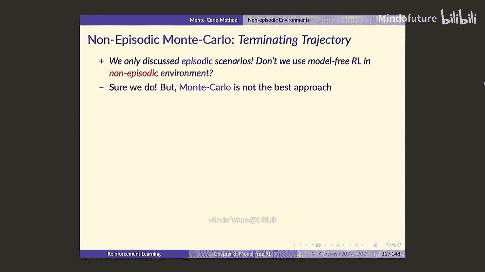

这个过程与之前讨论的“截断”策略迭代有相似之处：我们从一个策略开始，进行不完美的评估（这里是蒙特卡洛估计，之前是未完全收敛的动态规划），然后改进，逐步使策略变好。不同之处在于，蒙特卡洛估计本身带有噪声，方差可能更大。

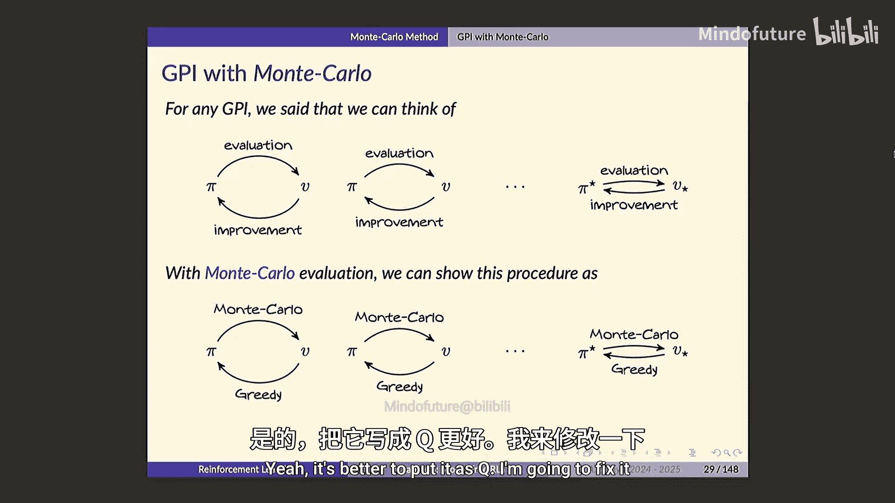

**注意**：要保证蒙特卡洛策略迭代收敛到最优策略，理论上需要满足一个条件：在每次策略评估中，都有“无限多”的样本（即样本数远大于状态-动作对的数量）。这在实践中很难实现，因此实际算法不能严格保证收敛到最优。

## 非终止环境下的挑战与解决思路 💡

蒙特卡洛方法的一个关键要求是回合必须终止。但在很多环境中（例如持续运行的游戏或系统），没有明确的终止状态。

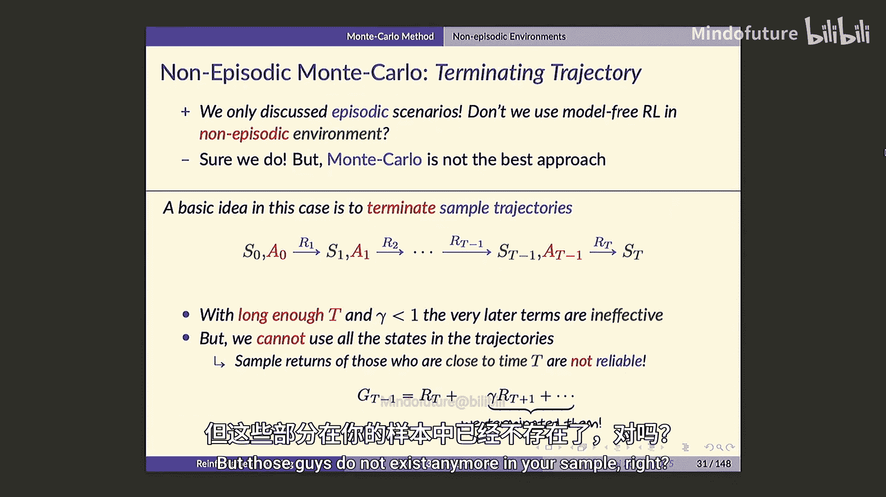

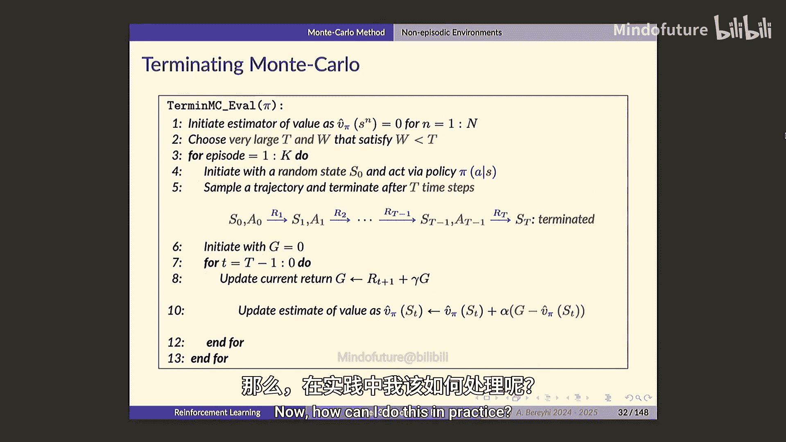

如果我们强行在某个时间步 `T` 截断轨迹，就会产生问题。对于轨迹早期的状态-动作对，其真实的回报包含 `T` 时刻之后的所有未来奖励。而我们截断后，这部分信息丢失了，导致估计有偏。

一种解决思路是利用折扣因子 `γ`。如果 `γ < 1`，那么未来很远处的奖励对当前价值的贡献非常小（`γ^t` 趋于0）。因此，我们可以设定一个足够大的窗口 `W`，并假设在 `T-W` 步之后截断轨迹，对早期状态-动作对的估计影响可以忽略不计。我们只使用轨迹中前 `T-W` 个时间步的数据来更新 `Q` 值。

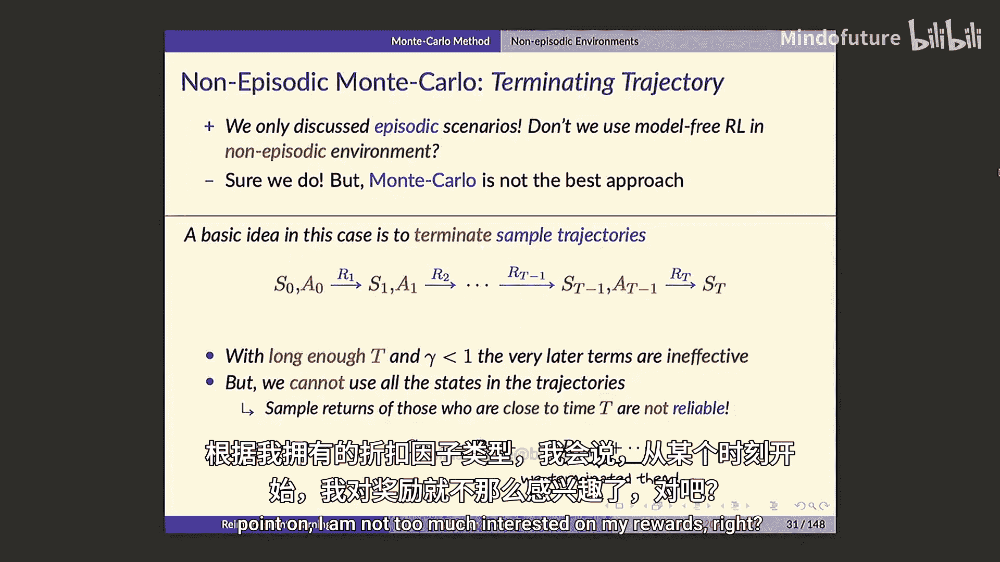

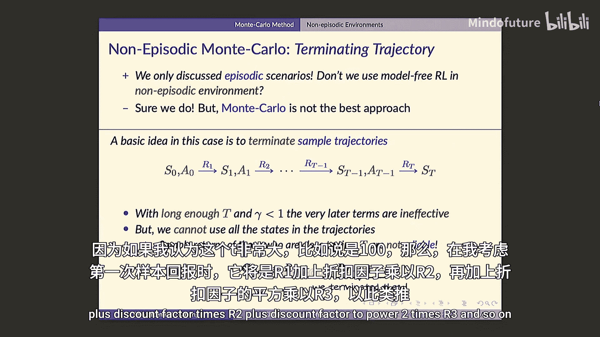

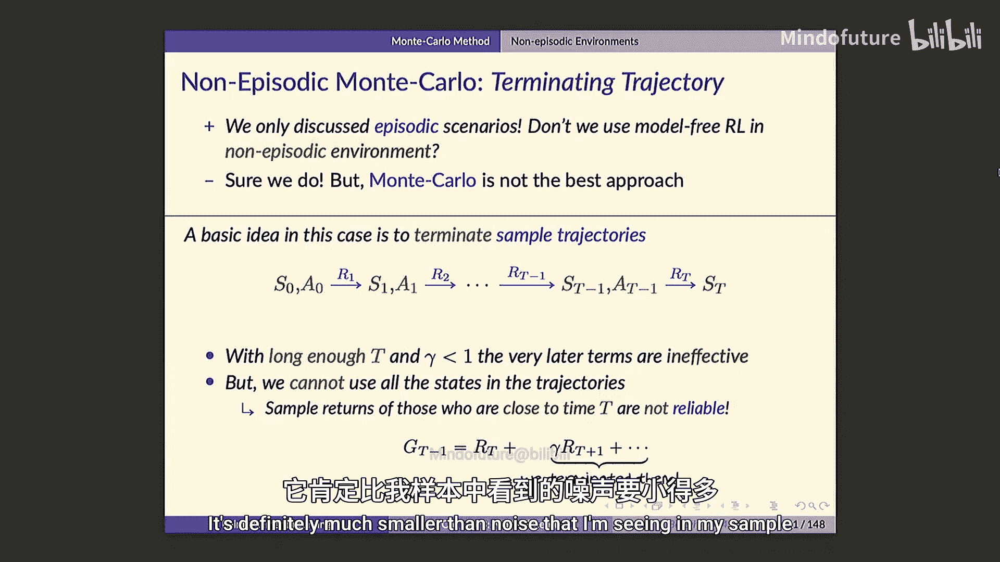

然而，这种方法效率低下，因为它丢弃了轨迹尾部 `W` 个时间步的数据，而这些数据本可以用来更新靠近轨迹尾部的状态-动作对。

更高效的解决方案是使用**时间差分学习**，这将在后续课程中详细介绍。时间差分方法可以在每一步进行更新，而不需要等待整个回合结束，非常适合没有终止状态的环境。

---

本节课中我们一起学习了：
1.  蒙特卡洛估计在实践中表现出特定的学习率敏感性和收敛行为。
2.  在模型未知的情况下进行策略迭代，需要在策略评估步骤直接使用蒙特卡洛方法估计**动作价值函数 Q**，因为无法通过贝尔曼方程从 V 推导 Q。
3.  估计 Q 函数比估计 V 函数需要更多样本，因其参数更多。
4.  蒙特卡洛策略迭代框架保持了“评估-改进”的循环，但用蒙特卡洛采样替代了精确的动态规划评估。
5.  贪婪改进基于估计的 Q 值，可能因估计误差而次优。
6.  标准的蒙特卡洛方法需要回合终止，对于非终止环境，截断轨迹是一种低效的替代方法，更好的方法是使用时间差分学习。

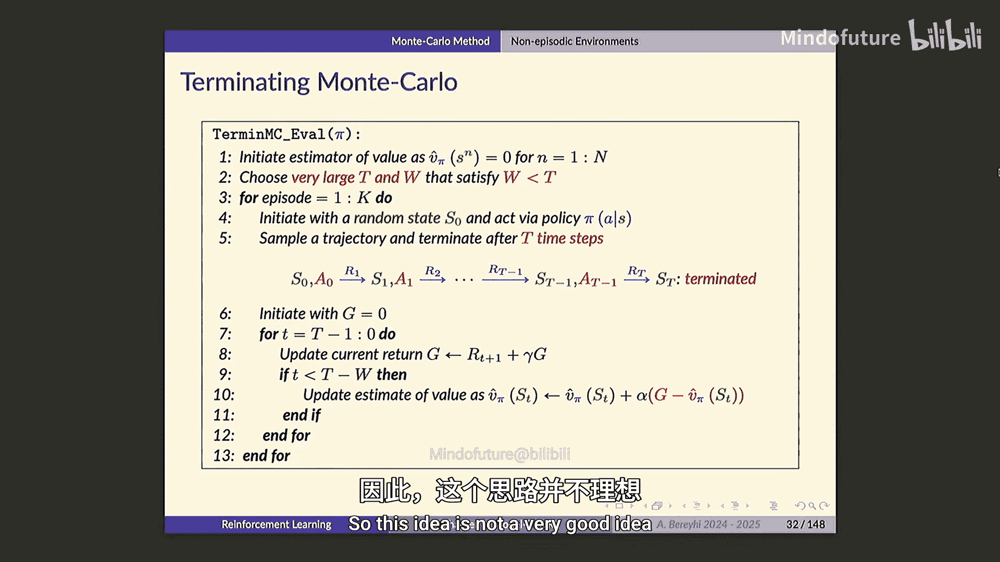

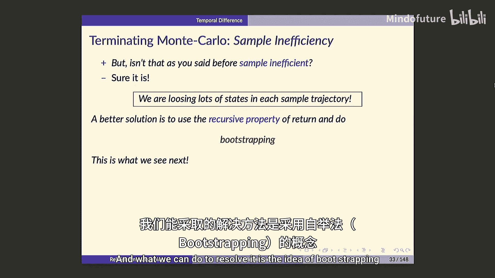

通过蒙特卡洛，我们迈出了在未知模型环境中进行强化学习的关键一步。