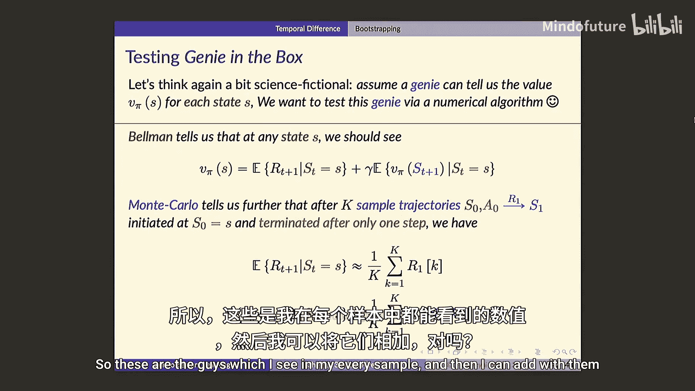
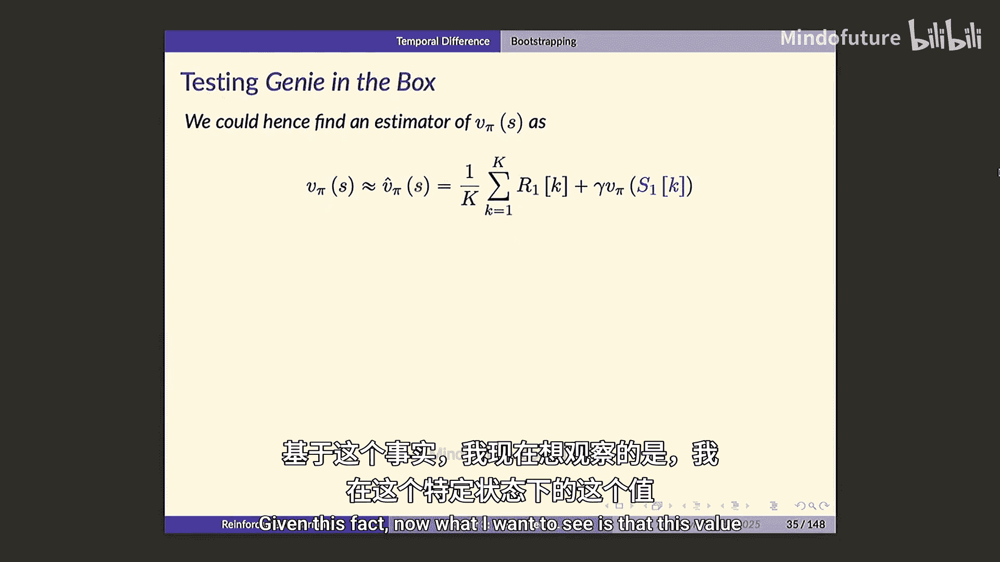
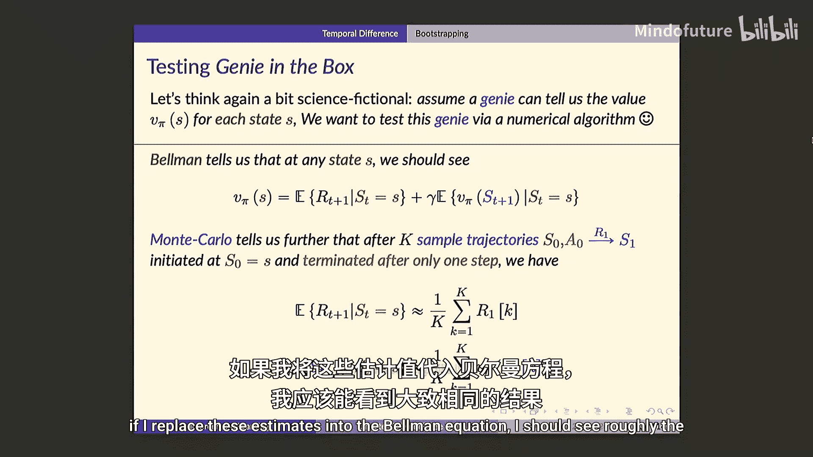
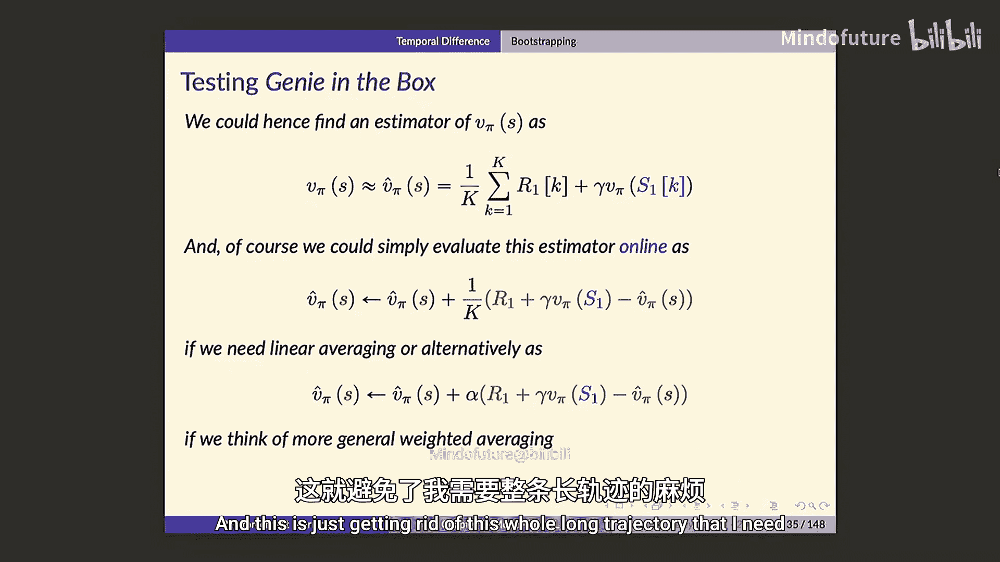
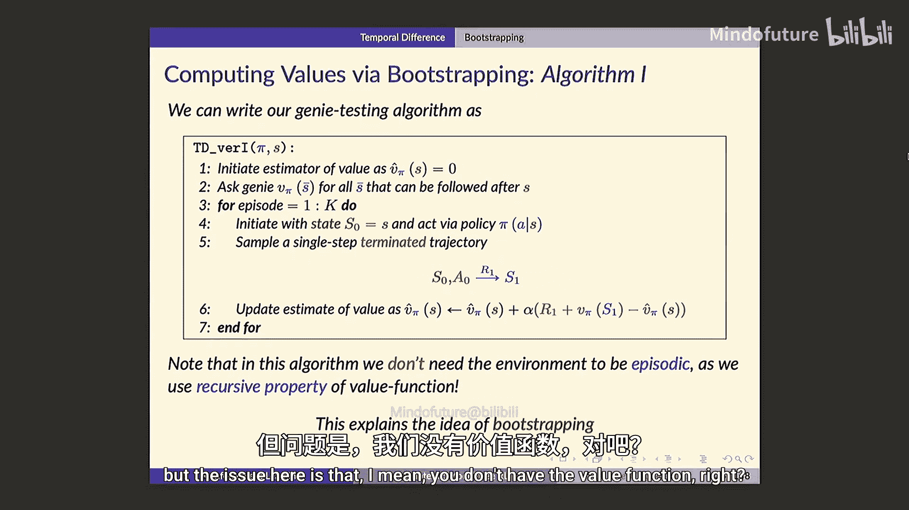
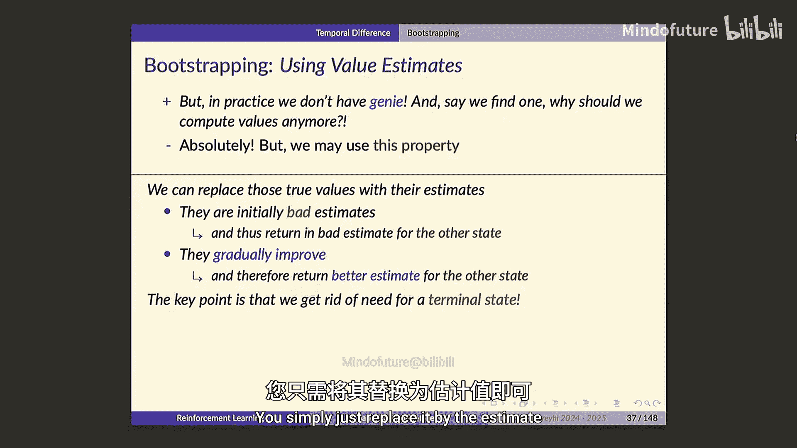
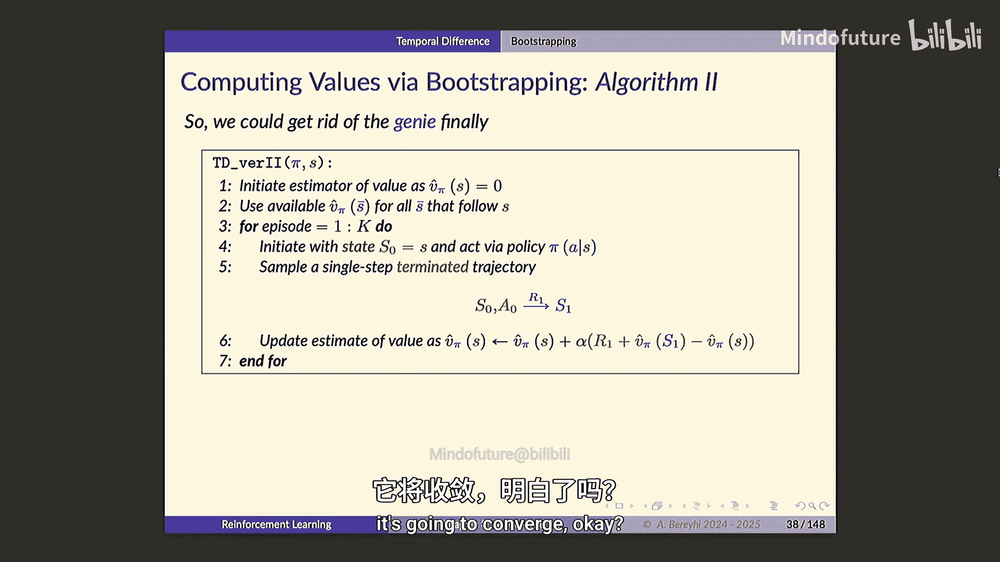

# 024：自举法 🧠

在本节课中，我们将学习一种名为“自举法”的强化学习技术。我们将从一个思想实验开始，逐步理解如何利用贝尔曼方程来更高效地评估策略的价值函数，而无需像蒙特卡洛方法那样采样到回合结束。

## 思想实验：测试“精灵” 🧞

假设我们有一个“精灵”。这个精灵拥有一种能力：如果我告诉它我当前的状态，它就能告诉我，在我的策略下，这个状态的价值是多少。

显然，如果我拥有这个精灵，我就不再需要任何评估过程了。但假设我想测试这个精灵，以确认它告诉我的价值是否正确。我该如何做呢？

我们可以利用贝尔曼方程来测试它。

## 利用贝尔曼方程进行测试 📐

贝尔曼方程告诉我们，在特定状态 `S` 下的价值，等于在该状态下执行策略所获得的**即时奖励的期望**，加上**折扣因子**乘以**下一状态价值的期望**。公式表示如下：

`V(S) = E[R + γ * V(S')]`

其中：
*   `V(S)` 是当前状态 `S` 的价值。
*   `E[R]` 是在状态 `S` 下执行策略后获得的即时奖励的期望。
*   `γ` 是折扣因子。
*   `E[V(S')]` 是下一状态 `S'` 的价值的期望。

为了测试精灵，我们可以这样做：从我们想评估的状态 `S` 开始，根据策略执行一次动作，得到一个即时奖励 `R`，并转移到下一个状态 `S'`。我们重复这个过程 `K` 次，得到 `K` 个样本 `(R, S')`。

现在，我们可以用这些样本来计算贝尔曼方程右边的两项：
1.  **即时奖励的期望**：我们可以简单地计算这 `K` 个即时奖励 `R` 的平均值。
2.  **下一状态价值的期望**：对于每次采样得到的下一个状态 `S'`，我们直接询问精灵它的价值 `V(S')`，然后计算这 `K` 个价值的平均值。

最后，我们将计算出的 `E[R] + γ * E[V(S')]` 与精灵最初告诉我们的 `V(S)` 进行比较。如果它们大致相等，就说明精灵可能是正确的。

这种方法的关键在于，我们**只需要采样一个时间步**，而无需像蒙特卡洛方法那样采样到回合结束。

## 从测试到更新：在线学习 🔄

上一节我们介绍了如何用贝尔曼方程测试一个已知的价值函数（精灵）。本节中，我们来看看如何将这个思想用于实际学习。

如果我们没有精灵，但想在线学习状态的价值，我们可以采用类似的思路。我们从一个初始的价值估计开始（例如，将所有状态的价值设为0）。然后，我们与环境交互，每次得到一个样本 `(S, R, S')`。

此时，我们没有精灵提供的真实 `V(S')`，但我们有自己的当前估计值，记作 `V_est(S')`。我们可以用这个估计值来更新当前状态 `S` 的价值估计。更新规则类似于蒙特卡洛中的增量更新：

`V_est(S) ← V_est(S) + α * [ R + γ * V_est(S') - V_est(S) ]`

其中 `α` 是学习率。

这个更新公式的含义是：我们将当前估计 `V_est(S)` 朝着“目标值” `R + γ * V_est(S')` 调整。这个目标值基于我们对下一状态的**现有估计**，而不是像蒙特卡洛那样基于整个回合的实际回报。

## 自举法的核心思想与挑战 💡

这种方法被称为**自举法**。它的核心思想是利用价值函数自身的**递归属性**（贝尔曼方程），用**其他状态的当前估计值**来更新**当前状态的估计值**。

这就像“拽着自己的鞋带把自己提起来”一样。它允许我们仅凭单步采样数据就进行更新，无需等待回合结束，从而实现了更高效、更适用于在线和持续任务的学习。

然而，自举法也带来了一个核心挑战：**估计偏差**。因为我们的更新依赖于其他状态的价值估计，而这些估计本身可能是不准确甚至错误的。如果初始估计很差，或者环境动态变化很快，这种偏差可能会被传播和放大，导致学习不稳定或收敛到错误的值。

相比之下，蒙特卡洛方法（基于整个回合的实际回报）是无偏的，但方差可能很高，且必须等到回合结束。

## 时序差分学习：结合两者 🤝

我们刚刚描述的方法——使用自举法进行单步更新——正是**时序差分学习**的一种形式，具体来说是 **TD(0)** 算法。

它巧妙地结合了蒙特卡洛和动态规划的思想：
*   **像蒙特卡洛一样**：它通过与环境交互采样来学习，不需要知道环境的完整模型。
*   **像动态规划一样**：它利用贝尔曼方程进行自举更新，无需等待回合结束。

以下是TD(0)价值评估的核心算法步骤：
1.  初始化所有状态 `S` 的价值估计 `V(S)`（例如为0）。
2.  对每个回合重复：
    *   初始化状态 `S`。
    *   当状态 `S` 非终止状态时，重复：
        *   根据当前策略，在状态 `S` 选择动作 `A`。
        *   执行动作 `A`，观察奖励 `R` 和下一状态 `S‘`。
        *   进行更新：`V(S) ← V(S) + α * [ R + γ * V(S') - V(S) ]`
        *   `S ← S'`

通过不断重复这个过程，价值函数估计 `V(S)` 会逐渐收敛到策略的真实价值函数。

## 总结 📝

本节课中我们一起学习了自举法的核心概念。我们从测试一个“完美精灵”的思想实验出发，理解了如何利用贝尔曼方程进行单步评估。接着，我们探讨了如何将这一思想应用于实际学习，即用自身现有的价值估计来更新其他状态的估计，这就是自举法。最后，我们引出了时序差分学习（TD(0)）算法，它通过 `V(S) ← V(S) + α * [ R + γ * V(S') - V(S) ]` 这一更新规则，实现了无需模型、单步在线学习的高效价值评估。自举法带来了高效性，但也引入了估计偏差，这是其固有的权衡。