# 025：通过时序差分实现广义策略迭代 🎯

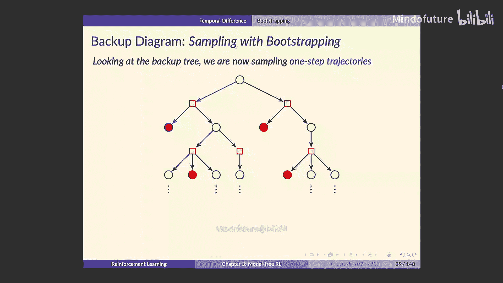

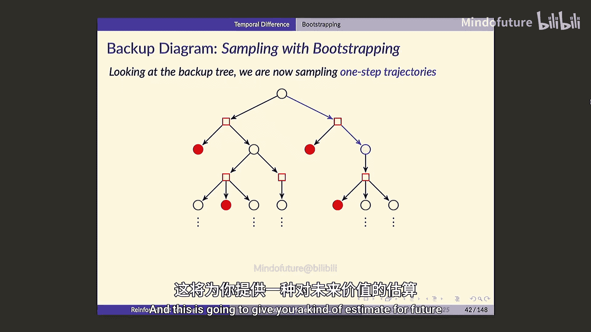

在本节课中，我们将学习一种名为**时序差分**的核心强化学习方法。我们将了解它如何通过结合蒙特卡洛方法和动态规划的思想，以在线、增量的方式高效地评估策略的价值函数。

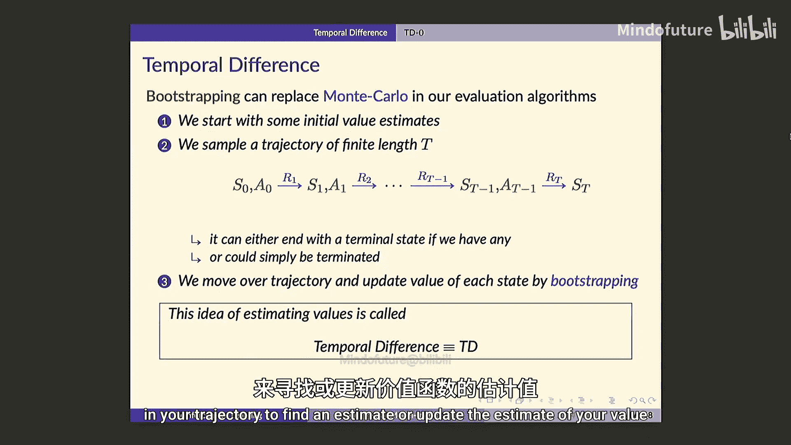

## 时序差分（TD）的核心思想

上一节我们介绍了蒙特卡洛方法，它需要等待一个完整的回合（轨迹）结束后才能进行价值更新。本节中我们来看看时序差分方法，它允许我们在每一步之后立即更新价值估计。

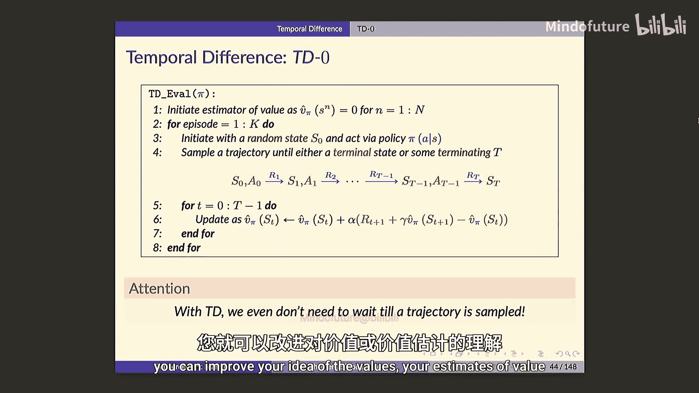

时序差分方法的核心是**自举**。其思想是，要估计当前状态的价值，我们不需要等到回合结束，而是可以基于下一个状态的**当前价值估计**和即时奖励来进行更新。

这个过程可以用贝尔曼方程的采样版本来描述：
`V(S_t) ← V(S_t) + α [R_{t+1} + γ * V(S_{t+1}) - V(S_t)]`
其中，`α` 是学习率，`γ` 是折扣因子。方括号内的项 `R_{t+1} + γ * V(S_{t+1}) - V(S_t)` 被称为 **TD误差**。

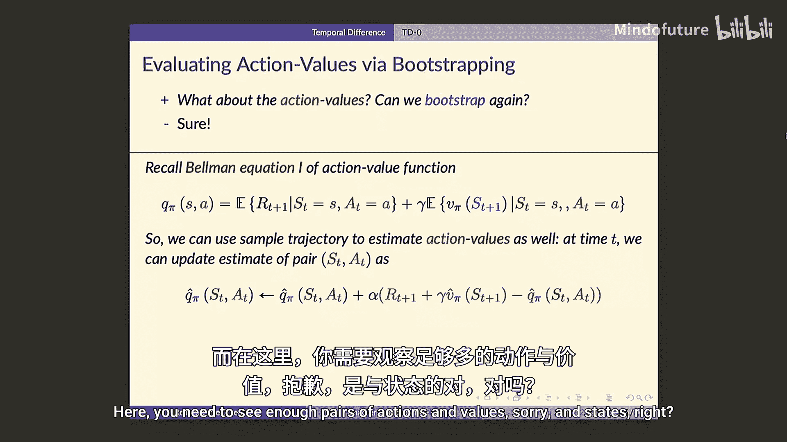

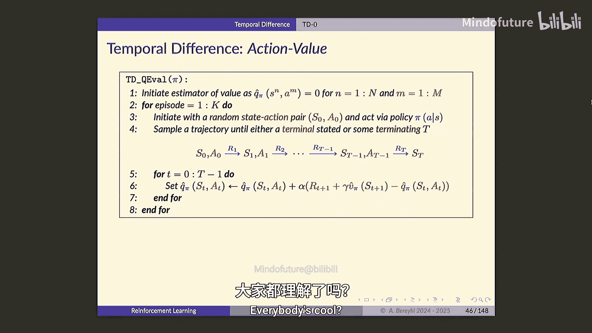

## TD(0) 策略评估算法

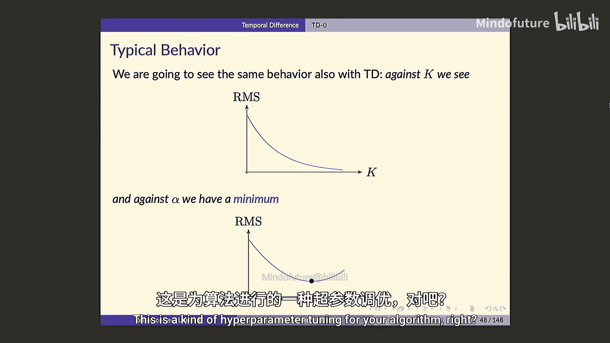

现在，让我们具体看看如何使用TD方法来评估一个给定的策略。这种方法被称为 **TD(0)**。

以下是TD(0)策略评估的步骤：
1.  初始化所有状态的价值 `V(s)`（例如，全部设为0）。
2.  根据待评估的策略 `π`，在环境中采样一个完整的轨迹（状态、动作、奖励序列）。
3.  沿着轨迹，对每一个遇到的状态 `S_t`，使用以下公式进行更新：
    `V(S_t) ← V(S_t) + α [R_{t+1} + γ * V(S_{t+1}) - V(S_t)]`
4.  重复步骤2和3足够多次，直到价值函数 `V(s)` 收敛。

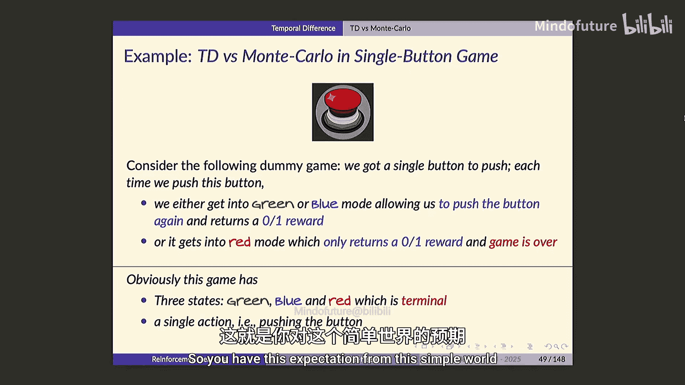

与蒙特卡洛方法的关键区别在于，TD更新**不需要等待轨迹结束**。在时间步 `t`，我们利用即时奖励 `R_{t+1}` 和下一个状态 `S_{t+1}` 的当前价值估计来更新 `S_t` 的价值。这使得学习过程是完全在线的。

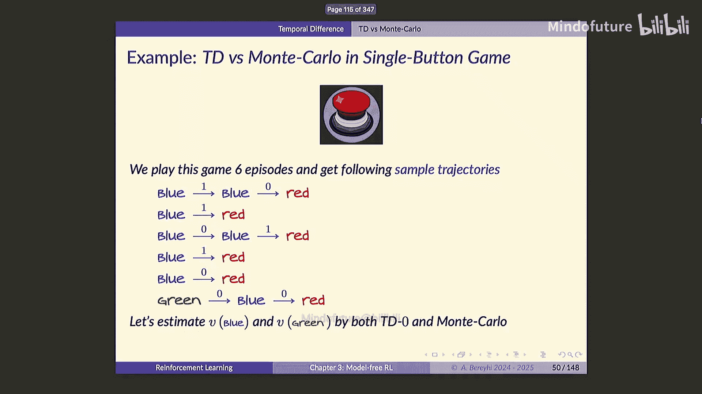

## 动作价值函数的TD估计

我们同样可以将TD方法应用于估计动作价值函数 `Q(s, a)`。

其更新公式与状态价值函数类似：
`Q(S_t, A_t) ← Q(S_t, A_t) + α [R_{t+1} + γ * Q(S_{t+1}, A_{t+1}) - Q(S_t, A_t)]`
其中，`A_{t+1}` 是根据策略 `π` 在状态 `S_{t+1}` 下选择的动作。

需要注意的是，估计 `Q` 函数通常比估计 `V` 函数需要更多的样本，因为它有更多的参数（状态-动作对）。因此，`V` 函数的收敛速度通常会更快。

## 一个简单的示例：网格世界

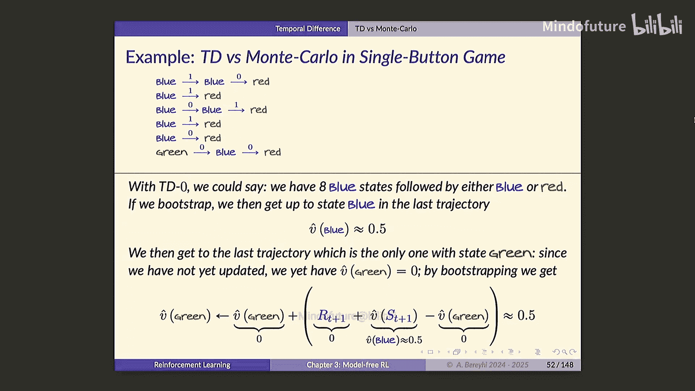

为了直观理解，我们可以在一个简单的网格世界环境中尝试TD(0)算法。

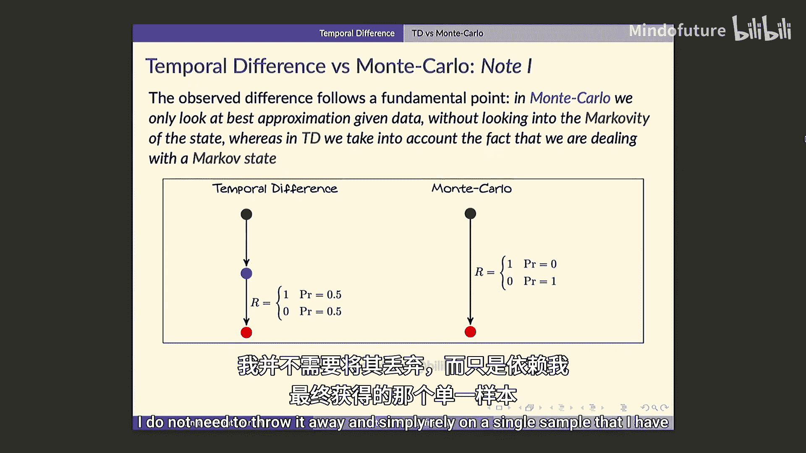

以下是算法的运行过程：
1.  将所有状态的价值初始化为0。
2.  遵循一个随机策略（例如，均匀随机选择动作）在网格中移动。
3.  每走一步，就根据上述TD更新规则更新当前状态的价值。
4.  经过足够多的步数（例如，10-15个回合）后，你会发现状态的价值估计会迅速收敛到接近其真实值。例如，靠近终点的状态会首先获得非零的价值，然后这个信息会通过TD更新“传播”给更早的状态。

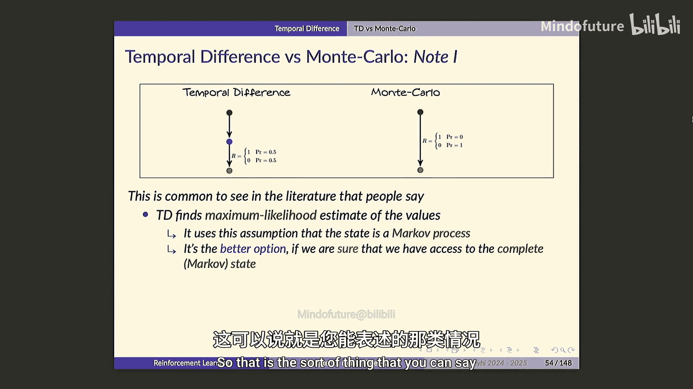

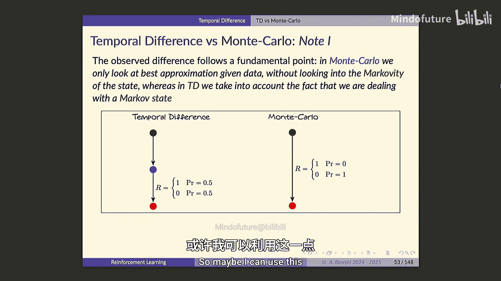

## TD与蒙特卡洛的对比：偏差与方差的权衡

为了深入理解TD方法的优势，我们来看一个极其简单的示例环境。这个环境只有三个“状态”：绿色、蓝色和红色。你只能按一个键，每次按键会随机看到一种颜色并获得0或1的奖励。看到红色时回合结束。

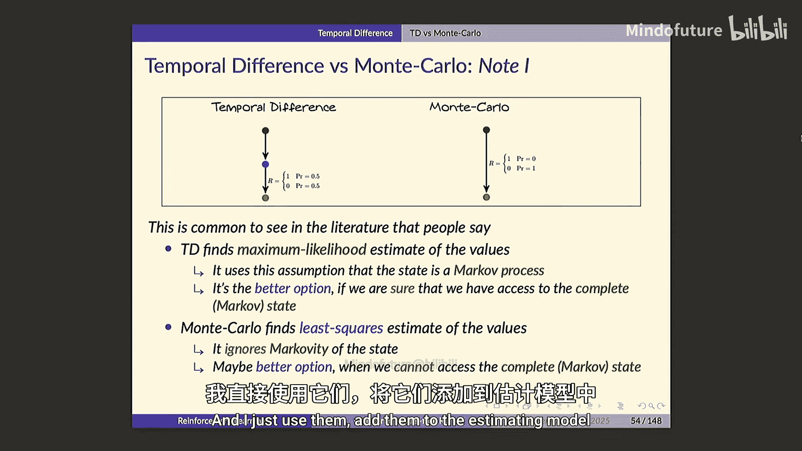

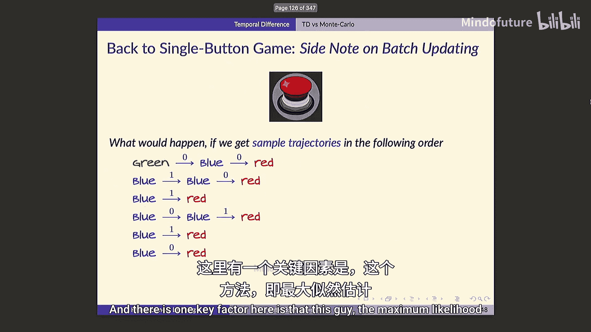

假设我们收集了6条轨迹样本，其中蓝色出现了8次，绿色只出现了1次。

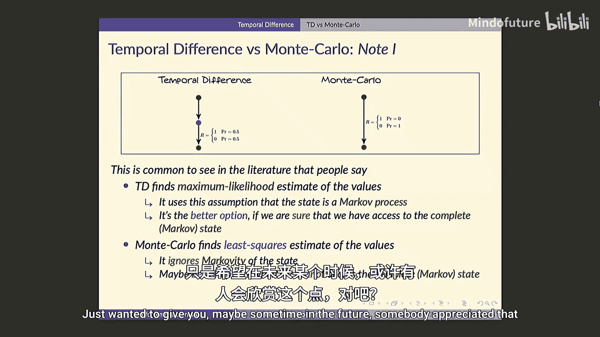

*   **蒙特卡洛估计**：对于绿色状态，我们只有1个样本，其后续回报为0，因此估计值为0。这个估计的**方差很高**，因为它只基于一次观察。
*   **TD(0)估计**：对于绿色状态，我们同样只有1个从绿色到蓝色的转移样本。但TD更新会使用蓝色状态的**当前价值估计**（基于8个样本，估计值约为0.5）。因此，绿色的价值更新为 `0 + 0.5 = 0.5`。这个估计**方差更低**，因为它利用了从蓝色状态收集到的更多信息。

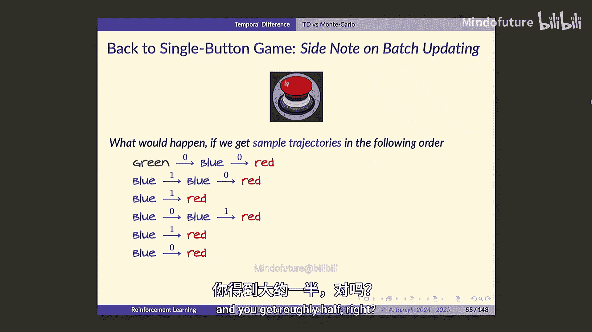

这个例子揭示了两种方法的核心差异：
*   **蒙特卡洛**：直接对从某个状态开始到回合结束的**完整回报**进行采样平均。它是**无偏**的（平均估计等于真实值），但**方差高**。
*   **时序差分**：基于当前的价值估计（自举）和单步采样进行更新。它通常引入一些**偏差**，但显著**降低了方差**。

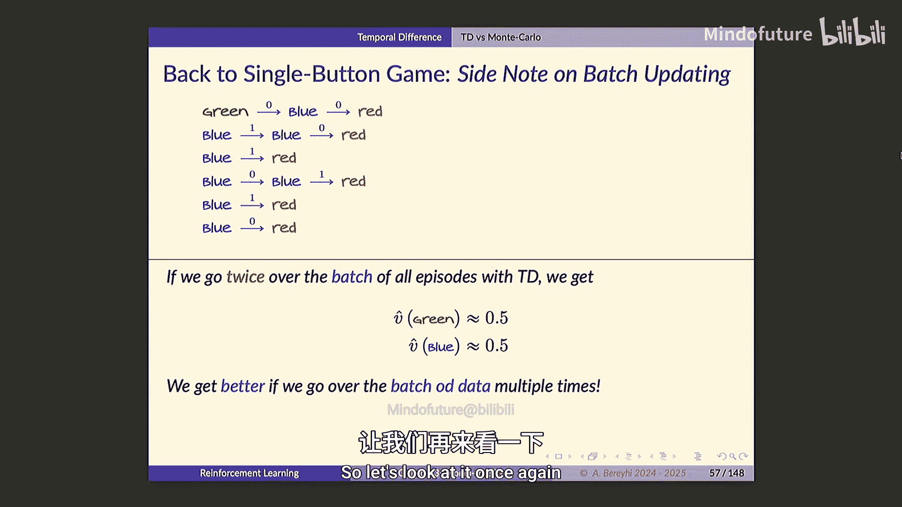

TD方法隐含地利用了环境的**马尔可夫性**。它假设从当前状态到下一个状态的转移是确定的（由环境动态决定），因此可以安全地使用下一个状态的价值估计来更新当前状态。这是一种在偏差和方差之间进行的有益权衡，在数据有限的情况下尤其有效。

## 通过TD实现广义策略迭代（GPI）

最后，我们可以将TD评估嵌入到广义策略迭代的框架中，就像我们对蒙特卡洛方法所做的那样。

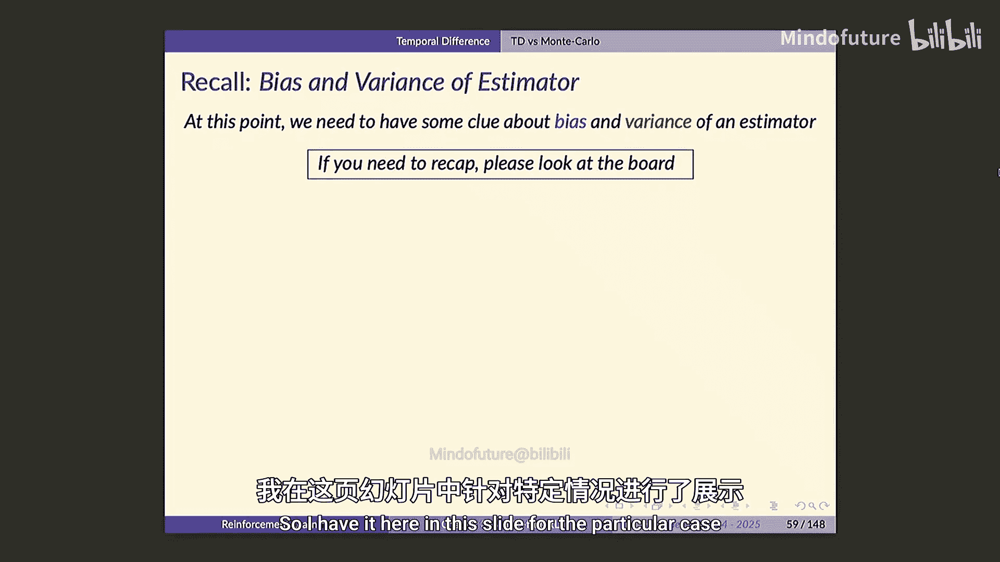

以下是基于TD(0)的GPI步骤：
1.  **策略评估**：使用TD(0)算法评估当前策略 `π` 的价值函数 `V^π`（或 `Q^π`）。
2.  **策略改进**：基于评估得到的价值函数，采用贪婪策略进行改进，生成一个新策略 `π‘`。例如，对于每个状态，选择能最大化 `Q(s, a)` 的动作。
3.  **迭代**：将新策略 `π‘` 设回为当前策略，并重复步骤1和2。

这个过程被称为 **TD(0)控制**。由于TD评估是在线的，整个控制过程也可以在线进行，智能体在与环境交互的同时不断改进其策略。

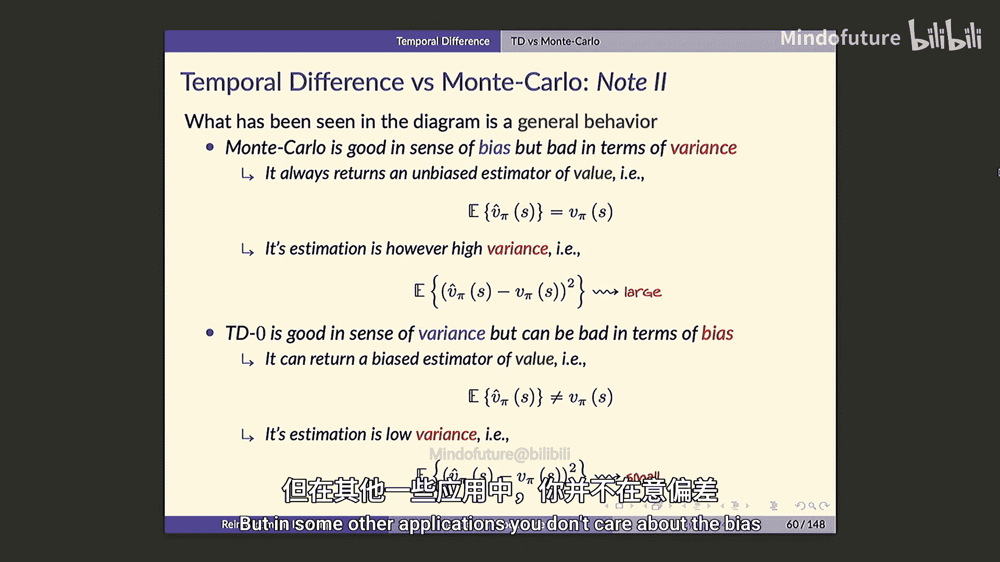

## 总结

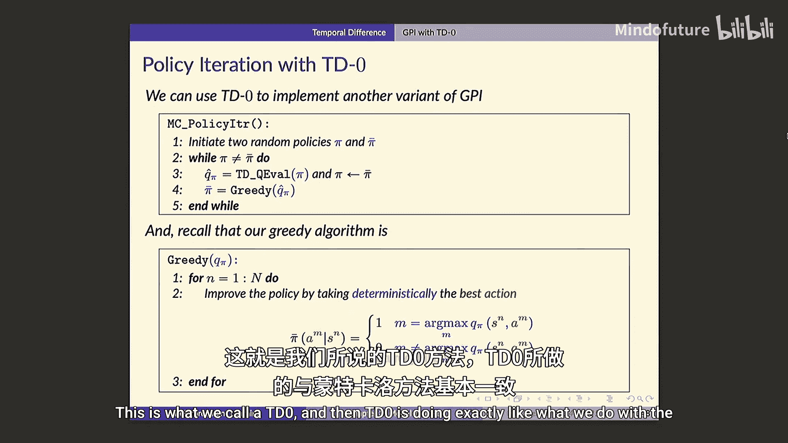

本节课中我们一起学习了**时序差分**这一强大的强化学习核心方法。
*   我们了解了TD方法如何通过**自举**，结合即时奖励和下一状态的估计价值，实现**在线、增量式**的价值函数更新。
*   我们详细探讨了**TD(0)算法**用于策略评估和动作价值估计。
*   通过一个简单示例，我们对比了TD与蒙特卡洛方法，理解了TD在**偏差与方差**之间的权衡：它通过引入少量偏差，换取了更低的方差和更快的收敛速度，这在样本有限的情况下非常有利。
*   最后，我们看到了如何将TD评估融入**广义策略迭代**框架，从而实现高效的在线策略优化。

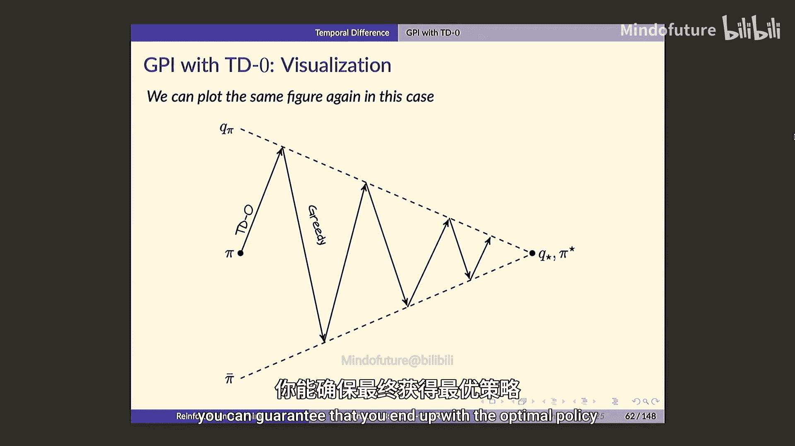

TD方法奠定了许多现代强化学习算法（如Q-learning、SARSA）的基础。在下一讲中，我们将探索更广义的TD方法，例如TD(λ)，它允许我们考虑多步的回报。