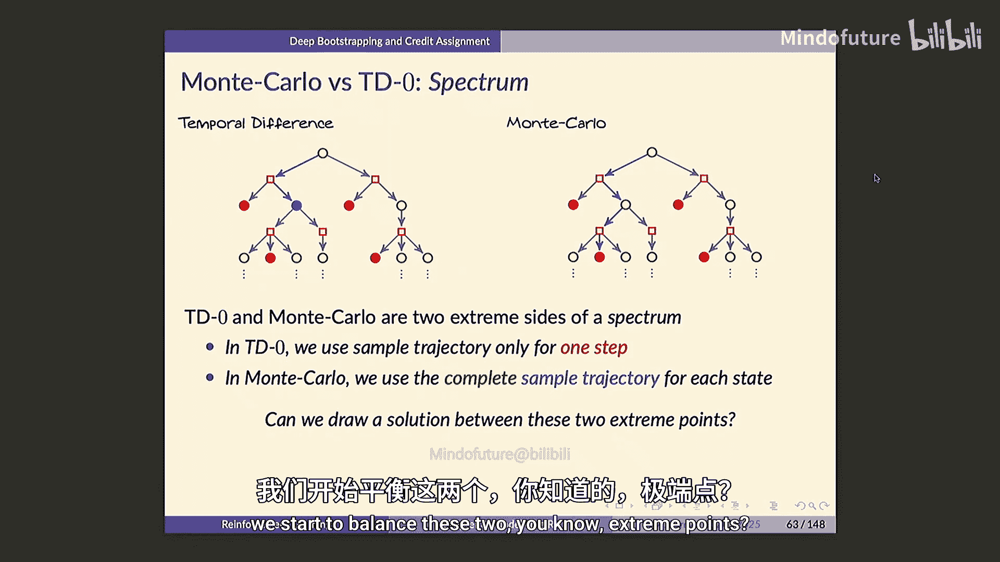
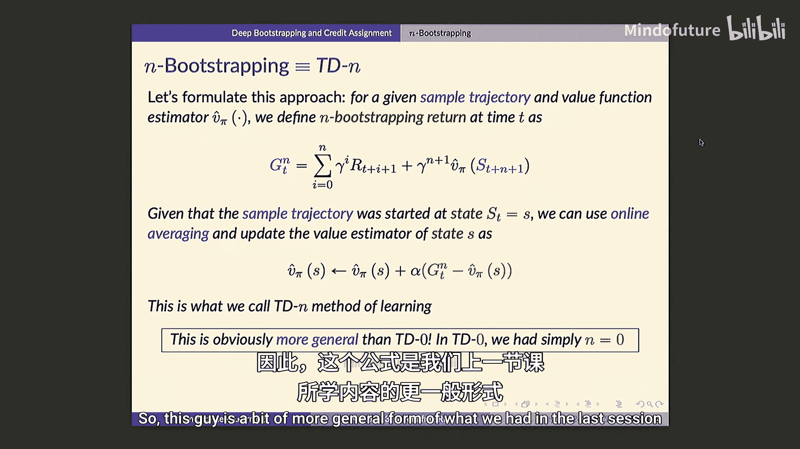
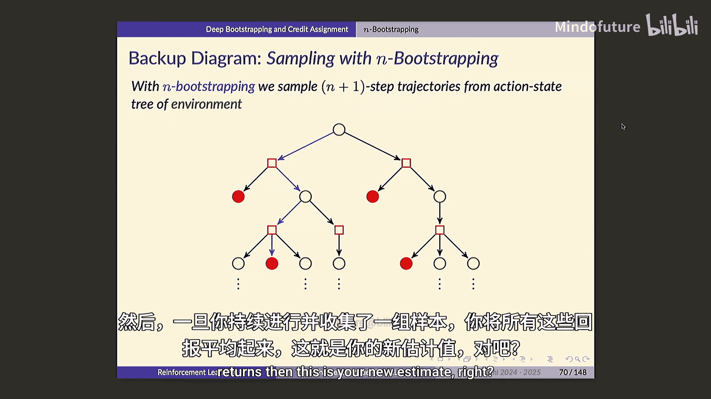
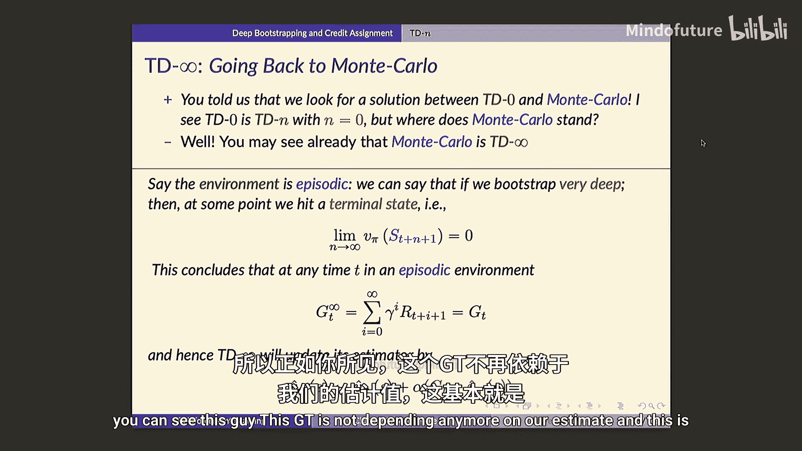
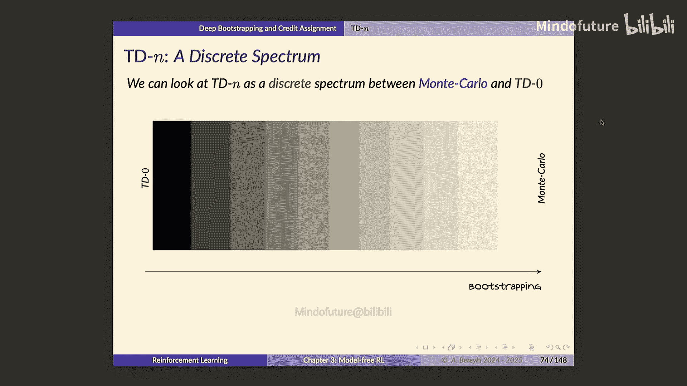
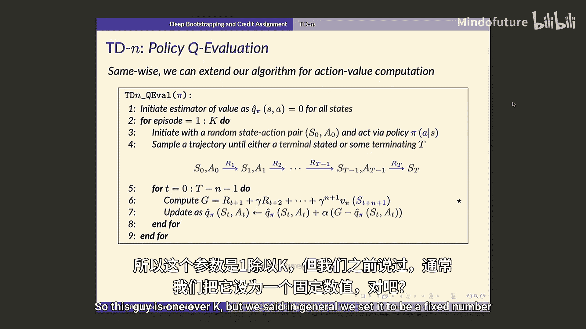
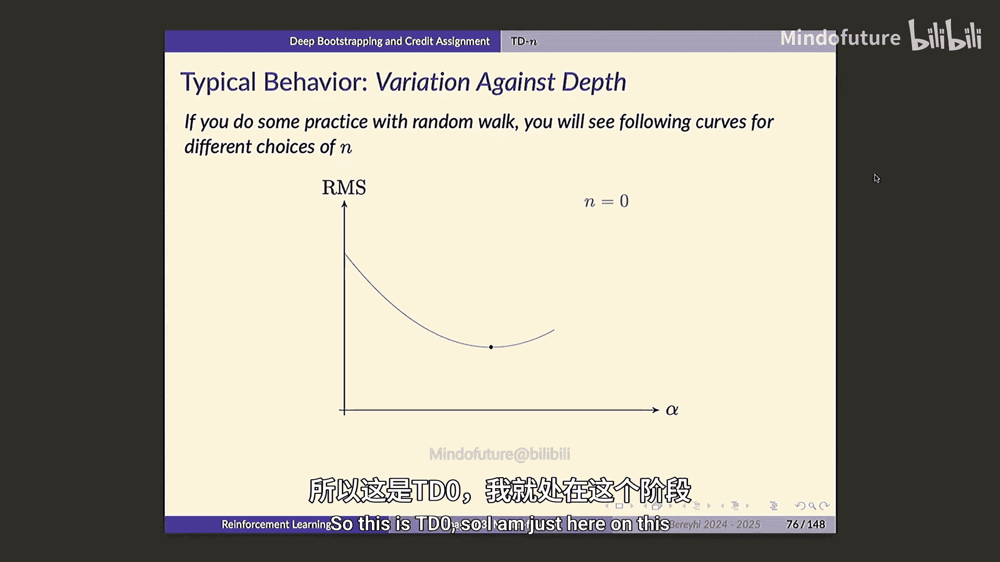
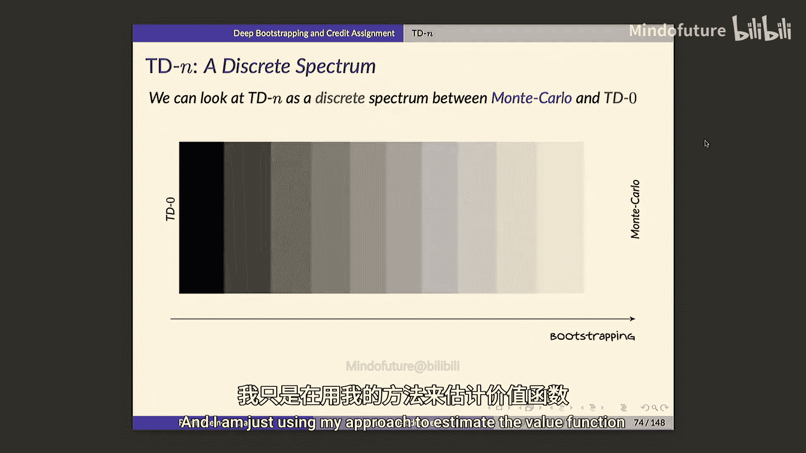
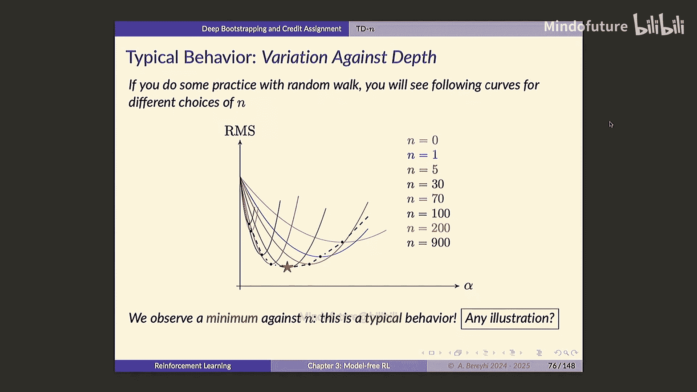

# 026：深度自举法与TD(n) 🧠

在本节课中，我们将学习如何扩展时间差分（TD）学习的思想，使其不仅仅局限于单步更新。我们将介绍TD(n)方法，它通过在多个时间步上进行“自举”来平衡TD(0)的样本效率和蒙特卡洛方法的低偏差特性。

## 概述

上一节我们介绍了基本的TD(0)方法，它通过结合即时奖励和下一状态的估计值来更新价值函数。本节中，我们来看看如何将这种“自举”的思想延伸到更深的未来，从而在TD(0)和蒙特卡洛方法之间找到一个平衡点。

## TD(0)与蒙特卡洛的回顾

首先，让我们快速回顾一下TD(0)和蒙特卡洛方法的核心区别。

*   **TD(0)方法**：从当前状态 `S_t` 出发，采样一个时间步。执行一个动作，获得即时奖励 `R_{t+1}` 并转移到新状态 `S_{t+1}`。其样本回报为：
    `G_t = R_{t+1} + γ * V(S_{t+1})`
    然后对多次采样的结果进行平均来更新 `V(S_t)`。
*   **蒙特卡洛方法**：从当前状态 `S_t` 出发，采样完整的轨迹直到终止状态。其样本回报为从 `t` 时刻开始的所有折扣奖励之和：
    `G_t = R_{t+1} + γR_{t+2} + γ^2R_{t+3} + ...`
    然后对完整轨迹的回报进行平均。

本质上，**TD(0)只向前看一步，而蒙特卡洛方法则向前看到无穷远（直到轨迹结束）**。那么，一个自然的问题是：是否存在介于这两种极端之间的方法？

## 引入TD(n)方法 🚀

我们希望找到一种方法，既能比TD(0)更深入地利用未来信息以减少偏差，又能比蒙特卡洛方法更高效地利用样本以减少方差。这就是TD(n)方法的动机。

其核心思想是：**从当前状态 `S_t` 开始，我们不是只采样一步，而是采样 `n` 步，然后使用第 `n` 步之后的状态的估计值来“自举”**。

### 理论基础

根据贝尔曼方程，状态 `S_t` 的价值可以递归地展开：
`V(S_t) = E[ R_{t+1} + γR_{t+2} + ... + γ^{n-1}R_{t+n} + γ^n V(S_{t+n}) ]`

这个公式的含义是：`S_t` 的价值等于未来 `n` 步的即时奖励之和，加上第 `n` 步之后状态 `S_{t+n}` 的折扣价值。

### 采样与估计

在实际中，我们无法计算期望值，因此使用采样来估计。对于一次从 `S_t` 开始的 `n` 步轨迹采样，我们得到一个样本回报：
`G_t^{(n)} = R_{t+1} + γR_{t+2} + ... + γ^{n-1}R_{t+n} + γ^n \hat{V}(S_{t+n})`

其中 `\hat{V}(S_{t+n})` 是我们当前对状态 `S_{t+n}` 的价值估计。

如果我们进行了 `K` 次这样的采样，就可以通过平均来更新对 `V(S_t)` 的估计：
`\hat{V}_{new}(S_t) = \hat{V}_{old}(S_t) + α * ( \frac{1}{K} \sum_{k=1}^{K} G_t^{(n)}(k) - \hat{V}_{old}(S_t) )`

更常见的在线更新形式是，每得到一条 `n` 步轨迹样本就立即更新：
`\hat{V}(S_t) ← \hat{V}(S_t) + α * ( G_t^{(n)} - \hat{V}(S_t) )`

### 算法理解

以下是TD(n)估计状态价值 `V(s)` 的核心步骤：

1.  初始化价值函数 `\hat{V}(s)`。
2.  对每个回合（episode）：
    a. 根据策略 `π` 生成一条状态-奖励轨迹：`S_0, R_1, S_1, R_2, ..., S_T`。
    b. 对于轨迹中的每个时间步 `t = 0` 到 `T-n` （因为需要预留 `n` 步）：
        i. 计算 `n` 步回报：`G = R_{t+1} + γR_{t+2} + ... + γ^{n-1}R_{t+n} + γ^n \hat{V}(S_{t+n})`。
        ii. 更新：`\hat{V}(S_t) ← \hat{V}(S_t) + α * ( G - \hat{V}(S_t) )`。

**注意**：轨迹末尾的 `n` 个状态（`S_{T-n+1}` 到 `S_T`）无法用此方法更新，因为无法获得其后续 `n` 步的信息。这是TD(n)的一个小缺点，会导致一定的样本浪费。

## TD(n)的特殊情况 🔗

TD(n)是一个通用框架，通过选择不同的 `n` 值，可以涵盖我们之前学过的方法：

*   **当 n=0 时**：`G_t^{(0)} = R_{t+1} + γ \hat{V}(S_{t+1})`。这正是我们上一节学习的 **TD(0)** 方法。
*   **当 n→∞ 时**：这意味着采样直到轨迹终止。在终止状态 `S_T`，我们通常定义 `V(S_T)=0`。因此，`G_t^{(∞)} = R_{t+1} + γR_{t+2} + γ^2R_{t+3} + ...`，即从 `t` 时刻开始的累计折扣回报。这正是 **蒙特卡洛** 方法所使用的样本回报。

因此，**蒙特卡洛方法可以看作是 TD(∞)**。`n` 成为了一个控制“深度”的超参数，在TD(0)的样本效率和蒙特卡洛的无偏性之间进行权衡。

## 动作价值函数 Q(s,a) 的TD(n)

将TD(n)的思想扩展到动作价值函数 `Q(s,a)` 上是非常直接的。只需将状态替换为状态-动作对即可。

对于状态-动作对 `(S_t, A_t)`，其 `n` 步样本回报为：
`G_t^{(n)} = R_{t+1} + γR_{t+2} + ... + γ^{n-1}R_{t+n} + γ^n \hat{Q}(S_{t+n}, A_{t+n})`

更新公式为：
`\hat{Q}(S_t, A_t) ← \hat{Q}(S_t, A_t) + α * ( G_t^{(n)} - \hat{Q}(S_t, A_t) )`

由于需要估计的状态-动作对数量（`|S| x |A|`）通常远大于仅估计状态价值（`|S|`），因此 `Q(s,a)` 的收敛速度通常比 `V(s)` 慢。

## n的选择与偏差-方差权衡 ⚖️

选择不同的 `n` 值，本质上是进行偏差-方差权衡：

*   **小n（如TD(0)）**：**偏差可能较高**，因为严重依赖可能不准确的价值估计 `\hat{V}` 进行自举；但**方差较低**，因为样本回报只涉及少量随机变量（奖励）。
*   **大n（接近蒙特卡洛）**：**偏差较低**，因为样本回报中包含了更多真实的奖励，减少了对初始估计的依赖；但**方差较高**，因为样本回报是许多随机奖励的累加，波动性更大。

实验表明，随着 `n` 从0开始增大，估计误差通常会先下降后上升。初始的下降是因为减少偏差带来的收益大于方差增加的代价。但当 `n` 过大时，方差急剧增大成为主导，导致整体误差上升。

因此，**存在一个最优的 `n` 值**，能够在特定问题中取得最佳的偏差-方差平衡。这通常需要通过实验来调整。

## 总结

本节课中，我们一起学习了TD(n)方法。我们了解到：

1.  TD(n)通过向前看 `n` 步并利用第 `n` 步后的状态估计进行自举，统一了TD(0)和蒙特卡洛方法。
2.  TD(0)和蒙特卡洛分别是TD(n)在 `n=0` 和 `n→∞` 时的特例。
3.  `n` 是一个关键的超参数，控制着算法的“深度”。较小的 `n` 样本效率高但偏差大，较大的 `n` 偏差小但方差大。
4.  选择 `n` 是在偏差和方差之间进行权衡，存在一个理论上的最优值。
5.  该方法可以同时应用于状态价值函数 `V(s)` 和动作价值函数 `Q(s,a)` 的估计。

TD(n)为我们提供了一种灵活的工具，但需要手动选择 `n`。在接下来的课程中，我们将看到如何通过更精巧的设计（如资格迹）来避免选择固定的 `n`，并更高效地融合所有不同 `n` 的信息。