# 027：TD(λ)方法 🧠

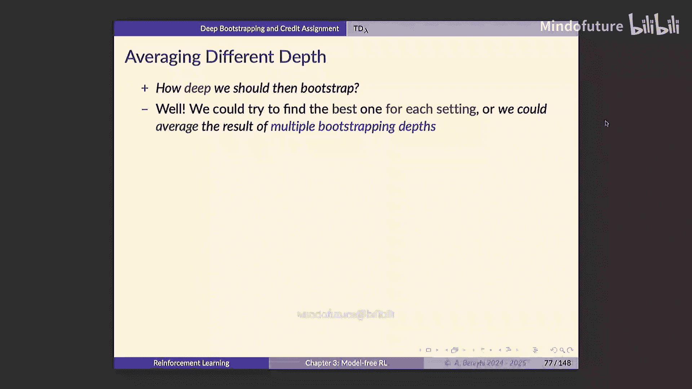

在本节课中，我们将要学习一种结合了蒙特卡洛方法和时序差分方法优势的算法——TD(λ)。我们将探讨如何通过一个参数 λ 来平滑地权衡即时奖励与未来估计，并理解其背后的“信用分配”直觉。最后，我们会介绍其高效的在线实现形式。

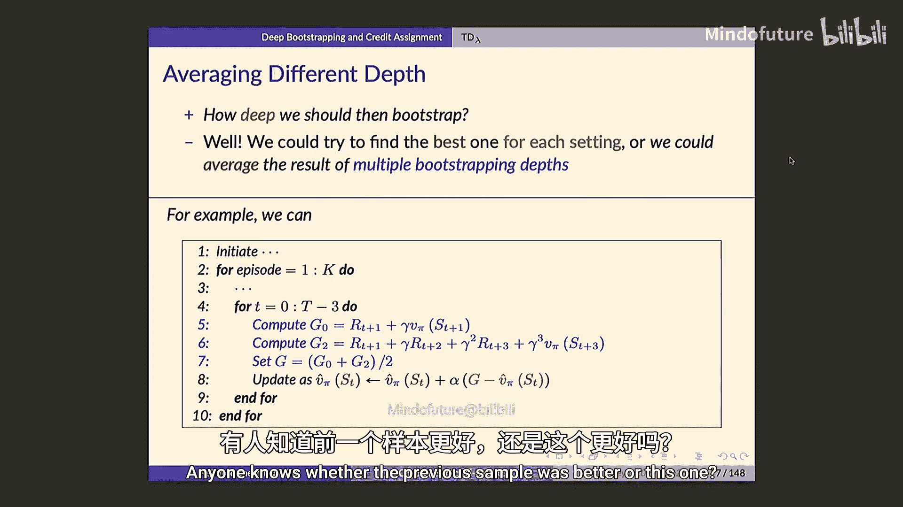

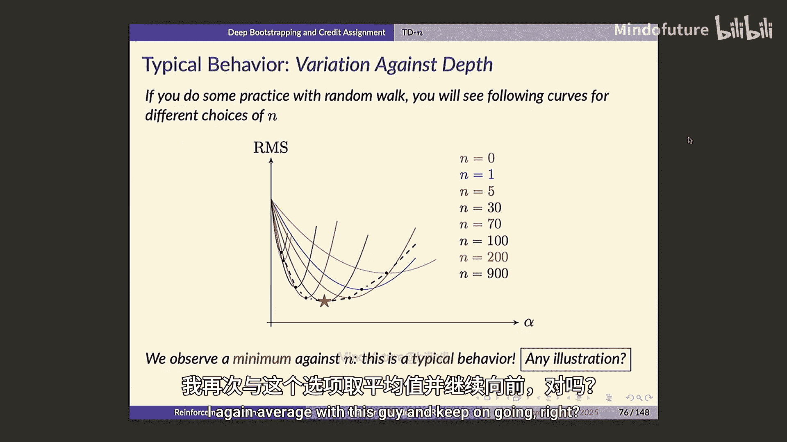

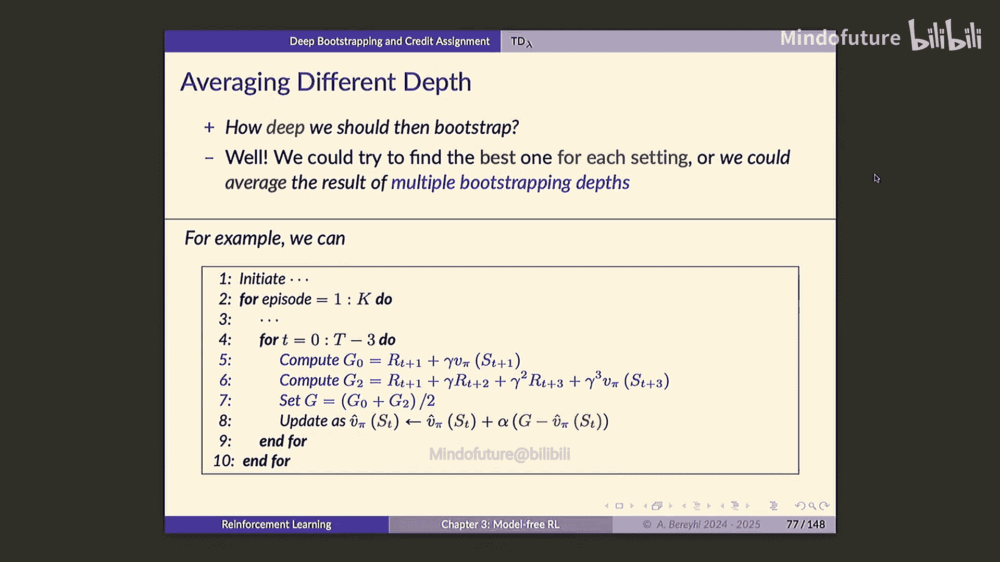

## 多步估计的挑战与平均思想

上一节我们讨论了TD(N)方法，它通过向前看N步来平衡偏差和方差。但如何选择最佳的N值是一个难题。

一个自然的想法是：与其只依赖一个特定的N值，不如考虑多个不同的N值，然后将它们的估计结果进行平均。这样，好的估计和坏的估计可以相互抵消，最终结果可能比单一选择更稳健。

以下是这种平均思想的一个简单示例：
*   假设我们处于轨迹中的某个特定状态。
*   我们可以使用 **TD(0)**，即只考虑下一个时间步：`G_t(0) = R_{t+1} + γ * V(S_{t+1})`。
*   我们也可以使用 **TD(2)**，即向前看两步：`G_t(2) = R_{t+1} + γ * R_{t+2} + γ^2 * V(S_{t+2})`。
*   对于当前状态，我们不知道哪个估计（TD(0)或TD(2)）更好。因此，我们可以将这两个样本（以及可能更多的N值样本）进行平均，并将这个平均值作为我们新的更新目标。

## 引入λ-平均：TD(λ)的核心

为了系统化地实现上述平均思想，并解决在轨迹末端无法进行多步估计的问题，我们引入了TD(λ)方法。它使用一个介于0和1之间的参数λ来进行几何加权平均。

TD(λ)的λ-回报 `G_t^λ` 定义如下：
`G_t^λ = (1 - λ) * Σ_{n=1}^{L-1} [λ^{n-1} * G_t(n)] + λ^{L-1} * G_t(L)`
其中，`G_t(n)` 是标准的n步TD回报，L是当前时刻到轨迹终点的最大步数。

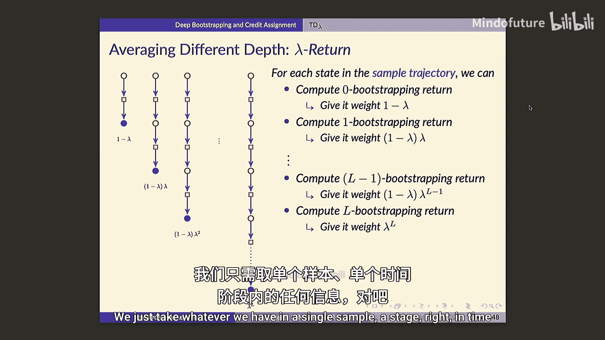

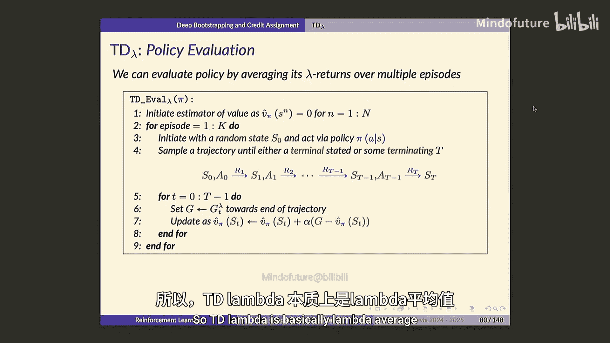

这个公式的核心是**几何衰减的权重**。让我们通过一个小例子来理解它：
*   当 `L=1`（即只看一步）时：`G_t^λ = (1-λ) * G_t(0) + λ * G_t(1)`。这是一个简单的加权平均。
*   当 `L=2`（即最多看两步）时：`G_t^λ = (1-λ) * G_t(0) + (1-λ)λ * G_t(1) + λ^2 * G_t(2)`。
*   可以验证，所有权重（`(1-λ)`, `(1-λ)λ`, `λ^2`）之和为1。

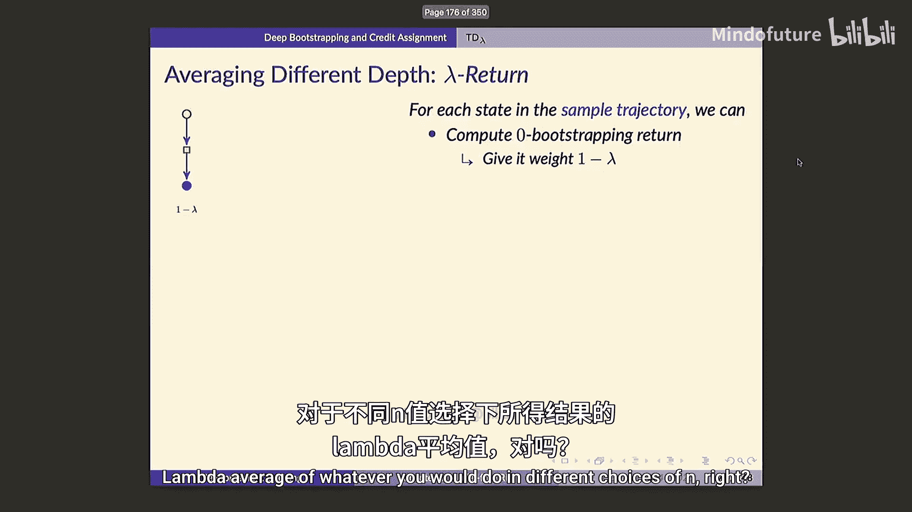

这种设计的精妙之处在于：
1.  **自适应深度**：在轨迹初期，我们可以向前看很多步（L很大）；随着接近终点，L自然减小，直到最后一步只能使用TD(0)。这解决了样本效率问题。
2.  **几何衰减**：对未来的估计赋予的权重按λ的指数衰减。即时下一步的估计权重最大（`1-λ`），越往后的步骤权重越小。这符合“信用分配”的直觉——我们更相信近期、更确定的信息。

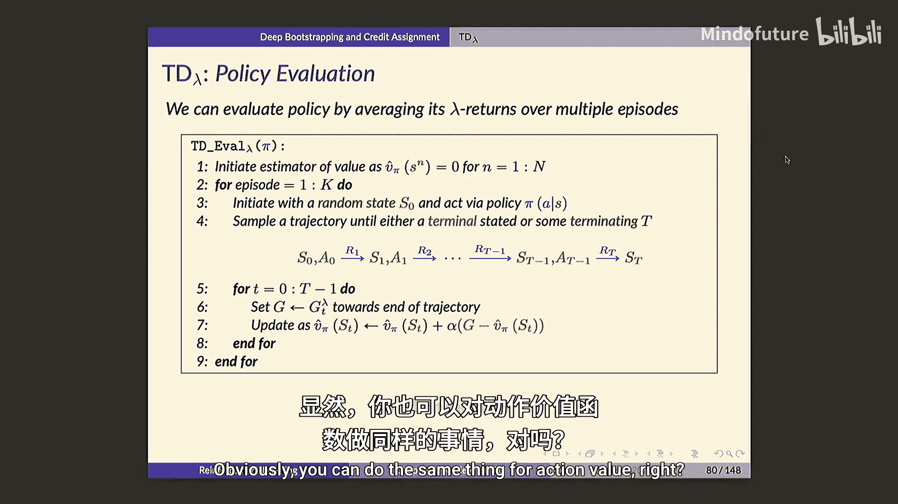

## λ的极端情况与算法意义

λ参数在TD(λ)中扮演着关键角色，它创建了一个从纯TD方法到蒙特卡洛方法的连续谱系。

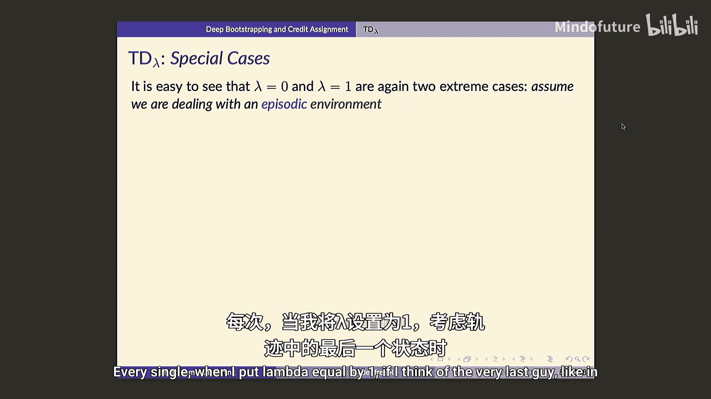

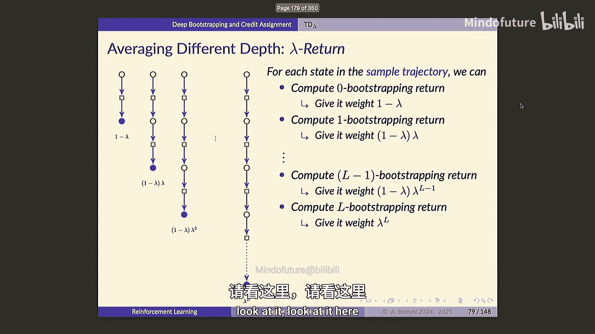

*   **当 λ = 0 时**：
    观察λ-回报公式，所有包含λ的项都会消失。此时 `G_t^λ` 退化为 `G_t(0)`。
    `G_t^λ = R_{t+1} + γ * V(S_{t+1})`
    这正是标准的 **TD(0)** 算法。

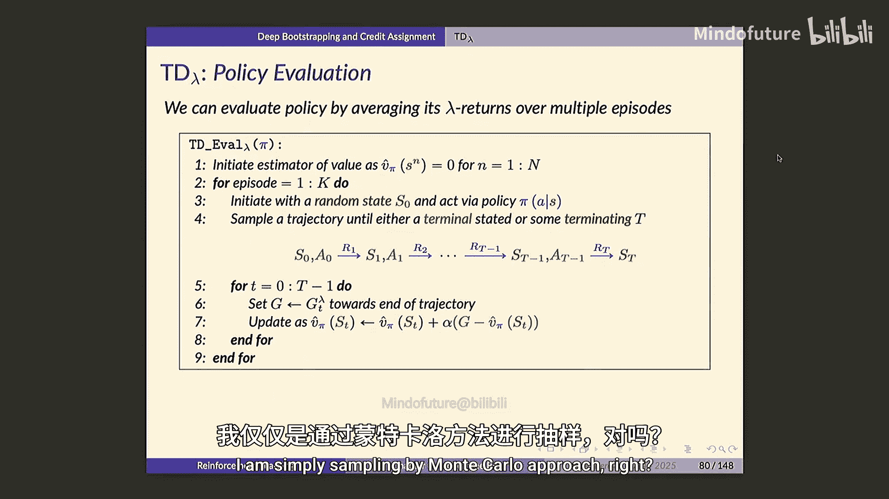

*   **当 λ = 1 时**：
    此时 `(1-λ)=0`，因此只有最后一项 `λ^{L-1} * G_t(L)` 有效，其系数为1。如果轨迹终点 `S_T` 是终止状态（其价值V为0），那么 `G_t(L)` 就是从当前时刻到结束的所有奖励之和。
    `G_t^λ = R_{t+1} + γ * R_{t+2} + ... + γ^{T-t-1} * R_T`
    这正是 **蒙特卡洛** 方法的完整回报。

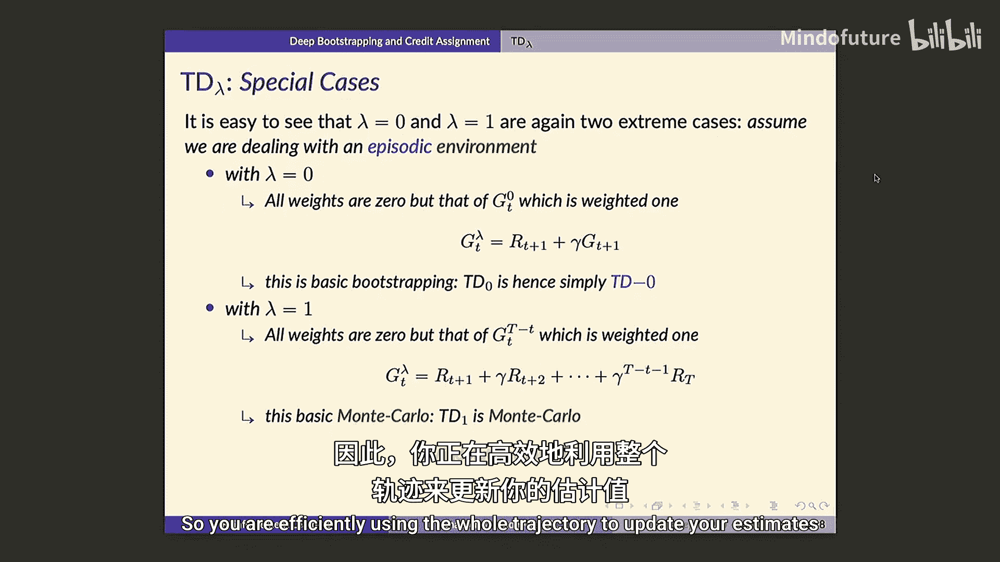

因此，通过调整λ从0到1，我们实际上是在**平滑地调节算法的“视野”**：从只关注下一步的TD(0)，到关注整个回合的蒙特卡洛方法。这比离散地选择TD(N)中的N值更加灵活和精细。

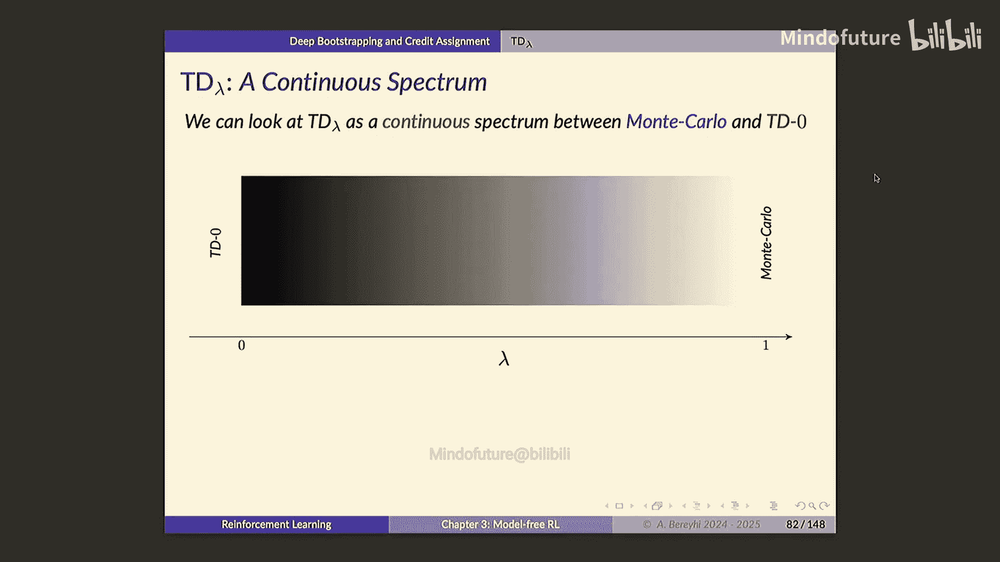

## 信用分配的直觉

TD(λ)中几何衰减的权重设计，体现了一种称为“信用分配”的直觉。

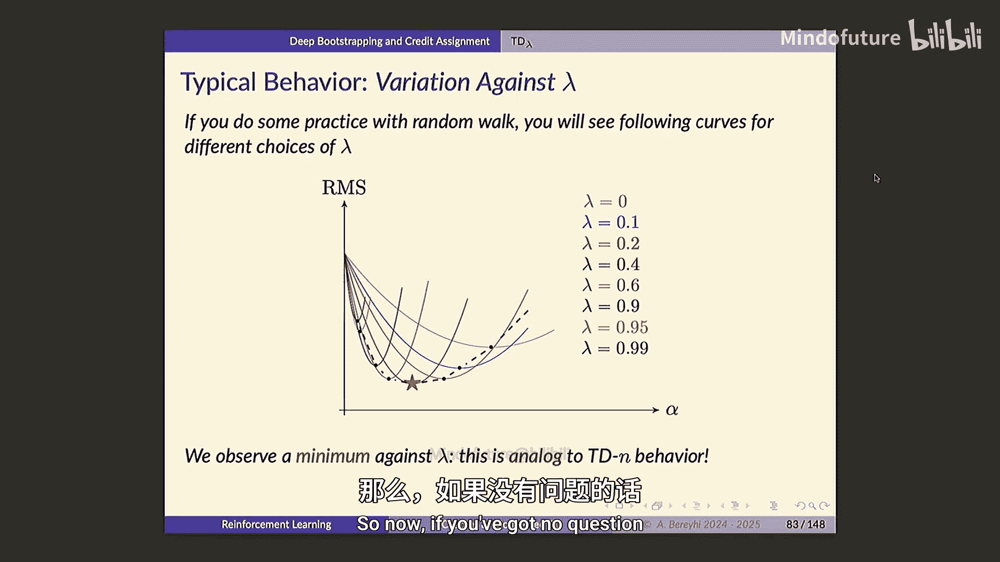

想象你在一个状态 `S_t`，之后会访问一系列状态 `S_{t+1}`, `S_{t+2}`, ...，直到终点。每个后续状态都为你评估当前状态的价值提供了一个“证据”：
*   `S_{t+1}` 的证据最直接、最可靠（权重最高）。
*   `S_{t+2}` 的证据稍远，可靠性稍差（权重是λ倍）。
*   以此类推，越远的未来状态，其证据的权重越低。

这类似于人类决策：我们更看重近期、明确的反馈（如下个月的工资），而对遥远、不确定的回报（如十年后的投资收入）会打折扣。TD(λ)通过λ参数量化了这种“折扣”的程度。

## 前向视图与后向视图：高效的在线算法

我们目前描述的TD(λ)被称为**前向视图**。在时刻t，它需要向前看完整条轨迹的剩余部分，才能计算λ-回报 `G_t^λ`，然后更新 `V(S_t)`。这在计算上是低效的，因为它需要等待未来发生。

幸运的是，TD(λ)有一个完全等价但可以在线、增量式实现的**后向视图**算法。其核心是引入了一个叫做**资格迹（Eligibility Trace）** 的向量 `e_t(s)`，它为每个状态s维护一个“信用度”。

在线TD(λ)算法的更新规则如下：
1.  计算当前时刻的TD误差：`δ_t = R_{t+1} + γ * V(S_{t+1}) - V(S_t)`
2.  更新所有状态的资格迹：`e_t(s) = γ * λ * e_{t-1}(s) + I(S_t = s)` （如果当前状态是s，则增加1，否则按系数衰减）
3.  用TD误差和资格迹更新所有状态的价值：`V(s) ← V(s) + α * δ_t * e_t(s)`， 对所有s

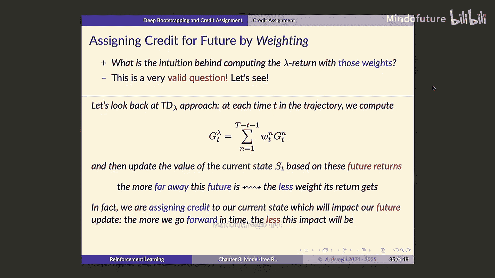

这个算法的美妙之处在于：
*   **在线更新**：每走一步，立即更新，无需等待回合结束。
*   **等效性**：在一定的条件下，这种后向视图的在线更新与前向视图的离线更新在数学上是等价的。
*   **实用性**：著名的SARSA(λ)和Q(λ)算法正是基于这种带资格迹的TD(λ)思想构建的，它们极大地提升了强化学习智能体的学习效率。

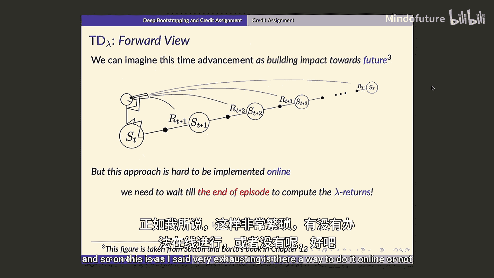

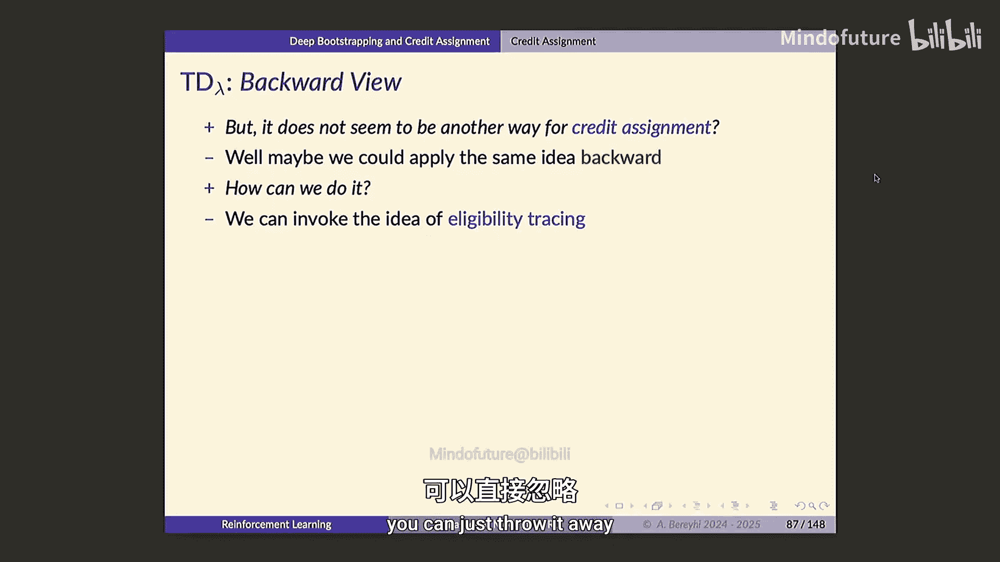

## 总结

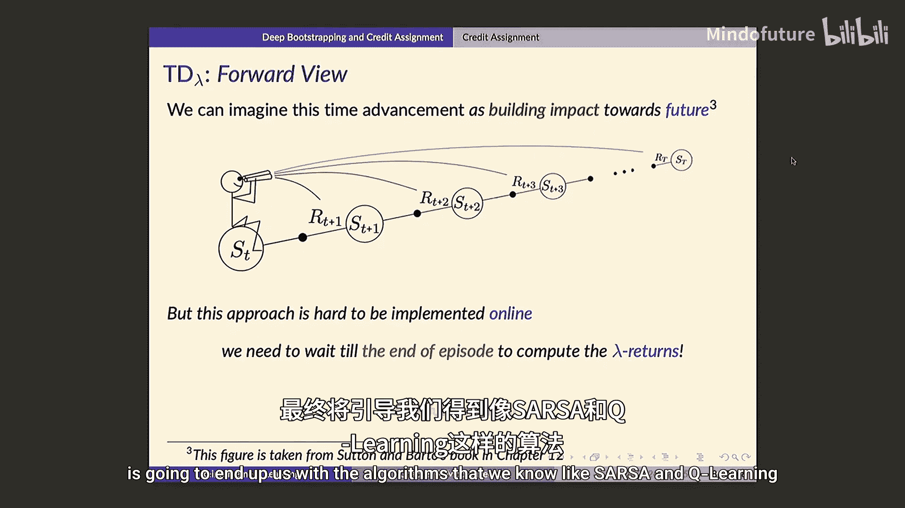

本节课中我们一起学习了TD(λ)方法。我们从多步TD估计的平均思想出发，引出了通过参数λ进行几何加权平均的λ-回报定义。我们理解了λ如何作为桥梁，连接TD(0)和蒙特卡洛方法。更重要的是，我们探讨了其背后的“信用分配”哲学，并介绍了从低效的“前向视图”转换到高效的、基于“资格迹”的“后向视图”在线算法。TD(λ)及其资格迹机制是许多现代强化学习算法的重要基石。