# 028：带资格迹的时序差分 (TD(λ)) 🧠

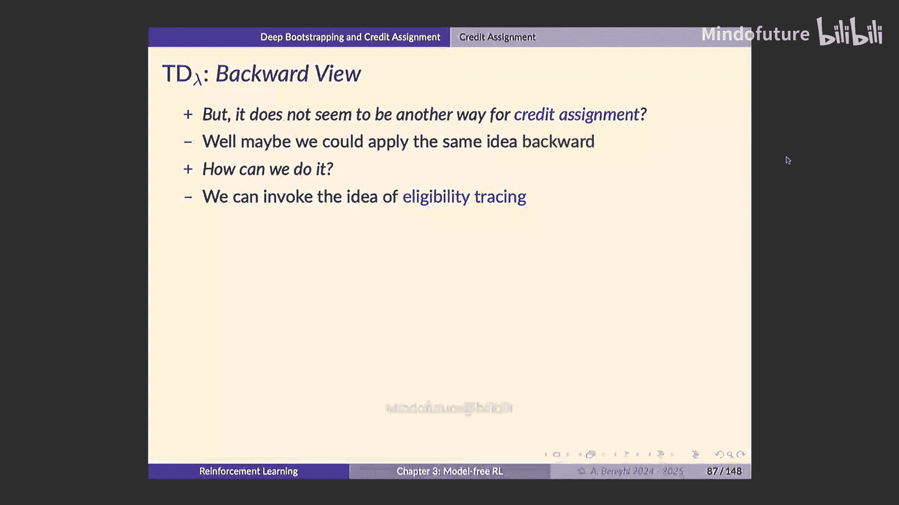

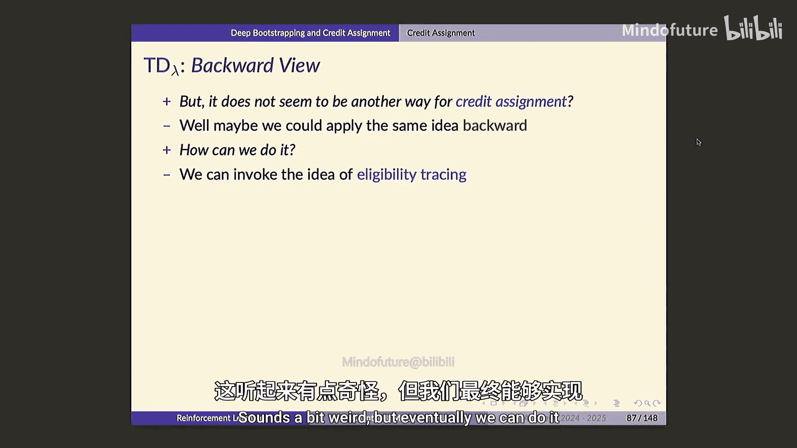

在本节课中，我们将学习一种称为“资格迹”的技术，它是实现时序差分方法 TD(λ) 的一种在线、高效方式。我们将理解资格迹如何通过向后追踪状态访问历史，来实现与向前看的 TD(λ) 相同的效果。

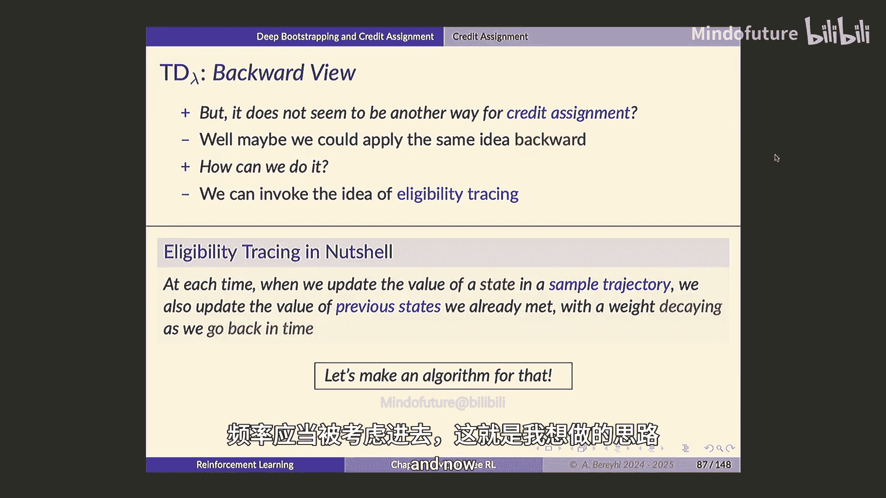

## 核心思想：从“向前看”到“向后看”

上一节我们介绍了 TD(λ) 方法，它通过向前看未来多步的回报来更新当前状态的价值估计。其核心是给未来的估计值赋予不同的权重，离当前时刻越近的估计权重越大，越远的权重越小。

然而，这种“向前看”的方式在在线学习时效率不高，因为要等到一个轨迹结束后才能进行更新。本节中我们来看看如何将这个过程“反过来”，实现一种在线更新的等效算法。

这个反向操作的核心就是**资格迹**。其基本想法是：当我们在时间 `t` 处于状态 `s_t` 时，我们不仅更新 `s_t` 的价值，还会回顾并更新所有之前访问过的状态的价值。但更新幅度会根据该状态被访问的时间远近而衰减：访问时间越近，更新幅度越大；访问时间越远，更新幅度越小。

## 资格迹算法详解

以下是资格迹算法的核心步骤，我们将通过一个简单的网格世界例子来具体说明。

### 资格迹的定义与初始化

首先，我们为环境中的每一个可能的状态 `s` 维护一个**资格迹** `E(s)`。你可以把它想象成一个表格，记录了每个状态的“活跃”或“资格”程度。

*   **初始化**：在开始任何轨迹之前，将所有状态的资格迹设置为 0。
    ```python
    E(s) = 0 for all states s
    ```

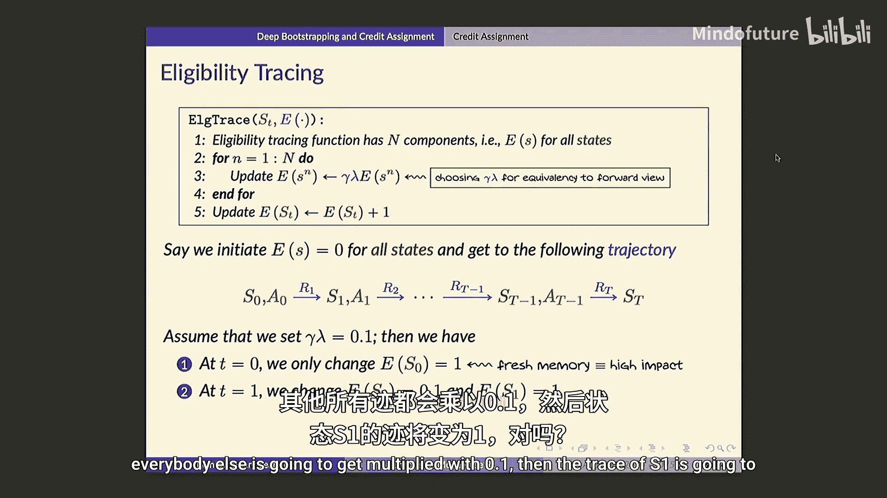

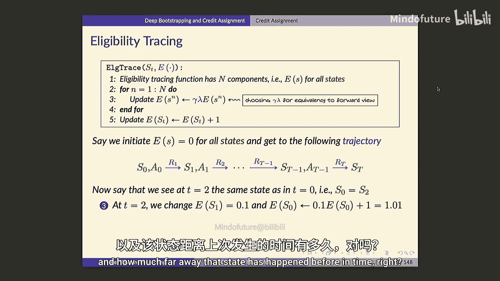

### 资格迹的更新规则

然后，我们开始与环境交互，生成轨迹 `(s_0, a_0, r_1, s_1, a_1, r_2, s_2, ...)`。在每个时间步 `t`，我们执行以下两步操作：

1.  **衰减所有迹**：首先，将**所有状态**的资格迹乘以一个衰减因子 `γ * λ`（其中 `γ` 是折扣因子，`λ` 是 TD(λ) 中的 λ 参数）。这个因子小于 1，意味着所有旧的“资格”都会随时间衰减。
    ```python
    E(s) = (γ * λ) * E(s) for all s
    ```
2.  **增加当前状态的迹**：接着，将当前状态 `s_t` 的资格迹增加 1。这表示当前状态是“最新鲜”的，具有最高的更新资格。
    ```python
    E(s_t) = E(s_t) + 1
    ```

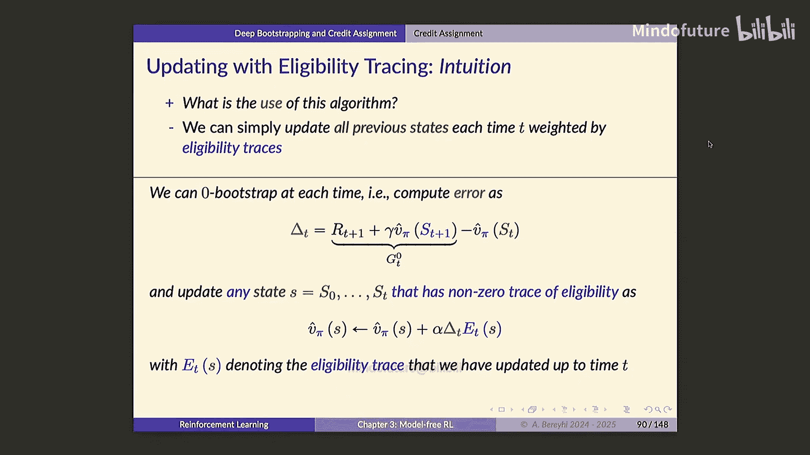

**直观理解**：这个操作就像是在每个状态上留下一个“痕迹”，但这个痕迹会随着时间推移而慢慢消退（乘以小于1的数）。每当再次访问一个状态，就相当于给这个旧痕迹“加墨”，让它重新变清晰一些。因此，一个状态在近期被访问得越频繁，它的资格迹 `E(s)` 值就越高。

### 价值函数的更新

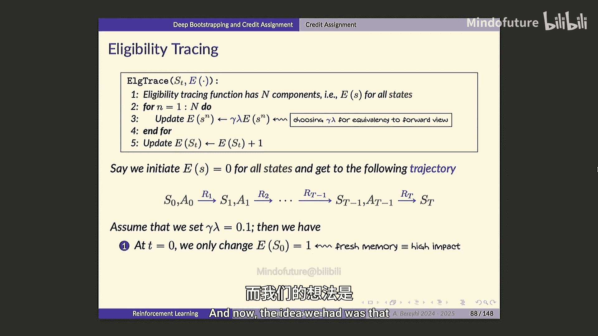

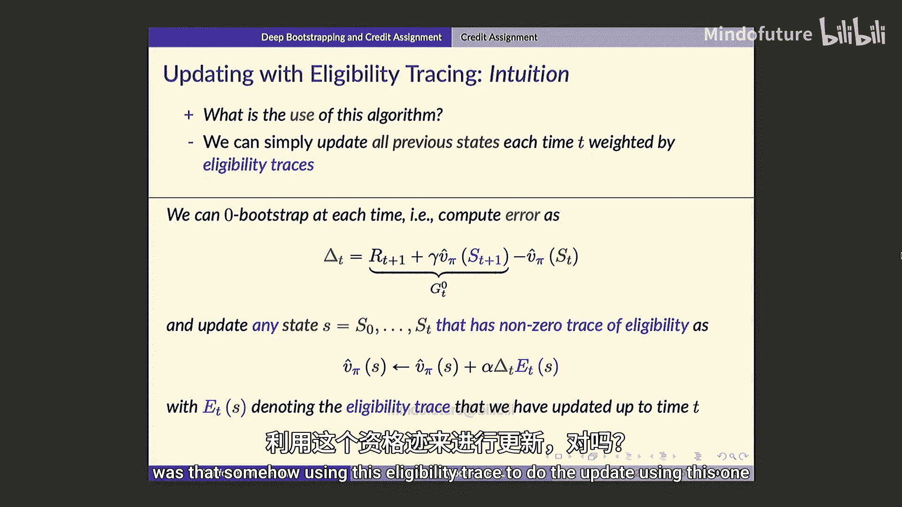

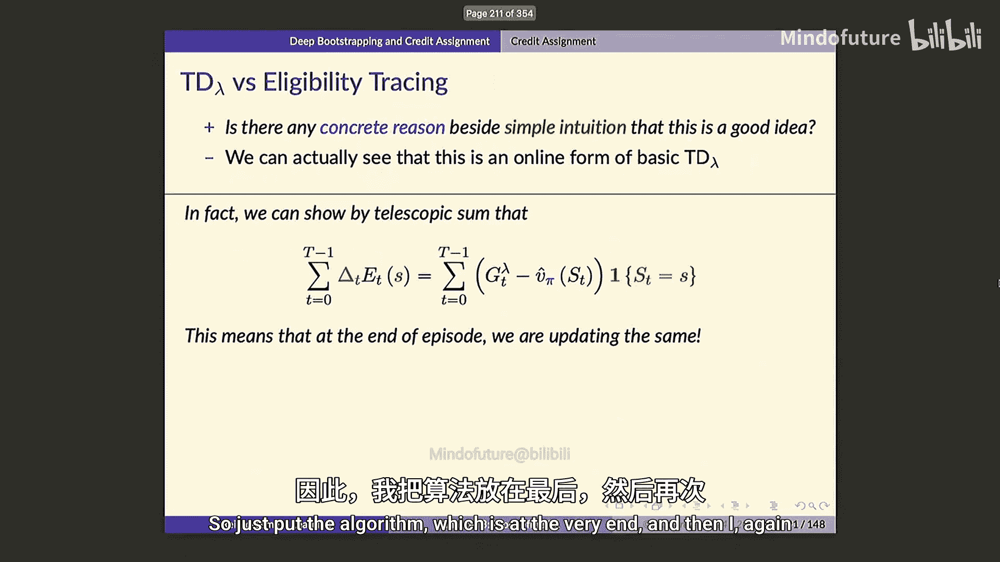

在更新了资格迹之后，我们像 TD(0) 一样计算当前时间步的时序差分误差 `δ_t`：
```python
δ_t = r_{t+1} + γ * V(s_{t+1}) - V(s_t)
```
这里 `V(s)` 是状态 `s` 的价值估计。

关键的不同点在于，我们不是只用这个误差 `δ_t` 来更新当前状态 `s_t` 的价值，而是用它来更新**所有状态**的价值，更新幅度与各状态的资格迹 `E(s)` 成正比：
```python
V(s) = V(s) + α * δ_t * E(s) for all states s
```
其中 `α` 是学习率。

**这意味着什么？** 当前时刻得到的新的回报信息 (`δ_t`) 会像涟漪一样向后传播，更新所有之前访问过的状态。一个状态在近期被访问得越多（`E(s)` 越大），它从当前新信息中获得的更新幅度就越大。这与 TD(λ) 中给近期的回报估计更高权重的思想是完全一致的。

## 算法流程总结

将以上步骤整合，就得到了完整的在线资格迹 TD(λ) 算法（用于策略评估）：

1.  初始化价值函数 `V(s)` 和资格迹 `E(s)`（通常全为0）。
2.  对每个回合（轨迹）：
    *   初始化状态 `s`。
    *   将本回合中所有状态的资格迹 `E(s)` 置为 0。
    *   对于本回合中的每个时间步 `t`：
        a. 执行动作，观测奖励 `r_{t+1}` 和下一个状态 `s_{t+1}`。
        b. 计算 TD 误差：`δ = r_{t+1} + γ * V(s_{t+1}) - V(s)`。
        c. **更新当前状态的资格迹**：`E(s) = E(s) + 1`。（注意：有些算法表述将“加1”放在衰减之后，效果等价）
        d. **对所有状态 `s‘`**：`V(s’) = V(s‘) + α * δ * E(s’)`。
        e. **衰减所有资格迹**：对所有状态 `s’`，`E(s‘) = γ * λ * E(s’)`。
        f. 将状态设置为下一个状态：`s = s_{t+1}`。

## 与 TD(λ) 的等价性

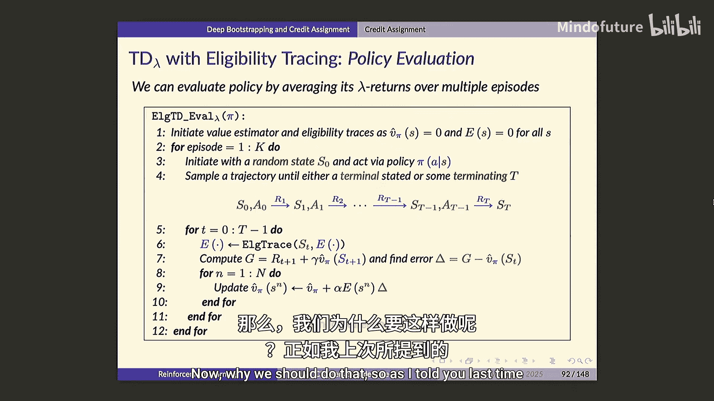

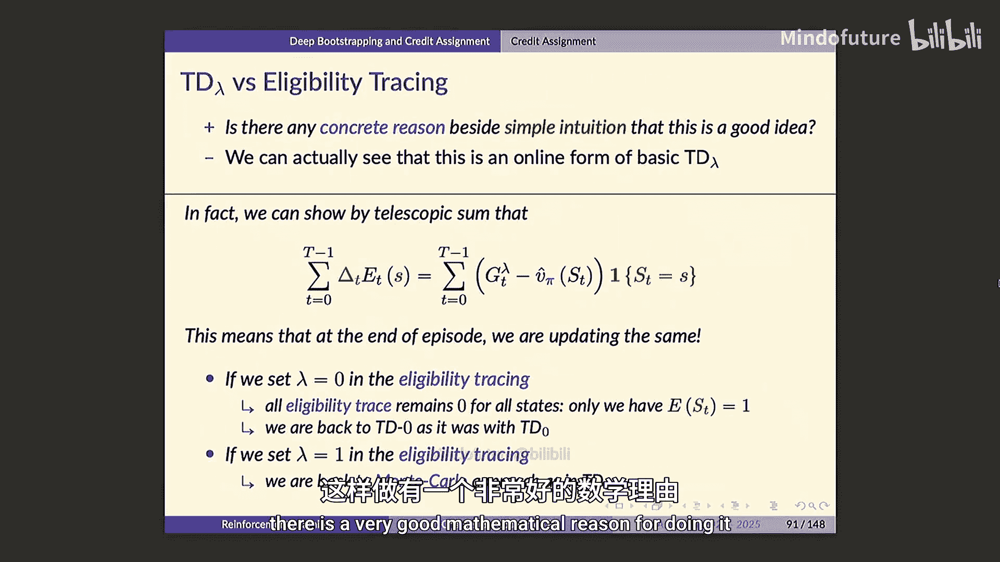

虽然资格迹算法看起来是“向后看”的在线更新，而原始的 TD(λ) 是“向前看”的离线更新，但数学上可以证明，**在一个完整的轨迹结束后，这两种方法对价值函数产生的总更新量是完全相同的**。

资格迹算法的优势在于它是**在线**的：你可以在每个时间步立即进行更新，而不需要等待整个轨迹结束。这使得它更适用于持续学习或非回合制的任务。

## 本节课总结

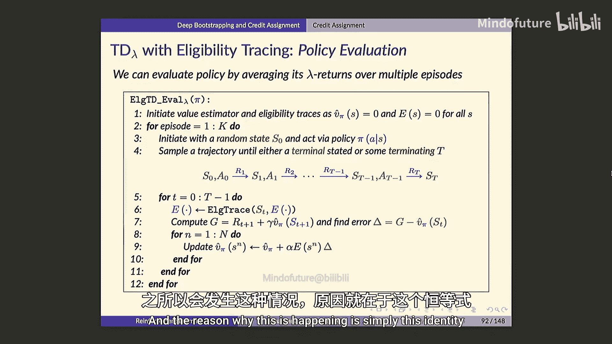

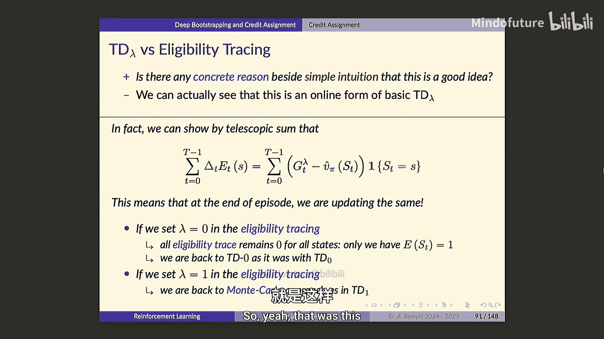

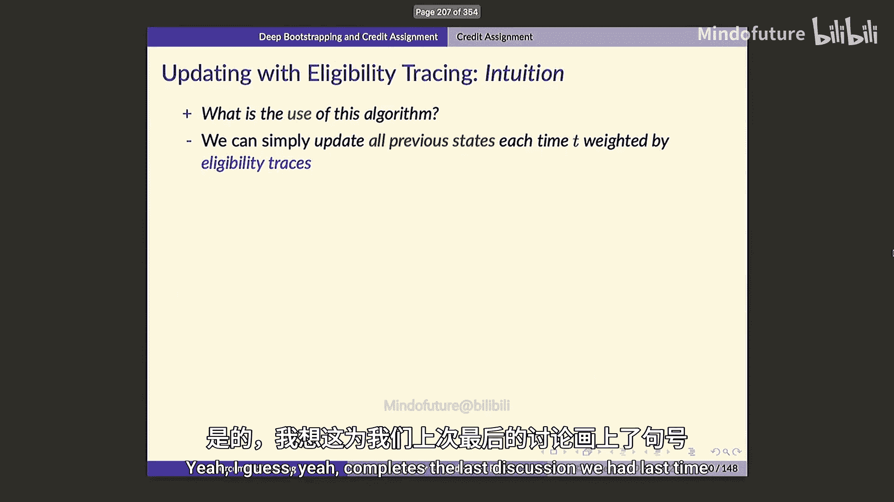

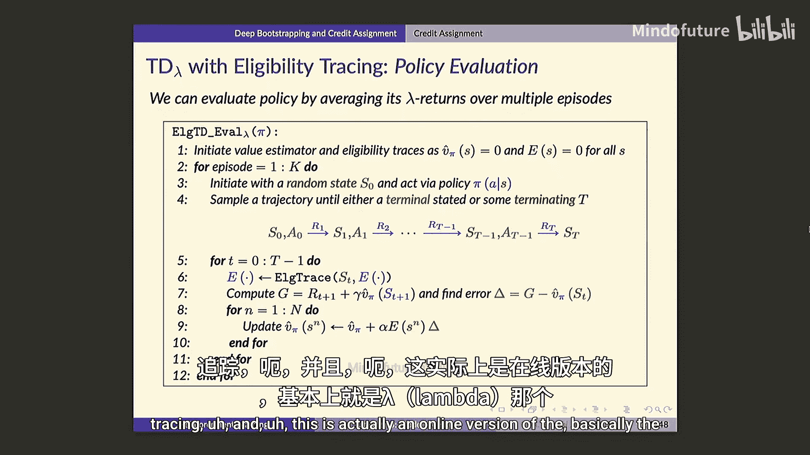

本节课中我们一起学习了强化学习中的资格迹技术。

*   我们首先回顾了 TD(λ) 向前进行多步信用分配的思想。
*   接着，我们引入了资格迹 `E(s)` 的概念，它记录每个状态根据其近期访问频率应获得的更新资格。
*   我们详细讲解了资格迹算法的每一步：初始化、随时间衰减、对当前状态加1，以及如何利用资格迹和 TD 误差来同时更新所有状态的价值。
*   最后，我们理解了资格迹算法本质上是 TD(λ) 的一种在线实现形式，两者在数学上是等价的，但资格迹算法允许更高效、更即时的学习。

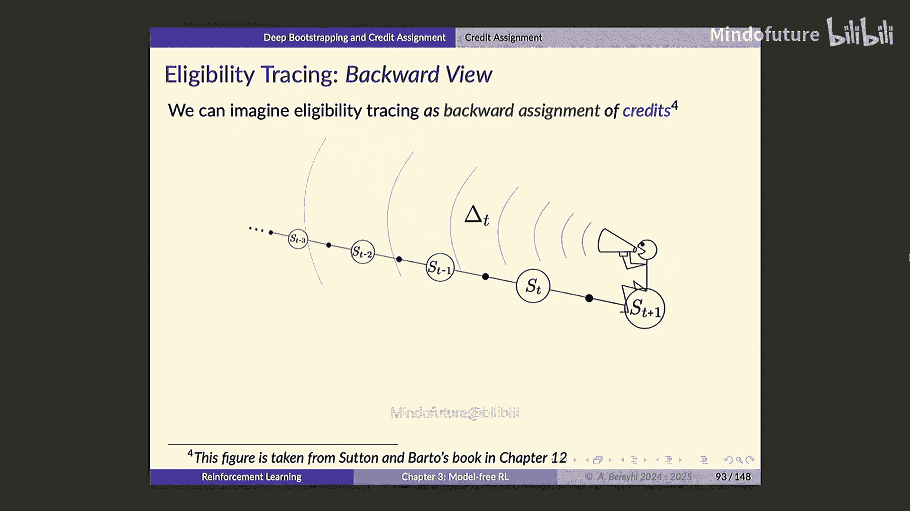

资格迹是连接 TD(0) 和蒙特卡洛方法的重要桥梁，也是许多先进强化学习算法（如 Actor-Critic 框架中的更新）的核心组件。掌握它，将为理解更复杂的算法打下坚实基础。