# 029：蒙特卡洛控制循环 🎲

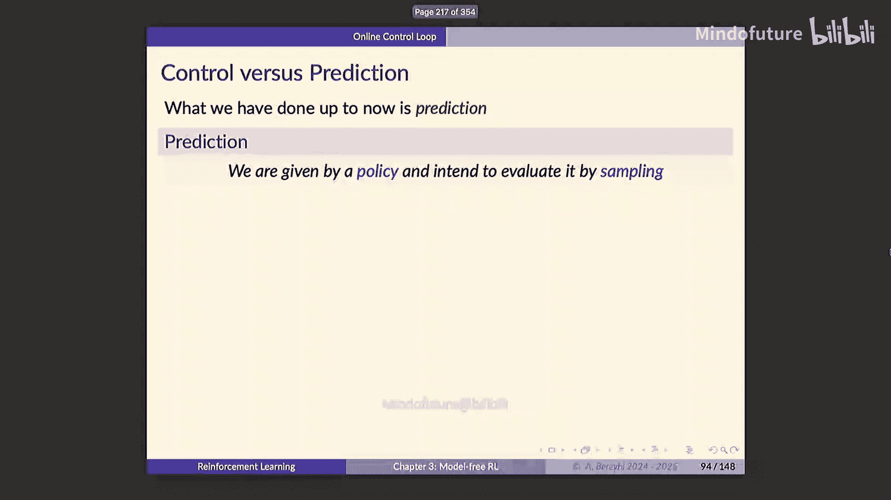

在本节课中，我们将学习如何将之前学到的预测算法转化为控制算法。我们将从理解预测与控制的区别开始，逐步构建一个在线学习的控制循环，并探讨其核心挑战与解决方案。

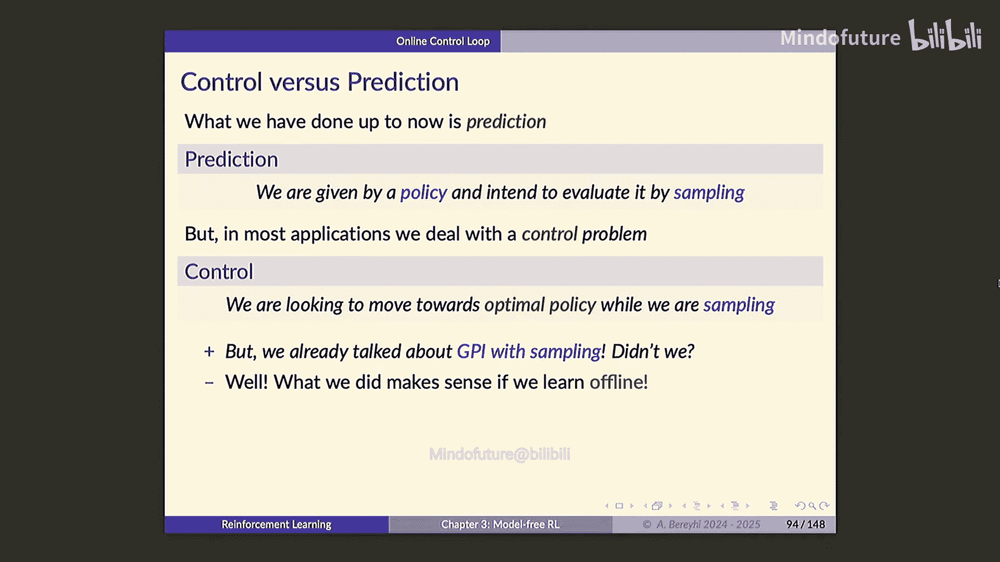

## 概述：从预测到控制

到目前为止，我们学习的内容被称为**预测**。预测是指：给定一个固定的策略 π，让智能体在环境中运行，收集数据，然后评估并估计该策略的状态价值函数 V(s) 或动作价值函数 Q(s, a)。这就像是在“预测”一个既定策略的表现。

然而，强化学习的最终目标是**控制**。控制意味着我们不满足于仅仅评估一个给定的策略，而是希望智能体能够通过与环境的直接交互，自主地学习并最终找到最优策略 π*。这更接近人类或智能机器人的学习方式：我们不会将一个策略尝试成千上万次才去改进它，而是在每一步行动后都尝试获取新的认知，并即时调整行为。

上一节我们介绍了预测算法，本节中我们来看看如何将其转化为控制算法。

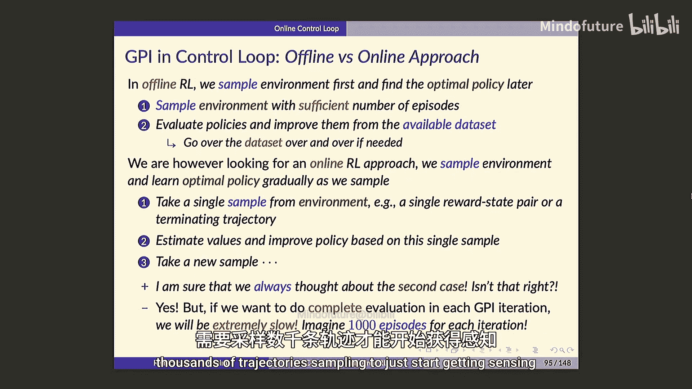

## 广义策略迭代的局限

一个自然的想法是利用**广义策略迭代**框架：
1.  **策略评估**：评估当前策略 π。
2.  **策略改进**：基于评估得到的价值函数，采用贪婪方法改进策略（即，在每个状态选择价值最高的动作）。
3.  重复以上两步，直到策略收敛。

其核心公式是策略改进定理：
`π'(s) = argmax_a Q_π(s, a)`

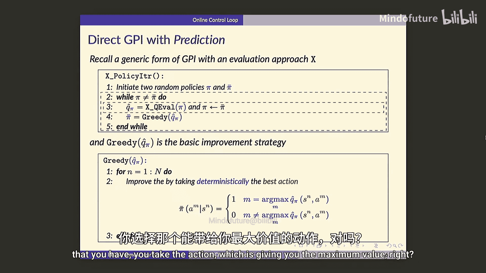

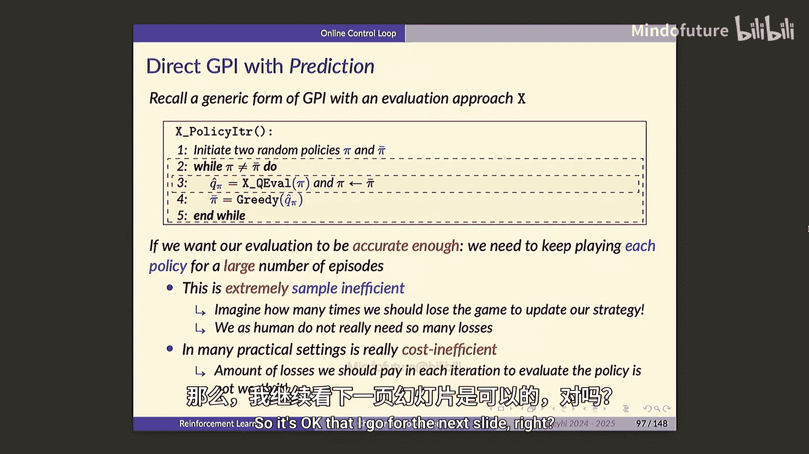

这个框架在理论上是可行的，但它是一种**离线学习**方法。它要求我们在每次策略改进之前，都必须对当前策略进行“彻底”的评估，这可能需要采集海量的样本轨迹。例如，让机器人先随机行动数年以评估一个随机策略，然后才改进一次，这显然不切实际。

我们真正需要的是**在线学习**：智能体在每一步行动后，都能利用即时获得的奖励信息，对价值估计和策略进行微小的、增量的更新。这样，学习过程是渐进且高效的。

## 在线控制的核心思想

那么，如何将广义策略迭代在线化呢？关键在于**交织评估与改进**。

我们不再等待完整的策略评估。假设我们使用某种预测算法（如蒙特卡洛或时序差分）来估计动作价值函数 Q。在在线学习中：
1.  智能体根据当前策略 π，在状态 `s_t` 执行动作 `a_t`。
2.  观察到奖励 `r_{t+1}` 并转移到新状态 `s_{t+1}`。
3.  利用这个新的样本 `(s_t, a_t, r_{t+1}, s_{t+1})`，立即更新动作价值估计 `Q(s_t, a_t)`。
4.  **关键步骤**：一旦 Q 值被更新，我们立即基于更新后的 Q 表来改进策略（例如，转为贪婪策略）。下一次行动将遵循这个新的、改进后的策略。

这个过程可以概括为：**“评估一步，改进一步”**。它模仿了人类学习的过程：小孩学走路时，迈出一步摔倒了（获得负奖励），他会立即更新对“那个迈步方式”的价值判断，并在下一次尝试时调整动作。

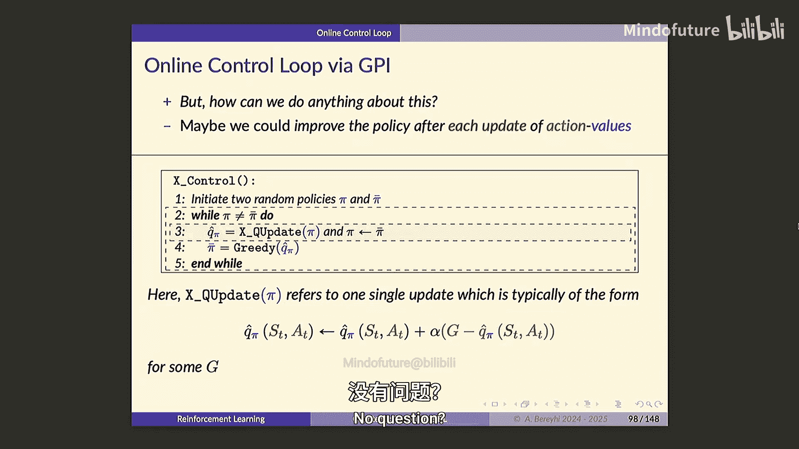

以下是这个在线控制循环的抽象描述：
```
初始化 Q(s, a) 和策略 π
对于每一个时间步：
    根据当前策略 π，在状态 S 选择动作 A
    执行动作 A，观察奖励 R 和下一状态 S'
    使用样本 (S, A, R, S') 更新 Q(S, A)  # 例如用 MC 或 TD 更新
    基于更新后的 Q 表，改进策略 π (例如，令 π(s) = argmax_a Q(s, a))
```

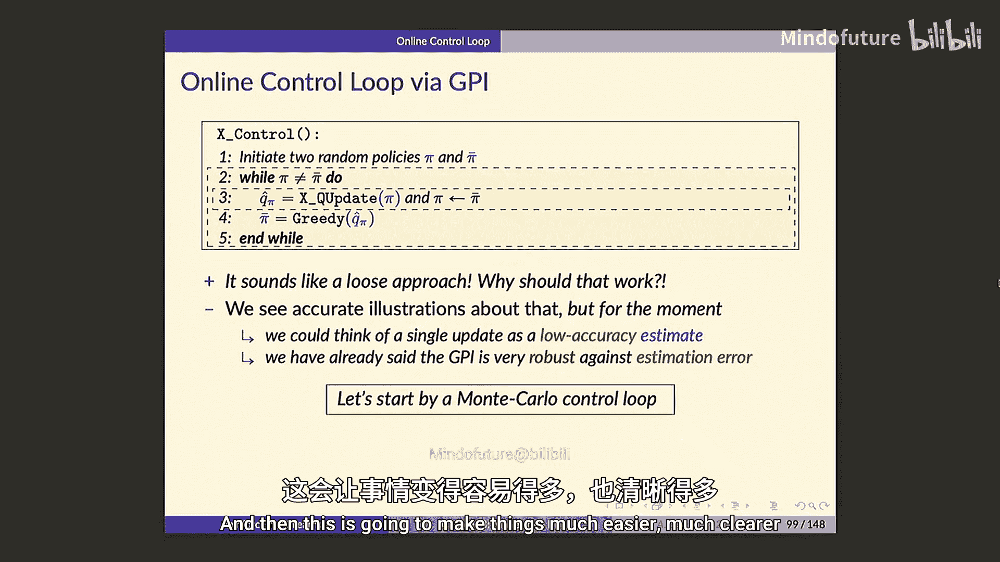

## 蒙特卡洛控制循环

让我们以最简单的**蒙特卡洛**预测方法为例，将其具体化为一个控制算法。

蒙特卡洛控制算法（首次访问）流程如下：

以下是算法步骤：
1.  初始化：对所有 `s ∈ S, a ∈ A(s)`，任意初始化 `Q(s, a)`；初始化策略 `π` 为关于 `Q` 的贪婪策略。
2.  循环（对每一个回合）：
    1.  根据策略 `π` 生成一个回合序列：`S0, A0, R1, ..., S_{T-1}, A_{T-1}, R_T`。
    2.  `G ← 0`
    3.  对回合中的每一步 `t = T-1, T-2, ..., 0`：
        *   `G ← γG + R_{t+1}`
        *   如果 `(S_t, A_t)` 在 `S0, A0, ..., S_{t-1}, A_{t-1}` 中未出现过：
            *   将 `G` 加入 `Returns(S_t, A_t)`。
            *   `Q(S_t, A_t) ← average(Returns(S_t, A_t))`。
    4.  对回合中出现的每个状态 `S_t`：
        *   `π(S_t) ← argmax_a Q(S_t, a)`。

与单纯的蒙特卡洛评估相比，控制循环的关键区别在于**第4步**。在评估中，我们使用同一个策略 π 采集多个回合来更新 Q。而在控制中，我们每完成**一个回合**，就用这个回合更新得到的 Q 表立即生成一个新的贪婪策略 π’，并用它来采集下一个回合。

这就像玩一个游戏：玩完一局后，你反思哪些走法是错的（更新Q值），下一局你就尝试采用你认为更好的走法（更新策略）。

## 贪婪控制的挑战：探索与利用

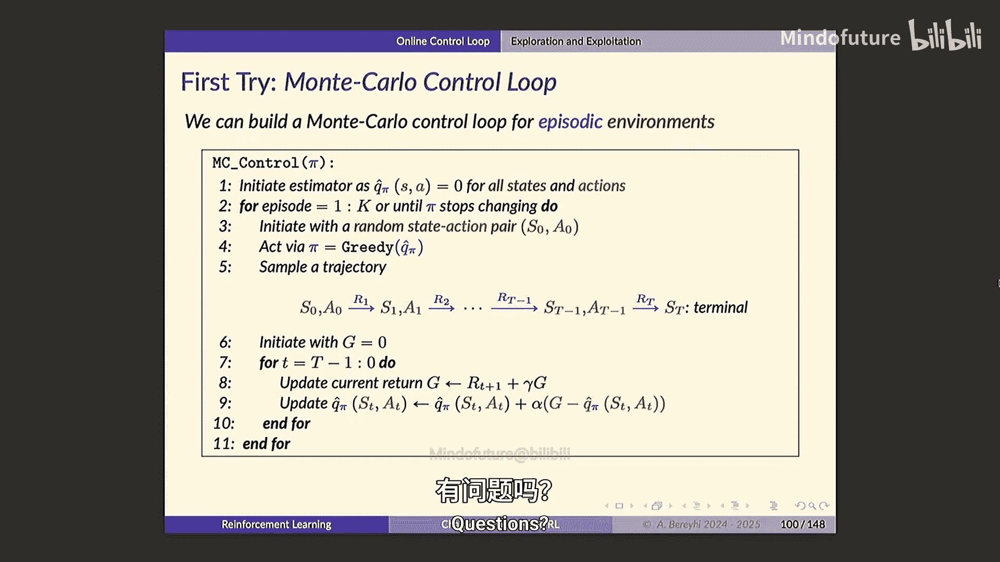

然而，上述简单的“贪婪”控制循环存在一个严重问题：它可能无法收敛到最优策略。

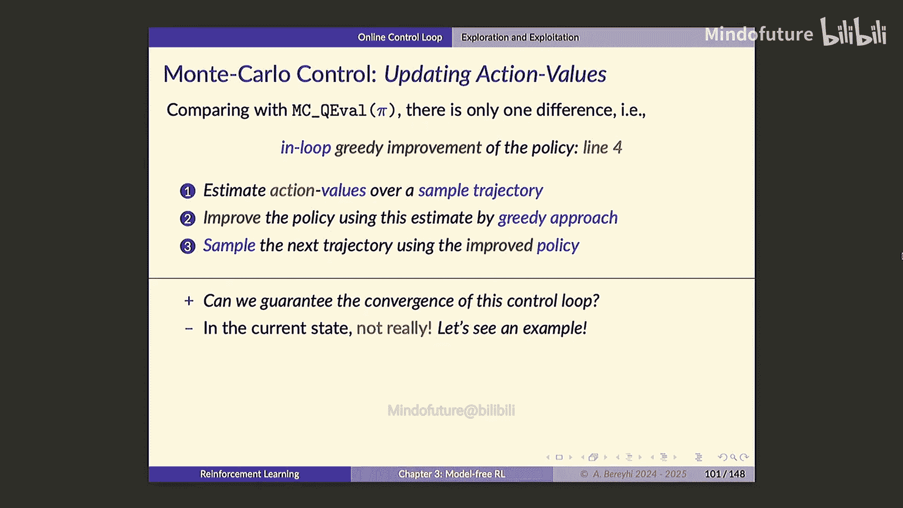

考虑一个没有状态的多臂老虎机问题：两个动作（A公司、B公司），A公司平均工资更高。智能体初始Q值全为0。
1.  首次随机选择，去了B公司，获得工资150。更新后，`Q(B)=150`，`Q(A)=0`。
2.  基于贪婪策略，下一次必然选择B公司。
3.  从此，智能体将永远选择B公司，再也**不会尝试**A公司，因而永远无法发现A公司更好。

问题根源在于**缺乏探索**。贪婪策略只**利用**当前已知的、看起来最好的动作，而放弃了**探索**其他可能更好的动作。如果初始样本有偏差，或者某些状态-动作对从未被访问，智能体就会陷入局部最优。

## 解决方案：引入探索机制

要解决这个问题，我们必须修改策略改进步骤，让策略在大多数时候利用当前知识的同时，仍以一定概率进行探索。

一个经典且有效的方法是 **ε-贪婪策略**：
*   以 **1-ε** 的概率选择贪婪动作（即 `argmax_a Q(s, a)`）。
*   以 **ε** 的概率随机选择所有动作中的任何一个。

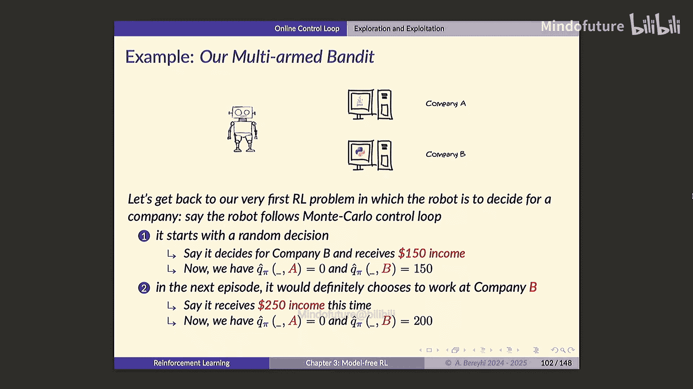

其策略更新公式可以表示为：
`π(a|s) = { 1 - ε + ε/|A(s)|, if a = argmax_a‘ Q(s, a’)； ε/|A(s)|, otherwise }`

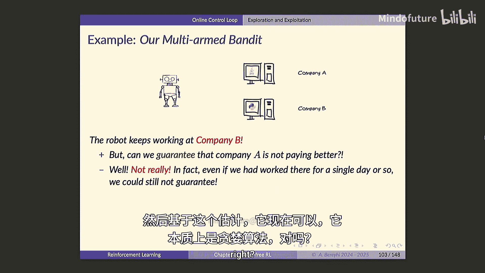

通过引入这个小的随机探索概率 ε，我们保证了在无限步的学习后，每个状态-动作对都会被访问无限次。这满足了收敛到最优策略的理论条件。在下一讲中，我们将详细探讨 ε-贪婪策略及其在控制算法中的应用。

## 总结

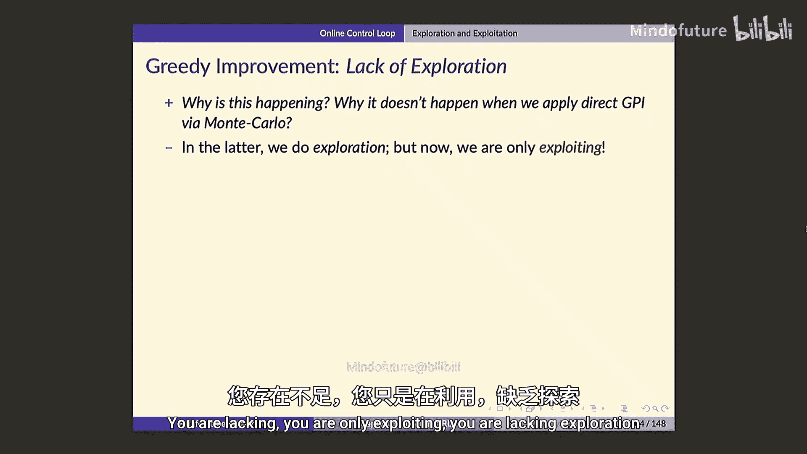

本节课中我们一起学习了：
1.  **预测与控制的区别**：预测是评估给定策略，控制是寻找最优策略。
2.  **在线控制的核心思想**：将广义策略迭代在线化，实现“评估一步，改进一步”的增量学习。
3.  **蒙特卡洛控制循环**：每完成一个回合，立即用其数据更新Q值并改进策略，然后开始新回合。
4.  **贪婪控制的局限性**：纯粹的贪婪改进会导致智能体缺乏探索，可能陷入局部最优策略。
5.  **解决方案的方向**：需要通过如 ε-贪婪策略等方法，在策略中引入探索机制，平衡利用与探索。

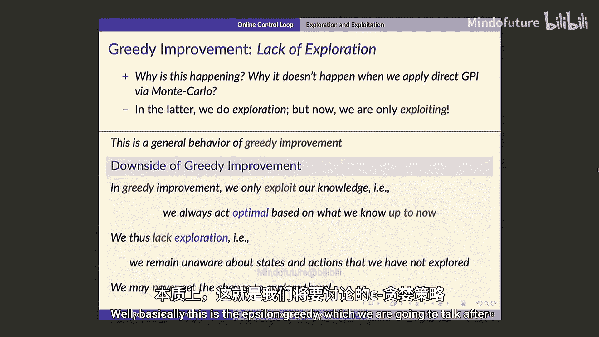

理解这个基本的控制循环框架以及探索-利用的权衡，是学习所有高级强化学习控制算法（如Q-learning, SARSA）的重要基础。