# 031：通过SARSA实现同策略强化学习 🎯

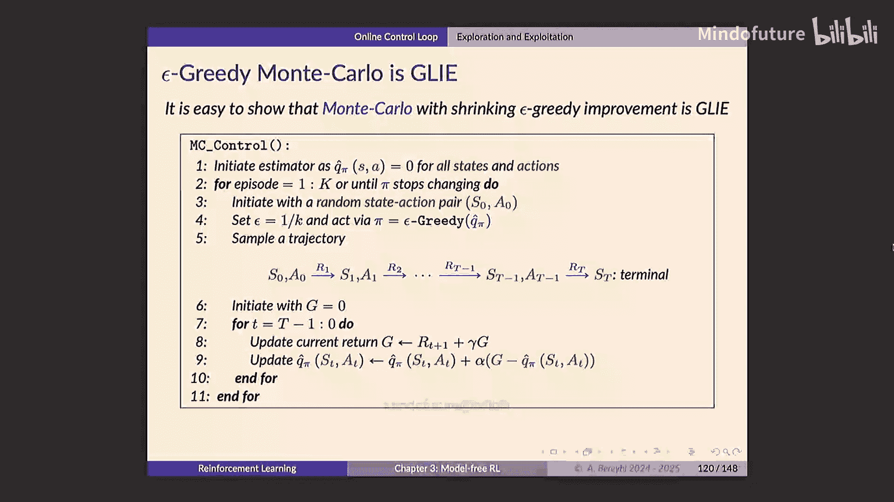

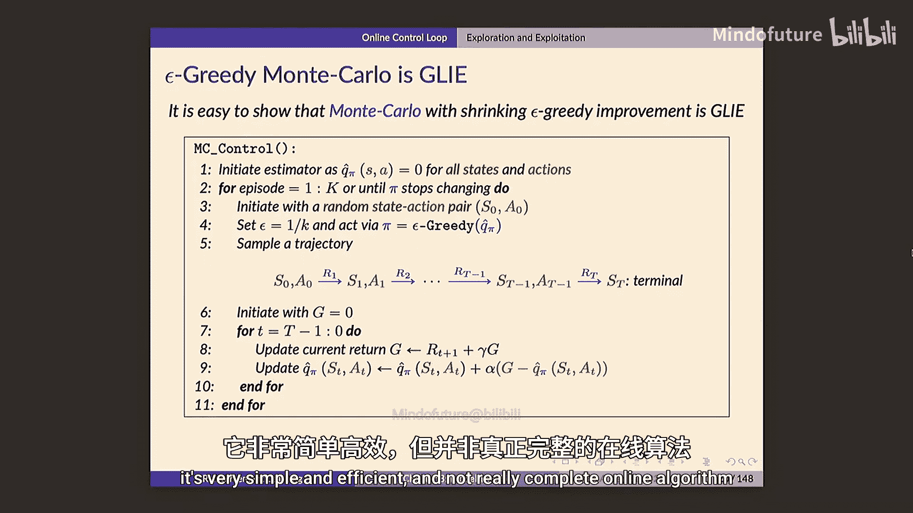

在本节课中，我们将学习如何将时序差分（TD）方法应用于控制问题，并深入探讨一个核心的同策略（On-policy）算法——SARSA。我们将从基础概念开始，逐步构建出SARSA及其更高效的变体SARSA(λ)的完整理解。

## 概述

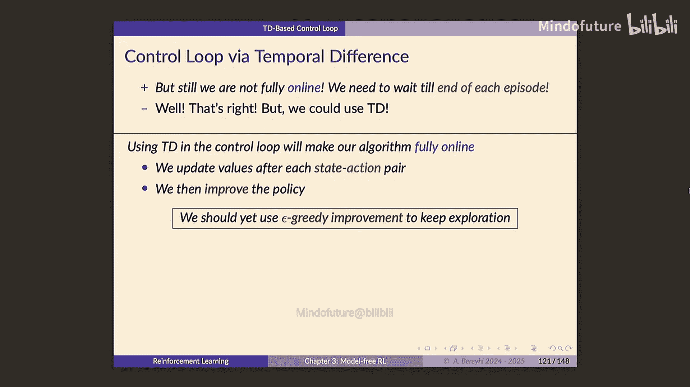

上一节我们讨论了蒙特卡洛方法在控制问题上的应用。本节中，我们来看看如何利用时序差分（TD）方法实现一个完全在线的、同策略的强化学习算法。我们将重点介绍SARSA算法，并解释其名称的由来、工作原理以及如何通过资格迹（Eligibility Traces）进行高效扩展。

## 从蒙特卡洛到时序差分（TD）

蒙特卡洛方法虽然直观，但在实践中存在效率问题。其主要缺点是需要等待一个完整的轨迹结束后才能进行更新，这并非真正的在线学习。

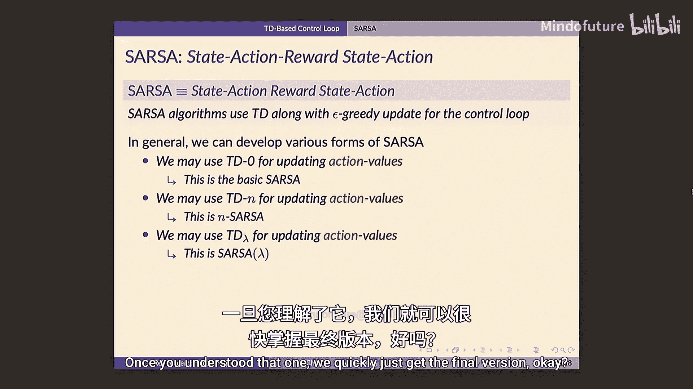

**公式：蒙特卡洛更新**
`G_t = R_{t+1} + γR_{t+2} + γ^2R_{t+3} + ...`
`V(S_t) ← V(S_t) + α [G_t - V(S_t)]`

对于一个实时控制系统（如电站），我们无法承受让系统执行随机策略直到发生多次事故后才学习到正确行为。我们希望训练过程能够持续在线进行。

因此，我们必须转向时序差分（TD）方法。TD方法的核心优势在于，它可以在每个时间步之后立即进行更新。

**公式：TD(0)更新**
`V(S_t) ← V(S_t) + α [R_{t+1} + γV(S_{t+1}) - V(S_t)]`

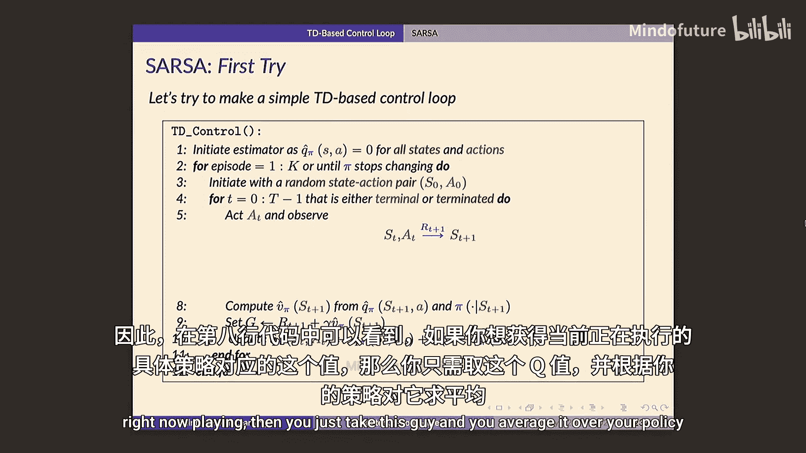

由于价值函数的更新发生在每个时间步，我们的策略也可以在每一步之后进行改进。为了避免陷入次优行为，我们将使用ε-贪心策略进行改进。

## SARSA算法基础

我们将要介绍的第一个算法是SARSA。SARSA代表 **状态（State）- 动作（Action）- 奖励（Reward）- 状态（State）- 动作（Action）**，这个顺序揭示了算法的执行流程。

SARSA本质上是用TD方法来估计动作价值函数Q(s, a)，并在每次更新后执行一次ε-贪心策略改进。

我们可以使用不同形式的TD方法：
*   使用TD(0)：即最基本的SARSA。
*   使用TD(N)：即N步SARSA。
*   使用TD(λ)：即SARSA(λ)。

在实践中，最有效的是SARSA(λ)。为了便于理解，我们将从最基本的版本开始讲解。

### SARSA(0) 算法流程

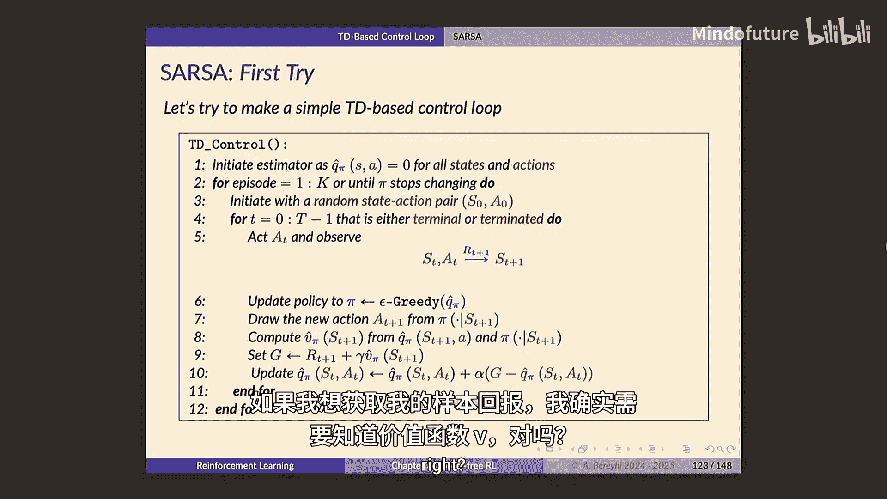

以下是SARSA(0)算法的伪代码描述。我们将逐步拆解其含义。

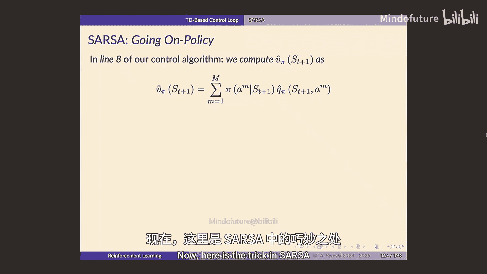

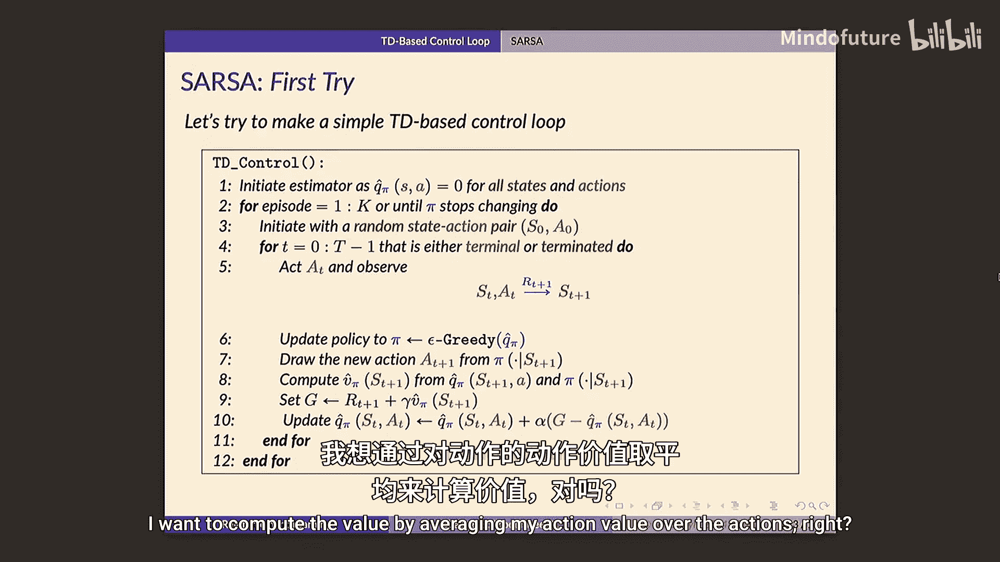

**代码：SARSA(0) 伪代码**
```
1: 初始化 Q(s, a) 为任意值（例如全零）
2: 对于每个回合（episode）：
3:    初始化状态 S
4:    根据当前策略π（如ε-贪心）选择动作 A
5:    当状态 S 非终止状态时：
6:        执行动作 A，观察奖励 R 和下一状态 S‘
7:        根据当前Q值，用ε-贪心更新策略π
8:        根据新策略π，在状态 S‘ 选择动作 A’
9:        δ = R + γ * Q(S‘, A’) - Q(S, A)  # TD误差
10:        Q(S, A) ← Q(S, A) + α * δ       # 更新Q值
11:        S ← S‘, A ← A’                   # 转移到下一状态-动作对
```

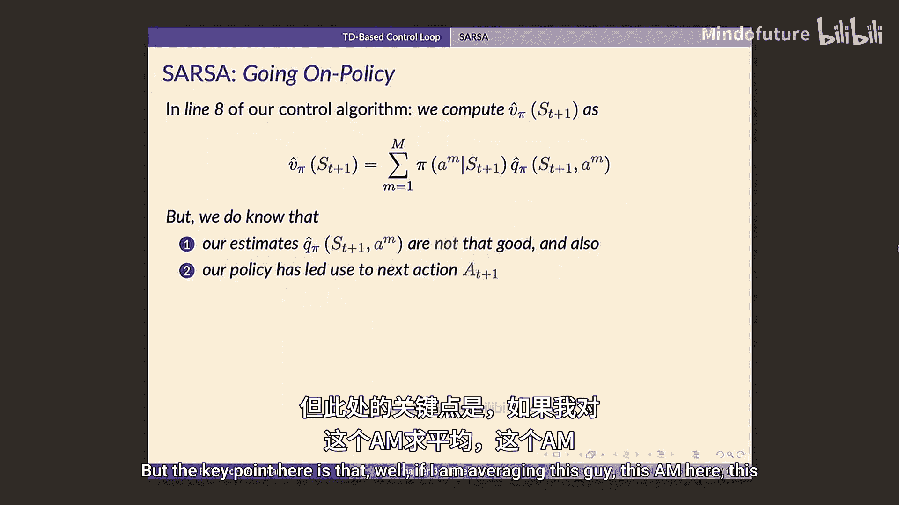

让我们详细分析这个流程：

1.  **初始化**：我们从对Q函数一无所知开始（例如全零）。
2.  **开始回合**：进入环境，从一个随机状态开始，并根据初始策略（如随机策略）选择第一个动作。
3.  **循环（核心步骤）**：
    *   **步骤6**：执行上一步选择的动作`A`，环境反馈即时奖励`R`和下一个状态`S‘`。
    *   **步骤7**：利用当前的Q值估计，通过ε-贪心方法**更新**策略π。注意，此时策略已经改变。
    *   **步骤8**：在**新的**状态`S‘`下，根据**刚更新**的策略π选择下一个动作`A’`。至此，我们得到了“状态-动作-奖励-状态-动作”的序列。
    *   **步骤9 & 10**：计算TD误差并更新之前的状态-动作对`(S, A)`的Q值。TD目标值是`R + γ * Q(S‘, A’)`。
    *   **步骤11**：将当前状态和动作更新为`S‘`和`A’`，为下一个时间步做准备。

### 关键点与“同策略”含义

在SARSA中有两个关键点，它们共同定义了“同策略”学习：


1.  **策略更新的时机**：在时间步`t`执行的动作`A_t`是基于**更新前**的策略`π_t`。而在下一个状态`S_{t+1}`选择的动作`A_{t+1}`是基于**更新后**的策略`π_{t+1}`。策略在每一步都在微调。
2.  **TD目标值的计算**：我们使用`Q(S‘, A’)`来估计下一状态`S‘`的价值，而不是对所有可能动作的Q值求期望`V(S‘) = Σ π(a|S‘) * Q(S‘, a)`。这是因为动作`A’`已经根据新策略被实际采样出来了。这种用采样值代替期望值的做法，正是“同策略”学习的精髓：我们使用**正在执行的政策**所产生的样本来进行评估和改进。

**公式：SARSA的TD目标**
`TD Target = R + γ * Q(S‘, A’)`，其中 `A’ ~ π(·|S‘)`

### 基础SARSA的局限性

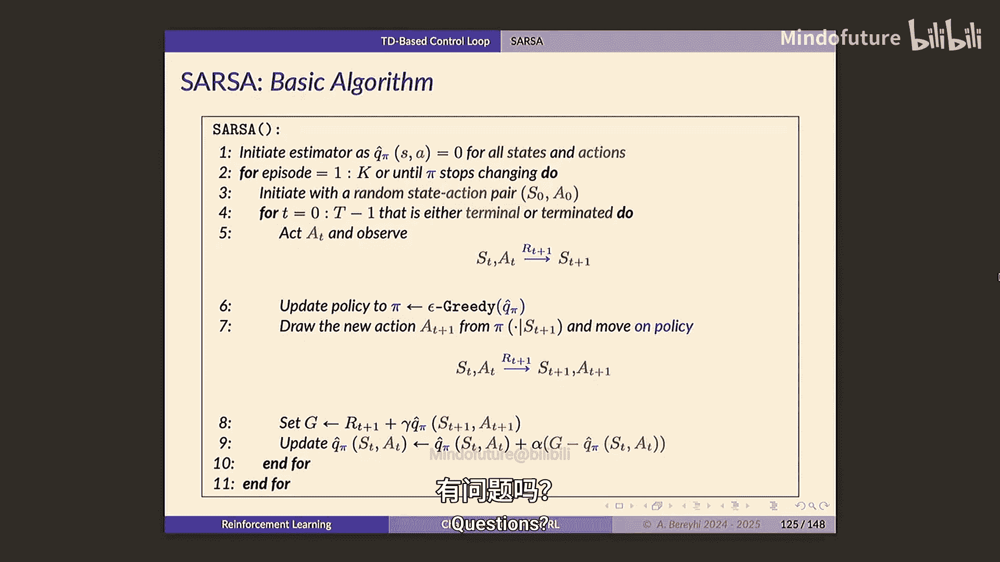

细心的你可能已经发现，在SARSA(0)中，每次循环（第10行）只更新了一个状态-动作对`(S, A)`的Q值。这使得每次更新对整体策略的影响非常微小，学习速度可能很慢。

这正是我们需要引入资格迹（Eligibility Traces）和SARSA(λ)的原因。资格迹可以让我们将当前TD误差反向传播给近期访问过的所有状态-动作对，从而大幅提高学习效率。

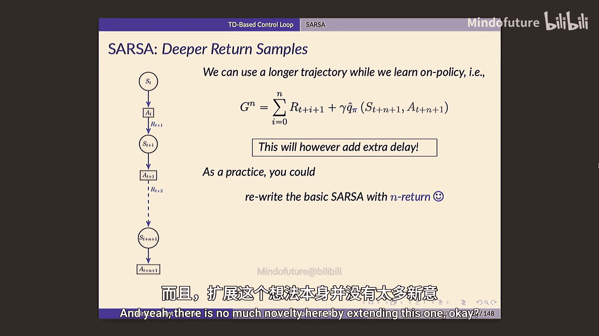

## 引入资格迹：SARSA(λ)

上一节我们介绍了资格迹用于价值函数`V(s)`的估计。现在，我们需要将其扩展到动作价值函数`Q(s, a)`上。

### 动作价值函数的资格迹

思路是相似的，只是将追踪对象从状态`s`变为状态-动作对`(s, a)`。

我们维护一个资格迹表`e(s, a)`，其大小与Q表相同（状态数 × 动作数）。其更新规则如下：

**公式：资格迹更新规则**
`e_t(s, a) = { γλ * e_{t-1}(s, a) + 1, 如果 (s, a) = (S_t, A_t)`
`            { γλ * e_{t-1}(s, a),     其他情况`

**流程解释**：
1.  在每个时间步开始时，所有资格迹先衰减一个因子`γλ`（`γ`是折扣因子，`λ`是迹衰减参数）。
2.  然后，将当前被访问的状态-动作对`(S_t, A_t)`的资格迹增加1。
3.  这样，近期频繁访问的`(s, a)`对会有较高的资格迹，而很久未访问的则趋近于零。

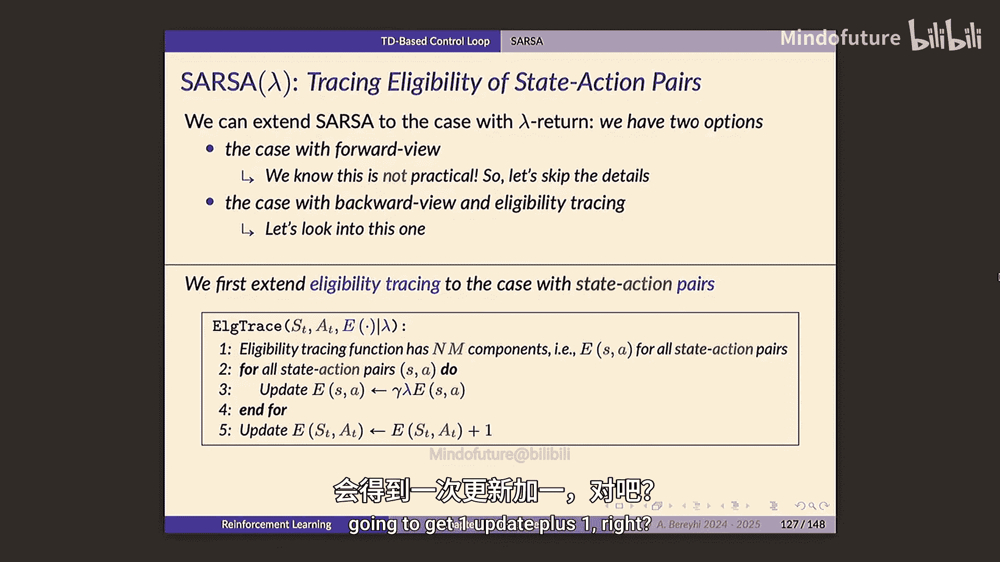

### SARSA(λ) 算法流程

结合了资格迹的SARSA(λ)算法如下：

**代码：SARSA(λ) 伪代码**
```
1: 初始化 Q(s, a) 为任意值， e(s, a) = 0
2: 对于每个回合（episode）：
3:    初始化状态 S
4:    根据策略π选择动作 A
5:    当状态 S 非终止状态时：
6:        执行动作 A，观察奖励 R 和下一状态 S‘
7:        根据当前Q值，用ε-贪心更新策略π
8:        根据新策略π，在状态 S‘ 选择动作 A’
9:        δ = R + γ * Q(S‘, A’) - Q(S, A)  # TD误差
10:       e(S, A) ← e(S, A) + 1            # 增加当前对的资格迹
11:       对于所有的 s, a：
12:           Q(s, a) ← Q(s, a) + α * δ * e(s, a)  # 更新所有Q值
13:           e(s, a) ← γλ * e(s, a)               # 衰减资格迹
14:       S ← S‘, A ← A’                           # 转移
```

**算法解析**：
*   **第9行**：计算当前`(S, A)`对的TD误差`δ`。
*   **第10行**：为当前访问的对`(S, A)`增加资格迹（等效于在衰减后加1）。
*   **第11-13行**：这是核心更新。利用当前的TD误差`δ`和每个状态-动作对的资格迹`e(s, a)`，**同时更新所有Q值**。资格迹`e(s, a)`越大，该`(s, a)`对从当前TD误差中获得的更新就越多。更新后，所有资格迹衰减。
*   这样，一次经验`(S, A, R, S‘, A’)`不仅能更新当前对，还能高效地更新之前访问过的相关状态-动作对，从而加速学习。

## 总结

本节课中，我们一起学习了如何构建一个在线的、同策略的强化学习控制器。

1.  我们首先指出了蒙特卡洛方法在在线学习中的不足，并转向了时序差分（TD）方法。
2.  我们介绍了基础的SARSA算法，它通过“状态-动作-奖励-状态-动作”的顺序，在每个时间步交替执行动作、评估价值和改进策略，实现了同策略学习。
3.  我们分析了基础SARSA(0)每次只更新一个状态-动作对的局限性。
4.  最后，我们引入了资格迹的概念，并将其从状态价值估计扩展到动作价值估计，从而得到了更强大的SARSA(λ)算法。SARSA(λ)通过资格迹将TD误差高效地分配给近期访问过的状态-动作对，极大地提升了学习速度和样本效率。

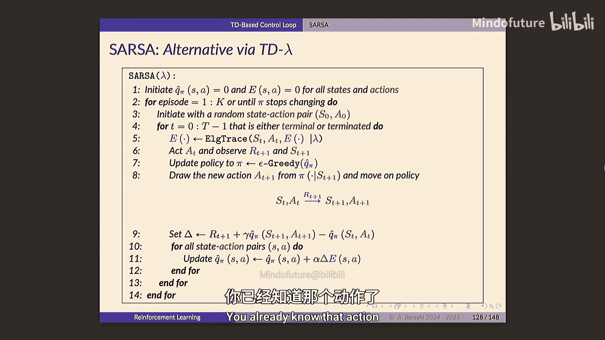

SARSA(λ)结合了TD学习的即时性和资格迹的多步更新能力，是实践中非常有效的同策略强化学习算法。