# 032：通过重要性采样实现异策略强化学习 🎯

在本节课中，我们将要学习异策略强化学习的概念，并重点介绍其核心工具——重要性采样。我们将探讨如何利用从一个策略收集的数据来评估或改进另一个策略，并理解其背后的数学原理。

## 什么是异策略学习？🤔

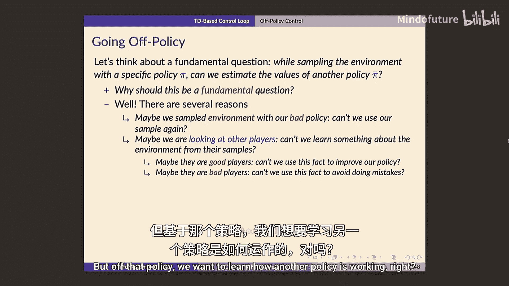

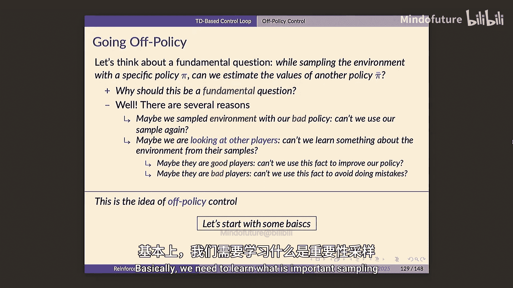

上一节我们介绍了同策略方法，例如SARSA。在同策略学习中，我们使用并更新的策略是同一个。具体来说，我们使用策略π与环境交互，收集数据，然后用这些数据来更新同一个策略π。最终，我们希望这个不断更新的策略能收敛到最优策略。

那么，一个根本性的问题是：我们是否必须进行同策略学习？能否基于一个策略（行为策略）产生的数据来学习另一个策略（目标策略）？这就是异策略学习的核心思想。

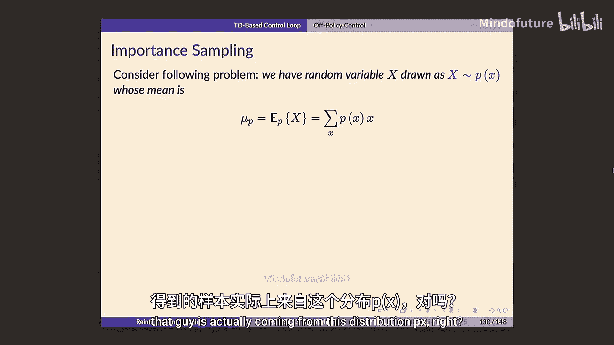

以下是异策略学习在实践中的重要性：
*   **从多样经验中学习**：我们不仅可以从表现完美的专家那里学习，也可以从表现不佳的个体那里学习，通过观察错误行为来避免重蹈覆辙。
*   **适应性学习**：我们可能借鉴他人的策略思路，但需要将其调整以适应自身的特点和方式。

因此，异策略学习允许我们利用来自其他策略（无论好坏）的经验样本来学习目标策略。

## 重要性采样基础 📊

为了实现异策略学习，我们需要一个关键工具：重要性采样。这是一种统计学方法，用于估计一个分布下的期望值，而使用的样本却来自另一个分布。

假设我们有一个随机变量 **X**，它服从分布 **P(X)**。我们想计算 **X** 在分布 **P** 下的期望值：
`μ_P = E_P[X]`
如果我们从分布 **P** 中采样 **K** 个独立同分布的样本 `{x_1, ..., x_K}`，那么蒙特卡洛估计为：
`μ_P ≈ (1/K) * Σ_{i=1}^{K} x_i`

现在，问题来了：如果我们想计算 **X** 在另一个分布 **Q(X)** 下的期望值 `μ_Q = E_Q[X]`，但我们只有来自分布 **P** 的样本，该如何估计？

我们可以通过数学变换来实现：
`μ_Q = E_Q[X] = Σ_x x * Q(x) = Σ_x x * (Q(x)/P(x)) * P(x) = E_P [ X * (Q(X)/P(X)) ]`

这个公式就是重要性采样的核心。它告诉我们，要估计分布 **Q** 下的期望，我们可以使用来自分布 **P** 的样本，但需要对每个样本 `x_i` 乘以一个**重要性权重** `Q(x_i)/P(x_i)`，然后再进行平均：
`μ_Q ≈ (1/K) * Σ_{i=1}^{K} x_i * (Q(x_i)/P(x_i))`

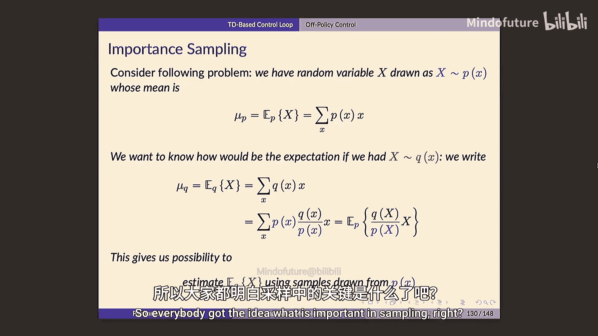

关于重要性采样，有几点需要注意：
*   **需要已知分布**：我们必须知道分布 **P** 和 **Q**（或至少知道它们的比值），才能计算重要性权重。在强化学习中，策略就是分布，我们通常知道或可以计算策略的概率。
*   **估计方差可能增大**：重要性采样并非没有代价。如果 **P** 在某个区域概率很小而 **Q** 在该区域概率很大，那么重要性权重 `Q/P` 会非常大，导致估计的方差增大。因此，当行为策略 **P** 与目标策略 **Q** 差异很大时，估计效果可能不佳。

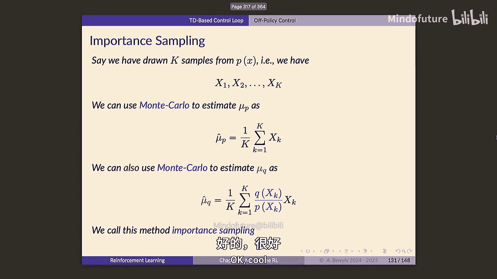

## 将重要性采样应用于强化学习轨迹 🛤️

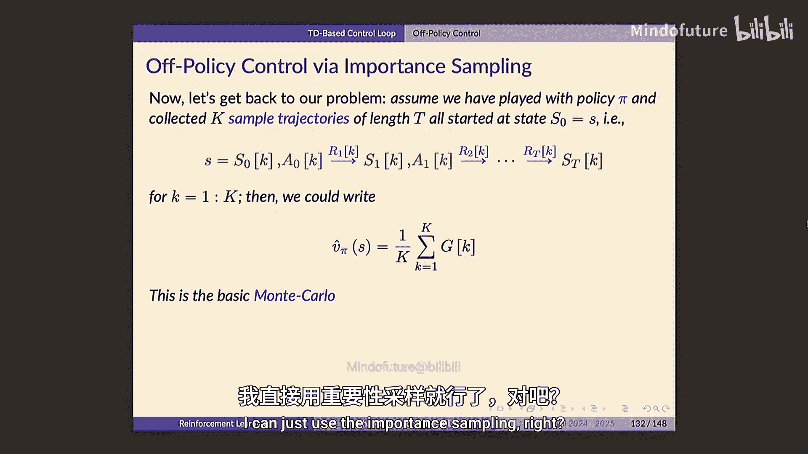

现在，让我们将重要性采样应用到强化学习问题中。假设我们使用策略 **π**（行为策略）与环境交互，生成了一条轨迹：
`τ = (S_0, A_0, R_1, S_1, A_1, R_2, ..., S_T)`
这条轨迹出现的概率（在策略 **π** 下）为：
`P(τ|π) = P(S_0) * π(A_0|S_0) * P(S_1|S_0, A_0) * π(A_1|S_1) * ...`

我们使用这条轨迹计算得到了一个回报 `G(τ)`。通常，我们可以用这个回报来估计策略 **π** 的价值（同策略评估）。

异策略评估的目标是：**利用这条从策略 π 采样的轨迹，来估计另一个策略 π̄（目标策略）的价值**。

根据重要性采样的思想，我们需要计算目标策略下轨迹出现的概率与行为策略下轨迹出现概率的比值。计算这个比值：

`重要性权重 ρ = P(τ|π̄) / P(τ|π) = [π̄(A_0|S_0) * π̄(A_1|S_1) * ...] / [π(A_0|S_0) * π(A_1|S_1) * ...]`

可以发现，初始状态分布 `P(S_0)` 和环境转移概率 `P(S_{t+1}|S_t, A_t)` 在分子分母中完全相同，因此被约去。最终，重要性权重简化为**轨迹中每个状态-动作对的目标策略概率与行为策略概率的比值之积**。

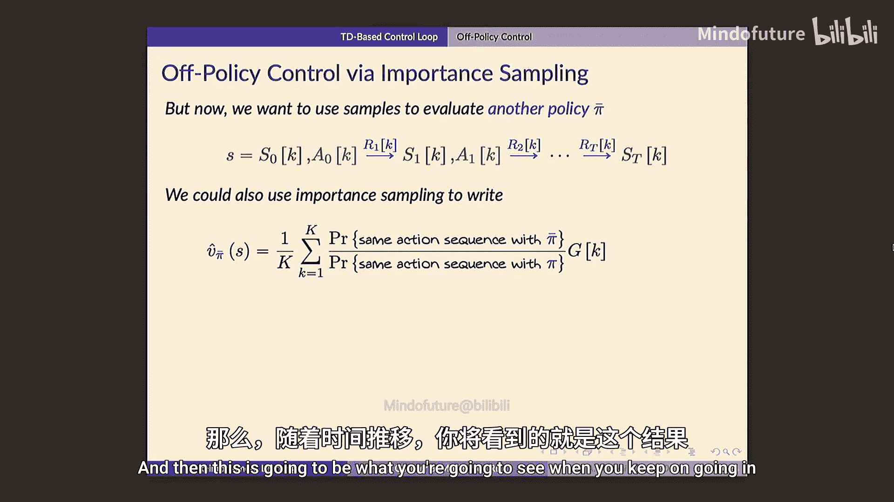

因此，策略 **π̄** 的价值估计为：
`V(π̄) ≈ G(τ) * ρ = G(τ) * Π_{t=0}^{T-1} [π̄(A_t|S_t) / π(A_t|S_t)]`

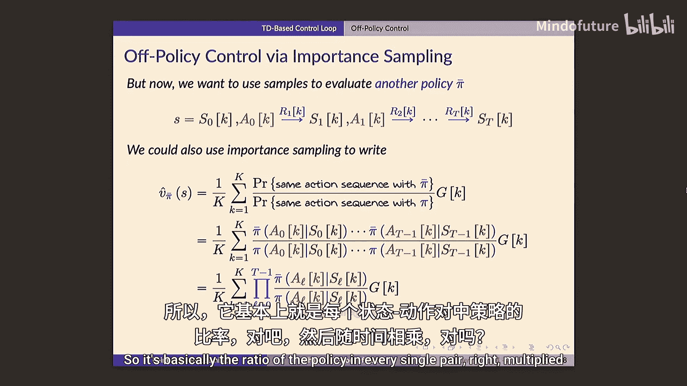

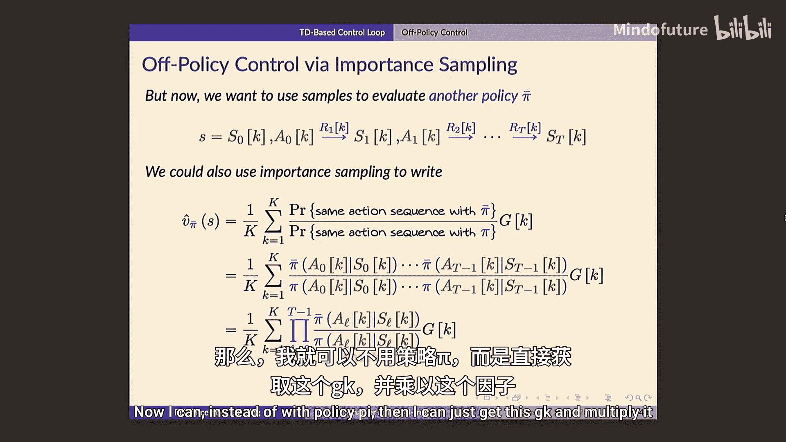

同样，这里存在方差问题。如果行为策略 **π** 在某个状态下选择某个动作的概率为0（或极小），而目标策略 **π̄** 却很可能选择该动作，那么重要性权重会趋于无穷大（或极大），导致估计方差爆炸，估计结果不可靠。因此，异策略学习要求行为策略对目标策略有“覆盖”，即目标策略可能采取的所有动作，行为策略也应以非零概率采取。

## 从蒙特卡洛到时序差分学习 ⚡

上一节我们讨论了在完整的蒙特卡洛方法中应用重要性采样。本节中我们来看看如何在时序差分（TD）学习中应用它，这能让我们进行更高效的在线学习。

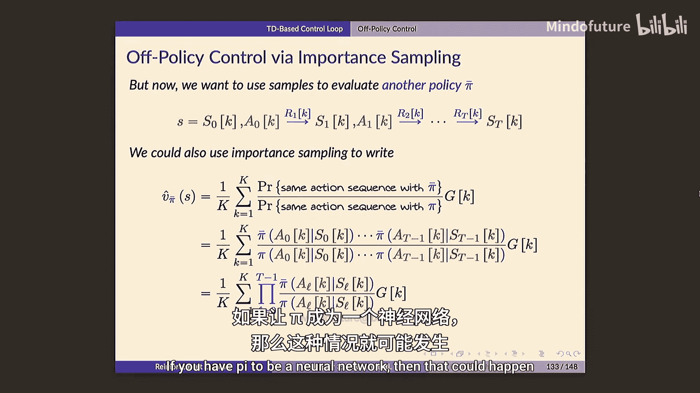

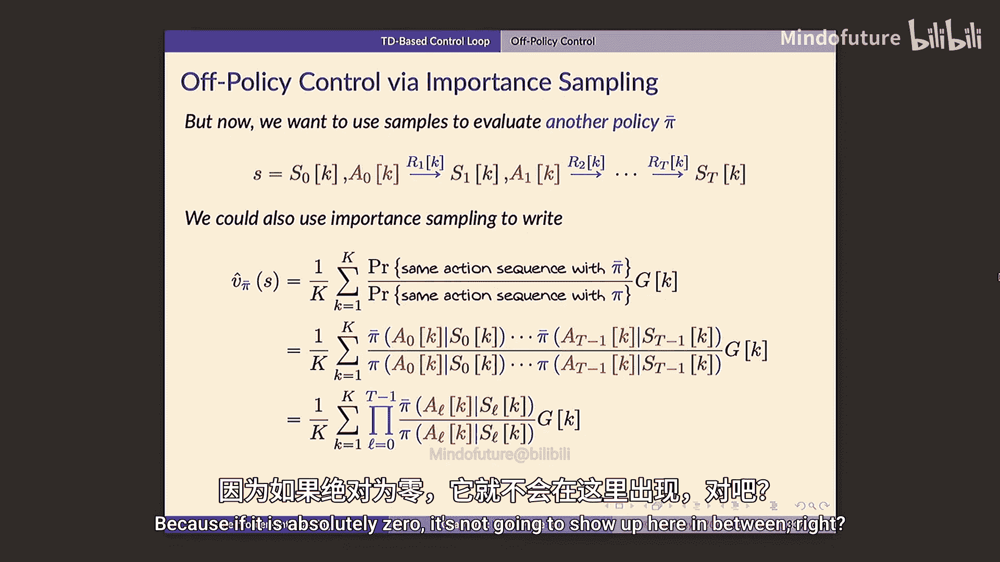

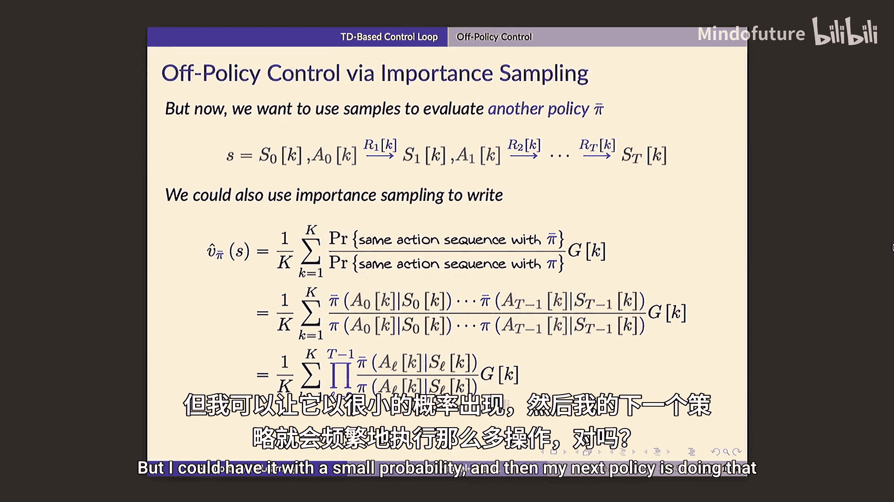

在同策略TD(0)学习中，价值函数的更新为：
`V(S_t) ← V(S_t) + α * [ R_{t+1} + γ * V(S_{t+1}) - V(S_t) ]`
其中 `R_{t+1} + γ * V(S_{t+1})` 被称为TD目标，是基于当前策略 **π** 的样本估计。

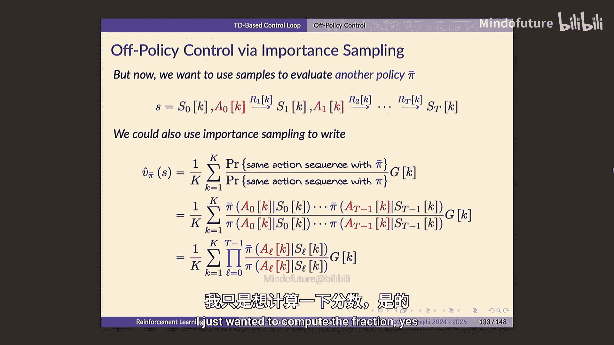

在异策略TD(0)学习中，我们使用行为策略 **π** 采样，但要更新目标策略 **π̄** 的价值函数。我们需要对TD目标进行重要性采样修正。由于TD(0)只涉及一步前瞻，我们只需要为当前采取的动作 `A_t` 乘以重要性权重：
`V(S_t) ← V(S_t) + α * [ ρ_t * ( R_{t+1} + γ * V(S_{t+1}) ) - V(S_t) ]`
其中，单步重要性权重 `ρ_t = π̄(A_t|S_t) / π(A_t|S_t)`。

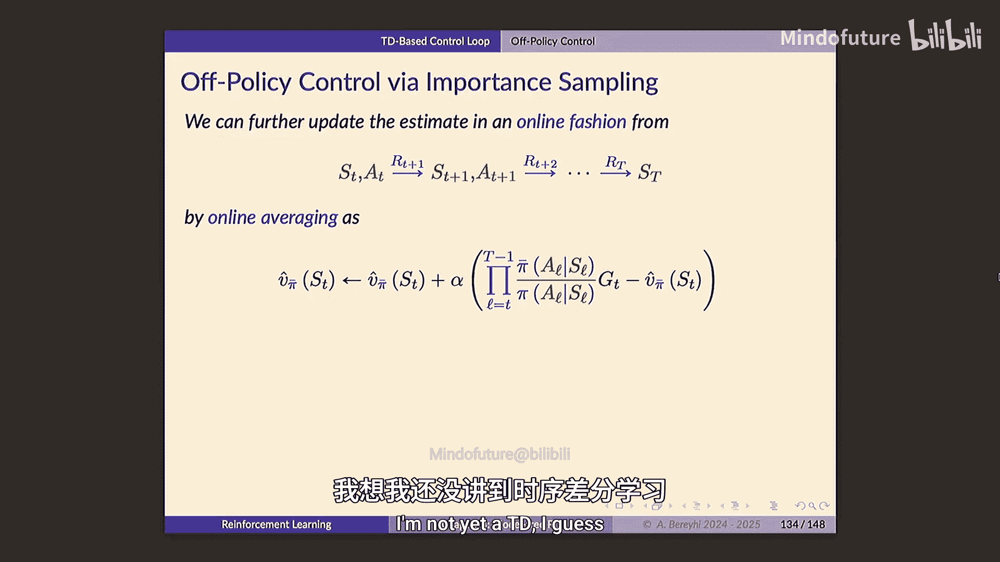

对于动作价值函数 **Q(s, a)** 的更新，情况略有不同。因为 **Q(s, a)** 已经指定了在状态 `S_t` 下采取的动作是 `A_t`，所以即时奖励 `R_{t+1}` 与策略无关，其重要性权重为1。但是，下一个状态的价值 `V(S_{t+1})`（或 `max_a Q(S_{t+1}, a)`）仍然依赖于目标策略。因此，Q学习的异策略更新通常采用一种更巧妙的方式，这引出了著名的Q-learning算法，其更新规则为：
`Q(S_t, A_t) ← Q(S_t, A_t) + α * [ R_{t+1} + γ * max_a Q(S_{t+1}, a) - Q(S_t, A_t) ]`
注意，在计算TD目标时，我们直接使用了下一个状态的最大Q值（对应贪婪目标策略），而无需显式的重要性权重，因为 `max` 操作隐含地实现了从行为策略到贪婪目标策略的转换。这使得Q-learning成为一种非常高效且常用的异策略控制算法。

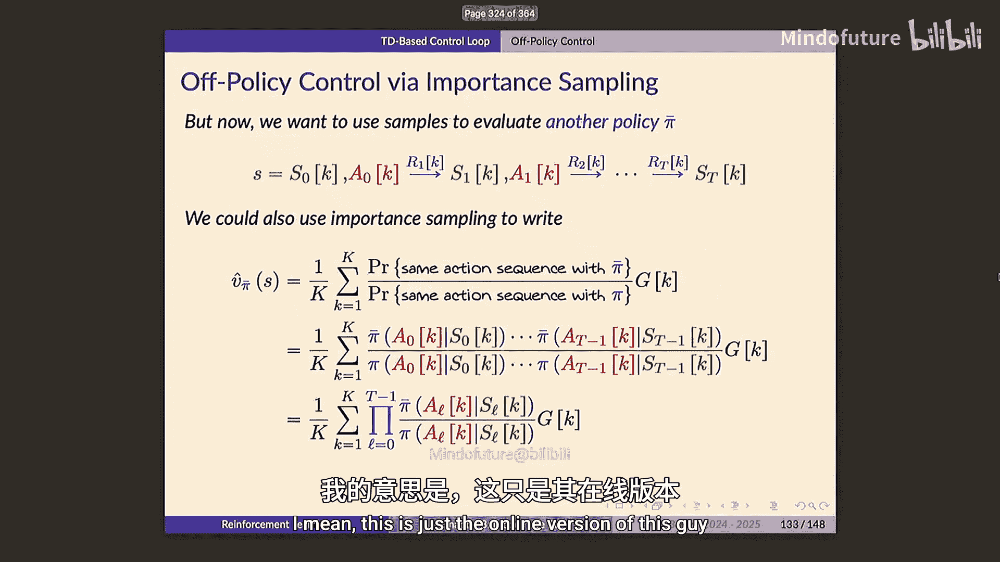

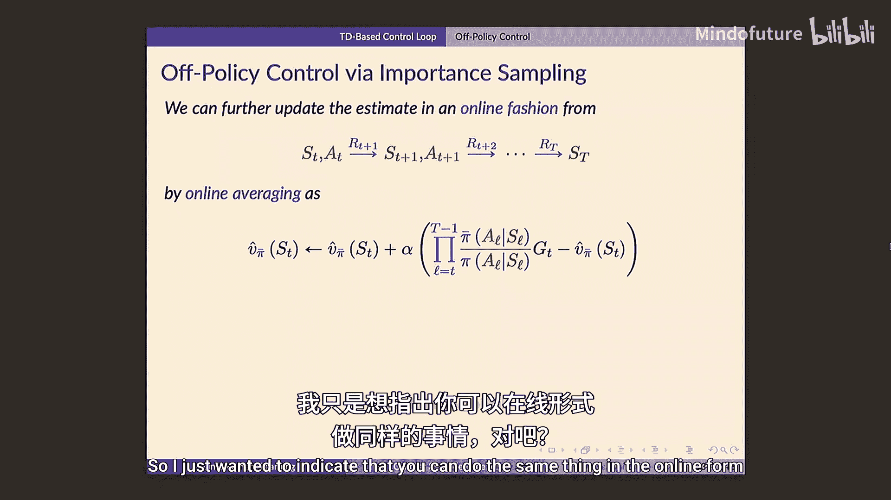

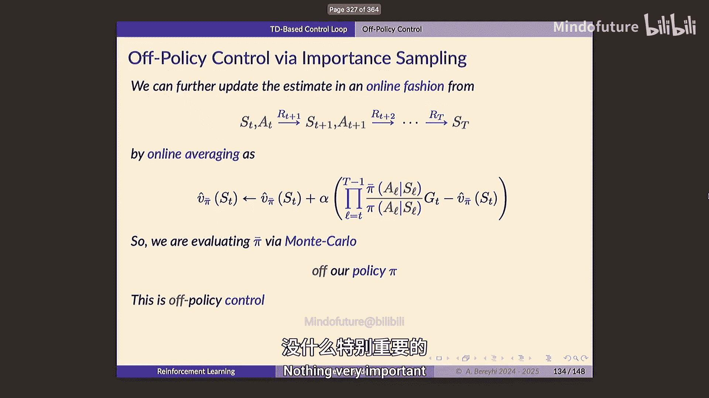

## 总结 🎓

本节课中我们一起学习了异策略强化学习的基础。
*   我们首先理解了**异策略学习**的概念，即从行为策略产生的数据中学习目标策略。
*   然后，我们深入探讨了实现异策略评估的关键技术——**重要性采样**，它通过给来自行为策略的样本加权，来估计目标策略下的期望值。
*   接着，我们将重要性采样应用于完整的**蒙特卡洛轨迹**，推导出用于异策略评估的重要性权重乘积形式。
*   最后，我们将其扩展到**时序差分学习**，介绍了如何在TD(0)和Q-learning中应用重要性采样思想，从而实现更高效的在线异策略学习。

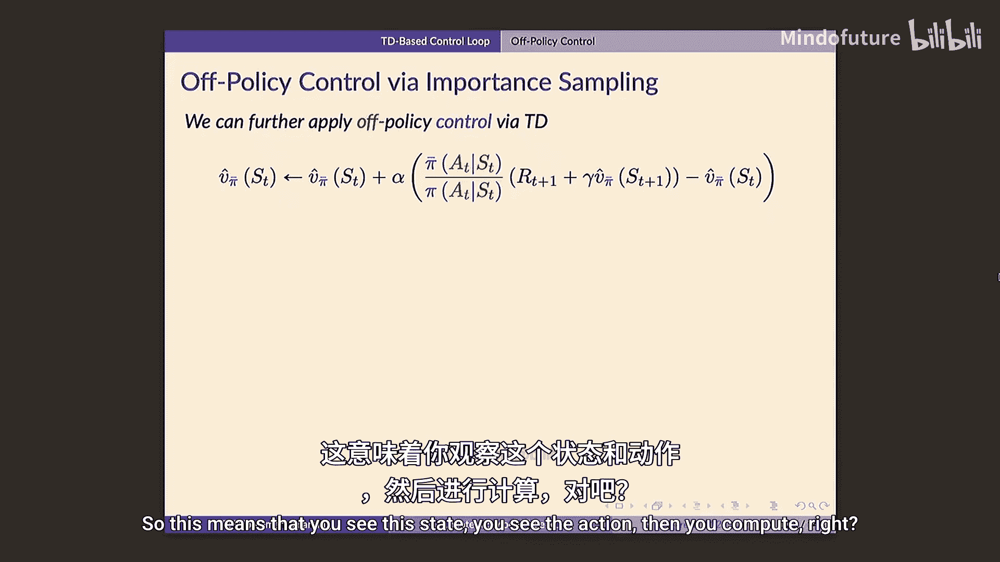

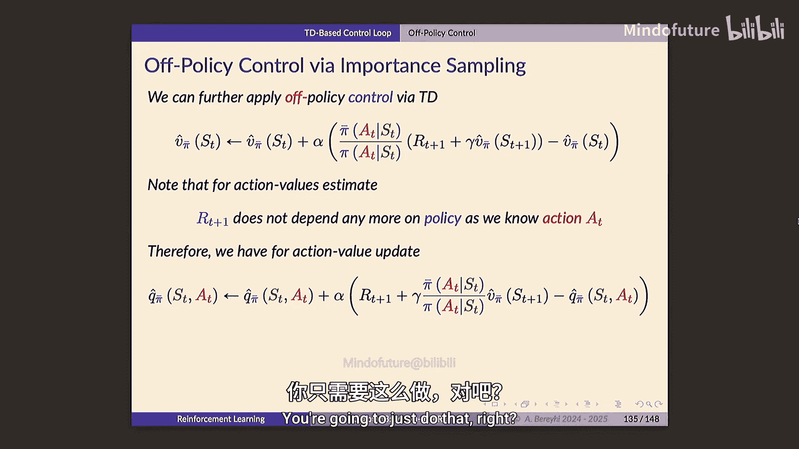

理解重要性采样是掌握高级异策略算法（如Q-learning及其深度强化学习变体）的基石。记住，虽然异策略学习提高了数据利用的灵活性，但也需要注意行为策略与目标策略差异过大时可能带来的高方差问题。