# 033：Q学习算法 🧠

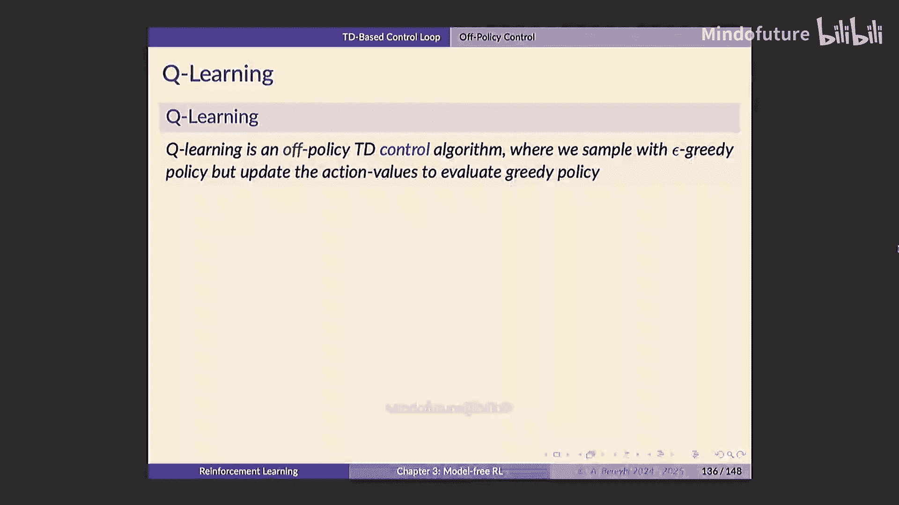

在本节课中，我们将学习Q学习算法。这是一种离策略的时序差分控制方法，它允许智能体在探索环境的同时，学习一个最优策略的价值函数。我们将详细解释其核心思想、工作原理以及更新规则。

---

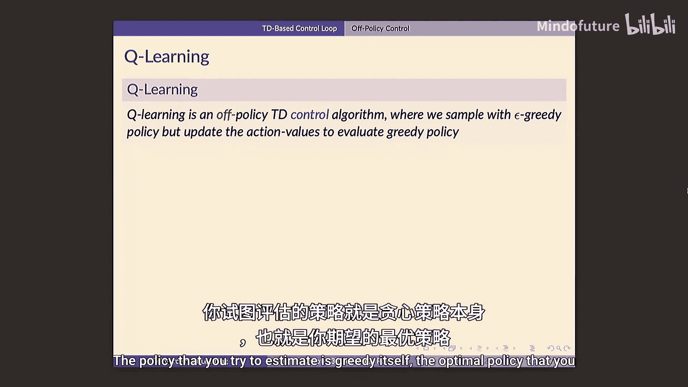

## 什么是Q学习？🤔

上一节我们介绍了时序差分控制和离策略学习的概念。本节中，我们来看看Q学习算法，它是离策略学习的一个经典且高效的实例。

Q学习是一种**离策略**算法。这意味着智能体用于**采样**的策略和用于**更新价值函数**的目标策略是不同的。

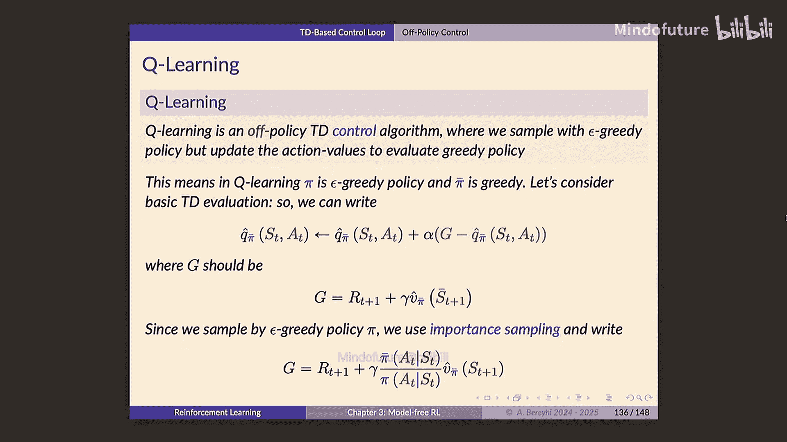

*   **行为策略**：智能体与环境交互时实际使用的策略，通常采用**ε-贪心**策略来平衡探索与利用。
*   **目标策略**：智能体试图评估并最终学习的策略，即**贪心**策略，也就是我们期望的最优策略。

在Q学习中，我们使用行为策略（ε-贪心）来收集经验样本，但我们的目标是直接估计最优策略（贪心）的动作价值函数 **Q***。

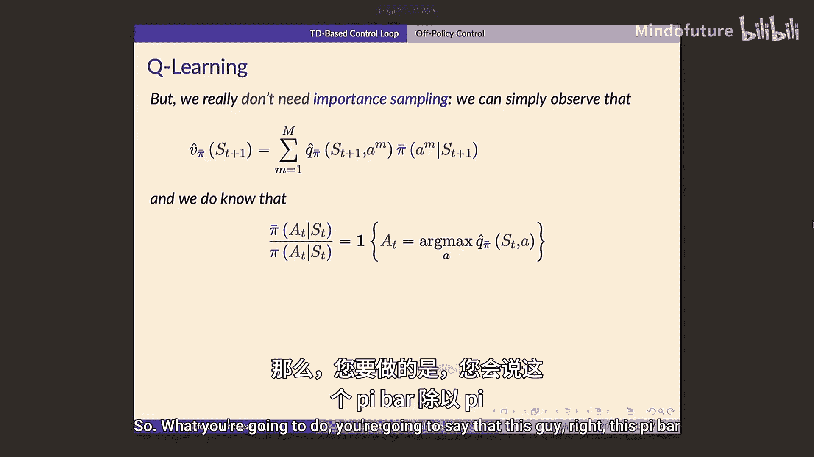

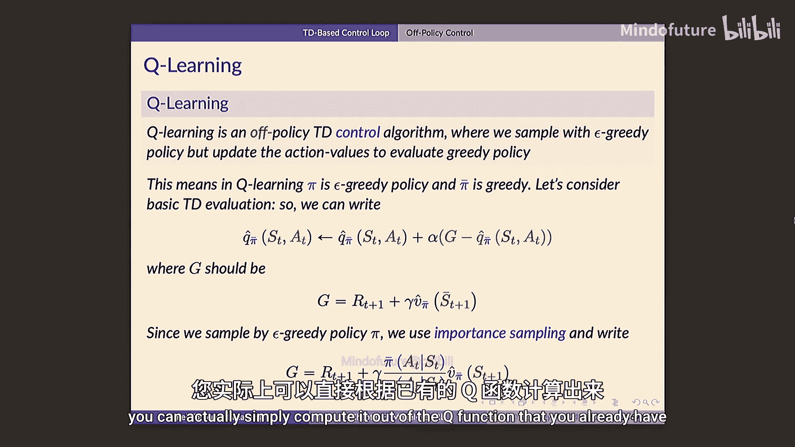

---

## 从重要性采样到简化更新 🔄

在离策略学习中，我们通常需要使用重要性采样来修正不同策略之间的偏差。然而，在Q学习的特定设置下，这个更新过程可以得到极大的简化。

以下是简化的关键步骤：

1.  **目标策略是贪心的**：这意味着对于任意状态 `s`，目标策略 `π̄` 只以概率1选择能最大化当前Q值的动作 `a*`，选择其他动作的概率为0。
    *   公式表示为：`π̄(a|s) = 1` 当 `a = argmax_a‘ Q(s, a’)`，否则为 `0`。

2.  **行为策略是ε-贪心的**：它以 `(1-ε)` 的概率选择贪心动作，以 `ε` 的概率随机选择动作。

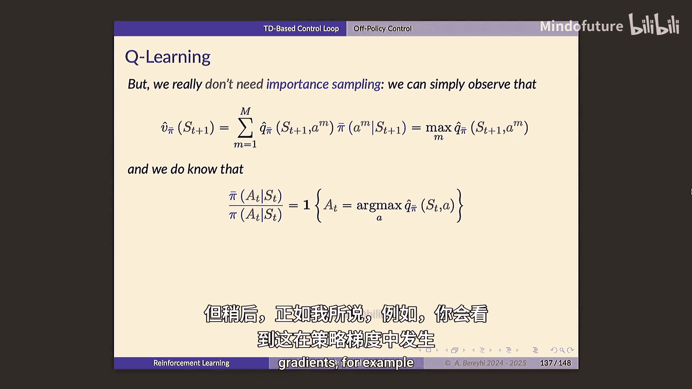

3.  **更新公式的简化**：当我们计算目标策略的价值时，重要性采样权重 `π̄(a|s) / π(a|s)` 在大多数情况下会变为0。唯一非零的情况发生在动作 `a` 恰好是贪心动作时。更重要的是，目标策略在下一状态 `s‘` 下的价值 `V_π̄(s’)`，可以直接通过我们正在学习的Q函数的最大值来近似：
    *   `V_π̄(s‘) ≈ max_a’ Q(s‘, a’)`

因此，复杂的、带有重要性采样的更新目标，最终简化为一个非常简洁的形式：我们只需用下一状态的最大Q值来估计未来的回报。

---

## Q学习的核心更新规则 ⚙️

基于上述简化，我们得到了Q学习的核心更新公式。这个公式是时序差分更新的一种形式。

智能体在状态 `S_t` 下执行动作 `A_t`，收到奖励 `R_{t+1}` 并转移到新状态 `S_{t+1}` 后，按以下规则更新Q值：

`Q(S_t, A_t) ← Q(S_t, A_t) + α [ R_{t+1} + γ * max_a Q(S_{t+1}, a) - Q(S_t, A_t) ]`

让我们解析这个公式：
*   `α` 是学习率。
*   `γ` 是折扣因子。
*   `R_{t+1} + γ * max_a Q(S_{t+1}, a)` 是**更新目标**。它由即时奖励和基于当前Q函数估计的、下一状态最优未来回报的折现值组成。
*   `Q(S_t, A_t)` 是当前的估计值。
*   方括号内的整体是**时序差分误差**，我们根据它来调整当前的估计。

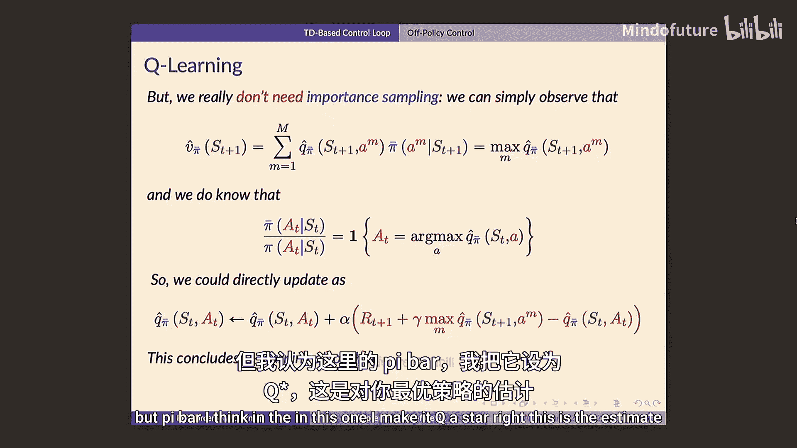

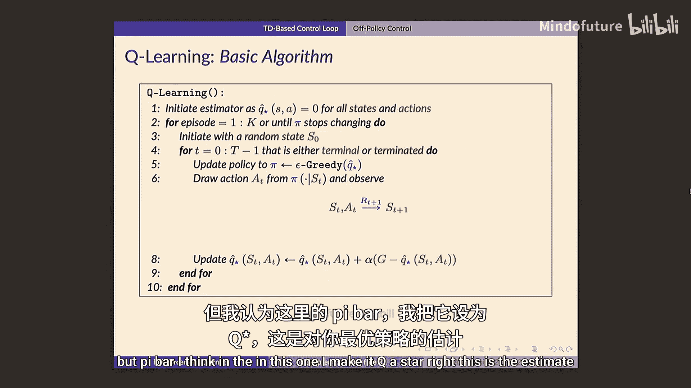

这个更新的精妙之处在于：无论智能体实际执行了什么动作（可能出于探索目的而随机选择），它都在假设“如果我在下一状态采取最优动作”的前提下，来更新当前状态-动作对的价值。这使得Q函数 `Q(s, a)` 直接逼近最优动作价值函数 `Q*(s, a)`。

---

## Q学习算法流程 📝

以下是Q学习算法的完整伪代码流程。

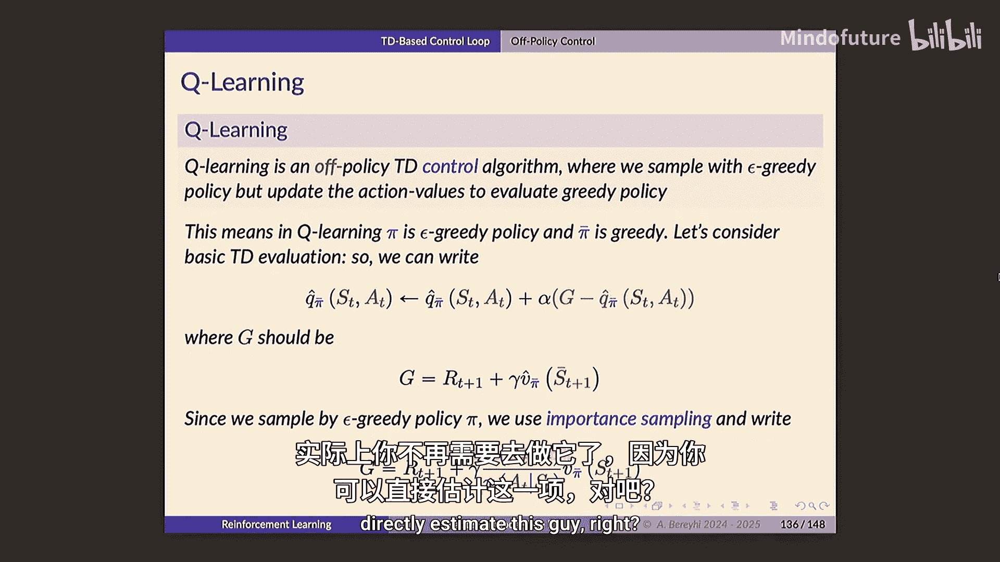

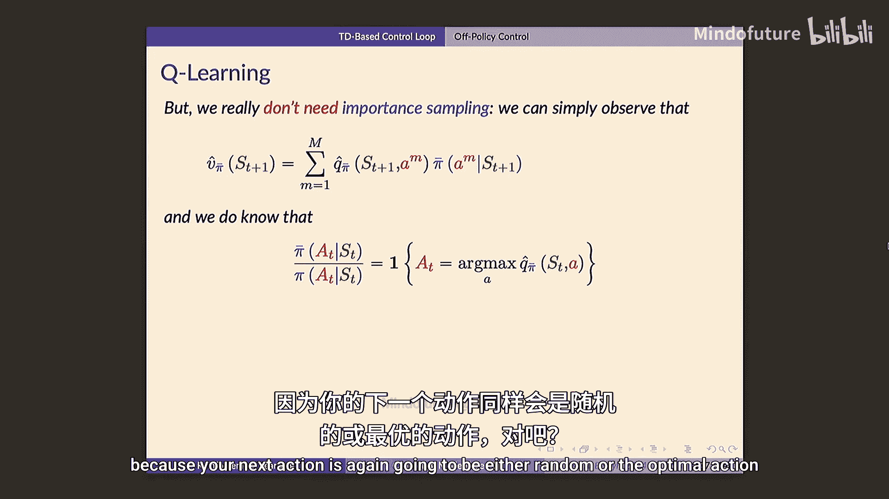

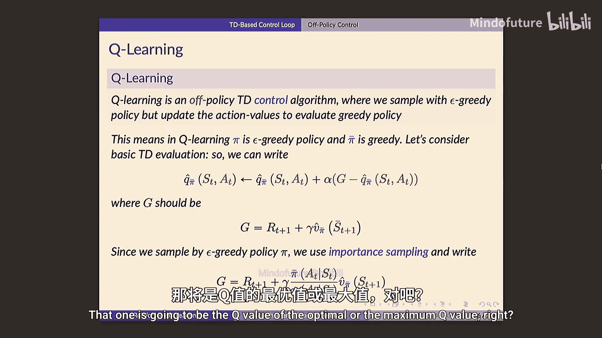

初始化所有状态 `s` 和动作 `a` 对应的 `Q(s, a)`（可为0）
对每一个训练回合（episode）执行：
    初始化状态 `S`
    当状态 `S` 不是终止状态时，循环：
        根据当前Q函数，使用ε-贪心策略从状态 `S` 中选择动作 `A`（例如：以ε概率随机选，否则选 `argmax_a Q(S, a)`）
        执行动作 `A`，观察奖励 `R` 和下一状态 `S‘`
        使用更新规则：`Q(S, A) ← Q(S, A) + α [ R + γ * max_a Q(S‘, a) - Q(S, A) ]`
        将状态更新为 `S ← S‘`

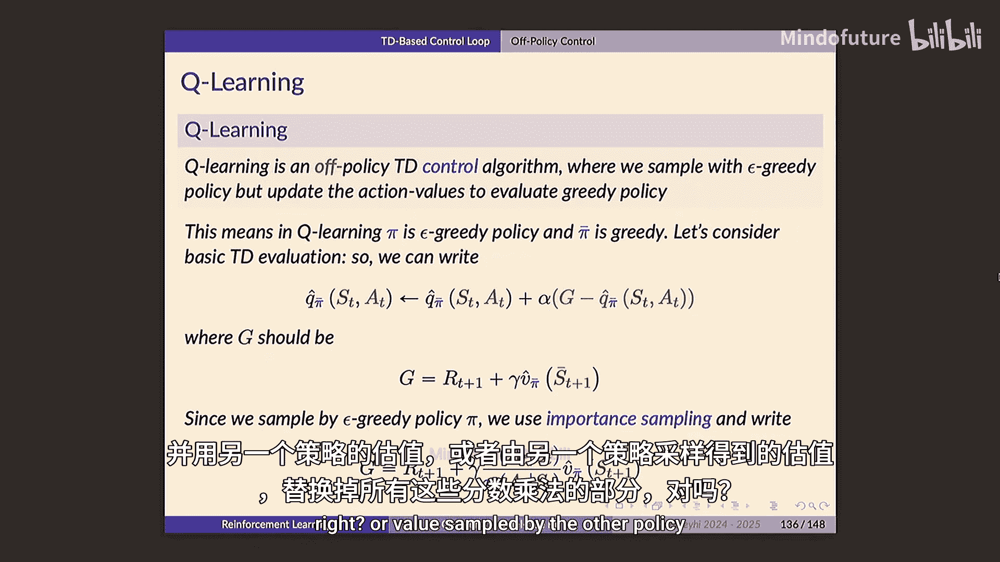

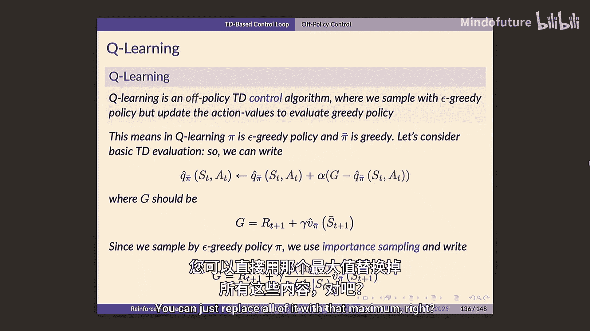

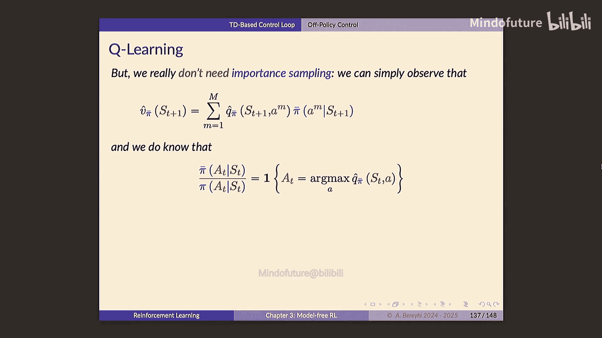

---

## 总结与要点 🎯

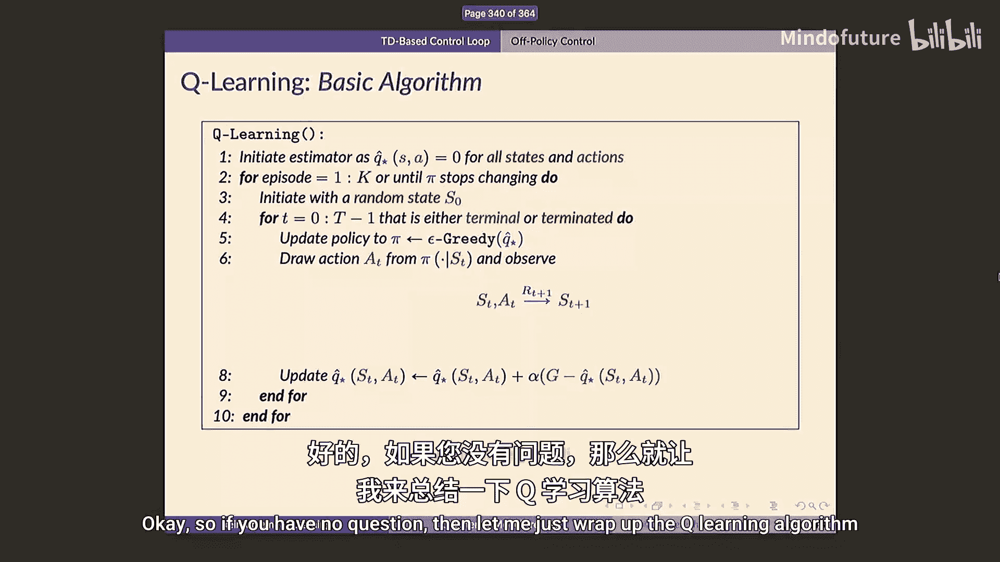

本节课中我们一起学习了Q学习算法。

*   **核心性质**：Q学习是一种**离策略**的时序差分控制算法。
*   **策略分工**：它使用**ε-贪心策略**（行为策略）进行探索和环境交互，同时直接学习和更新**贪心策略**（目标策略，即最优策略）的动作价值函数 `Q*`。
*   **关键简化**：通过将目标策略设定为贪心策略，其更新公式从复杂的重要性采样简化为使用下一状态的最大Q值作为未来回报的估计。
*   **更新规则**：其核心是公式 `Q(S_t, A_t) ← Q(S_t, A_t) + α [ R_{t+1} + γ * max_a Q(S_{t+1}, a) - Q(S_t, A_t) ]`。
*   **最终目标**：算法最终会收敛到最优动作价值函数，从而我们可以通过选择每个状态下Q值最大的动作来获得最优策略。

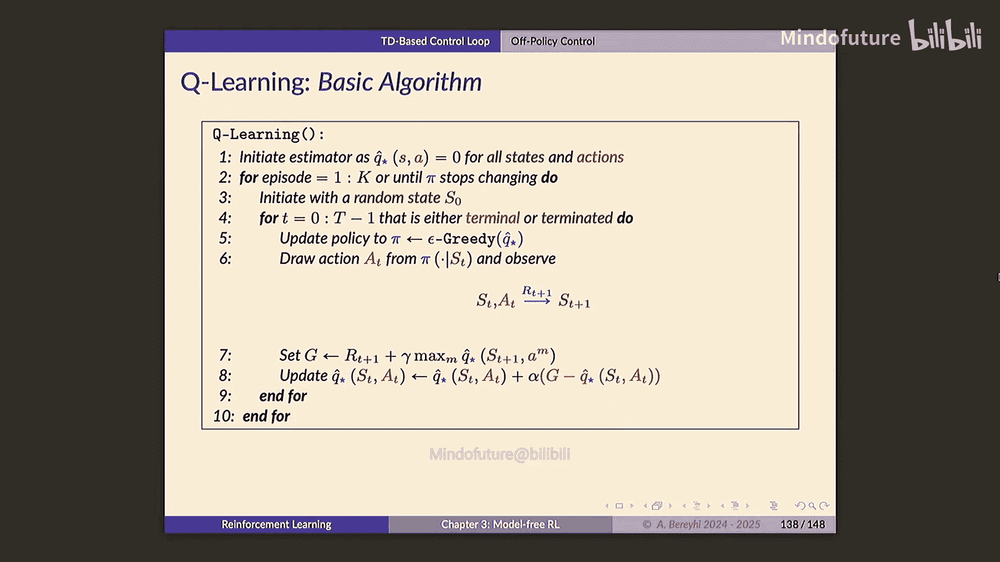

Q学习因其简单、有效而成为强化学习中最基础和重要的算法之一。它巧妙地分离了探索和行为策略与学习的目标策略，使得学习过程更加高效稳定。