# 034：Q学习与SARSA的收敛性 🧠

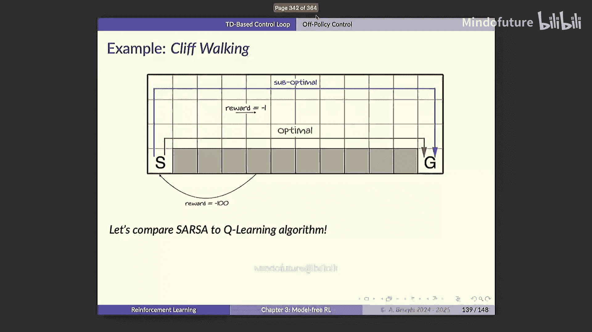

在本节课中，我们将通过一个具体的悬崖行走（Cliffwalk）环境示例，深入探讨并比较SARSA和Q学习这两种经典时序差分控制算法的收敛行为、性能差异及其背后的原理。

## 概述

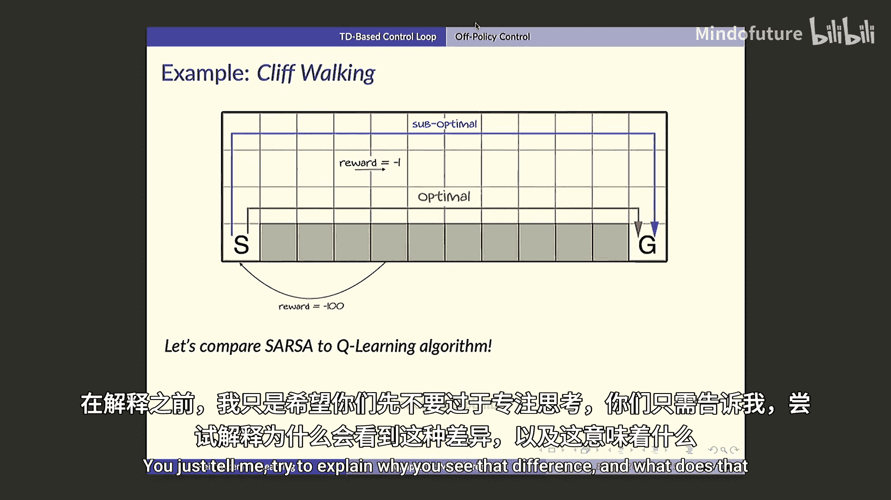

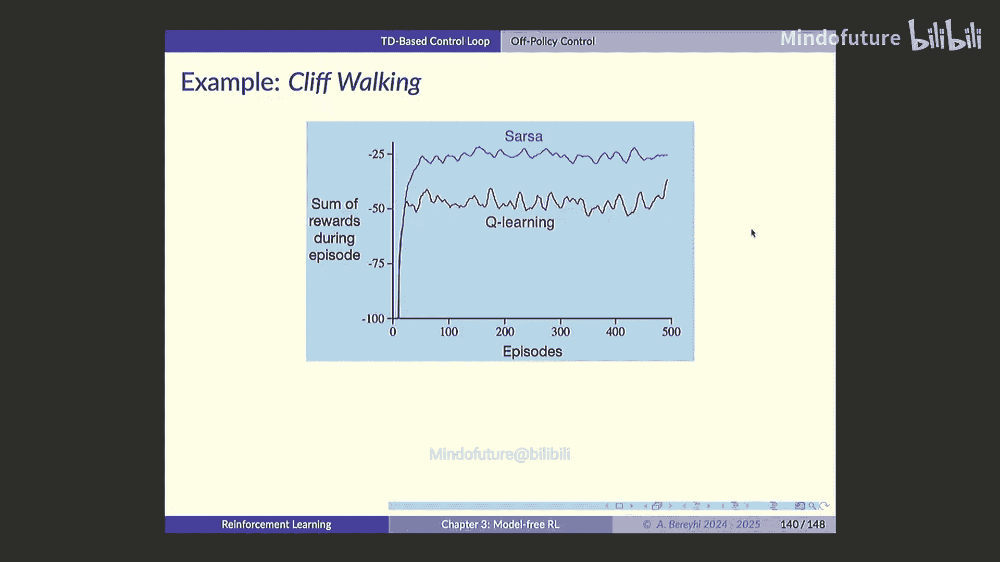

我们将分析SARSA（同策略）与Q学习（异策略）在悬崖行走环境中的表现。核心在于理解两者在探索-利用权衡上的根本区别，以及这如何影响学习过程中的策略收敛和最终性能。我们会看到，即使两者都能学习到最优策略，它们在训练期间的行为和部署时的表现可能截然不同。

## 悬崖行走环境示例 🧗

首先，我们来看一个悬崖行走环境的例子。这个例子曾在作业中出现过。

*   **环境设定**：智能体从一个起点出发，目标是找到一条到达目的地的最短路径。在确定性环境中，最优路径是紧贴悬崖边缘的那一条。
*   **学习挑战**：在学习初期，如果智能体过于贪婪（即总是选择当前估计价值最高的动作），它可能会撞到“墙”（即掉下悬崖），并收到一个很大的负奖励。这会告诉它“不要往这个方向走”。
*   **学习过程**：通过SARSA算法，智能体使用ε-贪婪策略进行探索。它可能会随机尝试不同的动作，偶尔会走上最优路径。随着时间的推移，通过不断更新Q值，它最终能够发现最优路径。如果不进行充分的探索，则可能陷入次优路径。

上一节我们回顾了悬崖行走问题的背景，本节中我们来看看SARSA和Q学习在这个环境中的具体表现对比。

## SARSA vs. Q学习：性能曲线分析 📊

以下是SARSA与Q学习在训练过程中的性能对比图。图中纵轴表示智能体在整个回合中收集到的**奖励总和**。奖励总和越大（即负值越小），说明智能体走的路径越短、表现越好；反之，负值越大则说明路径越长、表现越差。

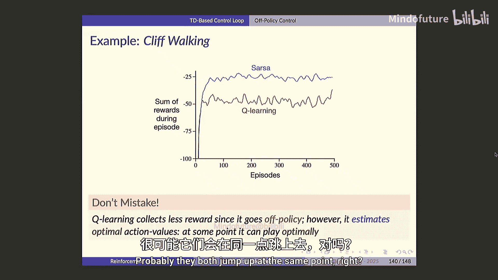

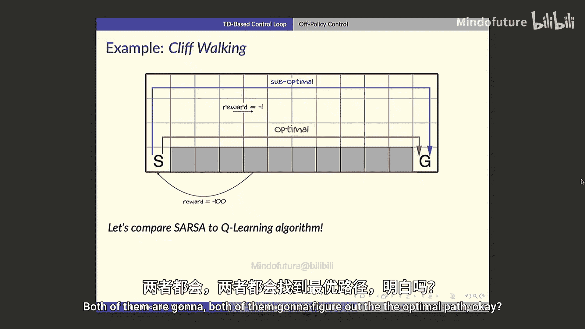

图中显示的是算法**收敛后**，在多个回合中平均的奖励总和。所谓“收敛”，是指经过一段时间的训练后，Q函数基本不再发生显著变化。

*   **观察现象**：从曲线可以看出，Q学习收敛后的平均奖励总和（负值）比SARSA要**小**（即表现更差）。
*   **关键问题**：这是否意味着Q学习找到了次优策略，而SARSA找到了最优策略？
*   **答案**：**不是**。原因在于探索策略。

### 探索策略的差异

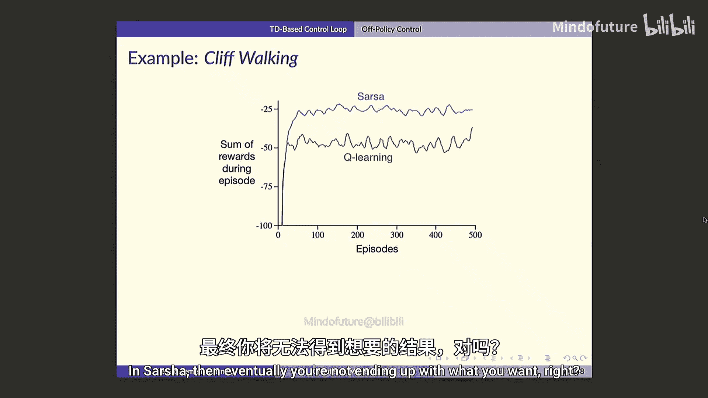

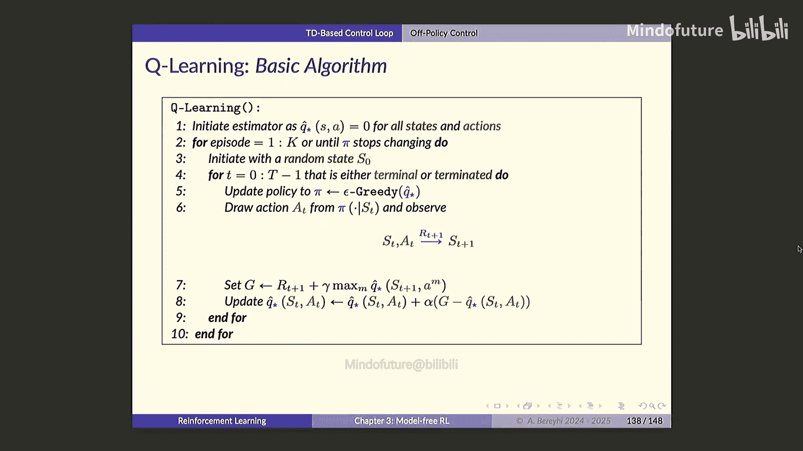

以下是理解这一现象的核心：

*   **Q学习（异策略）**：在训练时，其行为策略（如ε-贪婪）与要学习的最优策略（贪婪策略）是分离的。即使Q函数已经收敛到最优值，**在部署时，我们仍然可以（并且经常）使用一个带有小ε值的ε-贪婪策略来保持探索**。因此，图中Q学习的较低性能，是因为在评估时它仍有相当一部分时间在进行随机探索，这虽然会降低即时性能，但**并不影响它已经学习到了最优Q值**。
*   **SARSA（同策略）**：它直接学习并优化当前执行的行为策略。为了让算法收敛到最优策略，**在训练过程中必须将探索率ε衰减到非常小（甚至为零）**。因此，当SARSA的曲线稳定时，它执行的基本上就是纯粹的最优贪婪策略，所以其平均奖励更高。

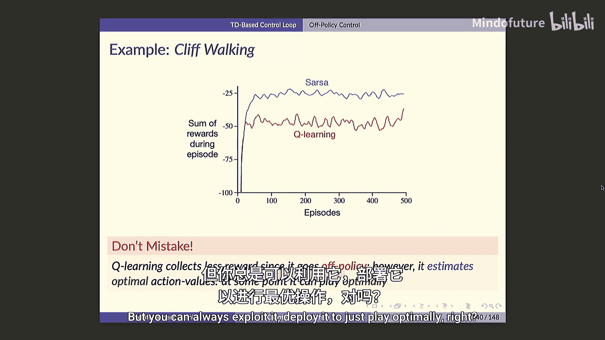

**结论**：图中性能差异主要源于评估时策略的探索性不同，而非学习到的策略质量不同。Q学习在保持探索的同时仍能学到最优策略，这是其优势之一。

为了验证这一点，我们可以做一个思想实验：如果在训练结束后（例如第300个回合后），将**两个算法的探索率ε都设置为0**（即完全贪婪），再评估它们的性能，会发生什么？

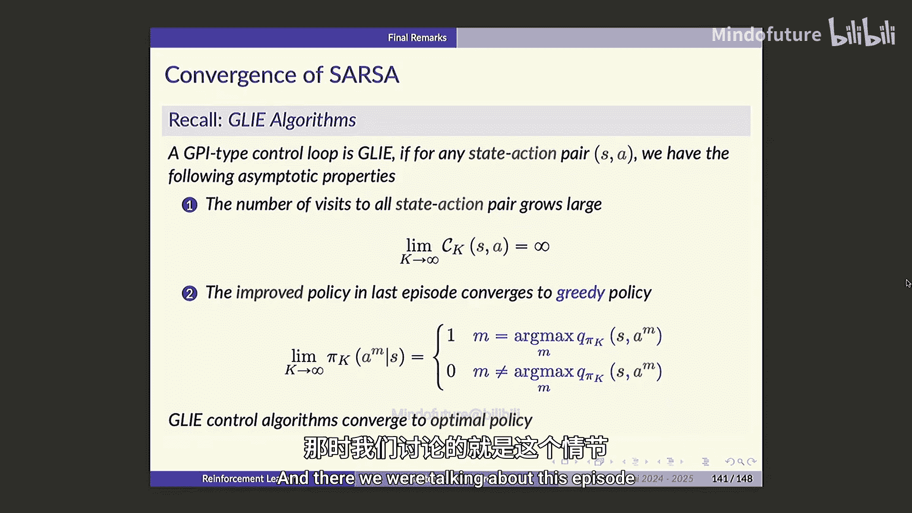

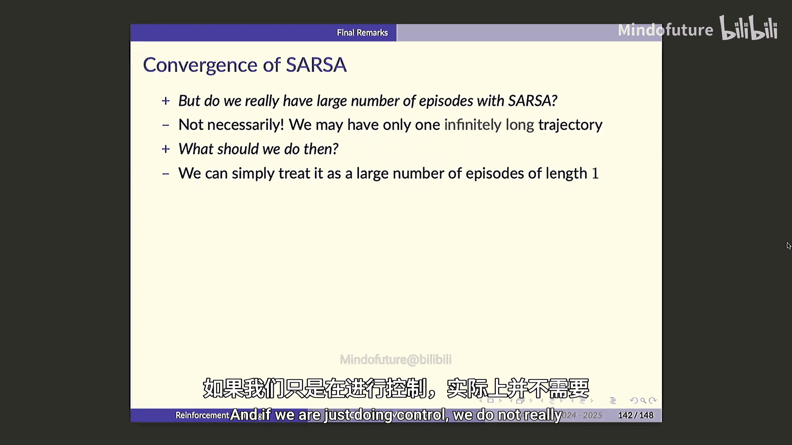

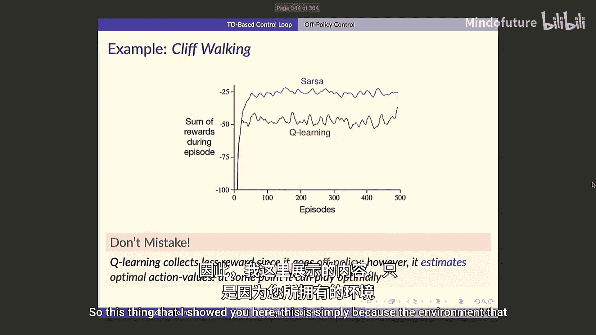

**预期结果**：两者都会执行贪婪策略。由于悬崖行走问题相对简单，两者都应已学到最优或接近最优的Q值。因此，**两条性能曲线都会向上跳跃，并最终稳定在同一个高性能水平（例如奖励总和约为-25）**。SARSA原本就在高处，而Q学习会因为停止探索而大幅提升性能。

**核心公式回顾**：
两者的更新公式清晰地体现了这一根本区别：
*   **SARSA更新**：`Q(S, A) ← Q(S, A) + α [ R + γ * Q(S‘, A’) - Q(S, A) ]`
    其中 `A‘` 是根据当前策略（如ε-贪婪）在状态 `S‘` 下选择的动作。
*   **Q学习更新**：`Q(S, A) ← Q(S, A) + α [ R + γ * max_a Q(S‘, a) - Q(S, A) ]`
    直接使用下一状态 `S‘` 下的**最大**Q值进行更新，与当前行为策略无关。

如果SARSA不衰减ε，那么它评估和优化的将始终是一个带有探索的随机策略，而非最优贪婪策略。

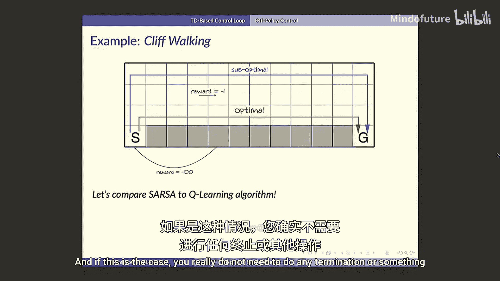

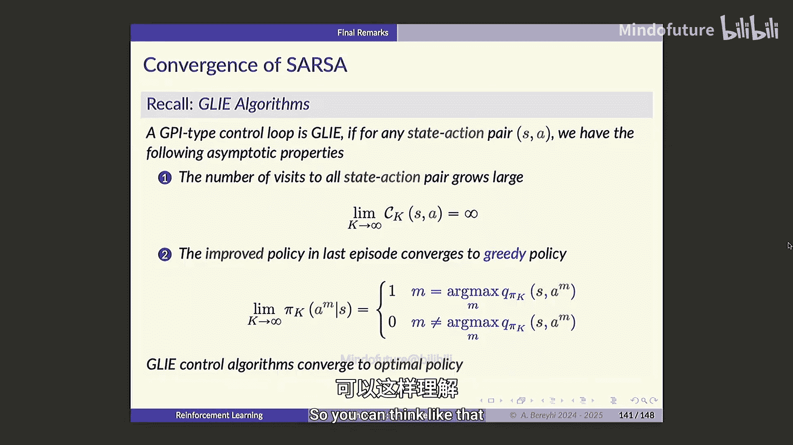

## 算法收敛性理论 ⚙️

理解了现象后，我们来看看两者收敛的理论保证。两者都是**通用策略迭代（GPI）** 框架下的算法，要保证收敛到最优策略，需要满足两个关键条件：

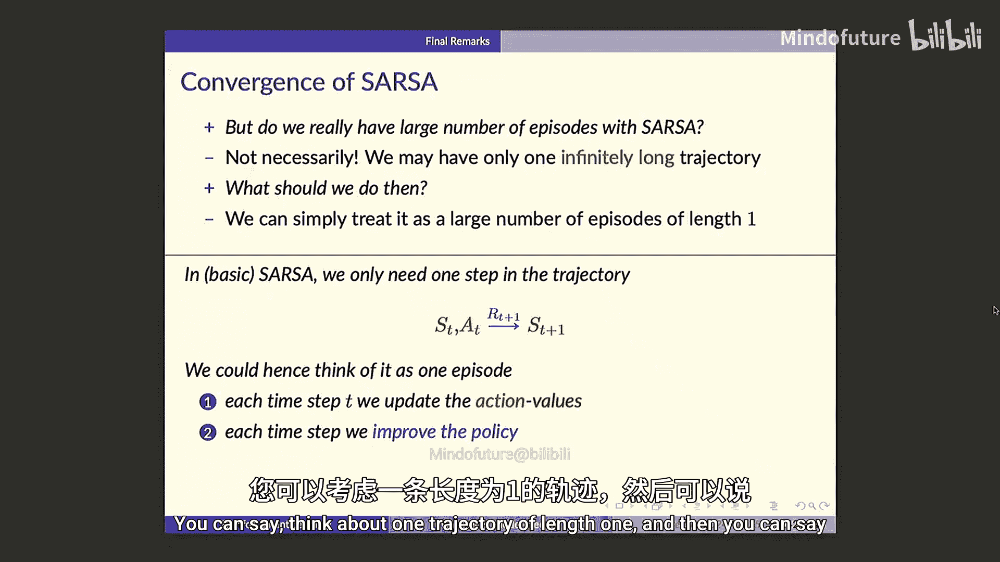

1.  **充分探索**：每个状态-动作对都需要被访问无限次（在实践中是足够多次）。
2.  **策略收敛**：行为策略必须逐渐收敛到一个确定性的最优策略（例如贪婪策略）。

### SARSA的收敛条件

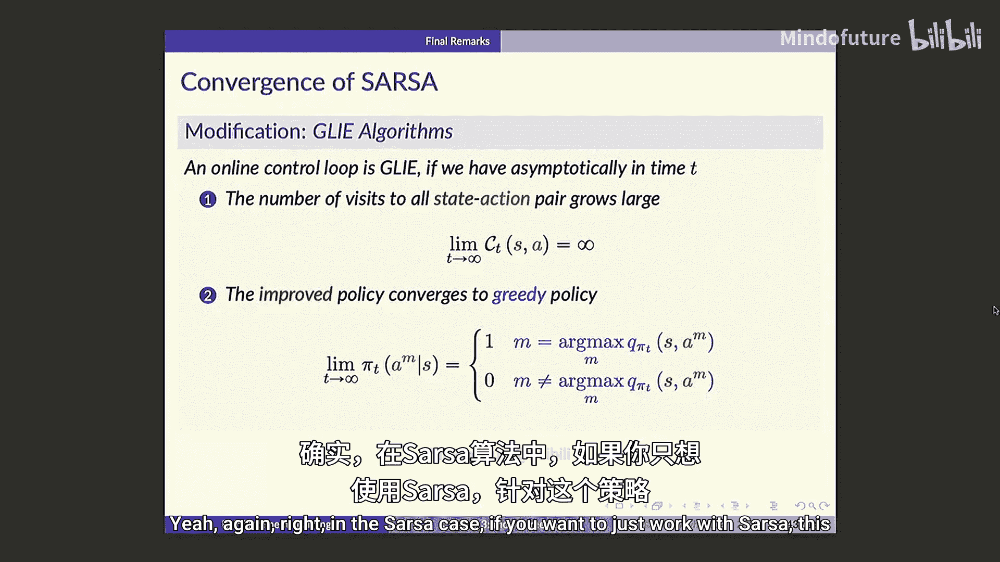

对于SARSA这个同策略算法：
*   **条件1**：通过使用并**随时间衰减ε**的ε-贪婪策略来满足。衰减不能太快，以免错过某些状态-动作对；也不能太慢，以免策略无法收敛。
*   **条件2**：ε的衰减过程本身就保证了策略最终会趋近于纯贪婪策略。

因此，一个精心设计ε衰减计划的SARSA算法是一个**GPI算法**，能够保证收敛。

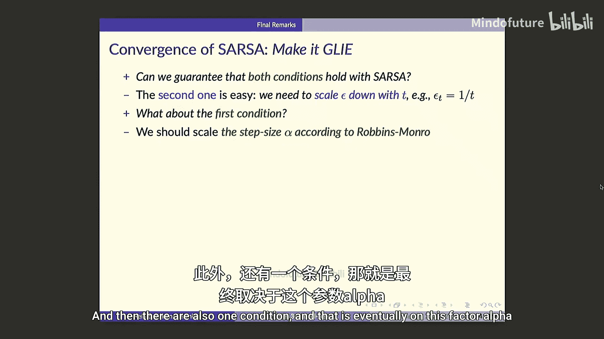

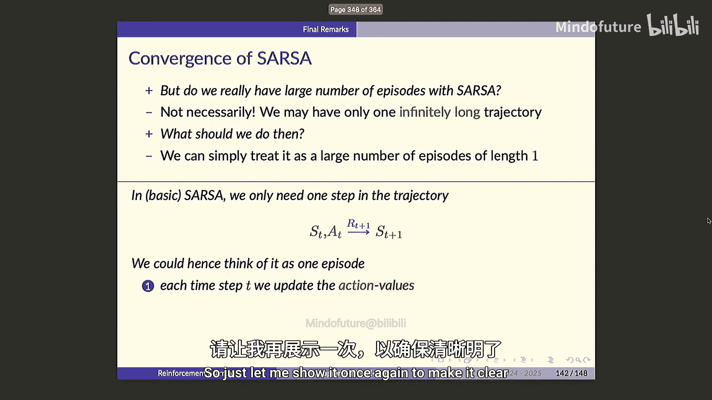

### 关于环境与时间步的说明

上述讨论基于“回合”（episode）。但在持续任务（无终止状态）中，算法同样适用。我们可以将每个时间步视为一个长度为1的“迷你回合”，整个学习过程就是一条无限长的轨迹。收敛条件中的“无限次访问”就转化为在无限时间范围内，每个状态-动作对被访问无限次。

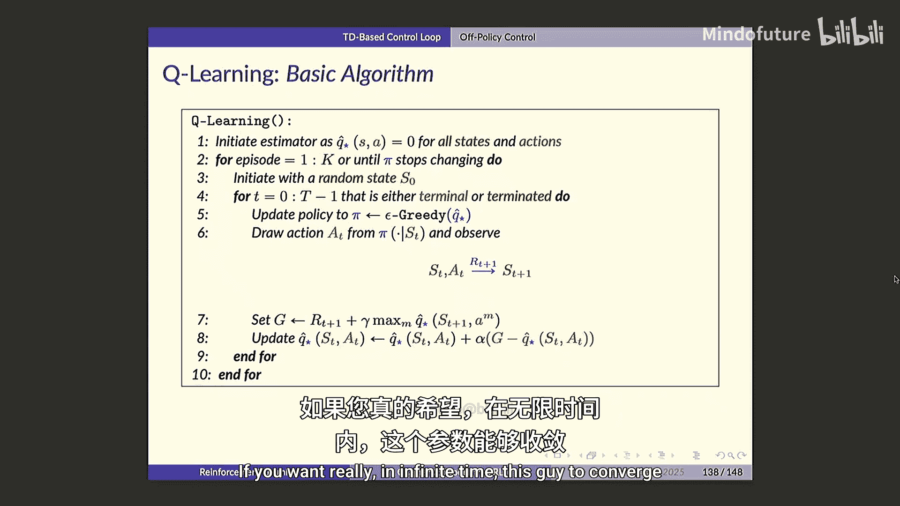

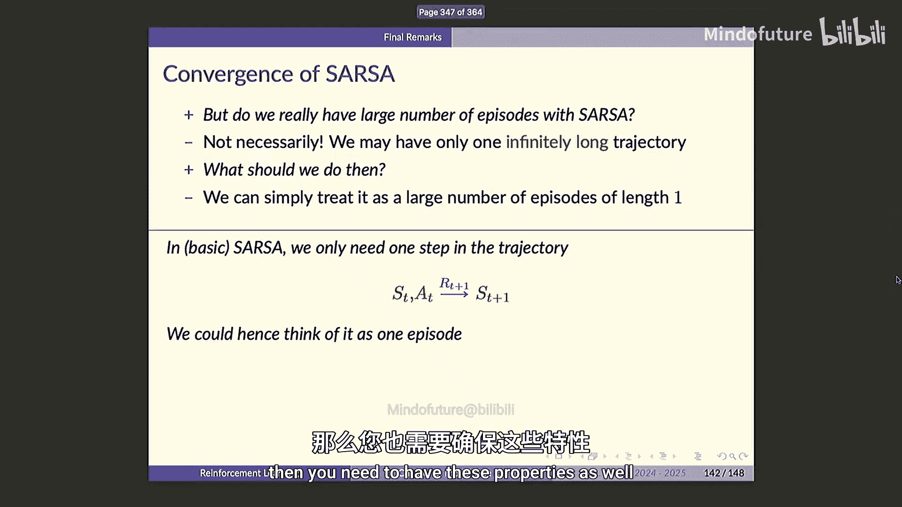

### 学习率α的条件

除了探索策略，**学习率α**（或步长）的设定也至关重要。为了保证在无限时间序列上的收敛，α序列需要满足以下数学条件：

1.  `∑ α_t = ∞` （保证有足够的更新幅度以最终收敛）
2.  `∑ (α_t)^2 < ∞` （保证更新方差足够小，最终稳定）

一个经典的满足条件的序列是：`α_t = 1 / t`。在实际应用中，也常使用 `c / t` 或分段衰减等方式。

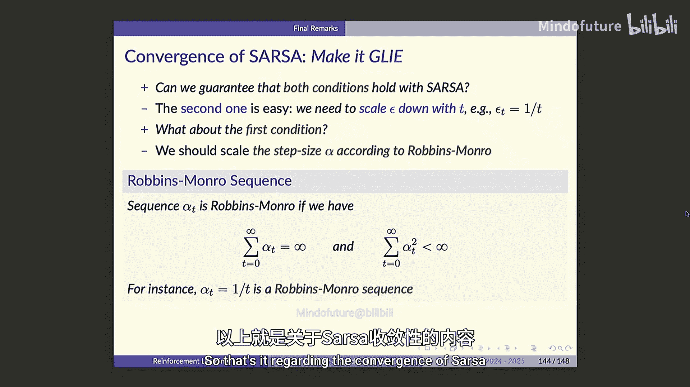

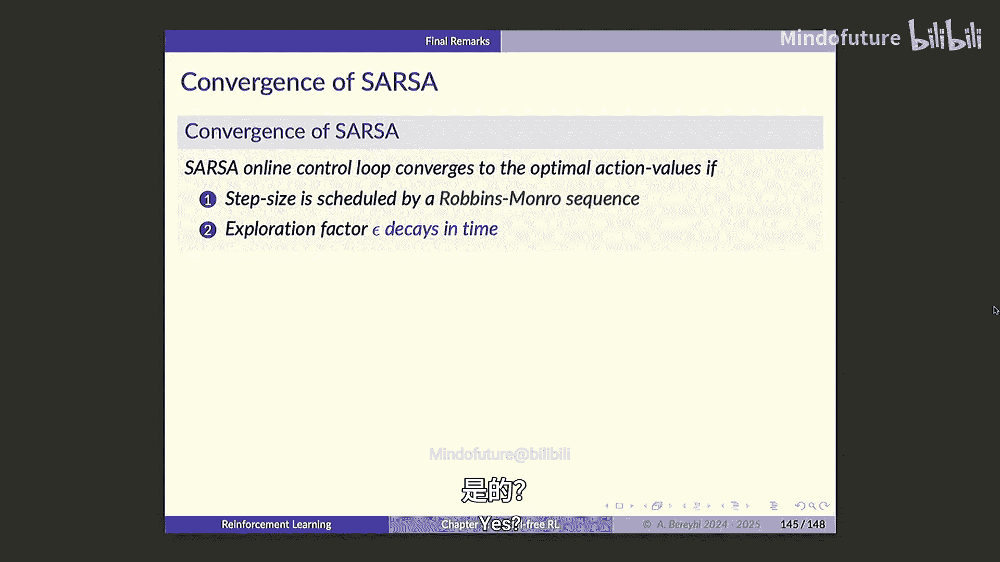

**实践意义**：在表格型强化学习中，这些条件为收敛提供了理论保障。然而，在后续将接触的**深度强化学习**中，由于函数近似器的引入，优化问题变得非凸、非线形，这些经典收敛条件通常不再严格成立，调参（如学习率调度）变得更加经验化。

## 实践对比与总结 🏁

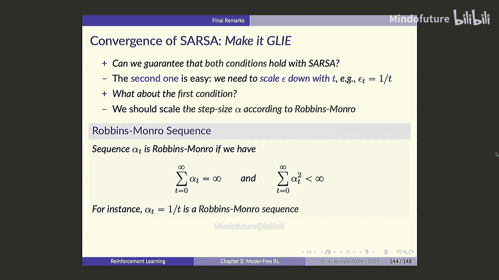

最后，我们来总结一下SARSA和Q学习在实践中的特点。

### Q学习的优势

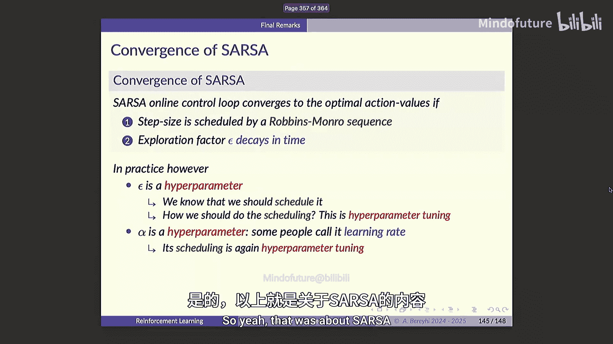

1.  **更宽松的收敛要求**：Q学习不要求行为策略收敛到贪婪策略，只需保持足够的探索以满足“充分访问”条件即可。这通常使它在实践中**收敛更快**。
2.  **更高的样本效率**：由于其异策略特性，它可以更自由地利用历史经验（例如通过**经验回放**），这在大规模或深度强化学习中是一个巨大优势。
3.  **灵活性**：学得最优Q值后，可以灵活部署不同探索程度的策略。

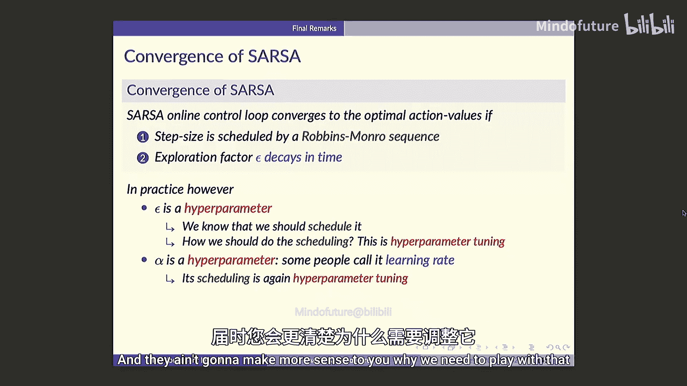

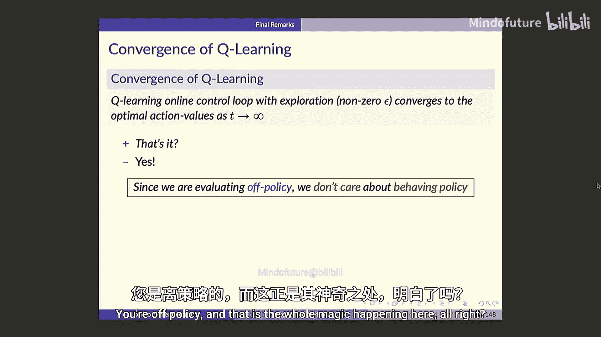

### SARSA的适用场景

1.  **在线控制与安全性**：在需要**持续在线学习并同时保证性能**的场景中（如机器人实时控制），SARSA更合适。因为它直接优化并执行当前策略，避免了Q学习在探索时可能采取的冒险行为。在悬崖行走例子中，SARSA学到的策略会远离悬崖边缘，更加安全。
2.  **概念简单**：只需要维护和更新一个策略，概念和实现上相对简单。

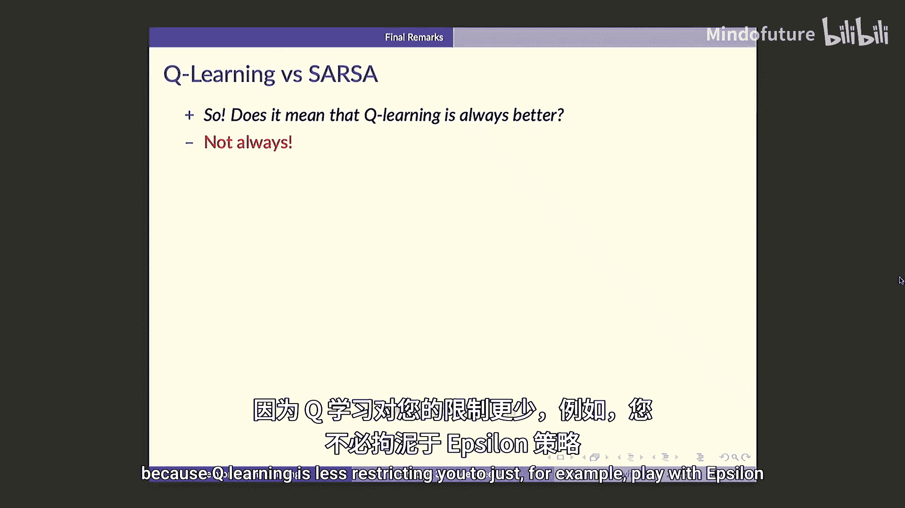

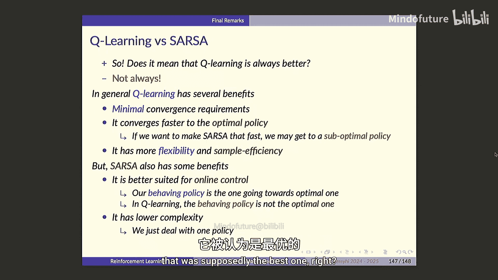

**结论**：如果没有对在线策略安全性的严格要求，Q学习通常因其更快的收敛速度和样本效率而被优先选择。这也是早期表格型强化学习教学中更侧重Q学习的原因。然而，SARSA在特定领域，尤其是注重安全性和稳定性的在线学习任务中，仍有其不可替代的价值。

## 本节课总结

在本节课中，我们一起学习了：
1.  通过悬崖行走示例，**直观对比**了SARSA和Q学习在训练和评估阶段的表现差异。
2.  揭示了性能差异的**根本原因**在于SARSA（同策略）必须衰减探索以收敛到最优策略，而Q学习（异策略）可以将探索与最优策略学习分离。
3.  从理论角度分析了两者收敛所需的**通用策略迭代（GPI）条件**，包括充分探索和策略收敛，并特别讨论了学习率α的数学条件。
4.  最后，**对比总结了**SARSA和Q学习各自的优缺点及适用场景，认识到Q学习在大多数情况下具有优势，但SARSA在安全敏感的在线控制任务中至关重要。

理解这些基础算法的收敛特性，为我们后续学习更复杂的深度强化学习算法奠定了坚实的理论基础。