# 035：为什么需要深度强化学习 🧠

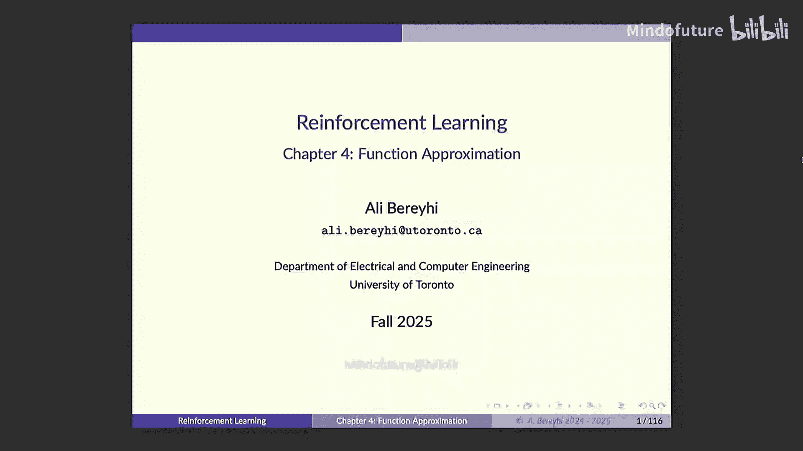

在本节课中，我们将探讨从表格型强化学习过渡到深度强化学习的必要性。我们将分析表格型方法的局限性，并理解深度神经网络如何为解决大规模环境中的学习问题提供关键支持。

## 从学习到“魔法”的转变

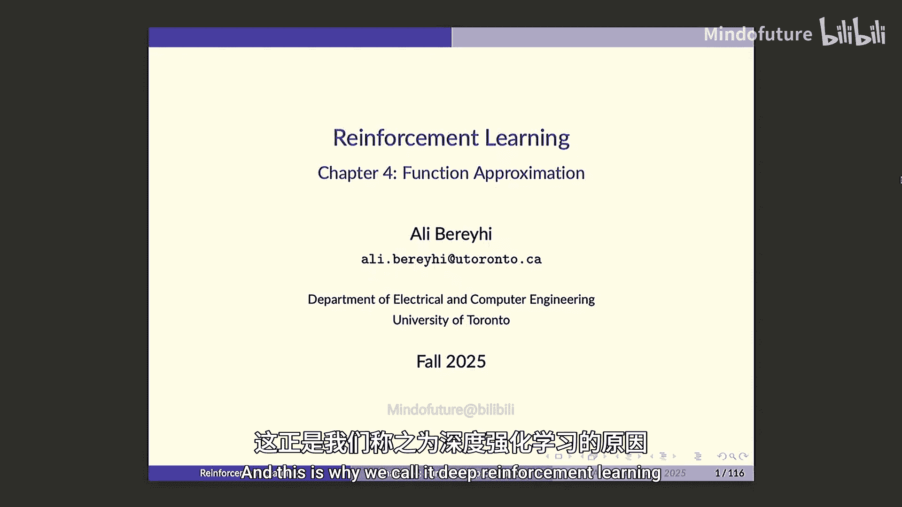

上一节我们介绍了在未知环境中通过采样进行估计的模型无关方法。本节中我们来看看，当我们面对的问题规模变得非常庞大时，这些方法会遇到什么挑战。

我们之前所做的本质上是一种学习。但这并非传统意义上的机器学习。它是在一个概率环境中试图找出某种统计结论，这仍然是一种学习问题。但这并非那种利用机器学习的“魔法”来预测从未见过事物的计算学习。例如，如果你想知道某个特定状态的价值，你需要足够多次地访问它。如果没有访问过，就无法知道。到目前为止，还没有“魔法”。“魔法”实际上从这里才开始，这就是我们所说的**深度强化学习**。

在深度强化学习中，我们所做的只是在基础的估计方法之上增加一个神经网络。利用这一点，我们现在能够完成一些早期人们认为不可能实现的惊人任务。

## 理解表格型强化学习

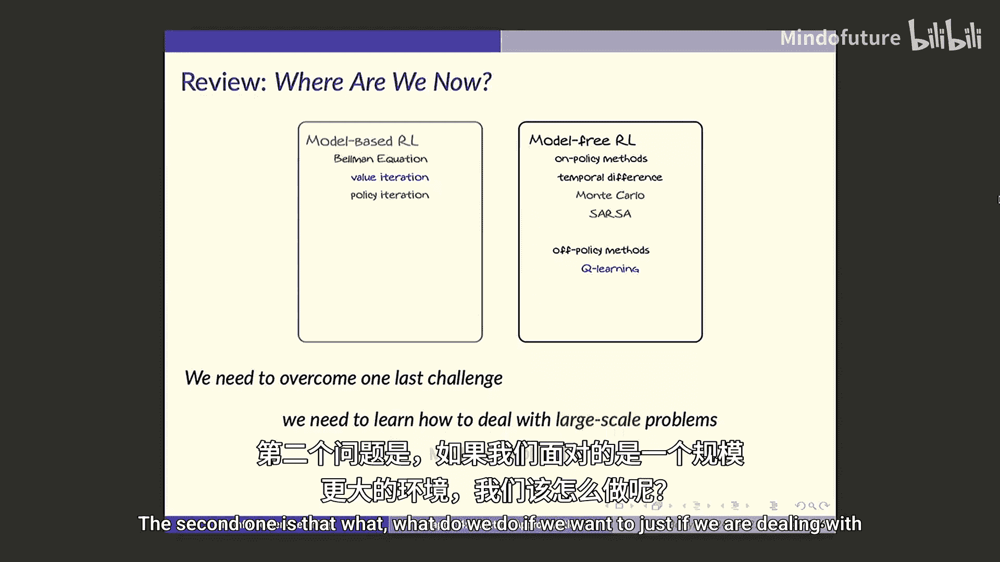

我们之前讨论过基于模型和无模型的方法。基于模型的方法帮助我们理解了贝尔曼方程，即环境的递归性质。现在，无模型方法中的术语对你来说应该很清晰了：什么是同策略、什么是时序差分、蒙特卡洛以及策略学习。

现在我们要回答第二个问题。第一个问题是：我们不知道环境，怎么办？答案是我们可以估计它，这就是无模型强化学习。这是挑战的一部分。第二个问题是：如果我们处理的是一个**大规模环境**，我们该怎么办？这正是本章节要探讨的内容。

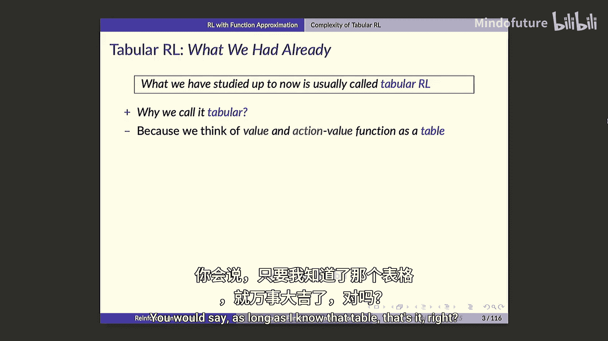

到目前为止，我们所拥有的是所谓的**表格型强化学习**。这个词的来源是，你可以将价值函数或动作价值函数看作一种表格。你尝试做的就是估计那个表格内部的值。你会认为，只要我知道那个表格，就万事大吉了。

## 表格型方法的运作与局限

例如，在所有实际算法中，你处理的是动作价值函数 `Q(s, a)`。这实际上是一个表格，索引是状态 `s` 和动作 `a`。假设你有 `M` 个状态和 `N` 个动作，那么你的表格就有 `M × N` 个不同的条目。你不知道这些条目的值，你尝试基于采样来估计它们。一旦估计出来，你就把它们当作已知，并据此执行最优策略。这就是为什么称之为“表格型”。

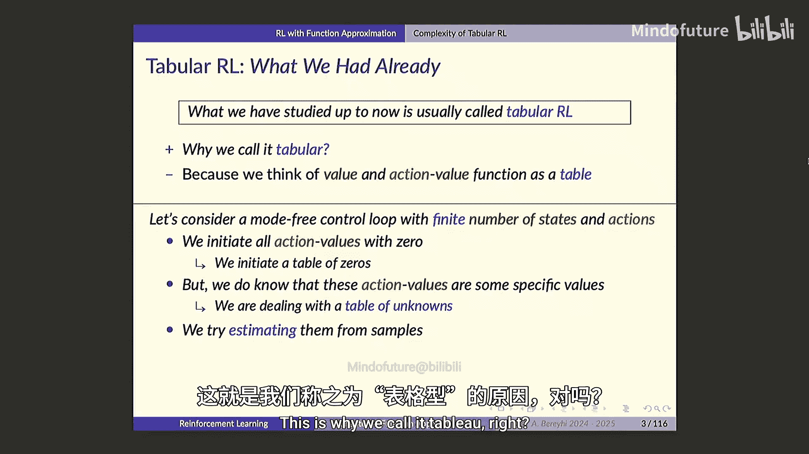

如果你想将其可视化，如果你只处理价值函数 `V(s)`，那么你有一个价值表。你的状态可能是 `S1, S2, ..., Sn`，这是所有可能的状态。你想知道它们的价值。最初，你把所有值设为0，然后不断进行游戏。基于获得的样本，你尝试改进这些值，并希望它能收敛到有意义的结果，然后用它来决定最优策略。

更实际的是，我们通常使用 **Q 表格**。Q 表格本质上是二维的相同事物。对于任何状态和任何可能的动作，你最终再次在环境中采样一条轨迹。每次你进入这些单元格中的一个（即处于某个状态并采取某个动作），基于这些样本，你提出某种方法来再次估计这些值。如果你能让这个表格非常可靠（例如收敛到低方差的结果），那么你就可以基于它来做决策。这就是整个想法。

这很好，它给了我们收敛的结果。但收敛总是伴随着一个要求：你这里的**每一个单元格**都需要被访问无限次（实际上是大数次）。如果你考虑一个现实问题，这几乎是不可能的。这就是现在的核心挑战。我们所做的（表格型方法）实际上是有效的，很完美。问题是我们无法在可行的时间内实现它。

## 大规模问题的不可行性

如果你想使用表格型方法，我们可以使用时序差分，也可以使用蒙特卡洛。最终，我们都需要看到所有那些**状态-动作对**足够多次。假设对于每一对，我们需要 `C` 个不同的样本（比如1000个样本，你才能信任得到的估计值）。那么你就需要 `C × N × M` 个不同的样本。`N × M` 是你拥有的状态-动作对数量。每个你至少需要访问100次，所以你需要的样本数是 `100 × N × M`。而 `N` 和 `M` 可能非常大。这不会发生。

在实践中，在大多数情况下，你甚至无法覆盖所有可能的配对。在许多实际问题中，表格型强化学习很好，但所需的样本数量级非常低效。为了能够依赖你得到的结果，最终需要的样本数量非常非常大，这在实践中是不可能的。

## 实例分析：井字棋与国际象棋

你看到问题所在了。让我给你几个例子。首先是**井字棋**。你知道这个游戏。你有不同的玩法，意味着你有不同的可能状态。总共有大约 `3^9`（约19683）种不同的状态。这是你可以玩游戏的方式数量。假设每次你有 `M` 个动作（我们先忽略 `M`，只谈状态）。假设你每秒可以检查一个状态，这已经很快了。从一个状态开始，你进行游戏以获得一个样本。这就是思路。如果你做蒙特卡洛，你再次从另一个状态开始，进行游戏，获得另一个样本。现在，如果你想为每个状态以及你在那里可以做的每个动作获得 `C` 个样本，那么这就是你需要的总时间（秒）。如果你把它转换成需要的年数，这个数字会非常大。

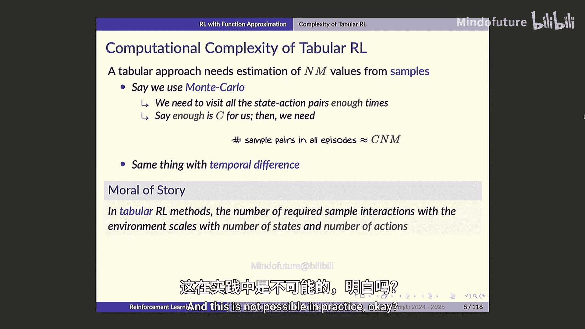

你可能会说：“好吧，我对这个游戏非常感兴趣，我愿意花这么多时间，没问题。” 那我们来看看**国际象棋**。我给了你们这个有趣的作业。你们看到了国际象棋有多少种可能情况。香农估计至少有 `10^120` 种情况。这个 `10^120` 并不精确，因为并非所有情况都是合理的国际象棋对局，很多是胡乱走的。人们开始研究这个问题。虽然没有确切的数字，但有越来越好的估计。但无论如何，这个数字是天文数字。

以下是几个关键数字的对比：
*   **井字棋**状态数：~ `3^9` ≈ 20,000
*   **国际象棋**状态数下限：~ `10^120`
*   **围棋**状态数：~ `10^170`

显然，为如此庞大的状态空间中的每一个状态-动作对收集足够样本是完全不现实的。表格型方法在这里遇到了根本性的瓶颈。

## 引入深度强化学习

因此，表格型强化学习的核心限制在于其**可扩展性**。当状态和动作空间变得非常庞大时，存储整个Q表所需的内存以及遍历所有状态-动作对所需的采样时间都变得无法承受。

这就是**深度强化学习**登场的原因。其核心思想是使用一个**深度神经网络**来近似表示价值函数 `Q(s, a; θ)` 或策略 `π(a|s; θ)`，其中 `θ` 代表神经网络的参数。神经网络是一个函数逼近器，它能够从见过的状态-动作对中**泛化**到未见过的情况。

我们不再维护一个巨大的表格，而是维护一个参数数量相对较少的神经网络。这个网络学习一个从状态（和动作）到价值的映射函数。通过训练，网络能够捕捉状态之间的相似性和规律，从而对新的、未见过的状态做出合理的价值估计。这解决了表格型方法无法处理大规模状态空间和需要无限采样的根本问题。

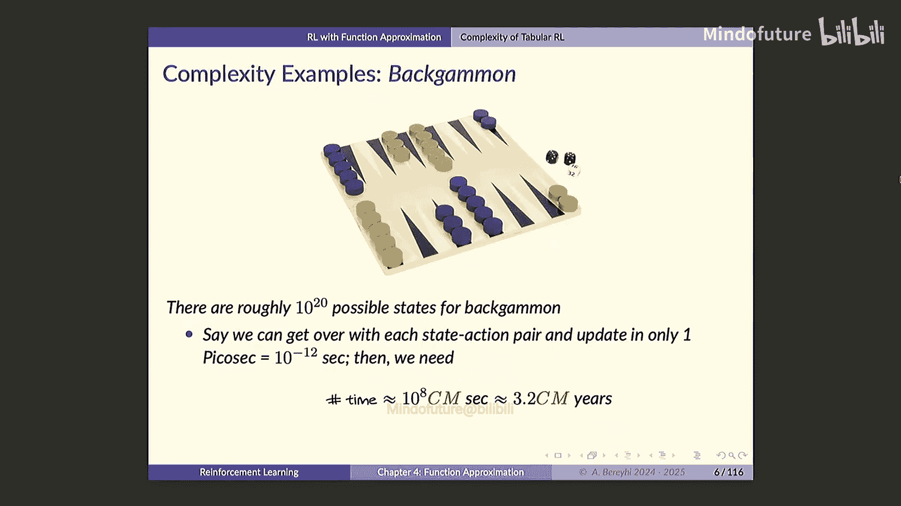

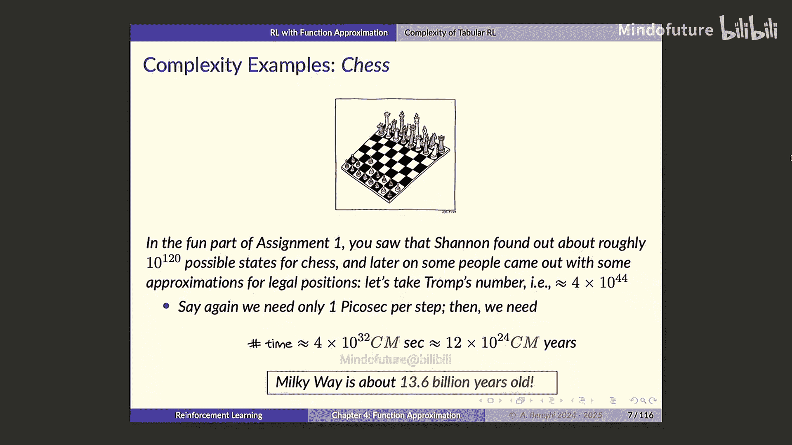

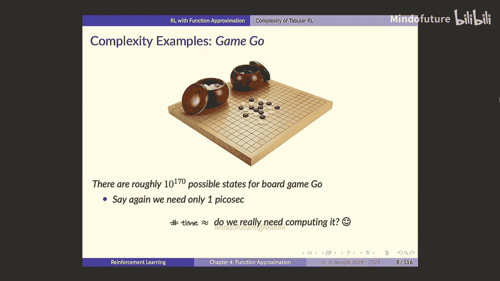

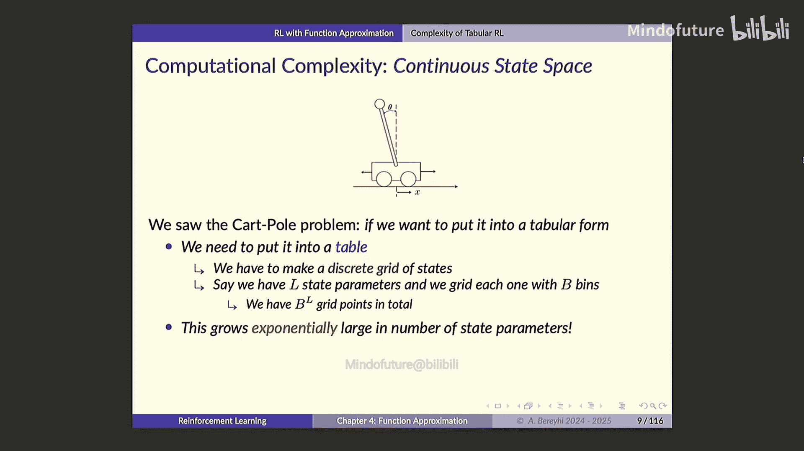

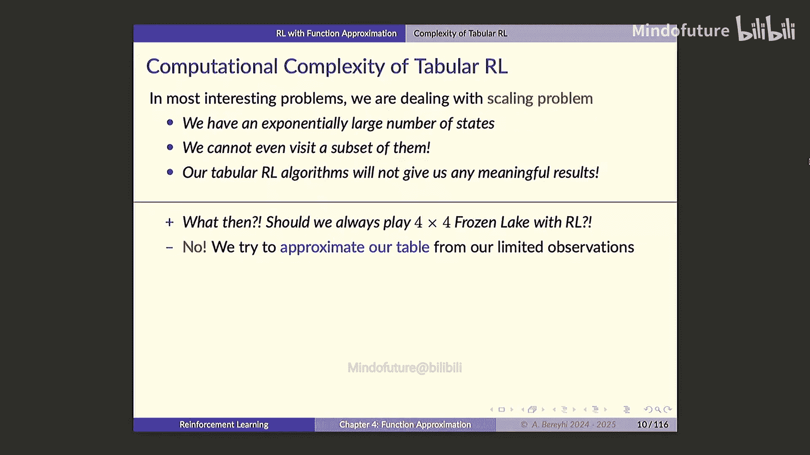

本节课中我们一起学习了从表格型强化学习过渡到深度强化学习的动机。我们分析了表格型方法在处理大规模环境时在样本效率和存储方面遇到的不可行性，并通过井字棋和国际象棋的例子具体说明了这一点。最后，我们指出了深度强化学习通过引入神经网络作为函数逼近器，为解决可扩展性问题提供了关键思路，使智能体能够学习从状态到价值的泛化映射，从而应对复杂的现实世界任务。