# 036：在强化学习中使用函数逼近

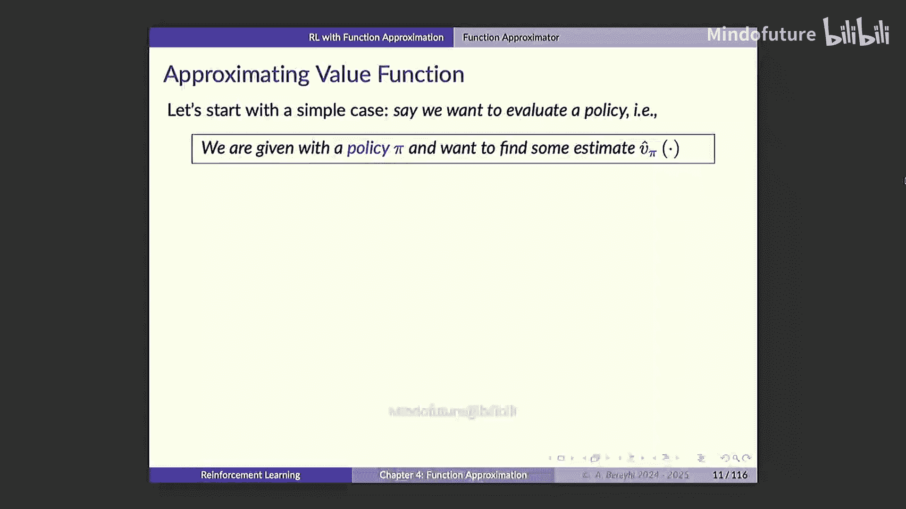

在本节课中，我们将学习如何在强化学习中使用函数逼近，特别是深度神经网络，来估计价值函数或策略。我们将从基本概念开始，逐步理解其优势、工作原理以及如何训练。

## 概述

在传统的表格化强化学习中，我们为每个状态或状态-动作对存储一个值。然而，当状态空间巨大或连续时，这种方法变得不可行。函数逼近通过使用一个参数化模型（如神经网络）来近似价值函数，从而解决了这个问题。本节我们将探讨价值函数逼近的基本框架、其相对于表格方法的优势，以及如何训练这样的模型。

## 价值函数逼近

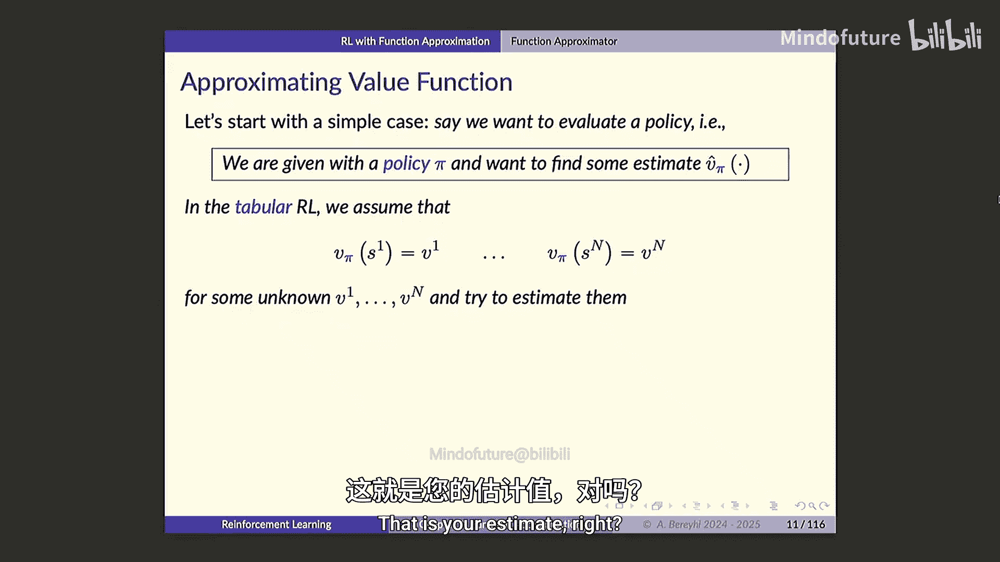

这是我们可以做的第一件事。我们并非只能做这一件事。我们也能使用神经网络或函数逼近器来估计策略。

当你只处理价值函数时，这是一种价值网络方法，即经典方法。其中最著名的是深度Q学习。

另一种情况是，你直接学习策略。这是基于策略的方法，即策略梯度方法。

然后，你可以将两者混合。因为在策略梯度方法中，如果你想训练那个策略网络，你仍然需要价值的估计。最初你可以用我们在这里做过的基本方法来估计，但后来人们说，也许我们可以有另一个价值网络来估计我们想要的价值。在这种情况下，你做的就是所谓的演员-评论家方法：你有一个策略网络（演员）在行动，还有一个价值网络（评论家）为你提供价值的估计。

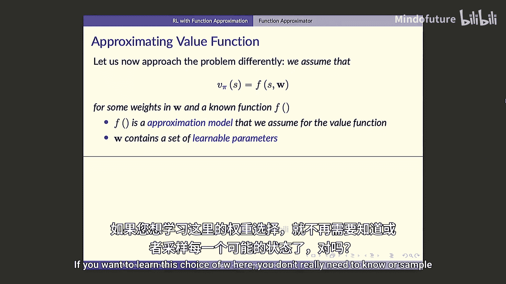

现在，让我们从通用框架开始。假设我们有一个特定的策略。我想让你估计该策略的价值。在表格化强化学习中，对于状态1是V1，状态2是V2，状态3是V3，依此类推。你有n个不同的值，然后你估计它们。如果你做蒙特卡洛，你只需进入一个状态，采样足够多次，然后对回报取平均，这就是你的估计。

但在实践中，这不再可行。你可以转而考虑使用函数逼近器。函数逼近器通常指神经网络。我使用通用术语“函数逼近器”，因为你可能想做神经网络以外的事情，但在实践中，你基本上只用神经网络。

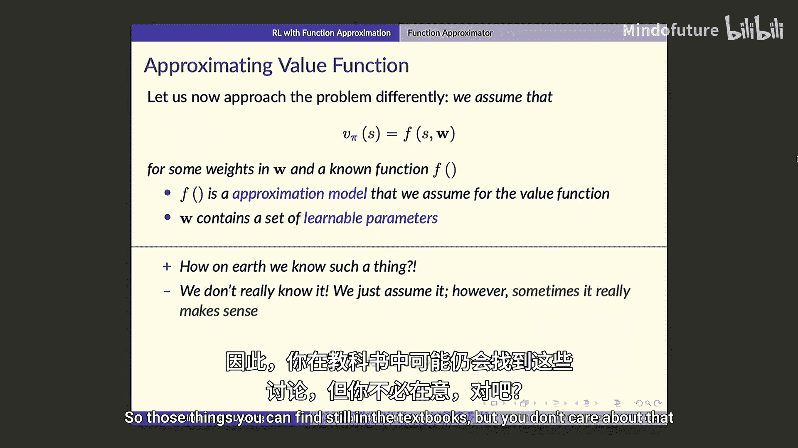

函数 `F_W(S)` 是一个函数逼近器，用于近似这个V函数。它内部有一堆权重W。状态S输入进去。你可能会问，我们真的直接把状态S输入进去吗？它只是一个数字。我们会讨论表示方法。最简单的表示是独热编码。状态输入后，经过一系列可调节的权重，然后输出结果。

你希望的是，能找到这些权重W的正确选择，使得这个函数能精确复现你寻找的价值函数。这能实现吗？是的，因为你有一个深度神经网络，它是一个通用函数逼近器。这意味着如果你有一个非常深的神经网络，它能够表示任何函数，包括你寻找的价值函数。

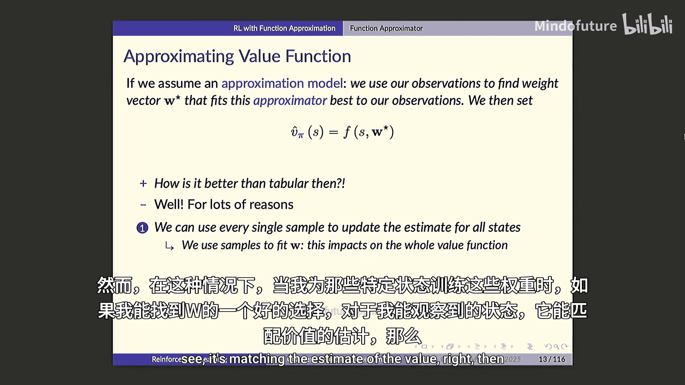

如果你想学习这里的权重W，你不再需要知道或采样每一个可能的状态。你只需尽可能多地采样，将它们作为样本数据，然后尝试基于该数据集训练你的函数逼近器。

这就是大致的思路。这是一个神经网络，有一堆可学习的参数（权重）。我们想做的就是找出这些权重的正确选择，使得它能拟合我们想要的原价值函数。

## 函数逼近的优势

你可能会问，这个模型（神经网络）的选择合理吗？在过去，人们需要使其合理。例如，在连续状态问题中，角度这样变化，彼此接近的角度应该具有大致接近的价值。所以这个函数应该具有这样的性质：如果我稍微改变状态，价值也稍微改变。它需要是连续的、可微的等等。但现在我们不需要担心这些了。神经网络具备所有好的性质，没有坏的性质。它是地球上最好的工具。我们不再关心那些了。这些内容仍然在教科书中，但你不需要关心。它是有意义的。

现在，你想找到这个正确的逼近器。你基本上想找到权重的正确选择，这些选择有望为你提供特定策略的价值函数的正确估计。

这个估计会比表格化方法更好吗？在复杂性方面，显然如此。例如，用表格法，我可能只对少数状态有好的估计，对其他状态则没有。而在这里，当我为那些特定状态训练这些权重时，如果我找到了一个好的权重选择，使得对于我能看到的状态，它能匹配价值的估计，那么它也会给我一些关于其他状态的信息。这比我在表格化情况下什么都没有要好。

实际上，当你训练这个模型时，你会从中得到一些东西。因为最终，将W拟合到你的数据上，不仅会给你已见状态的价值，也会给你未见状态的价值。仅仅因为这个函数逼近器以某种方式将它们联系在一起。

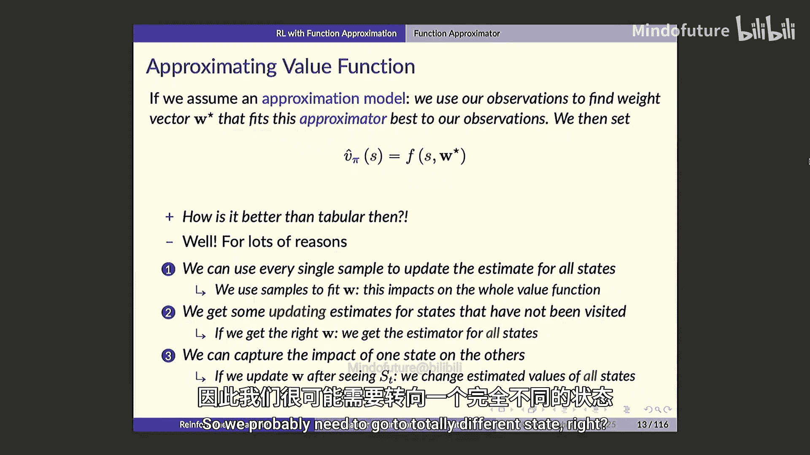

另一件事是，当你更新一个状态的价值时，就像我们做时序差分学习时，我们必须做资格迹追踪。整个想法是，如果我进入这个状态，由于我已经见过许多其他状态，并且最终我基于这个状态的价值更新了那些状态的价值，也许我应该回去也更新它们。我们经历了所有这些麻烦才想出资格迹追踪。而在神经网络中，你可以直接做到这一点。因为一旦你获得一个新样本并更新，你不仅仅是在更新一个状态的价值，你最终是在更新所有人的价值。当神经网络中的一个权重改变时，它不会只改变一个特定输入的值，任何输入进去都会改变输出。所以它以一种方式将影响传播到所有状态。这又是一件好事，因为我们直观地知道，当一个状态的估计变得更好时，也应该使其他价值的估计变得更好。

最后一点是，它将以某种方式捕捉这个状态对价值的影响。如果你训练一个神经网络，你的状态有很多可能的参数。也许其中一些是无用的，也许其中一些是冗余参数。我记录它们是因为我不知道这是否是状态的一部分。例如，机器人中的某个特定角度可能完全无用，我不需要知道它来评估价值，但我事先不知道。如果我想做表格化强化学习，那么我需要在我的状态空间中考虑那个状态并学习其价值，最终我发现它没有影响。但在这里，你不需要再这样做，因为你现在从深度学习中很好地知道，神经网络有能力忽略那些没有信息的参数。所以它将只关注有信息的特征，这又是一件好事。

总的来说，除了复杂性之外，从信息的角度来看，这也说得通。因为这种逼近器在某种程度上充当了一种通用操纵器，处理所有的价值。而在表格化情况下，你只关注一个特定的价值，你只处理那一个。这至少在我们所处的环境中不是最好的主意。如果某种情况或游戏中的某个特定状态发生了某事，那么如果我们只是稍微改变这个状态，我们可能对将要发生的事情有一些想法，大致相同。所以我们需要进入完全不同的状态。

## 可用的逼近器

显然，我们将总是使用深度神经网络。在深度学习之前，还有一些其他想法，如特征变换、傅里叶变换、小波变换。但现在我们不再使用它们了。

线性逼近基本上就是我们之前在表格化情况下所做的。我将展示，如果你将函数逼近器设置为线性函数逼近，那么你最终会得到和以前完全一样的结果。

现在，我们将重点讨论这两种：线性逼近（作为回顾）和深度神经网络。使用深度神经网络的主要原因之一是这些模型是可微的。即使在旧时代，与许多特征变换相比，人们也更喜欢线性模型，主要原因是线性模型是可微的。你有权重与东西相乘，当你想求导数时，你只需对任何权重求导，这非常简单。但你会逐渐明白为什么它们好。

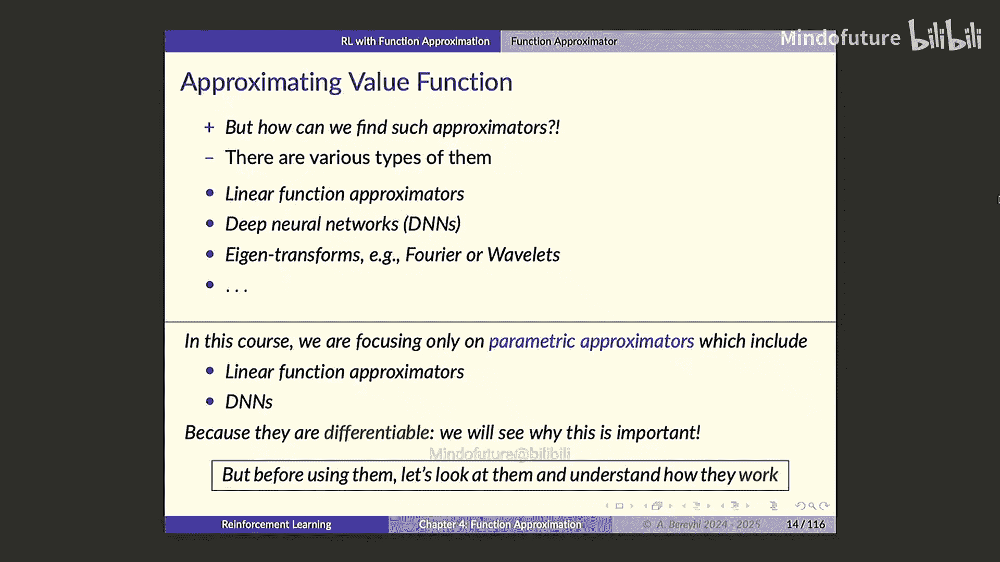

## 训练与泛化

价值函数是基于你对Q函数的估计。你可以说你的最优策略是什么。你不知道它。你只是得到估计。就像我们在表格化情况下做的那样。如果我在特定的状态和动作，我可以对环境进行采样。我专注于一个状态和动作，采样很多次，然后取平均。这将给我那个状态的估计。使用蒙特卡洛或时序差分法。这就是我们在其他章节中讨论过的。我在一个点、一个状态上做蒙特卡洛或时序差分，在另一个状态、另一些状态上做，然后我尝试将我的模型拟合到我在这些点上估计的价值。然后我会说，如果所有状态之间存在一种低维行为，那么这个模型最终会学习到其他状态的价值，而这些状态我没有时间去遍历。如果情况并非如此，那么这就是我能做的最好的事情。

但你知道，我们不一定需要专注于策略。我们可以做离策略学习。在Q学习中，我们可以对最优策略进行采样，然后基于该估计，我们可以知道在少数状态-动作情况下的最优Q值。然后你尝试将你的Q网络拟合到这些点。希望这能再次给你对其他状态和动作的正确估计。

所以你真的不需要做广义策略迭代。你可以做，但你真的不需要做，因为你也知道重要性采样。

或者进行估计。所以这是一种有噪声的估计，它可能会严重过拟合。所有这些麻烦在这里也存在，我们对此无能为力。

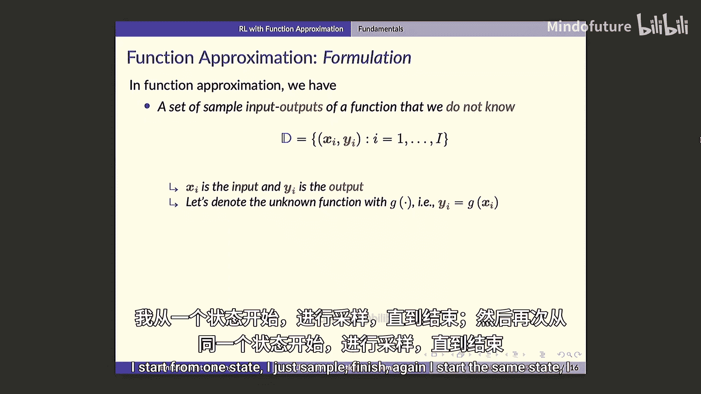

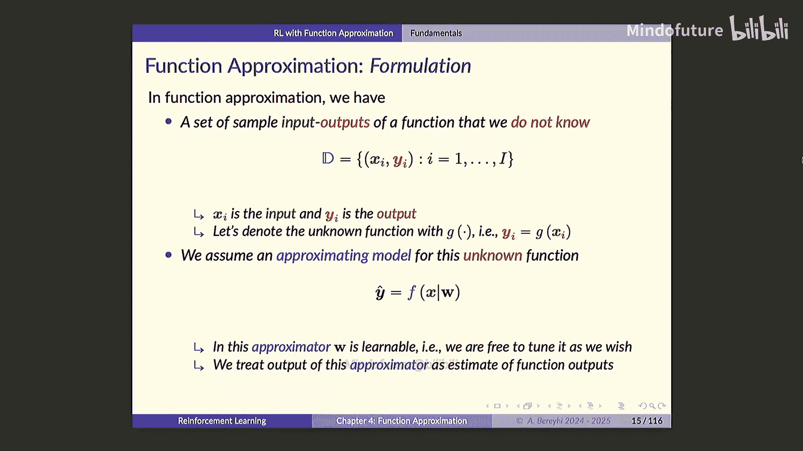

## 深度神经网络训练

思路清楚了吗？很好。所以如果你明白了，我就讲最后几张幻灯片。上次我讲得更多，然后人们告诉我可以相信我，他们记得深度学习。所以我只讲几张幻灯片来回顾，并给出符号表示。我相信你们大多数人都接触过深度学习，回顾一下有好处。这里我应该提到的一点是，我不会深入讲解像反向传播这样的内容，这些不是本课程的一部分。但如果你想实现任何东西，你需要能够实现一个神经网络。我在这里说的任何内容，比如模型更新，对你来说应该是有意义的。你不需要知道什么是CNN来跟上课程，但最终，如果你想实现我在这里告诉你的任何东西，你真的需要使用CNN。根据我的个人经验，如果你不知道什么是CNN，理解为什么这会奏效会有点困难。但正如我所说，我不会在本课程中指定模型或任何东西。所以如果你很久以前学过，想回顾一下，完全没问题。只要你熟悉这些概念就行。

我们如何进行函数逼近？通常，我们在这里获得一堆样本。这些样本是函数的输入，X是输入，Y是函数的输出。然后你有它们的一些样本。在我们的例子中，X是代表状态的东西，我们称之为该状态的特征表示。这是进入神经网络的东西。Y是价值，或动作价值之类的。现在我可以收集一堆样本，不需要太多，根据我的计算复杂度来定。同样，如果我想收集它们，我应该做一些像蒙特卡洛或时序差分这样的事情。这意味着我从一个状态开始。如果你考虑价值函数估计，我从一个状态开始，采样直到结束，然后我从同一个状态开始，采样直到结束，然后我对所有回报取平均，这就是这个状态的价值。

这个模型更具表现力。这是第一点。

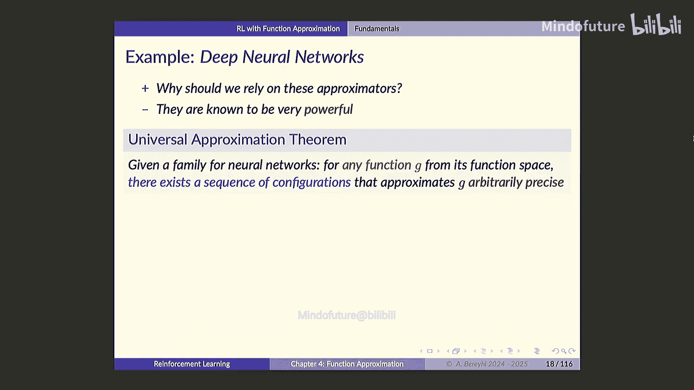

现在，这是它起作用的主要原因：通用逼近定理。你们大多数人可能见过或至少听说过。它说的是什么？它说，如果你有一个深度神经网络，它几乎能够估计任何函数。这里的“任何函数”并不意味着它真的能处理宇宙中所有可能的函数，但它能以良好的精度处理几乎所有函数。如果你想提高精度，你应该做什么？你只需增加模型的复杂度。你增加该模型内部的神经元数量。随着你加深网络，模型的表现力会越来越强，并且表现力会随着深度呈指数级增长。这意味着，如果一个深度为1的模型可以近似，我不知道，100个函数，那么当你使其深度为2时，它将是100的2次方，深度为3是100的3次方，依此类推。虽然不是完全相同的数字的幂次，但你明白这个意思，缩放顺序。这就是为什么我们对深度神经网络感到满意，它们在逼近意义上是完美的。这就是我们今天想做的。

## 训练过程

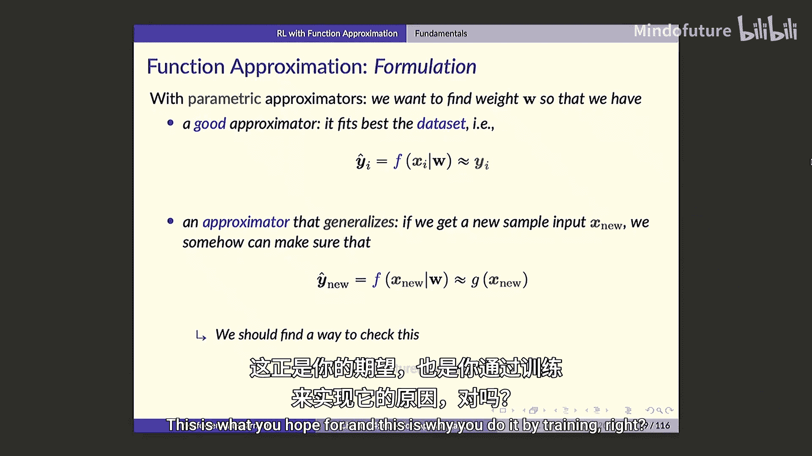

如果你想进行训练，你基本上只是尝试让你的模型在每个数据样本上的输出与你拥有的估计值匹配。你希望如果你获得新数据，你将在神经网络的输出端得到对真实函数的良好近似，而你并不知道真实函数。这第二个想法就是我们所说的泛化。你希望这种情况发生，这是你通过训练所希望的。

如果你想可视化模型，这可能对思考函数逼近有很大帮助。假设你的状态X是一个标量数字，输出Y也是标量数字，例如该状态的价值。这是一个标量函数，函数内部有一堆你可以改变的权重。

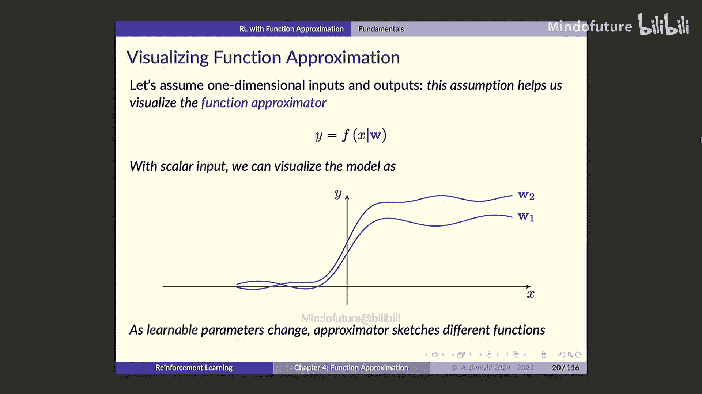

如果你设置一些权重，它看起来会像这样。如果你改变权重，它会改变。你想做的就是找到权重的正确选择，使其至少通过数据集中你拥有的每一个点。并希望在其他点上，例如，你知道这个特定的点，你尝试调整你的权重，使其精确地通过那个点或大致接近那个点。你希望的是，像区域函数足够平滑，当你从这个点经过到周围点时，你的模型给出的结果大致相同。

## 梯度下降

我们如何训练深度神经网络或任何模型？我们基本上做经验风险最小化。你有你的样本。X输入，Y输出，然后你让你的样本通过你的神经网络。这是你得到的 `F(x|W)`。这不一定与你数据集中拥有的东西相同。你只是调整你的W使其发生。如果你想这样做，你计算某种损失，这两者之间典型的损失是均方误差。所以我的神经网络输出减去我拥有的价值估计的平方。如果你使其为零，如果你最小化它，那将至少通过你数据集中拥有的相同值。然后对于其他点，你将是相同的。这是经验风险，然后我们进行训练。每个人都知道这个，对吧？没有问题。

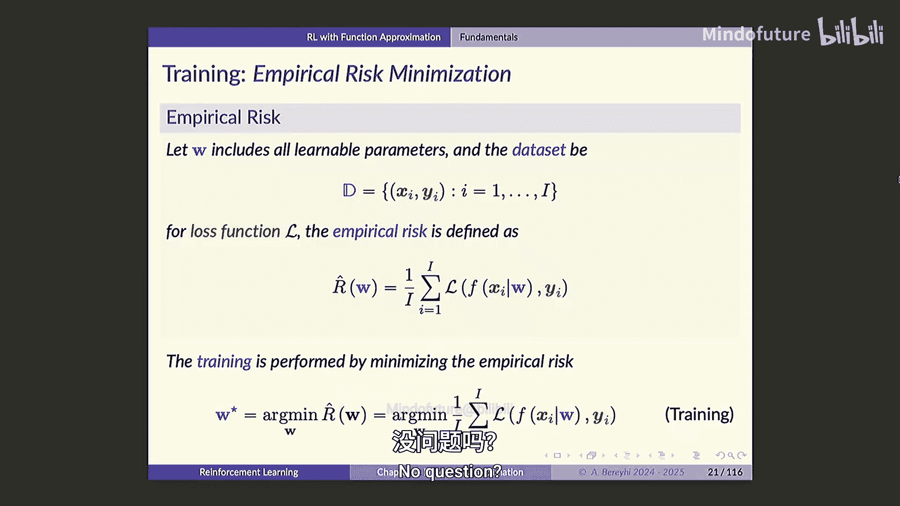

如果没有问题，我想回顾一下梯度下降。当你想要最小化这个函数时，梯度下降算法是什么？你需要从一组权重开始。这些是你的神经网络内部的权重。然后你持续计算每个权重的梯度。然后你沿着梯度的方向移动。

每个人都没问题，对吧？现在，如果你想计算梯度，基本的梯度下降告诉你，你需要计算数据集中所有样本的损失函数的梯度。这就是为什么我在第4行以这种形式写下来，你为一个样本计算它。所以你发送一个样本到你的网络。你计算梯度。你用什么来计算那个梯度？反向传播。很好。所以你记得反向传播，你将用它来计算这个特定的梯度。然后你需要对它们取平均。所以你处理你拥有的所有样本，也许有1000个样本，你收集的每一个样本。最后，你对它们取平均，全部加起来除以1000。这是一种方法。但在实践中，我们使用什么？我们做这种全批量训练吗？不，我们做什么？我们做随机梯度下降，我们使用小批量。所以你将从数据集中随机选择一个小批量数据，然后尝试计算该批数据的梯度，然后在该批数据上取平均。你希望这是真实梯度的良好估计，然后你继续前进。就是这样。

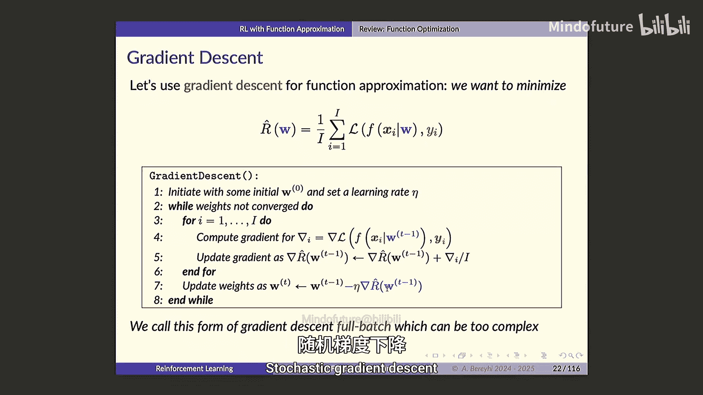

大家对深度学习、深度神经网络以及如何训练它们都没问题，对吧？很好。所以如果你知道这些，那么要跟上这门课程，你不需要知道更多关于深度学习的知识了。

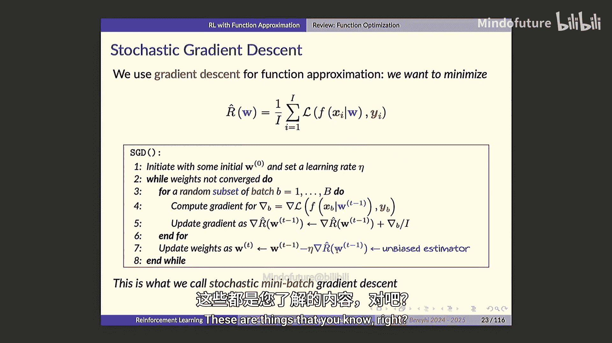

## 在强化学习中的应用

没有问题。所以让我给你一个简单的设置，我们在强化学习中使用函数逼近器。然后我们下周二将首先完全讨论线性模型，然后逐渐扩展到一般情况。

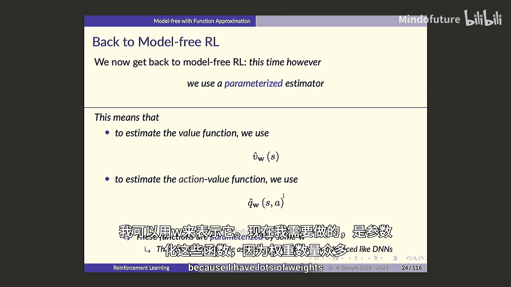

现在，当我有了这个特定的价值函数。这个价值函数估计器，这个家伙是价值网络或价值函数的逼近器。你看到这里的这个家伙是价值函数的逼近器。你没问题。你觉得我把W放在那里很舒服，因为W只是代表我的神经网络中的一些权重。

同样的事情我可以为我的动作价值做，所以我可以用W表示它。现在，我需要做的事情。这些是参数，因为我有很多权重。我唯一需要做的就是找到那些正确的权重。

但是，如何在实践中使用它们？我想我已经给了你一个大致的概念，你至少可以怎么做。在预测中相当简单。你可以估计几个特定的样本点。所以你只需选择几个状态，估计它们的价值，然后将其作为参考，尝试将你的模型拟合到那些样本中，希望它对其他状态也有效。

当涉及到控制时，情况变得有点复杂，因为随着你改变策略，你的价值也在随时间变化。这意味着你的价值逼近器不仅仅是在估计一个随时间固定的函数。这个函数随时间变化，因为你的策略在变化。这是一个更困难的情况，我们将花很多时间来解决它。但这是使整个情况变得相当复杂的关键麻烦。

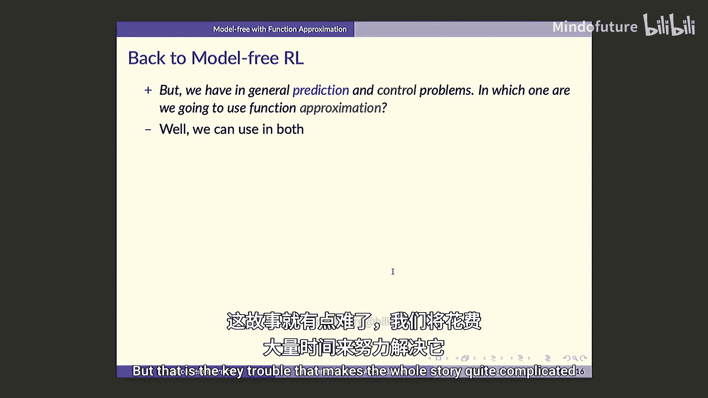

让我们从简单的情况开始，快速回顾一下，预测仅仅意味着我们有一个策略，我们想评估它。这不是一个大问题，因为我们有一个策略，如果我们有足够的时间，你可以简单地做足够的采样，通过足够的采样，我们收集一些样本点，然后我们可以学习价值函数。这不是一个大麻烦。主要的麻烦出现在我们做控制时，因为我们在估计价值函数方面非常受时间限制，因为我们还想更新我们的策略。这有点复杂。

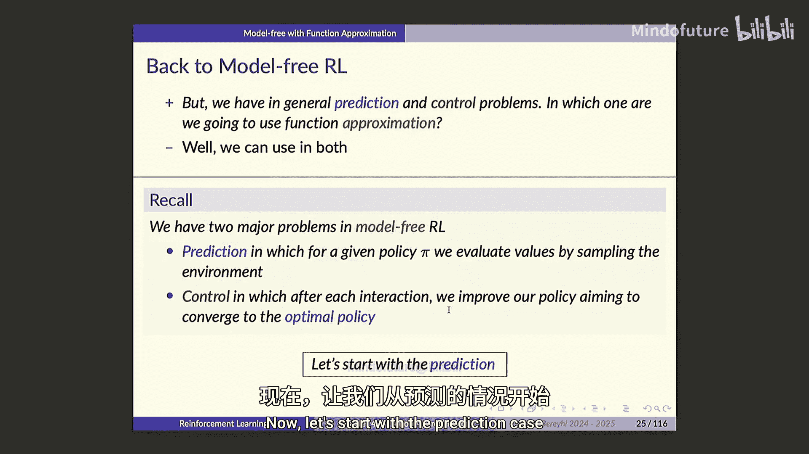

## 预测案例

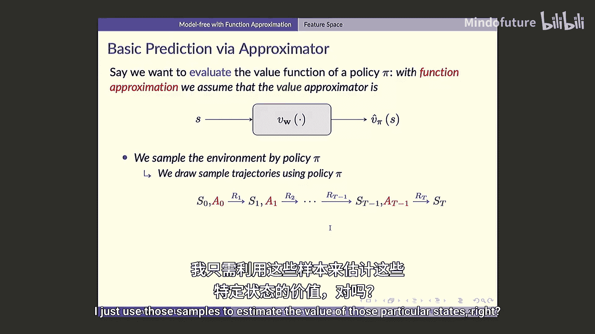

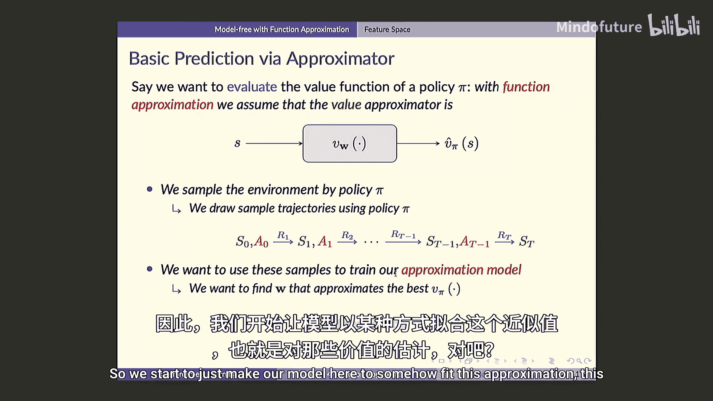

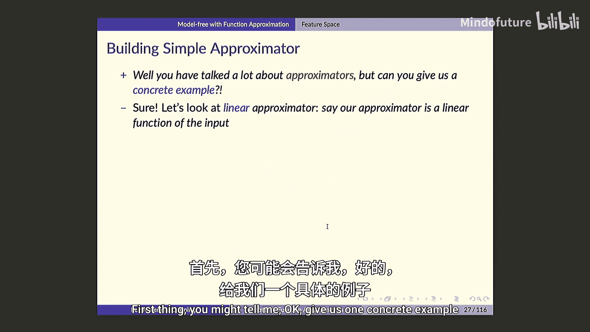

现在，让我们从预测案例开始。预测案例对你来说应该相当简单。预测中的想法是，我们想评估策略，我们能做的是在那里放一个神经网络。这个 `V_W` 是神经网络，该神经网络将状态作为输入。然后在输出端，它将给你这个状态的价值。

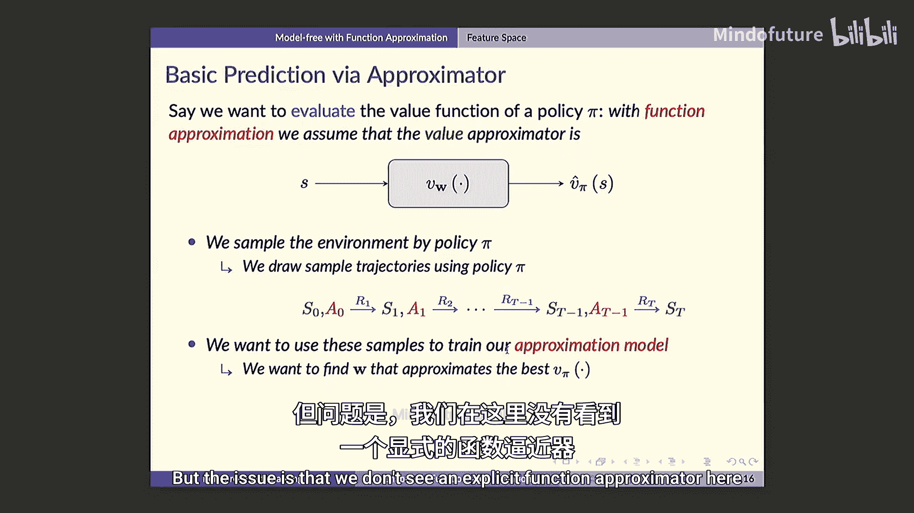

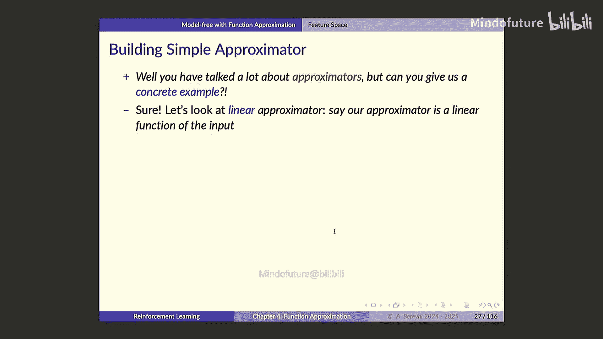

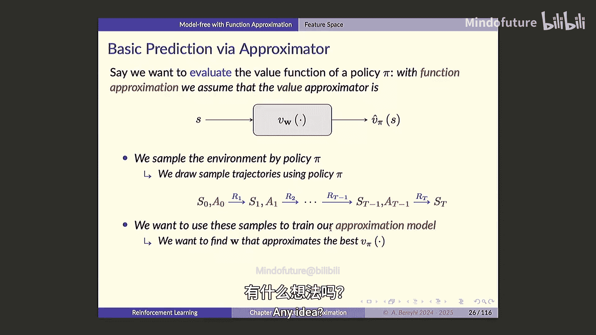

每个人都没问题，对吧？很好，就是这样。现在我们如何收集样本？我可以开始用我的策略进行游戏，然后我会看到一堆状态。我肯定看不到所有的状态。我只看到它们的一个非常小的子集，但这没关系。我只需使用那些样本来估计那些特定状态的价值，然后利用这些价值估计，我们开始让我们的模型以某种方式拟合这些价值的近似估计。

## 线性案例与特征表示

现在，你可能会告诉我，好吧，给我们一个具体的例子。这个蓝色的框很好。但问题是，我们在这里没有看到一个显式的函数逼近器。让我们从线性情况开始，最基本的情况。线性情况会是什么？你认为这里的线性情况会是什么？假设你的状态是一个标量或数字。

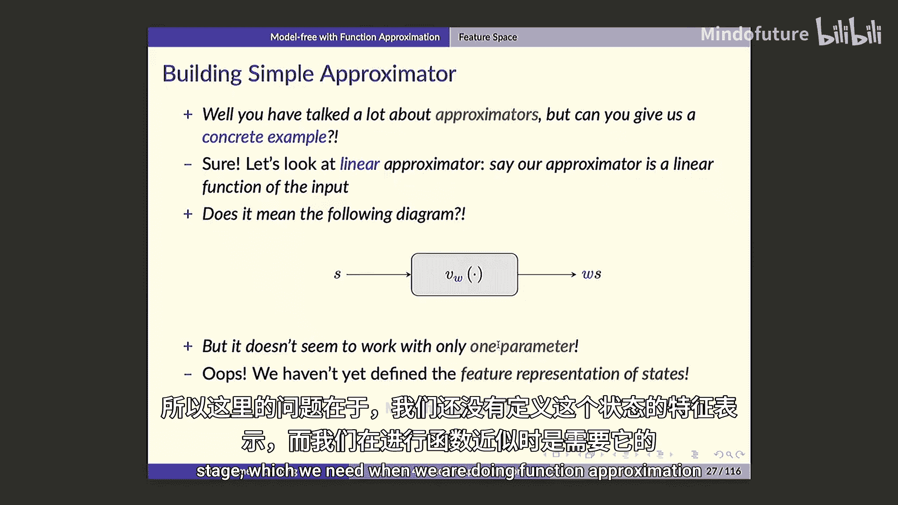

状态1，2，3，直到状态10。你怎么做？线性模型是什么，有什么想法吗？

假设我们想非常天真。我给出这个状态，然后它乘以某个权重，然后输出就是价值。这显然行不通，对吧？你知道的，对吧？这只是一个单一参数。我的意思是，我真的无法让它工作。这对你来说是完全显而易见的。这不是我们在做表格化强化学习时的情况。在表格化情况下，当我们有n个不同的状态时，我们有多少个参数？我们没有称它们为参数。我们只是称它们为表格中的空单元格。我们有多少个？如果我们有n个不同的可能状态和不同的可能价值，每个都是一个参数。我们不知道它。我们将学习它。所以我们有n个不同的参数，我们没有一个单一参数，然后我们需要以某种方式匹配它。所以这里的问题是，我们还没有定义这个状态的特征表示，而这是我们在做函数逼近时需要的。

什么是特征表示？如果你有一个特定的状态，那么你想做的是以某种方式将其展示给你的神经网络。你可以想出不同的主意。

一般来说，你可以说，我有n个不同的可能状态，对于每个状态，我给出一个表示。显然，你希望这个表示尽可能大，因为越大，它携带的特征就越多。特征表示意味着，你看到你拥有的n个可能状态中的一个，然后有一个特定的变换，只是将该状态转换为另一个值。如果我们想很傻，我们可以说，我有一个状态1，2，3，直到n，然后我可以用这个索引表示每个状态。我有一个有16个不同单元格的网格世界，16个不同的状态。我会说状态1用1表示，状态2用2表示，类似这样。我可以这样做，但这不是一个很好的选择。更好的选择是这个家伙。这实际上是我们到目前为止所做的。我们到目前为止所做的，实际上使用了这个作为表示，或者叫独热编码表示。所以我们说，如果我在状态1，那么这用一个特征向量表示，大小为n。第一个条目的值是1，其余都是0，表示我在状态1。当我在S2时，同样的向量，所有条目都是0，第二个条目是1，依此类推。现在你显然看到的一件事是，如果你改变状态的这种表示，你的神经网络的架构将会改变，因为你的神经网络在第一种情况下只处理一个整数输入，而在第二种情况下处理一个n维向量。

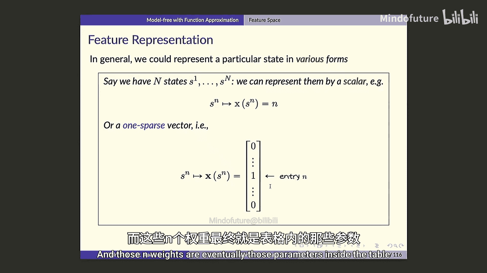

如果你考虑线性模型。第一种将只有一个权重，第二种将有n个权重，而这些n个权重最终就是你在做表格化强化学习时试图估计的表格内的那些参数。

## 高级表示与总结

最终，你将拥有一个特征表示。对于一些简单的问题，如虚拟网格世界，很容易表示，只要你确保没有遗漏任何信息，那就没问题。对于一些更复杂的问题，比如一个超级复杂的电脑游戏，那么你可能需要想出一个好的特征表示。也许游戏中几帧的截图就是这种状态的一种表示。你可以为一种状态收集不同形式的数据，每一种都是一种表示。在实践中，当你实现一个新问题时，哪一个是最好的，这也是一个挑战，你需要找出来，你需要弄清楚哪一个是最好的。

从现在开始，我们将假设，无论我有什么状态，我有一个空间，即所有可能状态的空间。在虚拟网格世界中，这很简单，比如有169种不同的情况，但在像国际象棋这样的东西中，这个家伙有10的40次方种不同的情况。然后你需要一个映射，无论你处于哪个特定状态，你都有该状态的一个表示。如果你考虑国际象棋，也许表示是你去拍一张棋盘的照片，这就是一种表示。这就是我所在的状态。

现在，当你想回到我们之前的所有故事时，你应该总是以这种形式思考。我称之为标记化，不是每个人都这样叫。所以请不要在这里以外使用它，因为我不想让自己难堪。标记化是别的东西，但它几乎在做同样的事情。就像对于每一个可能的状态，你给出一个标记。然后你说，我有一个巨大的向量，其中一个代表我所在的状态。但显然，这在国际象棋中是不切实际的，因为那个向量应该是10的40次方维，这是不可能的。你将要做的是找出一个更好的特征表示。

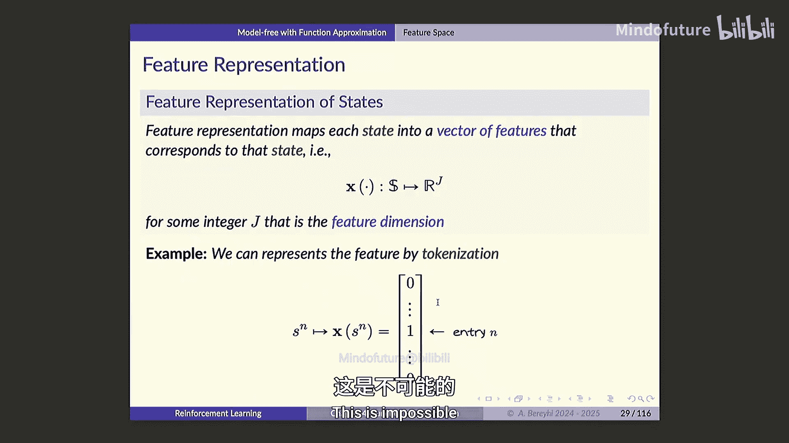

在更高级的问题中，正如我所说，你需要有一个特定问题的特征，这有时有点麻烦。但这里有一堆例子，例如，当你考虑机器人或任何你想训练以执行特定类人动作的实体时，那么，这些东西可以收集状态特征的不同值。显然，这个房间里的一个机器人有一个状态，这个状态与它的位置成比例，但你可以用不同的形式表示它。离周围墙壁有多远，或者它朝向什么方向。这些是显示该特定机器人状态的参数。或者，例如，如果你在处理电脑游戏，一个非常典型的事情是，你获得几帧图像，显示正在播放的游戏的一小部分，这就是游戏的状态。这是另一种表示。

## 总结

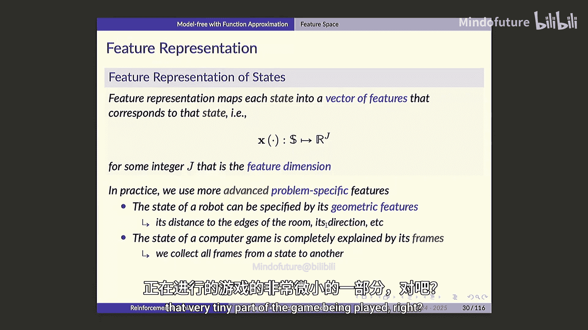

在本节课中，我们一起学习了在强化学习中使用函数逼近的核心概念。我们从为什么需要函数逼近开始，了解了使用神经网络（特别是深度神经网络）来近似价值函数的基本框架。我们讨论了函数逼近相对于传统表格方法的优势，包括更好的泛化能力、参数共享以及自动特征提取。我们还回顾了训练神经网络的基本原理，如经验风险最小化和梯度下降。最后，我们探讨了状态特征表示的重要性，以及如何从简单的独热编码过渡到更复杂、问题特定的表示。这些知识为我们后续深入探讨线性逼近模型和深度Q学习等高级主题奠定了基础。