# 037：通过函数逼近实现灵活性 🚀

在本节课中，我们将学习如何利用函数逼近（例如神经网络）来处理强化学习中的连续状态空间问题。我们将以“山地车”环境为例，对比传统的表格化方法与函数逼近方法的优劣，并理解如何通过调整模型复杂度来平衡样本效率与预测精度。

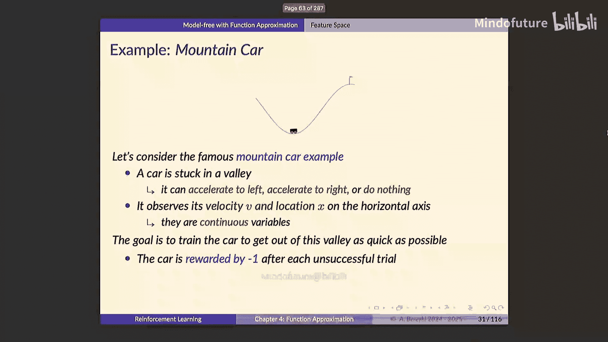

---

## 概述：从表格化方法到函数逼近

上一节我们讨论了值函数估计的基本概念。本节中，我们来看看当状态空间是连续而非离散时，传统表格化方法面临的挑战，以及函数逼近如何提供一种灵活的解决方案。

## 山地车问题示例 🏔️🚗

为了理解如何使用神经网络或任何模型进行函数逼近，我们先来看“山地车”这个例子。这个环境可以在Gymnasium库中找到。

在这个问题中，一辆车位于山谷中。智能体可以采取的动作是**向左加速**、**向右加速**或**不执行任何操作**。因此，动作空间是离散的，包含三个选项。

智能体在该问题中能观察到的信息是**速度**和**位置**。目标是让小车冲出山谷，到达山顶。通常的策略是，先向左加速上坡，滑下后再向右加速，如此反复，直到成功逃脱。每次失败的尝试都会获得-1的奖励，因此智能体希望用最少的步骤逃脱。

## 状态表示与挑战

在这个问题中，小车的完整状态本应包括位置、速度、加速度、与地面的摩擦力等诸多因素。然而，智能体实际只能访问**速度(V)**和**位置(X)**这两个参数。因此，这只是一个**状态表示**，而非完整状态。

关键挑战在于，X和V都是**连续**变量。如果我们想用表格化强化学习（Tabular RL）来解决，就会遇到问题。

以下是表格化方法面临的困难：
*   **状态数量无限**：由于X和V是连续的，理论上存在无限多个可能的状态。
*   **必须量化**：要应用表格法，必须将连续空间**离散化**（或称量化）。例如，将位置范围[A, B]划分为G个网格点：`x1, x2, ..., xG`。对速度也进行类似处理。
*   **状态组合爆炸**：如果每个维度有G个网格点，那么组合后的离散状态总数就是 `G^2` 个。

## 函数逼近方法

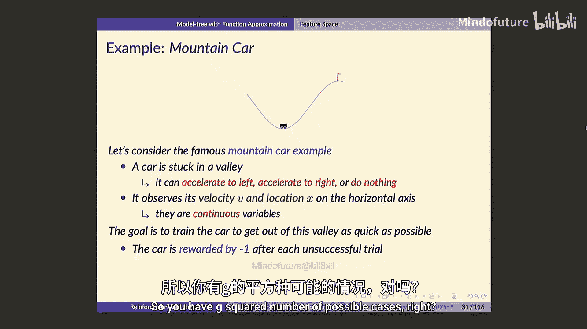

如果我们使用神经网络（或任何函数模型），就可以绕过量化步骤。我们可以直接将状态表示（特征向量）输入模型。

具体做法如下：
1.  将状态表示为一个特征向量，例如 `[V, X]`。
2.  将这个向量输入一个神经网络。
3.  网络经过一系列加权和计算（可能包含多层处理），最终输出一个值，即对该状态（特定速度和位置）的**值函数估计**。

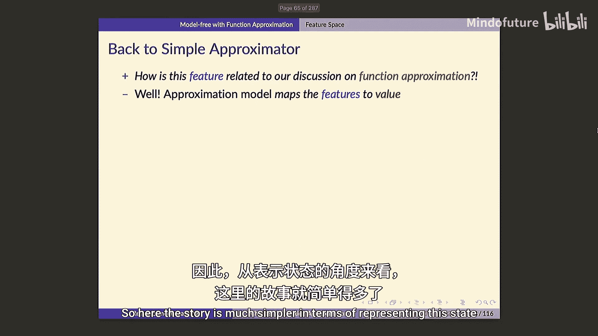

这种方法比量化更易处理，因为你不再需要维护一个巨大的值表。如果需要更高的复杂度，只需增加神经网络的复杂度即可。

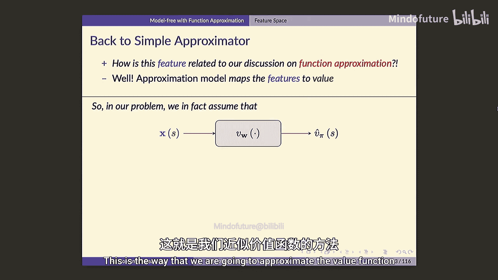

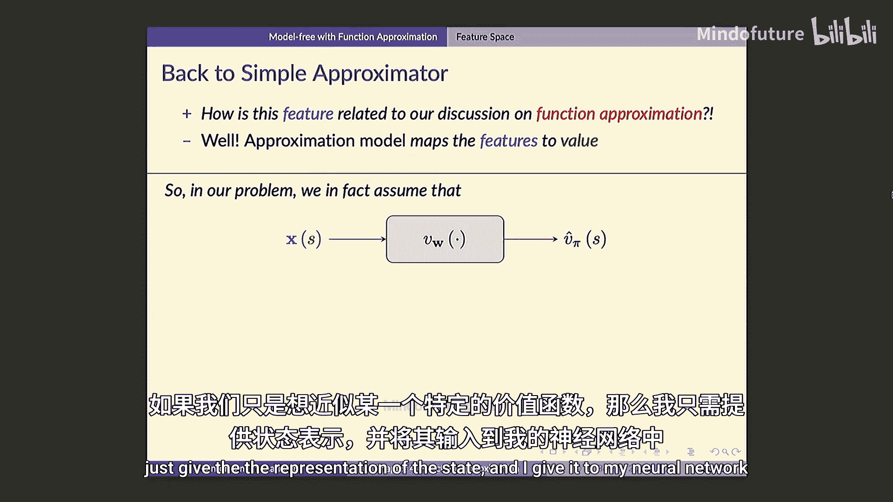

## 模型选择：从线性到深度网络

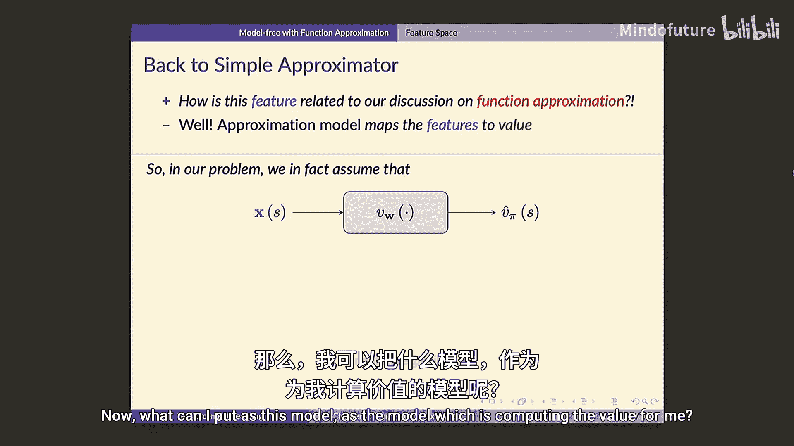

我们可以使用不同复杂度的模型来近似值函数。目前我们讨论的是**预测**问题，即评估一个给定策略的好坏。

**1. 线性近似**
最简单的模型是线性模型。状态特征乘以对应的权重后相加，得到输出值。

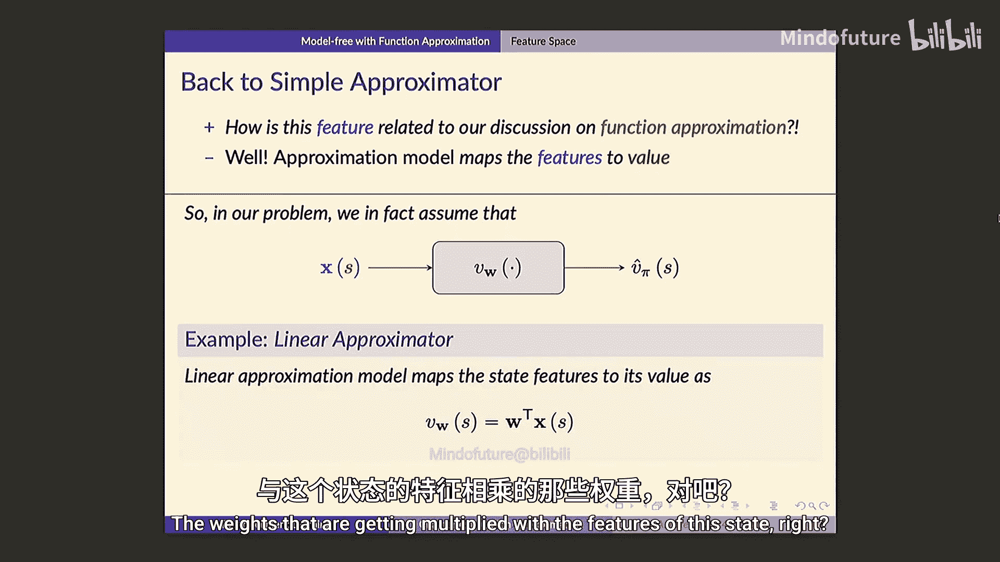

公式表示为：`V(s) ≈ w1 * V + w2 * X`
其中，`w1`和`w2`是需要从收集的样本中学习的参数。这意味着我们假设状态值是速度和位置的线性组合。

**2. 与表格法的对比**
假设每个维度量化成10个网格点，表格法需要学习 `10 * 10 = 100` 个独立的状态值。如果每个状态需要约100个样本来可靠估计，总共需要约 `100 * 100 = 10,000` 个样本。

而对于线性模型，我们只需要学习两个权重（`w1`, `w2`）。我们可能只需要在少数几个`(X, V)`点上收集样本，拟合出权重，然后依赖这个模型去估计其他未见过的状态值。这需要的样本量少得多。

**3. 线性模型的局限与改进**
线性模型参数少，样本效率高，但表达能力有限，可能无法捕捉复杂的真实值函数。表格法则有更多参数（100个），但样本效率低，且对未访问过的状态无法估计。

那么，如何改进函数逼近方法呢？答案是：使用**更复杂的模型**，例如深度神经网络。

我们可以构建一个深度网络：
*   输入层：接收 `[V, X]`。
*   隐藏层：可以包含多个层，每层有大量神经元（例如1000个）。
*   输出层：一个神经元，输出值函数估计 `V(s)`。

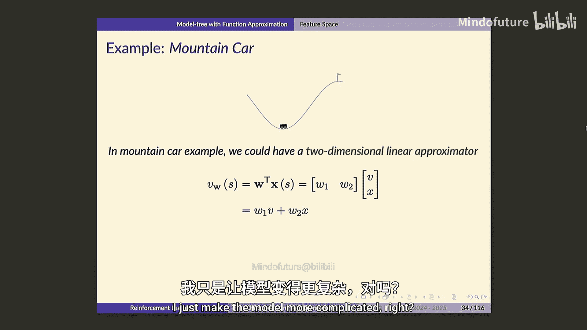

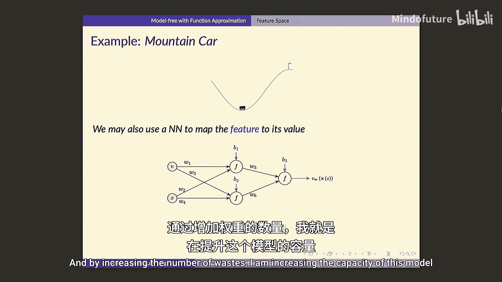

通过增加网络深度和宽度，我们增加了模型参数（权重）的数量，从而提升了模型的**容量**，使其能够拟合更复杂、非线性的值函数。如果我们有更多的样本数据，就可以训练更复杂的模型以获得更好的预测性能。

相比之下，表格法的“模型”就是表格本身，其容量固定为离散状态的数量，无法灵活扩展。

## 总结

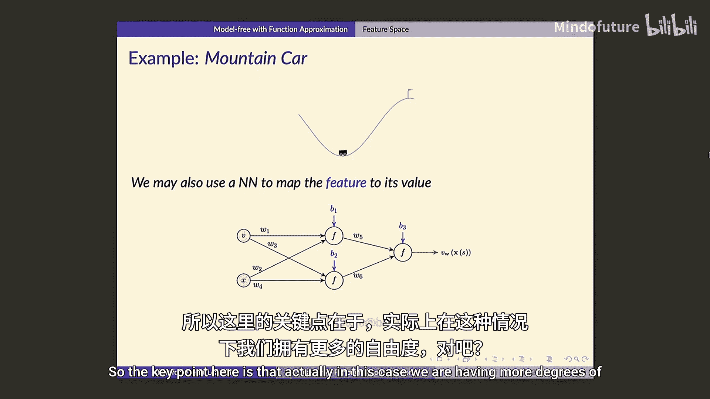

本节课中，我们一起学习了函数逼近如何为强化学习带来灵活性：
1.  **问题**：连续状态空间使表格化方法面临状态爆炸和量化难题。
2.  **解决方案**：使用函数（如神经网络）直接近似值函数，输入状态特征，输出值估计。
3.  **优势**：
    *   **无需量化**：直接处理连续状态。
    *   **参数共享**：通过泛化能力，用较少参数估计大量状态的值。
    *   **灵活扩展**：可通过增加模型复杂度（如使用更深网络）来利用更多数据，提高近似精度，而表格法无法做到这一点。
4.  **核心权衡**：在样本效率（简单模型）与表达能力和最终精度（复杂模型）之间进行权衡。

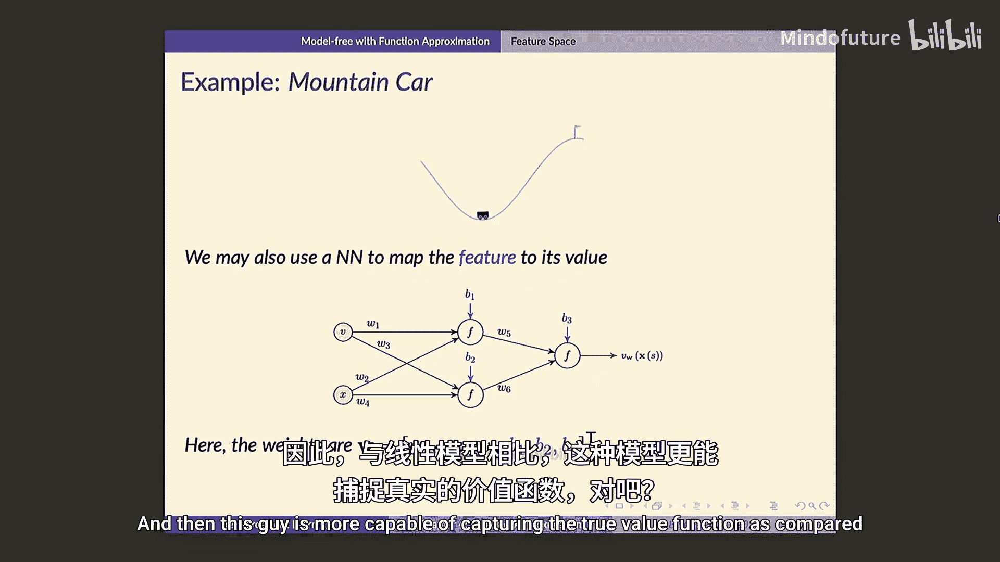

函数逼近是将强化学习应用于现实世界复杂问题的关键一步，它使我们能够处理高维或连续的状态与动作空间。