# 038：重回表格型强化学习 📊

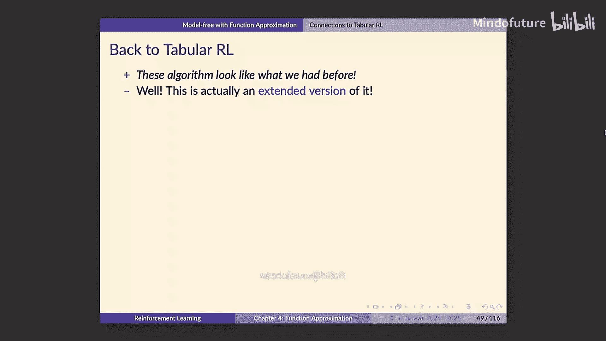

在本节课中，我们将通过一个具体例子，探讨如何将函数近似框架应用于强化学习。我们将回到熟悉的表格型强化学习，并理解它如何成为新框架下的一个特例。

## 概述：表格型强化学习作为特例

上一节我们介绍了使用函数近似进行强化学习的一般框架。本节中，我们来看看一个具体的例子：表格型强化学习。我们将展示，我们之前所做的表格型强化学习，实际上是这个新框架下的一个特殊情形。

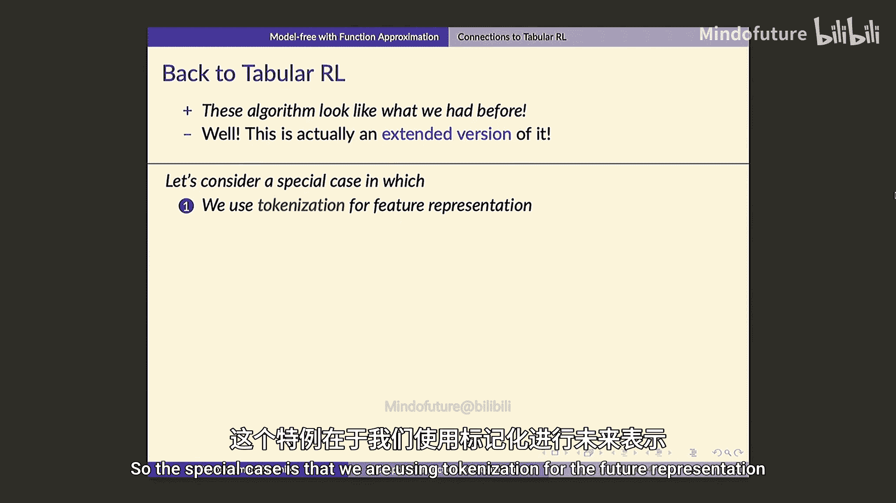

这个特殊情形包含两个关键点：使用**独热编码**进行状态表示，以及使用**线性模型**进行价值函数近似。

## 状态表示：独热编码

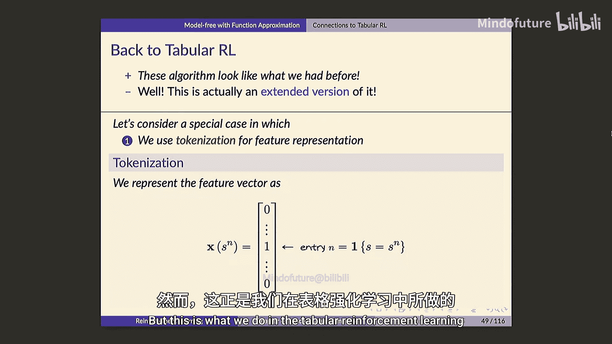

首先，我们来看状态表示。在表格型强化学习中，我们使用**独热编码**来表示每个状态。

这意味着，对于每一个可能的状态，我们使用一个向量来表示它。这个向量在所有位置上都是0，只在对应状态的位置上是1。例如，如果有100个状态，那么第5个状态就表示为一个长度为100的向量，其中只有第5个元素是1，其余都是0。

这种表示方法在状态空间连续时效率不高，因为连续状态有无穷多种可能，需要量化处理。但这就是我们在表格型强化学习中所做的。

## 价值函数模型：线性模型

其次，我们来看价值函数模型。我们使用一个**线性模型**来近似价值函数。

这个模型包含一组权重 `w`。输入是状态表示向量 `x`（即独热编码向量）。权重向量的维度与状态向量的维度完全相同。模型的输出是权重向量与状态向量的点积：`V_w(s) = w^T * x`。

假设我们有 `n` 个不同的状态，我们就有 `n` 个权重。每个权重对应一个状态的价值估计。

## 线性模型与价值表的关系

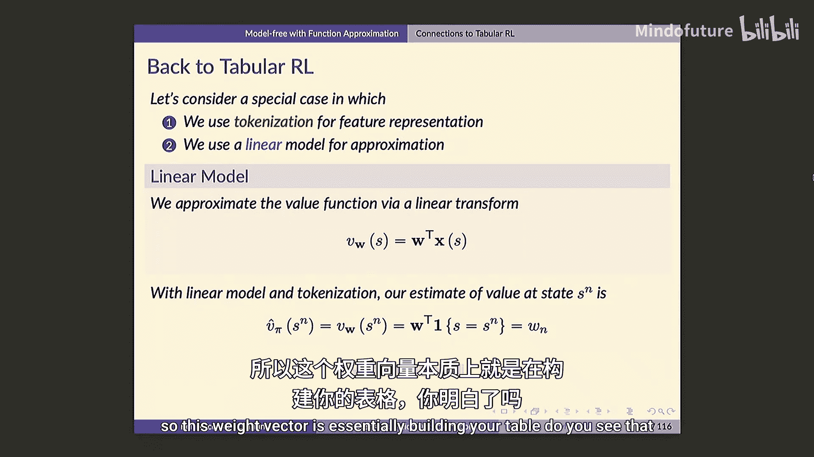

现在，让我们理解线性模型如何构建价值表。

当我们处于一个特定状态 `s_n` 时，其独热编码向量 `x` 只在第 `n` 个位置为1。将这个向量与权重向量 `w` 相乘，结果就是第 `n` 个权重 `w_n` 本身。

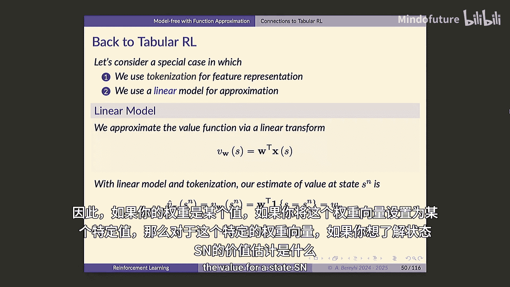

因此，**每个权重 `w_n` 实际上就是对应状态 `s_n` 的价值估计 `V_hat(s_n)`**。

我们从一个随机的权重向量开始（例如全零），然后通过更新规则不断改进这些权重。这个过程与我们之前更新价值表的过程完全相同。权重向量本质上就是在构建价值表。

## 计算梯度与更新规则

接下来，我们计算这个线性模型的梯度。对于线性模型 `V_w(s) = w^T * x`，其关于权重 `w` 的梯度非常简单。

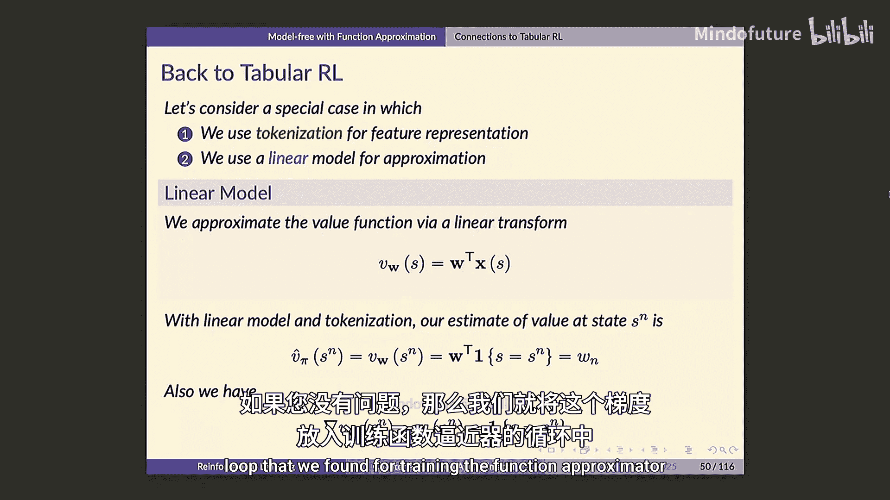

梯度就是输入向量 `x`：`∇_w V_w(s) = x`。在我们的例子中，`x` 是状态的独热编码向量。

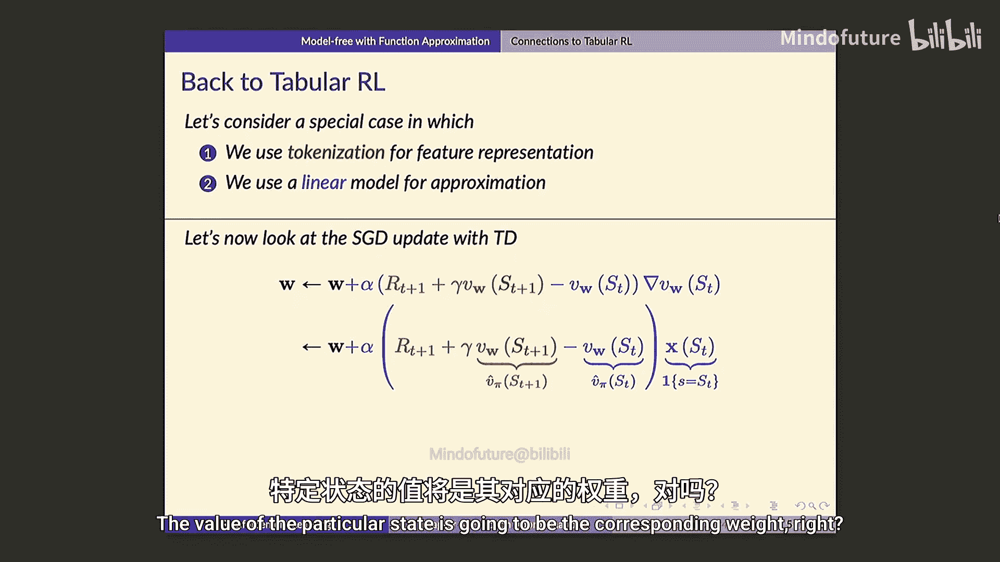

现在，我们将这个梯度代入到使用函数近似的时序差分学习更新规则中。

以下是使用函数近似的TD(0)更新公式：
`w ← w + α * [r + γ * V_w(s') - V_w(s)] * ∇_w V_w(s)`

将我们的特定设置代入：
*   `V_w(s)` 是状态 `s` 对应的权重 `w_s`。
*   `V_w(s')` 是状态 `s'` 对应的权重 `w_{s'}`。
*   `∇_w V_w(s)` 是状态 `s` 的独热编码向量 `x_s`。

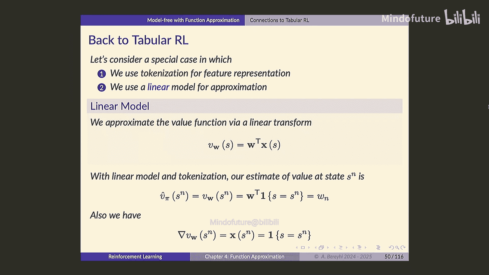

因此，更新公式变为：
`w ← w + α * [r + γ * w_{s'} - w_s] * x_s`

## 推导出表格型TD更新

让我们看看这个向量更新具体如何作用。

由于 `x_s` 是独热向量，只有对应状态 `s` 的位置为1。因此，标量 `α * [r + γ * w_{s'} - w_s]` 只会加到权重向量 `w` 中对应状态 `s` 的那个分量 `w_s` 上。其他所有权重分量都加上0，保持不变。

所以，有效的更新只发生在 `w_s` 上。回顾一下，`w_s` 就是我们对状态 `s` 的价值估计 `V_hat(s)`。因此，这个更新可以写为：

`V_hat(s) ← V_hat(s) + α * [r + γ * V_hat(s') - V_hat(s)]`

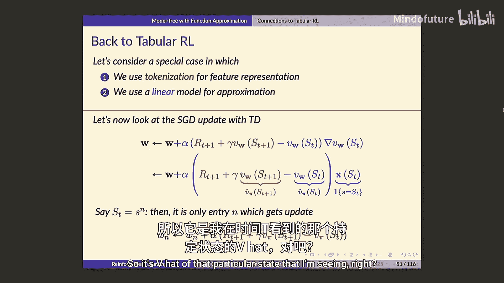

这个公式看起来非常熟悉。它正是我们之前学习的**表格型时序差分（TD）更新规则**。

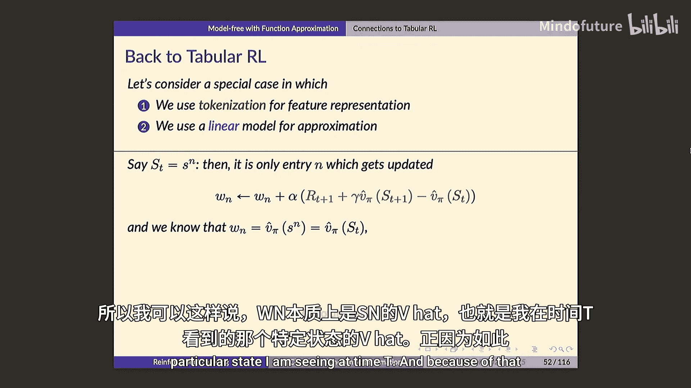

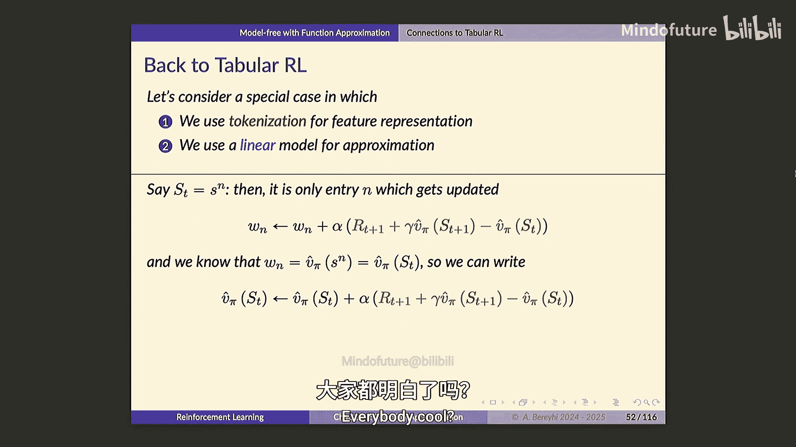

## 总结与启示

本节课中我们一起学习了如何将函数近似框架具体应用到表格型强化学习场景。

我们证明了：
1.  当使用**独热编码**作为状态表示，并使用**线性模型**作为价值函数近似器时。
2.  基于函数近似的梯度下降更新规则，会退化为我们熟悉的**表格型TD更新规则**。

因此，表格型强化学习是**函数近似强化学习框架下的一个特例**。这个特例的模型容量有限，无法有效处理复杂或连续的状态空间。

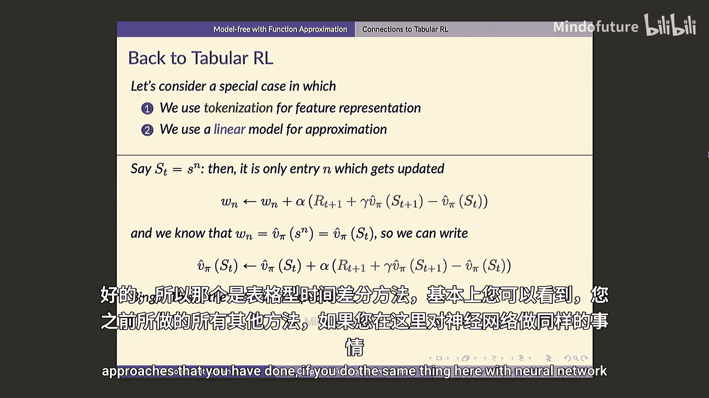

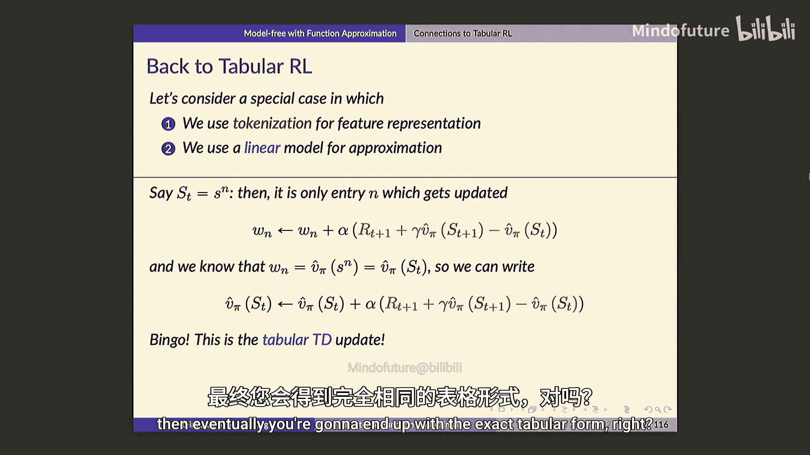

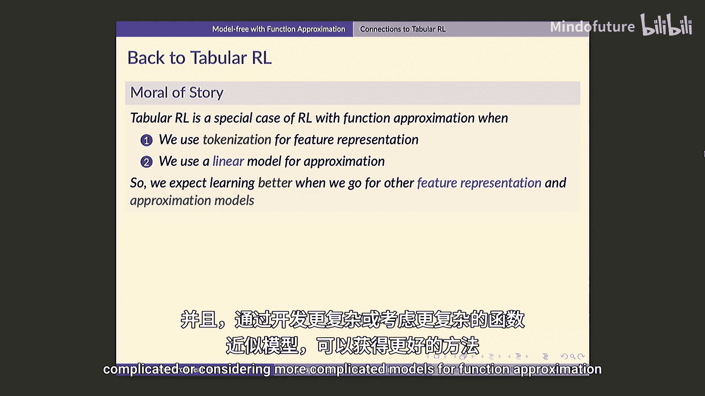

这个理解非常重要，它统一了我们已有的知识，并为我们指明了方向：要解决更复杂的问题，我们需要在这个通用框架下，探索更强大的状态表示（如神经网络提取的特征）和更复杂的函数近似模型（如深度神经网络）。