# 040：通过函数逼近学习动作价值 🧠

在本节课中，我们将学习如何将函数逼近的方法，从状态价值函数（V函数）扩展到动作价值函数（Q函数）。我们将探讨如何设计网络结构来表示Q函数，以及如何利用蒙特卡洛或时序差分方法对其进行训练。

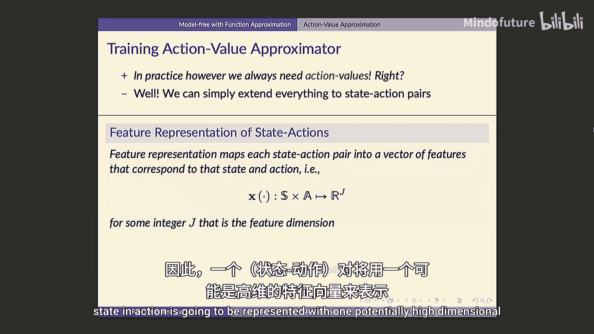

---

上一节我们介绍了使用函数逼近（如神经网络）来估计状态价值函数。本节中，我们来看看如何将同样的思想应用于估计动作价值函数。

## 从价值函数到动作价值函数

在表格化方法中，我们为每个状态-动作对存储一个值。但当状态或动作空间非常复杂时，这种方法不再可行。因此，我们需要一个模型来近似Q函数。

为了做到这一点，我们需要为每个状态-动作对定义一个特征表示。这意味着，对于任何给定的状态`s`和动作`a`，我们都需要用一个向量`x(s, a)`来表示它。

**公式**：`x(s, a)` 是状态-动作对 `(s, a)` 的特征向量。

## 动作价值网络的设计

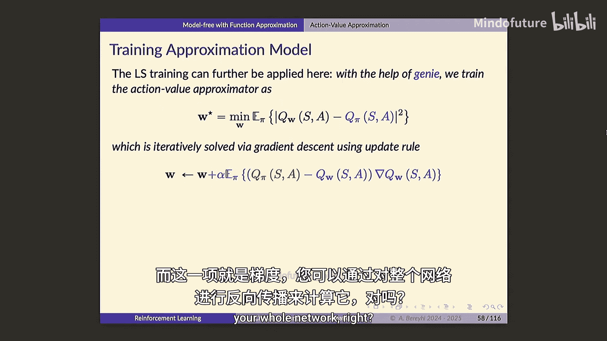

在实践中，我们通常处理离散的动作空间（例如，上、下、左、右）。我们不喜欢为每个动作单独创建特征表示并输入网络。

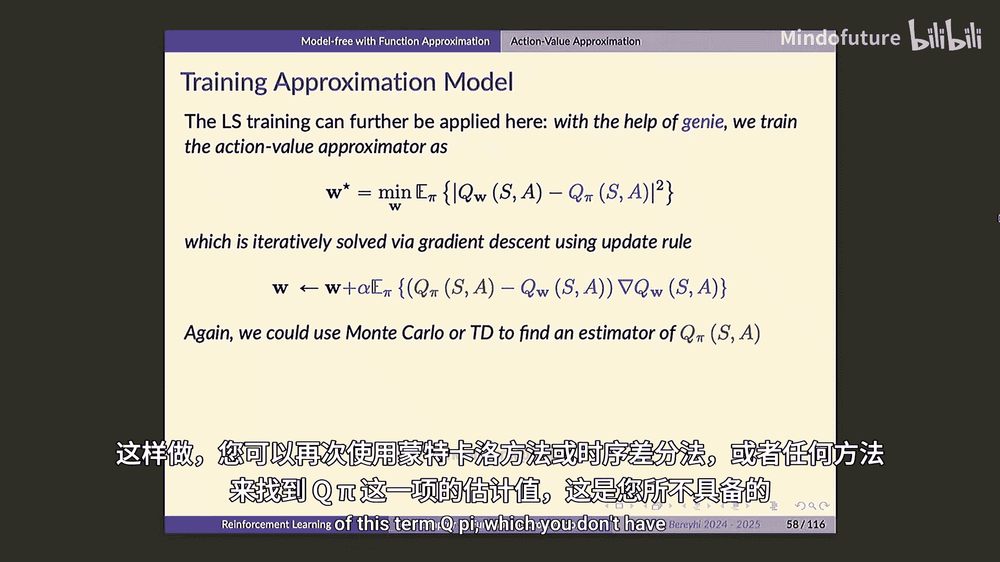

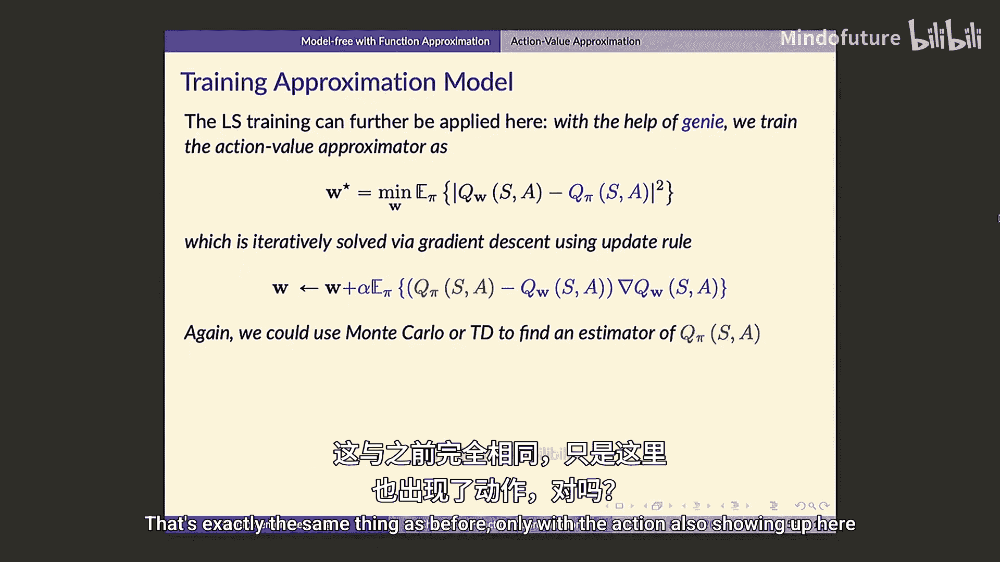

更常见的做法是，我们只用一个网络来接收**状态**的表示，然后直接输出一个**向量**。这个向量的每个维度对应一个可能动作的价值。

**概念**：我们设计一个“巨型”Q网络 `Q_w(s)`。它接收状态`s`的特征表示，输出一个向量 `[Q(s, a1), Q(s, a2), ..., Q(s, aM)]`，其中`M`是动作的数量。

在网格世界的例子中，你输入你所在的位置（状态），网络会输出四个值，分别对应执行“上”、“下”、“左”、“右”动作后能获得的预期回报。

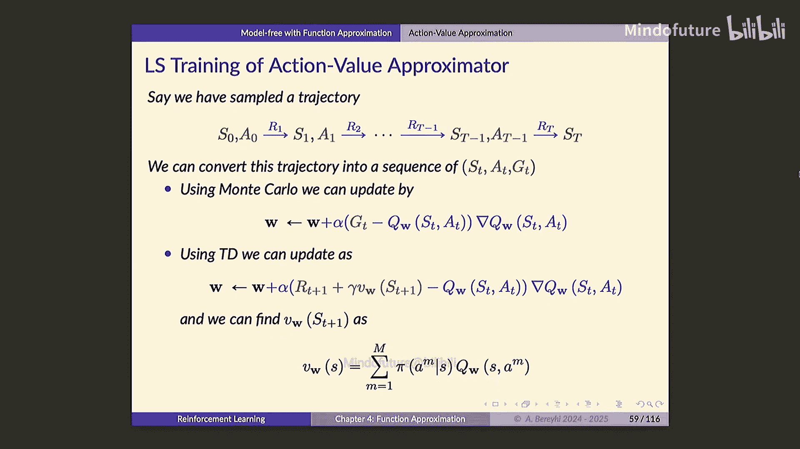

## 训练动作价值网络

训练过程与之前训练价值网络类似。我们的目标是让网络输出的Q值估计尽可能接近真实的动作价值。

**目标**：最小化期望误差 `E[(Q_w(s, a) - Q_π(s, a))^2]`。

我们使用梯度下降进行优化。梯度更新公式为：
**公式**：`w ← w - α * (Q_w(s, a) - 目标值) * ∇_w Q_w(s, a)`

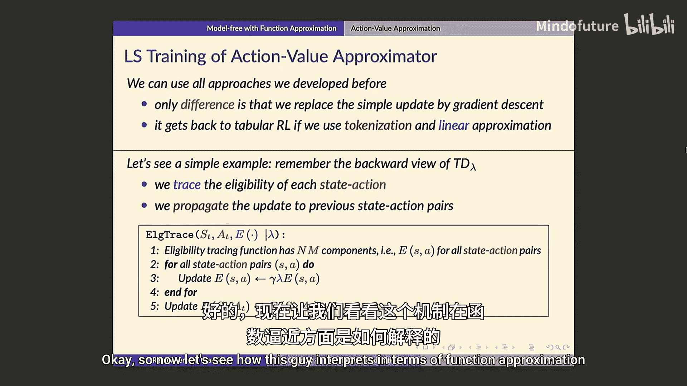

其中，`α`是学习率，`∇_w Q_w(s, a)`是网络输出对参数`w`的梯度，可以通过反向传播计算。

以下是获取训练样本的两种主要方法：

*   **蒙特卡洛方法**：你需要状态-动作对 `(s, a)` 以及从该点开始获得的**完整回报** `G_t` 作为样本。
*   **时序差分方法**：你将完整回报 `G_t` 替换为TD目标：`r + γ * V(s_{t+1})`。

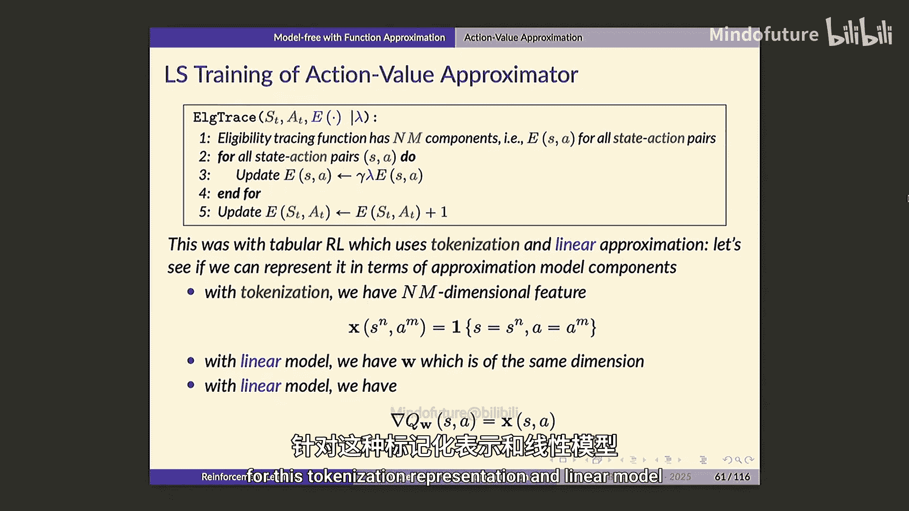

那么，如何从Q网络计算状态价值 `V(s_{t+1})` 呢？你可以对Q网络输出的所有动作价值，按照当前策略`π`的概率进行加权平均。

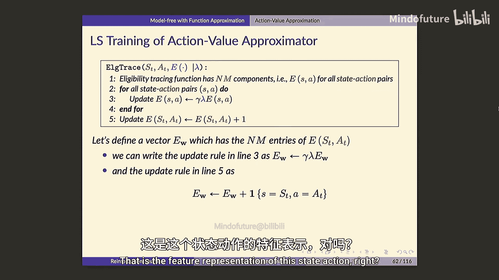

**公式**：`V(s) = Σ_a π(a|s) * Q_w(s, a)`

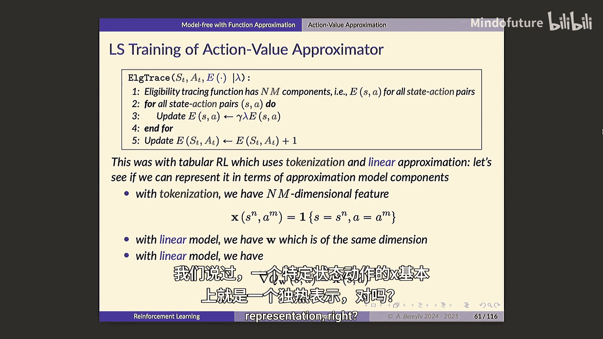

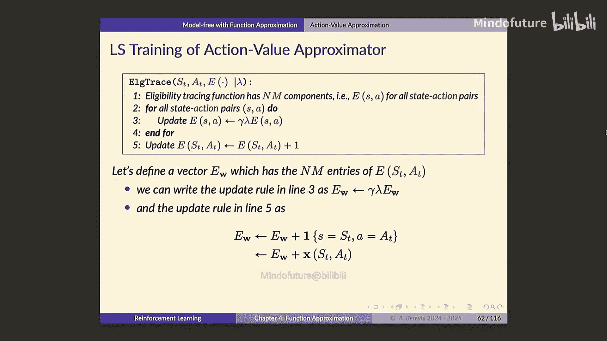

## 资格迹与函数逼近的结合

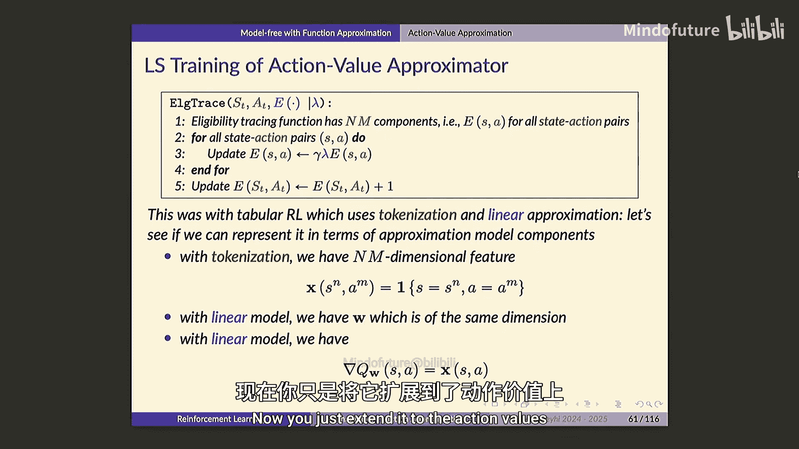

我们之前讨论过表格化方法中的资格迹（Eligibility Traces），它通过一个衰减的迹来记录访问过的状态-动作对，从而更有效地分配信用。

在函数逼近的背景下，资格迹可以被理解为对**梯度**计算了一个**移动平均**（或动量）。

**核心思想**：我们维护一个与网络参数`w`同维度的资格迹向量 `e_w`。在每一步，我们不是直接用当前梯度更新参数，而是用这个资格迹向量来更新。

**更新规则**：
1.  资格迹衰减：`e_w ← γ * λ * e_w`
2.  加入当前梯度：`e_w ← e_w + ∇_w Q_w(s_t, a_t)`
3.  参数更新：`w ← w - α * δ_t * e_w`

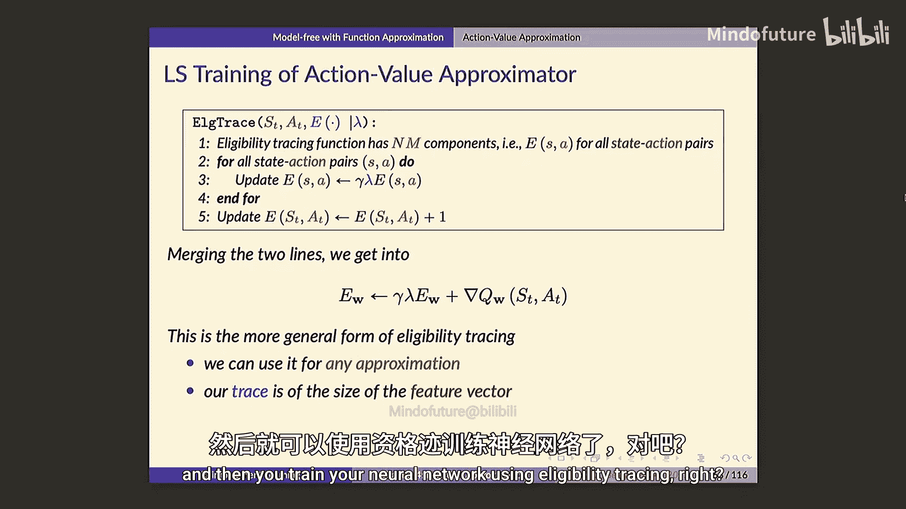

其中，`δ_t`是TD误差，`λ`是资格迹衰减参数。这相当于在优化过程中使用了梯度动量，使得更新不仅依赖于当前样本，也平滑地包含了历史样本的影响，从而得到更稳健的梯度估计。

## 函数逼近的优势：以山地车问题为例

最后，我们通过一个例子直观感受函数逼近的优势。考虑“山地车”问题，状态是连续的位置和速度。

*   **表格化方法**：需要将连续状态离散化成网格。训练后，价值函数在经常访问的网格点上有较好的估计，但在许多从未访问过的区域，估计值可能为0或非常不准确，导致价值函数表面非常“崎岖不平”。
*   **函数逼近方法**：使用神经网络（如带有非线性激活函数的多层网络）来近似价值函数。即使对于未在训练中精确出现过的状态，网络也能基于其学到的平滑函数给出合理的估计值。因此，最终得到的价值函数是一个**平滑的曲面**，能更好地泛化到整个状态空间，通常比表格化方法得到的结果更优。

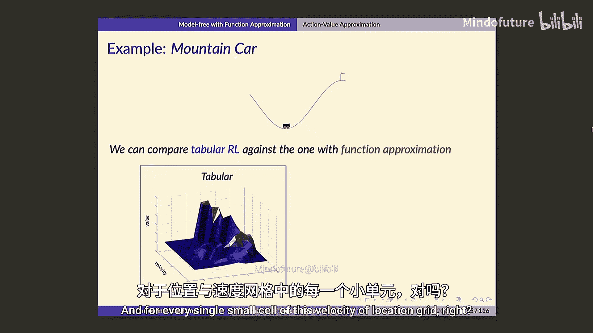

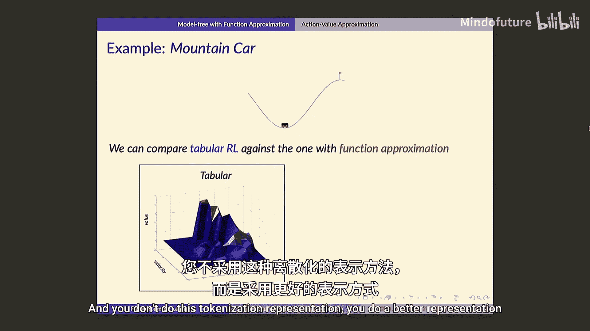

---

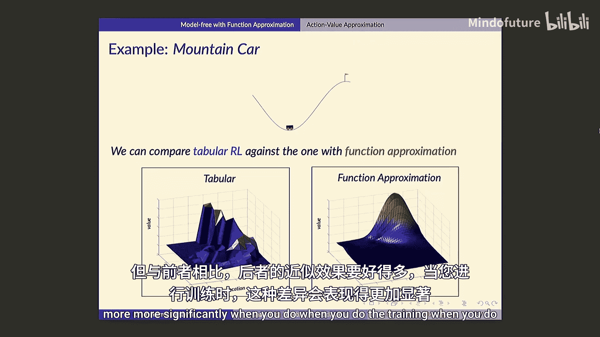

本节课中我们一起学习了：
1.  如何将函数逼近的思想从状态价值函数扩展到动作价值函数。
2.  如何设计一个输出向量（每个动作对应一个价值）的Q网络。
3.  如何使用蒙特卡洛或时序差分目标来训练这个Q网络。
4.  如何将表格化方法中的资格迹技术解释为函数逼近下的梯度动量，并应用于训练中。
5.  理解了函数逼近（尤其是神经网络）相比表格化方法的主要优势：它能够学习平滑的价值函数，从而更好地泛化到未见过的状态，避免估计值过于稀疏和不连续。