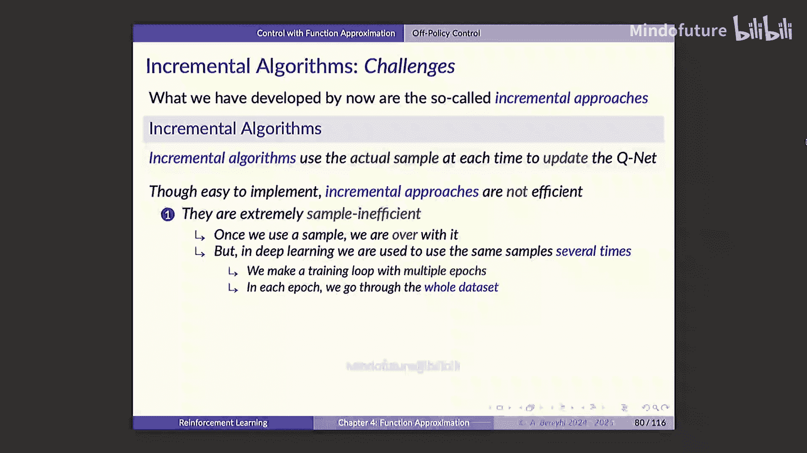
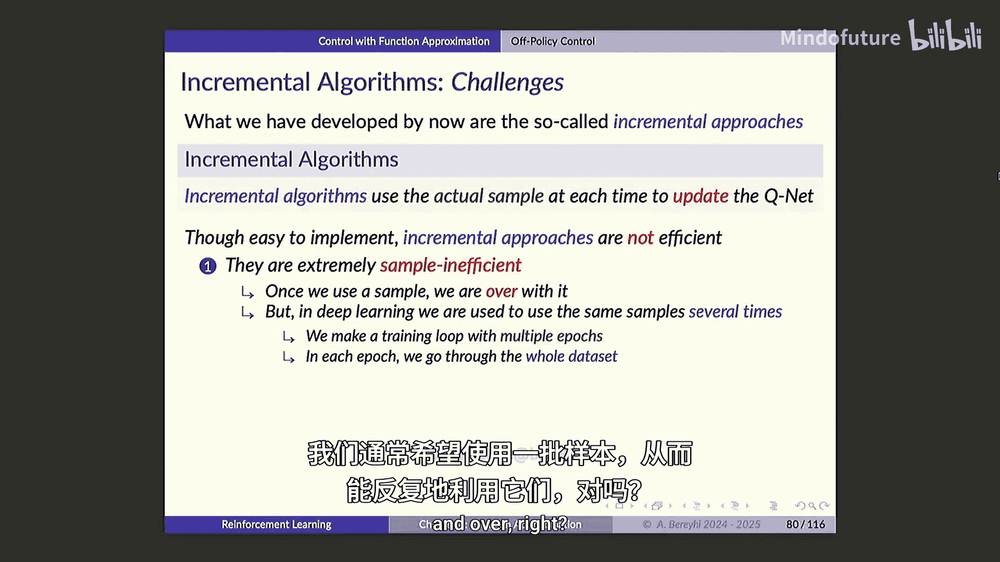
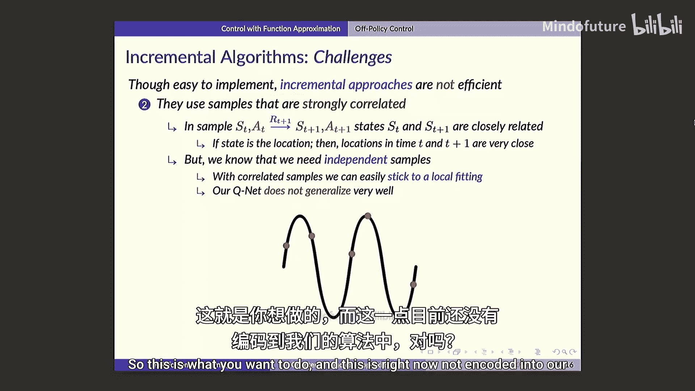
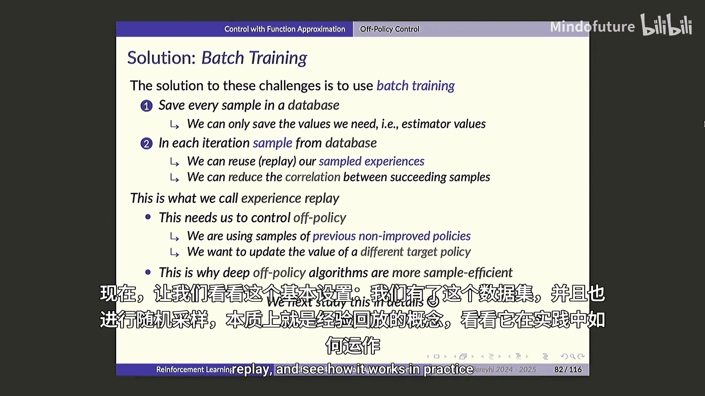
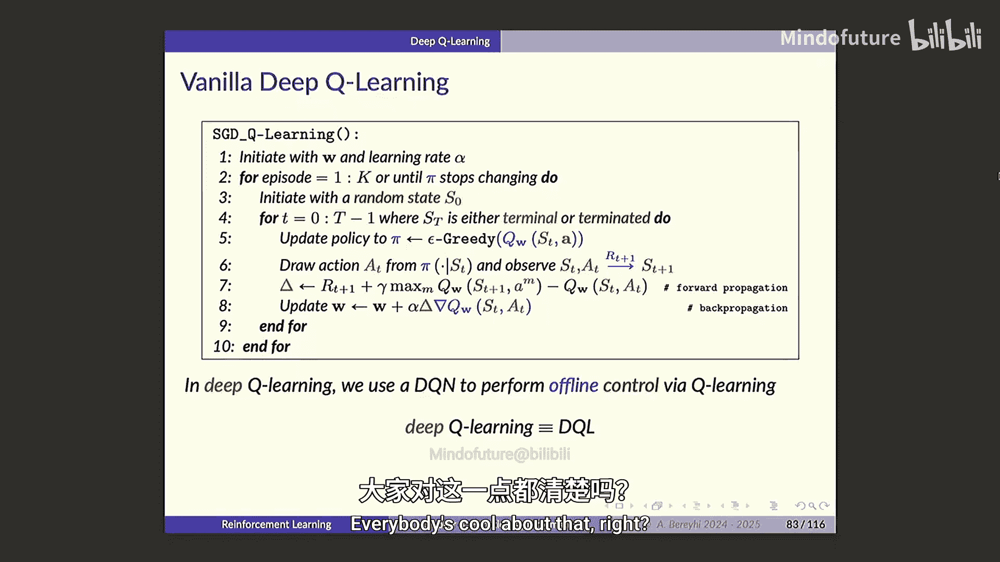
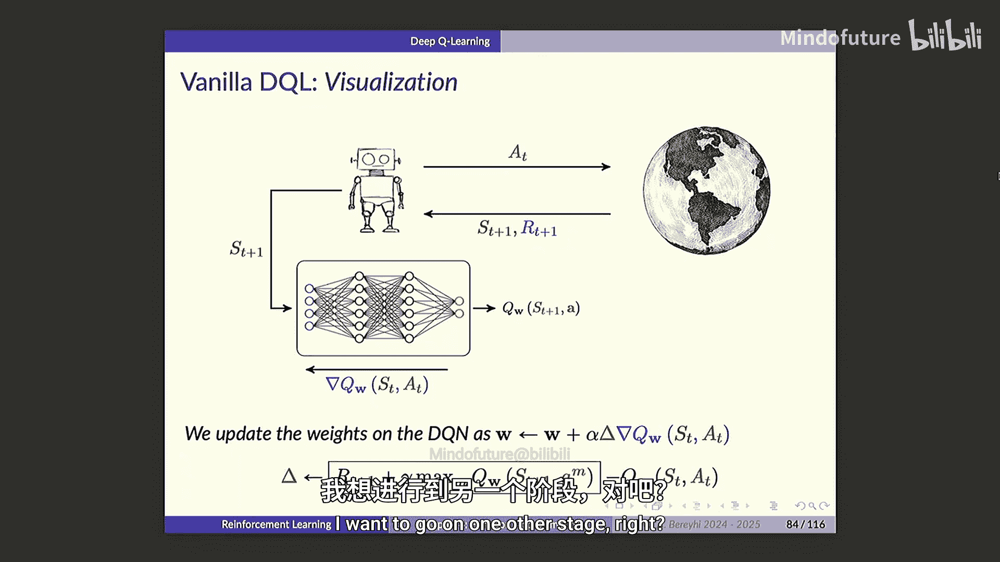
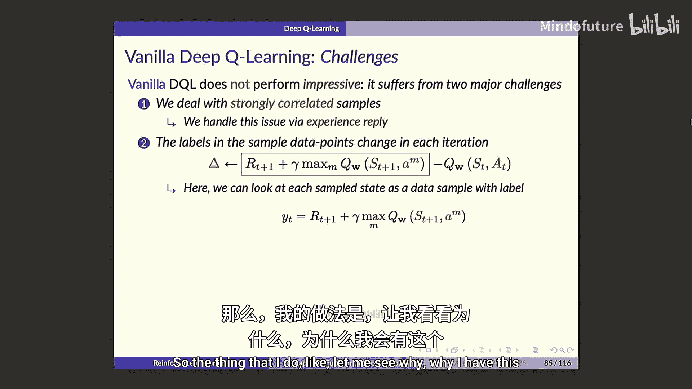
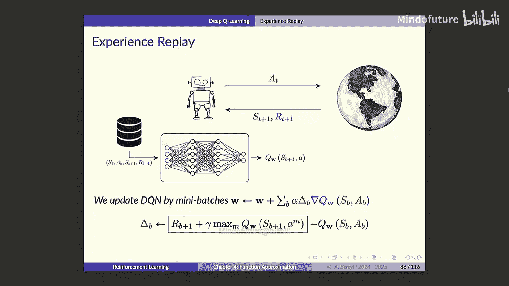
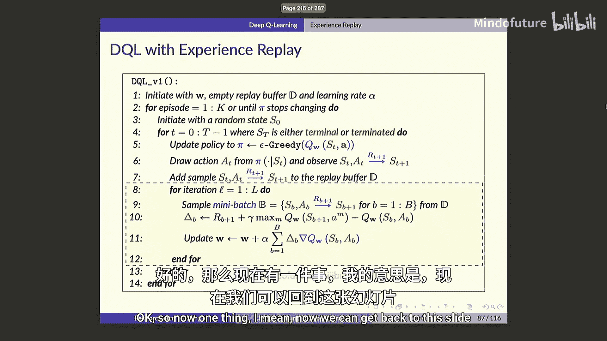
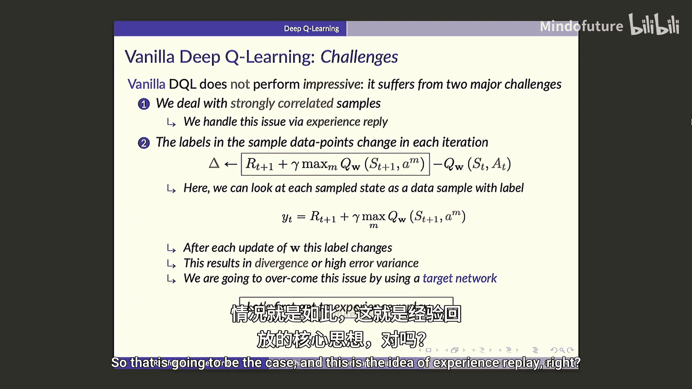

# 041：深度Q学习中的经验回放 🧠🔄

在本节课中，我们将要学习深度Q学习中的一个关键技术——经验回放。我们将探讨为什么简单的在线学习方式效率不高，以及如何通过经验回放来解决样本相关性和利用效率的问题。

## 概述

在上一节中，我们介绍了深度Q学习的基本框架。本节中，我们来看看一个关键的改进技术：经验回放。我们当前的做法是，每次从环境中获取一个样本，基于这个单一样本计算梯度并更新网络。然而，这种方法存在两个主要问题：样本效率低，以及连续采集的样本之间存在强相关性。

## 当前方法的局限性

我们当前采用的方法样本效率不高。我们基本上使用一个样本，计算一次梯度，更新网络，然后就将该样本丢弃。接着我们获取下一个样本，如此反复。在实践中，我们通常希望使用一批样本，计算这批样本梯度的平均值，然后再进行更新。

以下是当前方法的问题：
*   **样本效率低**：每个样本只使用一次。
*   **样本强相关**：连续采集的样本（如状态S和下一个状态S'）在空间上非常接近。

这种强相关性意味着，当你试图用神经网络拟合这些在特征空间上非常接近的点的标签时，网络可能会在这些点附近拟合得很好，但在远离这些点的区域，其预测可能与真实函数完全无关。理想情况下，我们希望用于训练神经网络的样本是**独立**的。如果我们能让函数拟合一些随机分布的样本点，并且函数本身足够平滑，那么它就更有可能全局地逼近真实函数。

## 经验回放的核心思想

为了同时解决上述两个问题——即更有效地利用样本并打破样本间的相关性——我们引入**经验回放**的概念。

其核心思想是建立一个数据库（通常称为**回放缓冲区**）。当你与环境交互采样时，将每一次交互的经验作为一个样本存入数据库。每个样本是一个元组 `(状态S, 动作A, 即时奖励R, 下一个状态S')`。

当需要训练神经网络时，我们不按顺序使用最新采集的样本，而是**随机**地从回放缓冲区中抽取一批样本。这意味着，你可能用第一条轨迹的起点样本来更新网络，下一次则用第三条轨迹中间的一个样本来更新。通过这种随机采样，我们获得的样本之间近似独立。

之所以可以进行经验回放，关键在于深度Q学习是一种**离策略**算法。我们评估和优化的是**目标策略**（贪婪策略），而我们用于采集样本的**行为策略**可以是任何策略（如ε-贪婪策略）。当我们回放一个旧样本 `(S, A, R, S')` 时，我们只关心在状态 `S'` 下，当前Q网络认为的最优价值是多少，而不关心当初是如何通过行为策略到达状态 `S'` 的。这允许我们自由地重用过去任何策略下收集的经验。

## 经验回放的工作流程

让我们将经验回放整合到深度Q学习的流程中。以下是关键步骤的概述：

1.  **初始化**：初始化Q网络参数、回放缓冲区D，并设定一个行为策略（如随机策略或ε-贪婪策略）。
2.  **交互与存储**：
    *   在状态 `S_t`，根据行为策略选择动作 `A_t`。
    *   执行动作 `A_t`，环境返回即时奖励 `R_{t+1}` 和下一个状态 `S_{t+1}`。
    *   将经验元组 `(S_t, A_t, R_{t+1}, S_{t+1})` 存储到回放缓冲区D中。
3.  **训练与更新**：
    *   从回放缓冲区D中随机采样一小批经验。
    *   对于采样中的每个经验 `(S, A, R, S')`：
        *   计算当前Q值：`Q(S, A)` （网络前向传播）。
        *   计算目标值：`Target = R + γ * max_{a'} Q(S', a')`。这里 `Q(S', a')` 也是由当前Q网络计算得出（但通常为了稳定，会使用一个目标网络，此为常见优化，此处简化说明）。
        *   计算损失（如均方误差）：`Loss = (Target - Q(S, A))^2`。
        *   计算损失关于网络参数的梯度，并更新Q网络。
4.  **循环**：重复步骤2和3。

在实践中，回放缓冲区通常有固定容量。当缓冲区满时，新的经验会覆盖最旧的经验。此外，训练步骤（步骤3）和环境交互步骤（步骤2）可以以不同的频率进行。例如，可以每交互N步，就进行M次批梯度更新。

## 总结

本节课中我们一起学习了深度Q学习中的**经验回放**技术。我们首先分析了简单在线Q学习在样本效率和样本相关性方面的不足。接着，我们介绍了经验回放的核心思想：通过将经验存储在缓冲区中并随机采样进行训练，来打破数据间的相关性并提高数据利用率。我们强调了这一技术可行的理论基础是深度Q学习的**离策略**性质，使得我们可以利用旧策略收集的经验来优化当前的目标策略。最后，我们概述了整合经验回放后的深度Q学习基本工作流程。经验回放是稳定和高效深度强化学习算法的关键组件之一。