# 042：通过函数逼近进行控制与深度Q学习

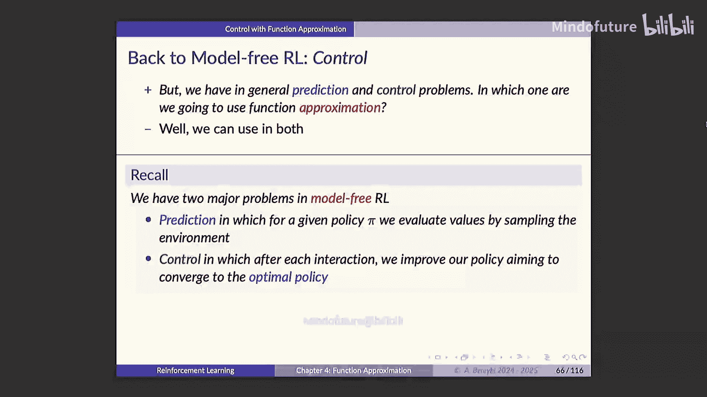

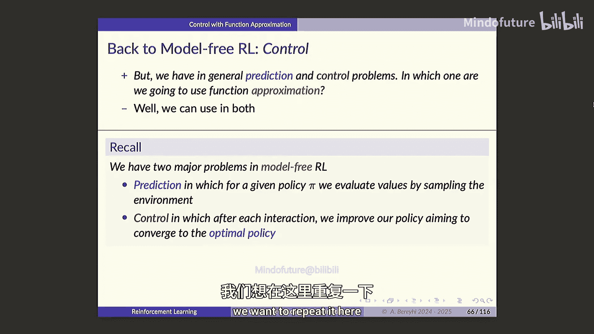

在本节课中，我们将学习如何将函数逼近（特别是深度神经网络）应用于强化学习中的控制问题。我们将回顾预测与控制问题的区别，并重点介绍如何将Q学习算法从表格形式扩展到使用深度Q网络（DQN）的形式。

## 预测与控制问题回顾

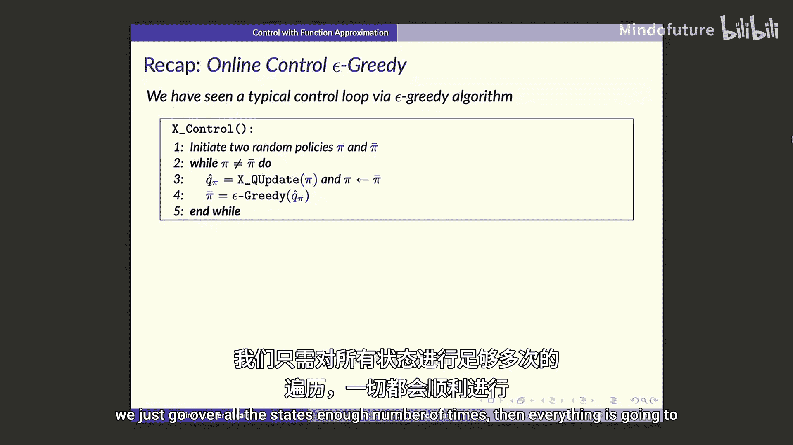

上一节我们介绍了使用函数逼近进行预测。本节中，我们来看看如何将其应用于控制问题。

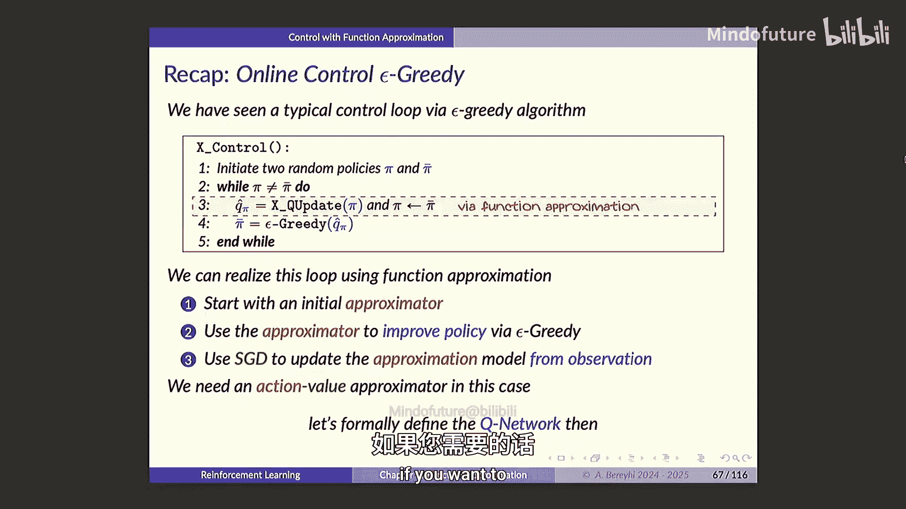

首先，我们回顾两个核心问题：
1.  **预测问题**：在策略固定的离线设置中，我们使用该策略生成的样本来训练模型，以估计状态或动作的价值。
2.  **控制问题**：在在线环境中，我们希望在采样过程中同时学习最优策略。这意味着策略改进需要融入到价值估计的循环中。

这正是我们在上一章用Sarsa和Q学习所做的事情，现在我们希望使用函数逼近来重复这一过程。

## 控制循环与函数逼近集成

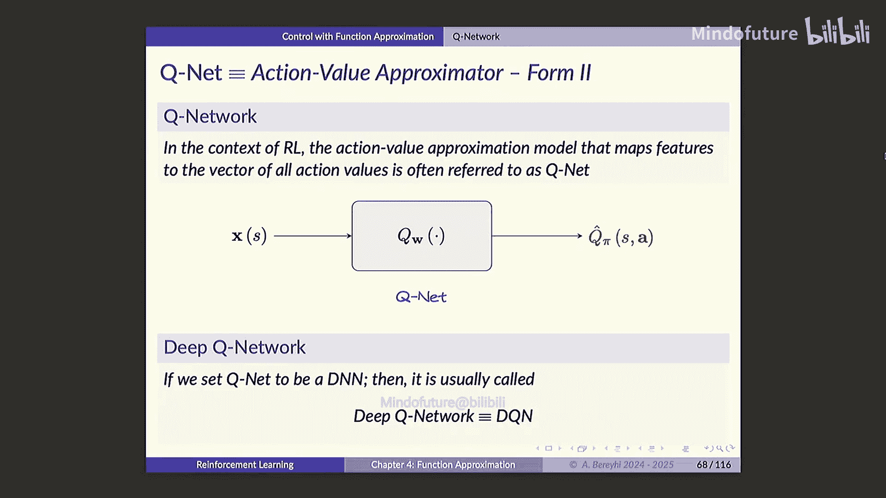

让我们进入控制部分。在广义策略迭代（GPI）中，我们从一个策略开始，评估它，然后改进它，再评估新的策略，如此循环。

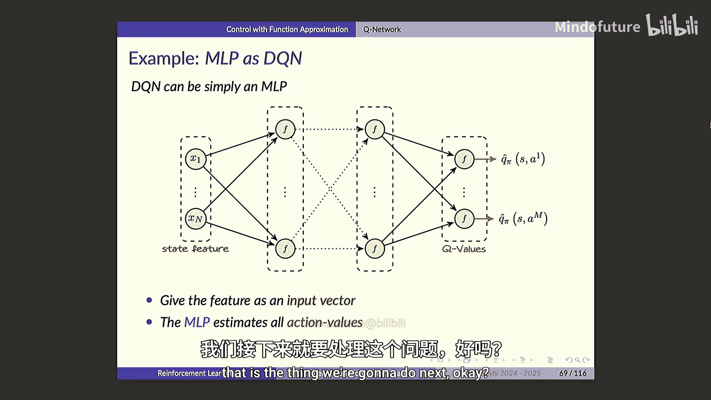

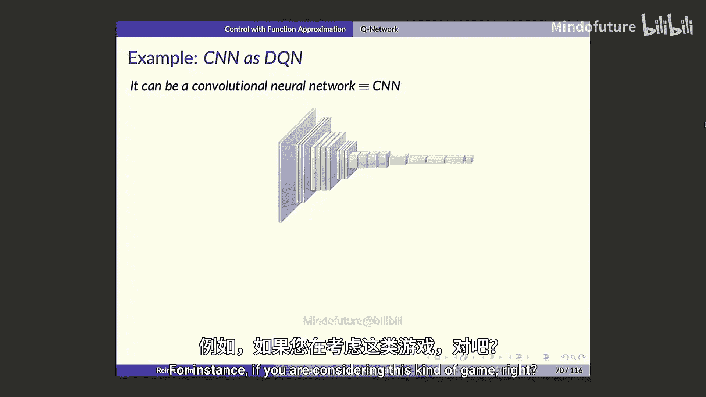

然而，直接使用贪婪策略改进会遇到探索不足的问题。因此，我们引入了 **ε-贪婪** 策略，以一定概率随机行动，从而更好地探索环境。

控制循环的一个关键点是，我们不再完整地评估一个策略。我们只是用单个样本来更新Q函数，然后用这个新的Q函数来执行ε-贪婪策略。这个迭代循环足够鲁棒，只要访问所有状态足够多次，最终就能收敛。

我们想在这里做同样的事情。唯一要改变的是，我们不再使用表格来估计策略或Q函数，而是使用一个模型，即深度模型。

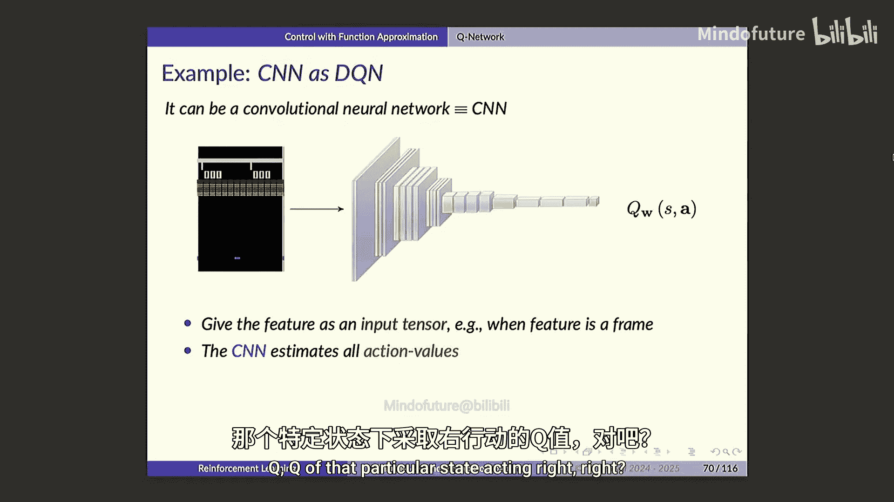

那么，在这个循环中，哪一行是我们集成神经网络的地方呢？答案是更新Q值的那一行。我们将不再更新表格，而是更新模型的权重。

## 深度Q网络（DQN）简介

现在，让我们定义Q网络。Q网络是一个神经网络，它接收某个状态的特征表示，并在输出层给出该状态下所有可能动作的Q值。

用公式表示，对于一个状态 `s`，Q网络输出一个向量：
`Q(s; θ) = [Q(s, a1; θ), Q(s, a2; θ), ..., Q(s, an; θ)]`
其中 `θ` 是网络参数，`n` 是离散动作的数量。

当使用深度神经网络作为Q网络时，我们通常称之为深度Q网络（DQN）。DQN是我们在基于价值的控制方法中主要使用的价值网络。

需要注意的是，目前我们讨论的仍然是离散动作空间。连续动作空间的处理将在后续章节介绍。

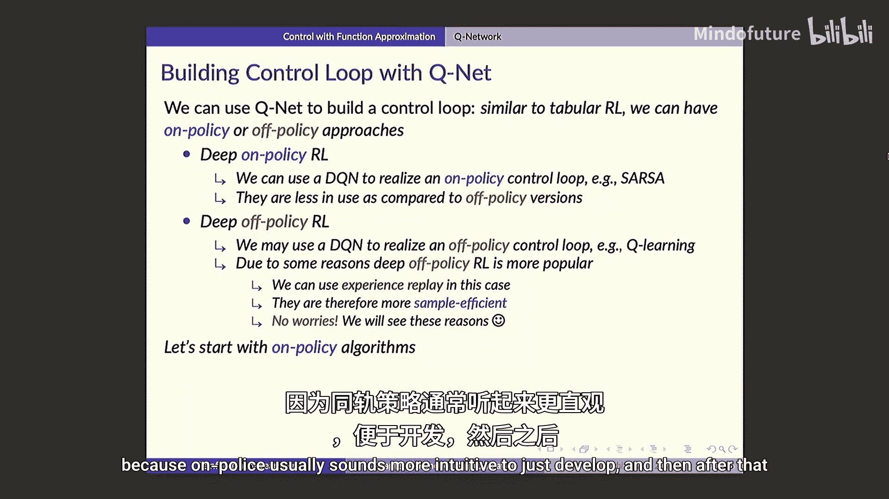

## 在线策略 vs. 离线策略学习

在控制中，我们有两种主要方法：
1.  **在线策略学习**：使用正在执行的策略（如ε-贪婪）生成的样本来改进同一个策略。深度版的Sarsa就属于此类。
2.  **离线策略学习**：用来评估的目标策略（如贪婪策略）与用来生成样本的行为策略（如ε-贪婪策略）不同。深度Q学习就属于此类。

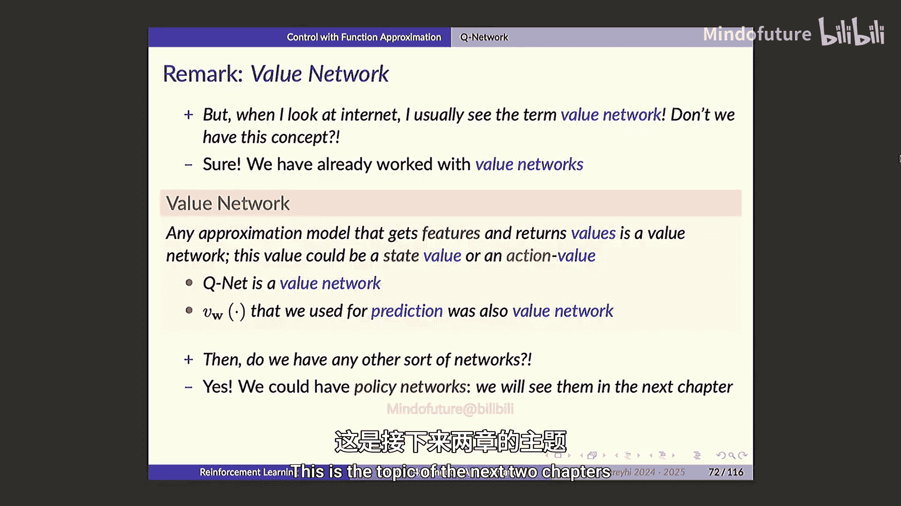

在深度强化学习中，我们通常更倾向于离线策略方法，主要是因为它具有更高的**样本效率**。在线策略学习中，早期由较差策略收集的样本很快就会过时。而离线策略学习允许我们重用过去收集的经验，这对于数据有限的深度学习场景至关重要。因此，深度Q学习比深度Sarsa更为流行。

## 从预测到在线策略控制：深度Sarsa

为了更直观地理解，让我们先从在线策略控制开始，然后过渡到深度Q学习。

回顾一下，在使用函数逼近进行预测时，我们通过时序差分（TD）误差来更新价值网络。对于Q网络，过程类似。我们采样一个轨迹，对于每个状态-动作对 `(St, At)`，我们有一个TD目标（即“标签”）来更新网络。

在Sarsa中，为了使更新在线且遵循当前策略，我们使用下一个状态 `S_{t+1}` 和**实际将要采取的下一个动作** `A_{t+1}` 的Q值来构建TD目标。

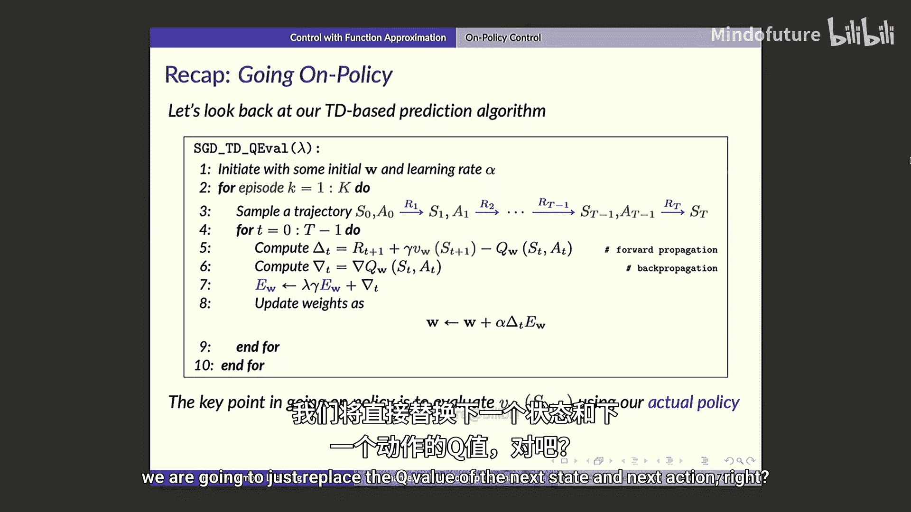

以下是将其转换为在线策略控制的关键步骤：

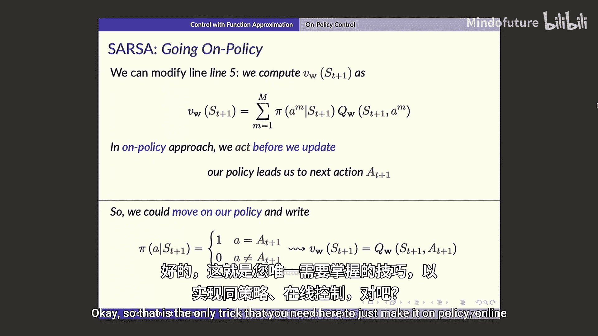

1.  在状态 `St`，根据当前Q网络和ε-贪婪策略选择动作 `At`。
2.  执行 `At`，获得奖励 `R_{t+1}` 和下一个状态 `S_{t+1}`。
3.  在状态 `S_{t+1}`，再次根据当前Q网络和ε-贪婪策略**选择**（但不立即执行）下一个动作 `A_{t+1}`。
4.  使用 `R_{t+1} + γ * Q(S_{t+1}, A_{t+1}; θ)` 作为TD目标来更新 `Q(St, At; θ)` 的网络参数 `θ`。

更新规则（梯度下降）可以写作：
`θ ← θ + α * [R_{t+1} + γ * Q(S_{t+1}, A_{t+1}; θ) - Q(St, At; θ)] * ∇_θ Q(St, At; θ)`
其中 `α` 是学习率。

我们可以在此算法中加入资格迹（Eligibility Trace），以实现多步更新，这相当于在轨迹上计算梯度的移动平均。

## 深度Q学习算法

现在，我们来看更重要的离线策略方法——深度Q学习。Q学习的目标是直接估计最优策略的Q值，其TD目标基于贪婪动作。

在表格Q学习中，更新规则是：
`Q(St, At) ← Q(St, At) + α * [R_{t+1} + γ * max_a Q(S_{t+1}, a) - Q(St, At)]`

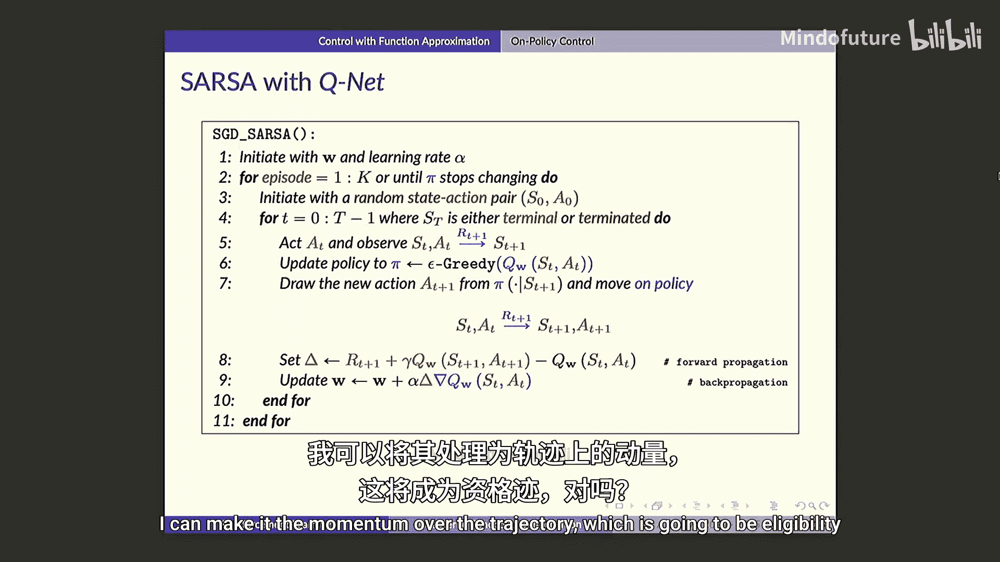

将其扩展到深度Q网络，我们得到以下步骤：

1.  初始化Q网络参数 `θ`。
2.  对于每个时间步 `t`：
    a. 根据当前Q网络和ε-贪婪策略选择动作 `At`。
    b. 执行动作 `At`，观察奖励 `R_{t+1}` 和下一个状态 `S_{t+1}`。
    c. 计算TD目标：`Y_t = R_{t+1} + γ * max_a Q(S_{t+1}, a; θ)`。这里 `max_a Q(S_{t+1}, a; θ)` 是目标网络对下一个状态最大Q值的估计。
    d. 计算损失（例如均方误差）：`L(θ) = [Y_t - Q(St, At; θ)]^2`。
    e. 使用梯度下降更新网络参数：`θ ← θ - α * ∇_θ L(θ)`。

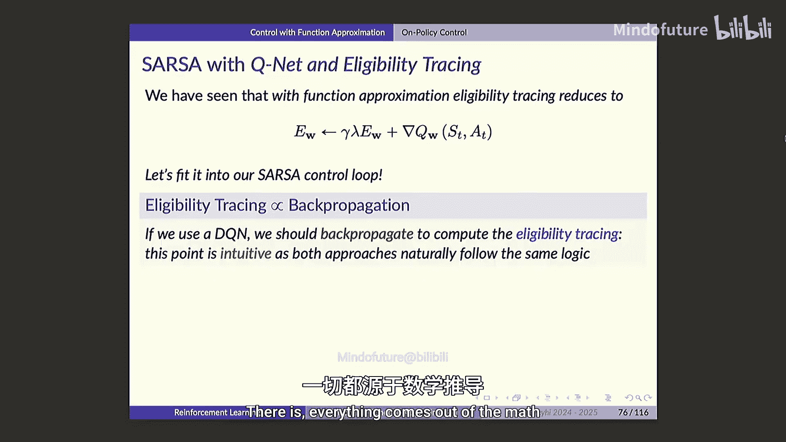

## 基础深度Q学习的问题与改进

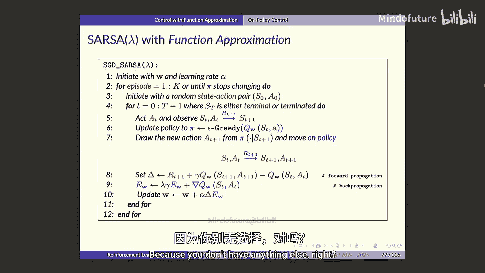

然而，上述基础版本的深度Q学习在实践中往往效果不佳，主要原因有三点：

1.  **样本相关性**：连续样本之间高度相关，这不利于神经网络的稳定训练。
2.  **样本效率低**：每个样本只使用一次就被丢弃。
3.  **目标非稳定性**：TD目标 `Y_t` 依赖于正在被更新的网络 `θ`，导致目标值不断移动，类似于追逐一个移动的目标，容易导致训练发散。

为了解决这些问题，深度Q学习引入了两个关键机制：

*   **经验回放**：将智能体与环境交互得到的转移样本 `(St, At, R_{t+1}, S_{t+1})` 存储在一个固定大小的回放缓冲区中。训练时，从缓冲区中随机采样一小批（minibatch）经验来进行梯度更新。这打破了样本间的相关性，提高了样本效率。
*   **目标网络**：使用一个独立的、结构相同的目标网络（参数为 `θ-`）来计算TD目标。目标网络的参数定期（例如每N步）从主Q网络复制过来，在间隔期内保持固定。这样，TD目标在一段时间内是稳定的。此时TD目标变为：
    `Y_t = R_{t+1} + γ * max_a Q(S_{t+1}, a; θ-)`

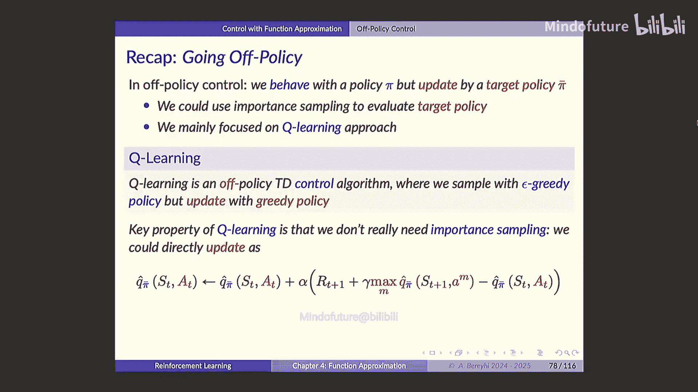

结合了经验回放和目标网络的深度Q学习算法，才是真正取得突破、使得深度神经网络成功应用于复杂强化学习任务（如玩Atari游戏）的版本。

## 总结

本节课中，我们一起学习了如何将函数逼近应用于强化学习的控制问题。

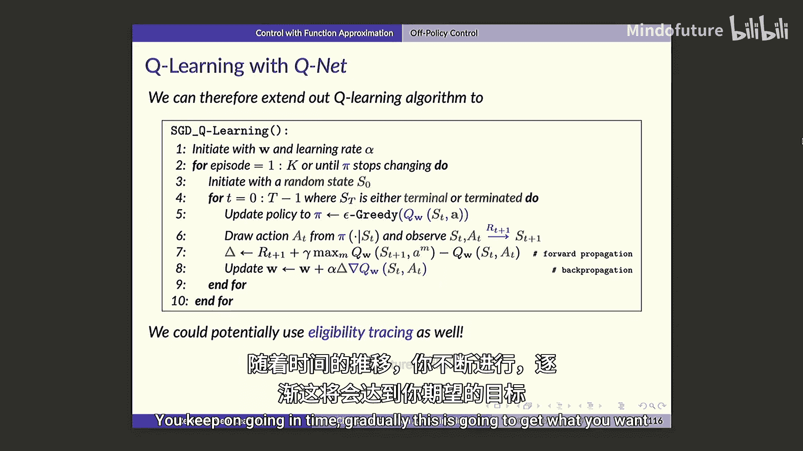

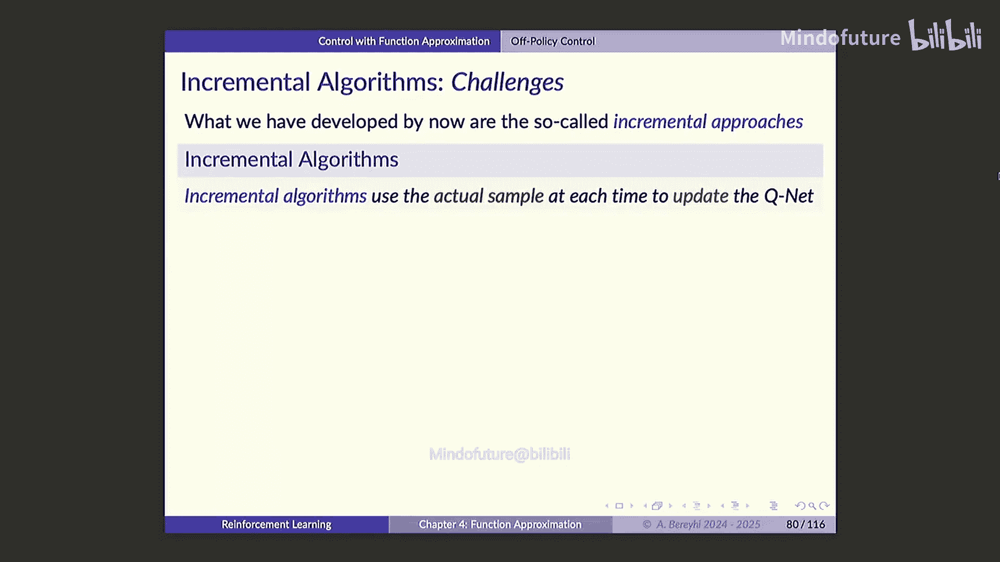

*   我们首先区分了预测问题和控制问题，并回顾了将策略改进融入价值估计的控制循环。
*   接着，我们介绍了深度Q网络（DQN），它用神经网络来近似状态-动作价值函数。
*   我们比较了在线策略（如深度Sarsa）和离线策略（如深度Q学习）方法，并解释了后者因样本效率更高而在深度强化学习中更受青睐。
*   我们详细推导了如何将表格形式的Sarsa和Q学习算法转化为使用神经网络的在线更新形式。
*   最后，我们指出了基础深度Q学习算法的缺陷，并介绍了使其成功的关键改进：**经验回放**和**目标网络**。

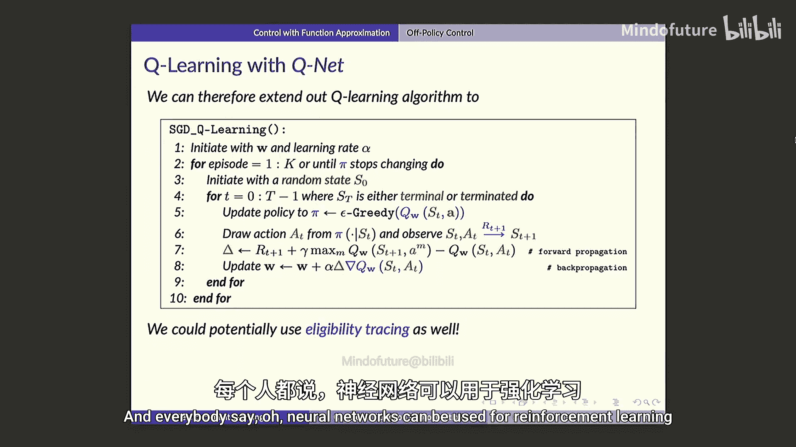

理解这些基础概念和算法演变，是掌握现代深度强化学习技术的重要一步。在接下来的课程中，我们将探讨处理连续动作空间的方法以及直接参数化策略的策略梯度方法。