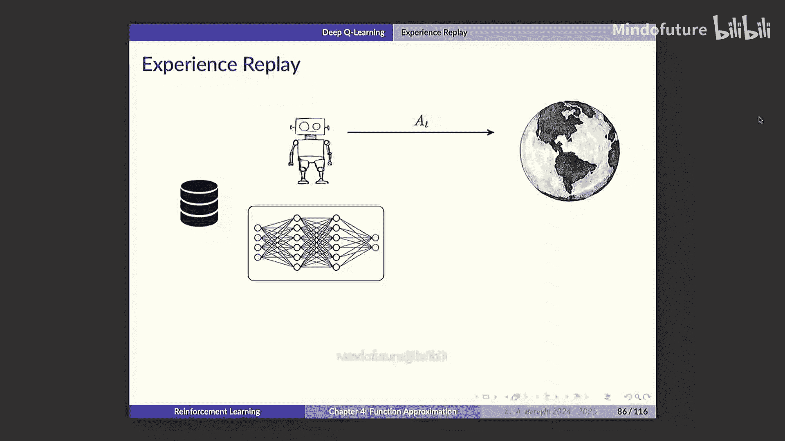
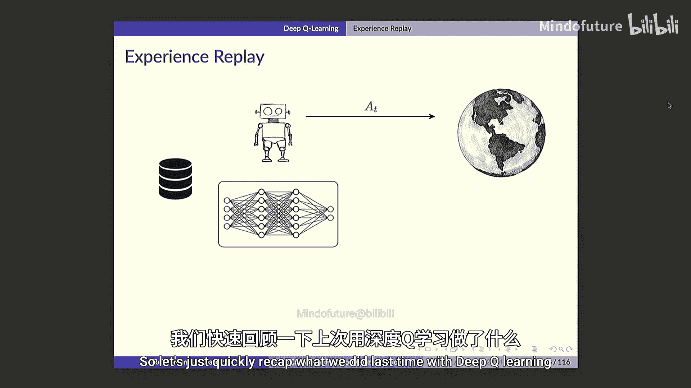
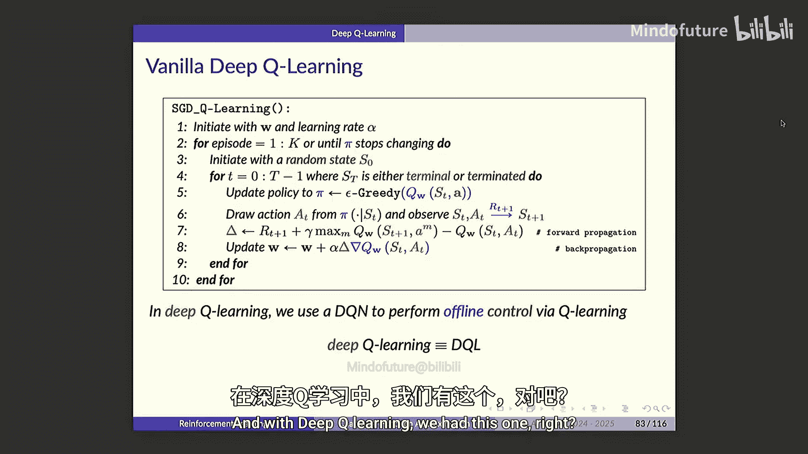
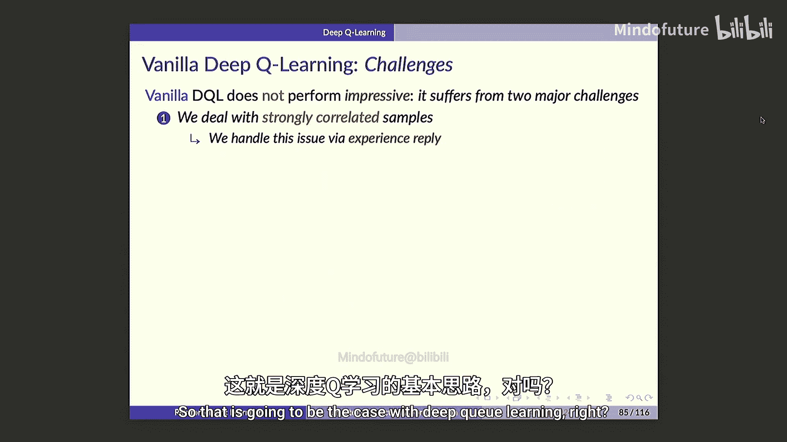
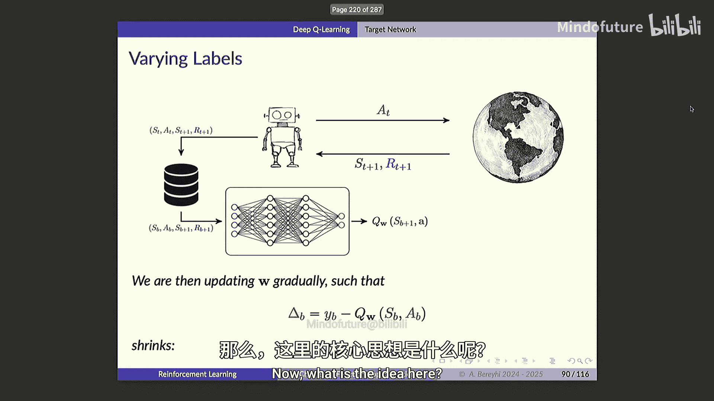
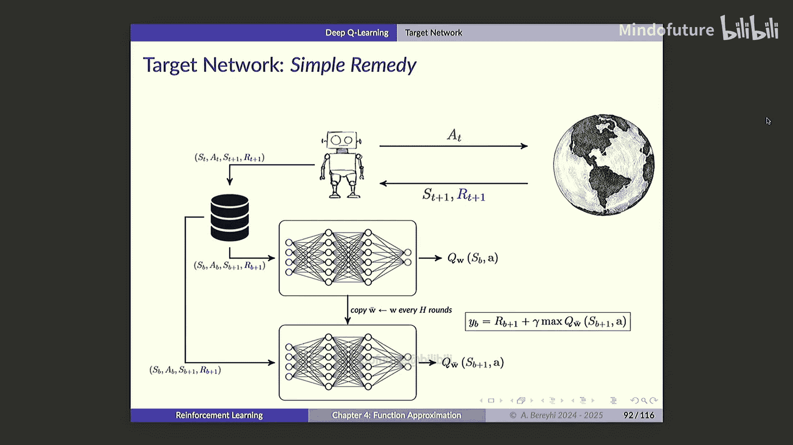
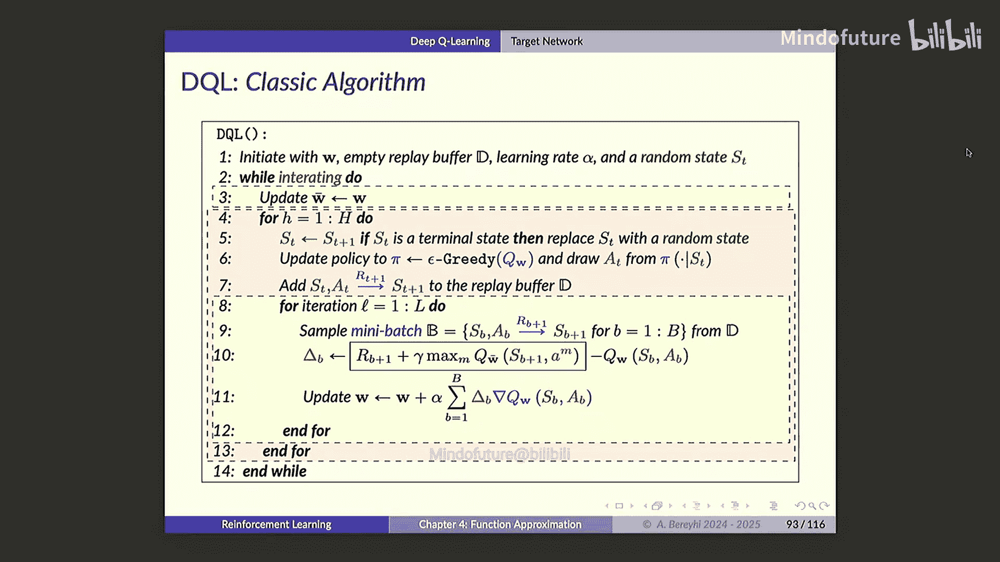
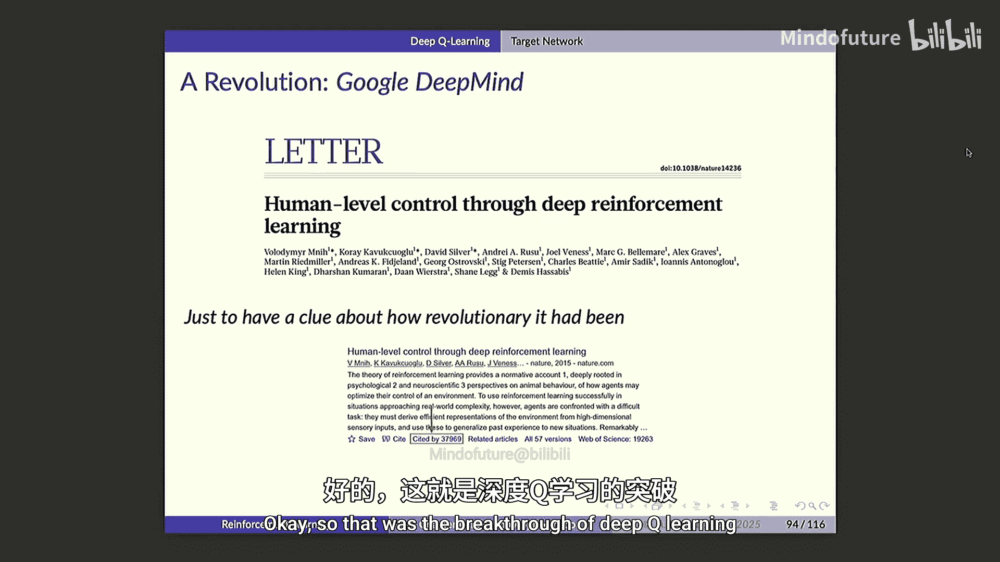
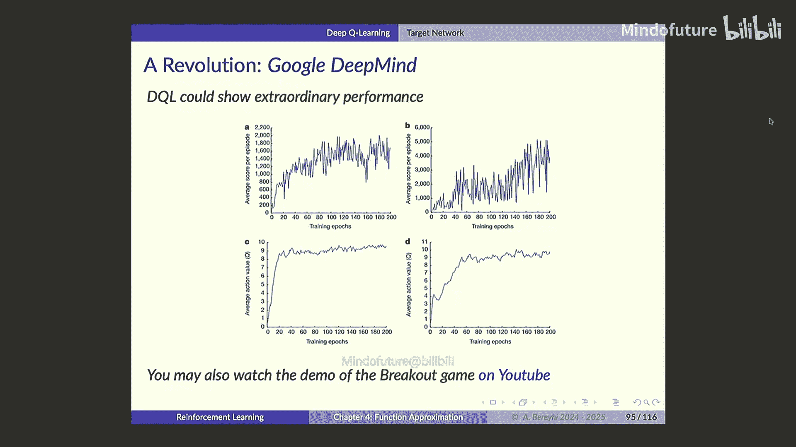
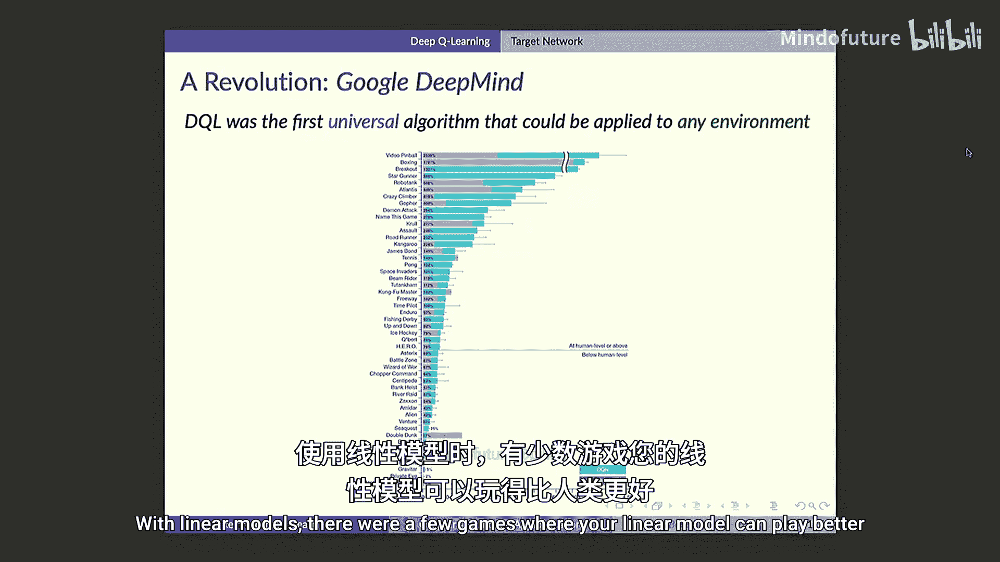

# 043：目标网络 🎯

在本节课中，我们将学习深度Q学习中的一个关键改进技术——目标网络。我们将回顾深度Q学习的基本原理，分析其面临的问题，并详细解释目标网络如何通过稳定训练过程来解决这些问题。

## 概述

上一节我们介绍了深度Q学习的基本框架和经验回放机制。本节中，我们将探讨深度Q学习训练不稳定的一个核心原因，并引入“目标网络”这一重要概念来稳定训练过程。

## 回顾深度Q学习

首先，我们快速回顾一下深度Q学习的基本原理。深度Q学习本质上是Q学习，但我们使用神经网络模型来生成训练所需的标签。标签是对特定状态下未来价值的估计。

在Q学习中，我们处于一个特定状态 `S_t`，目标是获得该状态下动作价值 `Q(S_t, A_t)` 的估计值，并将其用作训练模型的标签。具体做法是：我们观察从环境中获得的轨迹，在状态 `S_t` 执行动作 `A_t`，获得即时奖励 `R_{t+1}` 并转移到下一个状态 `S_{t+1}`。

我们如何估计状态 `S_t` 下的最优动作价值 `Q*` 呢？在Q学习中，我们使用以下公式作为样本估计：
`标签 = R_{t+1} + γ * max_a Q(S_{t+1}, a)`
这里的 `max` 是对下一个状态 `S_{t+1}` 下所有可能动作的Q值取最大值。理论上我们需要期望值，但在实践中，我们使用这个样本估计值作为目标。

在深度Q学习中，我们使用神经网络来近似Q函数。神经网络以状态 `S_t` 为输入，输出该状态下所有动作的Q值。我们希望神经网络的输出 `Q(S_t, A_t; w)` 能够接近我们计算出的目标标签。我们通过梯度下降法来训练网络，最小化预测值与目标标签之间的差异。

## 经验回放的益处

在基础版本之上，我们引入了经验回放机制。以下是经验回放的核心思想：
*   智能体与环境交互，收集样本 `(S_t, A_t, R_{t+1}, S_{t+1})` 并存入一个数据库（回放缓冲区）。
*   训练时，从缓冲区中随机采样小批量样本，而不是使用最近连续的样本。

经验回放带来了两个主要好处：
1.  **样本重用**：由于我们通常使用离策略学习，因此可以重复使用旧策略收集的样本，提高了数据效率。
2.  **降低相关性**：随机采样打破了连续状态之间的强相关性，使得训练数据更接近独立同分布，有助于训练的稳定性。

## 不稳定的标签问题

现在，我们来看深度Q学习面临的一个关键挑战：**不稳定的目标标签**。在标准的深度Q学习中，我们使用同一个网络（参数为 `w`）来同时计算当前Q值（用于预测）和下一个状态的Q值（用于构建目标）。

具体流程如下：
1.  将当前状态 `S_t` 输入网络，得到预测值 `Q(S_t, A_t; w)`。
2.  将下一个状态 `S_{t+1}` 输入**同一个网络**，计算 `max_a Q(S_{t+1}, a; w)`，并与奖励结合得到目标标签 `y = R + γ * max_a Q(S_{t+1}, a; w)`。
3.  通过梯度下降更新网络参数 `w`，使预测值接近目标标签。

这里的问题是：**目标标签 `y` 本身依赖于我们正在更新的网络参数 `w`**。每次我们更新 `w`，目标值也会随之移动。这就像是在追逐一个移动的目标：网络试图接近的目标在它每次更新时都在“跑开”。这会导致训练过程振荡、不稳定，甚至难以收敛。

## 引入目标网络 🎯

为了解决标签不稳定的问题，我们引入了**目标网络**。其核心思想是：使用一个独立的、更新缓慢的网络来生成目标标签，从而将目标“固定”住一段时间。

以下是目标网络的工作原理：
1.  **初始化两个网络**：我们创建两个结构完全相同的Q网络。
    *   **主网络（在线网络）**：参数为 `w`，负责与环境交互、选择动作，并且是**被训练和频繁更新**的网络。
    *   **目标网络**：参数为 `w̄`（w bar），负责**生成稳定的目标标签**。在训练初期，`w̄` 被初始化为与 `w` 相同的值。
2.  **冻结目标网络**：在训练过程中，目标网络的参数 `w̄` 在一段时间内（比如 `H` 步更新）保持**固定不变**。
3.  **使用目标网络计算标签**：现在，我们使用冻结的目标网络来计算目标标签：
    `标签 y = R_{t+1} + γ * max_a Q(S_{t+1}, a; w̄)`
    由于 `w̄` 是固定的，这个目标标签在 `H` 步内也是稳定的。
4.  **训练主网络**：我们使用这个稳定的标签 `y` 来训练主网络，通过梯度下降更新其参数 `w`，使 `Q(S_t, A_t; w)` 接近 `y`。
5.  **定期同步**：每经过 `H` 步训练（例如每10000步），我们将主网络的参数 `w` **复制**到目标网络，即令 `w̄ ← w`。然后，目标网络用新的参数继续为接下来的 `H` 步提供稳定的目标。

这个过程可以形象地理解为：目标网络设定了一个固定的“靶子”，主网络努力向它靠近。当主网络靠近后，我们再把靶子移到主网络当前的位置，然后主网络继续朝新的靶子努力。通过这种方式，训练过程变得更加平滑和稳定。

## 完整的深度Q学习算法（含目标网络）

结合经验回放和目标网络，我们得到了一个完整且鲁棒的深度Q学习算法。以下是算法的关键步骤概述：

1.  **初始化**：初始化主Q网络（参数 `w`）和目标Q网络（参数 `w̄ = w`）。初始化经验回放缓冲区 `D`。
2.  **交互与存储**：智能体使用主网络（通常配合ε-贪婪策略）与环境交互，将每一步的经验 `(S_t, A_t, R_{t+1}, S_{t+1})` 存入缓冲区 `D`。
3.  **采样与训练**：从缓冲区 `D` 中随机采样一个小批量的经验。
4.  **计算目标**：对于采样中的每个转移，使用**冻结的目标网络**计算目标值：
    `y_j = R_j + γ * max_a‘ Q(S’_j, a‘; w̄)`
    （对于终止状态，`y_j = R_j`）。
5.  **梯度更新**：计算主网络的损失（如均方误差）：`L(w) = Σ_j [(y_j - Q(S_j, A_j; w))^2]`，并对参数 `w` 执行一步梯度下降。
6.  **定期更新目标网络**：每经过 `H` 次迭代（或一定时间步），将主网络的参数复制到目标网络：`w̄ ← w`。
7.  **重复**：重复步骤2至6，直到网络收敛。

这个算法（深度Q网络，DQN）在2015年由DeepMind团队在《自然》杂志上发表，标志着深度强化学习第一个取得重大突破的实用算法。它成功地在多个雅达利（Atari）游戏上达到了超越人类水平的性能，证明了深度神经网络与强化学习结合的巨大潜力。

## 总结

本节课中我们一起学习了目标网络这一关键技术。我们首先回顾了深度Q学习因使用同一网络计算目标和预测而导致训练不稳定的问题。接着，我们详细介绍了目标网络的解决方案：通过创建一个参数更新缓慢的副本网络来提供稳定的目标标签，从而将“移动的目标”固定下来。最后，我们看到了将目标网络与经验回放结合的完整深度Q学习算法，该算法是深度强化学习发展史上的一个里程碑。理解目标网络的工作原理对于掌握后续更高级的深度强化学习算法至关重要。