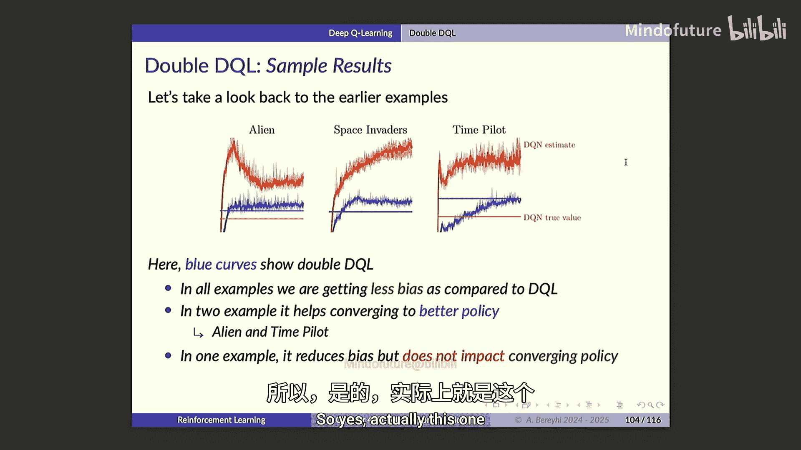
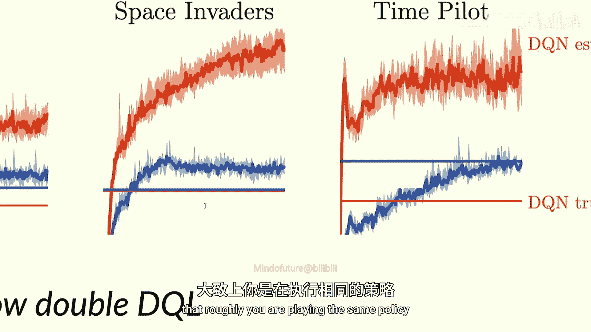
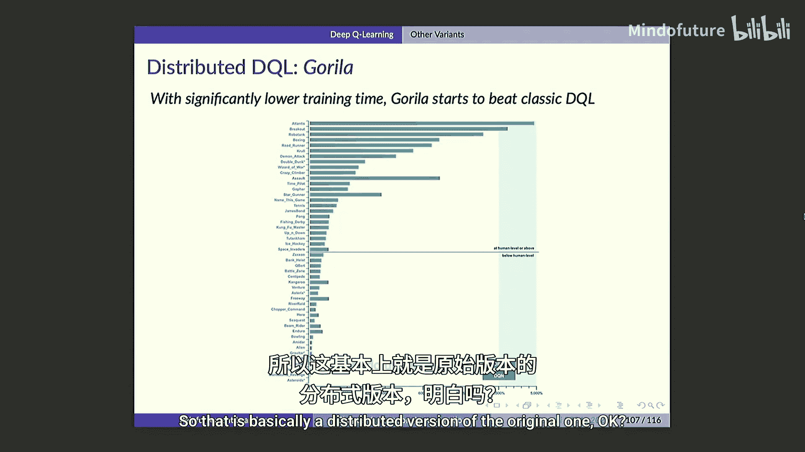

# 044：双重深度Q学习与Gorila架构 🧠

在本节课中，我们将学习深度Q学习（DQN）中一个重要的改进方法——双重深度Q学习（Double DQN），以解决Q值估计中的偏差问题。同时，我们也将简要了解一种用于大规模并行计算的强化学习架构——Gorila。

## 概述

上一节我们介绍了深度Q学习的基本原理。本节中，我们来看看一个在实践中发现的关键问题：Q值估计中的偏差。这种偏差源于训练过程中对Q值的最大化操作，可能导致学习到的策略并非最优。我们将探讨双重深度Q学习如何通过解耦动作选择和动作价值评估来缓解这一问题。最后，我们会介绍Gorila架构，它展示了如何通过分布式计算来加速强化学习训练。

## 双重深度Q学习（Double DQN）的原理

在标准的深度Q学习中，我们使用同一个神经网络来同时选择动作（即找出最大Q值对应的动作）和评估该动作的价值。这会导致一个统计上的问题：对最大值的估计本身是有偏的。

为了理解这个偏差，我们可以考虑一个简单的例子。假设我们有两台计算机A和B，运行同一个程序。计算机A的真实运行时间是8秒，计算机B是5秒。但我们无法直接获得这个真实时间，每次测量都会得到一个带有随机噪声的估计值 `X_hat = X_true + ε`。如果我们进行多次测量，并每次都取两台计算机中测量时间的最大值，那么这个“最大值”在统计上会系统地高估真实的“最大运行时间”。因为随着测量次数K增加，几乎必然会出现某个噪声ε为正的样本，从而拉高了最大值。

在DQN中，情况类似。我们使用当前Q网络来估计下一个状态 `s'` 下所有动作的Q值，并取最大值 `max_a' Q(s', a')` 作为目标价值的一部分。由于Q值是带噪声的估计，这个最大化操作同样会导致对最优动作价值的系统性高估。

## 双重深度Q学习的解决方案

双重深度Q学习的核心思想是使用两个独立的Q网络来分别处理动作选择和动作价值评估，从而打破偏差的根源。

以下是双重深度Q学习的关键步骤：

1.  **动作选择网络（在线网络）**：这个网络用于选择下一个状态 `s'` 下具有最大Q值的动作。其参数记为 `θ`。
    *   公式：`a* = argmax_a' Q(s', a'; θ)`

2.  **动作评估网络（目标网络）**：这个网络用于评估上一步所选动作 `a*` 的实际Q值。其参数记为 `θ'`，通常定期从在线网络同步，但在此处的作用是提供独立的评估。
    *   公式：`Q(s', a*; θ')`

3.  **目标价值计算**：在计算TD目标时，我们不再使用同一个网络的最大Q值，而是使用评估网络对所选动作的估值。
    *   标准DQN目标：`y = r + γ * max_a' Q(s', a'; θ')`
    *   Double DQN目标：`y = r + γ * Q(s', argmax_a' Q(s', a'; θ); θ')`

通过这种方式，选择“哪个动作最优”和“这个动作值多少”由两个相对独立的估计器完成，有效减少了因最大化操作引起的过高估计偏差。

## 偏差与策略最优性的关系

需要明确的一点是：**有偏的Q值估计并不一定导致学不到最优策略**。

如果偏差对所有状态-动作对的影响是均匀的（例如，所有Q值都被高估了相似的量），那么动作之间的相对顺序可能保持不变，智能体仍然会选择真正具有最高价值的动作。此时，偏差只会影响我们对最终回报的“预期”，而不会影响“决策”。

然而，如果偏差对不同动作的影响不均，就可能改变最优动作的排序，导致学习到次优策略。双重深度Q学习通过减少偏差，降低了后一种情况发生的风险，使学习过程更稳定可靠。

## Gorila：分布式强化学习架构

在讨论了算法层面的改进后，我们来看看系统层面的扩展。Gorila（Generalized Reinforcement Learning Architecture）是一种分布式架构，旨在将深度Q学习扩展到大规模并行计算环境。

以下是Gorila架构的主要组件和工作流程：

1.  **多个并行执行器（Actors）**：多个智能体实例同时在不同的环境副本中进行探索和经验收集。这能更快地覆盖广阔的状态空间。
2.  **经验存储器（Replay Memories）**：每个执行器拥有本地的经验回放缓冲区，用于存储其收集到的转移样本 `(s, a, r, s')`。
3.  **多个并行学习器（Learners）**：多个学习器进程从执行器的经验存储器（或一个共享存储器）中采样数据，并行地计算梯度并更新本地的Q网络参数。
4.  **中央参数服务器（Parameter Server）**：所有并行学习器定期将计算出的梯度（或更新后的参数）发送到一个中央服务器。服务器聚合这些更新，生成全局最新的Q网络参数。
5.  **参数同步**：中央服务器将更新后的参数同步回所有的执行器和学习器，确保它们使用最新的策略进行探索和学习。

这种分布式的设计带来了两大好处：
*   **更高的数据吞吐量**：并行探索极大地加速了经验收集。
*   **更强的计算能力**：并行梯度计算加快了模型训练速度。
这使得Gorila能够处理极其复杂和庞大的环境，例如完整的视频游戏或复杂的模拟环境。

## 总结

本节课中我们一起学习了深度Q学习的两个重要扩展。

首先，我们深入探讨了**双重深度Q学习（Double DQN）**。我们理解了标准DQN中因最大化操作导致的Q值高估偏差，并掌握了Double DQN通过解耦动作选择与价值评估来消除这一偏差的核心机制。这使学习过程更加稳定和准确。

其次，我们简要了解了**Gorila分布式架构**。它展示了如何通过并行执行器收集经验、并行学习器更新模型以及中央参数服务器同步更新，来将强化学习算法扩展到大规模计算集群，从而应对更复杂的问题。

这些内容表明，强化学习的发展不仅依赖于算法创新，也离不开计算工程上的优化。理解这些概念有助于我们在实际项目中根据需求选择合适的算法和架构。