# 045：为什么需要策略网络 🧠

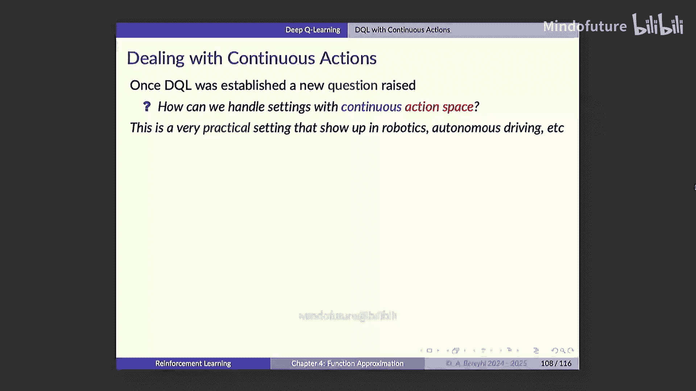

在本节课中，我们将探讨为什么在强化学习中，尤其是在处理连续动作空间时，我们需要引入策略网络。我们将回顾基于价值的方法的局限性，并解释策略网络如何成为解决这些挑战的关键。

## 概述

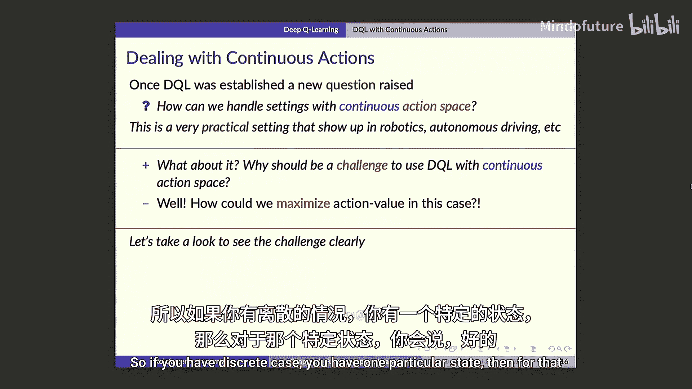

之前我们主要学习了基于价值的深度强化学习方法，例如深度Q学习。这些方法的核心思想是价值迭代，即通过一个价值网络（如Q网络）来评估状态或状态-动作对的价值，并据此选择动作。然而，当动作空间是连续的，这种方法就会遇到巨大的挑战。

## 基于价值方法的局限性

上一节我们介绍了基于价值的深度强化学习。本节中我们来看看它在连续动作空间下面临的根本问题。

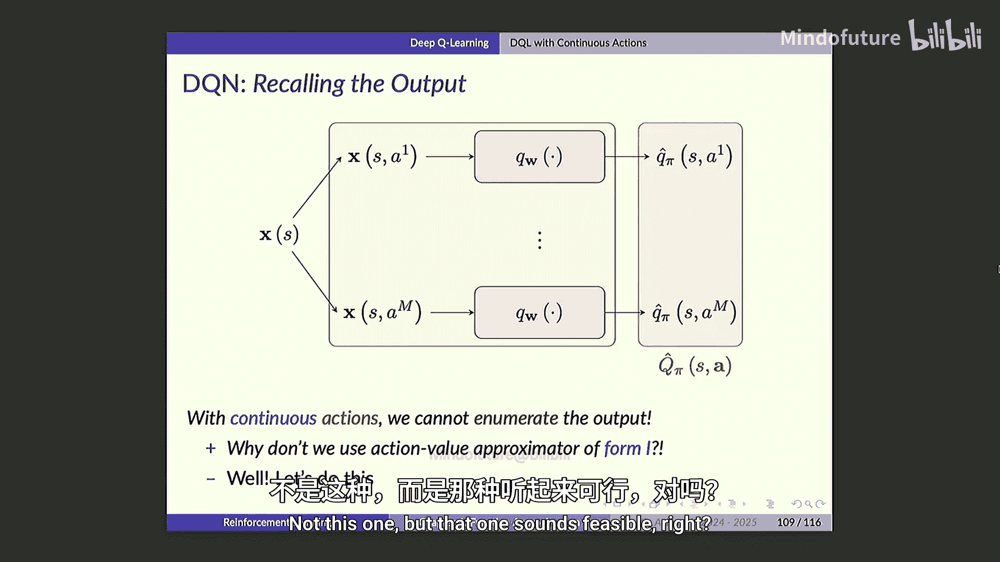

在Q学习中，我们需要找到能最大化Q值的动作。在离散动作空间中，这很简单：我们只需枚举所有可能的动作，通过神经网络计算每个动作的Q值，然后选择最大值即可。其过程可以表示为：

**公式：** `a* = argmax_a Q(s, a)`

但当动作空间连续时，问题就变得复杂了。我们无法枚举无限多的动作。一种想法是将连续空间离散化为网格，但如果动作维度很高（例如，一个具有10个连续关节的机械臂），即使每个维度只离散化为100个点，总的网格点数量也将是 `100^10`，这会导致神经网络的输出层无比庞大，在计算上是不可行的。

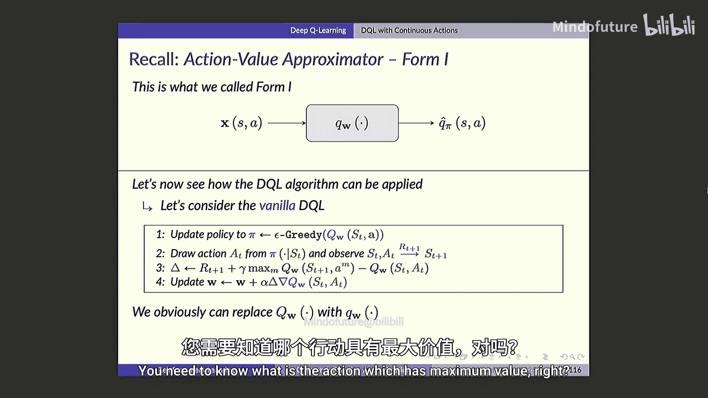

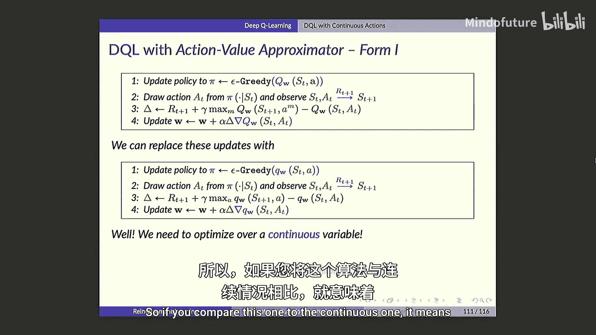

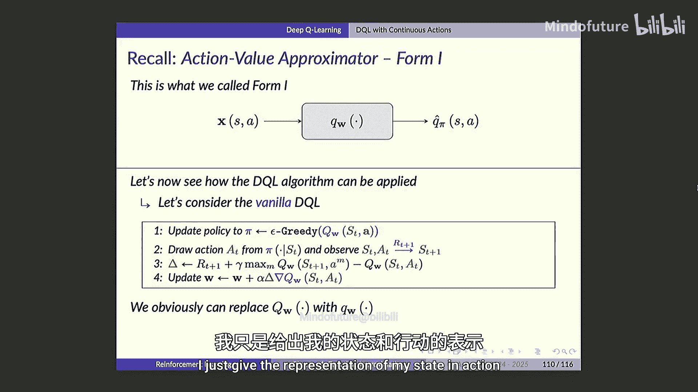

你可能会问：为什么不设计一个神经网络，它以状态 `s` 和动作 `a` 共同作为输入，并输出一个标量值 `Q(s, a)` 呢？这听起来是可行的。

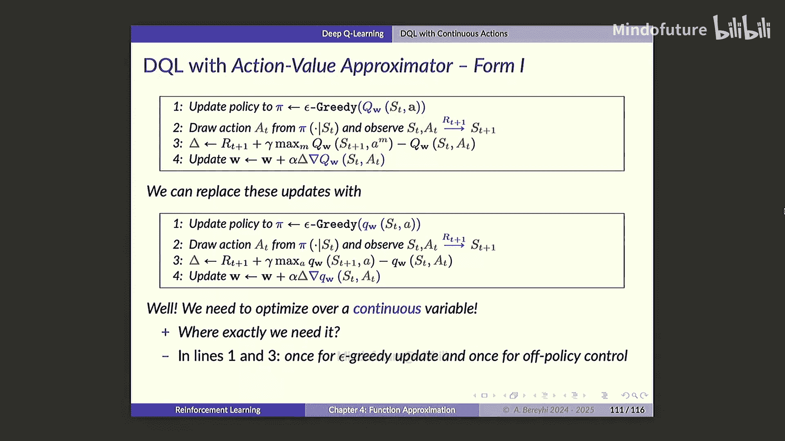

**代码表示（概念）：**
```python
# 一个接受状态和动作作为输入，输出Q值的网络
q_value = Q_network(state, action)
```

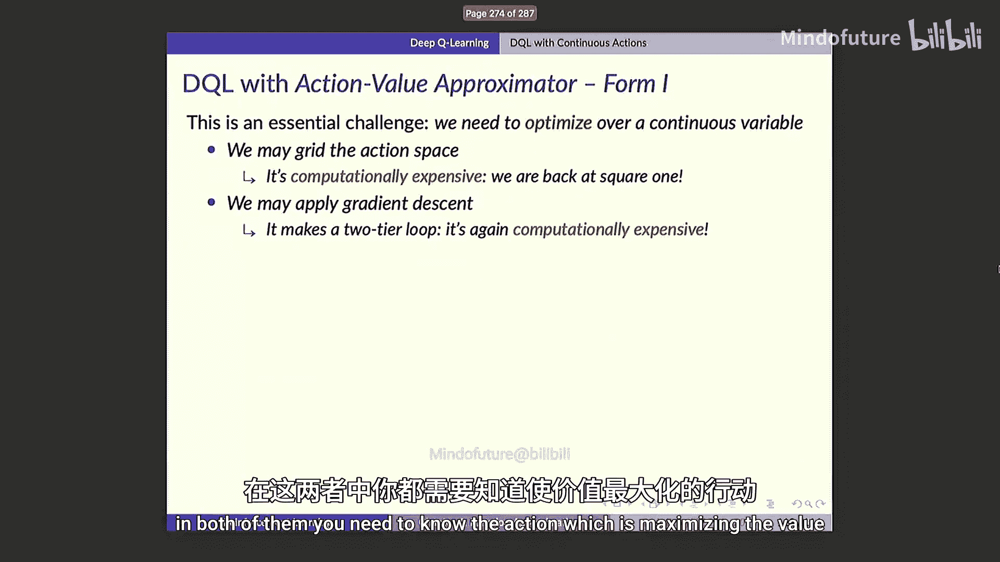

然而，问题在于Q学习算法本身需要执行最大化操作。具体来说，在以下两个关键步骤中都需要找到最大化Q值的动作：
1.  **生成训练标签时**：计算目标Q值 `y = r + γ * max_a‘ Q(s‘, a‘)`。
2.  **执行策略时**：在ε-贪婪策略中，需要知道 `argmax_a Q(s, a)` 来选取最优动作。

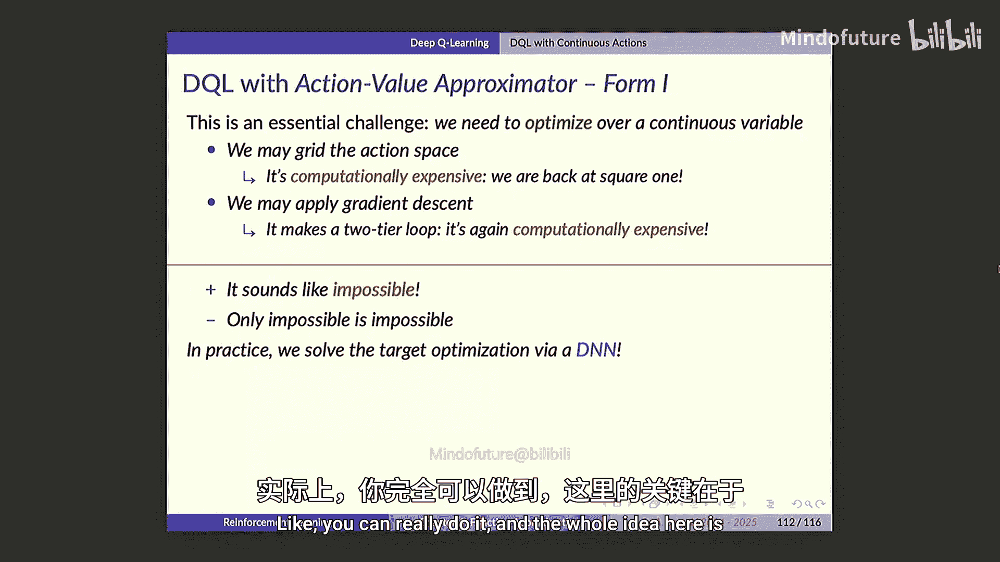

在连续动作空间中，这两个步骤都要求我们解决一个复杂的优化问题：`max_a Q(s, a)`。这本质上等同于最初我们试图避免的、在连续空间中进行穷举搜索的难题。因此，传统的基于价值的方法在处理连续动作时遇到了瓶颈。

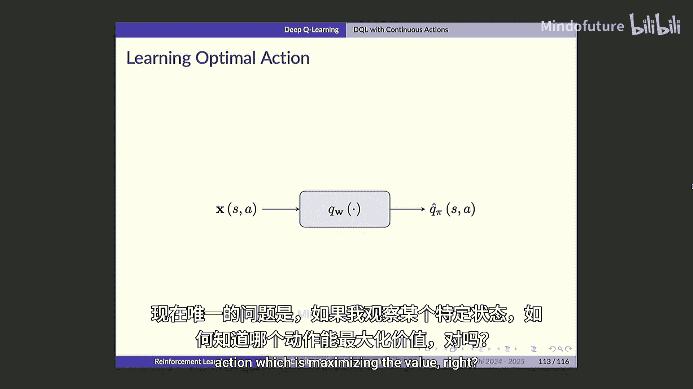

## 引入策略网络：一种解决方案

既然基于价值的方法在连续动作空间上行不通，我们该怎么办？答案就是引入策略网络。

核心思路是改变我们解决问题的角度。我们不再试图直接求解 `argmax_a Q(s, a)`，而是引入一个专门的网络来直接输出动作。这个网络就是**策略网络**。

想象一下，如果我们有两个网络协同工作：
1.  **价值网络（Critic）**：输入状态 `s` 和动作 `a`，输出价值 `Q(s, a)`。
2.  **策略网络（Actor）**：**只输入状态 `s`**，直接输出被预测为能最大化价值的动作 `a*`。

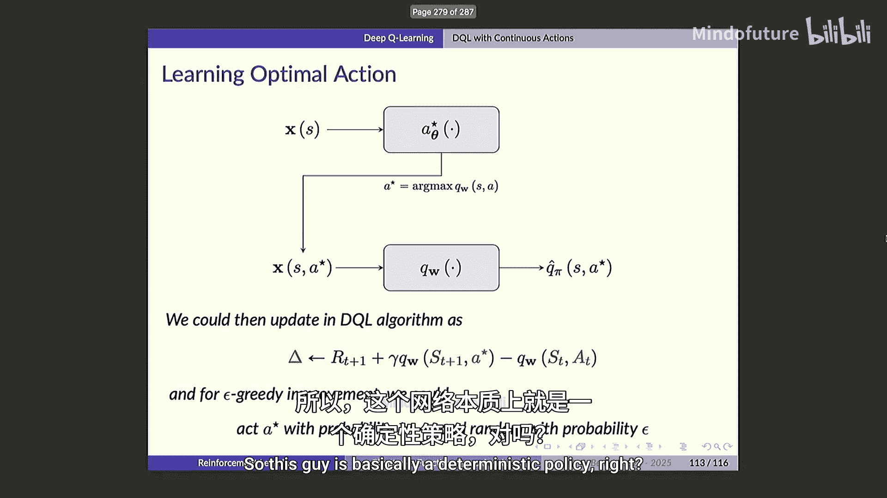

那么，当我们需要 `max_a Q(s, a)` 时，我们只需将当前状态 `s` 输入策略网络，得到动作 `a*`，再将 `(s, a*)` 输入价值网络，得到近似的最大Q值。这样，我们就绕过了在连续空间中直接进行优化的难题。

策略网络本质上定义了一个**策略**：`π(a|s)` 或 `π(s)`。它可以是：
*   **确定性策略**：直接输出一个具体的动作 `a = π(s)`。
*   **随机性策略**：输出一个动作的概率分布（例如高斯分布），然后我们可以从中采样得到动作 `a ~ π(·|s)`。

这种将策略网络（Actor）和价值网络（Critic）结合起来的框架，被称为 **Actor-Critic（演员-评论家）方法**。这是深度强化学习中最通用、最强大的形式之一，尤其适合解决复杂的实际问题，如机器人控制。

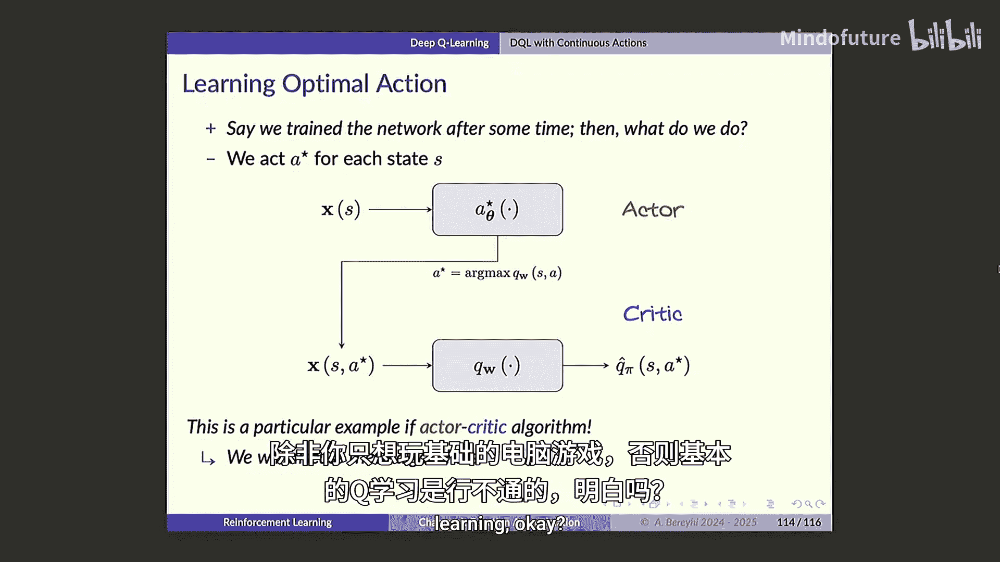

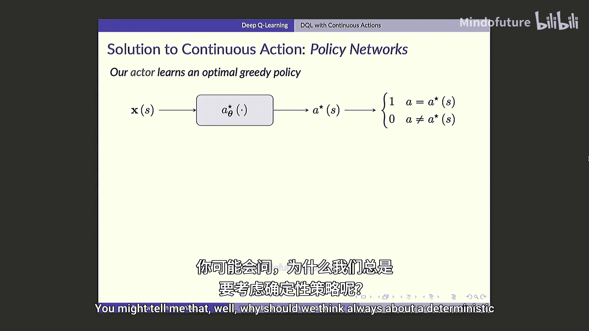

## 后续学习路径

为了最终实现完整的Actor-Critic框架，我们需要分步学习：

以下是后续的核心学习步骤：
1.  **策略梯度**：首先，我们需要学习如何训练一个策略网络。这被称为策略梯度方法。我们将假设在训练时，可以通过某种方式（例如蒙特卡洛估计）获得动作的价值，并以此为指导来更新策略网络。
2.  **Actor-Critic**：然后，我们将用另一个可学习的价值网络（Critic）来替代之前假设的“价值获取方式”。让Actor（策略网络）和Critic（价值网络）在交互中共同学习、共同优化，从而形成一个完整且自洽的强化学习系统。

策略梯度部分是理解上的一个难点，但请不要担心。我们已经打下了坚实的基础，接下来我会尽力将其分解，用简单明了的方式讲解。

## 总结

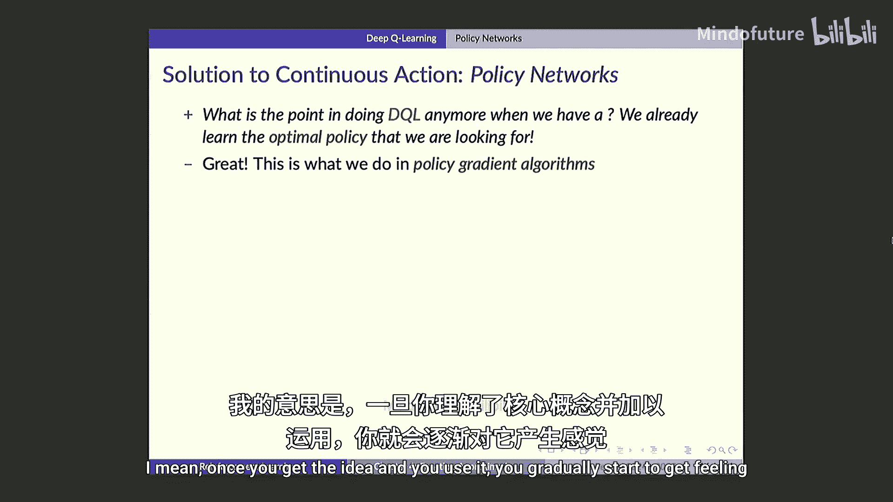

本节课中我们一起学习了：
1.  基于价值的深度强化学习（如DQN）在处理**连续动作空间**时面临根本性挑战，因为其核心的 `max_a Q(s, a)` 操作在连续空间中难以高效求解。
2.  为了解决这个问题，我们引入了**策略网络**。它直接学习一个从状态到动作的映射，从而避免了在连续动作空间中进行显式的最大化搜索。
3.  策略网络与价值网络结合的 **Actor-Critic 框架**，为处理连续动作空间问题提供了强大且通用的解决方案，这也是后续课程的核心。

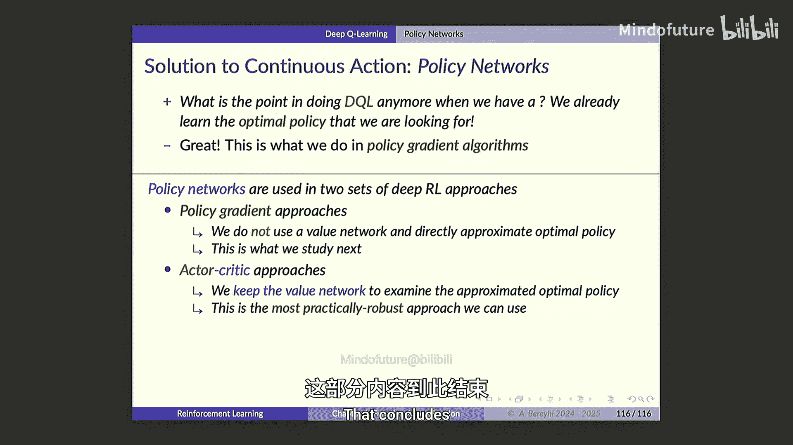

接下来，我们将深入探讨**策略梯度方法**，这是训练策略网络的关键。