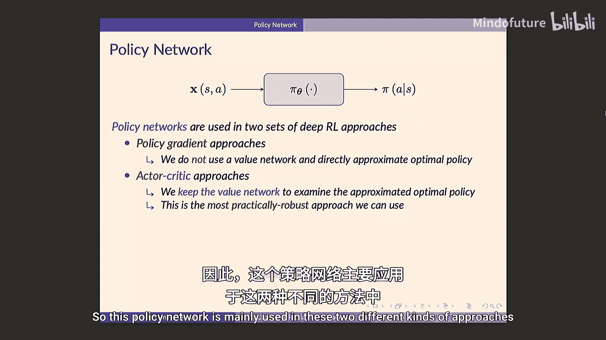
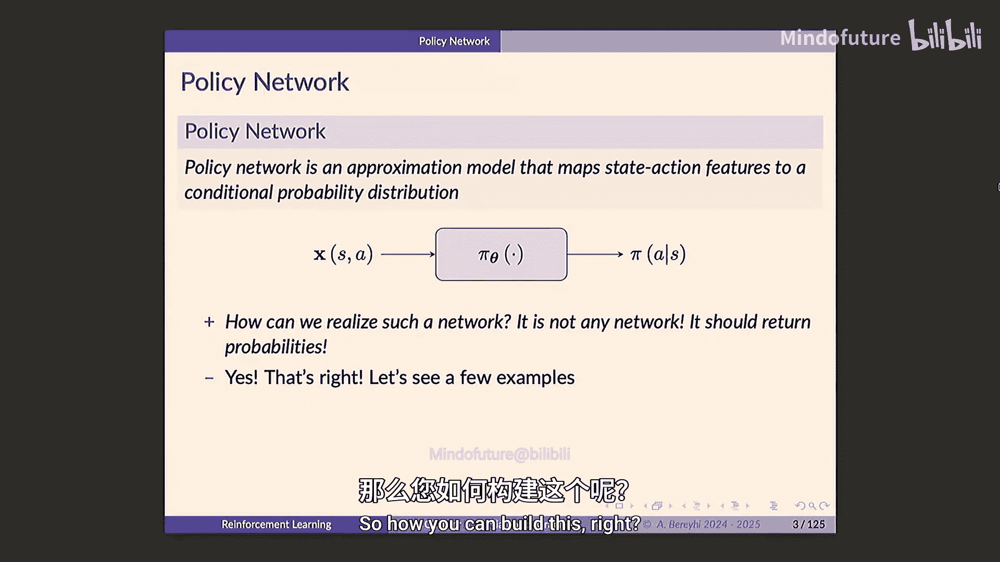
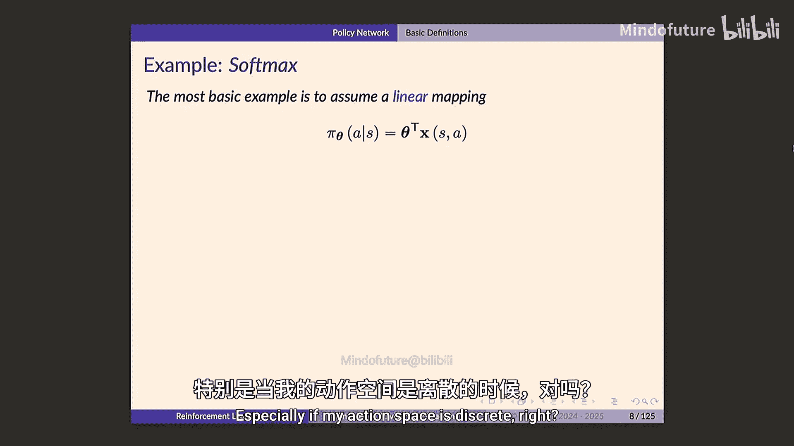
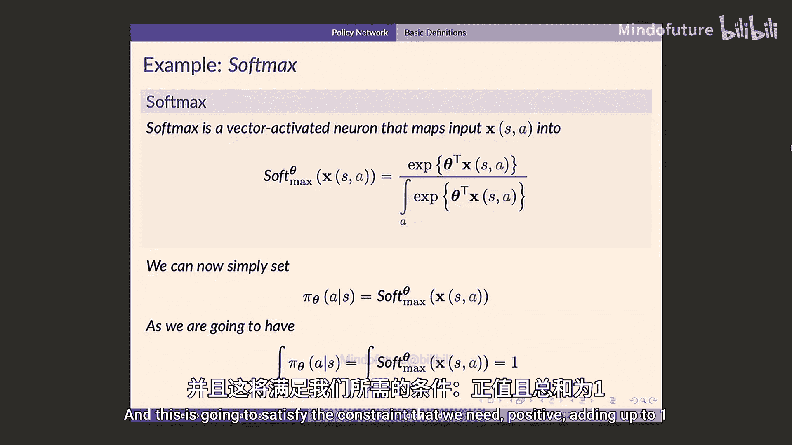
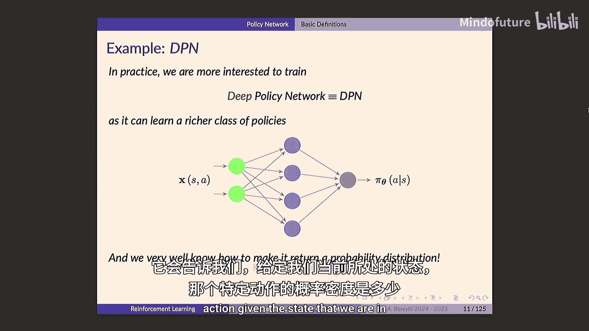

# 047：策略网络及其学习目标 🎯

在本节课中，我们将学习策略网络的基本概念，以及如何训练它。我们将重点介绍策略梯度理论，该理论让我们能够直接处理策略网络。课程最后，我们会总结策略网络的核心思想及其训练目标。

---

## 策略网络简介

上一节我们回顾了价值网络，本节中我们来看看策略网络。策略网络是一种神经网络，它接收状态和动作的表示，并输出一个概率分布。

策略网络的形式化定义如下：
*   **输入**：状态-动作对的表示向量 `X`。
*   **输出**：给定当前状态下，每个可能动作的概率（或概率密度）。

其核心作用是：给定一个状态 `s`，策略网络 `π_θ(a|s)` 会告诉我们选择每个动作 `a` 的可能性有多大。

---

## 策略网络的构建要求

并非任何神经网络都可以作为策略网络。策略网络的输出必须满足两个关键属性：
1.  **非负性**：所有输出值必须为正，因为概率不能为负。
2.  **归一性**：所有可能动作的输出值之和必须为1，因为它是一个概率分布。

以下是构建策略网络的两种常见方法：

### 1. 离散动作空间：Softmax 层
当动作空间是离散的（例如，上、下、左、右），我们通常在神经网络的最后一层使用 Softmax 激活函数。

**公式**：
`π_θ(a|s) = exp(f_θ(s, a)) / Σ_{a'} exp(f_θ(s, a'))`
其中 `f_θ(s, a)` 是网络对于状态-动作对 `(s, a)` 的输出（例如线性变换后的值）。

### 2. 连续动作空间：参数化分布
当动作空间是连续的（例如，机器人的关节角度），策略网络可以输出一个参数化分布（如高斯分布）的参数。

**示例（高斯分布）**：
`π_θ(a|s) = N(a | μ_θ(s), σ²)`
其中，均值 `μ_θ(s)` 由神经网络根据状态 `s` 计算得出，方差 `σ²` 可以是一个可学习的参数或固定值。

---

## 策略网络的学习目标

我们已经了解了策略网络是什么，本节中我们来看看如何训练它。我们的目标是找到最优的策略网络参数 `θ`，使智能体的长期回报最大化。

最优策略的特性是：在每一个状态 `s` 下，其价值函数 `V^π(s)` 是所有可能策略中最大的。因此，我们希望调整参数 `θ`，使得策略 `π_θ` 的价值尽可能高。

然而，我们面对的是一个多目标优化问题：我们希望在所有状态 `s` 上都实现价值最大化，但参数 `θ` 是所有状态共享的。优化一个状态的价值可能会损害另一个状态的价值。

解决方案是：**最大化期望价值**。我们不是单独最大化每个状态的价值，而是最大化所有状态价值的加权平均。权重是访问到每个状态的概率 `p(s)`。

**学习目标（目标函数）**：
`J(θ) = Σ_s p(s) * V^{π_θ}(s) = E_{s ~ p(·)} [ V^{π_θ}(s) ]`
我们的目标是找到参数 `θ`，以最大化这个期望价值 `J(θ)`。

---

## 目标函数的轨迹形式

为了深入理解如何优化 `J(θ)`，我们需要将其用轨迹（Trajectory）的形式重新表述。一条轨迹 `τ` 记录了从起始状态 `s0` 开始，遵循策略 `π_θ` 与环境交互，直到终止的完整序列：`τ = (s0, a0, r1, s1, a1, r2, ...)`。

给定起始状态 `s0`，遵循策略 `π_θ` 的轨迹 `τ` 的概率为：
`p(τ | s0; θ) = p0(s0) * Π_{t=0}^{T-1} π_θ(a_t | s_t) * p(s_{t+1}, r_{t+1} | s_t, a_t)`
其中 `p0(s0)` 是初始状态分布，`p(s_{t+1}, r_{t+1} | s_t, a_t)` 是环境动态模型。

在该轨迹上获得的回报（Return）是累计奖励之和：`G(τ) = Σ_{t=0}^{T-1} r_{t+1}`。

那么，从状态 `s0` 开始的价值函数就是轨迹回报的期望：
`V^{π_θ}(s0) = E_{τ ~ p(·|s0; θ)} [ G(τ) ]`

最终，我们的目标函数 `J(θ)` 可以写成对所有可能轨迹的期望：
`J(θ) = E_{τ ~ p(·; θ)} [ G(τ) ]`
这里，轨迹分布 `p(τ; θ)` 综合了初始状态分布和策略的影响。

**关键点**：策略参数 `θ` 只出现在轨迹的概率分布 `p(τ; θ)` 中，而不直接出现在回报 `G(τ)` 里。我们的任务是通过改变 `θ` 来改变轨迹分布，从而最大化期望回报。

---

## 总结

本节课中我们一起学习了策略网络及其学习目标：
1.  **策略网络**：是一个输出动作概率分布的神经网络，必须满足非负和归一化条件。对于离散和连续动作空间，分别常用 Softmax 和参数化分布（如高斯）来实现。
2.  **学习目标**：训练策略网络的目标是最大化期望价值 `J(θ)`，即智能体在遵循策略 `π_θ` 时，从所有可能起始状态获得的平均长期回报。
3.  **轨迹视角**：该目标可以等价地表述为最大化智能体在遵循策略 `π_θ` 时所产生的所有可能轨迹的期望回报。策略参数 `θ` 通过影响轨迹的分布来间接影响这个期望值。

理解这个以轨迹分布为核心的目标函数，是接下来学习**策略梯度理论**以优化 `J(θ)` 的基础。在下一讲中，我们将探讨如何计算目标函数关于参数 `θ` 的梯度，并利用它来更新策略网络。